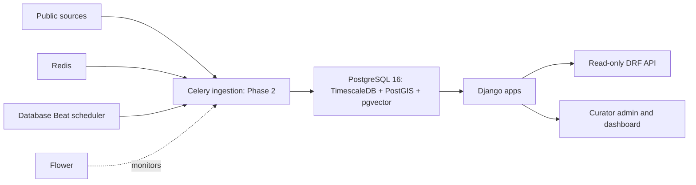

# Architecture

The arrows into ingestion describe a future boundary. Phase 1 creates the storage
and task infrastructure, with a zero-row ping task, and downloads no observations.
No connectors, forecasting, policy analytics, document parsing, embedding generation,
retrieval, assistant, or plume simulator are implemented.

| App | Phase 1 responsibility |
| --- | --- |
| core | Abstract timestamps, health checks, restricted admin site, capped paginator, ping and infrastructure commands; extension migration |
| warehouse | Reference geography, pollutants, station metadata, three Timescale hypertables, GeoJSON catalogue and real reference seed |
| ingest | Source registry and auditable ingestion runs; task module reserved for Phase 2 |
| rag | PDF and chunk metadata, nullable 1024-dimensional vectors, HNSW cosine and GIN full-text indexes |
| analytics | Empty app shell for later policy-impact analysis |
| forecast | Empty app shell for later PM2.5 forecasting |
| vayusim | Empty app shell for later dispersion simulation |
| dashboard | Base template and home placeholder |

`web` runs Django's development server with source autoreload. `worker` consumes
Celery's default queue. `beat` uses django-celery-beat's DatabaseScheduler. Task
results persist through django-celery-results in PostgreSQL. Redis stores broker
messages; Flower monitors task events and requires HTTP Basic authentication.
The database image includes the three extension libraries in one PostgreSQL server.
Init SQL and dependency-ordered Django migrations explicitly load them; the health
endpoint reports actual `pg_extension` versions and pings Redis and workers.
See the upstream [HA image source](https://github.com/timescale/timescaledb-docker-ha).

The health response returns 200 only when every dependency check passes and 503
otherwise. Errors stay in server logs; credentials and stack traces are not returned
to clients. This is a readiness probe, with per-network timeouts, rather than a
cheap liveness endpoint. API endpoints permit public reads and reject writes.
Reference APIs paginate at 100 items; GeoJSON page-size requests are capped at 100.

The PostgreSQL, Redis and media named volumes survive normal `make down`. Docker
installs the native GIS libraries so Windows hosts need no host GDAL installation.
Workers wait for migrations, avoiding Beat querying tables before schema creation.
Migration/seed commands remain explicit and are not run concurrently by services.
Use only one Beat scheduler; ingestion schedules will require an explicit design
in Phase 2.

Database migrations and integration tests are tied to PostgreSQL 16 with the real
extensions. This deliberately prevents a SQLite fallback from concealing spatial,
hypertable, or vector incompatibilities. CI creates the complete stack and executes
the live worker verification as well as the full suite. Local validation status is
recorded separately in [VALIDATION.md](VALIDATION.md).

## Phase 2 ingestion

Management commands share a source lifecycle and immutable raw cache. Each input
is registered with source, run, URL, byte count and SHA256. HTTP retries transient
errors/rate limits; the documented anonymous FTP alternative resumes the large
WorldPop input after validating cached bytes. Source failures remain visible as
failed/partial runs, and absent optional keys create finished skipped runs.

Scalar readings use COPY into a session-local staging table followed by batched
`INSERT ... ON CONFLICT DO NOTHING RETURNING`. Weather/fire use native GIS-aware
batched inserts. Actual returned keys count insertions; observation values and
first provenance are retained on conflict. Weather/fire provenance is inserted
transactionally in a separate ledger because the foundation uses composite keys.
See [data model decisions](DATA_MODEL.md) and [source details](DATA_SOURCES.md).

`ingest_all` creates database-backed, admin-editable schedules: OpenAQ hourly,
FIRMS six hourly and Open-Meteo daily. Existing curator settings are preserved.
Only one Beat process runs. Public backfills remain explicit commands rather than
startup hooks. Observation APIs are read-only, use cursor pagination and enforce
a maximum time range. Completeness is an ingestion coverage check. Analytics,
ML, RAG, exposure calculations and simulator logic were deferred at the Phase 2 handoff.

## Phase 3A analysis

`apps/analytics/` owns the audit, versioned analysis tables, pandas export,
descriptive calculations and RF meteorological normalisation. Warehouse observation
values, raw values and provenance stay immutable; `ReadingFlagChange` records each
in-place quality correction. Cached source quarters distinguish changing input
from coincidentally equal hourly means. Unverified positions have explicit city
and spatial exclusion metadata, with curator evidence required to override it.

We chose materialised Django tables instead of Timescale continuous aggregates:
each analysis is a versioned snapshot with its own quality rules, station exclusions
and data window. `build_analysis_tables` creates one snapshot; `run_phase3a`
performs audit → population registration → tables → descriptions → models → report.
An `AnalysisRun` retains parameters, code hash, Git commit, installed versions,
timestamps and success/failure. Only a successful full run becomes the API default.

City means weight stations equally after averaging within a station/IST-hour bin.
Weather attaches at the local-hour midpoint's UTC timestamp. Calendar rows count
missing coverage without generating observations. Daily/monthly thresholds apply
to raw and normalised series; models additionally require complete weather and
eligible city-years. The RF validation split is chronological 80/20 with a seven-day
purge. The final historical normalisation refits on eligible complete-case hours.
Joint observed weather/seasonal draws hold the trend term fixed. An exact tree
partition optimisation reuses predictions for observed trend values with identical
tree branches; it is checked against direct donor predictions in the smoke suite.

`analytics.run_phase3a` is a real Celery task with a four-hour soft limit. `--enqueue`
submits and awaits it; synchronous CLI operation shares the same pipeline. Run one
job at a time. CSVs, joblib models, SVG/PNG figures and a SHA256 manifest live under
`data/results/<run_id>/`; bodies are ignored by Git, manifests retained. There is
no model target or plot axis spanning the 2020–2023 concentration gap. Read-only
DRF coverage, city summary and raw/deweathered series endpoints expose these runs.

Phase 3A2 retains the legacy pipeline and adds `diagnostic_data`/`diagnostic_pipeline`
for verified source-clock conversion, native IST bins, geography, station panels
and source sanity checks. `model_diagnostics` implements random splits, embargoed
week folds, transfer diagnostics, bias/support gates and reproducible common-weather
normalisation. `revised_deweather` evaluates the frozen eight-variant grid and
stores new models/series in a full `phase3a2` run. `hourly_validation` reports the
hourly counterpart when selection favours a daily target; it does not alter fits
or readiness. `diagnostic_report` exports the measured figures/tables separately.
The result manifest distinguishes compute, supplement and export revisions.
Only successful full `phase3a`/`phase3a2` runs become the read-only API default;
diagnostic data and failed provisional results remain available for the audit.
