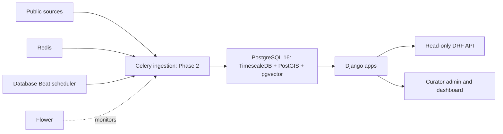

# Architecture

The arrows into ingestion describe a future boundary. Phase 1 creates the storage
and task infrastructure, with a zero-row ping task, and downloads no observations.
Those capabilities were deferred in Phase1; the later sections describe delivered phases.

| App | Phase 1 responsibility |
| --- | --- |
| core | Abstract timestamps, health checks, restricted admin site, capped paginator, ping and infrastructure commands; extension migration |
| warehouse | Reference geography, pollutants, station metadata, three Timescale hypertables, GeoJSON catalogue and real reference seed |
| ingest | Source registry and auditable ingestion runs; task module reserved for Phase 2 |
| rag | PDF and chunk metadata, nullable 1024-dimensional vectors, HNSW cosine and GIN full-text indexes |
| analytics | Empty app shell for later policy-impact analysis |
| forecast | Empty app shell for later PM2.5 forecasting |
| vayusim | Empty app shell for later dispersion simulation |
| dashboard | Base template and home placeholder |

`web` runs Django's development server with source autoreload. `worker` consumes
Celery's default queue. `beat` uses django-celery-beat's DatabaseScheduler. Task
results persist through django-celery-results in PostgreSQL. Redis stores broker
messages; Flower monitors task events and requires HTTP Basic authentication.
The database image includes the three extension libraries in one PostgreSQL server.
Init SQL and dependency-ordered Django migrations explicitly load them; the health
endpoint reports actual `pg_extension` versions and pings Redis and workers.
See the upstream [HA image source](https://github.com/timescale/timescaledb-docker-ha).

The health response returns 200 only when every dependency check passes and 503
otherwise. Errors stay in server logs; credentials and stack traces are not returned
to clients. This is a readiness probe, with per-network timeouts, rather than a
cheap liveness endpoint. Warehouse APIs permit public reads and reject writes.
Reference APIs paginate at 100 items; GeoJSON page-size requests are capped at 100.

The PostgreSQL, Redis and media named volumes survive normal `make down`. Docker
installs the native GIS libraries so Windows hosts need no host GDAL installation.
Workers wait for migrations, avoiding Beat querying tables before schema creation.
Migration/seed commands remain explicit and are not run concurrently by services.
Use only one Beat scheduler; ingestion schedules will require an explicit design
in Phase 2.

Database migrations and integration tests are tied to PostgreSQL 16 with the real
extensions. This deliberately prevents a SQLite fallback from concealing spatial,
hypertable, or vector incompatibilities. CI creates the complete stack and executes
the live worker verification as well as the full suite. Local validation status is
recorded separately in [VALIDATION.md](VALIDATION.md).

## Phase 2 ingestion

Management commands share a source lifecycle and immutable raw cache. Each input
is registered with source, run, URL, byte count and SHA256. HTTP retries transient
errors/rate limits; the documented anonymous FTP alternative resumes the large
WorldPop input after validating cached bytes. Source failures remain visible as
failed/partial runs, and absent optional keys create finished skipped runs.

Scalar readings use COPY into a session-local staging table followed by batched
`INSERT ... ON CONFLICT DO NOTHING RETURNING`. Weather/fire use native GIS-aware
batched inserts. Actual returned keys count insertions; observation values and
first provenance are retained on conflict. Weather/fire provenance is inserted
transactionally in a separate ledger because the foundation uses composite keys.
See [data model decisions](DATA_MODEL.md) and [source details](DATA_SOURCES.md).

`ingest_all` creates database-backed, admin-editable schedules: OpenAQ hourly,
FIRMS six hourly and Open-Meteo daily. Existing curator settings are preserved.
Only one Beat process runs. Public backfills remain explicit commands rather than
startup hooks. Observation APIs are read-only, use cursor pagination and enforce
a maximum time range. Completeness is an ingestion coverage check. Analytics,
ML, RAG, exposure calculations and simulator logic were deferred at the Phase 2 handoff.

## Phase 3A analysis

`apps/analytics/` owns the audit, versioned analysis tables, pandas export,
descriptive calculations and RF meteorological normalisation. Warehouse observation
values, raw values and provenance stay immutable; `ReadingFlagChange` records each
in-place quality correction. Cached source quarters distinguish changing input
from coincidentally equal hourly means. Unverified positions have explicit city
and spatial exclusion metadata, with curator evidence required to override it.

We chose materialised Django tables instead of Timescale continuous aggregates:
each analysis is a versioned snapshot with its own quality rules, station exclusions
and data window. `build_analysis_tables` creates one snapshot; `run_phase3a`
performs audit → population registration → tables → descriptions → models → report.
An `AnalysisRun` retains parameters, code hash, Git commit, installed versions,
timestamps and success/failure. Only a successful full run becomes the API default.

City means weight stations equally after averaging within a station/IST-hour bin.
Weather attaches at the local-hour midpoint's UTC timestamp. Calendar rows count
missing coverage without generating observations. Daily/monthly thresholds apply
to raw and normalised series; models additionally require complete weather and
eligible city-years. The RF validation split is chronological 80/20 with a seven-day
purge. The final historical normalisation refits on eligible complete-case hours.
Joint observed weather/seasonal draws hold the trend term fixed. An exact tree
partition optimisation reuses predictions for observed trend values with identical
tree branches; it is checked against direct donor predictions in the smoke suite.

`analytics.run_phase3a` is a real Celery task with a four-hour soft limit. `--enqueue`
submits and awaits it; synchronous CLI operation shares the same pipeline. Run one
job at a time. CSVs, joblib models, SVG/PNG figures and a SHA256 manifest live under
`data/results/<run_id>/`; bodies are ignored by Git, manifests retained. There is
no model target or plot axis spanning the 2020–2023 concentration gap. Read-only
DRF coverage, city summary and raw/deweathered series endpoints expose these runs.

Phase 3A2 retains the legacy pipeline and adds `diagnostic_data`/`diagnostic_pipeline`
for verified source-clock conversion, native IST bins, geography, station panels
and source sanity checks. `model_diagnostics` implements random splits, embargoed
week folds, transfer diagnostics, bias/support gates and reproducible common-weather
normalisation. `revised_deweather` evaluates the frozen eight-variant grid and
stores new models/series in a full `phase3a2` run. `hourly_validation` reports the
hourly counterpart when selection favours a daily target; it does not alter fits
or readiness. `diagnostic_report` exports the measured figures/tables separately.
The result manifest distinguishes compute, supplement and export revisions.
Only successful full `phase3a`/`phase3a2` runs become the read-only API default;
diagnostic data and failed provisional results remain available for the audit.

## Phase 4 forecasting

`apps/forecast/` reads the canonical raw concentration snapshot and immutable
lead-offset forecast weather. Monthly expanding-origin experiments fit point,
quantile and small recurrent models with separate purged tuning/calibration
segments. A versioned AnalysisRun retains predictions, split audits, input hashes,
metrics and conditional SHAP explanations. MLflow tracks every algorithm/origin
and registers each selected city/horizon version; SQLite metadata and artifact
files persist under `data/mlflow/` on D:. The frozen method is in
[PHASE4_PROTOCOL.md](results/PHASE4_PROTOCOL.md).

ForecastWeather retains archive/live mode, issue/target dates, availability bounds
and raw-asset links. ForecastModelVersion connects weights and MLflow identifiers
to training dates and the AnalysisRun. Forecast stores three horizons, nested
80/95% uncertainty bounds, the PM2.5 subindex category, mode, drivers and feature
availability. ForecastEvaluation stores the complete archived-weather comparison.
The read-only latest/history/evaluation endpoints select only a successful full
forecasting run; running and failed experiments do not become defaults.

Celery refreshes ten days of keyed PM at 23:35 IST, public forecast weather at
23:40, and issues at 00:10 for the completed day. Readings must have finished
ingestion before issue-end. Missing keys or incomplete live features select
explicit replay; no observations are manufactured. Operational uncertainty uses
the frozen training calibration radii, and SARIMAX state masks all future target
labels. Historic publication latency and changes in station/weather support remain
limitations rather than being hidden by service readiness.

## Phase 5 evidence flow

The user-facing capability is **extractive retrieval with verified citations**.
The optional local Qwen generator failed answer-quality acceptance (2/80
literature and 0/30 available-data answers retained in its completed evaluation).
It remains an experimental opt-in provider. The default is the extractive path:
`LLM_PROVIDER=extractive`, `OLLAMA_ENABLED=false`, empty `COMPOSE_PROFILES`.
Ollama's existing `llm` Compose profile remains available but is stopped locally.
Exact citation support checks source text, not independent semantic correctness.
The Phase 6A fix changes the provider default only; prompts, frozen questions and
relevance labels are unchanged, with no additional language-model evaluation.
The final audit memory check also fails for the installed 3B model:
4,103,503,872 available bytes versus 5,151,137,904 required. Earlier measurements
passed; the precise cause of the lower final availability is unverified.
Opt-in generation requires a new resource check; default extractive retrieval
does not invoke a language model.

`apps/rag/library.py` downloads public PDF/HTML and snapshots the five internal
results/provenance documents. SHA256-addressed bodies, real retrieval times,
licence notes and failed attempts are recorded in the retained manifest.
No body means no invented Document row or hash. Curator PDF uploads share the
same ingestion pipeline via an after-commit Celery task.

PyMuPDF physical pages, pdfplumber Markdown tables and Tesseract OCR feed a
versioned section parser. Native tables are excluded from prose heading detection;
OCR typography is not trusted as a section detector. BGE-token windows retain
page ranges and source sections, with 100-token overlap and shorter section tails.
Document-level advisory locks prevent concurrent ingestion of the same revision;
each completed embedding batch persists independently for resume.

The internal `rag-models` HTTP service produces normalized1024-vectors and releases
the embedding model after use. Reranking delegates to a dedicated single-slot
Celery `rag-reranker` worker on queue `rag-rerank`; its pinned model stays resident.
Top24 RRF candidates passed the frozen Recall@10 gate against40. The audit isolates
candidate competition with a shared fresh score vector per query and measures
uncached cold/warm latency separately. Known-gold recall is measured before the
unchanged 0.2 relevance floor and eight-passage output; it is not answer-quality
acceptance. Near-tied ranks can move under small floating-point score differences,
which are retained in the audit evidence. Model revision, float32 and1024-token
limits are unchanged. Query/passage/pair caches include revisions and
content hashes. pgvector cosine HNSW and indexed English full-text retrieval
remain in PostgreSQL. Metadata filters apply before ranking; missing model
service connectivity is recorded and permits an explicit keyword fallback.

Transparent rules select literature/data/mixed routes. Eight original data tools
and the new `vayusim_run(run_id)` tool are explicitly whitelisted.
Parameter serializers reject unknown fields/cities, bad date windows, nonfinite
thresholds and out-of-range horizons. Tool results retain their actual data,
normalisation, research or forecasting run and model IDs. No raw SQL is exposed.
The provider defaults to extractive, including when keys are configured. Explicit
`auto` opts into configured Anthropic/OpenAI/Ollama/extractive order. The generator
receives evidence only. The verifier requires each cited source to contain the
claim and its numbers; unsupported lines are removed and empty evidence refuses.
This conservative exact-text check is not a semantic entailment or medical-validity
classifier. Query rows retain answers, retrieval IDs, calls, latency and checks.

DRF exposes ask/explain/library/page endpoints. Django templates and vendored HTMX
provide the minimal Ask page with escaped text and clickable citations. Explain
context never promotes unverified client numbers into evidence. Frozen human-
authored questions and DB expectations drive four retrieval comparisons and
available-provider answer evaluation, independently auditing emitted claims
against stored source text. Actual metrics/artifacts are logged to MLflow `rag`.

## Phase6A dispersion and presentation

`apps/vayusim/physics/` imports NumPy only: stability tables, power-profile wind,
Briggs rural/urban sigmas, stack-tip/buoyancy/momentum rise, ground/lid images and
linear source superposition. Geographic adapters use pyproj AEQD; the receptor
grid's affine rotates with transport direction (meteorological wind FROM+180°).
Area midpoint lattices and line midpoint segments conserve entered total g/s.
Their near-field discretisation and the100m–10km coefficient range are flagged.

DRF strictly validates finite values, geometry, city, source type and grid size.
The adapter reads warehouse weather at the IST hour midpoint's UTC instant;
missing BLH uses the cited, explicitly illustrative CDM2 class relationship.
WorldPop counts become geodesic-area densities before area-weighted warping;
a separately warped support mask prevents inflating partial nodata cells.
Exposure includes known population only. Nearby quality-OK, spatially eligible
CPCB/OpenCity CPCB readings are labelled measured totals and never added.

Scenario inputs, actual weather values/provenance, population asset hash and
engine version form a canonical SHA256. Transaction advisory locks plus a unique
hash prevent duplicate runs. Atomic float32 files live under
`data/results/vayusim/<run_id>/`. Day mode stores24 summaries, marks missing
hours unavailable, and defers grid/contour files until requested. A second
advisory lock serialises concurrent lazy materialisation.
Materialisation reads the run's hashed input/weather snapshot, so later edits
to its Scenario cannot change the historical field. An unmaterialised old-engine
run cannot be silently rebuilt by a different engine version.

Run/header responses carry limitations, units, affine, WKT CRS, shape, byte order
and image corners. Threshold masks become WGS84 GeoJSON polygons. The PNG uses
CPCB PM2.5 category colours only; hourly increments are not actual AQI.
Scenario explanation validates the stored run and supplies its values as dataset
evidence alongside library passages. Client parameters remain unverified.

Run responses also derive `interpretation` from the run's retained input snapshot.
Explicitly declared hypothetical examples are labelled `hypothetical 1 g/s source`;
an emission rate of 1 alone does not establish that label. Disclosures explain
linear Q scaling at fixed transport/release geometry and limit population values
to the grid footprint and known raster support. This presentation metadata does
not rewrite historical summaries or change numerical input hashes/engine version.
The stable `highway` preset ID is displayed as road dust resuspension, citing
AP-42 January 2011 §13.2.1.1 p.13.2.1-1 and §13.2.1.3 p.13.2.1-4. No exhaust,
brake/tire or universal PM2.5 emission factor is supplied.

The Phase 6A fix separates passing formula checks (Table 2.3 arithmetic and the
Gaussian equation with published inputs) from Briggs-versus-Martin scheme
comparisons using Cimbala PDF p.3. Differences of 14.13% sigma-y, 15.60% sigma-z
and 10.66% concentration exceed unchanged 5%/10% tolerances; they are differences
between schemes, not validation errors. Brune's rural-B table gives 152.554014 m
at 1 km, matching code; the adjacent paragraph's 210 m reference is excluded.
The source is unpaginated, and Turner physical pages remain unverified.
No physical coefficients or city example outputs changed. See the revised
tables in [PHASE6A](results/PHASE6A.md#fix-pass).

Django templates serve the overview, forecast/research selectors, source library,
assistant and simulator with shared responsive styling. MapLibre5.24.0 is vendored
with its BSD licence; the map requests standard OSM tiles with visible attribution
and normal browser caching, without tile prefetch or offline downloads. Scientific
figures and saved results retain their original timestamps and caveats. Markdown
answer tables render with raw HTML disabled and unsafe URL schemes rejected.
