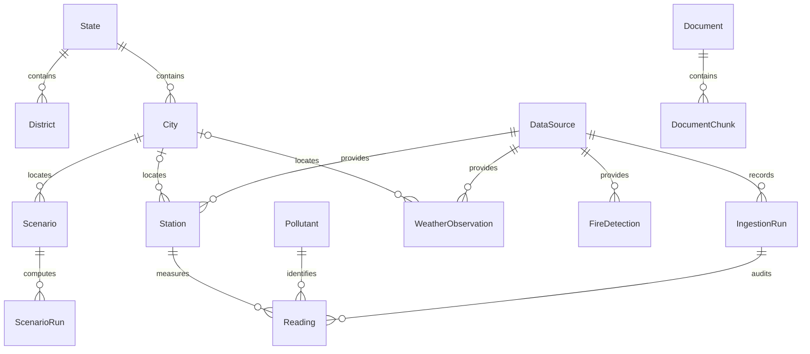

# Data model

## Relationships

`State` stores unique project codes and optional WGS84 MultiPolygons. `District`
belongs to a state, has an optional census code/geometry, and is unique by state
and name; non-null census codes are unique. `City` has a unique slug and state/name
pair, a mandatory WGS84 point, an NCAP flag and optional nonnegative population.
`Pollutant` restricts codes to the seven requested pollutants and stores the
display name, canonical unit, nullable WHO short-term value/averaging period and
nullable NAAQS 24-hour value.

`Station` belongs to a source, optionally a city, and has a WGS84 location, operator,
active flag and optional first/last-seen timestamps. `(source, external_id)` is
unique and last-seen cannot precede first-seen. Deletion of referenced sources,
stations, cities, pollutants and ingestion runs is protected to preserve provenance.

`DataSource` stores access and licence metadata under a stable unique slug.
`IngestionRun` records task identity, start/finish, status, counts, error and JSON
parameters. Finish cannot precede start. Source/start and city/active indexes support
curation. The demo ping references an existing source, records zero fetched/inserted/
flagged rows and labels its parameters as an infrastructure probe.

`Reading` associates station, pollutant and a timezone-aware observation timestamp
with normalized/raw values, a quality flag and an ingestion run. Its primary key is
the natural `(station_id, pollutant_id, observed_at)` tuple. The station/time index
supports recent-history queries across pollutants. Quality flags are enforced in
the database; an `ok` value must exist and be nonnegative.

`WeatherObservation` stores an optional city, mandatory source/location/time and
nullable meteorological variables. Relative humidity uses percent, wind direction
uses degrees in `[0, 360)`, total cloud cover uses a fraction in `[0, 1]`, pressure
uses hPa, wind speed m/s, radiation W/m², precipitation mm and boundary-layer height m.
Wind speed, precipitation, pressure and boundary-layer height cannot be negative.
City/time and source/time indexes support later joins. `FireDetection` stores time,
WGS84 point, satellite, confidence, nullable nonnegative FRP in MW and source.
Source/time and implicit spatial indexes support subsequent querying.

`Document` stores title, authors as citation text, optional year/page count, category,
source/licence metadata, a PDF FileField, a unique lowercase SHA-256 digest and
nullable parse time. `DocumentChunk` stores ordered text and page/section metadata,
token count and JSON metadata. Document/index is unique; pages are 1-based and end
cannot precede start. Document deletion cascades to chunks; deleting a database
record does not automatically delete the stored PDF. No parsing or hashing pipeline
is implemented in this phase; curators must supply the actual digest.

Chunk embeddings are nullable `vector(1024)`. The HNSW index uses `vector_cosine_ops`,
`m=16`, `ef_construction=64`. The functional GIN index uses
`to_tsvector('english', text)`; later full-text queries must use the same configuration.
PostgreSQL maintains both indexes on insert/update. Index creation does not generate
embeddings, perform retrieval or provide RAG logic. See [pgvector's Django integration](https://github.com/pgvector/pgvector-python).

## Hypertables

All unique keys include the partition time column:

| Table | Partition column | Django and PostgreSQL primary key |
| --- | --- | --- |
| Reading | observed_at | station_id, pollutant_id, observed_at |
| WeatherObservation | observed_at | UUID id, observed_at |
| FireDetection | detected_at | UUID id, detected_at |

Django 5.2's `CompositePrimaryKey` represents these keys honestly in both migration
state and the database. There is no hidden single-column unique/primary index that
would prevent Timescale conversion. All three tables use seven-day chunks and
retain standard PostgreSQL foreign keys to regular reference tables. The initial
table migration precedes an explicit `RunSQL` migration using `create_hypertable`.
Compression, retention and continuous aggregates are deferred.

The reverse SQL rebuilds each ordinary table inside the migration transaction,
copying rows and restoring outgoing FKs, primary/unique keys and non-constraint
indexes. It does not edit Timescale's internal catalog. Reversal takes an exclusive
lock and needs space for a complete table copy; it is expensive at research scale.
The integration test reverses/reapplies this migration and verifies row/key survival.
There are no incoming foreign keys to these composite-key tables. Adding any later
requires revisiting both Django's relation support and the reverse migration.

## Decisions

1. **Composite keys and admin:** [Django 5.2 does not support composite models in
   standard admin](https://docs.djangoproject.com/en/5.2/topics/composite-primary-key/).
   A narrowly restricted custom AdminSite registers the actual models for changelists
   only. These listings have no forms, object links, actions or mutation/detail URLs,
   and never write scalar-key admin log entries. They inherit GISModelAdmin, but
   geometry editing/maps are available only for editable reference models. This
   reconciles correct hypertable keys with the requested curator listings without
   misrepresenting a nonunique scalar ID as the ORM primary key. Review the custom
   registration when upgrading Django; standard support may replace it.
2. **Count bounds:** time-series admin counts at most `ADMIN_COUNT_CAP + 1` rows and
   returns at most the configured cap. Full-result counting, facets and show-all are
   disabled. Pagination intentionally stops at the cap; users narrow with date/search
   filters. This bounds counted rows but does not guarantee constant query latency
   for arbitrary search predicates or large offsets.
3. **Missing data:** nullable reading values/raw values preserve missing observations
   without fabricated zeros. Weather variables and FRP may also be unavailable.
   `quality_flag='ok'` requires a nonnegative value. Ingestion must preserve raw negative
   values with an appropriate flag and normalize units in Phase 2.
4. **Time and geography:** `USE_TZ=True` stores timestamps in PostgreSQL timestamptz;
   application display timezone is Asia/Kolkata. Tests reject naive DateTimeField
   warnings. Every geometry uses SRID 4326 and points are `(longitude, latitude)`.
   Seed coordinates are approximate urban centres, not boundary-derived centroids;
   geometries and population remain unknown. State codes are stable project codes;
   `TS` is retained for Telangana and is not a live ISO-code synchronization system.
5. **Standards:** `who_averaging_hours` explicitly disambiguates WHO's short-term
   values. Ozone uses 8 hours; most others use 24. NH3 has no WHO 2021 AQG and CO/O3
   have no NAAQS 24-hour standard, so those fields are null. CO is mg/m³; others are
   µg/m³. Null means unpublished for that field, not zero or compliance.
6. **Fire confidence:** stored as source-native text because MODIS uses numerical
   confidence while VIIRS uses categories. Phase 2 must retain satellite/product
   provenance and define comparable normalization explicitly.
7. **Weather/fire identity:** UUID/time composite keys avoid nullable-city uniqueness
   and geometry-key assumptions. They do not deduplicate repeated downloads. Phase 2
   must define stable product identity and retry/deduplication rules before ingestion.
8. **Audit metadata:** timestamps apply to catalogue, audit and document models; the
   three observation tables stay lean without created/updated fields. Phase 2 must
   ensure a reading's station source matches its ingestion-run source; this cross-table
   condition is not enforced by a PostgreSQL CHECK constraint. Reading natural-key
   conflicts must have an explicit policy for corrections and provenance.
9. **Licence/access entries:** source records document product-dependent permissions;
   public availability does not imply an unrestricted API or reuse licence. The seed
   adds no credentials or download code. NCAP flags reflect the cited CPCB list and
   are preserved on reruns rather than treated as dynamically updated classifications.
10. **Text language:** the initial full-text index uses English. A multilingual
    library will require explicit language/configuration changes before indexing
    substantial Hindi or other-language content. The 1024-dimensional schema does
    not select or download an embedding model.

## Phase 2 decisions

11. **Provenance:** `RawAsset` stores source, download run, digest/path and metadata.
    `ObservationProvenance` logically associates weather/fire kind + UUID + timestamp
    with source/run/asset in the observation insertion transaction. Its unique
    logical key has no unsupported FK into a composite-key table. Reading already
    links to its run and station source; loaders keep those providers consistent.
    Runs retain raw units, asset IDs and coordinate-registry provenance. Dew point
    and fire product/version metadata stay in the ledger. Warehouse columns and
    the reversible foundation hypertable migration are preserved.
12. **Identity/corrections:** weather UUID5 includes source, model, city and UTC time.
    Fire UUID5 includes product/version, satellite, coordinates and UTC time.
    Readings keep their natural composite key. COPY staging plus batched SQL
    `ON CONFLICT DO NOTHING RETURNING` counts real insertions. First values and
    provenance win; a rerun
    never silently replaces measurements. Different fire products are retained
    separately; these rows are not a deduplicated fire-event catalogue.
    Valid committed batches from a partial run keep that original run link after
    repair passes. A partial status describes the whole job; it does not make
    every committed observation unusable.
13. **Quality:** negative/physically impossible gas concentrations become null and
    flagged negative; raw stays available. Finite PM2.5 >1000/PM10 >2000 is retained
    as outlier. Phase 2 used six consecutive constant hours to flag the entire streak, including
    its first five; five-hour database context joins adjacent files. Existing
    flags may be promoted to stuck when neighbours arrive, with revised counts
    audited in run parameters; values/run links are immutable. Priority is
    negative/missing, outlier, stuck, PM2.5 > PM10. Quarter means require three
    valid distinct slots; original quarters stay in raw input, absent hours stay absent.
14. **Time/units:** CO remains mg/m³ per Decision 5 despite the brief asking for all
    gases in µg/m³. Gas ppb/ppm conversion assumes 25°C and one atmosphere; the
    raw value's original units are recorded by the run. Naive CPCB times are IST;
    explicit OpenCity +0000 offsets are preserved. Weather explicitly uses ERA5
    and current Open-Meteo BLH in metres; missing values are null.
15. **Geography:** boundary loading updates State/District geometry and creates
    `BoundaryProvenance`. `CityDistrictLink` records point-in-polygon matches,
    run and asset. Districts are Census 2011 and use national `censuscode`, not
    state-local district numbering. Retain source/vintage rather than relabelling
    historical districts to current administrative geography.
    Resolve state-name aliases across boundary layers. National census identity
    retains district IDs when a parent spelling is corrected; historical DN/DD
    names retain district-asset provenance even without a newer state polygon.
16. **Completeness:** station/pollutant/month coverage counts distinct IST calendar
    hours with finite nonnegative concentrations, including finite flagged values.
    Missing days/months between first/last reports count zero. Flag station-days
    with fewer than 18 present hours. City-year PM2.5 is the union of station hours,
    not average station coverage or a representativeness claim. Current-year
    denominators end at the last complete local day. Coverage calendars generate
    expected counts, never measurements.
17. **Access/vintage:** Princeton original files require Globus; the historical
    alternative is explicitly XKDR PM2.5 only. Older OpenCity AQI matrices cannot
    create concentrations. WorldPop 2030 is a constrained alpha population
    projection registered for later use. See [DATA_SOURCES.md](DATA_SOURCES.md)
    for source access/licences and honestly labelled contract-fixture adaptations.

## Phase 3A decisions and tables

18. **Corrected quality screening:** six consecutive *positive* constant hours
    remain diagnostic stuck candidates. Zero alone can be a detection/reporting
    floor and is not sufficient. An hour with varying cached original quarters
    breaks a stuck sequence even if its mean equals adjacent means. The first
    five hours of a qualifying sequence are flagged as before; gaps break sequences.
    Rounded positive measurements alone do not establish instrument failure.
    Negative/missing, outlier and paired canonical-unit PM inversion rules retain
    their priority. `reflag_readings` updates flags only, records natural keys in
    `ReadingFlagChange`, and verifies the count/hash of values/raw/run links.
19. **Station eligibility:** `StationEligibility` adds city/spatial exclusion,
    reason and evidence without changing warehouse schema. Sites 292, 293, 5405,
    5618 and 5767 are excluded pending official coordinates. Their observations
    remain stored. An explicit curator `verified_official_listing` evidence flag
    preserves a reviewed override; no contributed position is silently upgraded.
20. **Population vintage:** `PopulationRaster` references `RawAsset`, vintage,
    rationale and default status. A partial unique constraint permits one default.
    The public constrained R2025A v1 2025 raster is default; 2030 stays registered.
    This does not perform exposure estimation or imply census accuracy.
21. **Versioned analysis:** `AnalysisRun` contains name, JSON parameters, start/end
    dates, Git revision, job times/status/error and results. `CityHourly` stores
    run/city/pollutant/UTC timestamp, equal-station mean, contributor count and
    joined weather JSON. `CityCoverage` stores per-year hour/day/month coverage
    and eligibility. `CityMetric` holds named result JSON. `CitySeries` holds
    daily/monthly raw/deweathered values, counts, denominators and sampling SE.
    Ordinary scalar keys avoid unsupported relations to warehouse composite keys.
22. **Coverage/time:** use IST bins/calendar dates, quality_flag=ok and eligible
    stations. Daily ≥18 distinct hours, monthly ≥75% calendar days, annual
    analysis eligibility ≥75% valid hours *and* valid days. Weather joins the local
    hour midpoint in UTC with no interpolation. Raw calendar rows with NULL values
    describe missingness. Normalisation exports only dates with observed complete-case
    targets; missing weather/gap dates are absent rather than predicted.
23. **Inference:** eligible PM2.5 years support descriptive annual ranks/exceedances,
    seasonal, weekday, Diwali and winter summaries. Old/recent differences use a
    seeded year/seven-day block bootstrap, not a causal interpretation. Holdout
    performance comes from a separate blocked validation forest; final RF
    normalisation uses joint observed donors and at least 300 draws, holding trend
    fixed. Sampling SE is Monte Carlo error, not total uncertainty.

The analytics migration depends on ingestion 0002 and warehouse 0001. It leaves
the foundational hypertables and their reversible migration unchanged. See
[actual Phase 3A results](results/PHASE3A.md) for coverage and model limits.

24. **Corrected source clocks:** Phase 3A2 uses independently verified IST wall
    clocks for cached OpenCity concentration exports despite their UTC labels.
    Original files/warehouse keys remain immutable. Corrected derived hourly
    timestamps subtract 5.5 hours only for that source; historical CPCB and weather
    physical timestamps are unchanged. Audited four-quarter publisher means are
    native IST-hour means after conversion. Literal UTC sensitivity runs rebin the
    original quarters across the IST half-hour boundary instead of relabelling means.
25. **Readiness and reference weather:** `phase3a2-data` stores audited PM2.5
    snapshots/panels; `phase3a2` stores the new fits, OOF diagnostics and normalised
    series. Five folds assign whole IST weeks within each observed era, with a
    24-hour embargo. Immutable protocol thresholds gate daily OOF R2, overall and
    monthly NMB and support separately in each era. Random-hour and cross-period
    transfer scores are supplementary. Both eras draw the same pooled observed
    weather/calendar reference, holding explicit period and within-era trend.
    Calendar gaps never become targets. Fixed panels match physical CPCB IDs
    across source-specific station identities, with coverage checked separately.

26. **Canonical clock repair in Phase 3B:** the verified OpenCity IST conversion
    is now applied once to warehouse timestamp keys, with an idempotent source
    clock marker and audit run. Measurement values, flags and ingestion links are
    preserved. Frozen earlier derived snapshots remain unchanged.
27. **Forecast weather:** `ForecastWeather` stores city, issue and target date,
    horizon, archive/live mode, lead offset, availability bound, 24-hour coverage,
    weather features and source/run/raw-asset provenance. Uniqueness is per
    city/issue/horizon/mode. Observed reanalysis remains a separate input used
    only in the explicit perfect-prognosis experiment.
28. **Forecast versions and results:** `ForecastModelVersion` references an
    AnalysisRun, city/horizon, cohort, algorithm, fit label dates, first available
    issue date, training-only selection/calibration metadata, weights path and
    MLflow run/registry version. `Forecast` references that version, with issue/
    target dates, mode, point, nested 80/95% bounds, PM2.5 category, top-five
    drivers and feature-availability provenance. Uniqueness includes the model
    version, preserving prior outputs. `ForecastEvaluation` holds one full
    evaluation JSON per run/city/horizon, including all models, interval/event
    scores and the separately labelled perfect-prognosis comparison.
29. **Operational forecast inputs:** completed-day PM must have been ingested
    before issue-end. Seven-day lag support and forecast weather must be complete
    at all three horizons; otherwise issuance uses labelled archival replay.
    Saved conformal radii are immutable during issuance. SARIMAX can assimilate
    measured past labels across days missing weather, but never future labels.
    Forecast migrations depend on existing analytics/ingest/warehouse tables and
    do not modify the foundational hypertables or observation values.

30. **RAG document revisions:** existing Document SHA256 remains unique. New
    fields record local source path/format, bytes, retrieval time, ingestion state,
    error and versioned parser/encoder metadata. PDF uploads use the media volume;
    hash-addressed public PDF/HTML/Markdown bodies use `data/raw/rag/` on D:.
    `project_results` is a distinct category. Missing downloads stay in the
    manifest and have no fabricated document body/hash.
31. **Physical and logical pages:** DocumentPage is unique on document/page number,
    with stored source text, sections, Markdown tables, OCR flag and logical-page
    flag. PDF indices are one-based physical file pages. HTML/Markdown remain
    unpaginated and cite actual section headings, even though their text endpoint
    exposes one explicitly logical page. Empty physical PDF pages are retained.
32. **RAG chunks:** existing DocumentChunk uniqueness, page-range constraint,
    1024-dimensional nullable VectorField, cosine HNSW and English FTS GIN remain.
    Metadata stores source SHA256, category/year, seeded city/pollutant mentions,
    table flag and logical-page flag. Parser versions distinguish incompatible
    index rebuilds; pending NULL vectors support batch resume without reparsing.
33. **Stored answers:** Query retains question, validated filters, route, retrieved
    chunk IDs, validated tool results/provenance, answer, citation objects, provider,
    latency and verification/removal/refusal details. Dataset citations reference
    the actual AnalysisRun and parameters, with forecast model version IDs.
    Client scenario/chart numbers are context rather than trusted evidence.

## Phase6A scenarios

`Scenario` stores name, protected city FK, WGS84 centre point, source JSON,
manual/real weather mode, date-hour, receptor height, grid settings, complete
validated input JSON, unique random share slug and creation time. It is a
scenario specification, not a measured emission inventory.

`ScenarioRun` has a protected Scenario FK, globally unique64-character inputs
SHA256, stability class, flags, input/provenance JSON, summary JSON, grid path,
engine version, actual compute milliseconds and creation time. The hash uses
canonical numerical inputs (presentation name excluded), actual weather values,
population asset hash and engine version. Identical requests return the original
run and scenario. New engine versions retain earlier runs.

Summaries include lattice peak/location/distance, threshold area, hourly known-
population exposure and fractional support, weather/population provenance,
source assumptions, separate measured station totals, limits and grid metadata.
Day runs initially have no grid path/contours; they materialise under an advisory
lock when the binary, header or overlay is requested. Files are little-endian
float32; shape/affine/WKT CRS and lon/lat corners are served separately. The
stored peak is a grid estimate, not an analytic continuous maximum.

`ForecastModelVersion.interval_policy` records per-level interval choices,
empirical coverage/gate, original evaluation run/window, adoption time and
explicit post-evaluation selection. Point model versions are not refitted.
Changed bounds retain their original values in Forecast feature provenance.

Dataset citations for `vayusim_run` reference the actual ScenarioRun, input hash,
engine version and read-only run endpoint. They do not reuse an AnalysisRun ID
for a simulator run. The immutable Phase5 evaluation remains unchanged; the five
scenario questions live in separate `data/eval/vayusim_eval.jsonl`.

Phase 6A audit response metadata (`interpretation`) is derived from the retained
ScenarioRun input snapshot, never an edited Scenario. It labels explicitly
hypothetical unit-release examples, explains fixed-condition linear Q scaling,
and limits population to the modelled footprint and known raster support.
It does not change stored inputs, numerical summaries, hashes or engine versions.
The `highway` preset ID is retained for compatibility but means road dust
resuspension only; its required total segment PM2.5 emission rate stays null.
No exhaust factor is stored or inferred. The RAG feature is described as
extractive retrieval with verified citations; a stored provider name and valid
citations do not constitute answer-quality certification.
Memory eligibility is likewise a timestamped resource measurement, separate from
Query/provider identity and answer quality. The final audit gate failed for the
installed 3B model. The fix pass defaults to `LLM_PROVIDER=extractive`, disables
Ollama and leaves its Compose `llm` profile opt-in. Existing Query provider/model
identities and evaluation artifacts are retained; no question, relevance label,
prompt or generation parameter was tuned.

Textbook references in `tests/fixtures/vayusim-textbook-audit.json` now distinguish
formula checks, scheme comparisons and unverified physical pages. Rural-B
Table 2.3 arithmetic yields sigma-y 152.554014 m at 1000 m; the inconsistent 210 m
paragraph reference is retained as an excluded diagnostic. Briggs-versus-Martin
differences (Cimbala PDF p.3: 14.13%/15.60%/10.66%) are scheme differences beyond
5%/10% tolerances, not validation errors. Turner physical pages are unverified.
This correction changes no ScenarioRun input hashes, engine version, stored
numerical summaries or frozen Phase 3A.2/4/5 evaluation records.

## Phase 6B stored presentation artifacts

No model or schema change. `validation_status` is response metadata derived
from `ScenarioRun.inputs.environment` and `stability_class`, never a mutable
Scenario. Values are `unvalidated_branch` for urban C/F and `formula_check_only`
otherwise. The same status accompanies shared scenarios, day entries, grid
headers, supplementary sections and annotated exports. Original numerical
summary values, input hashes and geographic grid/PNG formats are retained.

`data/results/vayusim/<id>/section-v1.json` is an atomic, versioned supplementary
vertical grid: run ID, input hash, engine version, status, origin, wind FROM,
distance/height axes, row-major concentration matrix in µg/m³ and limitations.
POST creates it once from the retained run snapshot; GET reads stored bytes.
It samples the same engine at additional heights, not an inferred vertical
extension of the original horizontal field. The transect begins at the first
retained source, with all retained sources contributing. Sidecars do not mutate
the parent run's numerical summary or original binary field. Source-removal
comparisons use another normal ScenarioRun with all source rates explicitly zero.
