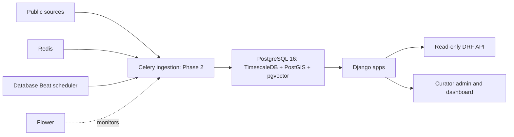

# Phase 1 live verification

Recorded 7 October 2026 (Asia/Kolkata). **All nine verification steps passed.**
All project commands and edits now use **D:\EnviroInsights-India**. No Phase 2
features were added, and all ten test source files are unchanged by SHA-256 comparison.

## Environment

| Component | Actual verified state |
| --- | --- |
| Active checkout and /app bind mount | D:\EnviroInsights-India |
| Docker Desktop / Engine / Compose | 4.94.0 / 29.8.2 / v5.5.1 |
| Engine context / container mode | desktop-linux / OSType: linux |
| WSL | 3.0.1.0; docker-desktop uses WSL 2 |
| Registered Docker WSL VM | D:\DockerDesktopData\main\ext4.vhdx; WSL registry BasePath points to D: |
| Image, container and volume data disk | D:\DockerDesktopData\disk\docker_data.vhdx |
| Docker compatibility paths | Original AppData wsl\main and wsl\disk directories are junctions to D: |
| Docker CLI temporary files | D:\EnviroInsights-India\.tools\temp, scoped by the PowerShell wrapper |
| Python / Django | 3.12.15 / 5.2.18 in Linux containers |
| PostgreSQL | 16.15 (Ubuntu 16.15-1.pgdg22.04+2) |
| PostgreSQL host / container endpoints | 127.0.0.1:5433 / db:5432 |
| Redis host / container endpoints | 127.0.0.1:6380 / redis:6379 |
| Web / Flower | http://localhost:8000/ / http://localhost:5555/ |

Docker's large VM/data storage and the active checkout are physically on D:.
Docker Desktop's Windows executable and Windows-managed settings/registry metadata
remain in their normal Windows locations. The old C: checkout is retained as a
backup while the client still has it open; it is not serving the containers.

The original space-containing path parsed correctly. Relocation followed the user's
request, not a quoting failure. The project copy was verified against the original:
100 source/environment files had matching SHA-256 hashes before later D: edits.
Docker was stopped before relocation. WSL's own --manage --move command moved its
registered VM; the separate offline data disk was copied and hash-verified before
source removal and creation of compatibility junctions. Docker restarted successfully,
and hello-world passed again from the relocated engine.

## Nine verification steps

| Step | Result | Command and key real output |
| --- | --- | --- |
| 1. Build and services | PASS | docker compose up -d --build; docker compose ps: db and redis healthy; web, worker, beat and flower running |
| 2. Migrations | PASS | docker compose exec -T web python manage.py migrate --noinput: all migrations OK, including core.0001_extensions, rag.0001_initial, warehouse.0001_initial and warehouse.0002_hypertables |
| 3. Seed twice | PASS | seed_reference executed twice: State=10, City=12, Pollutant=7, DataSource=12; second run created no new rows and all reference primary keys were identical |
| 4. Extension versions | PASS | SELECT extname, extversion FROM pg_extension: postgis 3.6.4, timescaledb 2.30.2, vector 0.8.7 |
| 5. Hypertables | PASS | timescaledb_information.hypertables contains warehouse_reading, warehouse_weatherobservation and warehouse_firedetection |
| 6. Health | PASS | Real host GET /api/health/: HTTP 200; top-level ok=true and every database/extension/Redis/Celery check true. PowerShell wrapper health check also passed |
| 7. Real worker task | PASS | scripts/dev.ps1 verify-worker: Worker executed core.tasks.ping: run=1, status=success, rows=0; persisted row confirmed by SQL |
| 8. Full pytest suite | PASS | scripts/dev.ps1 test: checks passed; No changes detected; pytest --ds=enviroinsights.settings.test: 37 passed in 17.00s |
| 9. Ruff and production checks | PASS | scripts/dev.ps1 lint: All checks passed; 79 files already formatted. check --deploy --settings=enviroinsights.settings.prod: System check identified no issues (0 silenced), zero warnings |

All six services remained running after the tests. Main-database Reading,
WeatherObservation and FireDetection counts were rechecked and are all zero.
The worker demonstration records a zero-row infrastructure probe, not a measurement.
Tests use a disposable PostgreSQL database and real Redis/Celery, including a dedicated
worker queue. No synthetic readings were written to the development database.
OpenAPI generation was additionally validated with --validate --fail-on-warn (exit 0).

## Real output excerpts

```text
Engine=29.8.2 OSType=linux Containers=0
Hello from Docker!
This message shows that your installation appears to be working correctly.

       extname       | extversion
---------------------+------------
 plpgsql             | 1.0
 postgis             | 3.6.4
 timescaledb         | 2.30.2
 timescaledb_toolkit  | 1.26.0
 vector              | 0.8.7
(5 rows)

       hypertable_name
------------------------------
 warehouse_firedetection
 warehouse_reading
 warehouse_weatherobservation
(3 rows)

Second seed counts: {'State': 10, 'City': 12, 'Pollutant': 7, 'DataSource': 12}
Second seed created no new rows; reference primary keys are identical.

Worker executed core.tasks.ping: run=1, status=success, rows=0
 id |    task_name    | status  | rows_fetched | rows_inserted | rows_flagged
----+-----------------+---------+--------------+---------------+-------------
  1 | core.tasks.ping | success |            0 |             0 |            0
(1 row)

platform linux -- Python 3.12.15, pytest-9.1.1
settings: enviroinsights.settings.test (from option)
collected 37 items
============================= 37 passed in 17.00s ==============================

All checks passed!
79 files already formatted
System check identified no issues (0 silenced).

 readings | weather | fires
----------+---------+-------
        0 |       0 |     0
(1 row)
```

Actual host HTTP status: **200**. Response:

```json
{
  "ok": true,
  "checks": {
    "database": {"ok": true},
    "extensions": {
      "postgis": {"ok": true, "version": "3.6.4"},
      "timescaledb": {"ok": true, "version": "2.30.2"},
      "vector": {"ok": true, "version": "0.8.7"}
    },
    "redis": {"ok": true},
    "celery": {"ok": true}
  }
}
```

## Failures, root causes, fixes and reruns

1. Docker was initially absent. The user installed Docker Desktop with WSL 2.
   Its CLI was still absent from the old shell PATH, so commands and the wrapper
   resolved the actual per-user installation. Real version, info and hello-world passed.
2. Earlier PostgreSQL authentication errors reached native PostgreSQL 17 on 5432
   (service postgresql-x64-17, PID 6756). Test settings also supplied an unused-password
   localhost URL before reading .env. Published port is now 5433; container URL remains
   db:5432; the bogus test fallback was removed. Migrations and PostgreSQL 16 tests pass.
3. Native Redis occupied 6379 (service Redis, PID 5316). Its container is now published
   on 6380, with internal broker URLs unchanged. Redis health and worker execution pass.
   Both native Windows database/Redis services were left running.
4. Initial image extraction exhausted C: (measured free space 0 bytes), returned
   unexpected EOF, then Docker API 500. VM/data storage and active project work moved
   to D: with offline-copy verification. Docker restarted; image pull/build and the
   complete Compose stack succeeded.
5. A later BuildKit stream returned rpc Unavailable/EOF; logs reported a session
   health-check connection failure, only one connection allowed. The engine subsequently
   responded normally. Building the web image alone succeeded, then the required
   compose up -d --build rerun succeeded. The deeper cause of the transient transport
   interruption was not established; no application or test code was changed to hide it.
6. The first full test run passed 37 tests but selected development settings from
   Compose's environment. Both runners now explicitly pass --ds=enviroinsights.settings.test.
   The rerun used test settings and passed all 37 tests. SHA-256 comparison confirms all
   10 test source files are unchanged.

No previous project volumes existed at startup, so down -v was unnecessary. Fresh
PostgreSQL/Redis/media volumes were created using the existing matching .env credentials.
Username, password and database-name consistency were checked without printing secrets.
No secret replacements, administrator service stops or Windows restart were needed.

## Files changed

- compose.yaml, .env.example and ignored .env: host ports 5433/6380 while retaining
  db:5432 and redis:6379 inside containers.
- enviroinsights/settings/test.py: remove the misleading localhost fallback.
- Makefile: explicitly select the pytest test settings.
- scripts/dev.ps1: mirror every Make target; handle path quoting, CLI discovery and
  failures; select test settings and put temporary Docker CLI files under the D: checkout.
- README.md: Windows commands, ports, D: locations and explicit test settings.
- docs/VALIDATION.md: replace earlier failed results with this live verification record.

Docker relocation also changed host WSL registration and AppData compatibility junctions.
Application models and migrations were not changed. Tests were not changed.

## Remaining action and Phase 2 readiness

**Phase 1 is verified and ready for Phase 2 work. No technical blocker remains.**
Reopen **D:\EnviroInsights-India** in the client to make its visible workspace match
all current commands, edits and running container mounts. Keep the old C: checkout
as a backup until that workspace switch is complete. No reinstall, admin rights or
Windows restart is currently required.

The production deployment check emitted zero warnings; the running development
Compose services continue using development settings. This is foundation verification,
not a production deployment.

Phase 2 should follow [DATA_MODEL.md](DATA_MODEL.md): specify weather/fire identity
and deduplication, reading correction/provenance policy, timezone/unit normalization,
quality flags and verified source licences before downloading real observations.
No Phase 2 implementation was started during the Phase 1 environment task. The
separately authorized Phase 2 work is recorded below.

## Phase 2 live ingestion verification — 2026-10-08

This section records the separately authorized ingestion task. All commands,
code, cached bodies and reports used **D:\EnviroInsights-India**, mounted at
`/app`. Docker data remains under **D:\DockerDesktopData**. No analytics, ML,
RAG or simulator implementation was added.

The public pipelines completed successfully. Every public source was replayed
against the same cached inputs and inserted **zero** rows. The original Princeton
release could not be delivered without Globus sign-in; the historical rows below
are explicitly the public XKDR PM2.5 compilation. Keyed sources skipped cleanly.

Final database snapshot: `2026-10-08T13:20:08.910093+00:00`. It contains **16,266,240 readings**, **1,236,672 weather calendar rows**, and **0 live fire detections**.

### Environment and executed commands

Actual final environment output:

```text
docker version --format '{{.Client.Version}} / {{.Server.Version}}'
29.8.2 / 29.8.2
docker info --format 'OSType={{.OSType}} ServerVersion={{.ServerVersion}}'
OSType=linux ServerVersion=29.8.2
compose services: db/redis healthy; web/worker/beat/flower running
host: PostgreSQL 5433, Redis 6380, web 8000, Flower 5555
container: db:5432, redis:6379
```

The image was rebuilt for the pinned ingestion dependencies. The new
`ingest.0002_ingestion_provenance` migration applied. The final migration rerun:

```text
Operations to perform:
  Apply all migrations: admin, auth, contenttypes, core, django_celery_beat,
  django_celery_results, ingest, rag, sessions, warehouse
Running migrations:
  No migrations to apply.
Reference seed complete: 7 pollutants, 12 data sources, 12 cities. No measurements.
Reference seed complete: 7 pollutants, 12 data sources, 12 cities. No measurements.
```

Commands executed through the Windows wrapper after fixture checks passed:

```powershell
.\scripts\dev.ps1 manage download_sources
.\scripts\dev.ps1 manage ingest_all
# Repeat the repaired inputs; the corrected all-source pass already replayed
# historical air, weather and population with zero additions.
.\scripts\dev.ps1 manage ingest_all --source opencity
.\scripts\dev.ps1 manage ingest_all --source boundaries
.\scripts\dev.ps1 manage data_completeness --output .tools/phase2-validation/completeness.json
.\scripts\dev.ps1 test
.\scripts\dev.ps1 lint
.\scripts\dev.ps1 manage check --deploy --settings=enviroinsights.settings.prod
.\scripts\dev.ps1 health
.\scripts\dev.ps1 verify-worker
.\scripts\dev.ps1 manage spectacular --validate --fail-on-warn --file .tools/phase2-validation/schema.yaml
```

Download retries reused verified caches. The complete `download_sources` command
ended successfully (runs 47–51); the corrected complete `ingest_all` command also
ended successfully. The full input replays are below, with exact run IDs.

### Downloaded files and integrity

[PHASE2_FILES.csv](validation/PHASE2_FILES.csv) records **every** cached file's
path, exact size, SHA256, URL, retrieval time and truncated-parent status.
Raw bodies are ignored; adjacent manifests are eligible for version control.
There is no Git repository in this checkout, so no commit is claimed.

| Cache group | Files | Exact bytes | Inputs |
| --- | ---: | ---: | --- |
| datameet-maps | 8 | 27,426,050 | 4 state + 4 district shapefile components |
| cpcb-ccr | 864 | 108,061,831 | 860 CSVs, primary registry, contributed coordinates, DOI metadata, catalogue response |
| opencity | 259 | 1,512,837,796 | 247 CSVs + 12 search catalogues |
| openmeteo | 144 | 82,439,663 | 12 cities × 12 yearly JSONs, including partial 2026 |
| worldpop | 2 | 798,145,552 | GeoTIFF + catalogue metadata |

Total: **1,277 files, 2,528,910,892 bytes**. The final audit recomputed every body hash and checked every size: **0 mismatches**. Station registries are shared by both air loaders; physical files are counted once in their cache group.

WorldPop raster: `worldpop/ind_pop_2030_CN_100m_R2025A_v1.tif`; **798,127,525 bytes**; SHA256 `b6c3520df0fefcbf01a75ad7c8de294f5804526f332d0bbe80889b4861eeb3f1`; EPSG:4326; 35,040 × 34,507; one band; nodata −99,999. This is the **2030 constrained R2025A v1 alpha projection**, registered as metadata only.

### Live load totals

These are actual committed totals after the initial loads and repair passes,
not the sum of fetched rows across retries. Flagged totals count the current
warehouse flags, including later promotions to stuck. Air `rows_fetched` counts
input records (OpenCity quarters), while inserted counts are unique hourly
station/pollutant records. Duplicate exports and query-window overlaps do not
create additional measurements. Metadata/reference work is identified separately.

| Source | Status | Files in cache group | Rows fetched by complete load | Committed rows / reference work | Current flagged rows |
| --- | --- | ---: | ---: | ---: | ---: |
| CPCB via XKDR | success; alternative compilation | 864 | 1,490,974 | 1,478,656 readings | 7,421 |
| OpenCity | success | 259 | 59,033,702 quarter records | 14,787,584 hourly readings | 3,057,148 |
| Open-Meteo ERA5 | success | 144 | 1,236,672 | 1,236,672 weather rows | 0 invalid-value records |
| Datameet | success | 8 | 677 features | initial run: 689 geometry/reference/link work units | 0 |
| WorldPop | success | 2 | 1 raster | 1 metadata registration | 0 |
| openaq | skipped: no key | 0 live | 0 | 0 | 0 |
| nasa-firms | skipped: no key | 0 live | 0 | 0 | 0 |
| era5 | skipped: no key | 0 live | 0 | 0 | 0 |

Air repairs retained valid committed batches from partial runs:

```text
run 53 CPCB partial:   fetched=913778   inserted=837780   flagged=6142
run 55 CPCB success:   fetched=1490974  inserted=640876   flagged=1262
run 54 OpenCity partial: fetched=54981367 inserted=13771310 flagged=2687747
run 63 OpenCity success: fetched=59033702 inserted=1016274 flagged=369401
run 56 weather success: fetched=1236672 inserted=1236672 flagged=0
```

CPCB's current 7,421 flagged rows exceed the initial insertion flag counters
by 17 because adjacent-file context later promoted existing rows to stuck;
these promotions are audited in run parameters. Partial/failed runs remain
in the audit history, with their original errors and counts.

### Idempotency proof

The same cached bodies were processed again with the final loaders. Source
replays finished successfully, with both insertion and newly inserted flag
counters zero. No test, mock database or synthetic record supplied these counts.

```text

run 74 datameet-maps: status=success fetched=677 inserted=0 flagged=0 message=

run 62 cpcb-ccr: status=success fetched=1490974 inserted=0 flagged=0 message=

run 69 opencity: status=success fetched=59033702 inserted=0 flagged=0 message=

run 68 openmeteo: status=success fetched=1236672 inserted=0 flagged=0 message=

run 70 worldpop: status=success fetched=1 inserted=0 flagged=0 message=

run 71 openaq: status=skipped fetched=0 inserted=0 flagged=0 message=skipped: no key

run 72 nasa-firms: status=skipped fetched=0 inserted=0 flagged=0 message=skipped: no key

run 73 era5: status=skipped fetched=0 inserted=0 flagged=0 message=skipped: no key

```

### Completeness

[PHASE2_CITY_YEAR_COMPLETENESS.csv](validation/PHASE2_CITY_YEAR_COMPLETENESS.csv)
contains all 144 city/year results, including zeros. The denominator uses IST
calendar hours from 2015-01-01 through 2026-10-07, the last completed local day;
the partial 2026 denominator is 6,720 hours. Non-null nonnegative PM2.5 counts
as present, including finite flagged values. City coverage is the union of
station hours, not average station coverage or validated representative air quality.

Actual command output summary: **23,940 station/pollutant/month entries**, **158,978 station/pollutant/day entries below 18 hours**, and **53 of 144 city-years at least 75% complete**. The full local JSON retains every low-coverage day. [Station-month CSV](validation/PHASE2_STATION_MONTH_COMPLETENESS.csv) records the monthly values.

| City | PM2.5 years with at least 75% of hours |
| --- | --- |
| ahmedabad | 2018 (96.12%), 2019 (93.01%) |
| bengaluru | 2015 (78.09%), 2016 (90.30%), 2017 (95.46%), 2018 (93.41%), 2019 (99.99%), 2024 (99.94%), 2025 (100.00%) |
| chennai | 2016 (91.34%), 2017 (97.95%), 2018 (99.95%), 2019 (99.93%), 2024 (99.94%), 2025 (100.00%) |
| delhi | 2015 (98.33%), 2016 (99.73%), 2017 (100.00%), 2018 (100.00%), 2019 (100.00%), 2024 (99.94%), 2025 (100.00%) |
| hyderabad | 2016 (96.24%), 2017 (99.36%), 2018 (99.95%), 2019 (100.00%), 2024 (99.94%), 2025 (100.00%) |
| jaipur | 2018 (99.91%), 2019 (99.95%) |
| kanpur | 2016 (89.94%), 2017 (87.24%), 2018 (96.30%), 2019 (94.33%) |
| kolkata | 2019 (99.95%), 2024 (99.94%), 2025 (100.00%) |
| lucknow | 2015 (78.20%), 2016 (91.95%), 2017 (89.66%), 2018 (96.85%), 2019 (99.95%) |
| mumbai | 2015 (98.73%), 2016 (95.07%), 2017 (87.58%), 2019 (98.89%), 2024 (99.94%), 2025 (100.00%) |
| patna | 2016 (79.62%), 2018 (96.60%), 2019 (96.68%) |
| pune | 2024 (99.94%), 2025 (100.00%) |

**2020–2023 has no loaded concentration coverage.** Older OpenCity files in
that period are AQI matrices and cannot be converted to concentrations.
Recent concentration exports cover 2024–2025 in seven cities. The five early
IST hours in some 2026 results are the last UTC hours of 2025, not meaningful
2026 monitoring coverage. No 2026 city-year reaches 75%.

Weather has 103,056 calendar rows per city, 2015-01-01 00:00 UTC through
2026-10-03 23:00 UTC. [Weather coverage CSV](validation/PHASE2_WEATHER_COVERAGE.csv)
checks every raw variable: October 3 has all-null weather (288 rows across
12 cities), so October 2 is the latest non-null weather day in this capture.
BLH additionally lacks January–June 2024 (4,368 hours per city); total BLH
nulls are 52,704. These are actual provider nulls, retained without filling.

### Provenance, extensions, boundaries, API and Celery

Actual SQL/ORM audit:

```text
reading station-source / ingestion-run-source mismatches: 0
weather missing or mismatched source/run provenance: 0
fire missing or mismatched source/run provenance: 0 (no live fire rows)
state/district references lacking provenance: 0 / 0
states: 38 references; 36 geometries; historical DN/DD geometries remain null
district features: 641; audited city/district links: 12
invalid stored state/district geometries: 0 / 0
postgis=3.6.4 timescaledb=2.30.2 vector=0.8.7
hypertables: warehouse_reading, warehouse_weatherobservation, warehouse_firedetection
```

All 12 city points matched exactly one district polygon. Hyderabad retains its
2011 Andhra Pradesh district parent; its seeded present-day city state is Telangana.

| Actual HTTP request | Result | Key output |
| --- | --- | --- |
| `/api/health/` | 200 | all database/extensions/Redis/Celery checks true |
| `/api/readings/`, station 131, PM2.5, two days | 200 | 48 real rows; source/run/raw unit present |
| `/api/weather/?city=delhi`, 2019-01-01 to 2019-01-03 UTC | 200 | 48 real rows, BLH and provenance present |
| Same weather endpoint over seven days | 200 | cursor pages 100 + 68; 168 unique rows |
| `/api/fires/`, bbox 73,27,78,33 | 200 | empty result; missing live key recorded, no fake detections |
| `/api/completeness/`, real station and date range | 200 | monthly/day completeness response |
| Weather range longer than 31 days | 400 | maximum-range validation |
| POST `/api/readings/` | 405 | read-only method enforcement |

The real host-port HTTP captures are in ignored
`.tools/phase2-validation/api-final.json` and `api-pagination.json`.

```text
Worker executed core.tasks.ping: run=65, status=success, rows=0
Registered worker tasks:
core.tasks.ping, ingest.openaq_hourly, ingest.firms_six_hourly, ingest.weather_daily
queued ingest.openaq_hourly: run=66 status=skipped message=skipped: no key
queued ingest.firms_six_hourly: run=67 status=skipped message=skipped: no key
```

The database has enabled admin-editable intervals: OpenAQ 1 hour, FIRMS 6 hours,
Open-Meteo 24 hours. Configuration reruns preserve curator edits. Live private
API access was not attempted without credentials; fixtures test their contracts,
normalization, provenance, retry and conflict-ignore paths.

### Tests, lint and deployment checks

Final actual output from `scripts/dev.ps1 test` inside `web`:

```text
System check identified no issues (0 silenced).
No changes detected
django: version: 5.2.18, settings: enviroinsights.settings.test (from option)
collected 87 items
87 passed, 1 warning in 24.57s
```

SHA256 comparison against the saved foundation baseline: **10 original test
source files checked, zero changed**. All 37 foundation cases still pass; 50
additional cases cover ingestion, units/time, quality, real source samples,
idempotency, provenance, missing keys, API limits, cache integrity, FTP resume,
state aliases and HTTP retries. External source HTTP is mocked in fixture tests;
foundation integration tests still exercise the local real PostgreSQL/Redis/worker.

The unsilenced pytest warning:

```text
RuntimeWarning: numpy.ndarray size changed, may indicate binary incompatibility.
Expected 16 from C header, got 96 from PyObject
```

It occurs with netCDF4 1.7.4/NumPy 2.5.3 import ordering; the actual split-NetCDF
fixture reader passes. The upstream issue and limitations are linked in
DATA_SOURCES.md. No warning filters or test suppressions were added.

```text
ruff check .: All checks passed!
ruff format --check .: 114 files already formatted
python manage.py check --deploy --settings=enviroinsights.settings.prod:
System check identified no issues (0 silenced).
spectacular --validate --fail-on-warn: exit 0, no warnings
```

The production configuration check has **zero warnings**. These commands do
not deploy production; the running Compose stack remains the development stack.

### Failures, root causes, fixes and reruns

1. **Original Princeton delivery unavailable:** the actual catalogue presented
   a challenge, the older DataSpace attempt returned HTTP 401, and DOI metadata
   identified Globus delivery requiring sign-in. Retained the actual response,
   attempted URLs and metadata. Used documented public XKDR access, split
   10,000-row-capped responses recursively, excluded truncated parents from
   loading, and recorded the different product and PM2.5-only scope. Original
   Princeton files and other historical pollutants remain unavailable.
2. **Docker/bind interruption:** earlier downloads received `/app` I/O errors
   when Desktop was unavailable. The underlying shutdown cause was not established.
   Restarted through `docker desktop start --detach`, verified cached bytes,
   retained failed/partial audits and resumed the public downloads. Runs 47–51
   completed successfully. No local database volume was deleted.
3. **WorldPop slow HTTP/no Range support:** the original HTTPS host and official
   Southampton mirror ignored Range requests. The documented anonymous FTP
   service had matching file size/time and a byte-identical real 1 MiB prefix.
   Verified cached first/last segments, resumed 26,214,400 bytes and completed
   the 798,127,525-byte raster. Final full-file SHA256 matches its manifest;
   registration/replay succeeded. Incorrect resume prefixes are fixture-tested.
4. **Wrong city labels in broad CKAN search:** searches returned other cities'
   packages. Restricted each requested city's hourly input to its exact package
   identity. Relocated the earlier 104 mislabeled cached files by actual catalogue
   package, checked D: targets, corrected manifest/asset paths and kept bytes/hashes
   unchanged. Complete download run 49 and load run 63 succeeded. All 12 catalogues
   were searched; seven cities have the matching hourly concentration resources.
5. **Ambiguous station names:** shared aliases such as Pusa, Lodhi and Mumbai
   sites caused partial runs 53/54. Exact CPCB site IDs now take precedence over
   name aliases. Real registry fixtures reproduce the ambiguity. Corrected CPCB
   run 55 added 640,876 missing rows; run 62 replayed all inputs with zero additions.
6. **Missing coordinates:** five Chennai/Pune sites lacked primary registry GPS.
   Matched exact station/city names to a pinned contributed 2024 snapshot, preserving
   primary coordinates. Run parameters identify the fallback asset and sites.
   OpenCity run 63 added the remaining 1,016,274 rows and succeeded. The contributed
   compilation has no declared licence and its positions are unverified; the
   Alandur address discrepancy is documented. Review these before spatial analysis.
7. **Boundary identity and aliases:** district local numbers are not nationally
   unique, so use `censuscode`. The live layers also differed in ampersands and
   spelling (Arunachal/Arunanchal, Andaman labels, historical territories). Normalize
   those aliases, retain national district IDs, recode import references in place
   and give historical parent names district-asset provenance. Removed only two
   proven empty duplicate references created by our earlier import after verifying
   they had no geometry or city/district references; run 64 records the exact IDs.
   Final audit: zero unprovenanced references; all city links correct; repeat run
   74 inserted zero. GDAL/GEOS reported source polygon self-intersections; buffer(0)
   repaired those polygons before storage rather than suppressing the notice.
8. **Foundation compatibility:** an attempted warehouse-field approach conflicted
   with the reversible hypertable test and Django's composite-key relation limits.
   Kept the warehouse schema unchanged, introduced logical weather/fire provenance
   in `ingest`, and made its migration depend on warehouse 0001. All original
   foundation checks pass with their original source hashes.
9. **Validation implementation:** corrected the newly written exclusive-end test
   setup to include its two intended hours, retaining a separate narrower-window
   assertion; gave the completeness OpenAPI response an explicit object type.
   The new boundary alias check initially mistook Bihar's BR code for an import
   hash; restricted that assertion to the actual nine-character hash pattern.
   These were added ingestion checks, not changes to the original 37 tests.
   Final suite and strict OpenAPI schema validation pass.

### Files added/changed and Phase 3 handoff

- `apps/ingest/{base,http,units,quality,registry,completeness,api,tasks}.py`:
  lifecycle, caching/retry, normalization/flags, bulk insertion, coverage, APIs/schedules.
- `apps/ingest/sources/{air,cpcb_archive,opencity,openmeteo,boundaries,worldpop,openaq,firms,era5}.py`:
  public downloads, real parsers and tested optional credential integrations.
- `apps/ingest/models.py`, `admin.py`, `migrations/0002_ingestion_provenance.py`,
  management command modules: skipped audits, assets/provenance, curator filters,
  source commands, completeness and editable Beat registration.
- `enviroinsights/settings/base.py`, `urls.py`: ingestion settings/logging and API routes.
- `requirements/{base,dev}.{in,txt}`: requests/openpyxl/CDS/NetCDF and fixture tooling,
  with transitive dependencies pinned and installed in the rebuilt image.
- `.env.example`, `.gitignore`, `.dockerignore`, `scripts/dev.ps1`: optional key
  signup links, raw-body exclusion, and the container-backed `manage` target.
- `tests/test_ingest_{units,sources,api}.py`, `tests/fixtures/` and its manifest:
  50 added checks and traceable real/adapted contract samples; original tests unchanged.
- `README.md`, `docs/{ARCHITECTURE,DATA_MODEL,DATA_SOURCES,VALIDATION}.md`,
  `docs/validation/PHASE2_*.csv`, `data/raw/**/*.manifest.json`: commands, design
  decisions, licences/access/gaps, actual validation and full file/coverage inventories.

Phase 3 can start with the verified public ingestion dataset and the recorded
coverage limits. It must account for the 2020–2023/2026 concentration gaps;
historical PM2.5-only alternative; finite flagged values counting as present;
OpenCity's explicit +0000 timestamps; CO in mg/m³; approximate weather city centres;
five contributed station positions/licence uncertainty; historic boundary parents;
BLH/provider-null periods; first-value/provenance conflict policy (including nulls);
and the future 2030 alpha population projection. Separate providers are separate
station identities. Fire product rows are not deduplicated physical fire events.
Valid batches retain their original partial-run links after repairs; a partial
job status does not invalidate every committed row from that run.

No manual download, account, key, administrator step or restart is needed for
the completed public pipeline. Optional OpenAQ/FIRMS/CDS live access remains
unverified until credentials exist; original Princeton delivery still requires
account access. Reopen the D: checkout in the client if its visible workspace
still points at the retained C: backup. No Phase 3 feature was implemented.

## Phase 3A live verification — 8 October 2026

All work uses `D:\EnviroInsights-India` and the existing Compose database. No
warehouse data volume was removed. The baseline 87 tests remain unchanged: all
13 original Python test-file SHA256 values match `.tools/tests-before-phase3a.json`.
The 23 added analytics cases use small fixtures and mock external HTTP; the
existing foundation checks still exercise local PostgreSQL, Redis and Celery.

The first real pipeline ran through Celery as task
`4b1009c3-8ef1-410c-b1e4-cf0629b5d180`, AnalysisRun **1**, and succeeded.
Its CLI returned:

```text
Phase 3A completed: AnalysisRun 1
```

It corrected **12,498** stuck flags, built **1,228,198** city/pollutant/hour rows,
identified **52** eligible PM2.5 city-years, fitted all **12** city forests and
exported **98** initially manifested artifacts. A later file-hash/size check
matched all 98. The count/hash of all 16,266,240 warehouse readings, measured/raw
values, natural keys and original ingestion links remained unchanged:
`{'rows': 16266240, 'order_independent_record_hash': 695864490642684660}`.
Corrections were 12,415 CO,
44 O3, 32 NH3 and 7 PM10 rows; all changed stuck → ok. Most flags were missing
data rather than questionable finite readings. The detailed initial audit and
raw-quarter evidence are preserved under `data/results/1/`.

The initial image lacked Git and the checkout was not versioned. Added Git to
the Docker image, created a local code snapshot (no remote/push), checked staged
files against actual secret values without printing them, and verified that
`.env`, `.tools`, raw bodies and result bodies are excluded; manifests remain
eligible. Revision **2b0f254ce0ddff9751019c1277ca5ac0e7194726** is available
inside the rebuilt containers. Source SHA256 is
`30cdb2ccf89c614e917c88bd7a77dfb60b9985c9fdd05cb8b4c0d1a3eafc5ed0`.
The final repeat run retains the initial measured pre-correction audit, rather
than replacing it with already-corrected repeat-run counts.

Actual checks before and after the image rebuild:

```text
PS D:\EnviroInsights-India> .\scripts\dev.ps1 test
System check identified no issues (0 silenced).
No changes detected
collected 110 items
110 passed, 1 warning in 48.78s

RuntimeWarning: numpy.ndarray size changed, may indicate binary incompatibility.
Expected 16 from C header, got 96 from PyObject

PS D:\EnviroInsights-India> .\scripts\dev.ps1 lint
All checks passed!
135 files already formatted

PS D:\EnviroInsights-India> .\scripts\dev.ps1 schema
Schema exit code: 0

PS D:\EnviroInsights-India> docker compose exec -T web python manage.py check --deploy --settings=enviroinsights.settings.prod
System check identified no issues (0 silenced).
```

The known NetCDF/NumPy import warning is not filtered. Production check reported
no warnings. Earlier full-suite execution before the Git image rebuild also
passed all 110 checks in 45.96 seconds. Full local outputs are retained in
`.tools/phase3a-validation/`. New-suite coverage includes completeness boundaries,
equal-station weighting/exclusions, Diwali/exceedances, corrected flags, replay
immutability, deterministic blocked RF fitting, direct-donor equivalence and
read-only/gap-safe APIs. No original test was changed to obtain these results.

Initial live HTTP checks returned 200 for health (every check true), coverage
(144 PM2.5 city-years, 52 eligible), Delhi summary (26 metrics), Delhi raw daily
series for 2025 (365 rows) and deweathered monthly queries inside the gap (zero
rows). Final repeat-run comparisons and API/export validation are recorded below.
Scientific performance and full coverage tables are
in [results/PHASE3A.md](results/PHASE3A.md); successful execution does not imply
reliable weather normalisation for research.

The change from Phase 2's 53 eligible city-years to 52 is explained by Patna 2016:
it has 6,981/8,784 valid hours, but only 257/366 days meet the daily 18-hour rule.
It fails the new ≥75% valid-day requirement. This is a stricter analysis selection,
not deletion or interpolation of historical data.

### Completed repeat run and final checks

Task **a0588198-5fb5-4478-8430-fec71e561947**, AnalysisRun **2**, finished
**successfully**. Database job times are 20:51:29–21:13:21 IST; elapsed
**1,311.729 seconds**. Celery recorded SUCCESS after finishing the manifest.
The repeat changed **zero** flags, inspected **104,660** quarter-backed candidates
(including previously cleared candidates), found the same **129** varying-quarter
candidates, and retained the original measurement/provenance fingerprint. Run 1's
pre-correction baseline remains explicitly linked in Run 2's `flag_audit.json`.
WorldPop registration run 80 succeeded with zero downloads/new observations.

The wrapper initially reported failure because PowerShell 5.1 treated a redirected
Matplotlib INFO message, `generated new fontManager`, as a terminating native
error record. The Celery job itself succeeded. `Invoke-Compose` now leaves stderr
visible and checks the real exit code. A fresh-font-cache management-shell probe
produced that actual INFO message plus deliberate stderr and exited 0; a second
probe exited 7 and the wrapper correctly raised:

```text
Native stderr success probe completed
Deliberate native stderr probe, exit 0
Confirmed: stderr remains visible, wrapper exit 0
Real failure preserved: docker compose exec -T web python manage.py shell --command=import sys; sys.exit(7) failed (exit 7).
```

Figure review found that empty-era panels had Matplotlib's default clock-date
labels. Fixed explicit era boundaries, marked empty panels “No observed series”,
used matched scales per city and distinct city colours, and split annual plots
into the two observed eras. Regenerated only figures/report from the saved real
Run 2 tables/CSVs. Computation revision remains `2b0f254`; export revision is
**7e0adff38a82580bfef799dfa9fde2d867c47065**, recorded with its code SHA256,
reason and actual export times in `AnalysisRun.parameters` and the manifest.
No data value, fitted model or quantitative result changed during this export.

The final verifier checked the actual task result, code/version provenance,
original test hashes, unchanged 16,266,240-row fingerprint, exclusions/default
population, coverage, absence of gap/future modelled rows, pandas export, all
model scores and all recorded artifact hashes/sizes. Actual output:

```text
Validated 103 real HTTP responses, 57 reproduced CSVs and all 12 city model metrics
manifested_files_verified: 99
eligible_pm25_city_years: 52
city_hourly_rows: 1228198
delhi_dataframe_rows: 61118
deweathered_gap_rows: 0
```

CSV/model comparisons passed within numerical tolerance 1e-10; the explanatory
text for an unavailable old/recent comparison was corrected to “At least one
observed era lacks eligible years”. All remaining values match. HTTP checks cover
all 12 cities, both series kinds/frequencies, missing-BLH periods and the gap;
all successful reads returned 200, writes 405, invalid filters 400 and unknown
runs/cities 404. During execution the default API continued to serve successful
Run 1, with incomplete Run 2 returning 404; after completion it served Run 2.

The full suite was rerun after the wrapper/export fixes:

```text
System check identified no issues (0 silenced).
No changes detected
110 passed, 1 warning in 50.62s
All checks passed!
135 files already formatted
```

The same NetCDF/NumPy warning remains visible. Full outputs, the standalone
verification script and `verification.json` are retained with Run 2's artifacts;
its manifest includes supplemental verification evidence. No city passed the
predefined meteorological-normalisation readiness screen. Descriptive datasets
are available, but RF normalisation needs further scientific validation before
Phase 3B relies on it. Phase 3B questions, forecasts, RAG, simulators and dashboards
were not implemented.

## Phase 3A2: corrected deweathering verification (2026-10-08)

All commands ran in the web container from `D:\EnviroInsights-India`.
Corrected diagnostic data run **6** and full model run **7** succeeded. Legacy
run **2**, literal-clock diagnostic run **4**, failed initial diagnostic run **3**
and interrupted provisional model run **5** remain available for the audit.

| Check | Actual result |
| --- | --- |
| Full pytest | 117 passed, 1 warning in 30.49s; all 14 original test files unchanged |
| Ruff | All checks passed; 147 files already formatted |
| Django checks/migrations | No issues (0 silenced); no changes detected |
| Production deploy check | System check identified no issues (0 silenced) |
| Schema | spectacular --validate --fail-on-warn completed successfully |
| Health | HTTP 200; every database/extension/Redis/Celery check true |
| Model grid | All 12 cities, all eight frozen variants; six all-station passes |
| Shared reference | Same seeded 300 joint pooled-weather draws for both eras; hashes stored |
| Measurement preservation | 16,266,240 rows; record hash 695864490642684660 unchanged |
| Frozen protocol | SHA256 09d869e72551b31af0368b0d89a5c91510e8ecd65e6ce53605d33a704b827977 unchanged |
| Gap/future targets | No deweathered series rows in 2020-2023 or 2026 |
| Live API | Latest summary/series/coverage use run 7; explicit run=2 still works |
| Artifact preservation | Runs 2-7 manifests validated against actual bytes and file lists |

The existing netCDF4/NumPy ndarray-size RuntimeWarning remains visible; no warning
filter or test weakening was introduced. The new tests check positive/negative
known lags, whole-week/embargo isolation, pooled-donor reproducibility, correct
IST quarter bins, verified publisher-clock decoding, revised API selection with
legacy access, and interruption failure/manifests.

Real diagnostic findings, a/b/c validation, model ablations, seasonal bias,
readiness and conditional bootstrap intervals are in
[PHASE3A2.md](results/PHASE3A2.md). Passing models do not establish instrument
accuracy or causal effects. All-station readiness passes: Delhi, Hyderabad,
Kanpur, Lucknow, Mumbai and Pune, for their observed eligible periods. Bengaluru
qualifies only on its seven-station fixed panel; its all-station historical
screen fails. Mumbai's matched panel lacks eligible years in both periods.
Kolkata and Patna retain monthly-bias failures despite high overall R2.

Hyderabad 2025 has 0 all-station city-average days above 60 ug/m3 (daily maximum
53.0306); the six-station fixed panel has 53 (maximum 77.6869). Changing station
composition is consequential. Published integer ranges/repeats remain a source
quality limitation and were not fabricated away.

Failures and corrections: the first diagnostic attempt expected a cache-manifest
`bytes` field, while cache metadata uses `size_bytes`; actual file size now comes
from the cached file. Provisional fits were stopped after independent same-site
records proved IST clocks were labelled UTC; the derived -5.5-hour conversion
was then verified in all seven recent cities. A report reader initially failed
on blank Timestamp rows; it now excludes those rows consistently with ingestion.
A final audit initially confused fitted complete-case rows with raw hourly rows:
Delhi has 61,118 raw rows, including five without weather, versus 61,113 fitted
hours. The corrected audit compares the default dataframe directly to run 7.
These corrections changed neither the original tests nor the frozen thresholds.

Exact stdout and proof JSON/CSV/figures are archived under
`data/results/7/verification/` and `data/results/7/diagnostics/`. The manifest
records compute, hourly-supplement and export revisions separately. No Phase 3B
research question has been started.

## Phase 3B live verification — 10 October 2026

Phase 3B is now complete on `D:\EnviroInsights-India`. The successful publication
is **AnalysisRun 19**; city runs are **10, 12, 13, 14, 15, 16 and 17**. Run 11 is
retained as a failed GAM attempt; Run 18 is the preceding publication before
seasonal and matched-network supplements. Run 7 and its 414 artifacts remain
unchanged. This section supersedes the earlier statement that Phase 3B had not
started. The paper is [PHASE3B.md](results/PHASE3B.md).

The stored-clock audit is IngestionRun **87**. It corrected **14,787,584** rows;
the total remained **16,266,240**, with identical value/quality/ingestion-link
hash **767228030051878155** before and after. The repeat command returned:

```text
status: already canonical
corrected_rows: 0
version: opencity-ist-clock-v1
```

DataRun 8 reconstructs diagnostics from canonical storage without a second shift.
Its 12 city hourly frames exactly match Run 6. DataRun 9 rebuilds all pollutant
tables; all 12 PM2.5 hourly series match frozen Run 7 within 1e-12. Cached raw
values and first ingestion links were preserved. The clock tests include a
Timescale chunk-boundary move and real quarter ingestion into native IST bins.

Actual final verification output:

```text
125 passed, 16 warnings in 20.85s
All checks passed!
167 files already formatted
System check identified no issues (0 silenced).
No changes detected
```

OpenAPI generation with `spectacular --validate --fail-on-warn` exited 0 without
warnings. The original 15 test source/support files are unchanged; all original
117 tests are included in the passing suite. The 16 visible warnings comprise
the existing netCDF4/NumPy ndarray-size warning, three SHAP/matplotlib pending
deprecations, and twelve pandas/NumPy generic timedelta deprecations in the new
week-isolation fixture. No warning filter or weakened assertion was introduced.

Live HTTP checks returned:

| Request | HTTP | Key result |
| --- | --- | --- |
| `/api/health/` | 200 | Database, PostGIS 3.6.4, Timescale 2.30.2, vector 0.8.7, Redis and Celery all true |
| `/api/analytics/rq2/delhi/` | 200 | Research run 19; both networks and explicit nested gates |
| `/api/analytics/rq2/bengaluru/` | 200 | Fixed panel is the main cohort; all-station output descriptive only |
| `/api/analytics/rq2/chennai/` | 200 | Descriptive only |
| `/api/analytics/ncap/` | 200 | PM2.5 proxy; official compliance false/not assessed |
| `/api/analytics/comparisons/` | 200 | Run 19 weather-adjusted descriptive comparisons |

The read-only API regression also verifies POST 405 and invalid query 400.
All six compose services are running; db and Redis are healthy. Docker reports
Linux engine **29.8.2**. Host database port remains **5433** and Redis **6380**.

Nine validated Run 7 cohorts have **180 actual refit replicates**, comprising
**300 fitted forests** because separate-era replicates fit two forests. All
cohorts retain 20 refit daily CSVs, parameters, seeds and sampled-index hashes.
The whole-week nested CV, frozen eight-model grid and readiness thresholds are
unchanged. Main-cohort nested gates pass all observed eras only for Lucknow,
Mumbai and Bengaluru's fixed panel. Delhi recent, Hyderabad old, Kanpur old and
Pune recent retain failures; the report does not loosen the criteria.

Meaningful failures and fixes are recorded in
[PHASE3B_IMPLEMENTATION_FIXES.md](results/PHASE3B_IMPLEMENTATION_FIXES.md):

- Cross-chunk bulk UPDATE failed a Timescale constraint and rolled back; the
  atomic partition-aware repair and its boundary test pass.
- The user pause rolled back the unfinished repair; the complete resumed audit
  committed once and reruns change zero rows.
- New fixtures caught NumPy string labels and bootstrap index/date-accessor
  defects; the implementation was corrected without changing original tests.
- Run 11 failed on a held-out 115.4 mm rainfall value outside GAM spline support.
  A documented flat boundary extension retains observations and records clipping
  counts. The exact Gaussian fixture also exposed statsmodels' separation error;
  its equivalent penalised least-squares fallback passes the unchanged assertions.
- The live RQ2 endpoint initially returned 500 due to duplicate city keyword
  metadata; dictionary merging was fixed, the fixture strengthened, and all live
  GETs above reran successfully.
- Docker's interrupted dependency build failed after the engine connection ended;
  Desktop was started, the build succeeded and all services use the rebuilt image.

On matched network dates, Delhi's fixed-panel long-run normalised change is
**−17.591985246475744 µg/m³**, with refit/block 95% interval
**[−35.071142907974696, 1.6623174839119734]**. The interval includes zero.
The calendar-2017/2018 proxy is unavailable for Bengaluru's fixed panel (2017
ineligible), Mumbai (2018 ineligible), Kanpur/Lucknow (no recent targets), and
Pune (no historical baseline). Missing years remain missing.

Source verification corrected Chennai's non-attainment flag: the official CPCB
PDF marks it as a million-plus participant outside the non-attainment list.
The seven eligible cities are unstarred entries. Recent PM10 is context only.
BS-VI attribution and crop-fire estimates are deferred for the stated missing
data; no forecasts, RAG, simulator or dashboards were implemented.

Exact command logs, HTTP checks, preservation checks and integrity outputs are
archived in `data/results/19/verification/`; manifests retain their hashes.
The long model process's launch revision is recorded separately from per-record
on-disk revisions in `compute_provenance.json`, and report export provenance is
stored separately. The existing scheduled weather ingestion added later 2026
weather cache manifests; frozen 2015–2019/2024–2025 research snapshots are unchanged.

## Phase 4 live verification — 10 October 2026

Phase 4 is complete on `D:\EnviroInsights-India`, as **AnalysisRun 21**.
The full suite baseline for Phase 5 is **148 tests**. All 125 original tests
remain passing; all 18 baseline test/support files retain their hashes.
The actual report is [PHASE4.md](results/PHASE4.md).

```text
148 passed, 148 warnings in 29.25s
System check identified no issues (0 silenced).
No changes detected
All checks passed!
```

Schema validation with `spectacular --validate --fail-on-warn` exits 0 without
warnings. Visible full-suite warnings include SHAP/matplotlib deprecations,
MLflow prediction-signature advice, the existing NumPy/netCDF binary-size warning,
generic timedelta warnings in fixtures, and a synthetic SARIMAX convergence
warning. No warning filter or weaker assertion was introduced.

| Verification | Real result |
| --- | --- |
| Forecast migrations | `forecast.0001_initial` applied; no migration drift |
| Real rolling evaluation | 7728 rows; 21 city/horizons; 294 origins including real/ideal weather |
| Target support | 184/184 days, 2025-07-01 through 2025-12-31, for every city/horizon/weather variant |
| MLflow registry | 147 finished registered versions independently checked |
| Replay default | 21 forecasts issued 2025-12-31; stored rows 3864 → 3885 |
| Replay repeat twice and real Celery task | Still 3885 rows; task `cefba66a-830e-48bb-9d36-cb3169ed6371` succeeded |
| Public live weather | IngestionRun 98 success; 21 rows; task `632924ce-4a60-4636-8676-100ad7d6bb56` |
| Keyed PM refresh | IngestionRun 100 skipped, zero inserts, `skipped: no key`; actual task `bd8e2414-4142-403d-92d1-5143f81c2559` succeeded |
| HTTP | Health 200; 21 forecast GETs 200; POST 405, invalid input 400, unknown city 404 |
| CAMS issued-vintage coverage | 0/93240 non-null hourly forecasts; explicitly skipped |
| Preservation | 16,266,240 readings and fingerprint `767228030051878155` unchanged; Runs 7 and 19 artifact hashes unchanged |

Final commands run inside `web`:

```text
python manage.py evaluate_forecasters --run 21
python manage.py issue_forecasts
python manage.py issue_forecasts --replay-date 2025-12-31  # twice
python .tools/phase4-validation/verify.py --run 21
python manage.py export_phase4_report --run 21
```

The actual source archive reload inserted 168 previously missing IST-boundary
daily rows (IngestionRun 94); the repeat (96) inserted zero. BLH remains null
in lead-offset forecasts. Historical Forecast API near-valid-time weather was
probed and excluded from headline features; GFS Previous Runs lead-2/3/4 inputs
have explicit availability bounds. Perfect-prognosis is separately labelled.

Held-out policies losing to persistence: bengaluru h1, bengaluru h3, chennai h1, mumbai h1, mumbai h2, mumbai h3, pune h1, pune h2, pune h3.
Negative skill and convergence warnings are retained. The report includes every
model, horizon, event denominator, empirical interval coverage and monthly/seasonal
bias. Delhi February/March and Pune May are outside the final six-month test;
their earlier bias cannot be declared fixed by this evaluation.

Missing implementation items completed before Phase 5: PM refresh before cutoff,
all-horizon live-input checks with replay fallback, frozen operational calibration,
measured-label preservation in SARIMAX history, and actual result/figure exports.
The frozen forecast design and held-out selection rules are unchanged. See
[PHASE4_IMPLEMENTATION_FIXES.md](results/PHASE4_IMPLEMENTATION_FIXES.md).

Daily schedules are PM 23:35 IST, weather 23:40 and forecasts 00:10. Without an
OpenAQ key, forecasts remain replay. Bengaluru also requires verified fixed-panel
station correspondence. All seven compose services are running, with db/Redis/
MLflow healthy. Host ports remain database 5433, Redis 6380 and MLflow 5000.

AnalysisRun 20 is retained as failed after its numerical thread configuration
was found inconsistent. Run 21 launched at Git `6b3f4b028d0b352b0f29763e8833b4372497f1b1`;
the report export revision is recorded separately. The protocol SHA256 is
`395b384c7b5324ba4b4e87f87e2cdff30295be1de9a42155c85c707e417aa28c` and all recorded numerical thread pools use one
thread. Exact commands, outputs, HTTP/model checks and prior-failure evidence are
under `data/results/21/verification/`, hashed by the manifest.

Phase 5's queued request begins only after this completed verification.

## Phase 5 live verification — 11 October 2026

Work runs from `D:\EnviroInsights-India`; tests run inside `web`, using the
Compose database service rather than the Windows PostgreSQL installation.
Phase 4's baseline is 148 passing tests. SHA256 checks confirm that all 20
original test/support files are unchanged. The Phase 5 implementation adds
35 test cases; no baseline assertion or warning filter was weakened.

Actual commands and output:

```text
docker compose exec -T web pytest
183 passed, 149 warnings in 71.47s (0:01:11)

docker compose exec -T web ruff check .
All checks passed!

docker compose exec -T web ruff format --check .
226 files already formatted

docker compose exec -T web python manage.py check
System check identified no issues (0 silenced).

docker compose exec -T web python manage.py makemigrations --check --dry-run
No changes detected

docker compose exec -T web python manage.py check --deploy --settings=enviroinsights.settings.prod
System check identified no issues (0 silenced).
```

OpenAPI schema validation also exits 0 without warnings. Test warnings remain
visible: Django's future URL form scheme, three SHAP/matplotlib deprecations,
MLflow signature/type-hint advice, the existing NumPy binary-size warning,
NumPy timedelta fixture deprecations and synthetic SARIMAX nonconvergence.
The binary-size warning was also recorded in Phase 4. Exact pytest output is
retained in the validation log.

All eight default services run: db, Redis, web, worker, beat, Flower, MLflow and
the private CPU encoder service. db, Redis, MLflow and the encoder service are
healthy. Database/Redis/web/MLflow ports remain loopback 5433/6380/8000/5000.
Docker reports Linux containers; project/model/cache files remain on D:.

| Live check | Actual output |
| --- | --- |
| Health | HTTP 200; database, Redis and Celery true; PostGIS 3.6.4, TimescaleDB 2.30.2, vector 0.8.7 |
| Library listing | HTTP 200; 29 registered actual document bodies |
| Data answers | Eight POST requests returned 200; seven answered with dataset citations, unavailable Delhi 2022 refused |
| Citation URLs | All seven returned dataset links returned HTTP 200, including explicit raw snapshot Run 9 |
| HTMX Ask form | Real CSRF-protected POST returned 200 with the actual Delhi value, extractive badge and clickable citation |
| Input validation | Six malformed questions, filters and explanation contexts returned 400 |
| Source page | JSON and HTML returned 200 with identical stored text; missing physical page returned 404 |
| Local HTMX asset | HTTP 200; bytes match the vendored file, SHA256 d6fdc75f204e6bdefa99b69bf1e6d4ac69b8a364f77929f45c13476b4000f717 |
| Real Celery ingestion | Task dac0f2e3-1494-40d7-9784-2f9785580893 succeeded; Document 23 ready, 129 vectors, parser 3 |
| Complete corpus | 29 ready documents; 7,194 chunks and 7,194 stored embeddings |
| Pages | 1,947 physical PDF pages, 6 logical unpaginated pages; 223 OCR pages |
| Vector integrity | All dimensions 1024; unit norms range 0.9999998692963225–1.0000001804510361 |
| Re-ingestion | All 29 actual SHA256-verified files: zero new chunks/vectors, all chunk IDs unchanged |
| Source metadata | Every chunk's source SHA256, year and category match its Document |
| Index usability | Actual EXPLAIN uses chunk_embedding_hnsw and chunk_text_fts_gin; enable_seqscan was disabled locally for these proofs |
| Phase 4 preservation | Run 21 success; 147 versions, 3,885 forecasts; all 20 original test/support file hashes unchanged |

The complete index was verified with exit 0 by
`docker compose exec -T -e PYTHONPATH=/app web python .tools/phase5-validation/collect_final_proof.py`.
Its first attempt assumed the vector adapter returned an array; the adapter
returned a list. The collector was corrected and rerun successfully, without
changing corpus text or vectors. Full actual plans and counts are retained in
`verification/final-proof.json`.

### Frozen evaluation and final API verification ? 12 October 2026

Docker Desktop was unavailable at resume. It was started, then `docker compose
up -d` restored all eight services without rebuilding, deleting volumes or
re-embedding documents. Health returned 200 with every check true. The frozen
benchmark resumed 151 saved retrieval records, including 37 complete questions;
completed comparisons were retained. User pauses and resume dates are separate
from the per-question timings.

Actual commands (exit 0):

```text
docker compose exec -T -e PYTHONPATH=/app web python .tools/phase5-validation/evaluate_when_ready.py
docker compose exec -T web python .tools/phase5-validation/http_complete_proofs.py
Saved ten real HTTP answers and API/HTMX/source proofs.
docker compose exec -T web ruff check .
All checks passed!
docker compose exec -T web ruff format --check .
226 files already formatted
```

All four retrieval methods completed the same 80 literature questions (320
saved records). Extractive completed all 120 questions. The following values
are copied from the actual metrics artifact, not estimated:

```json
{
  "completed_at": "2026-10-12T09:52:59.930123+00:00",
  "retrieval": {
    "vector": {
      "recall_at_5": 0.609375,
      "recall_at_10": 0.690625,
      "hit_at_5": 0.625,
      "hit_at_10": 0.7125,
      "mrr": 0.4596243102657576,
      "seconds": 0.06993289818754497,
      "questions": 80
    },
    "keyword": {
      "recall_at_5": 0.678125,
      "recall_at_10": 0.803125,
      "hit_at_5": 0.7,
      "hit_at_10": 0.8125,
      "mrr": 0.5165074394267138,
      "seconds": 0.1868041276124952,
      "questions": 80
    },
    "hybrid": {
      "recall_at_5": 0.715625,
      "recall_at_10": 0.809375,
      "hit_at_5": 0.7375,
      "hit_at_10": 0.8375,
      "mrr": 0.5984731465429995,
      "seconds": 0.21304179618748192,
      "questions": 80
    },
    "hybrid_rerank": {
      "recall_at_5": 0.803125,
      "recall_at_10": 0.884375,
      "hit_at_5": 0.825,
      "hit_at_10": 0.9,
      "mrr": 0.6932707917082916,
      "seconds": 67.48113634682497,
      "questions": 80
    }
  },
  "answers": {
    "extractive": {
      "questions": 120,
      "citations": 464,
      "citation_accuracy": 1.0,
      "audited_citation_uses": 925,
      "correct_citation_uses": 925,
      "groundedness_before_removal": 1.0,
      "groundedness_emitted": 1.0,
      "emitted_sentences": 925,
      "supported_emitted_sentences": 925,
      "claims": 925,
      "supported_claims": 925,
      "removed_claims": 0,
      "number_correctness": 1.0,
      "numeric_precision": 1.0,
      "numeric_cell_exactness": 1.0,
      "correct_numeric_values": 669,
      "expected_numeric_values": 669,
      "extra_numeric_values": 0,
      "available_data_questions": 30,
      "missing_data_questions": 0,
      "available_data_answer_rate": 1.0,
      "missing_data_refusal_rate": null,
      "displayed_row_exactness": 1.0,
      "correct_data_rows": 491,
      "expected_data_rows": 491,
      "data_questions_exact": 1.0,
      "correct_refusal_rate": 1.0,
      "literature_answer_rate": 1.0,
      "literature_gold_source_citation_rate": 0.8875,
      "latency_seconds_mean": 1.6340416666666668,
      "generation_fallbacks": 0
    }
  },
  "mlflow_run_id": "2eb541abd6fe49f688d6a23d477f5227"
}
```

The frozen evaluation SHA256 remains
`f9e6d1eb712a772d4fac98479a98676b54ab9e7fb05219df8a1ecf667ee960b4`.
The MLflow `rag` run is `2eb541abd6fe49f688d6a23d477f5227`.
Recall is the fraction of all known gold chunks, hit is at least one gold
chunk, and MRR searches through 40. The 925/925 citation uses and emitted
sentences measure exact source-text support; they do not independently certify
semantic relevance or completeness. All 669 expected numeric field values
matched with no extra scored values. All 30 available-data questions answered;
the 10-question unanswerable set was refused. Missing-data metric within the
30 data questions is not applicable because all 30 were available.

Query vectors were primed before timed retrieval. The mean 67.48113634682497-second
reranking stage measures scoring the fused 40; answer-phase latency uses those
cached scores. The additional actual AERMOD and Kolkata API requests took
85.187 / 61.204 seconds. Both returned 200; all 16
returned document citation links returned 200 and matched stored SHA256 and
physical page. Supplied scenario value 999999 was absent from the answer.
Eight known-gold top-10 misses remain: four absent from the fused candidates and
four reranked below ten. The report describes their questions and the noisy OCR
and relevance limits. Questions, thresholds and ranking weights were unchanged.

The final report is [PHASE5.md](results/PHASE5.md); full metrics are in
[PHASE5_METRICS.json](results/PHASE5_METRICS.json). Exact logs and structured
proofs are retained under `data/results/rag-phase5/verification/`, with hashes
in its result manifest and copies in the MLflow run. The implementation tested
as 183 passing cases on 11 October is unchanged at evaluation commit `9b9c8a2`;
final changes are documentation and verification artifacts.


Windows' actual System event log records an idle sleep from
2026-10-11T02:46:04.888622Z to 2026-10-11T03:50:41.329951Z (08:16–09:20 IST).
Docker and the saved batch jobs survived; health returned 200 after wake.
A temporary `ES_CONTINUOUS | ES_SYSTEM_REQUIRED` request covered the CPU
jobs and was released on both the user pause and final completion. It changes no permanent power-plan setting and is released on pause or
completion. Event evidence and the request/release record are retained as
`verification/windows-sleep.json` and `verification/temporary-awake.json`.
The API behavior is described in the [Windows execution-state documentation](https://learn.microsoft.com/en-us/windows/win32/api/winbase/nf-winbase-setthreadexecutionstate).

Logs are under `.tools/phase5-validation/`; structured live HTTP and Celery
outputs are under `data/results/rag-phase5/verification/`. Download failures,
source identity corrections and parser fixes are recorded in the library
manifest and [PHASE5_IMPLEMENTATION_FIXES.md](results/PHASE5_IMPLEMENTATION_FIXES.md).

Final archiving initially hit Git exit 128 because the Windows bind mount
`/app` has different ownership inside the container. The read-only provenance
command now uses the process-scoped `git -c safe.directory=/app rev-parse HEAD`;
no global Git configuration changed. The actual rerun exited 0:

```text
docker compose exec -T -e PYTHONPATH=/app web python .tools/phase5-validation/archive_final_results.py
{"mlflow_run_id": "2eb541abd6fe49f688d6a23d477f5227", "status": "FINISHED", "metrics_logged": 58, "reports": ["reports/PHASE5.md", "reports/PHASE5_IMPLEMENTATION_FIXES.md", "reports/PHASE5_METRICS.json", "reports/PHASE5_PROTOCOL.md", "reports/VALIDATION.md"], "hashed_result_files": 32}
```

An independent SHA256/byte-count check matched all 32 retained result files.
The frozen evaluation file also matches its recorded SHA256. The temporary
Windows sleep request is released; normal project services remain running.


## Phase 6A and whole-site presentation verification (2026-10-15)

Active checkout: `D:\EnviroInsights-India`; baseline `b5fa5bf`, 183 tests.
No original tests or frozen Phase5 questions were modified. The final
SHA256 check matches all41 original test/support/fixture files and all32
original Phase5 result artifacts. See [PHASE6A](results/PHASE6A.md) for methods,
measured comparisons, source citations, failures/fixes, Decisions and limitations.

Docker Desktop was installed but stopped on resume; it was started and the
existing Compose stack brought up. Docker29.8.2, Compose5.5.1, Linux containers.
The project, models and Docker/WSL data remain on D:. Host5433 maps to db5432;
the native Windows PostgreSQL service on5432 is left alone. Container commands
use Compose service `db`; no host-native test database is substituted.

Actual service snapshot (`docker compose ps --format json`):

| Service | State | Health |
| --- | --- | --- |
| beat | running | no container healthcheck configured |
| db | running | healthy |
| flower | running | no container healthcheck configured |
| mlflow | running | healthy |
| ollama | running | healthy |
| rag-models | running | healthy |
| rag-reranker | running | healthy |
| redis | running | healthy |
| web | running | no container healthcheck configured |
| worker | running | no container healthcheck configured |

Actual `GET /api/health/` status 200:

```json
{
  "ok": true,
  "checks": {
    "database": {
      "ok": true
    },
    "extensions": {
      "postgis": {
        "ok": true,
        "version": "3.6.4"
      },
      "timescaledb": {
        "ok": true,
        "version": "2.30.2"
      },
      "vector": {
        "ok": true,
        "version": "0.8.7"
      }
    },
    "redis": {
      "ok": true
    },
    "celery": {
      "ok": true
    }
  }
}
```

Executed in the web container after final engine changes:

```powershell
docker compose exec -T -e HYPOTHESIS_STORAGE_DIRECTORY=/tmp/hypothesis web pytest --ds=enviroinsights.settings.test
```

```text
collected 242 items
242 passed, 149 warnings in 39.09s
```

Earlier verification briefly paused Ollama, rag-models and rag-reranker and
unpaused them in a `finally` block. The final full suite ran after provider
evaluation finished, with normal services running. An earlier targeted test encountered
Hypothesis's generation-speed health check during concurrent model inference.
No assertions/health checks were weakened. With `/tmp` Hypothesis storage and
inference paused, the targeted physics/API rerun reported53 passed in11.56s;
the complete final suite passed above. The149 warnings remain visible:
Django60 URL scheme, NumPy generic timedelta and statsmodels convergence.
The preexisting netCDF4/NumPy ndarray-size warning, SHAP/matplotlib deprecations
and MLflow type-hint warning are also retained. Each warning class is present
in the original183-test baseline log; none was suppressed.

Actual final command outputs (all exit0):

```text
ruff check .
All checks passed!
```

```text
ruff format --check .
261 files already formatted
```

```text
python manage.py check
System check identified no issues (0 silenced).
```

```text
python manage.py check --deploy --settings=enviroinsights.settings.prod
System check identified no issues (0 silenced).
```

```text
python manage.py makemigrations --check --dry-run
No changes detected
```

```text
python manage.py spectacular --validate --fail-on-warn --file /tmp/phase6a-schema.yml
(no stdout/stderr; exit0)
```


Production deploy check produced no warnings (0silenced); none were suppressed.
OpenAPI validated with `--fail-on-warn`; migration state has no drift.

Migrations applied earlier in this phase:

```text
forecast.0002_forecastmodelversion_interval_policy ... OK
vayusim.0001_initial ... OK
```

Step0 commands executed:

```powershell
docker compose exec -T web python manage.py select_forecast_intervals --run 21
docker compose exec -T -e PYTHONPATH=/app web python .tools/phase6a-validation/verify_intervals.py
docker compose exec -T web python manage.py evaluate_rag --provider ollama --output data/results/rag-ollama-phase6a
```

Interval output:147 model versions,21 city/horizon policies,42 level choices,
14 with no eligible method;3,885 oldrows retained, allpoint forecasts unchanged,
19 latest bounds changed. No refit. The0.75/0.90 minimum coverage gates are
unchanged; failures remain flagged. The policy is post-evaluation selection.

Installed16GiB RAM gave `.wslconfig` memory=9GB. After the clean Docker/WSL
restart, measured MemAvailable6,909,865,984 bytes exceeded model1,929,912,432
bytes+3GiB headroom. Actual pulled Qwen2.5:3b-instruct digest is retained in
`resume-memory-gate.json`. Its provider-only frozen evaluation is separate
from the original extractive results.

Final provider output:

```json
{
  "completed_at": "2026-10-15T15:16:48.629771+00:00",
  "answers": {
    "ollama": {
      "questions": 120,
      "citations": 2,
      "citation_accuracy": 1.0,
      "audited_citation_uses": 2,
      "correct_citation_uses": 2,
      "groundedness_before_removal": 0.016666666666666666,
      "groundedness_emitted": 1.0,
      "emitted_sentences": 2,
      "supported_emitted_sentences": 2,
      "claims": 120,
      "supported_claims": 2,
      "removed_claims": 118,
      "number_correctness": 0.0,
      "numeric_precision": null,
      "numeric_cell_exactness": 0.0,
      "correct_numeric_values": 0,
      "expected_numeric_values": 669,
      "extra_numeric_values": 0,
      "available_data_questions": 30,
      "missing_data_questions": 0,
      "available_data_answer_rate": 0.0,
      "missing_data_refusal_rate": null,
      "displayed_row_exactness": 0.0,
      "correct_data_rows": 0,
      "expected_data_rows": 491,
      "data_questions_exact": 0.9,
      "correct_refusal_rate": 1.0,
      "literature_answer_rate": 0.025,
      "literature_gold_source_citation_rate": 0.025,
      "latency_seconds_mean": 80.76179166666667,
      "generation_fallbacks": 0
    }
  },
  "mlflow_run_id": "a70d7abfbf0149b8a4a1f78b8dad544b"
}
```

Frozen question SHA256:
`f9e6d1eb712a772d4fac98479a98676b54ab9e7fb05219df8a1ecf667ee960b4`.
Forecast expectations predate interval updates; their snapshot drift is
reported separately. Strict aliases/exact-source verification remains unchanged.

Top24 gate on80 frozen literature questions: Recall10 .884375→.903125,
Recall5 .803125→.809375, MRR .6932707917→.7010148359. The maximum onepoint
Recall10 drop criterion passes. Cache-assisted means40=5.121477811s,
24=2.317789466s are not uncached timings. Actual uncached L001 before
cold/warm40=80.36799/47.59473s; resident after40=246.86437/156.84292s,
after embedding40=204.19029s, warm24=87.96909s. Different background load
prevents a causal speed comparison; **no uncached improvement is claimed**.

Actual final engine/data verification command:

```powershell
docker compose exec -T web python manage.py verify_vayusim
```

```text
{"city":"delhi","run_id":62,"peak_ugm3":15.641839027404785}
{"city":"mumbai","run_id":63,"peak_ugm3":11.536741256713867}
{"city":"hyderabad","run_id":64,"peak_ugm3":18.990890502929688}
```

Actual engine-only benchmark (200×200,20 timed repetitions after one warmup,
NumPy1thread, concurrent local-model evaluation active):

```json
{
  "1": {
    "median_ms": 6.127019500013375,
    "min_ms": 5.588031000002047,
    "max_ms": 7.398201000000881,
    "repeats": 20
  },
  "20": {
    "median_ms": 255.31281100001024,
    "min_ms": 212.9954299999781,
    "max_ms": 319.77631299992026,
    "repeats": 20
  },
  "conditions": "200x200 float32 output; NumPy1 thread; other Docker services active; engine only; projection, population and artifacts excluded. Record concurrent CPU jobs separately."
}
```

HTTP verification requested detail/shared/binary/header/PNG for allthree final
runs, returning200 for all15 requests. Each default binary was160000 bytes.
Delhi2025-01-15 dayPOST returned200,24/24 available hours; the first lazy
grid-header request returned200 with materialised GeoJSON contours.

Separate scenario evidence checks, invoked with the required project path:

```powershell
docker compose exec -T -e PYTHONPATH=/app web python .tools/phase6a-validation/scenario_evaluation.py
```

```text
V001 passed=True supported_claims=26/26 stored_values_exact=True
V002 passed=True supported_claims=26/26 stored_values_exact=True
V003 passed=True supported_claims=25/25 stored_values_exact=True
V004 passed=True supported_claims=26/26 stored_values_exact=True
V005 passed=True supported_claims=26/26 stored_values_exact=True
```

An additional real default-provider `POST /api/rag/explain/` returned HTTP200
in405.516s with provider=ollama. Stored ScenarioRun64 tool values matched;
fake client peak999999 was absent. Strict verification rejected the generated
text for missing valid evidence aliases, yielding a refusal. No generation
or retrieval error occurred. Complete response: `default-provider-explain.json`.

These five separate checks use the extractive provider with keyword literature retrieval. They test
stored-value integration, not independent generative answer quality. The five
questions are separate from the immutable120-question Phase5 evaluation.

Actual Playwright checks in Microsoft Edge:

```text
Overview, forecasts, research, library, ask, simulator:
1440px: all6 HTTP200; horizontal overflow=false; JavaScript errors=[]
390px: all6 HTTP200; horizontal overflow=false; JavaScript errors=[]
Interactions:3 forecast cards,7 NCAP cards,no undefined labels,
AERMOD filter1 document,example question filled,shared Hyderabad peak18.99,
shared form city=hyderabad,hour=2025-11-15T20:00,Q=1,H=50; errors=[]
Map: canvas=1, actual model summary and overlay; second identical run cached;
JavaScript errors=[]
```

Source/algorithm issues and fixes (including fractional population support,
original migration test ordering, standalone PYTHONPATH and repeated map-load
wait) are recorded in PHASE6A. Full logs are retained under
`.tools/phase6a-validation/`; structured proofs under
`data/results/vayusim/verification/`. Final hashes in the results manifest
identify retained artifacts; raw primary-source manifests retain URL/bytes/SHA256.


## Phase 6A audit command journal (15 October 2026)

Baseline commit: `b5136b2`; working directory: `D:\EnviroInsights-India`.
Commands and actual stdout/stderr follow, including failed checks and their reruns.
Console padding at line ends is removed in this rendered journal; unmodified
stdout/stderr log files remain in `.tools/phase6a-audit/` and the audit archive.
Read-only source inspection is retained as well as execution. Each folded block
contains the exact PowerShell command; source/log output uses a longer fence so
embedded Markdown cannot escape its block. Original Phase 1–6A records above
remain unchanged. Full scientific findings and Decisions are in
[PHASE6A](results/PHASE6A.md#phase-6a-audit).

The first logger append for command 004 encountered a Windows file-sharing conflict
while another read was active; the saved output was recovered here and later
appends are serialized. Command 031's helper stalled after a too-strict float32
tail comparison; its partial output and verified termination are retained.
Neither audit-scaffolding correction changes original tests or numerical methods.

Browser source checks: the PSU Cimbala URL timed out in the browser tool; its
retained PDF SHA and page-3 image were verified locally. PSU Brune §2.2.5 confirms
the Table 2.3 formulas and the inconsistent class-B example paragraph. EPA's
Turner HTML table was readable, but the attempted PDF URL returned non-PDF HTML;
its physical page remains unverified. EPA's AP-42 January 2011 PDF pages 1 and 4
confirm road-dust scope; the downloaded PDF is SHA-addressed in its manifest.
Source-fetch commands/output and transcribed numeric references follow below.


<details>
<summary>Phase 6A audit: 001-request-instructions-wsl (2026-10-15T21:17:57.3592721+05:30; exit 1)</summary>

```powershell
Get-Content -LiteralPath 'C:\Users\Andry\.codex\attachments\de6dfe41-2f91-4fe8-a031-58764cfd4199\Pasted text.txt' -Raw -Encoding UTF8
Get-Location
git log -1 --oneline
rg --files -g AGENTS.md -g '!data/**' -g '!.tools/**'
Get-Content -LiteralPath "$env:UserProfile\.wslconfig" -Raw
Get-ChildItem -LiteralPath $env:UserProfile -Force -Filter '*wslconfig*' | Select-Object FullName,Length,LastWriteTime
Get-Date -Format o
```

```text
ROLE
You are continuing EnviroInsights-India at D:\EnviroInsights-India after commit b5136b2 (Phase 6A plus UI refresh). Do an audit-and-fix pass on Phase 6A. Do not start Phase 6B. I may be away: never stop to ask questions. Choose the most reasonable option, record it under "Decisions" in the report, and continue.

GROUND RULES
- Never invent values, coefficients, citations, or results. If something cannot be verified from a source in the repo or a cited document, mark it "unverified" and say so.
- Do not modify the frozen Phase 3A.2, Phase 4 or Phase 5 evaluation sets or their labels. Verify this by hashing them before and after and recording the hashes.
- Keep all existing tests passing. Original tests must not be edited to pass. Run ruff and the full suite before committing.
- Record every command and its output in docs/VALIDATION.md.

FIRST
Read docs/results/PHASE6A.md, docs/VALIDATION.md, the vayusim physics package, tests/test_vayusim_physics.py, the preset definitions, the reranker configuration, and the .wslconfig file in %UserProfile%.

TASK 1: Audit the textbook validation
- Report which textbook example and page each reference value comes from.
- Check whether the reference values were transcribed from the source independently, or computed by the same code path the engine uses. If they were computed by the engine's own formulas, the validation is circular. In that case, transcribe reference values from the cited source (chart readings or printed tables), record each one with its page, and recompute the errors against those values.
- Use the tolerances already set: 5% for sigma values and 10% for concentrations. Report the actual error for each point, including any that are larger than the earlier 0.0096–1.23% figures.
- If an exact printed value cannot be obtained, say so and keep the example as "formula check only", not textbook validation.

TASK 2: Audit the highway preset
- The preset currently cites AP-42 13.2.1 (paved road dust). Check whether that section applies to vehicle exhaust PM2.5 or only to road dust resuspension.
- If it covers only resuspended dust, relabel the preset as "road dust resuspension" and keep the emission rate as a required user input. If an exhaust emission factor is needed and a citable source exists, cite it with the section and page. If none exists, leave it required.
- Update the preset citations table and the highway limitations text.

TASK 3: Explain the reranker result
- Confirm the frozen query set and relevance labels are byte-identical to before (hash them).
- Rerun the reranker comparison at top-K values of 24, 32 and 40, using the same configuration. Report recall@5, recall@10 and MRR for each, plus cold and warm latency.
- If recall@10 at 24 is higher than at 40, explain the cause (for example, the resident-model change or a tie-breaking effect) with evidence. If the cause cannot be found, revert the default to 40 and record the reason.
- Keep the reported latency in the report regardless.

TASK 4: Assistant status
- Check the total RAM and confirm that .wslconfig exists, that a backup of the original exists, and that /api/health/ returns 200. Record the backup path.
- Do not tune prompts or the provider on the frozen Phase 5 question set. If a larger model passes the memory gate (available memory ≥ model size + 3 GB, measured), you may evaluate it once on the frozen set and record the result, even if it is worse.
- Whatever the result, update the README, the RAG section of ARCHITECTURE.md, and the Phase 6A report so the assistant is described accurately. Until answer quality passes the Phase 5 acceptance gate, describe it as "extractive retrieval with verified citations", not as a question-answering assistant.

TASK 5: Warnings
- Group the 149 warnings by source (project code, Django, DRF, pandas, third-party library, and so on) and by message.
- Fix every warning that originates in project code. For third-party warnings, list them with a reason and leave them, or suppress only the specific message with a comment explaining why.
- Target: zero project-originated warnings. Report the new count.

TASK 6: Example runs
- Re-run the three example scenarios and confirm the numbers match the report.
- Label every example as "hypothetical 1 g/s source" in the report, the README and the API response.
- Add a note that peak concentration scales linearly with emission rate Q, and that population values are for the footprint only.

TASK 7: Documentation
- Add a "Phase 6A audit" section to docs/results/PHASE6A.md with: Decisions (each one with a reason), any changes to earlier claims, and the remaining limitations.
- Update the README, ARCHITECTURE.md and DATA_MODEL.md wherever a claim changed.

FINAL REPORT
1. Textbook validation: source, pages, reference values, errors, and whether the validation was circular before the fix.
2. Highway preset: the citation decision and the reason.
3. Reranker: a table of K=24/32/40 with recall@5, recall@10, MRR and latency, plus the chosen default.
4. Assistant: RAM, .wslconfig backup path, health status, any model evaluation result, and the final description used in the docs.
5. Warnings: before and after counts, and the list of remaining third-party warnings with reasons.
6. Example runs: confirmation that the numbers match.
7. Commit hash, test count, ruff status, and the frozen-set hashes before and after.

Path
----
D:\EnviroInsights-India
b5136b2 Build Phase 6A VayuSim and refresh research website
[wsl2]
memory=9GB


FullName      : C:\Users\Andry\.wslconfig
Length        : 20
LastWriteTime : 12-10-2026 16:05:22

2026-10-15T21:17:57.6440216+05:30


```

</details>

<details>
<summary>Phase 6A audit: 002-phase6a-report (recovered actual log; see notes below)</summary>

```powershell
Get-Content docs/results/PHASE6A.md -Raw -Encoding UTF8
```

```text
# Phase 6A: VayuSim engine, data integration and API

The engine, real-data adapters, API and verification map are implemented in
`D:\EnviroInsights-India`. The user's subsequent whole-site presentation request
covers the overview, forecasts, research, library, assistant and simulator pages.
This report separates measured software/scientific checks from predictive validity.
The full Phase 6B frontend is outside this implementation.

## Step 0 outcomes

### Forecast intervals

Existing Run 21 archived-weather evaluation results selected the closest coverage
to nominal among methods no more than five percentage points below it, separately
for each city, horizon and level. The policy is stored on all 147 model versions.
No point model was refitted. At the change, all 3,885 existing rows and their point
values were retained; 19 latest issuance rows had revised bounds. Earlier bounds
remain in provenance and `forecast-intervals-before.json`. Scheduled jobs may add
subsequent rows; 3,885 is the snapshot count, not a permanent database total.

Coverage below is retrospective selection evidence, **not independent validation**
of the selected policy. Fourteen of 42 level choices have no qualifying method;
the closest existing method is retained with an explicit failure flag. If needed,
issued 95% bounds are widened to contain the 80% interval. The archived coverage
table describes each selected family, not an independently rescored combined
nesting policy.

| City | Horizon | 80% method / coverage / gate | 95% method / coverage / gate |
| --- | --- | --- | --- |
| bengaluru | 1 | quantile_lightgbm / 71.20% / FAIL | quantile_lightgbm / 89.13% / FAIL |
| bengaluru | 2 | quantile_lightgbm / 73.37% / FAIL | quantile_lightgbm / 86.96% / FAIL |
| bengaluru | 3 | quantile_lightgbm / 73.37% / FAIL | quantile_lightgbm / 86.41% / FAIL |
| chennai | 1 | quantile_lightgbm / 72.83% / FAIL | quantile_lightgbm / 91.30% / pass |
| chennai | 2 | quantile_lightgbm / 73.91% / FAIL | quantile_lightgbm / 91.30% / pass |
| chennai | 3 | quantile_lightgbm / 74.46% / FAIL | quantile_lightgbm / 94.02% / pass |
| delhi | 1 | quantile_lightgbm / 80.43% / pass | quantile_lightgbm / 96.74% / pass |
| delhi | 2 | quantile_lightgbm / 79.89% / pass | quantile_lightgbm / 96.20% / pass |
| delhi | 3 | quantile_lightgbm / 85.87% / pass | quantile_lightgbm / 97.28% / pass |
| hyderabad | 1 | conformal / 78.26% / pass | conformal / 96.20% / pass |
| hyderabad | 2 | quantile_lightgbm / 78.80% / pass | quantile_lightgbm / 96.20% / pass |
| hyderabad | 3 | quantile_lightgbm / 78.80% / pass | quantile_lightgbm / 95.65% / pass |
| kolkata | 1 | quantile_lightgbm / 80.43% / pass | quantile_lightgbm / 94.02% / pass |
| kolkata | 2 | quantile_lightgbm / 82.61% / pass | quantile_lightgbm / 94.57% / pass |
| kolkata | 3 | quantile_lightgbm / 79.89% / pass | quantile_lightgbm / 95.65% / pass |
| mumbai | 1 | quantile_lightgbm / 82.07% / pass | quantile_lightgbm / 96.20% / pass |
| mumbai | 2 | quantile_lightgbm / 83.15% / pass | quantile_lightgbm / 96.20% / pass |
| mumbai | 3 | conformal / 78.80% / pass | quantile_lightgbm / 95.65% / pass |
| pune | 1 | conformal / 71.20% / FAIL | conformal / 88.59% / FAIL |
| pune | 2 | quantile_lightgbm / 70.65% / FAIL | quantile_lightgbm / 86.41% / FAIL |
| pune | 3 | quantile_lightgbm / 73.91% / FAIL | quantile_lightgbm / 91.30% / pass |

Failures: Bengaluru all three horizons at both levels; Chennai all three at 80%;
Pune all three at 80%, and horizons 1–2 at 95%. Quantile target distributions can
place the separate unchanged point model outside an interval. The API/UI retains
and explains that outcome instead of altering point forecasts or stretching bounds.

### Local language model

Installed RAM was 17,179,869,184 bytes (16 GiB). The requested floor of 60% gives
`[wsl2] memory=9GB` in `C:\Users\Andry\.wslconfig`. There was no existing file;
no previous settings were lost. Docker/WSL were cleanly restarted. The resumed
2026-10-15 measurement gave MemAvailable 6,909,865,984 bytes, exceeding the actual
model 1,929,912,432 bytes plus 3,221,225,472 bytes (3 GiB) headroom.

Ollama is enabled as the default with `qwen2.5:3b-instruct`, Q4_K_M, digest
`357c53fb659c5076de1d65ccb0b397446227b71a42be9d1603d46168015c9e4b`.
Model files and Docker's data disk reside on D:. Generation uses temperature 0,
seed 20261010, context 16384, maximum 1600 new tokens, four CPU threads and
keep_alive=0. The provider-only evaluation uses the original 120 frozen questions;
the previous extractive evaluation is preserved.

| Ollama frozen evaluation metric | Actual result |
| --- | --- |
| questions | 120 |
| citations | 2 |
| citation_accuracy | 1.0 |
| audited_citation_uses | 2 |
| correct_citation_uses | 2 |
| groundedness_before_removal | 0.016666666666666666 |
| groundedness_emitted | 1.0 |
| emitted_sentences | 2 |
| supported_emitted_sentences | 2 |
| claims | 120 |
| supported_claims | 2 |
| removed_claims | 118 |
| number_correctness | 0.0 |
| numeric_precision | None |
| numeric_cell_exactness | 0.0 |
| correct_numeric_values | 0 |
| expected_numeric_values | 669 |
| extra_numeric_values | 0 |
| available_data_questions | 30 |
| missing_data_questions | 0 |
| available_data_answer_rate | 0.0 |
| missing_data_refusal_rate | None |
| displayed_row_exactness | 0.0 |
| correct_data_rows | 0 |
| expected_data_rows | 491 |
| data_questions_exact | 0.9 |
| correct_refusal_rate | 1.0 |
| literature_answer_rate | 0.025 |
| literature_gold_source_citation_rate | 0.025 |
| latency_seconds_mean | 80.76179166666667 |
| generation_fallbacks | 0 |

Completed 2026-10-15T15:16:48.629771+00:00; MLflow run `a70d7abfbf0149b8a4a1f78b8dad544b`.

The strict verifier requires a literal supplied `[E#]` alias and exact source
sentences/table rows. Unsupported output becomes a refusal. Do not interpret
high grounding among retained claims as a high answer rate. The frozen forecast
expectations predate the new interval bounds and new interval-policy provenance;
snapshot mismatches must be reported separately from generation correctness.
See the appended provider results in PHASE5. Only 2/80 literature questions
retained an answer, 0/30 available-data questions were answered, and all 10
unanswerable questions were refused. The 100% emitted grounding/citation scores
apply to just two retained sentences/citation uses, not to all 120 questions.

With inference finished and the reranker still resident, the final warm check
measured 5,394,948,096 bytes available against 5,151,137,904 bytes required
(actual model + 3 GiB). This also passes; the margin is small. See `warm-memory-gate.json`.

### Resident reranker and candidate gate

A dedicated single-process Celery inference worker retains the same pinned
float32 cross-encoder (maximum length 1024, batch 2). HTTP embedding requests
release their embedding model; they do not unload the resident reranker.
All 80 frozen literature questions were measured for both candidate counts.

| Metric | Fused 40 | Fused 24 |
| --- | --- | --- |
| recall_at_5 | 0.803125 | 0.809375 |
| recall_at_10 | 0.884375 | 0.903125 |
| hit_at_10 | 0.9 | 0.9125 |
| mrr | 0.6932707917082916 | 0.7010148358585859 |
| seconds | 5.121477811050002 | 2.317789466399995 |

Recall@10 improved by 1.875 percentage points, satisfying the predeclared maximum
one-point drop gate, so 24 is retained. The `seconds` row above is mean
**cache-assisted evaluation** time and is not uncached interactive latency.

| Uncached L001 stage | Before (seconds) | After resident worker (seconds) |
| --- | --- | --- |
| Cold 40 | 80.36799 | 246.86437 |
| Warm 40 | 47.59473 | 156.84292 |
| Embedding request | 10.3666 | 224.39866 |
| Rerank 40 after embedding | 66.5089 | 204.19029 |
| Warm 24 | not measured | 87.96909 |

These actual uncached after timings are slower. They do **not** establish a latency
improvement. They were recorded on different days under different competing CPU
workloads on this laptop. Identical 40 candidate IDs had exactly matching scores;
the 24 subset differed by at most 4.2841e-8. Residence fixes model lifetime and the
24-candidate gate improves the measured retrieval tradeoff; CPU latency remains
a material limitation. Evidence: `reranker-before.json`, `reranker-after.json`,
`rerank-candidate-gate.json`.

## Engine design and references

`apps/vayusim/physics/` imports NumPy only. Geographic projection, population,
weather, Django/database and artifact generation are external adapters.
The current engine version is **gaussian-briggs-1.1.0**.
Point contributions broadcast over receptors and source batches of at most 20;
area midpoint lattices and line midpoint segments conserve total Q and then use
the same superposition. They approximate extended sources, not analytic ISC
area/line integrals. Upwind receptors and the first metre downwind are excluded.

With Q in g/s, the output concentration in µg/m³ is

`C = 10^6 Q/(2π u σy σz) exp(−y²/(2σy²))`
`× [exp(−(z−H)²/(2σz²)) + exp(−(z+H)²/(2σz²))]`.

The default receptor is z=1.5 m. Reflecting images at ±2nL converge elementwise
to a relative contribution below 1e-6. At σz/L≥1.6, the vertical factor becomes
`sqrt(2π) σz/L`, giving a vertically uniform profile. Effective releases above
the lid, or receptors above it, contribute zero and are flagged. Applying an
observed lid also in stable conditions is an educational adaptation; it is not
the unlimited stable mixing assumption of ISC and is not model equivalence.

Briggs σy/σz rural/urban tables are transcribed from
[Brune, PSU METEO532 Table 2.3](https://personal.ems.psu.edu/~brune/m532/m532_theatmosphere.htm).
They are extrapolated with a flag outside the cited 100 m–10 km range. Urban is
the city default. The adjacent class-B worked example conflicts with its own
σy table; coefficients were not tuned to reproduce that inconsistency.

Wind is FROM the supplied meteorological bearing. Wind at the physical release
height is `max(1, u10 (h/10)^p)`. Exponents from
[ISC3 Volume II](https://gaftp.epa.gov/aqmg/SCRAM/models/other/isc3/isc3v2.pdf),
printed p.1-5 Table 1-1, are rural A–F .07/.07/.10/.15/.35/.55 and urban
.15/.15/.20/.25/.30/.30. Low 10 m or release-height wind is flagged.
Release height is not silently clamped to 10 m.

Briggs buoyancy `Fb = g v d²(Ts−Ta)/(4Ts)`, momentum `Fm = v²d²Ta/(4Ts)`,
stable/unstable final and distance-dependent transitional rise and stack-tip
adjustment follow ISC3 printed pp.1-6–1-11, Eqs.1-7–1-29. g=9.80616 m/s²;
stable E/F potential-temperature gradients are .020/.035 K/m. Zero flow or
diameter disables rise. Cold exhaust uses momentum only and is flagged because
dense-gas sinking is not modelled.

Stability is a disclosed approximation: measured-radiation SRDT by day using
[EPA Meteorological Monitoring Guidance](https://www.epa.gov/sites/production/files/2020-10/documents/mmgrma_0.pdf),
Table 6-7 printed p.6-16 (925/675/175 W/m²), and Turner cloud/wind classes at
night. It is **not full Turner**, because cloud ceiling and nighttime delta-T
are unavailable. Daytime classes use measured radiation; an overcast daytime
hour is not overridden using the separate nighttime cloud table.

If BLH is absent, [CDM2 Table 5, printed p.15](https://nepis.epa.gov/Exe/ZyPURL.cgi?Dockey=9101EO4F.TXT)
supplies stability ratios. L=1500 m is the Turner Problem 6 illustrative inversion;
Lmin=500 m is an illustrative screening case in
[EPA Screening Procedures, Figure 4-19 printed p.4-62](https://nepis.epa.gov/Exe/ZyPURL.cgi?Dockey=2000F86J.TXT).
Transferred values A2250, B/C/D-day1500, D-night1000, E/F500 m are educational
assumptions, **not Indian climatology, measured BLH or universal EPA defaults**.
Every affected result contains the fallback and citation flags. The three final
real-weather examples below all have warehouse-supplied BLH; none needs this
fallback. Open-Meteo/ERA5 grid-point meteorology is archived model/reanalysis
data, not direct measurements of BLH. The provenance `observed` flag distinguishes
a supplied warehouse value from the illustrative fallback, not an instrument.

## Numerical validation

Gaussian tests use the source's own published dispersion inputs. The exact-page
worked example is [Cimbala ME433 Lesson06E, PDF p.3](https://www.me.psu.edu/cimbala/me433/Lesson_Notes/ME433_Lesson_06_E_Reflecting_Ground.pdf):
Q=110 kg/s, u=5 m/s, effective H=100 m, x=4.85 km, Martin σy=278.97 m,
σz=87.51 m, reflected ground concentration 149.3 mg/m³. These Martin sigmas
are supplied to the Gaussian primitive; Briggs is a separate parameterisation.
The extra [Turner AP26 Chapter 7 Problem 9 Table 7-4](https://nepis.epa.gov/Exe/ZyPURL.cgi?Dockey=9101GKEZ.TXT)
check uses an unpaginated EPA HTML transcription (no invented printed page).

| Worked example | Published µg/m³ | Computed µg/m³ | Absolute error % |
| --- | --- | --- | --- |
| Turner Table7-4 z=0m | 278.0000 | 274.592426 | 1.225746 |
| Turner Table7-4 z=30m | 285.0000 | 283.075948 | 0.675106 |
| Turner Table7-4 z=150m | 358.0000 | 356.331422 | 0.466083 |
| Cimbala Lesson06E PDF p3 | 149,300.0000 | 149,314.351448 | 0.009612 |

All concentration errors are below the requested 10%. The following independent
rounded arithmetic from the Briggs formula table is below the requested 5%
sigma tolerance. It checks coefficient transcription, not an independent
experimental validation of those coefficients or agreement with Martin sigmas.

| Environment/class at 1 km | Computed σy / σz (m) | σy error % | σz error % |
| --- | --- | --- | --- |
| rural/A | 209.761770 / 200.000000 | 0.000110 | 0.000000 |
| rural/B | 152.554014 / 120.000000 | 0.000009 | 0.000000 |
| rural/D | 76.277007 / 37.947332 | 0.000009 | 0.000875 |
| rural/F | 38.138504 / 12.307692 | 0.001302 | 0.002500 |
| urban/A | 270.449362 / 339.411255 | 0.000134 | 0.000075 |
| urban/D | 135.224681 / 122.788123 | 0.000236 | 0.000100 |
| urban/F | 92.966968 / 50.596443 | 0.000034 | 0.000875 |

All six required Hypothesis properties pass: reflected crosswind mass integral,
crosswind symmetry, Q linearity, source superposition, non-increasing ground
maximum with increased effective release height at identical wind/dispersion,
and zero upwind concentration. The stack-height property explicitly fixes
transport and has z=0/no rise/no lid; it does not claim every coupled plume-rise
configuration is monotonic. Three stored independent scalar-oracle golden fields
pass. Additional tests cover lid mass/uniform mixing, A–F heterogeneous rising
source broadcasting, stability tables, wind profiles, area/line mass conservation,
strict input rejection, synthetic raster count/support, cache uniqueness,
concurrent lazy materialisation and server-computed RAG provenance.

Final container output: **242 passed, 149 warnings in 39.09 s**. All 41 original
test/support/fixture files are SHA256-identical; all 183 original tests remain.
The frozen question hash and all 32 original Phase 5 result artifacts also match.
Ruff: `All checks passed!`; format: `261 files already formatted`.

## Performance

| Sources | Median ms | Min ms | Max ms | Timed repetitions |
| --- | --- | --- | --- | --- |
| 1 | 6.127 | 5.588 | 7.398 | 20 |
| 20 | 255.313 | 212.995 | 319.776 | 20 |

Measured on Intel Core i5-13420H (8 cores/12 logical processors), 16 GiB RAM,
Windows 11 with the 9 GB WSL2 limit; Python 3.12.15/NumPy 2.5.3 in Linux Docker.
200×200 receptors, float32 result, one warmup before 20 repetitions, one NumPy
thread. This times the pure engine, including buoyant rise, not projection,
population reprojection or response artifacts. The local Qwen evaluation and
normal Docker services were active. The one-source <100 ms target passes;
20-source latency is reported without an invented target. Source broadcasting
increases working memory and does not imply a guaranteed multicity speedup.
Reproduce with `docker compose exec -T web python manage.py verify_vayusim`.

## Real-data integration and three actual examples

Hourly WeatherObservation timestamps are UTC. An IST hour starting 06:30 UTC
uses its 07:00 UTC midpoint observation, which avoids shifting the IST half-hour
offset. Missing required weather is unavailable, not synthetic observations.

WorldPop 2025 counts become geodesic source-cell population densities, warped
by area-weighted rasterio reprojection onto the rotated AEQD grid. A separate
fractional support mask prevents nodata from being extrapolated over missing
areas. Known population counts are retained; unknown population is excluded,
and support area is reported. Reprojection is an approximate finite-cell
method, tested for conservation on known synthetic grids, not a census.

All three demonstrations deliberately use the same **hypothetical** 1 g/s
primary PM2.5 point release at 50 m, diameter/velocity 0 (no rise), 293.15 K
(irrelevant at zero flow), urban dispersion, z=1.5 m, 10 km/50 m grid.
These are declared software demonstration assumptions, not measured facilities,
AP-42 defaults or source-apportionment findings. Weather, population and the
computed scenario outputs are real stored runs.

| City / IST hour / ScenarioRun | Class | Peak added µg/m³ | Nearest source–peak m | Population >1 µg/m³ | Population support | Population-weighted increment µg/m³ |
| --- | --- | --- | --- | --- | --- | --- |
| Delhi, 2025-01-15 12:00 IST, #62 | C | 15.641839 | 176.777 | 11,787.141 | 91.306% | 0.025990 |
| Mumbai, 2025-07-15 15:00 IST, #63 | C | 11.536741 | 176.777 | 5,906.777 | 93.905% | 0.029134 |
| Hyderabad, 2025-11-15 20:00 IST, #64 | F | 18.990891 | 725.431 | 66,300.357 | 96.022% | 0.245285 |

| City | u10 m/s | Wind FROM ° | Air K | Shortwave W/m² | Cloud fraction | Warehouse BLH m | Same-hour nearby CPCB readings |
| --- | --- | --- | --- | --- | --- | --- | --- |
| Delhi | 3.26 | 126.0 | 285.65 | 501.0 | 0.71 | 815.0 | 33 |
| Mumbai | 4.42 | 227.0 | 300.65 | 296.0 | 1.0 | 460.0 | 25 |
| Hyderabad | 2.06 | 61.0 | 292.45 | 0.0 | 0.0 | 65.0 | 8 |


Population is modelled and fractional, so table decimals are retained for audit;
the UI rounds people. Concentrations are hourly increments from these assumed
sources. CPCB/OpenCity-CPCB readings are quality-OK nearby **measured total (all
sources)** within the same IST hour and remain separate; they are never added.
Peak is a 50 m lattice maximum, not a continuous analytical peak. All runs
retain assumptions, exact weather row/source, population SHA, engine version,
input hash, limits and flags. Old engine-version runs are retained.

Delhi 2025-01-15 day mode returned **24/24 available hourly summaries**. Grids
were initially lazy; the first metadata request successfully materialised grid
and contours. All three runs' detail, shared scenario, binary, JSON and PNG
requests returned HTTP 200; each default binary is 160,000 bytes.

## Presets and citations

| Family | Geometry | AP-42 source section | Physical numeric defaults |
| --- | --- | --- | --- |
| Thermal power plant | point | 1.1 Bituminous/subbituminous coal combustion | all null; required |
| Brick kiln cluster | area | 11.3 Brick/structural clay products | all null; required |
| Industrial boiler | point | 1 External combustion; select actual fuel/controls | all null; required |
| Crop-fire field | area | 2.5 Open burning; verify crop/activity/fine fraction | all null; required |
| Highway segment | line | 13.2.1 Paved roads; resuspension, not tailpipe | all null; required |

Each preset links to the [EPA AP-42 compilation](https://www.epa.gov/air-emissions-factors-and-quantification/ap-42-compilation-air-emissions-factors-stationary-sources)
and its exact section. No universal, defensible facility emission rate, height,
diameter, exit velocity or temperature was established. Those five fields are
null and required. Activity-based total particulate factors are not silently
converted to instantaneous primary PM2.5 g/s. Area/line geometry and subdivision
counts also require explicit input. No numbers were invented to make a preset
appear complete.

## Stored evidence and assistant integration

`vayusim_run(run_id)` is a strict whitelisted tool returning stored summary,
engine version, hash and scenario provenance. `/api/rag/explain/` with
`context_type=scenario,payload.run_id` combines that tool with retrieved
literature. Arbitrary client parameters remain unverified context. The separate
five-question VayuSim set checks exact stored values, stability/provenance,
population/support, separation from measured totals and limitations; all five
pass exact citation support with the deterministic extractive provider and
keyword literature retrieval. This is integration evidence, **not a measured
five-question generative LLM quality claim**, and not part of the frozen Phase 5
evaluation. The independent provider results are reported above.

An additional real HTTP request to the default-provider explanation endpoint
returned 200 in 405.516 s using Ollama. Its tool result exactly matched Hyderabad
ScenarioRun 64; the deliberately incorrect client peak 999999 was absent. The
generated explanation omitted valid evidence aliases and was rejected to a
refusal, with no generation or retrieval exception. This proves live routing
and stored-value isolation, **not successful generative explanation quality**.
The complete response is `default-provider-explain.json`.

Lazy materialisation reads the run's canonical input/weather snapshot, not the
editable Scenario record. A regression changes a scenario's emission by 100×
after summary creation and confirms its historical lazy grid still matches
the original peak/hash. This preserves result identity across future edits.

## Whole-site UI and browser verification

The additional requested presentation work gives all six main pages a shared
responsive navigation, typography, green/ivory palette, accessible labels, cards,
empty/loading/error states and explicit dates. Overview cards use actual stored
counts/results. Forecasts show horizon intervals, failed coverage warnings and
actual SHAP contributions. Research shows fixed-panel/all-station distinctions,
intervals and the observed calendar gap. Library search exposes source/licence
and page links. Ask renders safe Markdown plus source links and plaintext audit.
VayuSim supports click/drag placement, cited source families, manual/real weather,
PNG/contours, exposure, measured background and share/download/explain controls.

MapLibre GL JS 5.24.0 and its BSD-3-Clause licence are vendored. The basemap is
OpenStreetMap raster with visible attribution; no paid key, offline bulk fetch
or prefetch. The UI is a one-source verification form; the API supports multiple
sources. Shared one-source scenarios repopulate city, time and source values;
shared multiple-source results are viewable, with edits directed to the API.

Headless Microsoft Edge/Playwright returned HTTP 200 on all six pages at both
1440 px and 390 px, without horizontal overflow or JavaScript errors. Actual
interactions exercised mobile navigation, city selection (three forecast cards),
research mode (seven NCAP cards), AERMOD library filtering, example-question fill,
shared Hyderabad output and an actual map run/overlay. Browser artifacts are in
the verification folder; screenshots are retained under `.tools/phase6a-validation/`.

## Failures found, root causes and corrections

| Failure | Root cause / correction | Measured rerun |
| --- | --- | --- |
| Docker unavailable on resume | Installed Docker Desktop was stopped; start hidden and bring Compose up | Services running/healthy; health 200 |
| Resident reranker lacked Django model registry | Standalone entrypoint needed django.setup() before database result backend | Resident worker requests returned scores matching original |
| Population warp overstated nodata-border support | GDAL excludes nodata from density average; preserve a separate fractional support mask and do not extrapolate | Synthetic count/partial-nodata checks pass; final real exposure recomputed |
| GDAL denormal nodata warning | Zero destination nodata was converted to a tiny sentinel; use NaN nodata and explicit mask | No warning in final reprojection checks |
| New transactional test missing analytics table after original migration test | Original test intentionally restores warehouse-only migration; arrange full leaf schema inside new test | 242 full-suite tests pass; original test unchanged |
| Hypothesis generation timing health check under concurrent inference | CPU contention and Windows bind-mounted cache; put storage in /tmp and briefly pause inference during test, then unpause | Unchanged 53 targeted tests pass, then all242 pass |
| Map repeated-run wait could hang | map.loaded() can be false during tile refresh after load event; cache initial load Promise | Browser map run/share checks pass |
| Shared form showed default city/blank assumptions | Map result was loaded without repopulating controls; restore saved inputs and robust IST datetime | Shared Hyderabad form/output browser check passes |
| Standalone verification helper import error | Script path omitted project PYTHONPATH; invoke with -e PYTHONPATH=/app | Five scenario evidence checks pass |
| Local model refuses most answerable questions | Model output omits required evidence aliases and/or exact supported text; verifier rejects claims | No verifier weakening or synthetic fallback score; completed 120-question results above |

The 149 suite warnings are retained, primarily Django 6 URL-scheme deprecation,
NumPy generic timedelta deprecation and statsmodels convergence warnings.
The preexisting netCDF4/NumPy ndarray-size warning, SHAP/matplotlib deprecations
and MLflow type-hint warning also remain. The original baseline log contains
the same warning classes; they were not suppressed or treated as proof of
compatibility outside the tested paths.
`check --deploy --settings=enviroinsights.settings.prod` reports **no issues
(0 silenced)**, so there are no deployment warnings to list or suppress.
Migration drift and OpenAPI validation checks pass.

## Decisions

1. Preserve original tests, gold questions, original extractive artifacts and
   old simulation runs; new outputs have separate directories/version hashes.
2. Keep the requested retrospective interval-selection rule even when no method
   passes; flag the 14 failures and preserve unchanged point forecasts.
3. Adopt 24 candidates on its predefined recall gate; do not claim a latency
   improvement contradicted by uncached measurements.
4. Keep source-specific physical defaults null when citations do not establish
   them. Demonstration source assumptions are explicit and distinct from data.
5. Use the measured-radiation/cloud-table stability hybrid and cited BLH transfer
   anchors with persistent flags rather than claiming unavailable full Turner
   inputs or local climatology.
6. Preserve unknown population support. Report known hourly added exposure;
   do not invent zeros outside the raster or extrapolate counts over nodata.
7. Use local AEQD and bounded source/receptor broadcasting. Performance numbers
   cover the engine only and include actual background laptop CPU contention.
8. Fulfil the later whole-site UI request while leaving Phase 6B's cinematic
   frontend and additional research scope for its own phase.

## Limitations

Primary PM2.5 only: no chemistry, secondary aerosol, deposition or removal.
Flat terrain and uniform steady hourly meteorology; no building downwash beyond
stack-tip. Calm wind, near-field coefficient extrapolation, stable shallow lids,
cold exhaust and extended-source discretisation need caution. No regulatory
assessment or claim of equivalence with AERMOD. Real regulatory work needs
appropriate emissions, meteorological preprocessing and model configuration.
The demonstration has no measured facility inventory. BLH transfer defaults
are illustrative. WorldPop is modelled 2025 population with missing support;
exposure is not daily/annual exposure, dose, health impact or causal attribution.
Partial support, grid resolution and assumed source parameters limit precision.
Reranking/generation are CPU-bound and can take minutes; strict citation support
does not measure semantic correctness or completeness. Existing data gaps,
fixed-panel restrictions, causal limitations and replay labels still apply.
The development server and public local scenario shares are not a production
authentication/hosting deployment.

## Phase 6B API contract

| Endpoint | Contract |
| --- | --- |
| `POST /api/vayusim/run/` | Strict finite JSON, city slug, centre `[lon,lat]`, 1–20 sources, real/manual weather, offset-aware datetime; returns run ID, flags, summary, contours, URLs and cache flag |
| `GET /api/vayusim/runs/<id>/` | Re-open an actual stored run and its provenance |
| `GET /api/vayusim/grid/<id>.bin` | Row-major little-endian float32; default200×200=160000 bytes; `X-Grid-Header` points to metadata |
| `GET /api/vayusim/grid/<id>.json` | Shape, dtype/order, six affine coefficients, AEQD WKT, four lon/lat corners in image order, receptor height, units, label, version/hash, flags, limits and contours |
| `GET /api/vayusim/grid/<id>.png` | Transparent at ≤1 µg/m³, category-colour overlay; hourly increment, **not CPCB AQI** |
| Contours | GeoJSON FeatureCollection in WGS84 lon/lat, thresholds1/15/60/120 plus user values; may be empty; metadata request materialises lazy contours |
| `GET /api/vayusim/scenarios/<slug>/` | Stored inputs and versioned runs for a shared scenario |
| `POST /api/vayusim/day/` | Real weather only, uses the supplied datetime's IST date, 24 entries with availability/reason and summary; grids/contours on demand; **24 independent hours**, not averaged exposure |
| `GET /api/vayusim/presets/` | Five source families, null physical defaults, required inputs and citations |
| `GET /api/vayusim/stations/?city=&datetime=` | Same-hour nearby measured totals; never summed with modelled increment |
| `POST /api/rag/explain/` | `context_type=scenario`, `payload.run_id` selects stored evidence; returns answer, citations, provider and verification |

Affine maps **pixel corners** to east/north metres; sample receptors at
`(column+0.5,row+0.5)`. Wind rotates the grid. PNG corners are top-left,
top-right,bottom-right,bottom-left, with their actual geographic positions;
do not assume an unrotated north-up image. Validate returned shape/resolution.
The frontend must display increment versus measured-total labels, hourly scope,
real/manual weather, actual date and source assumptions, source citations,
population support/unavailability, all flags/limits and replay/provider
verification. Do not animate missing hours as zeros or hide fallback weather.

An older run without a retained grid cannot be silently materialised by a new
engine under its old version label. Its summary stays available; grid requests
return400 with instructions to submit its saved inputs as a new versioned run.

Full commands and measured output are recorded in [VALIDATION](../VALIDATION.md).
Structured local proof files are under `data/results/vayusim/verification/`.
Their final manifest hashes retained files; downloaded scientific source
manifests are under `data/raw/vayusim/`. Re-run the committed verification
command against the retained database/raw assets to reproduce the examples.


```

</details>

<details>
<summary>Phase 6A audit: 003-validation-history (2026-10-15T21:18:11.4360453+05:30; exit 0)</summary>

````powershell
Get-Content docs/VALIDATION.md -Encoding UTF8 -TotalCount 1500
````

````text
# Phase 1 live verification

Recorded 7 October 2026 (Asia/Kolkata). **All nine verification steps passed.**
All project commands and edits now use **D:\EnviroInsights-India**. No Phase 2
features were added, and all ten test source files are unchanged by SHA-256 comparison.

## Environment

| Component | Actual verified state |
| --- | --- |
| Active checkout and /app bind mount | D:\EnviroInsights-India |
| Docker Desktop / Engine / Compose | 4.94.0 / 29.8.2 / v5.5.1 |
| Engine context / container mode | desktop-linux / OSType: linux |
| WSL | 3.0.1.0; docker-desktop uses WSL 2 |
| Registered Docker WSL VM | D:\DockerDesktopData\main\ext4.vhdx; WSL registry BasePath points to D: |
| Image, container and volume data disk | D:\DockerDesktopData\disk\docker_data.vhdx |
| Docker compatibility paths | Original AppData wsl\main and wsl\disk directories are junctions to D: |
| Docker CLI temporary files | D:\EnviroInsights-India\.tools\temp, scoped by the PowerShell wrapper |
| Python / Django | 3.12.15 / 5.2.18 in Linux containers |
| PostgreSQL | 16.15 (Ubuntu 16.15-1.pgdg22.04+2) |
| PostgreSQL host / container endpoints | 127.0.0.1:5433 / db:5432 |
| Redis host / container endpoints | 127.0.0.1:6380 / redis:6379 |
| Web / Flower | http://localhost:8000/ / http://localhost:5555/ |

Docker's large VM/data storage and the active checkout are physically on D:.
Docker Desktop's Windows executable and Windows-managed settings/registry metadata
remain in their normal Windows locations. The old C: checkout is retained as a
backup while the client still has it open; it is not serving the containers.

The original space-containing path parsed correctly. Relocation followed the user's
request, not a quoting failure. The project copy was verified against the original:
100 source/environment files had matching SHA-256 hashes before later D: edits.
Docker was stopped before relocation. WSL's own --manage --move command moved its
registered VM; the separate offline data disk was copied and hash-verified before
source removal and creation of compatibility junctions. Docker restarted successfully,
and hello-world passed again from the relocated engine.

## Nine verification steps

| Step | Result | Command and key real output |
| --- | --- | --- |
| 1. Build and services | PASS | docker compose up -d --build; docker compose ps: db and redis healthy; web, worker, beat and flower running |
| 2. Migrations | PASS | docker compose exec -T web python manage.py migrate --noinput: all migrations OK, including core.0001_extensions, rag.0001_initial, warehouse.0001_initial and warehouse.0002_hypertables |
| 3. Seed twice | PASS | seed_reference executed twice: State=10, City=12, Pollutant=7, DataSource=12; second run created no new rows and all reference primary keys were identical |
| 4. Extension versions | PASS | SELECT extname, extversion FROM pg_extension: postgis 3.6.4, timescaledb 2.30.2, vector 0.8.7 |
| 5. Hypertables | PASS | timescaledb_information.hypertables contains warehouse_reading, warehouse_weatherobservation and warehouse_firedetection |
| 6. Health | PASS | Real host GET /api/health/: HTTP 200; top-level ok=true and every database/extension/Redis/Celery check true. PowerShell wrapper health check also passed |
| 7. Real worker task | PASS | scripts/dev.ps1 verify-worker: Worker executed core.tasks.ping: run=1, status=success, rows=0; persisted row confirmed by SQL |
| 8. Full pytest suite | PASS | scripts/dev.ps1 test: checks passed; No changes detected; pytest --ds=enviroinsights.settings.test: 37 passed in 17.00s |
| 9. Ruff and production checks | PASS | scripts/dev.ps1 lint: All checks passed; 79 files already formatted. check --deploy --settings=enviroinsights.settings.prod: System check identified no issues (0 silenced), zero warnings |

All six services remained running after the tests. Main-database Reading,
WeatherObservation and FireDetection counts were rechecked and are all zero.
The worker demonstration records a zero-row infrastructure probe, not a measurement.
Tests use a disposable PostgreSQL database and real Redis/Celery, including a dedicated
worker queue. No synthetic readings were written to the development database.
OpenAPI generation was additionally validated with --validate --fail-on-warn (exit 0).

## Real output excerpts

```text
Engine=29.8.2 OSType=linux Containers=0
Hello from Docker!
This message shows that your installation appears to be working correctly.

       extname       | extversion
---------------------+------------
 plpgsql             | 1.0
 postgis             | 3.6.4
 timescaledb         | 2.30.2
 timescaledb_toolkit  | 1.26.0
 vector              | 0.8.7
(5 rows)

       hypertable_name
------------------------------
 warehouse_firedetection
 warehouse_reading
 warehouse_weatherobservation
(3 rows)

Second seed counts: {'State': 10, 'City': 12, 'Pollutant': 7, 'DataSource': 12}
Second seed created no new rows; reference primary keys are identical.

Worker executed core.tasks.ping: run=1, status=success, rows=0
 id |    task_name    | status  | rows_fetched | rows_inserted | rows_flagged
----+-----------------+---------+--------------+---------------+-------------
  1 | core.tasks.ping | success |            0 |             0 |            0
(1 row)

platform linux -- Python 3.12.15, pytest-9.1.1
settings: enviroinsights.settings.test (from option)
collected 37 items
============================= 37 passed in 17.00s ==============================

All checks passed!
79 files already formatted
System check identified no issues (0 silenced).

 readings | weather | fires
----------+---------+-------
        0 |       0 |     0
(1 row)
```

Actual host HTTP status: **200**. Response:

```json
{
  "ok": true,
  "checks": {
    "database": {"ok": true},
    "extensions": {
      "postgis": {"ok": true, "version": "3.6.4"},
      "timescaledb": {"ok": true, "version": "2.30.2"},
      "vector": {"ok": true, "version": "0.8.7"}
    },
    "redis": {"ok": true},
    "celery": {"ok": true}
  }
}
```

## Failures, root causes, fixes and reruns

1. Docker was initially absent. The user installed Docker Desktop with WSL 2.
   Its CLI was still absent from the old shell PATH, so commands and the wrapper
   resolved the actual per-user installation. Real version, info and hello-world passed.
2. Earlier PostgreSQL authentication errors reached native PostgreSQL 17 on 5432
   (service postgresql-x64-17, PID 6756). Test settings also supplied an unused-password
   localhost URL before reading .env. Published port is now 5433; container URL remains
   db:5432; the bogus test fallback was removed. Migrations and PostgreSQL 16 tests pass.
3. Native Redis occupied 6379 (service Redis, PID 5316). Its container is now published
   on 6380, with internal broker URLs unchanged. Redis health and worker execution pass.
   Both native Windows database/Redis services were left running.
4. Initial image extraction exhausted C: (measured free space 0 bytes), returned
   unexpected EOF, then Docker API 500. VM/data storage and active project work moved
   to D: with offline-copy verification. Docker restarted; image pull/build and the
   complete Compose stack succeeded.
5. A later BuildKit stream returned rpc Unavailable/EOF; logs reported a session
   health-check connection failure, only one connection allowed. The engine subsequently
   responded normally. Building the web image alone succeeded, then the required
   compose up -d --build rerun succeeded. The deeper cause of the transient transport
   interruption was not established; no application or test code was changed to hide it.
6. The first full test run passed 37 tests but selected development settings from
   Compose's environment. Both runners now explicitly pass --ds=enviroinsights.settings.test.
   The rerun used test settings and passed all 37 tests. SHA-256 comparison confirms all
   10 test source files are unchanged.

No previous project volumes existed at startup, so down -v was unnecessary. Fresh
PostgreSQL/Redis/media volumes were created using the existing matching .env credentials.
Username, password and database-name consistency were checked without printing secrets.
No secret replacements, administrator service stops or Windows restart were needed.

## Files changed

- compose.yaml, .env.example and ignored .env: host ports 5433/6380 while retaining
  db:5432 and redis:6379 inside containers.
- enviroinsights/settings/test.py: remove the misleading localhost fallback.
- Makefile: explicitly select the pytest test settings.
- scripts/dev.ps1: mirror every Make target; handle path quoting, CLI discovery and
  failures; select test settings and put temporary Docker CLI files under the D: checkout.
- README.md: Windows commands, ports, D: locations and explicit test settings.
- docs/VALIDATION.md: replace earlier failed results with this live verification record.

Docker relocation also changed host WSL registration and AppData compatibility junctions.
Application models and migrations were not changed. Tests were not changed.

## Remaining action and Phase 2 readiness

**Phase 1 is verified and ready for Phase 2 work. No technical blocker remains.**
Reopen **D:\EnviroInsights-India** in the client to make its visible workspace match
all current commands, edits and running container mounts. Keep the old C: checkout
as a backup until that workspace switch is complete. No reinstall, admin rights or
Windows restart is currently required.

The production deployment check emitted zero warnings; the running development
Compose services continue using development settings. This is foundation verification,
not a production deployment.

Phase 2 should follow [DATA_MODEL.md](DATA_MODEL.md): specify weather/fire identity
and deduplication, reading correction/provenance policy, timezone/unit normalization,
quality flags and verified source licences before downloading real observations.
No Phase 2 implementation was started during the Phase 1 environment task. The
separately authorized Phase 2 work is recorded below.

## Phase 2 live ingestion verification — 2026-10-08

This section records the separately authorized ingestion task. All commands,
code, cached bodies and reports used **D:\EnviroInsights-India**, mounted at
`/app`. Docker data remains under **D:\DockerDesktopData**. No analytics, ML,
RAG or simulator implementation was added.

The public pipelines completed successfully. Every public source was replayed
against the same cached inputs and inserted **zero** rows. The original Princeton
release could not be delivered without Globus sign-in; the historical rows below
are explicitly the public XKDR PM2.5 compilation. Keyed sources skipped cleanly.

Final database snapshot: `2026-10-08T13:20:08.910093+00:00`. It contains **16,266,240 readings**, **1,236,672 weather calendar rows**, and **0 live fire detections**.

### Environment and executed commands

Actual final environment output:

```text
docker version --format '{{.Client.Version}} / {{.Server.Version}}'
29.8.2 / 29.8.2
docker info --format 'OSType={{.OSType}} ServerVersion={{.ServerVersion}}'
OSType=linux ServerVersion=29.8.2
compose services: db/redis healthy; web/worker/beat/flower running
host: PostgreSQL 5433, Redis 6380, web 8000, Flower 5555
container: db:5432, redis:6379
```

The image was rebuilt for the pinned ingestion dependencies. The new
`ingest.0002_ingestion_provenance` migration applied. The final migration rerun:

```text
Operations to perform:
  Apply all migrations: admin, auth, contenttypes, core, django_celery_beat,
  django_celery_results, ingest, rag, sessions, warehouse
Running migrations:
  No migrations to apply.
Reference seed complete: 7 pollutants, 12 data sources, 12 cities. No measurements.
Reference seed complete: 7 pollutants, 12 data sources, 12 cities. No measurements.
```

Commands executed through the Windows wrapper after fixture checks passed:

```powershell
.\scripts\dev.ps1 manage download_sources
.\scripts\dev.ps1 manage ingest_all
# Repeat the repaired inputs; the corrected all-source pass already replayed
# historical air, weather and population with zero additions.
.\scripts\dev.ps1 manage ingest_all --source opencity
.\scripts\dev.ps1 manage ingest_all --source boundaries
.\scripts\dev.ps1 manage data_completeness --output .tools/phase2-validation/completeness.json
.\scripts\dev.ps1 test
.\scripts\dev.ps1 lint
.\scripts\dev.ps1 manage check --deploy --settings=enviroinsights.settings.prod
.\scripts\dev.ps1 health
.\scripts\dev.ps1 verify-worker
.\scripts\dev.ps1 manage spectacular --validate --fail-on-warn --file .tools/phase2-validation/schema.yaml
```

Download retries reused verified caches. The complete `download_sources` command
ended successfully (runs 47–51); the corrected complete `ingest_all` command also
ended successfully. The full input replays are below, with exact run IDs.

### Downloaded files and integrity

[PHASE2_FILES.csv](validation/PHASE2_FILES.csv) records **every** cached file's
path, exact size, SHA256, URL, retrieval time and truncated-parent status.
Raw bodies are ignored; adjacent manifests are eligible for version control.
There is no Git repository in this checkout, so no commit is claimed.

| Cache group | Files | Exact bytes | Inputs |
| --- | ---: | ---: | --- |
| datameet-maps | 8 | 27,426,050 | 4 state + 4 district shapefile components |
| cpcb-ccr | 864 | 108,061,831 | 860 CSVs, primary registry, contributed coordinates, DOI metadata, catalogue response |
| opencity | 259 | 1,512,837,796 | 247 CSVs + 12 search catalogues |
| openmeteo | 144 | 82,439,663 | 12 cities × 12 yearly JSONs, including partial 2026 |
| worldpop | 2 | 798,145,552 | GeoTIFF + catalogue metadata |

Total: **1,277 files, 2,528,910,892 bytes**. The final audit recomputed every body hash and checked every size: **0 mismatches**. Station registries are shared by both air loaders; physical files are counted once in their cache group.

WorldPop raster: `worldpop/ind_pop_2030_CN_100m_R2025A_v1.tif`; **798,127,525 bytes**; SHA256 `b6c3520df0fefcbf01a75ad7c8de294f5804526f332d0bbe80889b4861eeb3f1`; EPSG:4326; 35,040 × 34,507; one band; nodata −99,999. This is the **2030 constrained R2025A v1 alpha projection**, registered as metadata only.

### Live load totals

These are actual committed totals after the initial loads and repair passes,
not the sum of fetched rows across retries. Flagged totals count the current
warehouse flags, including later promotions to stuck. Air `rows_fetched` counts
input records (OpenCity quarters), while inserted counts are unique hourly
station/pollutant records. Duplicate exports and query-window overlaps do not
create additional measurements. Metadata/reference work is identified separately.

| Source | Status | Files in cache group | Rows fetched by complete load | Committed rows / reference work | Current flagged rows |
| --- | --- | ---: | ---: | ---: | ---: |
| CPCB via XKDR | success; alternative compilation | 864 | 1,490,974 | 1,478,656 readings | 7,421 |
| OpenCity | success | 259 | 59,033,702 quarter records | 14,787,584 hourly readings | 3,057,148 |
| Open-Meteo ERA5 | success | 144 | 1,236,672 | 1,236,672 weather rows | 0 invalid-value records |
| Datameet | success | 8 | 677 features | initial run: 689 geometry/reference/link work units | 0 |
| WorldPop | success | 2 | 1 raster | 1 metadata registration | 0 |
| openaq | skipped: no key | 0 live | 0 | 0 | 0 |
| nasa-firms | skipped: no key | 0 live | 0 | 0 | 0 |
| era5 | skipped: no key | 0 live | 0 | 0 | 0 |

Air repairs retained valid committed batches from partial runs:

```text
run 53 CPCB partial:   fetched=913778   inserted=837780   flagged=6142
run 55 CPCB success:   fetched=1490974  inserted=640876   flagged=1262
run 54 OpenCity partial: fetched=54981367 inserted=13771310 flagged=2687747
run 63 OpenCity success: fetched=59033702 inserted=1016274 flagged=369401
run 56 weather success: fetched=1236672 inserted=1236672 flagged=0
```

CPCB's current 7,421 flagged rows exceed the initial insertion flag counters
by 17 because adjacent-file context later promoted existing rows to stuck;
these promotions are audited in run parameters. Partial/failed runs remain
in the audit history, with their original errors and counts.

### Idempotency proof

The same cached bodies were processed again with the final loaders. Source
replays finished successfully, with both insertion and newly inserted flag
counters zero. No test, mock database or synthetic record supplied these counts.

```text

run 74 datameet-maps: status=success fetched=677 inserted=0 flagged=0 message=

run 62 cpcb-ccr: status=success fetched=1490974 inserted=0 flagged=0 message=

run 69 opencity: status=success fetched=59033702 inserted=0 flagged=0 message=

run 68 openmeteo: status=success fetched=1236672 inserted=0 flagged=0 message=

run 70 worldpop: status=success fetched=1 inserted=0 flagged=0 message=

run 71 openaq: status=skipped fetched=0 inserted=0 flagged=0 message=skipped: no key

run 72 nasa-firms: status=skipped fetched=0 inserted=0 flagged=0 message=skipped: no key

run 73 era5: status=skipped fetched=0 inserted=0 flagged=0 message=skipped: no key

```

### Completeness

[PHASE2_CITY_YEAR_COMPLETENESS.csv](validation/PHASE2_CITY_YEAR_COMPLETENESS.csv)
contains all 144 city/year results, including zeros. The denominator uses IST
calendar hours from 2015-01-01 through 2026-10-07, the last completed local day;
the partial 2026 denominator is 6,720 hours. Non-null nonnegative PM2.5 counts
as present, including finite flagged values. City coverage is the union of
station hours, not average station coverage or validated representative air quality.

Actual command output summary: **23,940 station/pollutant/month entries**, **158,978 station/pollutant/day entries below 18 hours**, and **53 of 144 city-years at least 75% complete**. The full local JSON retains every low-coverage day. [Station-month CSV](validation/PHASE2_STATION_MONTH_COMPLETENESS.csv) records the monthly values.

| City | PM2.5 years with at least 75% of hours |
| --- | --- |
| ahmedabad | 2018 (96.12%), 2019 (93.01%) |
| bengaluru | 2015 (78.09%), 2016 (90.30%), 2017 (95.46%), 2018 (93.41%), 2019 (99.99%), 2024 (99.94%), 2025 (100.00%) |
| chennai | 2016 (91.34%), 2017 (97.95%), 2018 (99.95%), 2019 (99.93%), 2024 (99.94%), 2025 (100.00%) |
| delhi | 2015 (98.33%), 2016 (99.73%), 2017 (100.00%), 2018 (100.00%), 2019 (100.00%), 2024 (99.94%), 2025 (100.00%) |
| hyderabad | 2016 (96.24%), 2017 (99.36%), 2018 (99.95%), 2019 (100.00%), 2024 (99.94%), 2025 (100.00%) |
| jaipur | 2018 (99.91%), 2019 (99.95%) |
| kanpur | 2016 (89.94%), 2017 (87.24%), 2018 (96.30%), 2019 (94.33%) |
| kolkata | 2019 (99.95%), 2024 (99.94%), 2025 (100.00%) |
| lucknow | 2015 (78.20%), 2016 (91.95%), 2017 (89.66%), 2018 (96.85%), 2019 (99.95%) |
| mumbai | 2015 (98.73%), 2016 (95.07%), 2017 (87.58%), 2019 (98.89%), 2024 (99.94%), 2025 (100.00%) |
| patna | 2016 (79.62%), 2018 (96.60%), 2019 (96.68%) |
| pune | 2024 (99.94%), 2025 (100.00%) |

**2020–2023 has no loaded concentration coverage.** Older OpenCity files in
that period are AQI matrices and cannot be converted to concentrations.
Recent concentration exports cover 2024–2025 in seven cities. The five early
IST hours in some 2026 results are the last UTC hours of 2025, not meaningful
2026 monitoring coverage. No 2026 city-year reaches 75%.

Weather has 103,056 calendar rows per city, 2015-01-01 00:00 UTC through
2026-10-03 23:00 UTC. [Weather coverage CSV](validation/PHASE2_WEATHER_COVERAGE.csv)
checks every raw variable: October 3 has all-null weather (288 rows across
12 cities), so October 2 is the latest non-null weather day in this capture.
BLH additionally lacks January–June 2024 (4,368 hours per city); total BLH
nulls are 52,704. These are actual provider nulls, retained without filling.

### Provenance, extensions, boundaries, API and Celery

Actual SQL/ORM audit:

```text
reading station-source / ingestion-run-source mismatches: 0
weather missing or mismatched source/run provenance: 0
fire missing or mismatched source/run provenance: 0 (no live fire rows)
state/district references lacking provenance: 0 / 0
states: 38 references; 36 geometries; historical DN/DD geometries remain null
district features: 641; audited city/district links: 12
invalid stored state/district geometries: 0 / 0
postgis=3.6.4 timescaledb=2.30.2 vector=0.8.7
hypertables: warehouse_reading, warehouse_weatherobservation, warehouse_firedetection
```

All 12 city points matched exactly one district polygon. Hyderabad retains its
2011 Andhra Pradesh district parent; its seeded present-day city state is Telangana.

| Actual HTTP request | Result | Key output |
| --- | --- | --- |
| `/api/health/` | 200 | all database/extensions/Redis/Celery checks true |
| `/api/readings/`, station 131, PM2.5, two days | 200 | 48 real rows; source/run/raw unit present |
| `/api/weather/?city=delhi`, 2019-01-01 to 2019-01-03 UTC | 200 | 48 real rows, BLH and provenance present |
| Same weather endpoint over seven days | 200 | cursor pages 100 + 68; 168 unique rows |
| `/api/fires/`, bbox 73,27,78,33 | 200 | empty result; missing live key recorded, no fake detections |
| `/api/completeness/`, real station and date range | 200 | monthly/day completeness response |
| Weather range longer than 31 days | 400 | maximum-range validation |
| POST `/api/readings/` | 405 | read-only method enforcement |

The real host-port HTTP captures are in ignored
`.tools/phase2-validation/api-final.json` and `api-pagination.json`.

```text
Worker executed core.tasks.ping: run=65, status=success, rows=0
Registered worker tasks:
core.tasks.ping, ingest.openaq_hourly, ingest.firms_six_hourly, ingest.weather_daily
queued ingest.openaq_hourly: run=66 status=skipped message=skipped: no key
queued ingest.firms_six_hourly: run=67 status=skipped message=skipped: no key
```

The database has enabled admin-editable intervals: OpenAQ 1 hour, FIRMS 6 hours,
Open-Meteo 24 hours. Configuration reruns preserve curator edits. Live private
API access was not attempted without credentials; fixtures test their contracts,
normalization, provenance, retry and conflict-ignore paths.

### Tests, lint and deployment checks

Final actual output from `scripts/dev.ps1 test` inside `web`:

```text
System check identified no issues (0 silenced).
No changes detected
django: version: 5.2.18, settings: enviroinsights.settings.test (from option)
collected 87 items
87 passed, 1 warning in 24.57s
```

SHA256 comparison against the saved foundation baseline: **10 original test
source files checked, zero changed**. All 37 foundation cases still pass; 50
additional cases cover ingestion, units/time, quality, real source samples,
idempotency, provenance, missing keys, API limits, cache integrity, FTP resume,
state aliases and HTTP retries. External source HTTP is mocked in fixture tests;
foundation integration tests still exercise the local real PostgreSQL/Redis/worker.

The unsilenced pytest warning:

```text
RuntimeWarning: numpy.ndarray size changed, may indicate binary incompatibility.
Expected 16 from C header, got 96 from PyObject
```

It occurs with netCDF4 1.7.4/NumPy 2.5.3 import ordering; the actual split-NetCDF
fixture reader passes. The upstream issue and limitations are linked in
DATA_SOURCES.md. No warning filters or test suppressions were added.

```text
ruff check .: All checks passed!
ruff format --check .: 114 files already formatted
python manage.py check --deploy --settings=enviroinsights.settings.prod:
System check identified no issues (0 silenced).
spectacular --validate --fail-on-warn: exit 0, no warnings
```

The production configuration check has **zero warnings**. These commands do
not deploy production; the running Compose stack remains the development stack.

### Failures, root causes, fixes and reruns

1. **Original Princeton delivery unavailable:** the actual catalogue presented
   a challenge, the older DataSpace attempt returned HTTP 401, and DOI metadata
   identified Globus delivery requiring sign-in. Retained the actual response,
   attempted URLs and metadata. Used documented public XKDR access, split
   10,000-row-capped responses recursively, excluded truncated parents from
   loading, and recorded the different product and PM2.5-only scope. Original
   Princeton files and other historical pollutants remain unavailable.
2. **Docker/bind interruption:** earlier downloads received `/app` I/O errors
   when Desktop was unavailable. The underlying shutdown cause was not established.
   Restarted through `docker desktop start --detach`, verified cached bytes,
   retained failed/partial audits and resumed the public downloads. Runs 47–51
   completed successfully. No local database volume was deleted.
3. **WorldPop slow HTTP/no Range support:** the original HTTPS host and official
   Southampton mirror ignored Range requests. The documented anonymous FTP
   service had matching file size/time and a byte-identical real 1 MiB prefix.
   Verified cached first/last segments, resumed 26,214,400 bytes and completed
   the 798,127,525-byte raster. Final full-file SHA256 matches its manifest;
   registration/replay succeeded. Incorrect resume prefixes are fixture-tested.
4. **Wrong city labels in broad CKAN search:** searches returned other cities'
   packages. Restricted each requested city's hourly input to its exact package
   identity. Relocated the earlier 104 mislabeled cached files by actual catalogue
   package, checked D: targets, corrected manifest/asset paths and kept bytes/hashes
   unchanged. Complete download run 49 and load run 63 succeeded. All 12 catalogues
   were searched; seven cities have the matching hourly concentration resources.
5. **Ambiguous station names:** shared aliases such as Pusa, Lodhi and Mumbai
   sites caused partial runs 53/54. Exact CPCB site IDs now take precedence over
   name aliases. Real registry fixtures reproduce the ambiguity. Corrected CPCB
   run 55 added 640,876 missing rows; run 62 replayed all inputs with zero additions.
6. **Missing coordinates:** five Chennai/Pune sites lacked primary registry GPS.
   Matched exact station/city names to a pinned contributed 2024 snapshot, preserving
   primary coordinates. Run parameters identify the fallback asset and sites.
   OpenCity run 63 added the remaining 1,016,274 rows and succeeded. The contributed
   compilation has no declared licence and its positions are unverified; the
   Alandur address discrepancy is documented. Review these before spatial analysis.
7. **Boundary identity and aliases:** district local numbers are not nationally
   unique, so use `censuscode`. The live layers also differed in ampersands and
   spelling (Arunachal/Arunanchal, Andaman labels, historical territories). Normalize
   those aliases, retain national district IDs, recode import references in place
   and give historical parent names district-asset provenance. Removed only two
   proven empty duplicate references created by our earlier import after verifying
   they had no geometry or city/district references; run 64 records the exact IDs.
   Final audit: zero unprovenanced references; all city links correct; repeat run
   74 inserted zero. GDAL/GEOS reported source polygon self-intersections; buffer(0)
   repaired those polygons before storage rather than suppressing the notice.
8. **Foundation compatibility:** an attempted warehouse-field approach conflicted
   with the reversible hypertable test and Django's composite-key relation limits.
   Kept the warehouse schema unchanged, introduced logical weather/fire provenance
   in `ingest`, and made its migration depend on warehouse 0001. All original
   foundation checks pass with their original source hashes.
9. **Validation implementation:** corrected the newly written exclusive-end test
   setup to include its two intended hours, retaining a separate narrower-window
   assertion; gave the completeness OpenAPI response an explicit object type.
   The new boundary alias check initially mistook Bihar's BR code for an import
   hash; restricted that assertion to the actual nine-character hash pattern.
   These were added ingestion checks, not changes to the original 37 tests.
   Final suite and strict OpenAPI schema validation pass.

### Files added/changed and Phase 3 handoff

- `apps/ingest/{base,http,units,quality,registry,completeness,api,tasks}.py`:
  lifecycle, caching/retry, normalization/flags, bulk insertion, coverage, APIs/schedules.
- `apps/ingest/sources/{air,cpcb_archive,opencity,openmeteo,boundaries,worldpop,openaq,firms,era5}.py`:
  public downloads, real parsers and tested optional credential integrations.
- `apps/ingest/models.py`, `admin.py`, `migrations/0002_ingestion_provenance.py`,
  management command modules: skipped audits, assets/provenance, curator filters,
  source commands, completeness and editable Beat registration.
- `enviroinsights/settings/base.py`, `urls.py`: ingestion settings/logging and API routes.
- `requirements/{base,dev}.{in,txt}`: requests/openpyxl/CDS/NetCDF and fixture tooling,
  with transitive dependencies pinned and installed in the rebuilt image.
- `.env.example`, `.gitignore`, `.dockerignore`, `scripts/dev.ps1`: optional key
  signup links, raw-body exclusion, and the container-backed `manage` target.
- `tests/test_ingest_{units,sources,api}.py`, `tests/fixtures/` and its manifest:
  50 added checks and traceable real/adapted contract samples; original tests unchanged.
- `README.md`, `docs/{ARCHITECTURE,DATA_MODEL,DATA_SOURCES,VALIDATION}.md`,
  `docs/validation/PHASE2_*.csv`, `data/raw/**/*.manifest.json`: commands, design
  decisions, licences/access/gaps, actual validation and full file/coverage inventories.

Phase 3 can start with the verified public ingestion dataset and the recorded
coverage limits. It must account for the 2020–2023/2026 concentration gaps;
historical PM2.5-only alternative; finite flagged values counting as present;
OpenCity's explicit +0000 timestamps; CO in mg/m³; approximate weather city centres;
five contributed station positions/licence uncertainty; historic boundary parents;
BLH/provider-null periods; first-value/provenance conflict policy (including nulls);
and the future 2030 alpha population projection. Separate providers are separate
station identities. Fire product rows are not deduplicated physical fire events.
Valid batches retain their original partial-run links after repairs; a partial
job status does not invalidate every committed row from that run.

No manual download, account, key, administrator step or restart is needed for
the completed public pipeline. Optional OpenAQ/FIRMS/CDS live access remains
unverified until credentials exist; original Princeton delivery still requires
account access. Reopen the D: checkout in the client if its visible workspace
still points at the retained C: backup. No Phase 3 feature was implemented.

## Phase 3A live verification — 8 October 2026

All work uses `D:\EnviroInsights-India` and the existing Compose database. No
warehouse data volume was removed. The baseline 87 tests remain unchanged: all
13 original Python test-file SHA256 values match `.tools/tests-before-phase3a.json`.
The 23 added analytics cases use small fixtures and mock external HTTP; the
existing foundation checks still exercise local PostgreSQL, Redis and Celery.

The first real pipeline ran through Celery as task
`4b1009c3-8ef1-410c-b1e4-cf0629b5d180`, AnalysisRun **1**, and succeeded.
Its CLI returned:

```text
Phase 3A completed: AnalysisRun 1
```

It corrected **12,498** stuck flags, built **1,228,198** city/pollutant/hour rows,
identified **52** eligible PM2.5 city-years, fitted all **12** city forests and
exported **98** initially manifested artifacts. A later file-hash/size check
matched all 98. The count/hash of all 16,266,240 warehouse readings, measured/raw
values, natural keys and original ingestion links remained unchanged:
`{'rows': 16266240, 'order_independent_record_hash': 695864490642684660}`.
Corrections were 12,415 CO,
44 O3, 32 NH3 and 7 PM10 rows; all changed stuck → ok. Most flags were missing
data rather than questionable finite readings. The detailed initial audit and
raw-quarter evidence are preserved under `data/results/1/`.

The initial image lacked Git and the checkout was not versioned. Added Git to
the Docker image, created a local code snapshot (no remote/push), checked staged
files against actual secret values without printing them, and verified that
`.env`, `.tools`, raw bodies and result bodies are excluded; manifests remain
eligible. Revision **2b0f254ce0ddff9751019c1277ca5ac0e7194726** is available
inside the rebuilt containers. Source SHA256 is
`30cdb2ccf89c614e917c88bd7a77dfb60b9985c9fdd05cb8b4c0d1a3eafc5ed0`.
The final repeat run retains the initial measured pre-correction audit, rather
than replacing it with already-corrected repeat-run counts.

Actual checks before and after the image rebuild:

```text
PS D:\EnviroInsights-India> .\scripts\dev.ps1 test
System check identified no issues (0 silenced).
No changes detected
collected 110 items
110 passed, 1 warning in 48.78s

RuntimeWarning: numpy.ndarray size changed, may indicate binary incompatibility.
Expected 16 from C header, got 96 from PyObject

PS D:\EnviroInsights-India> .\scripts\dev.ps1 lint
All checks passed!
135 files already formatted

PS D:\EnviroInsights-India> .\scripts\dev.ps1 schema
Schema exit code: 0

PS D:\EnviroInsights-India> docker compose exec -T web python manage.py check --deploy --settings=enviroinsights.settings.prod
System check identified no issues (0 silenced).
```

The known NetCDF/NumPy import warning is not filtered. Production check reported
no warnings. Earlier full-suite execution before the Git image rebuild also
passed all 110 checks in 45.96 seconds. Full local outputs are retained in
`.tools/phase3a-validation/`. New-suite coverage includes completeness boundaries,
equal-station weighting/exclusions, Diwali/exceedances, corrected flags, replay
immutability, deterministic blocked RF fitting, direct-donor equivalence and
read-only/gap-safe APIs. No original test was changed to obtain these results.

Initial live HTTP checks returned 200 for health (every check true), coverage
(144 PM2.5 city-years, 52 eligible), Delhi summary (26 metrics), Delhi raw daily
series for 2025 (365 rows) and deweathered monthly queries inside the gap (zero
rows). Final repeat-run comparisons and API/export validation are recorded below.
Scientific performance and full coverage tables are
in [results/PHASE3A.md](results/PHASE3A.md); successful execution does not imply
reliable weather normalisation for research.

The change from Phase 2's 53 eligible city-years to 52 is explained by Patna 2016:
it has 6,981/8,784 valid hours, but only 257/366 days meet the daily 18-hour rule.
It fails the new ≥75% valid-day requirement. This is a stricter analysis selection,
not deletion or interpolation of historical data.

### Completed repeat run and final checks

Task **a0588198-5fb5-4478-8430-fec71e561947**, AnalysisRun **2**, finished
**successfully**. Database job times are 20:51:29–21:13:21 IST; elapsed
**1,311.729 seconds**. Celery recorded SUCCESS after finishing the manifest.
The repeat changed **zero** flags, inspected **104,660** quarter-backed candidates
(including previously cleared candidates), found the same **129** varying-quarter
candidates, and retained the original measurement/provenance fingerprint. Run 1's
pre-correction baseline remains explicitly linked in Run 2's `flag_audit.json`.
WorldPop registration run 80 succeeded with zero downloads/new observations.

The wrapper initially reported failure because PowerShell 5.1 treated a redirected
Matplotlib INFO message, `generated new fontManager`, as a terminating native
error record. The Celery job itself succeeded. `Invoke-Compose` now leaves stderr
visible and checks the real exit code. A fresh-font-cache management-shell probe
produced that actual INFO message plus deliberate stderr and exited 0; a second
probe exited 7 and the wrapper correctly raised:

```text
Native stderr success probe completed
Deliberate native stderr probe, exit 0
Confirmed: stderr remains visible, wrapper exit 0
Real failure preserved: docker compose exec -T web python manage.py shell --command=import sys; sys.exit(7) failed (exit 7).
```

Figure review found that empty-era panels had Matplotlib's default clock-date
labels. Fixed explicit era boundaries, marked empty panels “No observed series”,
used matched scales per city and distinct city colours, and split annual plots
into the two observed eras. Regenerated only figures/report from the saved real
Run 2 tables/CSVs. Computation revision remains `2b0f254`; export revision is
**7e0adff38a82580bfef799dfa9fde2d867c47065**, recorded with its code SHA256,
reason and actual export times in `AnalysisRun.parameters` and the manifest.
No data value, fitted model or quantitative result changed during this export.

The final verifier checked the actual task result, code/version provenance,
original test hashes, unchanged 16,266,240-row fingerprint, exclusions/default
population, coverage, absence of gap/future modelled rows, pandas export, all
model scores and all recorded artifact hashes/sizes. Actual output:

```text
Validated 103 real HTTP responses, 57 reproduced CSVs and all 12 city model metrics
manifested_files_verified: 99
eligible_pm25_city_years: 52
city_hourly_rows: 1228198
delhi_dataframe_rows: 61118
deweathered_gap_rows: 0
```

CSV/model comparisons passed within numerical tolerance 1e-10; the explanatory
text for an unavailable old/recent comparison was corrected to “At least one
observed era lacks eligible years”. All remaining values match. HTTP checks cover
all 12 cities, both series kinds/frequencies, missing-BLH periods and the gap;
all successful reads returned 200, writes 405, invalid filters 400 and unknown
runs/cities 404. During execution the default API continued to serve successful
Run 1, with incomplete Run 2 returning 404; after completion it served Run 2.

The full suite was rerun after the wrapper/export fixes:

```text
System check identified no issues (0 silenced).
No changes detected
110 passed, 1 warning in 50.62s
All checks passed!
135 files already formatted
```

The same NetCDF/NumPy warning remains visible. Full outputs, the standalone
verification script and `verification.json` are retained with Run 2's artifacts;
its manifest includes supplemental verification evidence. No city passed the
predefined meteorological-normalisation readiness screen. Descriptive datasets
are available, but RF normalisation needs further scientific validation before
Phase 3B relies on it. Phase 3B questions, forecasts, RAG, simulators and dashboards
were not implemented.

## Phase 3A2: corrected deweathering verification (2026-10-08)

All commands ran in the web container from `D:\EnviroInsights-India`.
Corrected diagnostic data run **6** and full model run **7** succeeded. Legacy
run **2**, literal-clock diagnostic run **4**, failed initial diagnostic run **3**
and interrupted provisional model run **5** remain available for the audit.

| Check | Actual result |
| --- | --- |
| Full pytest | 117 passed, 1 warning in 30.49s; all 14 original test files unchanged |
| Ruff | All checks passed; 147 files already formatted |
| Django checks/migrations | No issues (0 silenced); no changes detected |
| Production deploy check | System check identified no issues (0 silenced) |
| Schema | spectacular --validate --fail-on-warn completed successfully |
| Health | HTTP 200; every database/extension/Redis/Celery check true |
| Model grid | All 12 cities, all eight frozen variants; six all-station passes |
| Shared reference | Same seeded 300 joint pooled-weather draws for both eras; hashes stored |
| Measurement preservation | 16,266,240 rows; record hash 695864490642684660 unchanged |
| Frozen protocol | SHA256 09d869e72551b31af0368b0d89a5c91510e8ecd65e6ce53605d33a704b827977 unchanged |
| Gap/future targets | No deweathered series rows in 2020-2023 or 2026 |
| Live API | Latest summary/series/coverage use run 7; explicit run=2 still works |
| Artifact preservation | Runs 2-7 manifests validated against actual bytes and file lists |

The existing netCDF4/NumPy ndarray-size RuntimeWarning remains visible; no warning
filter or test weakening was introduced. The new tests check positive/negative
known lags, whole-week/embargo isolation, pooled-donor reproducibility, correct
IST quarter bins, verified publisher-clock decoding, revised API selection with
legacy access, and interruption failure/manifests.

Real diagnostic findings, a/b/c validation, model ablations, seasonal bias,
readiness and conditional bootstrap intervals are in
[PHASE3A2.md](results/PHASE3A2.md). Passing models do not establish instrument
accuracy or causal effects. All-station readiness passes: Delhi, Hyderabad,
Kanpur, Lucknow, Mumbai and Pune, for their observed eligible periods. Bengaluru
qualifies only on its seven-station fixed panel; its all-station historical
screen fails. Mumbai's matched panel lacks eligible years in both periods.
Kolkata and Patna retain monthly-bias failures despite high overall R2.

Hyderabad 2025 has 0 all-station city-average days above 60 ug/m3 (daily maximum
53.0306); the six-station fixed panel has 53 (maximum 77.6869). Changing station
composition is consequential. Published integer ranges/repeats remain a source
quality limitation and were not fabricated away.

Failures and corrections: the first diagnostic attempt expected a cache-manifest
`bytes` field, while cache metadata uses `size_bytes`; actual file size now comes
from the cached file. Provisional fits were stopped after independent same-site
records proved IST clocks were labelled UTC; the derived -5.5-hour conversion
was then verified in all seven recent cities. A report reader initially failed
on blank Timestamp rows; it now excludes those rows consistently with ingestion.
A final audit initially confused fitted complete-case rows with raw hourly rows:
Delhi has 61,118 raw rows, including five without weather, versus 61,113 fitted
hours. The corrected audit compares the default dataframe directly to run 7.
These corrections changed neither the original tests nor the frozen thresholds.

Exact stdout and proof JSON/CSV/figures are archived under
`data/results/7/verification/` and `data/results/7/diagnostics/`. The manifest
records compute, hourly-supplement and export revisions separately. No Phase 3B
research question has been started.

## Phase 3B live verification — 10 October 2026

Phase 3B is now complete on `D:\EnviroInsights-India`. The successful publication
is **AnalysisRun 19**; city runs are **10, 12, 13, 14, 15, 16 and 17**. Run 11 is
retained as a failed GAM attempt; Run 18 is the preceding publication before
seasonal and matched-network supplements. Run 7 and its 414 artifacts remain
unchanged. This section supersedes the earlier statement that Phase 3B had not
started. The paper is [PHASE3B.md](results/PHASE3B.md).

The stored-clock audit is IngestionRun **87**. It corrected **14,787,584** rows;
the total remained **16,266,240**, with identical value/quality/ingestion-link
hash **767228030051878155** before and after. The repeat command returned:

```text
status: already canonical
corrected_rows: 0
version: opencity-ist-clock-v1
```

DataRun 8 reconstructs diagnostics from canonical storage without a second shift.
Its 12 city hourly frames exactly match Run 6. DataRun 9 rebuilds all pollutant
tables; all 12 PM2.5 hourly series match frozen Run 7 within 1e-12. Cached raw
values and first ingestion links were preserved. The clock tests include a
Timescale chunk-boundary move and real quarter ingestion into native IST bins.

Actual final verification output:

```text
125 passed, 16 warnings in 20.85s
All checks passed!
167 files already formatted
System check identified no issues (0 silenced).
No changes detected
```

OpenAPI generation with `spectacular --validate --fail-on-warn` exited 0 without
warnings. The original 15 test source/support files are unchanged; all original
117 tests are included in the passing suite. The 16 visible warnings comprise
the existing netCDF4/NumPy ndarray-size warning, three SHAP/matplotlib pending
deprecations, and twelve pandas/NumPy generic timedelta deprecations in the new
week-isolation fixture. No warning filter or weakened assertion was introduced.

Live HTTP checks returned:

| Request | HTTP | Key result |
| --- | --- | --- |
| `/api/health/` | 200 | Database, PostGIS 3.6.4, Timescale 2.30.2, vector 0.8.7, Redis and Celery all true |
| `/api/analytics/rq2/delhi/` | 200 | Research run 19; both networks and explicit nested gates |
| `/api/analytics/rq2/bengaluru/` | 200 | Fixed panel is the main cohort; all-station output descriptive only |
| `/api/analytics/rq2/chennai/` | 200 | Descriptive only |
| `/api/analytics/ncap/` | 200 | PM2.5 proxy; official compliance false/not assessed |
| `/api/analytics/comparisons/` | 200 | Run 19 weather-adjusted descriptive comparisons |

The read-only API regression also verifies POST 405 and invalid query 400.
All six compose services are running; db and Redis are healthy. Docker reports
Linux engine **29.8.2**. Host database port remains **5433** and Redis **6380**.

Nine validated Run 7 cohorts have **180 actual refit replicates**, comprising
**300 fitted forests** because separate-era replicates fit two forests. All
cohorts retain 20 refit daily CSVs, parameters, seeds and sampled-index hashes.
The whole-week nested CV, frozen eight-model grid and readiness thresholds are
unchanged. Main-cohort nested gates pass all observed eras only for Lucknow,
Mumbai and Bengaluru's fixed panel. Delhi recent, Hyderabad old, Kanpur old and
Pune recent retain failures; the report does not loosen the criteria.

Meaningful failures and fixes are recorded in
[PHASE3B_IMPLEMENTATION_FIXES.md](results/PHASE3B_IMPLEMENTATION_FIXES.md):

- Cross-chunk bulk UPDATE failed a Timescale constraint and rolled back; the
  atomic partition-aware repair and its boundary test pass.
- The user pause rolled back the unfinished repair; the complete resumed audit
  committed once and reruns change zero rows.
- New fixtures caught NumPy string labels and bootstrap index/date-accessor
  defects; the implementation was corrected without changing original tests.
- Run 11 failed on a held-out 115.4 mm rainfall value outside GAM spline support.
  A documented flat boundary extension retains observations and records clipping
  counts. The exact Gaussian fixture also exposed statsmodels' separation error;
  its equivalent penalised least-squares fallback passes the unchanged assertions.
- The live RQ2 endpoint initially returned 500 due to duplicate city keyword
  metadata; dictionary merging was fixed, the fixture strengthened, and all live
  GETs above reran successfully.
- Docker's interrupted dependency build failed after the engine connection ended;
  Desktop was started, the build succeeded and all services use the rebuilt image.

On matched network dates, Delhi's fixed-panel long-run normalised change is
**−17.591985246475744 µg/m³**, with refit/block 95% interval
**[−35.071142907974696, 1.6623174839119734]**. The interval includes zero.
The calendar-2017/2018 proxy is unavailable for Bengaluru's fixed panel (2017
ineligible), Mumbai (2018 ineligible), Kanpur/Lucknow (no recent targets), and
Pune (no historical baseline). Missing years remain missing.

Source verification corrected Chennai's non-attainment flag: the official CPCB
PDF marks it as a million-plus participant outside the non-attainment list.
The seven eligible cities are unstarred entries. Recent PM10 is context only.
BS-VI attribution and crop-fire estimates are deferred for the stated missing
data; no forecasts, RAG, simulator or dashboards were implemented.

Exact command logs, HTTP checks, preservation checks and integrity outputs are
archived in `data/results/19/verification/`; manifests retain their hashes.
The long model process's launch revision is recorded separately from per-record
on-disk revisions in `compute_provenance.json`, and report export provenance is
stored separately. The existing scheduled weather ingestion added later 2026
weather cache manifests; frozen 2015–2019/2024–2025 research snapshots are unchanged.

## Phase 4 live verification — 10 October 2026

Phase 4 is complete on `D:\EnviroInsights-India`, as **AnalysisRun 21**.
The full suite baseline for Phase 5 is **148 tests**. All 125 original tests
remain passing; all 18 baseline test/support files retain their hashes.
The actual report is [PHASE4.md](results/PHASE4.md).

```text
148 passed, 148 warnings in 29.25s
System check identified no issues (0 silenced).
No changes detected
All checks passed!
```

Schema validation with `spectacular --validate --fail-on-warn` exits 0 without
warnings. Visible full-suite warnings include SHAP/matplotlib deprecations,
MLflow prediction-signature advice, the existing NumPy/netCDF binary-size warning,
generic timedelta warnings in fixtures, and a synthetic SARIMAX convergence
warning. No warning filter or weaker assertion was introduced.

| Verification | Real result |
| --- | --- |
| Forecast migrations | `forecast.0001_initial` applied; no migration drift |
| Real rolling evaluation | 7728 rows; 21 city/horizons; 294 origins including real/ideal weather |
| Target support | 184/184 days, 2025-07-01 through 2025-12-31, for every city/horizon/weather variant |
| MLflow registry | 147 finished registered versions independently checked |
| Replay default | 21 forecasts issued 2025-12-31; stored rows 3864 → 3885 |
| Replay repeat twice and real Celery task | Still 3885 rows; task `cefba66a-830e-48bb-9d36-cb3169ed6371` succeeded |
| Public live weather | IngestionRun 98 success; 21 rows; task `632924ce-4a60-4636-8676-100ad7d6bb56` |
| Keyed PM refresh | IngestionRun 100 skipped, zero inserts, `skipped: no key`; actual task `bd8e2414-4142-403d-92d1-5143f81c2559` succeeded |
| HTTP | Health 200; 21 forecast GETs 200; POST 405, invalid input 400, unknown city 404 |
| CAMS issued-vintage coverage | 0/93240 non-null hourly forecasts; explicitly skipped |
| Preservation | 16,266,240 readings and fingerprint `767228030051878155` unchanged; Runs 7 and 19 artifact hashes unchanged |

Final commands run inside `web`:

```text
python manage.py evaluate_forecasters --run 21
python manage.py issue_forecasts
python manage.py issue_forecasts --replay-date 2025-12-31  # twice
python .tools/phase4-validation/verify.py --run 21
python manage.py export_phase4_report --run 21
```

The actual source archive reload inserted 168 previously missing IST-boundary
daily rows (IngestionRun 94); the repeat (96) inserted zero. BLH remains null
in lead-offset forecasts. Historical Forecast API near-valid-time weather was
probed and excluded from headline features; GFS Previous Runs lead-2/3/4 inputs
have explicit availability bounds. Perfect-prognosis is separately labelled.

Held-out policies losing to persistence: bengaluru h1, bengaluru h3, chennai h1, mumbai h1, mumbai h2, mumbai h3, pune h1, pune h2, pune h3.
Negative skill and convergence warnings are retained. The report includes every
model, horizon, event denominator, empirical interval coverage and monthly/seasonal
bias. Delhi February/March and Pune May are outside the final six-month test;
their earlier bias cannot be declared fixed by this evaluation.

Missing implementation items completed before Phase 5: PM refresh before cutoff,
all-horizon live-input checks with replay fallback, frozen operational calibration,
measured-label preservation in SARIMAX history, and actual result/figure exports.
The frozen forecast design and held-out selection rules are unchanged. See
[PHASE4_IMPLEMENTATION_FIXES.md](results/PHASE4_IMPLEMENTATION_FIXES.md).

Daily schedules are PM 23:35 IST, weather 23:40 and forecasts 00:10. Without an
OpenAQ key, forecasts remain replay. Bengaluru also requires verified fixed-panel
station correspondence. All seven compose services are running, with db/Redis/
MLflow healthy. Host ports remain database 5433, Redis 6380 and MLflow 5000.

AnalysisRun 20 is retained as failed after its numerical thread configuration
was found inconsistent. Run 21 launched at Git `6b3f4b028d0b352b0f29763e8833b4372497f1b1`;
the report export revision is recorded separately. The protocol SHA256 is
`395b384c7b5324ba4b4e87f87e2cdff30295be1de9a42155c85c707e417aa28c` and all recorded numerical thread pools use one
thread. Exact commands, outputs, HTTP/model checks and prior-failure evidence are
under `data/results/21/verification/`, hashed by the manifest.

Phase 5's queued request begins only after this completed verification.

## Phase 5 live verification — 11 October 2026

Work runs from `D:\EnviroInsights-India`; tests run inside `web`, using the
Compose database service rather than the Windows PostgreSQL installation.
Phase 4's baseline is 148 passing tests. SHA256 checks confirm that all 20
original test/support files are unchanged. The Phase 5 implementation adds
35 test cases; no baseline assertion or warning filter was weakened.

Actual commands and output:

```text
docker compose exec -T web pytest
183 passed, 149 warnings in 71.47s (0:01:11)

docker compose exec -T web ruff check .
All checks passed!

docker compose exec -T web ruff format --check .
226 files already formatted

docker compose exec -T web python manage.py check
System check identified no issues (0 silenced).

docker compose exec -T web python manage.py makemigrations --check --dry-run
No changes detected

docker compose exec -T web python manage.py check --deploy --settings=enviroinsights.settings.prod
System check identified no issues (0 silenced).
```

OpenAPI schema validation also exits 0 without warnings. Test warnings remain
visible: Django's future URL form scheme, three SHAP/matplotlib deprecations,
MLflow signature/type-hint advice, the existing NumPy binary-size warning,
NumPy timedelta fixture deprecations and synthetic SARIMAX nonconvergence.
The binary-size warning was also recorded in Phase 4. Exact pytest output is
retained in the validation log.

All eight default services run: db, Redis, web, worker, beat, Flower, MLflow and
the private CPU encoder service. db, Redis, MLflow and the encoder service are
healthy. Database/Redis/web/MLflow ports remain loopback 5433/6380/8000/5000.
Docker reports Linux containers; project/model/cache files remain on D:.

| Live check | Actual output |
| --- | --- |
| Health | HTTP 200; database, Redis and Celery true; PostGIS 3.6.4, TimescaleDB 2.30.2, vector 0.8.7 |
| Library listing | HTTP 200; 29 registered actual document bodies |
| Data answers | Eight POST requests returned 200; seven answered with dataset citations, unavailable Delhi 2022 refused |
| Citation URLs | All seven returned dataset links returned HTTP 200, including explicit raw snapshot Run 9 |
| HTMX Ask form | Real CSRF-protected POST returned 200 with the actual Delhi value, extractive badge and clickable citation |
| Input validation | Six malformed questions, filters and explanation contexts returned 400 |
| Source page | JSON and HTML returned 200 with identical stored text; missing physical page returned 404 |
| Local HTMX asset | HTTP 200; bytes match the vendored file, SHA256 d6fdc75f204e6bdefa99b69bf1e6d4ac69b8a364f77929f45c13476b4000f717 |
| Real Celery ingestion | Task dac0f2e3-1494-40d7-9784-2f9785580893 succeeded; Document 23 ready, 129 vectors, parser 3 |
| Complete corpus | 29 ready documents; 7,194 chunks and 7,194 stored embeddings |
| Pages | 1,947 physical PDF pages, 6 logical unpaginated pages; 223 OCR pages |
| Vector integrity | All dimensions 1024; unit norms range 0.9999998692963225–1.0000001804510361 |
| Re-ingestion | All 29 actual SHA256-verified files: zero new chunks/vectors, all chunk IDs unchanged |
| Source metadata | Every chunk's source SHA256, year and category match its Document |
| Index usability | Actual EXPLAIN uses chunk_embedding_hnsw and chunk_text_fts_gin; enable_seqscan was disabled locally for these proofs |
| Phase 4 preservation | Run 21 success; 147 versions, 3,885 forecasts; all 20 original test/support file hashes unchanged |

The complete index was verified with exit 0 by
`docker compose exec -T -e PYTHONPATH=/app web python .tools/phase5-validation/collect_final_proof.py`.
Its first attempt assumed the vector adapter returned an array; the adapter
returned a list. The collector was corrected and rerun successfully, without
changing corpus text or vectors. Full actual plans and counts are retained in
`verification/final-proof.json`.

### Frozen evaluation and final API verification ? 12 October 2026

Docker Desktop was unavailable at resume. It was started, then `docker compose
up -d` restored all eight services without rebuilding, deleting volumes or
re-embedding documents. Health returned 200 with every check true. The frozen
benchmark resumed 151 saved retrieval records, including 37 complete questions;
completed comparisons were retained. User pauses and resume dates are separate
from the per-question timings.

Actual commands (exit 0):

```text
docker compose exec -T -e PYTHONPATH=/app web python .tools/phase5-validation/evaluate_when_ready.py
docker compose exec -T web python .tools/phase5-validation/http_complete_proofs.py
Saved ten real HTTP answers and API/HTMX/source proofs.
docker compose exec -T web ruff check .
All checks passed!
docker compose exec -T web ruff format --check .
226 files already formatted
```

All four retrieval methods completed the same 80 literature questions (320
saved records). Extractive completed all 120 questions. The following values
are copied from the actual metrics artifact, not estimated:

```json
{
  "completed_at": "2026-10-12T09:52:59.930123+00:00",
  "retrieval": {
    "vector": {
      "recall_at_5": 0.609375,
      "recall_at_10": 0.690625,
      "hit_at_5": 0.625,
      "hit_at_10": 0.7125,
      "mrr": 0.4596243102657576,
      "seconds": 0.06993289818754497,
      "questions": 80
    },
    "keyword": {
      "recall_at_5": 0.678125,
      "recall_at_10": 0.803125,
      "hit_at_5": 0.7,
      "hit_at_10": 0.8125,
      "mrr": 0.5165074394267138,
      "seconds": 0.1868041276124952,
      "questions": 80
    },
    "hybrid": {
      "recall_at_5": 0.715625,
      "recall_at_10": 0.809375,
      "hit_at_5": 0.7375,
      "hit_at_10": 0.8375,
      "mrr": 0.5984731465429995,
      "seconds": 0.21304179618748192,
      "questions": 80
    },
    "hybrid_rerank": {
      "recall_at_5": 0.803125,
      "recall_at_10": 0.884375,
      "hit_at_5": 0.825,
      "hit_at_10": 0.9,
      "mrr": 0.6932707917082916,
      "seconds": 67.48113634682497,
      "questions": 80
    }
  },
  "answers": {
    "extractive": {
      "questions": 120,
      "citations": 464,
      "citation_accuracy": 1.0,
      "audited_citation_uses": 925,
      "correct_citation_uses": 925,
      "groundedness_before_removal": 1.0,
      "groundedness_emitted": 1.0,
      "emitted_sentences": 925,
      "supported_emitted_sentences": 925,
      "claims": 925,
      "supported_claims": 925,
      "removed_claims": 0,
      "number_correctness": 1.0,
      "numeric_precision": 1.0,
      "numeric_cell_exactness": 1.0,
      "correct_numeric_values": 669,
      "expected_numeric_values": 669,
      "extra_numeric_values": 0,
      "available_data_questions": 30,
      "missing_data_questions": 0,
      "available_data_answer_rate": 1.0,
      "missing_data_refusal_rate": null,
      "displayed_row_exactness": 1.0,
      "correct_data_rows": 491,
      "expected_data_rows": 491,
      "data_questions_exact": 1.0,
      "correct_refusal_rate": 1.0,
      "literature_answer_rate": 1.0,
      "literature_gold_source_citation_rate": 0.8875,
      "latency_seconds_mean": 1.6340416666666668,
      "generation_fallbacks": 0
    }
  },
  "mlflow_run_id": "2eb541abd6fe49f688d6a23d477f5227"
}
```

The frozen evaluation SHA256 remains
`f9e6d1eb712a772d4fac98479a98676b54ab9e7fb05219df8a1ecf667ee960b4`.
The MLflow `rag` run is `2eb541abd6fe49f688d6a23d477f5227`.
Recall is the fraction of all known gold chunks, hit is at least one gold
chunk, and MRR searches through 40. The 925/925 citation uses and emitted
sentences measure exact source-text support; they do not independently certify
semantic relevance or completeness. All 669 expected numeric field values
matched with no extra scored values. All 30 available-data questions answered;
the 10-question unanswerable set was refused. Missing-data metric within the
30 data questions is not applicable because all 30 were available.

Query vectors were primed before timed retrieval. The mean 67.48113634682497-second
reranking stage measures scoring the fused 40; answer-phase latency uses those
cached scores. The additional actual AERMOD and Kolkata API requests took
85.187 / 61.204 seconds. Both returned 200; all 16
returned document citation links returned 200 and matched stored SHA256 and
physical page. Supplied scenario value 999999 was absent from the answer.
Eight known-gold top-10 misses remain: four absent from the fused candidates and
four reranked below ten. The report describes their questions and the noisy OCR
and relevance limits. Questions, thresholds and ranking weights were unchanged.

The final report is [PHASE5.md](results/PHASE5.md); full metrics are in
[PHASE5_METRICS.json](results/PHASE5_METRICS.json). Exact logs and structured
proofs are retained under `data/results/rag-phase5/verification/`, with hashes
in its result manifest and copies in the MLflow run. The implementation tested
as 183 passing cases on 11 October is unchanged at evaluation commit `9b9c8a2`;
final changes are documentation and verification artifacts.


Windows' actual System event log records an idle sleep from
2026-10-11T02:46:04.888622Z to 2026-10-11T03:50:41.329951Z (08:16–09:20 IST).
Docker and the saved batch jobs survived; health returned 200 after wake.
A temporary `ES_CONTINUOUS | ES_SYSTEM_REQUIRED` request covered the CPU
jobs and was released on both the user pause and final completion. It changes no permanent power-plan setting and is released on pause or
completion. Event evidence and the request/release record are retained as
`verification/windows-sleep.json` and `verification/temporary-awake.json`.
The API behavior is described in the [Windows execution-state documentation](https://learn.microsoft.com/en-us/windows/win32/api/winbase/nf-winbase-setthreadexecutionstate).

Logs are under `.tools/phase5-validation/`; structured live HTTP and Celery
outputs are under `data/results/rag-phase5/verification/`. Download failures,
source identity corrections and parser fixes are recorded in the library
manifest and [PHASE5_IMPLEMENTATION_FIXES.md](results/PHASE5_IMPLEMENTATION_FIXES.md).

Final archiving initially hit Git exit 128 because the Windows bind mount
`/app` has different ownership inside the container. The read-only provenance
command now uses the process-scoped `git -c safe.directory=/app rev-parse HEAD`;
no global Git configuration changed. The actual rerun exited 0:

```text
docker compose exec -T -e PYTHONPATH=/app web python .tools/phase5-validation/archive_final_results.py
{"mlflow_run_id": "2eb541abd6fe49f688d6a23d477f5227", "status": "FINISHED", "metrics_logged": 58, "reports": ["reports/PHASE5.md", "reports/PHASE5_IMPLEMENTATION_FIXES.md", "reports/PHASE5_METRICS.json", "reports/PHASE5_PROTOCOL.md", "reports/VALIDATION.md"], "hashed_result_files": 32}
```

An independent SHA256/byte-count check matched all 32 retained result files.
The frozen evaluation file also matches its recorded SHA256. The temporary
Windows sleep request is released; normal project services remain running.


## Phase 6A and whole-site presentation verification (2026-10-15)

Active checkout: `D:\EnviroInsights-India`; baseline `b5fa5bf`, 183 tests.
No original tests or frozen Phase5 questions were modified. The final
SHA256 check matches all41 original test/support/fixture files and all32
original Phase5 result artifacts. See [PHASE6A](results/PHASE6A.md) for methods,
measured comparisons, source citations, failures/fixes, Decisions and limitations.

Docker Desktop was installed but stopped on resume; it was started and the
existing Compose stack brought up. Docker29.8.2, Compose5.5.1, Linux containers.
The project, models and Docker/WSL data remain on D:. Host5433 maps to db5432;
the native Windows PostgreSQL service on5432 is left alone. Container commands
use Compose service `db`; no host-native test database is substituted.

Actual service snapshot (`docker compose ps --format json`):

| Service | State | Health |
| --- | --- | --- |
| beat | running | no container healthcheck configured |
| db | running | healthy |
| flower | running | no container healthcheck configured |
| mlflow | running | healthy |
| ollama | running | healthy |
| rag-models | running | healthy |
| rag-reranker | running | healthy |
| redis | running | healthy |
| web | running | no container healthcheck configured |
| worker | running | no container healthcheck configured |

Actual `GET /api/health/` status 200:

```json
{
  "ok": true,
  "checks": {
    "database": {
      "ok": true
    },
    "extensions": {
      "postgis": {
        "ok": true,
        "version": "3.6.4"
      },
      "timescaledb": {
        "ok": true,
        "version": "2.30.2"
      },
      "vector": {
        "ok": true,
        "version": "0.8.7"
      }
    },
    "redis": {
      "ok": true
    },
    "celery": {
      "ok": true
    }
  }
}
```

Executed in the web container after final engine changes:

```powershell
docker compose exec -T -e HYPOTHESIS_STORAGE_DIRECTORY=/tmp/hypothesis web pytest --ds=enviroinsights.settings.test
```

```text
collected 242 items
242 passed, 149 warnings in 39.09s
```

Earlier verification briefly paused Ollama, rag-models and rag-reranker and
unpaused them in a `finally` block. The final full suite ran after provider
evaluation finished, with normal services running. An earlier targeted test encountered
Hypothesis's generation-speed health check during concurrent model inference.
No assertions/health checks were weakened. With `/tmp` Hypothesis storage and
inference paused, the targeted physics/API rerun reported53 passed in11.56s;
the complete final suite passed above. The149 warnings remain visible:
Django60 URL scheme, NumPy generic timedelta and statsmodels convergence.
The preexisting netCDF4/NumPy ndarray-size warning, SHAP/matplotlib deprecations
and MLflow type-hint warning are also retained. Each warning class is present
in the original183-test baseline log; none was suppressed.

Actual final command outputs (all exit0):

```text
ruff check .
All checks passed!
```

```text
ruff format --check .
261 files already formatted
```

```text
python manage.py check
System check identified no issues (0 silenced).
```

```text
python manage.py check --deploy --settings=enviroinsights.settings.prod
System check identified no issues (0 silenced).
```

```text
python manage.py makemigrations --check --dry-run
No changes detected
```

```text
python manage.py spectacular --validate --fail-on-warn --file /tmp/phase6a-schema.yml
(no stdout/stderr; exit0)
```


Production deploy check produced no warnings (0silenced); none were suppressed.
OpenAPI validated with `--fail-on-warn`; migration state has no drift.

Migrations applied earlier in this phase:

```text
forecast.0002_forecastmodelversion_interval_policy ... OK
vayusim.0001_initial ... OK
```

Step0 commands executed:

```powershell
docker compose exec -T web python manage.py select_forecast_intervals --run 21
docker compose exec -T -e PYTHONPATH=/app web python .tools/phase6a-validation/verify_intervals.py
docker compose exec -T web python manage.py evaluate_rag --provider ollama --output data/results/rag-ollama-phase6a
```

Interval output:147 model versions,21 city/horizon policies,42 level choices,
14 with no eligible method;3,885 oldrows retained, allpoint forecasts unchanged,
19 latest bounds changed. No refit. The0.75/0.90 minimum coverage gates are
unchanged; failures remain flagged. The policy is post-evaluation selection.

Installed16GiB RAM gave `.wslconfig` memory=9GB. After the clean Docker/WSL
restart, measured MemAvailable6,909,865,984 bytes exceeded model1,929,912,432
bytes+3GiB headroom. Actual pulled Qwen2.5:3b-instruct digest is retained in
`resume-memory-gate.json`. Its provider-only frozen evaluation is separate
from the original extractive results.

Final provider output:

```json
{
  "completed_at": "2026-10-15T15:16:48.629771+00:00",
  "answers": {
    "ollama": {
      "questions": 120,
      "citations": 2,
      "citation_accuracy": 1.0,
      "audited_citation_uses": 2,
      "correct_citation_uses": 2,
      "groundedness_before_removal": 0.016666666666666666,
      "groundedness_emitted": 1.0,
      "emitted_sentences": 2,
      "supported_emitted_sentences": 2,
      "claims": 120,
      "supported_claims": 2,
      "removed_claims": 118,
      "number_correctness": 0.0,
      "numeric_precision": null,
      "numeric_cell_exactness": 0.0,
      "correct_numeric_values": 0,
      "expected_numeric_values": 669,
      "extra_numeric_values": 0,
      "available_data_questions": 30,
      "missing_data_questions": 0,
      "available_data_answer_rate": 0.0,
      "missing_data_refusal_rate": null,
      "displayed_row_exactness": 0.0,
      "correct_data_rows": 0,
      "expected_data_rows": 491,
      "data_questions_exact": 0.9,
      "correct_refusal_rate": 1.0,
      "literature_answer_rate": 0.025,
      "literature_gold_source_citation_rate": 0.025,
      "latency_seconds_mean": 80.76179166666667,
      "generation_fallbacks": 0
    }
  },
  "mlflow_run_id": "a70d7abfbf0149b8a4a1f78b8dad544b"
}
```

Frozen question SHA256:
`f9e6d1eb712a772d4fac98479a98676b54ab9e7fb05219df8a1ecf667ee960b4`.
Forecast expectations predate interval updates; their snapshot drift is
reported separately. Strict aliases/exact-source verification remains unchanged.

Top24 gate on80 frozen literature questions: Recall10 .884375→.903125,
Recall5 .803125→.809375, MRR .6932707917→.7010148359. The maximum onepoint
Recall10 drop criterion passes. Cache-assisted means40=5.121477811s,
24=2.317789466s are not uncached timings. Actual uncached L001 before
cold/warm40=80.36799/47.59473s; resident after40=246.86437/156.84292s,
after embedding40=204.19029s, warm24=87.96909s. Different background load
prevents a causal speed comparison; **no uncached improvement is claimed**.

Actual final engine/data verification command:

```powershell
docker compose exec -T web python manage.py verify_vayusim
```

```text
{"city":"delhi","run_id":62,"peak_ugm3":15.641839027404785}
{"city":"mumbai","run_id":63,"peak_ugm3":11.536741256713867}
{"city":"hyderabad","run_id":64,"peak_ugm3":18.990890502929688}
```

Actual engine-only benchmark (200×200,20 timed repetitions after one warmup,
NumPy1thread, concurrent local-model evaluation active):

```json
{
  "1": {
    "median_ms": 6.127019500013375,
    "min_ms": 5.588031000002047,
    "max_ms": 7.398201000000881,
    "repeats": 20
  },
  "20": {
    "median_ms": 255.31281100001024,
    "min_ms": 212.9954299999781,
    "max_ms": 319.77631299992026,
    "repeats": 20
  },
  "conditions": "200x200 float32 output; NumPy1 thread; other Docker services active; engine only; projection, population and artifacts excluded. Record concurrent CPU jobs separately."
}
```

HTTP verification requested detail/shared/binary/header/PNG for allthree final
runs, returning200 for all15 requests. Each default binary was160000 bytes.
Delhi2025-01-15 dayPOST returned200,24/24 available hours; the first lazy
grid-header request returned200 with materialised GeoJSON contours.

Separate scenario evidence checks, invoked with the required project path:

```powershell
docker compose exec -T -e PYTHONPATH=/app web python .tools/phase6a-validation/scenario_evaluation.py
```

```text
V001 passed=True supported_claims=26/26 stored_values_exact=True
V002 passed=True supported_claims=26/26 stored_values_exact=True
V003 passed=True supported_claims=25/25 stored_values_exact=True
V004 passed=True supported_claims=26/26 stored_values_exact=True
V005 passed=True supported_claims=26/26 stored_values_exact=True
```

An additional real default-provider `POST /api/rag/explain/` returned HTTP200
in405.516s with provider=ollama. Stored ScenarioRun64 tool values matched;
fake client peak999999 was absent. Strict verification rejected the generated
text for missing valid evidence aliases, yielding a refusal. No generation
or retrieval error occurred. Complete response: `default-provider-explain.json`.

These five separate checks use the extractive provider with keyword literature retrieval. They test
stored-value integration, not independent generative answer quality. The five
questions are separate from the immutable120-question Phase5 evaluation.

Actual Playwright checks in Microsoft Edge:

```text
Overview, forecasts, research, library, ask, simulator:
1440px: all6 HTTP200; horizontal overflow=false; JavaScript errors=[]
390px: all6 HTTP200; horizontal overflow=false; JavaScript errors=[]
Interactions:3 forecast cards,7 NCAP cards,no undefined labels,
AERMOD filter1 document,example question filled,shared Hyderabad peak18.99,
shared form city=hyderabad,hour=2025-11-15T20:00,Q=1,H=50; errors=[]
Map: canvas=1, actual model summary and overlay; second identical run cached;
JavaScript errors=[]
```

Source/algorithm issues and fixes (including fractional population support,
original migration test ordering, standalone PYTHONPATH and repeated map-load
wait) are recorded in PHASE6A. Full logs are retained under
`.tools/phase6a-validation/`; structured proofs under
`data/results/vayusim/verification/`. Final hashes in the results manifest
identify retained artifacts; raw primary-source manifests retain URL/bytes/SHA256.

<details>
<summary>Phase 6A audit: 001-request-instructions-wsl (2026-10-15T21:17:57.3592721+05:30; exit 1)</summary>

```powershell
Get-Content -LiteralPath 'C:\Users\Andry\.codex\attachments\de6dfe41-2f91-4fe8-a031-58764cfd4199\Pasted text.txt' -Raw -Encoding UTF8
Get-Location
git log -1 --oneline
rg --files -g AGENTS.md -g '!data/**' -g '!.tools/**'
Get-Content -LiteralPath "$env:UserProfile\.wslconfig" -Raw
Get-ChildItem -LiteralPath $env:UserProfile -Force -Filter '*wslconfig*' | Select-Object FullName,Length,LastWriteTime
Get-Date -Format o
```

```text
ROLE
You are continuing EnviroInsights-India at D:\EnviroInsights-India after commit b5136b2 (Phase 6A plus UI refresh). Do an audit-and-fix pass on Phase 6A. Do not start Phase 6B. I may be away: never stop to ask questions. Choose the most reasonable option, record it under "Decisions" in the report, and continue.

GROUND RULES
- Never invent values, coefficients, citations, or results. If something cannot be verified from a source in the repo or a cited document, mark it "unverified" and say so.
- Do not modify the frozen Phase 3A.2, Phase 4 or Phase 5 evaluation sets or their labels. Verify this by hashing them before and after and recording the hashes.
- Keep all existing tests passing. Original tests must not be edited to pass. Run ruff and the full suite before committing.
- Record every command and its output in docs/VALIDATION.md.

FIRST
Read docs/results/PHASE6A.md, docs/VALIDATION.md, the vayusim physics package, tests/test_vayusim_physics.py, the preset definitions, the reranker configuration, and the .wslconfig file in %UserProfile%.

TASK 1: Audit the textbook validation
- Report which textbook example and page each reference value comes from.
- Check whether the reference values were transcribed from the source independently, or computed by the same code path the engine uses. If they were computed by the engine's own formulas, the validation is circular. In that case, transcribe reference values from the cited source (chart readings or printed tables), record each one with its page, and recompute the errors against those values.
- Use the tolerances already set: 5% for sigma values and 10% for concentrations. Report the actual error for each point, including any that are larger than the earlier 0.0096–1.23% figures.
- If an exact printed value cannot be obtained, say so and keep the example as "formula check only", not textbook validation.

TASK 2: Audit the highway preset
- The preset currently cites AP-42 13.2.1 (paved road dust). Check whether that section applies to vehicle exhaust PM2.5 or only to road dust resuspension.
- If it covers only resuspended dust, relabel the preset as "road dust resuspension" and keep the emission rate as a required user input. If an exhaust emission factor is needed and a citable source exists, cite it with the section and page. If none exists, leave it required.
- Update the preset citations table and the highway limitations text.

TASK 3: Explain the reranker result

````

</details>

<details>
<summary>Phase 6A audit: 004-physics-tests-presets-config (command completed; original journal append hit file contention; recovered from saved stdout/stderr)</summary>

```powershell
Get-ChildItem apps/vayusim/physics -File | ForEach-Object { Write-Output $_.FullName; Get-Content $_.FullName -Raw -Encoding UTF8 }
Get-Content tests/test_vayusim_physics.py -Raw -Encoding UTF8
Get-Content apps/vayusim/presets.py -Raw -Encoding UTF8
Get-Content apps/rag/reranker_worker.py -Raw -Encoding UTF8
rg -n 'RERANK|rag-reranker|OLLAMA|LLM_PROVIDER|filterwarnings' enviroinsights/settings compose.yaml pyproject.toml .env.example
Get-Content apps/rag/retrieval.py -Raw -Encoding UTF8
```

```text
D:\EnviroInsights-India\apps\vayusim\physics\dispersion.py
"""Briggs (1973) closed forms, x in metres, range 100m to 10km.

Penn State METEO532, W.H. Brune, Table2.3 (unpaginated lecture):
https://personal.ems.psu.edu/~brune/m532/m532_theatmosphere.htm
The adjacent worked example has an inconsistent sigma-y; use the table.
"""

import numpy as np

# Each entry: sy a, sy b, sz a, sz b, sz exponent; sy exponent is -1/2.
COEFFICIENTS = {
    "rural": {
        "A": (0.22, 0.0001, 0.20, 0.0, 0.0),
        "B": (0.16, 0.0001, 0.12, 0.0, 0.0),
        "C": (0.11, 0.0001, 0.08, 0.0002, -0.5),
        "D": (0.08, 0.0001, 0.06, 0.0015, -0.5),
        "E": (0.06, 0.0001, 0.03, 0.0003, -1.0),
        "F": (0.04, 0.0001, 0.016, 0.0003, -1.0),
    },
    "urban": {
        "A": (0.32, 0.0004, 0.24, 0.001, 0.5),
        "B": (0.32, 0.0004, 0.24, 0.001, 0.5),
        "C": (0.22, 0.0004, 0.20, 0.0, 0.0),
        "D": (0.16, 0.0004, 0.14, 0.0003, -0.5),
        "E": (0.11, 0.0004, 0.08, 0.0015, -0.5),
        "F": (0.11, 0.0004, 0.08, 0.0015, -0.5),
    },
}


def sigmas(x, stability, environment="urban"):
    x = np.maximum(np.asarray(x, dtype=float), 1.0)
    ay, by, az, bz, power = COEFFICIENTS[environment][stability]
    return ay * x / np.sqrt(1 + by * x), az * x * (1 + bz * x) ** power

D:\EnviroInsights-India\apps\vayusim\physics\engine.py
"""Reflected Gaussian fields; concentrations returned in µg/m³, Q in g/s."""

import numpy as np

from .dispersion import sigmas
from .meteorology import wind_at_height
from .rise import effective_height

ENGINE_VERSION = "gaussian-briggs-1.1.0"


def concentration(q_gs, u_ms, sigma_y, sigma_z, y, z=1.5, height=0.0, mixing_height=None):
    """Gaussian primitive with independently supplied dispersion coefficients.

    ISC3 VolII Eq1-50, printed pp.1-32--1-33: reflected image series;
    switch at sigma-z/L>=1.6 to vertical uniform mixing. Effective release
    above the lid is excluded (inversion penetration), not folded below it.
    Relative convergence is elementwise, including tiny nonzero tails.
    """
    sy, sz, yy, zz, hh = np.broadcast_arrays(sigma_y, sigma_z, y, z, height)
    vertical = np.exp(-0.5 * ((zz - hh) / sz) ** 2) + np.exp(-0.5 * ((zz + hh) / sz) ** 2)
    if mixing_height is not None:
        lid = float(mixing_height)
        if lid <= 0:
            raise ValueError("Mixing height must be positive")
        mixed = sz >= 1.6 * lid
        active = ~mixed & (hh <= lid) & (zz <= lid)
        for n in range(1, 100):
            addition = sum(
                np.exp(-0.5 * ((zz + sign * hh + shift * 2 * n * lid) / sz) ** 2)
                for sign in (-1, 1)
                for shift in (-1, 1)
            )
            vertical += np.where(active, addition, 0.0)
            if np.all(~active | (addition <= 1e-6 * np.maximum(vertical, np.finfo(float).tiny))):
                break
        else:
            raise ArithmeticError("Mixing-lid images did not converge")
        vertical = np.where(mixed, np.sqrt(2 * np.pi) * sz / lid, vertical)
        vertical = np.where((hh <= lid) & (zz <= lid), vertical, 0.0)
    return q_gs * 1e6 / (2 * np.pi * u_ms * sy * sz) * np.exp(-0.5 * (yy / sy) ** 2) * vertical


def expand_sources(sources):
    """Area midpoint lattice / line midpoint segments, conserving total Q.

    These are documented numerical point approximations, not ISC area/line
    integrals. Refinement is user-controlled; near-field peaks depend on it.
    Local coordinates are east/north metres, geographic conversion is external.
    """
    result = []
    for source in sources:
        kind = source.get("type", "point")
        if kind == "point":
            result.append(dict(source))
            continue
        count = source["subdivisions"]
        if kind == "area":
            offsets = (np.arange(count) + 0.5) / count - 0.5
            xx, yy = np.meshgrid(offsets * source["width_m"], offsets * source["length_m"])
            positions = np.column_stack(
                (xx.ravel() + source["east_m"], yy.ravel() + source["north_m"])
            )
        elif kind == "line":
            fraction = (np.arange(count) + 0.5) / count
            positions = np.column_stack(
                (
                    source["east_m"] + fraction * (source["end_east_m"] - source["east_m"]),
                    source["north_m"] + fraction * (source["end_north_m"] - source["north_m"]),
                )
            )
        else:
            raise ValueError("Unknown source type")
        result.extend(
            {
                **source,
                "type": "point",
                "east_m": float(e),
                "north_m": float(n),
                "emission_gs": source["emission_gs"] / len(positions),
            }
            for e, n in positions
        )
    return result


def simulate(east, north, sources, weather, receptor_height=1.5, environment="urban"):
    """Vectorised receptors with bounded source batches, linear superposition."""
    east, north = np.broadcast_arrays(east, north)
    total = np.zeros(east.shape, dtype=float)
    theta = np.deg2rad((weather["wind_direction_deg"] + 180) % 360)
    ne, nn = np.sin(theta), np.cos(theta)
    flags = set()
    if weather["wind_speed_ms"] < 1:
        flags.add("low-wind: Gaussian plume unreliable")
    if weather.get("mixing_height_m") is not None and receptor_height > weather["mixing_height_m"]:
        flags.add("Receptor above mixing lid: concentration excluded")
    points = expand_sources(sources)
    # Source/receptor broadcasting in bounded batches avoids a Python loop per
    # source while keeping400x400 grids within a predictable memory envelope.
    for offset in range(0, len(points), 20):
        batch = points[offset : offset + 20]
        shape = (len(batch),) + (1,) * east.ndim
        columns = {
            field: np.asarray([s[field] for s in batch], dtype=float).reshape(shape)
            for field in [
                "east_m",
                "north_m",
                "emission_gs",
                "height_m",
                "diameter_m",
                "exit_velocity_ms",
                "exit_temperature_k",
            ]
        }
        if np.any(
            (columns["exit_temperature_k"] < weather["temperature_k"])
            & (columns["exit_velocity_ms"] > 0)
        ):
            flags.add("Cold exhaust: momentum-only rise; dense-gas sinking not modelled")
        de, dn = east - columns["east_m"], north - columns["north_m"]
        x, y = de * ne + dn * nn, -de * nn + dn * ne
        active = x >= 1.0
        if np.any(active & ((x < 100) | (x > 10000))):
            flags.add("Briggs coefficients extrapolated outside 100m–10km")
        sy, sz = sigmas(x, weather["stability_class"], environment)
        u = wind_at_height(
            weather["wind_speed_ms"], columns["height_m"], weather["stability_class"], environment
        )
        if np.any(u <= 1.0):
            flags.add("low-wind: Gaussian plume unreliable; release-height wind floored at1m/s")
        h = effective_height(
            x,
            columns["height_m"],
            columns["diameter_m"],
            columns["exit_velocity_ms"],
            columns["exit_temperature_k"],
            weather["temperature_k"],
            u,
            weather["stability_class"],
        )
        lid = weather.get("mixing_height_m")
        if lid is not None and np.any(active & (h > lid)):
            flags.add("Effective release above mixing lid: ground contribution excluded")
        values = concentration(columns["emission_gs"], u, sy, sz, y, receptor_height, h, lid)
        total += np.where(active, values, 0.0).sum(axis=0)
    if any(s.get("type") in {"area", "line"} for s in sources):
        flags.add("Area/line point discretisation: near-field peaks depend on subdivisions")
    return total.astype(np.float32), sorted(flags)

D:\EnviroInsights-India\apps\vayusim\physics\meteorology.py
"""Published stability and wind-profile tables; SI inputs throughout."""

import numpy as np

# EPA ISC3 Volume II, EPA-454/B-95-003b, printed p.1-5, Table 1-1.
# https://gaftp.epa.gov/aqmg/SCRAM/models/other/isc3/isc3v2.pdf
WIND_EXPONENTS = {
    "rural": dict(zip("ABCDEF", [0.07, 0.07, 0.10, 0.15, 0.35, 0.55], strict=True)),
    "urban": dict(zip("ABCDEF", [0.15, 0.15, 0.20, 0.25, 0.30, 0.30], strict=True)),
}


def stability_class(wind_ms, solar_wm2, cloud_fraction, daytime):
    """Measured-radiation SRDT daytime / Turner cloud-table nighttime hybrid.

    EPA Meteorological Monitoring Guidance (2000), Table 6-7, printed p.6-16
    supplies daytime thresholds 925/675/175 W/m². Night uses Turner (1970)
    Table 3-1: >=half cloud versus clear. Cloud ceiling and nighttime delta-T
    are unavailable, so this is explicitly an approximation, not full Turner.
    """
    if not np.isfinite(wind_ms) or wind_ms < 0:
        raise ValueError("Wind must be finite and nonnegative")
    if daytime:
        if solar_wm2 is None or not np.isfinite(solar_wm2) or solar_wm2 < 0:
            raise ValueError("Daytime solar radiation is required")
        band = int(np.searchsorted([2, 3, 5, 6], wind_ms, side="right"))
        radiation = (
            0 if solar_wm2 >= 925 else 1 if solar_wm2 >= 675 else 2 if solar_wm2 >= 175 else 3
        )
        return ["AABD", "ABCD", "BBCD", "CCDD", "CDDD"][band][radiation]
    if cloud_fraction is None or not np.isfinite(cloud_fraction) or not 0 <= cloud_fraction <= 1:
        raise ValueError("Nighttime cloud fraction is required")
    if cloud_fraction >= 0.875:  # Turner overcast: neutral, day or night.
        return "D"
    if wind_ms >= 5:
        return "D"
    if cloud_fraction >= 0.5:
        return "E" if wind_ms < 3 else "D"
    return "F" if wind_ms < 3 else "E"


def wind_at_height(wind_ms, height_m, stability, environment="urban"):
    """ISC3 Eq.1-6 at release height, with the published minimum wind1m/s."""
    exponent = WIND_EXPONENTS[environment][stability]
    return np.maximum(1.0, wind_ms * (np.maximum(height_m, 0.0) / 10.0) ** exponent)


def fallback_mixing_height(stability, daytime):
    """Illustrative, source-backed anchors, NOT local observed/climatological BLH.

    CDM2 User Guide Table5, printed p.15: A=1.5L, B/C/Dday=L,
    Dnight=(L+Lmin)/2, E/F=Lmin. Adopt L=1500m from Turner Problem6
    and Lmin=500m from EPA Screening Procedures Fig4-19, printed p.4-62 (a screening
    example, not a recommended Indian nighttime climatology).
    This transfer assumption must be exposed in every affected result.
    """
    if stability == "A":
        return 2250.0
    if stability in "EF":
        return 500.0
    return 1000.0 if stability == "D" and not daytime else 1500.0

D:\EnviroInsights-India\apps\vayusim\physics\rise.py
"""ISC3 Vol II, printed pp.1-6--1-11, Briggs rise, Eqs.1-7--1-29.

https://gaftp.epa.gov/aqmg/SCRAM/models/other/isc3/isc3v2.pdf
No building-downwash/terrain/chemistry or regulatory-model equivalence.
"""

import numpy as np

G = 9.80616  # ISC3 Eq.1-8, not a fitted coefficient.


def effective_height(
    x,
    height_m,
    diameter_m,
    exit_velocity_ms,
    exit_temperature_k,
    ambient_temperature_k,
    wind_ms,
    stability,
):
    x = np.maximum(np.asarray(x, dtype=float), 0.0)
    v, d, ts, ta, u = (
        exit_velocity_ms,
        diameter_m,
        exit_temperature_k,
        ambient_temperature_k,
        wind_ms,
    )
    v, d, ts, ta, u, height_m = np.broadcast_arrays(v, d, ts, ta, u, height_m)
    enabled = (v > 0) & (d > 0)
    tip = np.where(v / u < 1.5, np.maximum(0.0, height_m + 2 * d * (v / u - 1.5)), height_m)
    fb = np.maximum(0.0, G * v * d * d * (ts - ta) / (4 * ts))
    fm = v * v * d * d * ta / (4 * ts)
    beta = 1 / 3 + u / np.where(v > 0, v, 1.0)
    stable = stability in "EF"
    if stable:
        s = G / ta * (0.020 if stability == "E" else 0.035)
        crossover = 0.019582 * ts * v * np.sqrt(s)
        final_b = 2.6 * np.cbrt(fb / (u * s))
        final_m = np.minimum(1.5 * np.cbrt(fm / (u * np.sqrt(s))), 3 * d * v / u)
        buoyancy = np.minimum(1.6 * np.cbrt(fb) * x ** (2 / 3) / u, final_b)
        capped = np.minimum(x * np.sqrt(s) / u, np.pi / 2)
        momentum = np.minimum(
            np.cbrt(3 * fm * np.sin(capped) / (beta * beta * u * np.sqrt(s))), final_m
        )
    else:
        crossover = np.where(
            fb < 55,
            0.0297 * ts * v ** (1 / 3) * d ** (2 / 3),
            0.00575 * ts * v ** (2 / 3) * d ** (1 / 3),
        )
        final_b = np.where(fb < 55, 21.425 * fb**0.75, 38.71 * fb**0.6) / u
        final_m = 3 * d * v / u
        buoyancy = np.minimum(1.6 * np.cbrt(fb) * x ** (2 / 3) / u, final_b)
        momentum = np.minimum(np.cbrt(3 * fm * x / (beta * beta * u * u)), final_m)
    rise = np.where((ts - ta >= crossover) & (fb > 0), buoyancy, momentum)
    return np.where(enabled, tip + rise, height_m)

D:\EnviroInsights-India\apps\vayusim\physics\__init__.py
"""NumPy-only educational dispersion engine. No Django or geographic adapters."""

from .engine import ENGINE_VERSION, concentration, expand_sources, simulate
from .meteorology import stability_class, wind_at_height

__all__ = [
    "ENGINE_VERSION",
    "concentration",
    "expand_sources",
    "simulate",
    "stability_class",
    "wind_at_height",
]

"""Physics checks run entirely offline; fixtures are not warehouse observations."""

import json
from pathlib import Path

import numpy as np
import pytest
from hypothesis import given, settings
from hypothesis import strategies as st

from apps.vayusim.physics import concentration, expand_sources, simulate
from apps.vayusim.physics.dispersion import sigmas
from apps.vayusim.physics.meteorology import stability_class, wind_at_height
from apps.vayusim.physics.rise import effective_height

POSITIVE = st.floats(min_value=1, max_value=1000, allow_nan=False, allow_infinity=False)
WEATHER = {
    "wind_speed_ms": 4.0,
    "wind_direction_deg": 270.0,
    "temperature_k": 293.0,
    "stability_class": "D",
    "mixing_height_m": None,
}
SOURCE = {
    "type": "point",
    "east_m": 0.0,
    "north_m": 0.0,
    "emission_gs": 10.0,
    "height_m": 0.0,
    "diameter_m": 0.0,
    "exit_velocity_ms": 0.0,
    "exit_temperature_k": 293.0,
}


def test_turner_problem9_concentrations():
    """Turner AP26 (1970), Chapter7 Problem9, Table7-4.

    EPA copy https://nepis.epa.gov/Exe/ZyPURL.cgi?Dockey=9101GKEZ.TXT
    Q=151g/s, u=4m/s, H=150m, x=1km, chart sy=157m, sz=110m.
    Tests the Gaussian equation using published chart inputs, NOT substituting
    Briggs for the workbook's different Pasquill chart parameterisation.
    This EPA HTML transcription is unpaginated. The separately checked Cimbala
    PDF example below provides the required exact-page worked example.
    """
    actual = concentration(
        151.0, 4.0, 157.0, 110.0, 0.0, z=np.array([0.0, 30.0, 150.0]), height=150.0
    )
    np.testing.assert_allclose(actual, [278.0, 285.0, 358.0], rtol=0.10)


def test_cimbala_reflecting_ground_worked_example():
    """J.M.Cimbala, PSU ME433 Lesson06E, PDF p3 worked example (incl handwritten solution).

    https://www.me.psu.edu/cimbala/me433/Lesson_Notes/ME433_Lesson_06_E_Reflecting_Ground.pdf
    At4.85km: Q=110kg/s, u=5m/s, H=80+20=100m,
    published Martin-model sy=278.97m, sz=87.51m, reflected C=149.3mg/m³.
    Primitive validation uses those published sigmas; Briggs is checked separately.
    """
    value = concentration(110000.0, 5.0, 278.97, 87.51, 0.0, z=0.0, height=100.0)
    assert value / 1000 == pytest.approx(149.3, rel=0.10)


@pytest.mark.parametrize(
    "environment,stability,expected",
    [
        ("rural", "A", (209.762, 200.0)),
        ("rural", "B", (152.554, 120.0)),
        ("rural", "D", (76.277, 37.947)),
        ("rural", "F", (38.139, 12.308)),
        ("urban", "A", (270.449, 339.411)),
        ("urban", "D", (135.225, 122.788)),
        ("urban", "F", (92.967, 50.596)),
    ],
)
def test_briggs_published_table(environment, stability, expected):
    """Brune, PSU METEO532 Table2.3 (unpaginated), independent table arithmetic at1km.

    This is coefficient transcription validation, not a chart/worked-example sigma claim.
    https://personal.ems.psu.edu/~brune/m532/m532_theatmosphere.htm
    """
    np.testing.assert_allclose(sigmas(1000.0, stability, environment), expected, rtol=0.05)


@given(q=POSITIVE, sy=POSITIVE, sz=POSITIVE, wind=st.floats(1, 20))
@settings(max_examples=30)
def test_crosswind_mass_reflection(q, sy, sz, wind):
    y = np.linspace(-10 * sy, 10 * sy, 2001)
    integrated = np.trapezoid(concentration(q, wind, sy, sz, y, z=0.0, height=0.0), y)
    assert integrated == pytest.approx(2 * q * 1e6 / (np.sqrt(2 * np.pi) * wind * sz), rel=1e-6)


@given(y=st.floats(-5000, 5000), sy=POSITIVE, sz=POSITIVE)
def test_crosswind_symmetry(y, sy, sz):
    assert concentration(10.0, 4.0, sy, sz, y) == concentration(10.0, 4.0, sy, sz, -y)


@given(q=POSITIVE, factor=st.floats(0.1, 10), sy=POSITIVE, sz=POSITIVE)
def test_emission_linearity(q, factor, sy, sz):
    assert concentration(q * factor, 4.0, sy, sz, 5.0) == pytest.approx(
        factor * concentration(q, 4.0, sy, sz, 5.0), rel=1e-12
    )


@given(q1=POSITIVE, q2=POSITIVE, shift=st.floats(-100, 100))
@settings(max_examples=30)
def test_source_superposition(q1, q2, shift):
    east, north = np.meshgrid(np.linspace(100, 5000, 20), np.linspace(-1000, 1000, 20))
    a, b = {**SOURCE, "emission_gs": q1}, {**SOURCE, "emission_gs": q2, "north_m": shift}
    combined, _ = simulate(east, north, [a, b], WEATHER)
    first, _ = simulate(east, north, [a], WEATHER)
    second, _ = simulate(east, north, [b], WEATHER)
    np.testing.assert_allclose(combined, first + second, rtol=2e-6, atol=1e-8)


@given(height=st.floats(0, 500), extra=st.floats(0, 500))
def test_higher_release_cannot_raise_ground_maximum(height, extra):
    # Identical transport/dispersion (fixed wind); z=0, no plume rise/lid.
    sy, sz = sigmas(np.linspace(100, 10000, 1000), "D")
    low = concentration(10.0, 4.0, sy, sz, 0.0, z=0.0, height=height)
    high = concentration(10.0, 4.0, sy, sz, 0.0, z=0.0, height=height + extra)
    assert high.max() <= low.max() * (1 + 1e-14)


@given(x=st.floats(-10000, 0), y=st.floats(-10000, 10000))
def test_upwind_zero(x, y):
    values, _ = simulate(np.array([x]), np.array([y]), [SOURCE], WEATHER)
    assert values[0] == 0.0


def test_mixing_lid_integral_and_uniform_limit():
    z = np.linspace(0, 200, 4001)
    for sz in [5.0, 80.0, 319.0, 320.0, 1000.0]:
        actual = concentration(10.0, 4.0, 100.0, sz, 0.0, z=z, height=50.0, mixing_height=200.0)
        assert np.trapezoid(actual, z) == pytest.approx(
            10e6 / (np.sqrt(2 * np.pi) * 4 * 100), rel=1e-5
        )
    assert (
        concentration(10.0, 4.0, 100.0, 400.0, 0.0, z=0.0, height=300.0, mixing_height=200.0) == 0
    )


@pytest.mark.parametrize(
    "wind,solar,cloud,day,expected",
    [
        (1, 1000, 0.1, True, "A"),
        (2.5, 800, 0.1, True, "B"),
        (4, 400, 0.1, True, "C"),
        (7, 50, 0.1, True, "D"),
        (2, 0, 0.1, False, "F"),
        (4, 0, 0.1, False, "E"),
        (2, 0, 0.6, False, "E"),
        (4, 0, 0.6, False, "D"),
        (1, 0, 1, False, "D"),
    ],
)
def test_stability_table(wind, solar, cloud, day, expected):
    assert stability_class(wind, solar, cloud, day) == expected


def test_power_profile_and_rise_limits():
    assert wind_at_height(4.0, 100.0, "D", "urban") == pytest.approx(4 * 10**0.25)
    assert wind_at_height(4.0, 5.0, "D", "urban") == pytest.approx(4 * 0.5**0.25)
    assert wind_at_height(0.1, 100.0, "F", "rural") == 1.0
    for stability in "ABCDEF":
        h = effective_height(
            np.array([0.0, 100.0, 1000.0, 10000.0]), 100.0, 2.0, 15.0, 400.0, 293.0, 4.0, stability
        )
        assert np.isfinite(h).all() and (np.diff(h) >= 0).all()
        assert h[0] == 100.0
    assert effective_height(np.array([1000.0]), 10.0, 2.0, 1.0, 293.0, 293.0, 4.0, "D")[0] < 10.0


def test_area_line_mass_conserved():
    for source in [
        {**SOURCE, "type": "area", "width_m": 100, "length_m": 200, "subdivisions": 5},
        {**SOURCE, "type": "line", "end_east_m": 500, "end_north_m": 500, "subdivisions": 20},
    ]:
        assert sum(s["emission_gs"] for s in expand_sources([source])) == pytest.approx(
            source["emission_gs"]
        )


@pytest.mark.parametrize("stability", list("ABCDEF"))
def test_heterogeneous_rising_sources_batch_superposition(stability):
    east, north = np.meshgrid(np.linspace(100, 5000, 25), np.linspace(-1000, 1000, 25))
    sources = [
        {
            **SOURCE,
            "height_m": 30.0,
            "diameter_m": 2.0,
            "exit_velocity_ms": 10.0,
            "exit_temperature_k": 400.0,
        },
        {
            **SOURCE,
            "height_m": 70.0,
            "north_m": 75.0,
            "east_m": 200.0,
            "diameter_m": 1.0,
            "exit_velocity_ms": 20.0,
            "exit_temperature_k": 300.0,
        },
    ]
    weather = {**WEATHER, "stability_class": stability}
    combined, _ = simulate(east, north, sources, weather)
    one, _ = simulate(east, north, [sources[0]], weather)
    two, _ = simulate(east, north, [sources[1]], weather)
    np.testing.assert_allclose(combined, one + two, rtol=2e-6, atol=1e-10)


@pytest.mark.parametrize("name", ["urban-neutral", "rural-unstable", "urban-stable-lid"])
def test_stored_golden_fields(name):
    fixture = json.loads((Path(__file__).parent / "fixtures" / "vayusim-golden.json").read_text())[
        name
    ]
    east, north = np.meshgrid(fixture["east"], fixture["north"])
    actual, _ = simulate(
        east,
        north,
        [fixture["source"]],
        fixture["weather"],
        receptor_height=fixture["receptor_height"],
        environment=fixture["environment"],
    )
    np.testing.assert_allclose(actual, fixture["expected"], rtol=2e-6, atol=1e-12)

"""Source families, with no unsupported facility-parameter defaults.

AP42 emission factors require activity, fuel, controls and size fraction; a
generic factor is not a facility PM2.5 g/s rate. Null fields require input.
"""

AP42 = (
    "https://www.epa.gov/air-emissions-factors-and-quantification/"
    "ap-42-compilation-air-emissions-factors-stationary-sources"
)
PRESETS = [
    {
        "id": "thermal-power",
        "name": "Thermal power plant",
        "type": "point",
        "section": "AP42 Chapter1.1 Bituminous and subbituminous coal combustion",
    },
    {
        "id": "brick-kiln",
        "name": "Brick kiln cluster",
        "type": "area",
        "section": "AP42 Chapter11.3 Brick and structural clay product manufacturing",
    },
    {
        "id": "industrial-boiler",
        "name": "Industrial boiler",
        "type": "point",
        "section": "AP42 Chapter1 External combustion; choose fuel/controls",
    },
    {
        "id": "crop-fire",
        "name": "Crop-fire field",
        "type": "area",
        "section": "AP42 Chapter2.5 Open burning; verify crop/activity and fine fraction",
    },
    {
        "id": "highway",
        "name": "Highway segment",
        "type": "line",
        "section": "AP42 Chapter13.2.1 Paved roads; resuspension only, not tailpipe exhaust",
    },
]


def presets():
    fields = ["height_m", "diameter_m", "exit_velocity_ms", "exit_temperature_k", "emission_gs"]
    return [
        {
            **preset,
            "defaults": dict.fromkeys(fields),
            "required_parameters": fields,
            "citations": [{"url": AP42, "section": preset["section"]}],
            "note": (
                "No universal source-backed facility values were established; enter explicit "
                "assumptions. AP42 factors are not default PM2.5 rates."
            ),
        }
        for preset in PRESETS
    ]

"""Pinned reranker retained in one dedicated Celery worker process."""

import os
from functools import lru_cache

import numpy as np

from .encoders import RERANK_MODEL, RERANK_REVISION, model_cache


def _build_model():
    import torch
    from sentence_transformers import CrossEncoder

    torch.set_num_threads(int(os.environ.get("RAG_CPU_THREADS", "4")))
    torch.manual_seed(20261010)
    return CrossEncoder(
        RERANK_MODEL,
        revision=RERANK_REVISION,
        device="cpu",
        cache_folder=str(model_cache()),
        local_files_only=True,
        max_length=1024,
        model_kwargs={"dtype": os.environ.get("RAG_MODEL_DTYPE", "float32")},
        activation_fn=torch.nn.Sigmoid(),
    )


@lru_cache(maxsize=1)
def load_reranker():
    return _build_model()


def score_passages(question, texts):
    values = load_reranker().predict(
        [(question, text) for text in texts],
        batch_size=2,
        show_progress_bar=False,
        convert_to_numpy=True,
    )
    scores = np.asarray(values, dtype="float32").reshape(-1)
    if len(scores) != len(texts) or not np.isfinite(scores).all():
        raise ValueError("Reranker returned invalid scores")
    return scores.tolist()

.env.example:61:LLM_PROVIDER=auto
.env.example:67:OLLAMA_ENABLED=false
.env.example:68:OLLAMA_MODEL=
.env.example:69:OLLAMA_URL=http://ollama:11434
.env.example:73:RAG_RERANK_CANDIDATES=24
.env.example:74:OLLAMA_KEEP_ALIVE=0
pyproject.toml:18:filterwarnings = ["error::RuntimeWarning:django.db.models.fields"]
compose.yaml:34:  rag-reranker:
compose.yaml:61:      - "127.0.0.1:${OLLAMA_PORT:-11434}:11434"
enviroinsights/settings\test.py:19:os.environ["LLM_PROVIDER"] = "extractive"
enviroinsights/settings\test.py:20:os.environ["OLLAMA_ENABLED"] = "false"
"""pgvector cosine + indexed English full-text ranking, RRF and pinned reranking."""

import os

from django.contrib.postgres.search import SearchQuery, SearchRank, SearchVector
from pgvector.django import CosineDistance
from rest_framework import serializers

from apps.warehouse.models import City

from .encoders import get_models
from .formatting import terms
from .models import Document, DocumentChunk


class Filters(serializers.Serializer):
    category = serializers.ChoiceField(choices=Document.Category.values, required=False)
    year_min = serializers.IntegerField(min_value=1900, max_value=2100, required=False)
    year_max = serializers.IntegerField(min_value=1900, max_value=2100, required=False)
    city = serializers.SlugField(required=False)

    def to_internal_value(self, data):
        if not isinstance(data, dict) or set(data) - set(self.fields):
            raise serializers.ValidationError({"filters": "Use known filter fields in an object"})
        return super().to_internal_value(data)

    def validate_city(self, value):
        if not City.objects.filter(slug=value).exists():
            raise serializers.ValidationError("Unknown seeded city")
        return value

    def validate(self, attrs):
        if attrs.get("year_min", 1900) > attrs.get("year_max", 2100):
            raise serializers.ValidationError("year_min must not exceed year_max")
        return attrs


def validate_filters(filters):
    serializer = Filters(data=filters or {})
    serializer.is_valid(raise_exception=True)
    return serializer.validated_data


def reciprocal_rank_fusion(rankings, k=60):
    scores = {}
    for ranking in rankings:
        seen = set()
        for position, identifier in enumerate(ranking, 1):
            if identifier not in seen:
                scores[identifier] = scores.get(identifier, 0) + 1 / (k + position)
                seen.add(identifier)
    return sorted(scores, key=lambda identifier: (-scores[identifier], identifier)), scores


def corpus(filters):
    rows = DocumentChunk.objects.filter(document__status=Document.Status.READY).select_related(
        "document"
    )
    for field, value in filters.items():
        if field == "category":
            rows = rows.filter(document__category=value)
        elif field == "year_min":
            rows = rows.filter(document__year__gte=value)
        elif field == "year_max":
            rows = rows.filter(document__year__lte=value)
        elif field == "city":
            rows = rows.filter(metadata__cities__contains=[value])
    return rows


def citation(chunk):
    title = chunk.document.title.replace("[", "(").replace("]", ")")
    if chunk.metadata.get("is_logical_page"):
        location = f"§ {chunk.section_title}" if chunk.section_title else "unpaginated text"
    else:
        location = f"p. {chunk.page_start}"
        if chunk.page_end != chunk.page_start:
            location += f"–{chunk.page_end}"
    return {
        "id": f"chunk:{chunk.pk}",
        "label": f"{title}, {location}",
        "kind": "document",
        "document_id": chunk.document_id,
        "chunk_id": chunk.pk,
        "title": chunk.document.title,
        "page_start": chunk.page_start,
        "page_end": chunk.page_end,
        "section_title": chunk.section_title,
        "is_logical_page": chunk.metadata.get("is_logical_page", False),
        "source_url": chunk.document.source_url,
        "url": f"/api/rag/documents/{chunk.document_id}/page/{chunk.page_start}/",
        "sha256": chunk.document.sha256,
    }


def retrieve(
    question, filters=None, mode="hybrid_rerank", limit=8, models=None, rerank_candidates=None
):
    if mode not in {"vector", "keyword", "hybrid", "hybrid_rerank"}:
        raise ValueError("Unknown retrieval mode")
    filters = validate_filters(filters)
    rows = corpus(filters)
    if not rows.exists():
        return []
    model = models or get_models()
    vectors, keywords = [], []
    if mode != "keyword":
        vector = model.embed_query(question)
        vectors = list(
            rows.filter(embedding__isnull=False)
            .annotate(distance=CosineDistance("embedding", vector))
            .order_by("distance")[:40]
        )
    if mode != "vector":
        query_text = " OR ".join(sorted(terms(question))) or question
        query = SearchQuery(query_text, config="english", search_type="websearch")
        search = SearchVector("text", config="english")
        keywords = list(
            rows.annotate(search=search, rank=SearchRank(search, query, normalization=32))
            .filter(search=query)
            .order_by("-rank", "pk")[:40]
        )
    if mode == "vector":
        selected = vectors
    elif mode == "keyword":
        selected = keywords
    else:
        identifiers, scores = reciprocal_rank_fusion(
            [[chunk.pk for chunk in vectors], [chunk.pk for chunk in keywords]]
        )
        lookup = {chunk.pk: chunk for chunk in [*vectors, *keywords]}
        selected = [lookup[identifier] for identifier in identifiers[:40]]
        for chunk in selected:
            chunk.fusion_score = scores[chunk.pk]
    if mode == "hybrid_rerank" and selected:
        candidates = int(rerank_candidates or os.environ.get("RAG_RERANK_CANDIDATES", "40"))
        if not 10 <= candidates <= 40:
            raise ValueError("Use 10–40 reranking candidates")
        selected = selected[:candidates]
        scores = model.rerank(question, [chunk.text for chunk in selected])
        for chunk, score in zip(selected, scores, strict=True):
            chunk.rerank_score = float(score)
        selected = sorted(selected, key=lambda chunk: (-chunk.rerank_score, chunk.pk))
    return [
        {
            "chunk_id": chunk.pk,
            "text": chunk.text,
            "citation": citation(chunk),
            "rerank_score": getattr(chunk, "rerank_score", None),
            "fusion_score": getattr(chunk, "fusion_score", None),
            "distance": float(chunk.distance) if hasattr(chunk, "distance") else None,
        }
        for chunk in selected[:limit]
    ]


```

</details>

<details>
<summary>Phase 6A audit: 005-sources-evaluation-warning-baseline (2026-10-15T21:18:33.5601327+05:30; exit 0)</summary>

```powershell
Get-Content apps/vayusim/physics/dispersion.py -Raw
Get-Content apps/vayusim/physics/gaussian.py -Raw
Get-Content apps/rag/encoders.py -Raw
Get-Content apps/rag/evaluation.py -TotalCount 210
Get-Content .tools/phase6a-validation/final-full-suite.log -Tail 180
rg --files data/eval data/results | Select-String 'phase3|phase4|phase5|eval|protocol'
Get-Content compose.yaml -TotalCount 100
```

```text
"""Briggs (1973) closed forms, x in metres, range 100m to 10km.

Penn State METEO532, W.H. Brune, Table2.3 (unpaginated lecture):
https://personal.ems.psu.edu/~brune/m532/m532_theatmosphere.htm
The adjacent worked example has an inconsistent sigma-y; use the table.
"""

import numpy as np

# Each entry: sy a, sy b, sz a, sz b, sz exponent; sy exponent is -1/2.
COEFFICIENTS = {
    "rural": {
        "A": (0.22, 0.0001, 0.20, 0.0, 0.0),
        "B": (0.16, 0.0001, 0.12, 0.0, 0.0),
        "C": (0.11, 0.0001, 0.08, 0.0002, -0.5),
        "D": (0.08, 0.0001, 0.06, 0.0015, -0.5),
        "E": (0.06, 0.0001, 0.03, 0.0003, -1.0),
        "F": (0.04, 0.0001, 0.016, 0.0003, -1.0),
    },
    "urban": {
        "A": (0.32, 0.0004, 0.24, 0.001, 0.5),
        "B": (0.32, 0.0004, 0.24, 0.001, 0.5),
        "C": (0.22, 0.0004, 0.20, 0.0, 0.0),
        "D": (0.16, 0.0004, 0.14, 0.0003, -0.5),
        "E": (0.11, 0.0004, 0.08, 0.0015, -0.5),
        "F": (0.11, 0.0004, 0.08, 0.0015, -0.5),
    },
}


def sigmas(x, stability, environment="urban"):
    x = np.maximum(np.asarray(x, dtype=float), 1.0)
    ay, by, az, bz, power = COEFFICIENTS[environment][stability]
    return ay * x / np.sqrt(1 + by * x), az * x * (1 + bz * x) ** power

Get-Content : Cannot find path 'D:\EnviroInsights-India\apps\vayusim\physics\gaussian.py' because it does not exist.
At line:2 char:1
+ Get-Content apps/vayusim/physics/gaussian.py -Raw
+ ~~~~~~~~~~~~~~~~~~~~~~~~~~~~~~~~~~~~~~~~~~~~~~~~~
    + CategoryInfo          : ObjectNotFound: (D:\EnviroInsigh...ics\gaussian.py:String) [Get-Content], ItemNotFoundEx
   ception
    + FullyQualifiedErrorId : PathNotFound,Microsoft.PowerShell.Commands.GetContentCommand

"""CPU model client and deterministic content/revision caches."""

import hashlib
import json
import os
from pathlib import Path

import numpy as np
import requests
from django.conf import settings

EMBED_MODEL = "BAAI/bge-m3"
EMBED_REVISION = "5617a9f61b028005a4858fdac845db406aefb181"
RERANK_MODEL = "BAAI/bge-reranker-v2-m3"
RERANK_REVISION = "953dc6f6f85a1b2dbfca4c34a2796e7dde08d41e"


def computation_revision(revision):
    precision = os.environ.get("RAG_MODEL_DTYPE", "float32")
    return f"{revision}:{precision}:maxlen1024"


def model_cache():
    return Path(os.environ.get("HF_HOME", settings.BASE_DIR / "data/models/huggingface")) / "hub"


def tokenizer():
    from transformers import AutoTokenizer

    return AutoTokenizer.from_pretrained(
        EMBED_MODEL,
        revision=EMBED_REVISION,
        cache_dir=str(model_cache()),
        local_files_only=True,
    )


def cache_path(kind, value, revision):
    digest = hashlib.sha256(json.dumps([revision, value], ensure_ascii=False).encode()).hexdigest()
    folder = settings.BASE_DIR / "data" / "models" / "computations" / kind
    folder.mkdir(parents=True, exist_ok=True)
    return folder / (digest + ".json")


def save_cache(path, value):
    # Unique temporary names allow concurrent identical queries without corrupting bytes.
    import uuid

    temporary = path.with_suffix(f".{uuid.uuid4().hex}.tmp")
    temporary.write_text(json.dumps(value, allow_nan=False), encoding="utf-8")
    temporary.replace(path)


class CPUModels:
    def request(self, endpoint, payload):
        url = os.environ.get("RAG_MODELS_URL", "http://rag-models:8090")
        response = requests.post(url + endpoint, json=payload, timeout=(5, 900))
        response.raise_for_status()
        return response.json()

    def embed(self, texts):
        paths = [
            cache_path("passages", text, computation_revision(EMBED_REVISION)) for text in texts
        ]
        result = [json.loads(path.read_text()) if path.exists() else None for path in paths]
        missing = [i for i, vector in enumerate(result) if vector is None]
        if missing:
            groups = {}
            for i in missing:
                groups.setdefault(str(paths[i]), []).append(i)
            calculated = self.request(
                "/embed", {"texts": [texts[indices[0]] for indices in groups.values()]}
            )["vectors"]
            for indices, vector in zip(groups.values(), calculated, strict=True):
                for i in indices:
                    result[i] = vector
        array = np.asarray(result, dtype=float)
        if array.shape != (len(texts), 1024) or not np.isfinite(array).all():
            raise ValueError("Encoder must return finite 1024-dimensional vectors")
        for i in missing:
            save_cache(paths[i], result[i])
        return array.tolist()

    def embed_query(self, question):
        path = cache_path("query", question, computation_revision(EMBED_REVISION))
        if path.exists():
            return json.loads(path.read_text())
        vector = self.embed([question])[0]
        save_cache(path, vector)
        return vector

    def rerank(self, question, texts):
        paths = [
            cache_path("pairs", [question, text], computation_revision(RERANK_REVISION))
            for text in texts
        ]
        scores = [json.loads(path.read_text()) if path.exists() else None for path in paths]
        missing = [i for i, score in enumerate(scores) if score is None]
        if missing:
            calculated = self.request(
                "/rerank", {"question": question, "texts": [texts[i] for i in missing]}
            )["scores"]
            if len(calculated) != len(missing) or not np.isfinite(calculated).all():
                raise ValueError("Reranker returned invalid scores")
            for i, score in zip(missing, calculated, strict=True):
                scores[i] = float(score)
                save_cache(paths[i], scores[i])
        return scores


def get_models():
    return CPUModels()

"""Frozen passage/data expectations and measured retrieval/grounding evaluation."""

import hashlib
import json
import os
import re
import time
from pathlib import Path

from django.conf import settings
from django.utils import timezone

from .data_tools import call_tool
from .encoders import EMBED_REVISION, CPUModels, cache_path, computation_revision, save_cache
from .formatting import data_evidence, table_rows
from .library import atomic_json
from .models import Document, DocumentChunk
from .providers import configured_providers
from .retrieval import retrieve
from .service import ask
from .verification import CITATION, REFUSAL, normalized, numeric_tokens

MODES = ("vector", "keyword", "hybrid", "hybrid_rerank")


def digest(path):
    return hashlib.sha256(Path(path).read_bytes()).hexdigest()


def build_evaluation(authored, output):
    if output.exists():
        raise ValueError(
            "Evaluation already frozen; do not overwrite its questions or expectations"
        )
    records = []
    specifications = json.loads(authored.read_text())
    if len(specifications["literature"]) < 80 or len(specifications["data"]) < 30:
        raise ValueError("At least 80 authored literature and 30 data questions required")
    if len(specifications["unanswerable"]) < 10:
        raise ValueError("At least 10 unanswerable questions required")
    for index, entry in enumerate(specifications["literature"], 1):
        doc = Document.objects.get(ingestion_metadata__library_key=entry["source"])
        quote = normalized(entry["source_excerpt"])
        if len(quote) < 25:
            raise ValueError("Use a substantive actual excerpt for the gold passage")
        gold = [c for c in doc.chunks.all() if quote in normalized(c.text)]
        if not gold:
            raise ValueError(f"Authored excerpt not in actual parsed chunks: {entry['question']}")
        records.append(
            {
                "id": f"L{index:03d}",
                "type": "literature",
                **entry,
                "gold_document_id": doc.pk,
                "source_sha256": doc.sha256,
                "gold_chunk_ids": [c.pk for c in gold],
                "gold_pages": sorted(
                    {p for c in gold for p in range(c.page_start, c.page_end + 1)}
                ),
                "gold_sections": sorted({c.section_title for c in gold}),
                "is_logical_page": bool(gold[0].metadata.get("is_logical_page")),
            }
        )
    for index, entry in enumerate(specifications["data"], 1):
        expected = call_tool(entry["tool"], entry["parameters"])
        records.append(
            {
                "id": f"D{index:03d}",
                "type": "data",
                **entry,
                "expected": expected,
                "expected_table_rows": table_rows(expected),
                "expected_numeric_cells": numeric_cells(table_rows(expected)),
                "data_available": expected["values"]["status"] == "available",
            }
        )
    records += [
        {"id": f"U{index:03d}", "type": "unanswerable", "question": question}
        for index, question in enumerate(specifications["unanswerable"], 1)
    ]
    if len({r["question"] for r in records}) != len(records):
        raise ValueError("Evaluation questions must be distinct")
    output.parent.mkdir(parents=True, exist_ok=True)
    output.write_text(
        "".join(json.dumps(row, ensure_ascii=False, default=str) + "\n" for row in records),
        encoding="utf-8",
    )
    freeze = {
        "built_at": timezone.now().isoformat(),
        "sha256": digest(output),
        "authored_sha256": digest(authored),
        "count": len(records),
        "counts": {
            kind: sum(r["type"] == kind for r in records)
            for kind in ("literature", "data", "unanswerable")
        },
        "gold_policy": "All same-document chunks containing the authored exact source excerpt",
        "number_policy": (
            "Match numeric values by their displayed field to frozen actual data-tool cells. "
            "Report numeric recall, precision and cell exactness separately from answer coverage. "
            "Unavailable-data questions require refusal and have no invented numeric target."
        ),
        "retrieval_policy": "Known-gold hit@k and fraction-of-known-gold recall@k; MRR through 40",
    }
    atomic_json(output.with_suffix(".freeze.json"), freeze)
    return freeze


def load_evaluation(path):
    freeze = json.loads(path.with_suffix(".freeze.json").read_text())
    if digest(path) != freeze["sha256"]:
        raise ValueError("Frozen evaluation checksum changed")
    return [json.loads(line) for line in path.read_text().splitlines() if line.strip()], freeze


def numeric_cells(rows):
    cells = []
    for row in rows:
        pieces = re.split(r"(?<!\\)\|", row)
        if len(pieces) < 4:
            continue
        tokens = numeric_tokens(pieces[2])
        if tokens:
            cells.append(
                {
                    "field": normalized(pieces[1]),
                    "numbers": sorted("0" if n == 0 else str(n.normalize()) for n in tokens),
                    "row": row,
                }
            )
    return cells


def score_data_answer(record, result):
    expected = record["expected_numeric_cells"] if record["data_available"] else []
    actual = numeric_cells(CITATION.sub("", result["answer"]).splitlines())
    observed = {}
    for cell in actual:
        observed.setdefault(cell["field"], set()).update(cell["numbers"])
    correct, extra, exact = 0, 0, 0
    for cell in expected:
        gold = set(cell["numbers"])
        found = observed.get(cell["field"], set())
        correct += len(gold & found)
        extra += len(found - gold)
        exact += int(gold == found)
    return {
        "data_available": record["data_available"],
        "expected_numeric_values": sum(len(c["numbers"]) for c in expected),
        "correct_numeric_values": correct,
        "extra_numeric_values": extra,
        "expected_numeric_cells": len(expected),
        "exact_numeric_cells": exact,
        "answered": result["answer"] != REFUSAL,
        "correct_missing_data_refusal": not record["data_available"]
        and result["answer"] == REFUSAL,
    }


def prime_queries(records, models):
    questions = [r["question"] for r in records if r["type"] != "data"]
    pending = [(q, cache_path("query", q, computation_revision(EMBED_REVISION))) for q in questions]
    pending = [(q, path) for q, path in pending if not path.exists()]
    for start in range(0, len(pending), 8):
        batch = pending[start : start + 8]
        vectors = models.embed([q for q, _ in batch])
        for (_, path), vector in zip(batch, vectors, strict=True):
            save_cache(path, vector)
        print(
            json.dumps(
                {
                    "event": "evaluation_query_embeddings",
                    "done": start + len(batch),
                    "total_pending": len(pending),
                }
            ),
            flush=True,
        )


def mean(values):
    return sum(values) / len(values) if values else None


def retrieval_scores(rows):
    metrics = {}
    for mode in MODES:
        selected = [r for r in rows if r["mode"] == mode]
        metrics[mode] = {
            key: mean([r[key] for r in selected])
            for key in (
                "recall_at_5",
                "recall_at_10",
                "hit_at_5",
                "hit_at_10",
                "mrr",
                "seconds",
            )
        }
        metrics[mode]["questions"] = len(selected)
    return metrics


def evaluate_provider(path, folder, provider="ollama"):
    """Resume one provider on the immutable set without repeating retrieval experiments."""
    records, freeze = load_evaluation(path)
    snapshot = list(
        Document.objects.filter(status="ready").values(
            "pk", "sha256", "page_count", "ingestion_metadata"
        )
============================= test session starts ==============================
platform linux -- Python 3.12.15, pytest-9.1.1, pluggy-1.6.0
cachedir: /tmp/pytest-cache
django: version: 5.2.18, settings: enviroinsights.settings.test (from option)
rootdir: /app
configfile: pyproject.toml
testpaths: tests
plugins: platformdirs-4.12.3, hypothesis-6.169.1, django-4.14.0, anyio-4.15.1, Faker-40.41.0
collected 242 items

tests/test_admin.py ..                                                   [  0%]
tests/test_analytics.py ....                                             [  2%]
tests/test_api.py ...                                                    [  3%]
tests/test_database.py ......                                            [  6%]
tests/test_deweather_diagnostics.py ...                                  [  7%]
tests/test_forecast_operations.py ..                                     [  8%]
tests/test_forecasting.py .                                              [  8%]
tests/test_ingest_api.py ....                                            [ 10%]
tests/test_ingest_sources.py ...................                         [ 18%]
tests/test_rag_audit.py .                                                [ 18%]
tests/test_rag_pipeline.py .......................                       [ 28%]
tests/test_research_api.py .                                             [ 28%]
tests/test_research_clocks.py ..                                         [ 29%]
tests/test_seed.py .                                                     [ 29%]
tests/test_vayusim_api.py ..............                                 [ 35%]
tests/test_vectors.py ..                                                 [ 36%]
tests/test_database.py .                                                 [ 36%]
tests/test_vayusim_api.py .                                              [ 37%]
tests/test_worker.py .                                                   [ 37%]
tests/test_analytics.py ...................                              [ 45%]
tests/test_dashboard_evidence.py ..                                      [ 46%]
tests/test_deweather_diagnostics.py ....                                 [ 47%]
tests/test_forecast_intervals.py .                                       [ 48%]
tests/test_forecast_operations.py ...                                    [ 49%]
tests/test_forecasting.py .................                              [ 56%]
tests/test_foundation.py .....................                           [ 65%]
tests/test_ingest_sources.py ......                                      [ 67%]
tests/test_ingest_units.py .....................                         [ 76%]
tests/test_rag_pipeline.py ...........                                   [ 80%]
tests/test_rag_resident_worker.py .                                      [ 81%]
tests/test_research_methods.py .....                                     [ 83%]
tests/test_vayusim_api.py ....                                           [ 85%]
tests/test_vayusim_physics.py ....................................       [100%]

=============================== warnings summary ===============================
../usr/local/lib/python3.12/site-packages/django/db/models/fields/__init__.py:1148
  /usr/local/lib/python3.12/site-packages/django/db/models/fields/__init__.py:1148: RemovedInDjango60Warning: The default scheme will be changed from 'http' to 'https' in Django 6.0. Pass the forms.URLField.assume_scheme argument to silence this warning, or set the FORMS_URLFIELD_ASSUME_HTTPS transitional setting to True to opt into using 'https' as the new default scheme.
    return form_class(**defaults)

../usr/local/lib/python3.12/site-packages/shap/plots/colors/_colors.py:47
  /usr/local/lib/python3.12/site-packages/shap/plots/colors/_colors.py:47: PendingDeprecationWarning: The set_bad function will be deprecated in a future version. Use cmap.with_extremes(bad=...) or Colormap(bad=...) instead.
    red_blue.set_bad(gray_rgb.tolist(), 1.0)

../usr/local/lib/python3.12/site-packages/shap/plots/colors/_colors.py:48
  /usr/local/lib/python3.12/site-packages/shap/plots/colors/_colors.py:48: PendingDeprecationWarning: The set_over function will be deprecated in a future version. Use cmap.with_extremes(over=...) or Colormap(over=...) instead.
    red_blue.set_over(gray_rgb.tolist(), 1.0)

../usr/local/lib/python3.12/site-packages/shap/plots/colors/_colors.py:49
  /usr/local/lib/python3.12/site-packages/shap/plots/colors/_colors.py:49: PendingDeprecationWarning: The set_under function will be deprecated in a future version. Use cmap.with_extremes(under=...) or Colormap(under=...) instead.
    red_blue.set_under(gray_rgb.tolist(), 1.0)  # "under" is incorrectly used instead of "bad" in the scatter plot

../usr/local/lib/python3.12/site-packages/mlflow/pyfunc/utils/data_validation.py:187
  /usr/local/lib/python3.12/site-packages/mlflow/pyfunc/utils/data_validation.py:187: UserWarning: Add type hints to the `predict` method to enable data validation and automatic signature inference during model logging. Check https://mlflow.org/docs/latest/model/python_model.html#type-hint-usage-in-pythonmodel for more details.
    color_warning(

<frozen importlib._bootstrap>:488
  <frozen importlib._bootstrap>:488: RuntimeWarning: numpy.ndarray size changed, may indicate binary incompatibility. Expected 16 from C header, got 96 from PyObject

tests/test_forecast_operations.py: 96 warnings
tests/test_forecasting.py: 32 warnings
  /app/tests/test_forecasting.py:66: DeprecationWarning: The 'generic' unit for NumPy timedelta is deprecated, and will raise an error in the future. This includes implicit conversion of bare integers (e.g. `+ 1`). Please use a specific unit instead.
    "available_by": issue_end(day.date()) - pd.Timedelta(hours=12),

tests/test_forecast_operations.py::test_sarimax_state_never_assimilates_future_target_labels
  /usr/local/lib/python3.12/site-packages/statsmodels/tsa/statespace/mlemodel.py:737: ConvergenceWarning: Maximum Likelihood optimization failed to converge. Check mle_retvals
    mlefit = super().fit(

tests/test_forecasting.py::test_every_feature_available_by_issue_end_and_future_pm_has_no_effect
  /app/tests/test_forecasting.py:91: DeprecationWarning: The 'generic' unit for NumPy timedelta is deprecated, and will raise an error in the future. This includes implicit conversion of bare integers (e.g. `+ 1`). Please use a specific unit instead.
    bad["weather_available_by"] = cutoff + pd.Timedelta(hours=1)

tests/test_forecasting.py::test_rolling_origins_and_tuning_calibration_labels_are_purged
  /app/tests/test_forecasting.py:102: DeprecationWarning: The 'generic' unit for NumPy timedelta is deprecated, and will raise an error in the future. This includes implicit conversion of bare integers (e.g. `+ 1`). Please use a specific unit instead.
    {"issued_for_date": dates, "target_date": dates + pd.Timedelta(days=3), "y": 20.0},

tests/test_research_methods.py: 12 warnings
  /app/tests/test_research_methods.py:84: DeprecationWarning: The 'generic' unit for NumPy timedelta is deprecated, and will raise an error in the future. This includes implicit conversion of bare integers (e.g. `+ 1`). Please use a specific unit instead.
    first - pd.Timedelta(hours=24), first + pd.Timedelta(days=8), inclusive="left"

-- Docs: https://docs.pytest.org/en/stable/how-to/capture-warnings.html
====================== 242 passed, 149 warnings in 39.09s ======================

data/eval\vayusim_eval.jsonl
data/eval\rag_questions.authored.json
data/eval\rag_eval.jsonl
data/eval\rag_eval.freeze.json
data/results\rag-phase5\manifest.json
name: enviroinsights-india

x-app: &app
  build:
    context: .
    dockerfile: docker/Dockerfile
    args:
      INSTALL_DEV: "true"
  image: enviroinsights-india:dev
  env_file: .env
  environment: &app-environment
    DJANGO_SETTINGS_MODULE: enviroinsights.settings.dev
    RUFF_CACHE_DIR: /tmp/ruff-cache
    PYTEST_ADDOPTS: "-o cache_dir=/tmp/pytest-cache"
    MLFLOW_TRACKING_URI: http://mlflow:5000
    OMP_NUM_THREADS: "1"
    OPENBLAS_NUM_THREADS: "1"
    MKL_NUM_THREADS: "1"
    NUMEXPR_NUM_THREADS: "1"
    HF_HOME: /app/data/models/huggingface
    HF_HUB_DISABLE_XET: "1"
  volumes:
    - .:/app
    - ./data/models:/app/data/models
    - media:/app/media
  depends_on:
    db:
      condition: service_healthy
    redis:
      condition: service_healthy
  restart: unless-stopped

services:
  rag-reranker:
    <<: *app
    environment:
      <<: *app-environment
      WAIT_FOR_MIGRATIONS: "1"
    command: ["celery", "-A", "enviroinsights", "worker", "--pool=threads", "--concurrency=1", "--queues=rag-rerank", "--hostname=rag-rerank@%h", "--loglevel=INFO"]
    healthcheck:
      test: ["CMD-SHELL", "celery -A enviroinsights inspect ping --destination=rag-rerank@$$HOSTNAME --timeout=5"]
      interval: 30s
      timeout: 10s
      retries: 10

  rag-models:
    <<: *app
    command: ["python", "-m", "apps.rag.encoder_service"]
    healthcheck:
      test: ["CMD", "python", "-c", "import urllib.request; urllib.request.urlopen('http://localhost:8090/health', timeout=3)"]
      interval: 15s
      timeout: 5s
      retries: 15

  ollama:
    image: ollama/ollama:latest
    profiles: ["llm"]
    volumes:
      - ./data/models/ollama:/root/.ollama
    ports:
      - "127.0.0.1:${OLLAMA_PORT:-11434}:11434"
    restart: unless-stopped
    healthcheck:
      test: ["CMD", "ollama", "list"]
      interval: 15s
      timeout: 10s
      retries: 30

  mlflow:
    <<: *app
    environment:
      <<: *app-environment
      DJANGO_SETTINGS_MODULE: enviroinsights.settings.dev
      MLFLOW_SERVER_ENABLE_JOB_EXECUTION: "false"
    command: ["mlflow", "server", "--host", "0.0.0.0", "--port", "5000", "--workers", "1", "--backend-store-uri", "sqlite:////app/data/mlflow/mlflow.db", "--artifacts-destination", "/app/data/mlflow/artifacts", "--allowed-hosts", "mlflow:5000,localhost:5000,127.0.0.1:5000"]
    ports:
      - "127.0.0.1:${MLFLOW_PORT:-5000}:5000"
    healthcheck:
      test: ["CMD", "python", "-c", "import urllib.request; urllib.request.urlopen('http://localhost:5000/health', timeout=3)"]
      interval: 10s
      timeout: 5s
      retries: 30

  db:
    image: timescale/timescaledb-ha:pg16
    environment:
      POSTGRES_DB: ${POSTGRES_DB:-enviroinsights}
      POSTGRES_USER: ${POSTGRES_USER:-enviroinsights}
      POSTGRES_PASSWORD: ${POSTGRES_PASSWORD:?Set POSTGRES_PASSWORD in .env}
      TIMESCALEDB_TELEMETRY: "off"
    command: ["postgres", "-c", "shared_preload_libraries=timescaledb", "-c", "timescaledb.telemetry_level=off"]
    volumes:
      - postgres:/home/postgres/pgdata/data
      - ./docker/init/020_extensions.sql:/docker-entrypoint-initdb.d/020_extensions.sql:ro
    ports:
      - "127.0.0.1:${POSTGRES_PORT:-5433}:5432"
    healthcheck:
      test: ["CMD-SHELL", "pg_isready -U $$POSTGRES_USER -d $$POSTGRES_DB"]
      interval: 5s
      timeout: 5s


```

</details>

<details>
<summary>Phase 6A audit: 006-engine-datetime-docs (2026-10-15T21:18:45.9436021+05:30; exit 0)</summary>

````powershell
Get-ChildItem apps/vayusim/physics -File | Select-Object Name,Length
Get-Content apps/vayusim/physics/engine.py -Raw
Get-Content apps/vayusim/physics/meteorology.py -Raw
Get-Content apps/vayusim/physics/rise.py -Raw
rg -n 'frozen|holdout|hold.out|eval|split' docs/results/PHASE3A2.md docs/results/PHASE4* apps/analytics apps/forecast -g '*.py' -g '*.md'
rg -n 'issue_end|PythonModel|def predict|available_by|Timedelta' apps/forecast apps/analytics tests/test_forecasting.py tests/test_research_methods.py
Get-Content README.md -Raw
Get-Content docs/ARCHITECTURE.md -Raw
````

````text

Name           Length
----           ------
dispersion.py    1237
engine.py        6555
meteorology.py   2775
rise.py          2128
__init__.py       357
"""Reflected Gaussian fields; concentrations returned in µg/m³, Q in g/s."""

import numpy as np

from .dispersion import sigmas
from .meteorology import wind_at_height
from .rise import effective_height

ENGINE_VERSION = "gaussian-briggs-1.1.0"


def concentration(q_gs, u_ms, sigma_y, sigma_z, y, z=1.5, height=0.0, mixing_height=None):
    """Gaussian primitive with independently supplied dispersion coefficients.

    ISC3 VolII Eq1-50, printed pp.1-32--1-33: reflected image series;
    switch at sigma-z/L>=1.6 to vertical uniform mixing. Effective release
    above the lid is excluded (inversion penetration), not folded below it.
    Relative convergence is elementwise, including tiny nonzero tails.
    """
    sy, sz, yy, zz, hh = np.broadcast_arrays(sigma_y, sigma_z, y, z, height)
    vertical = np.exp(-0.5 * ((zz - hh) / sz) ** 2) + np.exp(-0.5 * ((zz + hh) / sz) ** 2)
    if mixing_height is not None:
        lid = float(mixing_height)
        if lid <= 0:
            raise ValueError("Mixing height must be positive")
        mixed = sz >= 1.6 * lid
        active = ~mixed & (hh <= lid) & (zz <= lid)
        for n in range(1, 100):
            addition = sum(
                np.exp(-0.5 * ((zz + sign * hh + shift * 2 * n * lid) / sz) ** 2)
                for sign in (-1, 1)
                for shift in (-1, 1)
            )
            vertical += np.where(active, addition, 0.0)
            if np.all(~active | (addition <= 1e-6 * np.maximum(vertical, np.finfo(float).tiny))):
                break
        else:
            raise ArithmeticError("Mixing-lid images did not converge")
        vertical = np.where(mixed, np.sqrt(2 * np.pi) * sz / lid, vertical)
        vertical = np.where((hh <= lid) & (zz <= lid), vertical, 0.0)
    return q_gs * 1e6 / (2 * np.pi * u_ms * sy * sz) * np.exp(-0.5 * (yy / sy) ** 2) * vertical


def expand_sources(sources):
    """Area midpoint lattice / line midpoint segments, conserving total Q.

    These are documented numerical point approximations, not ISC area/line
    integrals. Refinement is user-controlled; near-field peaks depend on it.
    Local coordinates are east/north metres, geographic conversion is external.
    """
    result = []
    for source in sources:
        kind = source.get("type", "point")
        if kind == "point":
            result.append(dict(source))
            continue
        count = source["subdivisions"]
        if kind == "area":
            offsets = (np.arange(count) + 0.5) / count - 0.5
            xx, yy = np.meshgrid(offsets * source["width_m"], offsets * source["length_m"])
            positions = np.column_stack(
                (xx.ravel() + source["east_m"], yy.ravel() + source["north_m"])
            )
        elif kind == "line":
            fraction = (np.arange(count) + 0.5) / count
            positions = np.column_stack(
                (
                    source["east_m"] + fraction * (source["end_east_m"] - source["east_m"]),
                    source["north_m"] + fraction * (source["end_north_m"] - source["north_m"]),
                )
            )
        else:
            raise ValueError("Unknown source type")
        result.extend(
            {
                **source,
                "type": "point",
                "east_m": float(e),
                "north_m": float(n),
                "emission_gs": source["emission_gs"] / len(positions),
            }
            for e, n in positions
        )
    return result


def simulate(east, north, sources, weather, receptor_height=1.5, environment="urban"):
    """Vectorised receptors with bounded source batches, linear superposition."""
    east, north = np.broadcast_arrays(east, north)
    total = np.zeros(east.shape, dtype=float)
    theta = np.deg2rad((weather["wind_direction_deg"] + 180) % 360)
    ne, nn = np.sin(theta), np.cos(theta)
    flags = set()
    if weather["wind_speed_ms"] < 1:
        flags.add("low-wind: Gaussian plume unreliable")
    if weather.get("mixing_height_m") is not None and receptor_height > weather["mixing_height_m"]:
        flags.add("Receptor above mixing lid: concentration excluded")
    points = expand_sources(sources)
    # Source/receptor broadcasting in bounded batches avoids a Python loop per
    # source while keeping400x400 grids within a predictable memory envelope.
    for offset in range(0, len(points), 20):
        batch = points[offset : offset + 20]
        shape = (len(batch),) + (1,) * east.ndim
        columns = {
            field: np.asarray([s[field] for s in batch], dtype=float).reshape(shape)
            for field in [
                "east_m",
                "north_m",
                "emission_gs",
                "height_m",
                "diameter_m",
                "exit_velocity_ms",
                "exit_temperature_k",
            ]
        }
        if np.any(
            (columns["exit_temperature_k"] < weather["temperature_k"])
            & (columns["exit_velocity_ms"] > 0)
        ):
            flags.add("Cold exhaust: momentum-only rise; dense-gas sinking not modelled")
        de, dn = east - columns["east_m"], north - columns["north_m"]
        x, y = de * ne + dn * nn, -de * nn + dn * ne
        active = x >= 1.0
        if np.any(active & ((x < 100) | (x > 10000))):
            flags.add("Briggs coefficients extrapolated outside 100m–10km")
        sy, sz = sigmas(x, weather["stability_class"], environment)
        u = wind_at_height(
            weather["wind_speed_ms"], columns["height_m"], weather["stability_class"], environment
        )
        if np.any(u <= 1.0):
            flags.add("low-wind: Gaussian plume unreliable; release-height wind floored at1m/s")
        h = effective_height(
            x,
            columns["height_m"],
            columns["diameter_m"],
            columns["exit_velocity_ms"],
            columns["exit_temperature_k"],
            weather["temperature_k"],
            u,
            weather["stability_class"],
        )
        lid = weather.get("mixing_height_m")
        if lid is not None and np.any(active & (h > lid)):
            flags.add("Effective release above mixing lid: ground contribution excluded")
        values = concentration(columns["emission_gs"], u, sy, sz, y, receptor_height, h, lid)
        total += np.where(active, values, 0.0).sum(axis=0)
    if any(s.get("type") in {"area", "line"} for s in sources):
        flags.add("Area/line point discretisation: near-field peaks depend on subdivisions")
    return total.astype(np.float32), sorted(flags)

"""Published stability and wind-profile tables; SI inputs throughout."""

import numpy as np

# EPA ISC3 Volume II, EPA-454/B-95-003b, printed p.1-5, Table 1-1.
# https://gaftp.epa.gov/aqmg/SCRAM/models/other/isc3/isc3v2.pdf
WIND_EXPONENTS = {
    "rural": dict(zip("ABCDEF", [0.07, 0.07, 0.10, 0.15, 0.35, 0.55], strict=True)),
    "urban": dict(zip("ABCDEF", [0.15, 0.15, 0.20, 0.25, 0.30, 0.30], strict=True)),
}


def stability_class(wind_ms, solar_wm2, cloud_fraction, daytime):
    """Measured-radiation SRDT daytime / Turner cloud-table nighttime hybrid.

    EPA Meteorological Monitoring Guidance (2000), Table 6-7, printed p.6-16
    supplies daytime thresholds 925/675/175 W/m². Night uses Turner (1970)
    Table 3-1: >=half cloud versus clear. Cloud ceiling and nighttime delta-T
    are unavailable, so this is explicitly an approximation, not full Turner.
    """
    if not np.isfinite(wind_ms) or wind_ms < 0:
        raise ValueError("Wind must be finite and nonnegative")
    if daytime:
        if solar_wm2 is None or not np.isfinite(solar_wm2) or solar_wm2 < 0:
            raise ValueError("Daytime solar radiation is required")
        band = int(np.searchsorted([2, 3, 5, 6], wind_ms, side="right"))
        radiation = (
            0 if solar_wm2 >= 925 else 1 if solar_wm2 >= 675 else 2 if solar_wm2 >= 175 else 3
        )
        return ["AABD", "ABCD", "BBCD", "CCDD", "CDDD"][band][radiation]
    if cloud_fraction is None or not np.isfinite(cloud_fraction) or not 0 <= cloud_fraction <= 1:
        raise ValueError("Nighttime cloud fraction is required")
    if cloud_fraction >= 0.875:  # Turner overcast: neutral, day or night.
        return "D"
    if wind_ms >= 5:
        return "D"
    if cloud_fraction >= 0.5:
        return "E" if wind_ms < 3 else "D"
    return "F" if wind_ms < 3 else "E"


def wind_at_height(wind_ms, height_m, stability, environment="urban"):
    """ISC3 Eq.1-6 at release height, with the published minimum wind1m/s."""
    exponent = WIND_EXPONENTS[environment][stability]
    return np.maximum(1.0, wind_ms * (np.maximum(height_m, 0.0) / 10.0) ** exponent)


def fallback_mixing_height(stability, daytime):
    """Illustrative, source-backed anchors, NOT local observed/climatological BLH.

    CDM2 User Guide Table5, printed p.15: A=1.5L, B/C/Dday=L,
    Dnight=(L+Lmin)/2, E/F=Lmin. Adopt L=1500m from Turner Problem6
    and Lmin=500m from EPA Screening Procedures Fig4-19, printed p.4-62 (a screening
    example, not a recommended Indian nighttime climatology).
    This transfer assumption must be exposed in every affected result.
    """
    if stability == "A":
        return 2250.0
    if stability in "EF":
        return 500.0
    return 1000.0 if stability == "D" and not daytime else 1500.0

"""ISC3 Vol II, printed pp.1-6--1-11, Briggs rise, Eqs.1-7--1-29.

https://gaftp.epa.gov/aqmg/SCRAM/models/other/isc3/isc3v2.pdf
No building-downwash/terrain/chemistry or regulatory-model equivalence.
"""

import numpy as np

G = 9.80616  # ISC3 Eq.1-8, not a fitted coefficient.


def effective_height(
    x,
    height_m,
    diameter_m,
    exit_velocity_ms,
    exit_temperature_k,
    ambient_temperature_k,
    wind_ms,
    stability,
):
    x = np.maximum(np.asarray(x, dtype=float), 0.0)
    v, d, ts, ta, u = (
        exit_velocity_ms,
        diameter_m,
        exit_temperature_k,
        ambient_temperature_k,
        wind_ms,
    )
    v, d, ts, ta, u, height_m = np.broadcast_arrays(v, d, ts, ta, u, height_m)
    enabled = (v > 0) & (d > 0)
    tip = np.where(v / u < 1.5, np.maximum(0.0, height_m + 2 * d * (v / u - 1.5)), height_m)
    fb = np.maximum(0.0, G * v * d * d * (ts - ta) / (4 * ts))
    fm = v * v * d * d * ta / (4 * ts)
    beta = 1 / 3 + u / np.where(v > 0, v, 1.0)
    stable = stability in "EF"
    if stable:
        s = G / ta * (0.020 if stability == "E" else 0.035)
        crossover = 0.019582 * ts * v * np.sqrt(s)
        final_b = 2.6 * np.cbrt(fb / (u * s))
        final_m = np.minimum(1.5 * np.cbrt(fm / (u * np.sqrt(s))), 3 * d * v / u)
        buoyancy = np.minimum(1.6 * np.cbrt(fb) * x ** (2 / 3) / u, final_b)
        capped = np.minimum(x * np.sqrt(s) / u, np.pi / 2)
        momentum = np.minimum(
            np.cbrt(3 * fm * np.sin(capped) / (beta * beta * u * np.sqrt(s))), final_m
        )
    else:
        crossover = np.where(
            fb < 55,
            0.0297 * ts * v ** (1 / 3) * d ** (2 / 3),
            0.00575 * ts * v ** (2 / 3) * d ** (1 / 3),
        )
        final_b = np.where(fb < 55, 21.425 * fb**0.75, 38.71 * fb**0.6) / u
        final_m = 3 * d * v / u
        buoyancy = np.minimum(1.6 * np.cbrt(fb) * x ** (2 / 3) / u, final_b)
        momentum = np.minimum(np.cbrt(3 * fm * x / (beta * beta * u * u)), final_m)
    rise = np.where((ts - ta >= crossover) & (fb > 0), buoyancy, momentum)
    return np.where(enabled, tip + rise, height_m)

rg : rg: docs/results/PHASE4*: The filename, directory name, or volume label syntax is incorrect. (os error 123)
At line:5 char:1
+ rg -n 'frozen|holdout|hold.out|eval|split' docs/results/PHASE3A2.md d ...
+ ~~~~~~~~~~~~~~~~~~~~~~~~~~~~~~~~~~~~~~~~~~~~~~~~~~~~~~~~~~~~~~~~~~~~~
    + CategoryInfo          : NotSpecified: (rg: docs/result... (os error 123):String) [], RemoteException
    + FullyQualifiedErrorId : NativeCommandError

docs/results/PHASE3A2.md:3:Frozen before any new model evaluation: 2026-10-08T16:29:51.054711+00:00. Baseline is AnalysisRun 2.
docs/results/PHASE3A2.md:6:## Exact Phase 3A holdout before changes
docs/results/PHASE3A2.md:12:where available. This was a terminal chronological holdout, not random-week
docs/results/PHASE3A2.md:14:January-June 2024 before splitting. All dates below are exact stored/computed UTC.
docs/results/PHASE3A2.md:39:is unavailable/fail, not a waived criterion. Random splits show fit quality;
docs/results/PHASE3A2.md:51:[EPA evaluation guidance](https://nepis.epa.gov/Exe/ZyPURL.cgi?Dockey=P100W5V2.TXT)
docs/results/PHASE3A2.md:52:motivates NMB and seasonal evaluation. The PM2.5 benchmark discussion in the
docs/results/PHASE3A2.md:59:D4 evaluates the old hourly predictor structure on random-hour, random-whole-week
docs/results/PHASE3A2.md:60:and bidirectional cross-period splits. D5 uses eight fixed variants below without
docs/results/PHASE3A2.md:81:  "frozen_at": "2026-10-08T16:29:51.054711+00:00",
docs/results/PHASE3A2.md:267:Phase 3A used the terminal chronological holdout documented above. The following comparisons retain its original predictor structure and original data, changing only the split. (a) is random hourly 80/20; (b) is five random whole-week folds within each observed era, with 24-hour embargo; (c) trains one era and tests the other. Across-gap transfer is diagnostic only and never a readiness gate. Single-era cities have no transfer test.
docs/results/PHASE3A2.md:284:Corrected hourly diagnostics below use the selected hourly model, or its hourly counterpart from the same frozen variant list when selection favours a daily target. These are actual random-hour, week-hour and transfer-hour evaluations on corrected data; they are descriptive and do not change selection or the daily readiness gate.
docs/results/PHASE3A2.md:303:Eight prespecified paired variants compare hourly/daily target, BLH inclusion, trend inclusion and separate-era/pooled-period models. Forest parameters were fixed. Selection maximises mean era-specific daily week-CV R2 on the common valid dates of all eight variants. Readiness then uses every valid selected-model OOF day in each era. Selection and gating share CV, so the reported performance is not an untouched final-test estimate. The criteria were frozen before new fits and were not loosened.
docs/results/PHASE3A2.md:478:Every city has calendar-month, individual-year-month and season residual CSVs and a residual figure. The frozen monthly gate is checked by month of year within each era; individual year-month tables disclose shorter-lived bias rather than pooling it out of sight. No post-result model tuning was done to erase these failures.
docs/results/PHASE3A2.md:511:Values are equally weighted annual means over each series' eligible observed years; differences are recent minus old. Raw intervals use 500 year-and-seven-calendar-day block resamples. Normalised intervals use the frozen conditional construction: normalised daily values plus centred week-CV residuals, then the same resampling. They exclude forest-refit/parameter, donor-weather and station-network uncertainty and must not be interpreted as complete confidence intervals or causal effects. The normalised point estimate is the pure common-reference forest mean. The fixed panel is fitted separately using the selected structure and the same reference donors.
docs/results/PHASE3A2.md:592:and hash, frozen protocol bytes and absence of gap/future predictions were checked.
apps/forecast\api.py:125:            raise NotFound("No evaluation for this city")
apps/analytics\audit.py:105:            columns = {k: ALIASES.get(k.lower().split(" (")[0]) for k in reader.fieldnames}
apps/forecast\explain.py:35:            def evaluate(array, target_date=row.target_date):
apps/forecast\explain.py:40:            explainer = shap.Explainer(evaluate, reference, algorithm="permutation", seed=20261010)
apps/forecast\explain.py:42:                explainer(rows.loc[[row.name], names], max_evals=2 * len(names) + 1).values[0]
apps/forecast\intervals.py:3:Selection uses the completed evaluation by explicit user request. Its coverage is
apps/forecast\intervals.py:32:        "evaluation_window": [result["target_start"], result["target_end"]],
apps/forecast\intervals.py:34:        "evaluation_weather": "archived_forecast",
apps/forecast\intervals.py:35:        "post_evaluation_selection": True,
apps/forecast\cams.py:37:                        "purpose": "Actual evaluation-period issue-vintage availability audit",
apps/forecast\cams.py:62:                "CAMS archived lead forecasts are all null in the evaluation period; "
apps/forecast\estimators.py:151:        self.network.eval()
apps/forecast\operations.py:73:    """Use frozen calibration radii; current live history cannot rewrite old errors."""
apps/forecast\models.py:108:                fields=["analysis_run", "city", "horizon"], name="forecast_evaluation_unique"
apps/forecast\pipeline.py:140:        splits = []
apps/forecast\pipeline.py:304:                        splits.append(metadata)
apps/forecast\pipeline.py:307:        write_json(output / "split_audit.json", splits)
apps/forecast\pipeline.py:310:        result = evaluate_run(run, output)
apps/forecast\pipeline.py:315:def evaluate_run(run, output):
apps/forecast\pipeline.py:319:    evaluations = []
apps/forecast\pipeline.py:367:        evaluations.append(result)
apps/forecast\pipeline.py:390:            evaluation = [d for d in recent if d >= pd.Timestamp("2025-07-01").date()]
apps/forecast\pipeline.py:398:                    "evaluation_days": len(evaluation),
apps/forecast\pipeline.py:399:                    "expected_evaluation_days": 184,
apps/forecast\pipeline.py:409:        "evaluations": evaluations,
apps/forecast\pipeline.py:416:                "returned null evaluation-period forecasts. Historical valid-time PM2.5 "
apps/forecast\pipeline.py:427:                "CAMS vintage coverage exists: evaluate it before publishing; do not skip"
apps/forecast\pipeline.py:429:    for entry in evaluations:
apps/forecast\pipeline.py:433:                for e in evaluations
apps/analytics\deweather.py:65:    Predictions are exactly constant between a fitted forest's trend split thresholds
apps/analytics\deweather.py:186:        "holdout_mean": mean,
apps/analytics\deweather.py:193:        "holdout_start": cutoff.isoformat(),
apps/analytics\deweather.py:194:        "holdout_end": rows.loc[test, "observed_at"].max().isoformat(),
apps/forecast\migrations\0001_initial.py:177:                        name="forecast_evaluation_unique",
apps/analytics\diagnostic_data.py:36:                    (h for h in reader.fieldnames if h.lower().split(" (")[0] == label), None
apps/analytics\diagnostic_data.py:56:                        unit = column.split("(", 1)[1].rstrip(")") if "(" in column else "ug/m3"
apps/forecast\weather.py:97:                    else "actual retrieval time",
apps/forecast\management\commands\evaluate_forecasters.py:5:from apps.forecast.pipeline import evaluate_run
apps/forecast\management\commands\evaluate_forecasters.py:23:        result = evaluate_run(run, settings.BASE_DIR / "data" / "results" / str(run.pk))
apps/forecast\management\commands\evaluate_forecasters.py:25:            f"Run {run.pk}: {len(result['evaluations'])} city/horizon/weather evaluations"
apps/forecast\reporting.py:23:    real = [e for e in result["evaluations"] if e["weather"] == "archived_forecast"]
apps/forecast\reporting.py:24:    ideal = [e for e in result["evaluations"] if e["weather"] == "perfect_prognosis"]
apps/forecast\reporting.py:27:    for entry in result["evaluations"]:
apps/forecast\reporting.py:85:            f"| {row['days_2024_2025']} | {row['evaluation_days']} | {row['blh_non_null_days']} |"
apps/forecast\reporting.py:95:        "The frozen [protocol](PHASE4_PROTOCOL.md) specifies expanding monthly origins,",
apps/forecast\reporting.py:100:        "The latest six target calendar months are evaluated on common real/ideal support.",
apps/forecast\reporting.py:101:        "Monthly origins and omitted support are in split_audit.json and input_provenance.json.",
apps/forecast\reporting.py:106:        "visible when rejected. Quantile LightGBM is evaluated separately for intervals.",
apps/forecast\reporting.py:107:        "The issued policy may change its algorithm monthly; the evaluation itself never",
apps/forecast\reporting.py:196:        "Selected-policy absolute-residual split-conformal radii use finite-sample higher",
apps/forecast\reporting.py:297:        "The future assistant should cite this report, the frozen protocol, prior bias report,",
apps/forecast\reporting.py:300:        "dates), and `/evaluation/`. Always identify city, horizon, issue/target date, cohort,",
apps/forecast\reporting.py:310:        "[DM/HLN](https://github.com/bank-of-england/forecast_evaluation/blob/main/src/forecast_evaluation/tests/diebold_mariano.py),",
apps/forecast\reporting.py:323:    splits = json.loads((output / "split_audit.json").read_text())
apps/forecast\reporting.py:324:    trials = [c for s in splits for c in s["settings"].get("sarimax", {}).get("candidates", [])]
apps/forecast\reporting.py:373:            f"All {len(proof['http'])} latest/history/evaluation GETs returned HTTP 200; "
apps/forecast\reporting.py:398:            f"(../../data/results/{run.pk}/{city}_forecast_evaluation.png)"
apps/forecast\reporting.py:411:def plot_results(output, evaluations):
apps/forecast\reporting.py:428:        fig.savefig(output / f"{city}_forecast_evaluation.png", dpi=150)
apps/forecast\reporting.py:430:    cities = sorted(set(e["city"] for e in evaluations))
apps/forecast\reporting.py:436:                    for e in evaluations
apps/forecast\management\commands\select_forecast_intervals.py:12:    help = "Select interval families from an existing completed evaluation, without refitting"
apps/forecast\management\commands\select_forecast_intervals.py:20:            for evaluation in (
apps/forecast\management\commands\select_forecast_intervals.py:27:                policy = choose_interval_policy(evaluation.result)
apps/forecast\management\commands\select_forecast_intervals.py:30:                    analysis_run_id=options["run"], city=evaluation.city, horizon=evaluation.horizon
apps/forecast\management\commands\select_forecast_intervals.py:40:                        "city": evaluation.city.slug,
apps/forecast\management\commands\select_forecast_intervals.py:41:                        "horizon": evaluation.horizon,
apps/forecast\management\commands\select_forecast_intervals.py:47:            raise ValueError("No successful archived-weather evaluation exists for that run")
apps/analytics\diagnostic_report.py:63:                declared_unit=column.split("(", 1)[1].rstrip(")"),
apps/analytics\diagnostic_report.py:466:            "Phase 3A used the terminal chronological holdout documented above. The "
apps/analytics\diagnostic_report.py:468:            "data, changing only the split. (a) is random hourly 80/20; (b) is five random "
apps/analytics\diagnostic_report.py:522:            "hourly counterpart from the same frozen variant list when selection favours "
apps/analytics\diagnostic_report.py:524:            "evaluations on corrected data; they are descriptive and do not change "
apps/analytics\diagnostic_report.py:556:            "were frozen before new fits and were not loosened."
apps/analytics\diagnostic_report.py:725:            "and a residual figure. The frozen monthly gate is checked by month of year "
apps/analytics\diagnostic_report.py:811:            "frozen conditional construction: normalised daily values plus centred week-CV "
apps/analytics\diagnostic_report.py:911:    frozen = report_path.read_text().split("## Actual diagnostics")[0].rstrip()
apps/analytics\diagnostic_report.py:912:    report_path.write_text(frozen + "\n\n" + "\n\n".join(lines) + "\n")
apps/analytics\hourly_validation.py:14:from .model_diagnostics import evaluate
apps/analytics\hourly_validation.py:47:                    note="Selected hourly model; reuse actual completed evaluations",
apps/analytics\hourly_validation.py:62:                        delayed(evaluate)(frame, weather, config, scheme=scheme)
apps/analytics\hourly_validation.py:72:                    note="Hourly counterpart from frozen eight-variant list; descriptive only",
apps/analytics\model_diagnostics.py:9:from sklearn.model_selection import train_test_split
apps/analytics\model_diagnostics.py:222:def evaluate(frame, weather, config, scheme="weeks", seed=42, n_trees=100, original=False):
apps/analytics\model_diagnostics.py:229:        splits = list(week_folds(rows.observed_at, seed=seed))
apps/analytics\model_diagnostics.py:231:        train, test = train_test_split(
apps/analytics\model_diagnostics.py:234:        splits = [(train, test)]
apps/analytics\model_diagnostics.py:236:        splits = [
apps/analytics\model_diagnostics.py:243:    for fold, (train, test) in enumerate(splits):
apps/analytics\reporting.py:201:        "frozen instrument, "
apps/analytics\reporting.py:379:            "before the final 20% holdout. The final historical normalisation model then "
apps/analytics\reporting.py:381:            "available eligible complete-case hours; holdout metrics always come from "
apps/analytics\reporting.py:417:            "The readiness screen was defined before results: R²≥0.5, RMSE≤50% of holdout mean, "
apps/analytics\reporting.py:418:            "absolute bias≤10% of holdout mean, at least 2,000 train and 1,000 test hours. "
apps/analytics\reporting.py:454:            "sensitivity, assess season-specific holdout errors and review source "
apps/analytics\research_models.py:33:def split_positions(times, held_weeks, allowed=None, forbidden_weeks=()):
apps/analytics\research_models.py:66:        train, test = split_positions(rows.observed_at, held, allowed, forbidden_weeks)
apps/analytics\research_models.py:210:            train, test = split_positions(rows.observed_at, held, allowed)
apps/analytics\research_models.py:230:            wt, ws = split_positions(weather_rows.observed_at, held, allowed)
apps/analytics\research_pipeline.py:1:"""Observed-only Phase 3B research, preserving the frozen Run 7 designs."""
apps/analytics\research_pipeline.py:150:                    reason="Cohort has not passed frozen readiness",
apps/analytics\research_pipeline.py:262:        raise ValueError("Not all frozen eligible cities have completed research runs")
apps/analytics\research_pipeline.py:324:                reason="Failed frozen Run 7 readiness",
apps/analytics\research_pipeline.py:347:            raise ValueError("City outside frozen scope")
apps/analytics\research_report.py:549:NCAP compliance cannot be evaluated because the historic PM10 baseline is absent.
apps/analytics\research_report.py:618:rules, not universal literature guarantees. The Phase 3B protocol was frozen at
apps/analytics\research_report.py:619:{protocol["frozen_at"]}, before new fitting. Its SHA-256 is
apps/analytics\research_report.py:684:Only Lucknow's frozen selected forest retains BLH. Other cities have no validated
apps/analytics\research_report.py:890:  [Air-quality model performance evaluation](https://acp.copernicus.org/articles/21/2725/2021/),
apps/analytics\research_report.py:891:  already listed in PHASE3A2; the frozen bias screen is an operational criterion,
apps/analytics\revised_deweather.py:18:    evaluate,
apps/analytics\revised_deweather.py:61:    result = evaluate(frame, weather, config)
apps/analytics\revised_deweather.py:291:                    delayed(evaluate)(legacy, weather, config, scheme=scheme, original=True)
apps/analytics\revised_deweather.py:305:                    delayed(evaluate)(frame, weather, config, scheme=scheme)
apps/analytics\revised_deweather.py:330:                        panel_cv = evaluate(panel, weather, config)
apps/analytics\management\commands\run_phase3b.py:7:    help = "Run frozen Phase 3B nested validation, refits, explanations and comparisons."
apps/analytics\management\commands\supplement_phase3a2.py:7:    help = "Report random-hour/week/transfer diagnostics for frozen hourly counterparts."
tests/test_forecasting.py:22:from apps.forecast.weather import daily_weather, issue_end
tests/test_forecasting.py:66:            "available_by": issue_end(day.date()) - pd.Timedelta(hours=12),
tests/test_forecasting.py:75:def test_every_feature_available_by_issue_end_and_future_pm_has_no_effect():
tests/test_forecasting.py:81:    cutoff = issue_end(issued.date())
tests/test_forecasting.py:91:    bad["weather_available_by"] = cutoff + pd.Timedelta(hours=1)
tests/test_forecasting.py:102:        {"issued_for_date": dates, "target_date": dates + pd.Timedelta(days=3), "y": 20.0},
tests/test_forecasting.py:143:    assert row["available_by"] <= issue_end(row["issued_for_date"])
tests/test_research_methods.py:14:        def predict(self, x):
tests/test_research_methods.py:84:            first - pd.Timedelta(hours=24), first + pd.Timedelta(days=8), inclusive="left"
apps/analytics\diagnostic_data.py:210:    frame["observed_at"] = frame.observed_at - pd.Timedelta(minutes=30)
apps/forecast\data.py:16:from .weather import issue_end
apps/forecast\data.py:127:    rows["weather_available_by"] = pd.to_datetime(weather.available_by, utc=True).reindex(
apps/forecast\data.py:132:    cutoffs = pd.Series([issue_end(day.date()) for day in rows.index], index=rows.index)
apps/forecast\data.py:133:    if (rows.weather_available_by > cutoffs).any():
apps/forecast\data.py:150:        .values("issued_for_date", "available_by", "asset_id", "features")
apps/forecast\data.py:159:    end = issue_end(row.issued_for_date.date())
apps/forecast\data.py:160:    available = pd.Timestamp(row.weather_available_by)
apps/forecast\data.py:164:        "issue_end_utc": end.isoformat(),
apps/forecast\data.py:166:        "weather_available_by": available.isoformat(),
apps/forecast\weather.py:30:def issue_end(day):
apps/forecast\weather.py:65:        if available > issue_end(issued):
apps/forecast\weather.py:90:                available_by=available.to_pydatetime(),
apps/forecast\tracking.py:38:class RegisteredForecaster(mlflow.pyfunc.PythonModel):
apps/forecast\tracking.py:44:    def predict(self, context, model_input, params=None):
apps/forecast\models.py:14:    available_by = models.DateTimeField()
apps/forecast\migrations\0001_initial.py:110:                ("available_by", models.DateTimeField()),
apps/forecast\operations.py:20:from .weather import ForecastWeatherSource, issue_end
apps/forecast\operations.py:26:    cutoff = issue_end(day).to_pydatetime()
apps/forecast\operations.py:114:                "issued_for_date", "available_by", "asset_id", "features"
apps/forecast\estimators.py:49:    def predict(self, rows):
apps/forecast\estimators.py:66:    def predict(self, rows):
apps/forecast\estimators.py:105:    def predict(self, rows, history=None):
apps/forecast\estimators.py:162:    def predict(self, rows):
apps/forecast\estimators.py:184:def predict(model, rows, history):
apps/analytics\research_models.py:158:    def predict(self, x):
# EnviroInsights-India

Phase6A adds **VayuSim**, an educational, source-specific Gaussian dispersion
engine with archived weather, WorldPop2025 exposure, saved scenarios and a
verification map. The website now has consistent desktop/mobile navigation:
[Overview](http://localhost:8000/), [Forecasts](http://localhost:8000/forecasts/),
[Research](http://localhost:8000/research/), [Library](http://localhost:8000/library/),
[Ask](http://localhost:8000/ask/) and [VayuSim](http://localhost:8000/simulator/).
Read [the Phase6A report](docs/results/PHASE6A.md) for actual verification and
limitations. Forecast cards show archived replay dates; research comparisons
do not establish causation or official NCAP compliance.

VayuSim inputs are explicit scenario assumptions, not measured facility
inventories. All five source-family presets require emission rate, release
height, diameter, exit velocity and temperature where no defensible universal
default was established. Real weather uses the UTC midpoint of the selected
IST hour. Station totals stay separate from the modelled increment. The
population calculation is **hourly added exposure**, with fractional raster
support; missing population is not extrapolated across unknown area.

The default grid is10km×10km at50m, with an AEQD CRS and a wind-rotated affine.
`POST /api/vayusim/run/` returns summary, GeoJSON contours and binary/header/PNG
URLs. `POST /api/vayusim/day/` uses a timezone-aware datetime to select an IST
date and returns24 independent hourly summaries; missing hours remain
unavailable, and grids are materialised on their first request. Share scenarios
through `/simulator/?scenario=<slug>`. Explain uses a stored `run_id`; arbitrary
client numbers never become verified evidence.

The Windows test wrapper and Makefile force test settings, extractive answering
and a `/tmp` Hypothesis cache, so enabling the local language model cannot make
tests call it. Tests retain the real PostgreSQL and Celery integration. On this
machine the measured memory gate enabled Qwen2.5:3b-instruct; source-model caches
and all project data remain on D:. The assistant can take minutes on CPU and
retains refusal, citation and replay limitations.

Phase 5 adds the [cited research assistant](#phase-5-cited-research-assistant),
available at [Ask](http://localhost:8000/ask/). It uses real document passages
and recorded project results, with extractive answers available without API keys.

Phase 4 forecasting commands run from `D:\EnviroInsights-India` in the web
container. Forecasts are daily city PM2.5, issued at end-of-day IST for t+1–t+3.
They explicitly use replay mode until an OpenAQ key and fresh complete-day
observations are available. Bengaluru uses its seven-site fixed panel.

```powershell
.\scripts\dev.ps1 up
.\scripts\dev.ps1 migrate
.\scripts\dev.ps1 manage fetch_historical_forecasts
.\scripts\dev.ps1 manage train_forecasters
.\scripts\dev.ps1 manage evaluate_forecasters
.\scripts\dev.ps1 manage issue_forecasts
.\scripts\dev.ps1 manage issue_forecasts --replay-date 2025-12-31
.\scripts\dev.ps1 test
.\scripts\dev.ps1 lint
```

Read the frozen [forecast protocol](docs/results/PHASE4_PROTOCOL.md) and
[Delhi/Pune bias investigation](docs/results/PHASE4_BIAS.md). After training,
`export_phase4_report --run <id>` exports `docs/results/PHASE4.md` and actual
figures/tables under `data/results/<id>/`. Evaluation scores come from saved
monthly rolling predictions, with observed-weather perfect-prognosis kept separate.
Forecast versions and predictions reference their AnalysisRun and MLflow run.
The MLflow service is available at `http://localhost:5000`; SQLite metadata and
artifacts persist in `data/mlflow/` on D: and are ignored by Git.

The completed [Phase 4 report](docs/results/PHASE4.md) uses AnalysisRun 21:
7,728 real/ideal prediction rows, 147 registered versions and 148 passing tests.
Nine city/horizon issued policies lose to persistence. Empirical intervals often
undercover; read the measured tables before interpreting uncertainty or skill.

Read-only endpoints are `/api/forecast/<city>/latest/`,
`/api/forecast/<city>/history/?start=YYYY-MM-DD&end=YYYY-MM-DD` (inclusive target
dates, at most 366 days), and `/api/forecast/<city>/evaluation/`. Latest/history
include replay/live mode, three horizons, bounds, PM2.5 category, model version
and top five conditional SHAP drivers. The category is the PM2.5 subindex,
not overall CPCB AQI. Evaluation never serves perfect-prognosis as headline skill.

The daily PM refresh runs at 23:35 IST and requests ten days of readings through
the current instant. Public forecast weather is refreshed at 23:40 IST; issuance
runs at 00:10 IST for the latest completed day. Absent a key, fresh issue-time
readings, complete lag inputs or weather, it replays the latest archived day.
Only readings ingested before that day's cutoff enter live inputs. Saved training
calibration radii are retained when issuing forecasts. Bengaluru additionally
requires verified source station IDs matching its fixed panel; a provider's
different station IDs do not establish that correspondence.
Add `OPENAQ_API_KEY` only to ignored `.env`
and recreate containers to enable keyed ingestion. Historical publication delays,
missing forecast BLH, station changes and seasonal interval calibration remain
limitations; see the protocol and generated report before using predictions.

The active Windows checkout is `D:\EnviroInsights-India`. Docker's registered WSL
VM is at `D:\DockerDesktopData\main`, and its image/container/volume data disk is
at `D:\DockerDesktopData\disk`. Compatibility junctions at the former Docker
AppData paths preserve Docker Desktop's expected locations. Run project commands
from the D: checkout, and reopen that folder in the editor when switching workspaces.

A Django foundation for research on India's air quality. Phase 1 provides a spatial
reference catalogue, time-series storage, document metadata, curator admin,
read-only API, and background-task infrastructure. Phase 2 loads traceable public
observations. Phase 3A audits quality, builds analysis datasets and reports descriptive
statistics and meteorological normalisation. Synthetic measurements belong only in tests.

Requires Docker Engine/Desktop with **Linux containers**, Docker Compose v2, and GNU
Make, or the included PowerShell wrapper on Windows. Python 3.12 and GeoDjango's native
libraries are installed inside the application image. On Windows, use Docker Desktop
with the WSL 2 backend and Linux containers. Reserve several GB for the database image.

## Quick start

```sh
git clone <your-repository-url> enviroinsights-india
cd enviroinsights-india
cp .env.example .env
# Edit .env: set a random DJANGO_SECRET_KEY, POSTGRES_PASSWORD,
# the matching URL-encoded password in DATABASE_URL, and FLOWER_BASIC_AUTH.
make up
make migrate
make seed
make superuser
make health
make verify-worker
```

Generate secrets with `python -c "import secrets; print(secrets.token_urlsafe(64))"`.
The example values must be replaced. `.env`, media, local tools and caches are ignored.
Worker, Beat and Flower wait for migrations for up to five minutes and restart if
they time out. The web server supports autoreload. `make down` preserves data volumes.
Use one Beat instance to avoid duplicate scheduled tasks; Phase 1 installs no ingestion schedules.

The seed creates seven pollutant definitions, twelve sources, twelve cities and ten
parent states. Running it again updates published pollutant/source metadata and
preserves curated city data. It creates no stations, readings, weather, fires or PDFs.
See [reference provenance](docs/REFERENCE_DATA.md) for units and averaging periods.

| Service | URL / connection |
| --- | --- |
| Home placeholder | http://localhost:8000/ |
| Curator admin | http://localhost:8000/admin/ |
| Infrastructure health | http://localhost:8000/api/health/ |
| Swagger UI | http://localhost:8000/api/docs/ |
| OpenAPI schema | http://localhost:8000/api/schema/ |
| City / station GeoJSON | http://localhost:8000/api/cities/ and /api/stations/ |
| Pollutants | http://localhost:8000/api/pollutants/ |
| Flower, with configured Basic authentication | http://localhost:5555/ |
| PostgreSQL 16 | localhost:5433, credentials from `.env` |
| Redis | localhost:6380 |

Published ports bind to loopback. All container connections use service names `db`
and `redis`. Host port changes do not change container URLs. Set
`DJANGO_CSRF_TRUSTED_ORIGINS` to match a changed browser web port.
The default `POSTGRES_PORT=5433` leaves a native Windows PostgreSQL service on 5432
running. Compose's `DATABASE_URL` stays at `db:5432`. Any separate host application
must use `127.0.0.1:5433` with the matching credentials; run this project's tests
inside the web container.
Similarly, `REDIS_PORT=6380` coexists with a native Redis service on 6379. Container
Redis/broker URLs continue to use `redis:6379`; host applications use port 6380.

## Verification

```sh
make lint          # ruff check and format check
make schema        # OpenAPI validation; warnings fail
make test          # checks, migration drift, full pytest suite on a fresh test DB
make health        # real DB/extensions/Redis/worker probe
make verify-worker # broker task + persisted successful IngestionRun with zero rows
```

Tests use `enviroinsights.settings.test` and PostgreSQL with all three extensions,
never SQLite. The database role must create the isolated `TEST_DATABASE_NAME` and
extensions. Full tests require a running Compose worker for the live health probe
and Redis for a dedicated test worker. That worker consumes a unique queue against
the test DB; the ordinary Compose worker cannot consume test tasks. No integration
test silently skips missing infrastructure. Unit tests alone can be selected with
`pytest -m 'not integration'`, but they do not establish live service readiness.

The suite verifies fresh migrations, PostgreSQL major version, extension versions,
all hypertables and unique indexes, duplicate rejection, reversible hypertable
migration, vector dimensions/cosine ordering, HNSW/full-text indexes, seed
idempotence, GeoJSON, read-only API/admin behavior, bounded admin counts, and a
real broker/worker round trip. GitHub Actions runs the complete Compose sequence.

The database init SQL loads and reports PostGIS, TimescaleDB and vector. Django
extension migrations also run in fresh/test databases, before spatial/vector
tables. To inspect the actual installed versions:

```sh
docker compose exec db sh -c 'psql -U "$POSTGRES_USER" -d "$POSTGRES_DB" -c "SELECT extname, extversion FROM pg_extension ORDER BY extname;"'
```

If any extension fails to load, inspect `docker compose logs db` and the selected
image's installed extensions/preload configuration. Do not replace the stack with
a plain PostgreSQL or a test fake. The HA image's data directory is
`/home/postgres/pgdata/data`, where the named volume is mounted.

## PowerShell without Make

`scripts/dev.ps1` mirrors every Makefile target and runs from the project directory
even when invoked elsewhere. It quotes paths, so a folder name containing spaces
does not require renaming. It also finds standard per-user/all-users Docker Desktop
installations when the current shell's PATH predates installation.

```powershell
if (-not (Test-Path -LiteralPath .env)) { Copy-Item .env.example .env }
# Fill in secret placeholders if this is a newly copied .env.
.\scripts\dev.ps1 up
.\scripts\dev.ps1 migrate
.\scripts\dev.ps1 seed
.\scripts\dev.ps1 superuser
.\scripts\dev.ps1 health
.\scripts\dev.ps1 verify-worker
.\scripts\dev.ps1 test
.\scripts\dev.ps1 lint
.\scripts\dev.ps1 schema
```

Other wrapper targets: `shell`, `logs`, `down`. A failing external command stops
the wrapper and returns a failure; the `test` target runs checks, migration drift
and the entire suite inside `web`, explicitly selecting test settings with `--ds`
so Compose's development environment cannot override pytest's configuration.
Docker command temporary files also stay under the active project's `.tools/temp`.
Native stderr stays visible; the wrapper uses the real exit code so informational
Python/Docker logs do not falsely fail a successful command on PowerShell 5.1.
`down` preserves volumes. Run commands normally;
if PowerShell reports an execution-policy error, use a process-only invocation:
`powershell -NoProfile -ExecutionPolicy Bypass -File .\scripts\dev.ps1 test`.

For host-side Python development,
create a Python 3.12 virtual environment, install `requirements/dev.txt`, install
GDAL/GEOS/PROJ, and change `DATABASE_URL`, `REDIS_URL` and `CELERY_BROKER_URL` to
the loopback ports in that host process's environment. For PostgreSQL that is
`postgis://enviroinsights:<URL-encoded-password>@127.0.0.1:5433/enviroinsights`;
do not replace the Compose `.env` value of `db:5432` with a localhost address.
Optional GIS library paths are documented in `.env.example`.

## Settings and deployment boundary

`base`, `dev`, `prod` and `test` settings are separate. Production requires a long
random secret and enables secure cookies, HTTPS redirect and HSTS. Build with
`--build-arg INSTALL_DEV=false`, run Gunicorn with `enviroinsights.wsgi:application`,
and supply `DJANGO_SETTINGS_MODULE=enviroinsights.settings.prod`. Configure an HTTPS
proxy, static/media serving, backups and a separate least-privilege runtime database
role before deployment. The development Compose database role is a superuser for
extension migrations and disposable test database creation. Use a privileged
migration role separately in production. Only enable `DJANGO_TRUST_PROXY` for a
proxy that strips client-supplied forwarding headers. Compose is a development
stack, not an HA or production deployment.

All Python dependencies, including transitive dependencies, are pinned in
`requirements/base.txt` and `requirements/dev.txt`. `.in` files are the update
inputs; regenerate intentionally with `uv pip compile --python-version 3.12
--universal`. Pre-commit uses the same Ruff version as the development lock.
The database image follows the requested `timescale/timescaledb-ha:pg16` tag; pin
its verified digest before deploying a reproducible production environment.

Read [architecture](docs/ARCHITECTURE.md), [data model and decisions](docs/DATA_MODEL.md)
and [validation record](docs/VALIDATION.md) before Phase 2.

## Phase 2 ingestion

Ingestion, time/units, quality flags and bulk insertion live in `apps/ingest/`.
Public inputs cache under `data/raw/` with SHA256 manifests; keyed pipelines skip
cleanly without credentials. Read [DATA_SOURCES.md](docs/DATA_SOURCES.md) for
licences, verified layouts and gaps.

```powershell
.\scripts\dev.ps1 manage download_sources
.\scripts\dev.ps1 manage ingest_all
.\scripts\dev.ps1 manage data_completeness --output .tools/phase2-validation/completeness.json
.\scripts\dev.ps1 manage backfill_weather --start 2015-01-01 --end 2026-10-03
```

`manage` forwards Django commands/arguments inside `web`. Commands include
`load_cpcb_archive`, `load_opencity`, `load_boundaries`, `register_worldpop`,
`backfill_openaq`, `backfill_firms` and optional `backfill_era5`. `ingest_all`
creates admin-editable OpenAQ hourly, FIRMS six-hourly and weather daily Beat
schedules while preserving curator edits.

Read-only APIs: `/api/readings/?station=&pollutant=&start=&end=`,
`/api/weather/?city=<slug>&start=&end=`, `/api/fires/?bbox=&start=&end=` and
`/api/completeness/`. Observation responses use 100-row cursor pagination, a
31-day maximum and an exclusive end. Supply timestamps with explicit offsets.
Missing stays null. The ingestion coverage measure counts finite values, including
flagged ones; Phase 3A uses the stricter clean-data coverage below.

## Phase 3A audit and analysis

Run from `D:\EnviroInsights-India`; all commands execute inside the containers:

```powershell
.\scripts\dev.ps1 migrate
.\scripts\dev.ps1 manage run_phase3a --enqueue
# Individual maintenance steps:
.\scripts\dev.ps1 manage reflag_readings
.\scripts\dev.ps1 manage build_analysis_tables
.\scripts\dev.ps1 test
.\scripts\dev.ps1 lint
```

`run_phase3a --enqueue` submits the real Celery task and waits for its result.
Omit `--enqueue` to run the same pipeline synchronously inside `web`. The full
local dataset takes approximately 15 minutes. Run one analysis job at a time.
Defaults are 100 RF trees, 300 joint observed donor samples and seed 42. A run
records the local Git revision, code hash, package versions, dates and status.
The task has its own four-hour soft limit rather than ingestion's five-minute limit.

The audit updates only quality flags, uses cached original quarters and verifies
that measurement/provenance fingerprints remain unchanged. Zero flatlines and
equal hourly means with varying quarters no longer trigger stuck. Five unverified
sites are excluded pending official GPS evidence. WorldPop 2025 is registered
as default; the retained 2030 projection is not default.

Versioned materialised tables average quality-OK readings per station/IST hour,
then equally across eligible stations. Daily means require 18 valid hours; monthly
means require 75% of calendar days. Analysis-eligible years require 75% valid hours
and 75% valid days. Weather joins at the UTC timestamp of the local hour's midpoint.
Calendar gaps remain null and never become training observations or predictions.

```python
from apps.analytics.aggregation import analysis_dataframe

df = analysis_dataframe("delhi")  # latest successful Phase 3A run; joined weather
```

Read-only APIs use the latest successful full analysis run, or explicit `?run=<id>`:

- `/api/analytics/coverage/?city=delhi&pollutant=pm25&limit=1000`
- `/api/analytics/city/delhi/summary/`
- `/api/analytics/city/delhi/series/?kind=raw&freq=daily`
- `/api/analytics/city/delhi/series/?kind=deweathered&freq=monthly&start=2024-01-01&end=2026-01-01`

`start` is inclusive and `end` exclusive. Series/coverage use limit/offset
pagination (100 by default, capped at 1000). Invalid options return 400; writes
return 405. All metrics/series link to their `AnalysisRun`; earlier runs remain
available. Standalone maintenance runs do not replace the API's full analysis run.

Actual results, figures, model performance and limitations are in
[docs/results/PHASE3A.md](docs/results/PHASE3A.md). CSVs, fitted models and SVG/PNG
figures are local under `data/results/<run_id>/`; only `manifest.json` is eligible
for Git. The descriptive comparisons are not causal effects. Models use observed,
complete-case hours only and a blocked holdout; they do not forecast or bridge
2020–2023. Phase 3B uses the corrected snapshot described below. Forecasting and
RAG were deferred at the Phase 3A handoff and are covered in the later phase
sections. Simulators and dashboards remain deferred.

## Phase 3A2: corrected deweathering method

Use this method for the audited PM2.5 snapshot. The Phase 3A command above is
retained for legacy comparisons; it uses the old clock interpretation and terminal
holdout. The corrected method does not begin Phase 3B research.

```powershell
# Reconstruct and audit the corrected observed series; note the returned data-run ID.
.\scripts\dev.ps1 manage diagnose_deweathering
# Substitute that ID; note the returned model-run ID.
.\scripts\dev.ps1 manage run_phase3a2 --data-run 6
# Substitute the model-run ID in both commands.
.\scripts\dev.ps1 manage supplement_phase3a2 --run 7
.\scripts\dev.ps1 manage export_phase3a2_report --run 7
.\scripts\dev.ps1 test
.\scripts\dev.ps1 lint
```

`run_phase3a2` without `--data-run` creates a new diagnostic data run first.
Run one full model job at a time. Fixed seeds, the eight prespecified variants,
readiness criteria and identical pooled reference-weather donors are recorded in
[PHASE3A2_PROTOCOL.json](docs/results/PHASE3A2_PROTOCOL.json). The model grid takes
substantially longer than the legacy single-model run. The hourly supplement is
descriptive and does not change selection, thresholds or normalised values.

Independent same-site comparisons in all seven recent cities establish that the
OpenCity exports' `+0000` labels contain IST wall clocks. The corrected analysis
converts those clocks to UTC, reuses the audited native IST four-quarter means,
and joins UTC weather at IST-hour midpoints. Phase 3B has now moved the verified
fix into ingestion and stored UTC timestamps. Raw CSV labels remain unchanged
for provenance; clock-version markers prevent applying the shift twice.
Archived runs 2 and 7 retain their original versioned results.
`diagnose_deweathering --clock-shift-hours 0` reproduces the literal-UTC sensitivity
case, rebuilding quarter bins across UTC-hour boundaries. It is not the corrected
default. See [PHASE3A2_CLOCK_PROOF.json](docs/results/PHASE3A2_CLOCK_PROOF.json).

Successful full `phase3a2` runs become the analytics API and pandas-helper default;
diagnostic, failed and running jobs do not. Earlier full runs remain addressable
with `?run=2`. Phase 3A2 stores PM2.5 diagnostics and series; use the legacy full
run explicitly for other pollutants and its older descriptive metrics. Read the
[actual diagnostic report](docs/results/PHASE3A2.md) before using normalisation:
passing execution or random-hour fitting does not mean passing readiness, and
its original normalised bootstrap intervals exclude model-refit and network uncertainty.

## Phase 3B: observed-data research

The timestamp repair is an idempotent management command. It retains raw values,
quality flags, original ingestion links and cached publisher files. The bulk repair
uses partition-aware routing when a timestamp crosses a Timescale chunk boundary.
New OpenCity exports require verified clock evidence before canonical ingestion.
The corrected warehouse timestamps are safe for direct UTC reads; forecasting is
not implemented in this phase.

```powershell
.\scripts\dev.ps1 manage correct_stored_clocks
# Existing canonical diagnostic/data snapshots: 8 and 9.
.\scripts\dev.ps1 manage run_phase3b --diagnostic-run 8 --stored-run 9
# Use the completed research-run ID printed by the command.
.\scripts\dev.ps1 manage export_phase3b_report --run <research-run-id>
.\scripts\dev.ps1 test
.\scripts\dev.ps1 lint
```

If rebuilding snapshots, run `diagnose_deweathering`, then
`rebuild_research_tables --diagnostic-run <new-diagnostic-id>` and use the returned
IDs. The table rebuild checks PM2.5 equivalence against frozen Run 7 and verifies
NCAP reference flags against the retained official library document.

Run one research command at a time. Completed city runs with the same frozen
protocol/data IDs are reused after an interruption. Each city records nested
whole-week validation, a weather-only RF/GAM comparison, 20 actual bootstrap model
refits, seasonal exact SHAP/ALE, monthly trend tests and descriptive comparisons.
Bengaluru uses its fixed panel; unsupported panels and years remain unavailable.
Both eras use the same pooled reference weather. Research outputs include refit
series, sampled-index hashes, CSV tables, models, figures and manifests under
`data/results/<run_id>/`.

Read-only endpoints publish only completed full Phase 3B research runs:

- `/api/analytics/rq2/delhi/`
- `/api/analytics/ncap/`
- `/api/analytics/comparisons/`

They accept `?run=<id>` for a completed research run. Other cities are labelled
descriptive only. NCAP outputs are explicitly a **PM2.5 proxy for NCAP progress**,
with official compliance marked **not assessed**. Missing historic PM10 and the
fiscal/calendar baseline mismatch prevent official compliance conclusions.
Chennai participates as a million-plus city but is outside the non-attainment
classification in the verified CPCB list; its reference flag is corrected.

The paper and actual research results are in
[docs/results/PHASE3B.md](docs/results/PHASE3B.md). Primary reference documents and
their download hashes are catalogued in
[docs/RESEARCH_LIBRARY.md](docs/RESEARCH_LIBRARY.md). Weekly interpolation skill is
not forecasting validation, and weather-adjusted changes do not identify policy
effects. BS-VI attribution needs the missing intervening concentrations; crop-fire
analysis is deferred pending FIRMS data.

## Phase 5: cited research assistant

Open [Ask](http://localhost:8000/ask/) for a minimal question box, provider badge
and clickable source citations. Literature answers quote retrieved evidence;
data answers use eight validated, read-only tools. Missing evidence produces an
explicit refusal. Current forecasts are identified as live or archival replay.
Read [PHASE5.md](docs/results/PHASE5.md) for measured performance and corpus limits.

Verified corpus: 29 actual document bodies (24 public and five internal),
7,194 indexed chunks and four unavailable requests. The full suite passes
183 tests; the frozen 120-question evaluation is logged in MLflow's `rag`
experiment. No generative provider ran on this machine.

```powershell
.\scripts\dev.ps1 up
.\scripts\dev.ps1 migrate
.\scripts\dev.ps1 manage download_rag_library
.\scripts\dev.ps1 manage prepare_rag_models
.\scripts\dev.ps1 manage ingest_rag_library
# Submit selected registered documents to the real Celery worker:
.\scripts\dev.ps1 manage ingest_rag_library --enqueue --ids 1
.\scripts\dev.ps1 test
.\scripts\dev.ps1 lint
```

Public bodies are hash-addressed under `data/raw/rag/`; Git retains only the
manifest and source specifications. Download failures are explicit, not empty
documents. The BGE encoder/reranker weights and deterministic computation caches
persist on D: under `data/models/`. The internal `rag-models` service serializes
CPU inference with one model loaded at a time. Parsing and completed embedding
batches survive an interrupted command. Unchanged content with the same parser
version is a no-op; an incompatible parser fix requires an explicitly versioned
index rebuild. After upgrading ingestion code, restart the Celery worker before
submitting new tasks so it imports the current parser.

Upload and tag a PDF at `/admin/rag/document/add/` to queue ingestion after the
database commit. Existing PDF bodies cannot be replaced; a changed file is a new
SHA256 revision. HTML and Markdown have actual section citations and logical
text pages; PDF citations use physical file pages, not printed-page labels.

`LLM_PROVIDER=auto` selects configured Anthropic, OpenAI, enabled Ollama, then
extractive. Optional remote providers require both their API key and model name
in `.env`; see `.env.example`. Extractive works without keys. This machine does
not meet the requested 12 GB free-container condition for Ollama, so its optional
`llm` profile is disabled. Do not download a local LLM without rechecking memory.

API examples:

```json
POST /api/rag/ask/
{"question":"What was the annual mean PM2.5 in Delhi in 2025?"}

POST /api/rag/explain/
{"context_type":"forecast","payload":{"city":"delhi"}}

POST /api/rag/explain/
{"context_type":"scenario","payload":{"question":"What assumptions does AERMOD use?","scenario_id":"example"}}
```

`ask` accepts optional filters `category`, `year_min`, `year_max`, `city` (seeded
slug). `GET /api/rag/documents/` lists sources and ingestion status;
`GET /api/rag/documents/<id>/page/<n>/` exposes stored page text and provenance.
Explain payloads select evidence; supplied scenario/chart values are not verified
measurements or simulation results. Phase 6 must validate its actual scenario
outputs before using them as numerical evidence. This phase builds no simulator.

The checked-in `data/eval/rag_eval.jsonl` has frozen real-source and database
expectations. `evaluate_rag` resumes saved question/provider results under
`data/results/rag-phase5/` and logs them to MLflow's `rag` experiment. Do not
overwrite frozen questions in response to poor scores. `build_rag_eval` refuses
to overwrite an existing evaluation file; its input is the authored question
catalogue, with exact source excerpts verified against real stored chunks.

# Architecture



The arrows into ingestion describe a future boundary. Phase 1 creates the storage
and task infrastructure, with a zero-row ping task, and downloads no observations.
Those capabilities were deferred in Phase1; the later sections describe delivered phases.

| App | Phase 1 responsibility |
| --- | --- |
| core | Abstract timestamps, health checks, restricted admin site, capped paginator, ping and infrastructure commands; extension migration |
| warehouse | Reference geography, pollutants, station metadata, three Timescale hypertables, GeoJSON catalogue and real reference seed |
| ingest | Source registry and auditable ingestion runs; task module reserved for Phase 2 |
| rag | PDF and chunk metadata, nullable 1024-dimensional vectors, HNSW cosine and GIN full-text indexes |
| analytics | Empty app shell for later policy-impact analysis |
| forecast | Empty app shell for later PM2.5 forecasting |
| vayusim | Empty app shell for later dispersion simulation |
| dashboard | Base template and home placeholder |

`web` runs Django's development server with source autoreload. `worker` consumes
Celery's default queue. `beat` uses django-celery-beat's DatabaseScheduler. Task
results persist through django-celery-results in PostgreSQL. Redis stores broker
messages; Flower monitors task events and requires HTTP Basic authentication.
The database image includes the three extension libraries in one PostgreSQL server.
Init SQL and dependency-ordered Django migrations explicitly load them; the health
endpoint reports actual `pg_extension` versions and pings Redis and workers.
See the upstream [HA image source](https://github.com/timescale/timescaledb-docker-ha).

The health response returns 200 only when every dependency check passes and 503
otherwise. Errors stay in server logs; credentials and stack traces are not returned
to clients. This is a readiness probe, with per-network timeouts, rather than a
cheap liveness endpoint. Warehouse APIs permit public reads and reject writes.
Reference APIs paginate at 100 items; GeoJSON page-size requests are capped at 100.

The PostgreSQL, Redis and media named volumes survive normal `make down`. Docker
installs the native GIS libraries so Windows hosts need no host GDAL installation.
Workers wait for migrations, avoiding Beat querying tables before schema creation.
Migration/seed commands remain explicit and are not run concurrently by services.
Use only one Beat scheduler; ingestion schedules will require an explicit design
in Phase 2.

Database migrations and integration tests are tied to PostgreSQL 16 with the real
extensions. This deliberately prevents a SQLite fallback from concealing spatial,
hypertable, or vector incompatibilities. CI creates the complete stack and executes
the live worker verification as well as the full suite. Local validation status is
recorded separately in [VALIDATION.md](VALIDATION.md).

## Phase 2 ingestion

Management commands share a source lifecycle and immutable raw cache. Each input
is registered with source, run, URL, byte count and SHA256. HTTP retries transient
errors/rate limits; the documented anonymous FTP alternative resumes the large
WorldPop input after validating cached bytes. Source failures remain visible as
failed/partial runs, and absent optional keys create finished skipped runs.

Scalar readings use COPY into a session-local staging table followed by batched
`INSERT ... ON CONFLICT DO NOTHING RETURNING`. Weather/fire use native GIS-aware
batched inserts. Actual returned keys count insertions; observation values and
first provenance are retained on conflict. Weather/fire provenance is inserted
transactionally in a separate ledger because the foundation uses composite keys.
See [data model decisions](DATA_MODEL.md) and [source details](DATA_SOURCES.md).

`ingest_all` creates database-backed, admin-editable schedules: OpenAQ hourly,
FIRMS six hourly and Open-Meteo daily. Existing curator settings are preserved.
Only one Beat process runs. Public backfills remain explicit commands rather than
startup hooks. Observation APIs are read-only, use cursor pagination and enforce
a maximum time range. Completeness is an ingestion coverage check. Analytics,
ML, RAG, exposure calculations and simulator logic were deferred at the Phase 2 handoff.

## Phase 3A analysis

`apps/analytics/` owns the audit, versioned analysis tables, pandas export,
descriptive calculations and RF meteorological normalisation. Warehouse observation
values, raw values and provenance stay immutable; `ReadingFlagChange` records each
in-place quality correction. Cached source quarters distinguish changing input
from coincidentally equal hourly means. Unverified positions have explicit city
and spatial exclusion metadata, with curator evidence required to override it.

We chose materialised Django tables instead of Timescale continuous aggregates:
each analysis is a versioned snapshot with its own quality rules, station exclusions
and data window. `build_analysis_tables` creates one snapshot; `run_phase3a`
performs audit → population registration → tables → descriptions → models → report.
An `AnalysisRun` retains parameters, code hash, Git commit, installed versions,
timestamps and success/failure. Only a successful full run becomes the API default.

City means weight stations equally after averaging within a station/IST-hour bin.
Weather attaches at the local-hour midpoint's UTC timestamp. Calendar rows count
missing coverage without generating observations. Daily/monthly thresholds apply
to raw and normalised series; models additionally require complete weather and
eligible city-years. The RF validation split is chronological 80/20 with a seven-day
purge. The final historical normalisation refits on eligible complete-case hours.
Joint observed weather/seasonal draws hold the trend term fixed. An exact tree
partition optimisation reuses predictions for observed trend values with identical
tree branches; it is checked against direct donor predictions in the smoke suite.

`analytics.run_phase3a` is a real Celery task with a four-hour soft limit. `--enqueue`
submits and awaits it; synchronous CLI operation shares the same pipeline. Run one
job at a time. CSVs, joblib models, SVG/PNG figures and a SHA256 manifest live under
`data/results/<run_id>/`; bodies are ignored by Git, manifests retained. There is
no model target or plot axis spanning the 2020–2023 concentration gap. Read-only
DRF coverage, city summary and raw/deweathered series endpoints expose these runs.

Phase 3A2 retains the legacy pipeline and adds `diagnostic_data`/`diagnostic_pipeline`
for verified source-clock conversion, native IST bins, geography, station panels
and source sanity checks. `model_diagnostics` implements random splits, embargoed
week folds, transfer diagnostics, bias/support gates and reproducible common-weather
normalisation. `revised_deweather` evaluates the frozen eight-variant grid and
stores new models/series in a full `phase3a2` run. `hourly_validation` reports the
hourly counterpart when selection favours a daily target; it does not alter fits
or readiness. `diagnostic_report` exports the measured figures/tables separately.
The result manifest distinguishes compute, supplement and export revisions.
Only successful full `phase3a`/`phase3a2` runs become the read-only API default;
diagnostic data and failed provisional results remain available for the audit.

## Phase 4 forecasting

`apps/forecast/` reads the canonical raw concentration snapshot and immutable
lead-offset forecast weather. Monthly expanding-origin experiments fit point,
quantile and small recurrent models with separate purged tuning/calibration
segments. A versioned AnalysisRun retains predictions, split audits, input hashes,
metrics and conditional SHAP explanations. MLflow tracks every algorithm/origin
and registers each selected city/horizon version; SQLite metadata and artifact
files persist under `data/mlflow/` on D:. The frozen method is in
[PHASE4_PROTOCOL.md](results/PHASE4_PROTOCOL.md).

ForecastWeather retains archive/live mode, issue/target dates, availability bounds
and raw-asset links. ForecastModelVersion connects weights and MLflow identifiers
to training dates and the AnalysisRun. Forecast stores three horizons, nested
80/95% uncertainty bounds, the PM2.5 subindex category, mode, drivers and feature
availability. ForecastEvaluation stores the complete archived-weather comparison.
The read-only latest/history/evaluation endpoints select only a successful full
forecasting run; running and failed experiments do not become defaults.

Celery refreshes ten days of keyed PM at 23:35 IST, public forecast weather at
23:40, and issues at 00:10 for the completed day. Readings must have finished
ingestion before issue-end. Missing keys or incomplete live features select
explicit replay; no observations are manufactured. Operational uncertainty uses
the frozen training calibration radii, and SARIMAX state masks all future target
labels. Historic publication latency and changes in station/weather support remain
limitations rather than being hidden by service readiness.

## Phase 5 evidence flow

`apps/rag/library.py` downloads public PDF/HTML and snapshots the five internal
results/provenance documents. SHA256-addressed bodies, real retrieval times,
licence notes and failed attempts are recorded in the retained manifest.
No body means no invented Document row or hash. Curator PDF uploads share the
same ingestion pipeline via an after-commit Celery task.

PyMuPDF physical pages, pdfplumber Markdown tables and Tesseract OCR feed a
versioned section parser. Native tables are excluded from prose heading detection;
OCR typography is not trusted as a section detector. BGE-token windows retain
page ranges and source sections, with 100-token overlap and shorter section tails.
Document-level advisory locks prevent concurrent ingestion of the same revision;
each completed embedding batch persists independently for resume.

The internal `rag-models` HTTP service produces normalized1024-vectors and releases
the embedding model after use. Reranking delegates to a dedicated single-slot
Celery `rag-reranker` worker on queue `rag-rerank`; its pinned model stays resident.
Top24 RRF candidates passed the frozen Recall@10 gate against40. Model revision,
float32 and1024-token limits are unchanged. Query/passage/pair caches include revisions and
content hashes. pgvector cosine HNSW and indexed English full-text retrieval
remain in PostgreSQL. Metadata filters apply before ranking; missing model
service connectivity is recorded and permits an explicit keyword fallback.

Transparent rules select literature/data/mixed routes. Eight original data tools
and the new `vayusim_run(run_id)` tool are explicitly whitelisted.
Parameter serializers reject unknown fields/cities, bad date windows, nonfinite
thresholds and out-of-range horizons. Tool results retain their actual data,
normalisation, research or forecasting run and model IDs. No raw SQL is exposed.
Provider order is configured Anthropic/OpenAI/Ollama/extractive. The generator
receives evidence only. The verifier requires each cited source to contain the
claim and its numbers; unsupported lines are removed and empty evidence refuses.
This conservative exact-text check is not a semantic entailment or medical-validity
classifier. Query rows retain answers, retrieval IDs, calls, latency and checks.

DRF exposes ask/explain/library/page endpoints. Django templates and vendored HTMX
provide the minimal Ask page with escaped text and clickable citations. Explain
context never promotes unverified client numbers into evidence. Frozen human-
authored questions and DB expectations drive four retrieval comparisons and
available-provider answer evaluation, independently auditing emitted claims
against stored source text. Actual metrics/artifacts are logged to MLflow `rag`.

## Phase6A dispersion and presentation

`apps/vayusim/physics/` imports NumPy only: stability tables, power-profile wind,
Briggs rural/urban sigmas, stack-tip/buoyancy/momentum rise, ground/lid images and
linear source superposition. Geographic adapters use pyproj AEQD; the receptor
grid's affine rotates with transport direction (meteorological wind FROM+180°).
Area midpoint lattices and line midpoint segments conserve entered total g/s.
Their near-field discretisation and the100m–10km coefficient range are flagged.

DRF strictly validates finite values, geometry, city, source type and grid size.
The adapter reads warehouse weather at the IST hour midpoint's UTC instant;
missing BLH uses the cited, explicitly illustrative CDM2 class relationship.
WorldPop counts become geodesic-area densities before area-weighted warping;
a separately warped support mask prevents inflating partial nodata cells.
Exposure includes known population only. Nearby quality-OK, spatially eligible
CPCB/OpenCity CPCB readings are labelled measured totals and never added.

Scenario inputs, actual weather values/provenance, population asset hash and
engine version form a canonical SHA256. Transaction advisory locks plus a unique
hash prevent duplicate runs. Atomic float32 files live under
`data/results/vayusim/<run_id>/`. Day mode stores24 summaries, marks missing
hours unavailable, and defers grid/contour files until requested. A second
advisory lock serialises concurrent lazy materialisation.
Materialisation reads the run's hashed input/weather snapshot, so later edits
to its Scenario cannot change the historical field. An unmaterialised old-engine
run cannot be silently rebuilt by a different engine version.

Run/header responses carry limitations, units, affine, WKT CRS, shape, byte order
and image corners. Threshold masks become WGS84 GeoJSON polygons. The PNG uses
CPCB PM2.5 category colours only; hourly increments are not actual AQI.
Scenario explanation validates the stored run and supplies its values as dataset
evidence alongside library passages. Client parameters remain unverified.

Django templates serve the overview, forecast/research selectors, source library,
assistant and simulator with shared responsive styling. MapLibre5.24.0 is vendored
with its BSD licence; the map requests standard OSM tiles with visible attribution
and normal browser caching, without tile prefetch or offline downloads. Scientific
figures and saved results retain their original timestamps and caveats. Markdown
answer tables render with raw HTML disabled and unsafe URL schemes rejected.


````

</details>

<details>
<summary>Phase 6A audit: 007-runtime-and-artifact-inventory (2026-10-15T21:18:58.4432997+05:30; exit 0)</summary>

```powershell
docker version --format '{{json .Server}}'
docker compose ps --format json
Get-CimInstance Win32_ComputerSystem | Select-Object TotalPhysicalMemory
Get-ChildItem .tools/phase6a-validation -File | Select-Object Name
rg --files data/raw/vayusim
rg --files data/results | Select-Object -First 45
rg -n 'eval|split|freeze|protocol' docs/results/PHASE3A2.md docs/results/PHASE4_PROTOCOL.md
Get-Content apps/forecast/clock.py -Raw -ErrorAction SilentlyContinue
rg -n 'def issue_end|PythonModel|def predict' apps
Get-Content tests/test_research_methods.py -TotalCount 105
Get-Content .gitignore -Raw
```

```text
{"Platform":{"Name":"Docker Desktop 4.94.0 (241994)"},"Version":"29.8.2","ApiVersion":"1.56","MinAPIVersion":"1.40","Os":"linux","Arch":"amd64","Components":[{"Name":"Engine","Version":"29.8.2","Details":{"ApiVersion":"1.56","Arch":"amd64","BuildTime":"Wed Sep 30 19:32:25 2026","Experimental":"false","GitCommit":"8af9fe3","GoVersion":"go1.26.8","KernelVersion":"6.18.54.1-microsoft-standard-WSL2","MinAPIVersion":"1.40","Module":"github.com/moby/moby/v2","ModuleVersion":"v2.0.0+unknown","Os":"linux"}},{"Name":"containerd","Version":"v2.3.6","Details":{"GitCommit":"ee2735368117d2eb259779949d5e75cdafec9761"}},{"Name":"runc","Version":"1.5.1","Details":{"GitCommit":"v1.5.1-0-g8f2685a4"}},{"Name":"docker-init","Version":"0.19.0","Details":{"GitCommit":"de40ad0"}}],"GitCommit":"8af9fe3","GoVersion":"go1.26.8","KernelVersion":"6.18.54.1-microsoft-standard-WSL2","BuildTime":"2026-09-30T19:32:25.000000000+00:00"}
{"Command":"\"/bin/sh /app/docker…\"","CreatedAt":"2026-10-14 23:22:42 +0530 IST","Engine":"","ExitCode":0,"Health":"","ID":"2f323e174a52","Image":"enviroinsights-india:dev","Labels":"com.docker.compose.oneoff=False,com.docker.compose.project=enviroinsights-india,com.docker.compose.project.working_dir=D:\\EnviroInsights-India,desktop.docker.io/binds/0/Source=D:\\EnviroInsights-India\\data\\models,desktop.docker.io/binds/0/Target=/app/data/models,desktop.docker.io/ports.scheme=v2,com.docker.compose.config-hash=db871640774dfabd1f71d045a9851c9c9a7cd0bb8e984b7c6a409994546ca2c5,com.docker.compose.version=5.5.1,desktop.docker.io/binds/0/SourceKind=hostFile,desktop.docker.io/binds/2/SourceKind=hostFile,com.docker.compose.project.config_files=D:\\EnviroInsights-India\\compose.yaml,com.docker.compose.service=beat,desktop.docker.io/binds/2/Source=D:\\EnviroInsights-India,com.docker.compose.depends_on=db:service_healthy:false,redis:service_healthy:false,com.docker.compose.image=sha256:aa66f6d1f08943489183270577beed7b5eb36b3c6dbe473e3a29571cd6c9d7a7,com.docker.compose.replace=beat-1,desktop.docker.io/binds/2/Target=/app,com.docker.compose.container-number=1","LocalVolumes":"1","Mounts":"/run/desktop/m…,enviroinsights…,/run/desktop/m…","Name":"enviroinsights-india-beat-1","Names":"enviroinsights-india-beat-1","Networks":"enviroinsights-india_default","Ports":"8000/tcp","Project":"enviroinsights-india","Publishers":[{"URL":"","TargetPort":8000,"PublishedPort":0,"Protocol":"tcp"}],"RunningFor":"22 hours ago","Service":"beat","Size":"0B","State":"running","Status":"Up 2 hours"}
{"Command":"\"/docker-entrypoint.…\"","CreatedAt":"2026-10-07 23:22:49 +0530 IST","Engine":"","ExitCode":0,"Health":"healthy","ID":"64a8911542bf","Image":"timescale/timescaledb-ha:pg16","Labels":"com.docker.compose.project.working_dir=D:\\EnviroInsights-India,com.docker.compose.service=db,com.docker.compose.version=5.5.1,com.timescaledb.image.postgis.version=3.6.4,com.docker.compose.config-hash=ea7b6bcde5515dba574f00ab62ec119e892e50555f3ca8e68c29da01984c7036,com.docker.compose.oneoff=False,com.docker.compose.project=enviroinsights-india,com.timescaledb.image.postgresql.available_versions=16.15,com.timescaledb.image.timescaledb.available_versions=2.12.2,2.13.0,2.13.1,2.14.0,2.14.1,2.14.2,2.15.0,2.15.1,2.15.2,2.15.3,2.16.0,2.16.1,2.17.0,2.17.1,2.17.2,2.18.0,2.18.1,2.18.2,2.19.0,2.19.1,2.19.2,2.19.3,2.20.0,2.20.1,2.20.2,2.20.3,2.21.0,2.21.1,2.21.2,2.21.3,2.21.4,2.22.0,2.22.1,2.23.0,2.23.1,2.24.0,2.25.0,2.25.1,2.25.2,2.26.0,2.26.1,2.26.2,2.26.3,2.26.4,2.27.0,2.27.1,2.27.2,2.28.0,2.28.1,2.28.2,2.28.3,2.29.0,2.29.1,2.29.2,2.30.0,2.30.1,2.30.2,com.timescaledb.image.vectorscale.version=0.9.1,org.opencontainers.image.vendor=Timescale,com.docker.compose.container-number=1,com.docker.compose.image=sha256:3f789a1926336e0ff4d62701c19636b22b6beb3cc998aabe6d6d695cde63e85d,com.timescaledb.image.postgresql.version=16.15,desktop.docker.io/ports/5432/tcp=127.0.0.1:5433,com.timescaledb.image.timescaledb.version=2.30.2,com.timescaledb.image.timescaledb_toolkit.available_versions=1.18.0,1.19.0,1.21.0,1.22.0,1.23.0,1.24.0,1.25.0,1.26.0,org.opencontainers.image.created=2026-10-07T13:27:49+00:00,com.timescaledb.image.pgBackRest.version=2.59.3,desktop.docker.io/binds/1/SourceKind=hostFile,desktop.docker.io/binds/1/Target=/docker-entrypoint-initdb.d/020_extensions.sql,desktop.docker.io/ports.scheme=v2,com.timescaledb.image.patroni.version=4.1.5,com.timescaledb.image.timescaledb_toolkit.version=1.26.0,com.timescaledb.image.vectorscale.available_versions=0.2.0,0.3.0,0.4.0,0.5.0,0.5.1,0.6.0,0.7.0,0.7.1,0.8.0,0.9.0,0.9.1,desktop.docker.io/binds/1/Source=D:\\EnviroInsights-India\\docker\\init\\020_extensions.sql,org.opencontainers.image.revision=refs/heads/master,org.opencontainers.image.source=https://github.com/timescale/timescaledb-docker-ha,com.docker.compose.depends_on=,com.docker.compose.project.config_files=D:\\EnviroInsights-India\\compose.yaml,com.timescaledb.image.install_method=docker-ha","LocalVolumes":"1","Mounts":"/run/desktop/m…,enviroinsights…","Name":"enviroinsights-india-db-1","Names":"enviroinsights-india-db-1","Networks":"enviroinsights-india_default","Ports":"127.0.0.1:5433-\u003e5432/tcp","Project":"enviroinsights-india","Publishers":[{"URL":"127.0.0.1","TargetPort":5432,"PublishedPort":5433,"Protocol":"tcp"}],"RunningFor":"7 days ago","Service":"db","Size":"0B","State":"running","Status":"Up 2 hours (healthy)"}
{"Command":"\"/bin/sh /app/docker…\"","CreatedAt":"2026-10-14 23:22:42 +0530 IST","Engine":"","ExitCode":0,"Health":"","ID":"b1f3c8fe2357","Image":"enviroinsights-india:dev","Labels":"com.docker.compose.image=sha256:aa66f6d1f08943489183270577beed7b5eb36b3c6dbe473e3a29571cd6c9d7a7,com.docker.compose.project=enviroinsights-india,com.docker.compose.project.working_dir=D:\\EnviroInsights-India,com.docker.compose.replace=flower-1,com.docker.compose.service=flower,desktop.docker.io/binds/1/SourceKind=hostFile,com.docker.compose.version=5.5.1,desktop.docker.io/binds/0/Source=D:\\EnviroInsights-India,desktop.docker.io/binds/1/Target=/app/data/models,desktop.docker.io/ports.scheme=v2,desktop.docker.io/ports/5555/tcp=127.0.0.1:5555,com.docker.compose.config-hash=a9255ad912938711ea559a81317673c24e44b8a48e12d2e7c66ab4d68ec73569,com.docker.compose.container-number=1,com.docker.compose.oneoff=False,com.docker.compose.project.config_files=D:\\EnviroInsights-India\\compose.yaml,desktop.docker.io/binds/0/SourceKind=hostFile,desktop.docker.io/binds/0/Target=/app,com.docker.compose.depends_on=redis:service_healthy:false,db:service_healthy:false,desktop.docker.io/binds/1/Source=D:\\EnviroInsights-India\\data\\models","LocalVolumes":"1","Mounts":"/run/desktop/m…,enviroinsights…,/run/desktop/m…","Name":"enviroinsights-india-flower-1","Names":"enviroinsights-india-flower-1","Networks":"enviroinsights-india_default","Ports":"127.0.0.1:5555-\u003e5555/tcp","Project":"enviroinsights-india","Publishers":[{"URL":"127.0.0.1","TargetPort":5555,"PublishedPort":5555,"Protocol":"tcp"}],"RunningFor":"22 hours ago","Service":"flower","Size":"0B","State":"running","Status":"Up 2 hours"}
{"Command":"\"/bin/sh /app/docker…\"","CreatedAt":"2026-10-14 23:22:43 +0530 IST","Engine":"","ExitCode":0,"Health":"healthy","ID":"708e6d0e9813","Image":"enviroinsights-india:dev","Labels":"com.docker.compose.replace=mlflow-1,com.docker.compose.version=5.5.1,desktop.docker.io/binds/0/SourceKind=hostFile,desktop.docker.io/binds/2/Source=D:\\EnviroInsights-India,desktop.docker.io/binds/2/Target=/app,com.docker.compose.config-hash=835b2969a8b23eac221bb420ddeea14fd8c073f31b9bccf0f6b04648d4f39aa0,com.docker.compose.project.config_files=D:\\EnviroInsights-India\\compose.yaml,desktop.docker.io/binds/0/Target=/app/data/models,com.docker.compose.container-number=1,com.docker.compose.depends_on=redis:service_healthy:false,db:service_healthy:false,com.docker.compose.image=sha256:aa66f6d1f08943489183270577beed7b5eb36b3c6dbe473e3a29571cd6c9d7a7,com.docker.compose.project.working_dir=D:\\EnviroInsights-India,com.docker.compose.service=mlflow,desktop.docker.io/ports.scheme=v2,desktop.docker.io/ports/5000/tcp=127.0.0.1:5000,com.docker.compose.oneoff=False,com.docker.compose.project=enviroinsights-india,desktop.docker.io/binds/0/Source=D:\\EnviroInsights-India\\data\\models,desktop.docker.io/binds/2/SourceKind=hostFile","LocalVolumes":"1","Mounts":"/run/desktop/m…,enviroinsights…,/run/desktop/m…","Name":"enviroinsights-india-mlflow-1","Names":"enviroinsights-india-mlflow-1","Networks":"enviroinsights-india_default","Ports":"127.0.0.1:5000-\u003e5000/tcp","Project":"enviroinsights-india","Publishers":[{"URL":"127.0.0.1","TargetPort":5000,"PublishedPort":5000,"Protocol":"tcp"}],"RunningFor":"22 hours ago","Service":"mlflow","Size":"0B","State":"running","Status":"Up 2 hours (healthy)"}
{"Command":"\"/bin/ollama serve\"","CreatedAt":"2026-10-14 22:50:40 +0530 IST","Engine":"","ExitCode":0,"Health":"healthy","ID":"542a6ef54578","Image":"ollama/ollama:latest","Labels":"com.docker.compose.project=enviroinsights-india,com.docker.compose.project.config_files=D:\\EnviroInsights-India\\compose.yaml,com.docker.compose.service=ollama,org.opencontainers.image.version=24.04,com.docker.compose.config-hash=1bf6e3798b83890abb19088307a5e245f8c0f24f650986f27e2fac5d754de690,com.docker.compose.container-number=1,com.docker.compose.depends_on=,com.docker.compose.image=sha256:7434bb6d6a423b8c4060c4cf0bfa1b49a6540d080d6a3c98acc2cbe36a786158,com.docker.compose.project.working_dir=D:\\EnviroInsights-India,desktop.docker.io/binds/0/Source=D:\\EnviroInsights-India\\data\\models\\ollama,com.docker.compose.oneoff=False,com.docker.compose.version=5.5.1,desktop.docker.io/ports/11434/tcp=127.0.0.1:11434,desktop.docker.io/binds/0/SourceKind=hostFile,desktop.docker.io/binds/0/Target=/root/.ollama,desktop.docker.io/ports.scheme=v2","LocalVolumes":"0","Mounts":"/run/desktop/m…","Name":"enviroinsights-india-ollama-1","Names":"enviroinsights-india-ollama-1","Networks":"enviroinsights-india_default","Ports":"127.0.0.1:11434-\u003e11434/tcp","Project":"enviroinsights-india","Publishers":[{"URL":"127.0.0.1","TargetPort":11434,"PublishedPort":11434,"Protocol":"tcp"}],"RunningFor":"22 hours ago","Service":"ollama","Size":"0B","State":"running","Status":"Up 2 hours (healthy)"}
{"Command":"\"/bin/sh /app/docker…\"","CreatedAt":"2026-10-14 23:22:42 +0530 IST","Engine":"","ExitCode":0,"Health":"healthy","ID":"60fc700b355f","Image":"enviroinsights-india:dev","Labels":"com.docker.compose.depends_on=db:service_healthy:false,redis:service_healthy:false,com.docker.compose.project.working_dir=D:\\EnviroInsights-India,desktop.docker.io/binds/1/Source=D:\\EnviroInsights-India\\data\\models,desktop.docker.io/binds/0/Target=/app,com.docker.compose.image=sha256:aa66f6d1f08943489183270577beed7b5eb36b3c6dbe473e3a29571cd6c9d7a7,com.docker.compose.project.config_files=D:\\EnviroInsights-India\\compose.yaml,com.docker.compose.version=5.5.1,desktop.docker.io/binds/0/Source=D:\\EnviroInsights-India,desktop.docker.io/binds/1/SourceKind=hostFile,com.docker.compose.config-hash=21cc165970671aebdc77b4a81637fdd017633f919d22dbe6ed38ee01ca7e3c5b,com.docker.compose.replace=rag-models-1,com.docker.compose.service=rag-models,desktop.docker.io/ports.scheme=v2,com.docker.compose.container-number=1,com.docker.compose.oneoff=False,com.docker.compose.project=enviroinsights-india,desktop.docker.io/binds/0/SourceKind=hostFile,desktop.docker.io/binds/1/Target=/app/data/models","LocalVolumes":"1","Mounts":"/run/desktop/m…,enviroinsights…,/run/desktop/m…","Name":"enviroinsights-india-rag-models-1","Names":"enviroinsights-india-rag-models-1","Networks":"enviroinsights-india_default","Ports":"8000/tcp","Project":"enviroinsights-india","Publishers":[{"URL":"","TargetPort":8000,"PublishedPort":0,"Protocol":"tcp"}],"RunningFor":"22 hours ago","Service":"rag-models","Size":"0B","State":"running","Status":"Up 2 hours (healthy)"}
{"Command":"\"/bin/sh /app/docker…\"","CreatedAt":"2026-10-14 23:22:44 +0530 IST","Engine":"","ExitCode":0,"Health":"healthy","ID":"a458c31fc6a0","Image":"enviroinsights-india:dev","Labels":"desktop.docker.io/binds/0/Target=/app,com.docker.compose.container-number=1,com.docker.compose.oneoff=False,com.docker.compose.project=enviroinsights-india,com.docker.compose.replace=rag-reranker-1,com.docker.compose.config-hash=db8d0575fe7a709dc822018c983095d87ab090b5f7222d30b1ce47f3a5efd44f,com.docker.compose.project.working_dir=D:\\EnviroInsights-India,desktop.docker.io/ports.scheme=v2,desktop.docker.io/binds/0/SourceKind=hostFile,com.docker.compose.project.config_files=D:\\EnviroInsights-India\\compose.yaml,com.docker.compose.service=rag-reranker,com.docker.compose.version=5.5.1,desktop.docker.io/binds/0/Source=D:\\EnviroInsights-India,desktop.docker.io/binds/1/Source=D:\\EnviroInsights-India\\data\\models,desktop.docker.io/binds/1/Target=/app/data/models,com.docker.compose.depends_on=db:service_healthy:false,redis:service_healthy:false,com.docker.compose.image=sha256:aa66f6d1f08943489183270577beed7b5eb36b3c6dbe473e3a29571cd6c9d7a7,desktop.docker.io/binds/1/SourceKind=hostFile","LocalVolumes":"1","Mounts":"/run/desktop/m…,enviroinsights…,/run/desktop/m…","Name":"enviroinsights-india-rag-reranker-1","Names":"enviroinsights-india-rag-reranker-1","Networks":"enviroinsights-india_default","Ports":"8000/tcp","Project":"enviroinsights-india","Publishers":[{"URL":"","TargetPort":8000,"PublishedPort":0,"Protocol":"tcp"}],"RunningFor":"22 hours ago","Service":"rag-reranker","Size":"0B","State":"running","Status":"Up 2 hours (healthy)"}
{"Command":"\"docker-entrypoint.s…\"","CreatedAt":"2026-10-07 23:22:49 +0530 IST","Engine":"","ExitCode":0,"Health":"healthy","ID":"3d2847b8ebff","Image":"redis:7.4.2-alpine","Labels":"com.docker.compose.project=enviroinsights-india,com.docker.compose.project.config_files=D:\\EnviroInsights-India\\compose.yaml,desktop.docker.io/ports/6379/tcp=127.0.0.1:6380,com.docker.compose.config-hash=ab67d3cbc15f6703ecb2ba6f5e0ebf956f41c47be0c0488291ba1c9acea2490c,com.docker.compose.container-number=1,com.docker.compose.depends_on=,com.docker.compose.oneoff=False,com.docker.compose.project.working_dir=D:\\EnviroInsights-India,com.docker.compose.service=redis,com.docker.compose.version=5.5.1,desktop.docker.io/ports.scheme=v2,com.docker.compose.image=sha256:519f0189dfdee3bc0bad61fb265fe73d864b5c64020e6579ad48a45c49965635","LocalVolumes":"1","Mounts":"enviroinsights…","Name":"enviroinsights-india-redis-1","Names":"enviroinsights-india-redis-1","Networks":"enviroinsights-india_default","Ports":"127.0.0.1:6380-\u003e6379/tcp","Project":"enviroinsights-india","Publishers":[{"URL":"127.0.0.1","TargetPort":6379,"PublishedPort":6380,"Protocol":"tcp"}],"RunningFor":"7 days ago","Service":"redis","Size":"0B","State":"running","Status":"Up 2 hours (healthy)"}
{"Command":"\"/bin/sh /app/docker…\"","CreatedAt":"2026-10-14 23:22:42 +0530 IST","Engine":"","ExitCode":0,"Health":"","ID":"08431f802fff","Image":"enviroinsights-india:dev","Labels":"desktop.docker.io/ports.scheme=v2,com.docker.compose.config-hash=85ebbe78df92fea5a3d7cfdb7aeb8a84cc7e379eb63767546cc17df10ba20734,com.docker.compose.oneoff=False,com.docker.compose.project.config_files=D:\\EnviroInsights-India\\compose.yaml,com.docker.compose.version=5.5.1,desktop.docker.io/binds/0/Source=D:\\EnviroInsights-India,desktop.docker.io/binds/1/Source=D:\\EnviroInsights-India\\data\\models,desktop.docker.io/ports/8000/tcp=127.0.0.1:8000,com.docker.compose.depends_on=redis:service_healthy:false,db:service_healthy:false,com.docker.compose.project=enviroinsights-india,com.docker.compose.service=web,desktop.docker.io/binds/1/Target=/app/data/models,com.docker.compose.replace=web-1,desktop.docker.io/binds/0/Target=/app,com.docker.compose.container-number=1,com.docker.compose.image=sha256:aa66f6d1f08943489183270577beed7b5eb36b3c6dbe473e3a29571cd6c9d7a7,com.docker.compose.project.working_dir=D:\\EnviroInsights-India,desktop.docker.io/binds/0/SourceKind=hostFile,desktop.docker.io/binds/1/SourceKind=hostFile","LocalVolumes":"1","Mounts":"/run/desktop/m…,enviroinsights…,/run/desktop/m…","Name":"enviroinsights-india-web-1","Names":"enviroinsights-india-web-1","Networks":"enviroinsights-india_default","Ports":"127.0.0.1:8000-\u003e8000/tcp","Project":"enviroinsights-india","Publishers":[{"URL":"127.0.0.1","TargetPort":8000,"PublishedPort":8000,"Protocol":"tcp"}],"RunningFor":"22 hours ago","Service":"web","Size":"0B","State":"running","Status":"Up 2 hours"}
{"Command":"\"/bin/sh /app/docker…\"","CreatedAt":"2026-10-14 23:22:43 +0530 IST","Engine":"","ExitCode":0,"Health":"","ID":"a67ca8d1a6ba","Image":"enviroinsights-india:dev","Labels":"desktop.docker.io/ports.scheme=v2,com.docker.compose.depends_on=db:service_healthy:false,redis:service_healthy:false,com.docker.compose.version=5.5.1,desktop.docker.io/binds/0/Source=D:\\EnviroInsights-India,desktop.docker.io/binds/1/Target=/app/data/models,com.docker.compose.project.working_dir=D:\\EnviroInsights-India,com.docker.compose.replace=worker-1,desktop.docker.io/binds/1/Source=D:\\EnviroInsights-India\\data\\models,desktop.docker.io/binds/0/Target=/app,com.docker.compose.container-number=1,com.docker.compose.image=sha256:aa66f6d1f08943489183270577beed7b5eb36b3c6dbe473e3a29571cd6c9d7a7,com.docker.compose.oneoff=False,com.docker.compose.project.config_files=D:\\EnviroInsights-India\\compose.yaml,desktop.docker.io/binds/0/SourceKind=hostFile,com.docker.compose.config-hash=b9fd5e7025d23ad0250de3e0fd22b5efcebc27d7f226b42fdd6d92dc019c7a0d,com.docker.compose.project=enviroinsights-india,com.docker.compose.service=worker,desktop.docker.io/binds/1/SourceKind=hostFile","LocalVolumes":"1","Mounts":"/run/desktop/m…,enviroinsights…,/run/desktop/m…","Name":"enviroinsights-india-worker-1","Names":"enviroinsights-india-worker-1","Networks":"enviroinsights-india_default","Ports":"8000/tcp","Project":"enviroinsights-india","Publishers":[{"URL":"","TargetPort":8000,"PublishedPort":0,"Protocol":"tcp"}],"RunningFor":"22 hours ago","Service":"worker","Size":"0B","State":"running","Status":"Up 2 hours"}

TotalPhysicalMemory
-------------------
        16852574208


data/raw/vayusim\turner-workbook.html.manifest.json
data/raw/vayusim\screening-procedures.html.manifest.json
data/raw/vayusim\meteorological-guidance.pdf.manifest.json
data/raw/vayusim\isc3v2.pdf.manifest.json
data/raw/vayusim\cimbala-reflecting.pdf.manifest.json
data/raw/vayusim\cdm2-guide.html.manifest.json
data/raw/vayusim\briggs-table.html.manifest.json
data/results\11\manifest.json
data/results\17\manifest.json
data/results\20\manifest.json
data/results\3\manifest.json
data/results\14\manifest.json
data/results\16\manifest.json
data/results\18\manifest.json
data/results\vayusim\manifest.json
data/results\19\manifest.json
data/results\rag-phase5\manifest.json
data/results\rag-ollama-phase6a\manifest.json
data/results\5\manifest.json
data/results\13\manifest.json
data/results\1\manifest.json
data/results\9\manifest.json
data/results\10\manifest.json
data/results\15\manifest.json
data/results\7\manifest.json
data/results\4\manifest.json
data/results\6\manifest.json
data/results\2\manifest.json
data/results\12\manifest.json
data/results\8\manifest.json
data/results\21\manifest.json
docs/results/PHASE3A2.md:1:# Phase 3A2: diagnostic and method correction protocol
docs/results/PHASE3A2.md:3:Frozen before any new model evaluation: 2026-10-08T16:29:51.054711+00:00. Baseline is AnalysisRun 2.
docs/results/PHASE3A2.md:14:January-June 2024 before splitting. All dates below are exact stored/computed UTC.
docs/results/PHASE3A2.md:39:is unavailable/fail, not a waived criterion. Random splits show fit quality;
docs/results/PHASE3A2.md:51:[EPA evaluation guidance](https://nepis.epa.gov/Exe/ZyPURL.cgi?Dockey=P100W5V2.TXT)
docs/results/PHASE3A2.md:52:motivates NMB and seasonal evaluation. The PM2.5 benchmark discussion in the
docs/results/PHASE3A2.md:59:D4 evaluates the old hourly predictor structure on random-hour, random-whole-week
docs/results/PHASE3A2.md:60:and bidirectional cross-period splits. D5 uses eight fixed variants below without
docs/results/PHASE3A2.md:167:Model AnalysisRun **7** finished **2026-10-08T18:11:21.452470+00:00**; corrected data run **6**, legacy comparison run **2**. Original and provisional runs are retained. Compute commit `56f471b1f379dcf2163ee7902dc7d3df229488b1`; the immutable protocol JSON hash is `09d869e72551b31af0368b0d89a5c91510e8ecd65e6ce53605d33a704b827977`.
docs/results/PHASE3A2.md:267:Phase 3A used the terminal chronological holdout documented above. The following comparisons retain its original predictor structure and original data, changing only the split. (a) is random hourly 80/20; (b) is five random whole-week folds within each observed era, with 24-hour embargo; (c) trains one era and tests the other. Across-gap transfer is diagnostic only and never a readiness gate. Single-era cities have no transfer test.
docs/results/PHASE3A2.md:284:Corrected hourly diagnostics below use the selected hourly model, or its hourly counterpart from the same frozen variant list when selection favours a daily target. These are actual random-hour, week-hour and transfer-hour evaluations on corrected data; they are descriptive and do not change selection or the daily readiness gate.
docs/results/PHASE3A2.md:592:and hash, frozen protocol bytes and absence of gap/future predictions were checked.
docs/results/PHASE4_PROTOCOL.md:1:# Phase 4 forecasting protocol
docs/results/PHASE4_PROTOCOL.md:3:Frozen before any Phase 4 fitting or evaluation. Baseline: AnalysisRun 19 and
docs/results/PHASE4_PROTOCOL.md:4:125 passing tests. This protocol is versioned before launching the fit process.
docs/results/PHASE4_PROTOCOL.md:40:Use common valid targets across models; export every issue/target and split.
docs/results/PHASE4_PROTOCOL.md:54:residual split-conformal intervals. Do not refit on calibration labels.
docs/results/PHASE4_PROTOCOL.md:80:prove their original publication availability. Retrospective evaluation assumes
docs/results/PHASE4_PROTOCOL.md:88:[DM/HLN implementation](https://github.com/bank-of-england/forecast_evaluation/blob/main/src/forecast_evaluation/tests/diebold_mariano.py),
apps\analytics\research_models.py:158:    def predict(self, x):
apps\forecast\estimators.py:49:    def predict(self, rows):
apps\forecast\estimators.py:66:    def predict(self, rows):
apps\forecast\estimators.py:105:    def predict(self, rows, history=None):
apps\forecast\estimators.py:162:    def predict(self, rows):
apps\forecast\estimators.py:184:def predict(model, rows, history):
apps\forecast\tracking.py:38:class RegisteredForecaster(mlflow.pyfunc.PythonModel):
apps\forecast\tracking.py:44:    def predict(self, context, model_input, params=None):
apps\forecast\weather.py:30:def issue_end(day):
import numpy as np
import pandas as pd
import pytest
from sklearn.ensemble import RandomForestRegressor

from apps.analytics.model_diagnostics import week_labels
from apps.analytics.research_models import split_positions, week_partition
from apps.analytics.research_stats import ale, grouped_shap, trend_test
from apps.analytics.research_uncertainty import bootstrap_normalisations, comparison_intervals


def test_ale_linear_effect_and_daily_signed_shap_aggregation():
    class Linear:
        def predict(self, x):
            return 3 * np.asarray(x)[:, 0]

    x = pd.DataFrame({"temperature_c": np.linspace(-5, 5, 120)})
    curve = ale(Linear(), x, "temperature_c")
    expected = 3 * curve.midpoint
    expected -= np.average(expected, weights=curve.n)
    np.testing.assert_allclose(curve.ale, expected, atol=1e-12)
    import shap

    array = np.column_stack([np.linspace(-1, 1, 80), np.sin(np.arange(80)), np.cos(np.arange(80))])
    model = RandomForestRegressor(n_estimators=5, max_depth=3, random_state=10).fit(
        array, array[:, 0] * 3
    )
    explainer = shap.TreeExplainer(model, feature_perturbation="tree_path_dependent")
    values = explainer.shap_values(array[:4], approximate=False, check_additivity=True)
    grouped = grouped_shap(values, ["temperature_c", "wind_sin", "wind_cos"])
    np.testing.assert_allclose(
        grouped.sum(axis=1) + float(explainer.expected_value[0]),
        model.predict(array[:4]),
        atol=1e-10,
    )
    # Opposite hourly effects cancel in a daily mean; mean absolute hourly SHAP would not.
    opposed = grouped_shap(
        np.array([[1, 2, 3], [-1, -2, -3]]), ["temperature_c", "wind_sin", "wind_cos"]
    )
    assert opposed.mean().abs().sum() == 0


def test_sen_and_mann_kendall_known_monotone_and_ties():
    dates = pd.date_range("2017-01-01", periods=24, freq="MS")
    result = trend_test(pd.DataFrame({"date": dates, "value": np.arange(24) * 2 + 50}))
    assert result["slope_per_year"] == pytest.approx(24)
    assert result["mann_kendall_s"] == 276
    variance = 24 * 23 * 53 / 18
    assert result["mann_kendall_z"] == pytest.approx(275 / np.sqrt(variance))
    assert result["mann_kendall_p"] < 1e-10
    constant = trend_test(pd.DataFrame({"date": dates, "value": 10}))
    assert constant["mann_kendall_s"] == 0
    assert constant["mann_kendall_p"] == 1
    assert constant["slope_per_year"] == 0


def test_gam_extreme_predictor_uses_documented_boundary_extension():
    from apps.analytics.research_models import GAMRegressor

    x = pd.DataFrame({"precipitation_mm": np.linspace(0, 20, 100)})
    model = GAMRegressor().fit(x, x.precipitation_mm.to_numpy() * 2 + 30)
    extreme = pd.DataFrame({"precipitation_mm": [200.0]})
    prediction = model.predict(extreme)
    assert np.isfinite(prediction).all()
    assert model.prediction_support["clipped_rows"] == 1
    boundary = model.bounds[0, 1] * model.scale[0] + model.mean[0]
    np.testing.assert_allclose(prediction, model.predict([[boundary]]))
    assert extreme.precipitation_mm.iloc[0] == 200.0


def test_nested_weeks_and_outer_embargo_are_excluded_from_inner_fits():
    times = pd.Series(pd.date_range("2019-01-01", periods=24 * 120, freq="h", tz="UTC"))
    assignment = week_partition(times)
    outer = {w for w, f in assignment.items() if f == 0}
    allowed = set(assignment) - outer
    inner = week_partition(times[week_labels(times).isin(allowed)])
    held = {w for w, f in inner.items() if f == 0}
    train, test = split_positions(times, held, allowed, outer)
    labels = week_labels(times)
    assert not set(labels.iloc[train]) & set(labels.iloc[test])
    for week in outer:
        first = pd.Timestamp(week, tz="Asia/Kolkata").tz_convert("UTC")
        forbidden = times.between(
            first - pd.Timedelta(hours=24), first + pd.Timedelta(days=8), inclusive="left"
        )
        assert not forbidden.iloc[np.concatenate([train, test])].any()


def test_actual_bootstrap_refit_intervals_are_reproducible(tmp_path):
    rng = np.random.default_rng(4)
    chunks = []
    for year in [2017, 2018, 2024, 2025]:
        local = pd.date_range(f"{year}-01-01", periods=24 * 16, freq="h", tz="Asia/Kolkata")
        chunks.append(pd.Series(local.tz_convert("UTC")))
    times = pd.concat(chunks, ignore_index=True)
    frame = pd.DataFrame({"observed_at": pd.to_datetime(times, utc=True)})
    for column in [
        "temperature_c",
        "relative_humidity",
        "wind_speed_ms",
        "surface_pressure_hpa",
        "precipitation_mm",
        "total_cloud_cover",
        "solar_radiation_wm2",
        "boundary_layer_height_m",
.vscode/settings.json

.env
.env.*
!.env.example
.venv/
.tools/
__pycache__/
*.py[cod]
.pytest_cache/
.ruff_cache/
.coverage
htmlcov/
media/
staticfiles/
*.log

data/raw/**
!data/raw/**/
!data/raw/**/*.manifest.json
data/results/**
data/mlflow/
data/models/
!data/results/**/
!data/results/**/manifest.json


```

</details>

<details>
<summary>Phase 6A audit: 008-precise-audit-inputs (2026-10-15T21:19:22.7629164+05:30; exit 0)</summary>

```powershell
Get-Content apps/forecast/weather.py -TotalCount 75 -Encoding UTF8
Get-Content apps/forecast/tracking.py -TotalCount 110 -Encoding UTF8
Get-Content apps/analytics/model_diagnostics.py -TotalCount 130 -Encoding UTF8
Get-Content apps/vayusim/management/commands/verify_vayusim.py -Raw -Encoding UTF8
Get-Content .tools/phase6a-validation/rerank_candidate_gate.py -Raw -ErrorAction SilentlyContinue
Get-ChildItem .tools/phase6a-validation -File | Select-Object -ExpandProperty Name
Get-ChildItem data/results/7,data/results/21 -File | Select-Object FullName,Length | ConvertTo-Json
Get-Content data/raw/vayusim/cimbala-reflecting.pdf.manifest.json -Raw
Get-Content data/results/vayusim/verification/rerank-candidate-gate.json -TotalCount 50
Get-Content enviroinsights/settings/base.py -Tail 65
```

```text
"""Phase 2 cache/lifecycle and explicit lead-time provenance for forecast weather."""

import json
from datetime import UTC, datetime, timedelta
from zoneinfo import ZoneInfo

import numpy as np
import pandas as pd
from django.conf import settings
from django.utils import timezone

from apps.ingest.base import Source, insert_batch
from apps.warehouse.models import City

from .models import ForecastWeather

WEATHER_VARIABLES = {
    "temperature_2m": "temperature_c",
    "relative_humidity_2m": "relative_humidity",
    "wind_speed_10m": "wind_speed_ms",
    "wind_direction_10m": "wind_dir_deg",
    "precipitation": "precipitation_mm",
    "cloud_cover": "total_cloud_cover",
    "surface_pressure": "surface_pressure_hpa",
    "boundary_layer_height": "boundary_layer_height_m",
}
REQUIRED_WEATHER = tuple(v for v in WEATHER_VARIABLES.values() if v != "boundary_layer_height_m")


def issue_end(day):
    first_next = datetime.combine(
        day + timedelta(days=1), datetime.min.time(), ZoneInfo("Asia/Kolkata")
    )
    return pd.Timestamp((first_next - timedelta(microseconds=1)).astimezone(UTC))


def daily_weather(payload, horizon, mode="archive", fetched_at=None):
    if payload.get("utc_offset_seconds") != 0:
        raise ValueError("Forecast weather must have UTC response timestamps")
    hourly = payload["hourly"]
    times = pd.to_datetime(hourly["time"], utc=True)
    lead = horizon + 1
    frame = pd.DataFrame({"valid_at": times})
    for variable, feature in WEATHER_VARIABLES.items():
        key = f"{variable}_previous_day{lead}" if mode == "archive" else variable
        if variable == "wind_speed_10m" and payload["hourly_units"].get(key) != "m/s":
            raise ValueError("Forecast wind speed must be m/s")
        frame[feature] = hourly.get(key, [None] * len(frame))
    frame["date"] = times.tz_convert("Asia/Kolkata").date
    result = []
    for day, group in frame.groupby("date"):
        issued = day - timedelta(days=horizon)
        if mode == "live" and issued != pd.Timestamp(fetched_at).tz_convert("Asia/Kolkata").date():
            continue
        available = (
            pd.Timestamp(
                max(
                    v.to_pydatetime() - timedelta(days=lead) + timedelta(hours=12)
                    for v in group.valid_at
                )
            )
            if mode == "archive"
            else pd.Timestamp(fetched_at)
        )
        if available > issue_end(issued):
            continue
        features = {}
        counts = {}
        for feature in WEATHER_VARIABLES.values():
            values = pd.to_numeric(group[feature], errors="coerce")
            counts[feature] = int(values.notna().sum())
            if feature == "wind_dir_deg":
                radians = np.deg2rad(values)
                features["wind_sin"] = float(np.sin(radians).mean()) if counts[feature] else None
                features["wind_cos"] = float(np.cos(radians).mean()) if counts[feature] else None
from datetime import datetime

import mlflow
import numpy as np
import pandas as pd
from django.conf import settings
from mlflow import MlflowClient
from mlflow.entities import Metric, Param


def tracking_client():
    mlflow.set_tracking_uri(settings.MLFLOW_TRACKING_URI)
    client = MlflowClient()
    name = "EnviroInsights-India Phase 4"
    experiment = client.get_experiment_by_name(name)
    experiment_id = experiment.experiment_id if experiment else client.create_experiment(name)
    return client, experiment_id


def log_experiment(client, experiment_id, tags, parameters, metrics, artifact=None):
    run = client.create_run(experiment_id, tags={k: str(v) for k, v in tags.items()})
    run_id = run.info.run_id
    client.log_batch(
        run_id,
        metrics=[
            Metric(k, float(v), int(datetime.now().timestamp() * 1000), 0)
            for k, v in metrics.items()
            if isinstance(v, (int, float)) and np.isfinite(v)
        ],
        params=[Param(k, str(v)[:5900]) for k, v in parameters.items()],
    )
    if artifact:
        client.log_artifact(run_id, str(artifact))
    client.set_terminated(run_id, "FINISHED")
    return run_id


class RegisteredForecaster(mlflow.pyfunc.PythonModel):
    """Registry prediction adapter; stateful SARIMAX is served by Django commands."""

    def __init__(self, model):
        self.model = model

    def predict(self, context, model_input, params=None):
        from .estimators import SarimaxModel

        if isinstance(self.model, SarimaxModel):
            raise ValueError("Use issue_forecasts for SARIMAX with audited issue-time history")
        rows = pd.DataFrame(model_input)
        if "target_date" in rows:
            rows["target_date"] = pd.to_datetime(rows.target_date)
        return self.model.predict(rows)


def register_model(model, city, horizon, run_id):
    name = f"pm25-{city}-h{horizon}"
    with mlflow.start_run(run_id=run_id):
        info = mlflow.pyfunc.log_model(
            name="forecaster",
            python_model=RegisteredForecaster(model),
            pip_requirements=[
                "lightgbm==4.7.0",
                "torch==2.14.1+cpu",
                "statsmodels==0.15.0",
                "mlflow==3.17.0",
            ],
            registered_model_name=name,
        )
    client = MlflowClient()
    versions = client.search_model_versions(f"name='{name}'")
    matched = [v for v in versions if v.run_id == run_id]
    version = max(matched, key=lambda v: int(v.version))
    return name, str(version.version), info.model_uri
"""Deterministic validation and pooled-reference normalisation, without database I/O."""

from datetime import timedelta

import numpy as np
import pandas as pd
from sklearn.ensemble import RandomForestRegressor
from sklearn.metrics import r2_score, root_mean_squared_error
from sklearn.model_selection import train_test_split

from .deweather import WEATHER

IST = "Asia/Kolkata"


def period_labels(times):
    years = pd.to_datetime(times, utc=True).dt.tz_convert(IST).dt.year
    return np.where(
        years.between(2015, 2019), "old", np.where(years.between(2024, 2025), "recent", "gap")
    )


def week_labels(times):
    local = pd.to_datetime(times, utc=True).dt.tz_convert(IST).dt.tz_localize(None)
    return (local.dt.normalize() - pd.to_timedelta(local.dt.weekday, unit="D")).dt.strftime(
        "%Y-%m-%d"
    )


def week_folds(times, n_folds=5, seed=42, embargo_hours=24):
    """Assign whole Monday-start IST weeks within each era, with a boundary embargo."""
    times = pd.Series(pd.to_datetime(times, utc=True)).reset_index(drop=True)
    weeks = week_labels(times)
    periods = period_labels(times)
    if (periods == "gap").any():
        raise ValueError("CV cannot include the concentration gap")
    assignment = np.full(len(times), -1, dtype=int)
    rng = np.random.default_rng(seed)
    for period in sorted(set(periods)):
        unique = np.array(sorted(set(weeks[periods == period])))
        if len(unique) < n_folds:
            raise ValueError("Too few observed weeks for blocked CV")
        rng.shuffle(unique)
        lookup = {week: i % n_folds for i, week in enumerate(unique)}
        for i in np.flatnonzero(periods == period):
            assignment[i] = lookup[weeks.iloc[i]]
    for fold in range(n_folds):
        test = assignment == fold
        train = ~test
        if embargo_hours:
            for week in sorted(set(weeks[test])):
                first = pd.Timestamp(week, tz=IST).tz_convert("UTC").to_pydatetime()
                last = first + timedelta(days=7)
                train &= ~(
                    (times >= first - timedelta(hours=embargo_hours))
                    & (times < last + timedelta(hours=embargo_hours))
                ).to_numpy()
        yield np.flatnonzero(train), np.flatnonzero(test)


def lag_correlations(pm, wind, max_lag=12, minimum_pairs=48):
    """Pearson r(PM[t], wind[t+lag]); shift timestamps, never bridge missing rows."""
    records = []
    pm = pm.dropna().sort_index()
    wind = wind.dropna().sort_index()
    for lag in range(-max_lag, max_lag + 1):
        shifted = wind.copy()
        shifted.index = pd.to_datetime(shifted.index.asi8 - lag * 3600 * 1_000_000_000, utc=True)
        pairs = pd.concat([pm.rename("pm"), shifted.rename("wind")], axis=1).dropna()
        enough = len(pairs) >= minimum_pairs and pairs.pm.std() > 0 and pairs.wind.std() > 0
        records.append(
            dict(
                lag_hours=lag,
                correlation=float(pairs.pm.corr(pairs.wind)) if enough else None,
                pairs=len(pairs),
            )
        )
    return pd.DataFrame(records)


def weather_daily(frame):
    """Observed weather only; each daily variable requires 18 finite hourly reports."""
    rows = frame.copy()
    time = pd.to_datetime(rows.observed_at, utc=True).dt.tz_convert(IST)
    rows["date"] = time.dt.date
    rows["wind_sin"] = np.sin(np.deg2rad(rows.wind_dir_deg))
    rows["wind_cos"] = np.cos(np.deg2rad(rows.wind_dir_deg))
    values = []
    for day, group in rows.groupby("date", sort=True):
        item = {"observed_at": pd.Timestamp(day, tz=IST).tz_convert("UTC")}
        for feature in WEATHER:
            valid = group[feature].dropna()
            item[feature] = (
                float(valid.sum() if feature == "precipitation_mm" else valid.mean())
                if len(valid) >= 18
                else None
            )
        if group.wind_dir_deg.notna().sum() >= 18:
            item["wind_dir_deg"] = float(
                np.rad2deg(np.arctan2(group.wind_sin.mean(), group.wind_cos.mean())) % 360
            )
        values.append(item)
    return pd.DataFrame(values)


def target_rows(hourly, weather, target="hourly"):
    if target == "hourly":
        return hourly.copy()
    rows = hourly.copy()
    rows["date"] = pd.to_datetime(rows.observed_at, utc=True).dt.tz_convert(IST).dt.date
    grouped = rows.groupby("date").agg(value=("value", "mean"), hours=("value", "count"))
    grouped = grouped[grouped.hours >= 18].reset_index()
    grouped["observed_at"] = pd.to_datetime(grouped.date).dt.tz_localize(IST).dt.tz_convert("UTC")
    return grouped.rename(columns={"hours": "valid_count"})[
        ["observed_at", "value", "valid_count"]
    ].merge(weather_daily(weather), on="observed_at", how="left")


def features(frame, config, original=False):
    if original:
        from .deweather import design_matrix

        return design_matrix(frame)
    rows = frame.copy().reset_index(drop=True)
    time = pd.to_datetime(rows.observed_at, utc=True)
    local = time.dt.tz_convert(IST)
    period = period_labels(time)
    if (period == "gap").any():
        raise ValueError("Model targets must be in observed eras")
    x = pd.DataFrame(index=rows.index)
"""Reproduce the report's explicitly hypothetical sources using real archived data."""

import json
import time
from pathlib import Path

import numpy as np
from django.conf import settings
from django.core.management.base import BaseCommand

from apps.vayusim.grid import build_grid, project_sources
from apps.vayusim.physics import simulate
from apps.vayusim.serializers import RunSerializer
from apps.vayusim.service import run_response, run_scenario
from apps.warehouse.models import City


class Command(BaseCommand):
    help = "Verify three real-weather/WorldPop scenarios and benchmark the NumPy engine."

    def add_arguments(self, parser):
        parser.add_argument("--output", default="data/results/vayusim/verification")

    def handle(self, **options):
        folder = Path(settings.BASE_DIR) / options["output"]
        folder.mkdir(parents=True, exist_ok=True)
        examples = [
            ("delhi", "2025-01-15T12:00:00+05:30"),
            ("mumbai", "2025-07-15T15:00:00+05:30"),
            ("hyderabad", "2025-11-15T20:00:00+05:30"),
        ]
        results = []
        for slug, moment in examples:
            city = City.objects.get(slug=slug)
            centre = [city.location.x, city.location.y]
            source = {
                "type": "point",
                "location": centre,
                "emission_gs": 1.0,
                "height_m": 50.0,
                "diameter_m": 0.0,
                "exit_velocity_ms": 0.0,
                "exit_temperature_k": 293.15,
                "assumptions": (
                    "Declared hypothetical1g/s primary PM2.5 release at50m; no plume rise. "
                    "Not a measured facility or preset default. Temperature arbitrary for "
                    "zero-flow source and has no rise effect."
                ),
            }
            data = {
                "name": "Phase6A explicit unit-release demonstration " + slug,
                "city": slug,
                "centre": centre,
                "sources": [source],
                "weather_mode": "real",
                "datetime": moment,
                "thresholds": [5.0],
            }
            serializer = RunSerializer(data=data)
            serializer.is_valid(raise_exception=True)
            run, cached = run_scenario(serializer.validated_data)
            results.append(run_response(run, cached))
            self.stdout.write(
                json.dumps({"city": slug, "run_id": run.pk, "peak_ugm3": run.summary["peak_ugm3"]})
            )
        (folder / "real-scenarios.json").write_text(
            json.dumps(results, indent=2, ensure_ascii=False)
        )
        # Explicit software-benchmark inputs, not a facility preset or measured inventory.
        source = {
            "type": "point",
            "location": [77.2, 28.6],
            "emission_gs": 1.0,
            "height_m": 50.0,
            "diameter_m": 2.0,
            "exit_velocity_ms": 10.0,
            "exit_temperature_k": 400.0,
        }
        weather = {
            "wind_speed_ms": 4.0,
            "wind_direction_deg": 270.0,
            "temperature_k": 293.15,
            "stability_class": "D",
            "mixing_height_m": 1000.0,
        }
        grid = build_grid([77.2, 28.6], 270.0)
        projected = project_sources([source], grid)
        benchmarks = {}
        for count in [1, 20]:
            times = []
            for repetition in range(21):
                started = time.perf_counter()
                simulate(grid["east"], grid["north"], projected * count, weather)
                elapsed = (time.perf_counter() - started) * 1000
                if repetition:
                    times.append(elapsed)
            benchmarks[str(count)] = {
                "median_ms": float(np.median(times)),
                "min_ms": min(times),
                "max_ms": max(times),
                "repeats": 20,
            }
        benchmarks["conditions"] = (
            "200x200 float32 output; NumPy1 thread; other Docker services active; engine only; "
            "projection, population and artifacts excluded. Record concurrent CPU jobs separately."
        )
        (folder / "benchmarks.json").write_text(json.dumps(benchmarks, indent=2))
        self.stdout.write(json.dumps(benchmarks))

append_ollama_report.py
application-build.log
archive_results.py
ask-1440.png
ask-390.png
baseline-tests.log
basic-map-browser-rerun.log
basic-map-browser.log
basic-map.png
build_golden.py
candidate-gate.log
checkpoint.json
check_commands.py
cimbala-page3.png
collect_report_inputs.py
compile_requirements.py
default-provider-explain.log
deploy-check.log
final-command-checks.log
final-format.log
final-full-suite.log
final-map-browser.log
final-ruff.log
final-site-browser.log
final-site-interactions.log
final-suite-v103.log
final-suite.log
final-vectorised-http.log
final-vectorised-scenario-evaluation-rerun.log
final-vectorised-scenario-evaluation.log
final-vectorised-scenarios.log
forecasts-1440.png
forecasts-390.png
format.log
frozen-lazy-input-tests.log
full-suite.log
home-1440.png
home-390.png
http-verification-v103.log
http-verification.log
hypothesis-install.log
interval-issuance.log
interval-policy.json
interval-tests.log
isolated-invalid-input-tests.log
keep_awake.ps1
library-1440.png
library-390.png
live-scenarios-final.log
live-scenarios-rerun.log
live-scenarios-v101.log
live-scenarios-v102.log
live-scenarios-v103.log
live-scenarios.log
new-stack-start.log
old-run-provenance-tests.log
ollama-evaluation-20261015.log
ollama-evaluation-resume.log
ollama-evaluation.log
ollama-model-pull.log
ollama-service-resume-20261014.log
ollama-service.log
ollama_evaluation.py
paused-services.txt
physics-and-integrity.log
physics-dependencies.log
physics-tests.log
playwright-install.log
plot_scenarios.py
prettier-install.log
probe_after.py
probe_before.py
provider_supplement.py
requirements-compile.log
reranker-after.log
reranker-before.log
rerank_experiment.py
research-1440.png
research-390.png
resident-tests.log
resume-20261015-full-suite.log
resume-20261015-stack.log
ruff-interim.log
ruff.log
scenario-evaluation-v103.log
scenario-evaluation.log
scenario_evaluation.py
schema-check.log
simulator-1440.png
simulator-390.png
site-browser.log
site-interactions.log
source-provenance.log
source_provenance.py
ui-api-samples.json
vayusim-final-tests.log
vayusim-tests-rerun.log
vayusim-tests.log
vectorised-tests-rerun.log
vectorised-tests.log
verify-vayusim-command.log
verify_default_explain.py
verify_http.py
verify_intervals.py
verify_live.py
warm_memory_gate.py
write_phase6_report.py
write_validation_section.py
[
    {
        "FullName":  "D:\\EnviroInsights-India\\data\\results\\7\\ahmedabad_daily_no_trend_pooled_no_blh_cv.json",
        "Length":  2011
    },
    {
        "FullName":  "D:\\EnviroInsights-India\\data\\results\\7\\ahmedabad_daily_no_trend_pooled_no_blh_oof_daily.csv",
        "Length":  49268
    },
    {
        "FullName":  "D:\\EnviroInsights-India\\data\\results\\7\\ahmedabad_daily_trend_pooled_blh_cv.json",
        "Length":  2043
    },
    {
        "FullName":  "D:\\EnviroInsights-India\\data\\results\\7\\ahmedabad_daily_trend_pooled_blh_oof_daily.csv",
        "Length":  49319
    },
    {
        "FullName":  "D:\\EnviroInsights-India\\data\\results\\7\\ahmedabad_daily_trend_pooled_no_blh_cv.json",
        "Length":  2016
    },
    {
        "FullName":  "D:\\EnviroInsights-India\\data\\results\\7\\ahmedabad_daily_trend_pooled_no_blh_oof_daily.csv",
        "Length":  49279
    },
    {
        "FullName":  "D:\\EnviroInsights-India\\data\\results\\7\\ahmedabad_daily_trend_separate_no_blh_cv.json",
        "Length":  2014
    },
    {
        "FullName":  "D:\\EnviroInsights-India\\data\\results\\7\\ahmedabad_daily_trend_separate_no_blh_oof_daily.csv",
        "Length":  49324
    },
    {
        "FullName":  "D:\\EnviroInsights-India\\data\\results\\7\\ahmedabad_deweathered_daily.csv",
        "Length":  36437
    },
    {
        "FullName":  "D:\\EnviroInsights-India\\data\\results\\7\\ahmedabad_deweathered_monthly.csv",
        "Length":  1307
    },
    {
        "FullName":  "D:\\EnviroInsights-India\\data\\results\\7\\ahmedabad_hourly_no_trend_pooled_no_blh_cv.json",
        "Length":  2062
    },
    {
        "FullName":  "D:\\EnviroInsights-India\\data\\results\\7\\ahmedabad_hourly_no_trend_pooled_no_blh_oof_daily.csv",
        "Length":  51226
    },
    {
        "FullName":  "D:\\EnviroInsights-India\\data\\results\\7\\ahmedabad_hourly_trend_pooled_blh_cv.json",
        "Length":  2096
    },
    {
        "FullName":  "D:\\EnviroInsights-India\\data\\results\\7\\ahmedabad_hourly_trend_pooled_blh_oof_daily.csv",
        "Length":  51304
    },
    {
        "FullName":  "D:\\EnviroInsights-India\\data\\results\\7\\ahmedabad_hourly_trend_pooled_no_blh_cv.json",
        "Length":  2069
    },
    {
        "FullName":  "D:\\EnviroInsights-India\\data\\results\\7\\ahmedabad_hourly_trend_pooled_no_blh_oof_daily.csv",
        "Length":  51300
    },
    {
        "FullName":  "D:\\EnviroInsights-India\\data\\results\\7\\ahmedabad_hourly_trend_separate_no_blh_cv.json",
        "Length":  2065
    },
    {
        "FullName":  "D:\\EnviroInsights-India\\data\\results\\7\\ahmedabad_hourly_trend_separate_no_blh_oof_daily.csv",
        "Length":  51291
    },
    {
        "FullName":  "D:\\EnviroInsights-India\\data\\results\\7\\ahmedabad_hourly_validation.json",
        "Length":  4959
    },
    {
        "FullName":  "D:\\EnviroInsights-India\\data\\results\\7\\ahmedabad_pooled_forest.joblib",
        "Length":  2367091
    },
    {
        "FullName":  "D:\\EnviroInsights-India\\data\\results\\7\\ahmedabad_residual_month.csv",
        "Length":  1065
    },
    {
        "FullName":  "D:\\EnviroInsights-India\\data\\results\\7\\ahmedabad_residual_season.csv",
        "Length":  418
    },
    {
        "FullName":  "D:\\EnviroInsights-India\\data\\results\\7\\ahmedabad_residual_year_month.csv",
        "Length":  2231
    },
    {
        "FullName":  "D:\\EnviroInsights-India\\data\\results\\7\\ahmedabad_revised_model.json",
        "Length":  7758
    },
    {
        "FullName":  "D:\\EnviroInsights-India\\data\\results\\7\\bengaluru_daily_no_trend_pooled_no_blh_cv.json",
        "Length":  2558
    },
    {
        "FullName":  "D:\\EnviroInsights-India\\data\\results\\7\\bengaluru_daily_no_trend_pooled_no_blh_oof_daily.csv",
        "Length":  185427
    },
    {
        "FullName":  "D:\\EnviroInsights-India\\data\\results\\7\\bengaluru_daily_trend_pooled_blh_cv.json",
        "Length":  2596
    },
    {
        "FullName":  "D:\\EnviroInsights-India\\data\\results\\7\\bengaluru_daily_trend_pooled_blh_oof_daily.csv",
        "Length":  170710
    },
    {
        "FullName":  "D:\\EnviroInsights-India\\data\\results\\7\\bengaluru_daily_trend_pooled_no_blh_cv.json",
        "Length":  2569
    },
    {
        "FullName":  "D:\\EnviroInsights-India\\data\\results\\7\\bengaluru_daily_trend_pooled_no_blh_oof_daily.csv",
        "Length":  185452
    },
    {
        "FullName":  "D:\\EnviroInsights-India\\data\\results\\7\\bengaluru_daily_trend_separate_no_blh_cv.json",
        "Length":  2565
    },
    {
        "FullName":  "D:\\EnviroInsights-India\\data\\results\\7\\bengaluru_daily_trend_separate_no_blh_oof_daily.csv",
        "Length":  185418
    },
    {
        "FullName":  "D:\\EnviroInsights-India\\data\\results\\7\\bengaluru_deweathered_daily.csv",
        "Length":  128878
    },
    {
        "FullName":  "D:\\EnviroInsights-India\\data\\results\\7\\bengaluru_deweathered_monthly.csv",
        "Length":  4286
    },
    {
        "FullName":  "D:\\EnviroInsights-India\\data\\results\\7\\bengaluru_hourly_no_trend_pooled_no_blh_cv.json",
        "Length":  2616
    },
    {
        "FullName":  "D:\\EnviroInsights-India\\data\\results\\7\\bengaluru_hourly_no_trend_pooled_no_blh_oof_daily.csv",
        "Length":  192491
    },
    {
        "FullName":  "D:\\EnviroInsights-India\\data\\results\\7\\bengaluru_hourly_trend_pooled_blh_cv.json",
        "Length":  2649
    },
    {
        "FullName":  "D:\\EnviroInsights-India\\data\\results\\7\\bengaluru_hourly_trend_pooled_blh_oof_daily.csv",
        "Length":  177215
    },
    {
        "FullName":  "D:\\EnviroInsights-India\\data\\results\\7\\bengaluru_hourly_trend_pooled_no_blh_cv.json",
        "Length":  2620
    },
    {
        "FullName":  "D:\\EnviroInsights-India\\data\\results\\7\\bengaluru_hourly_trend_pooled_no_blh_oof_daily.csv",
        "Length":  192490
    },
    {
        "FullName":  "D:\\EnviroInsights-India\\data\\results\\7\\bengaluru_hourly_trend_separate_no_blh_cv.json",
        "Length":  2613
    },
    {
        "FullName":  "D:\\EnviroInsights-India\\data\\results\\7\\bengaluru_hourly_trend_separate_no_blh_oof_daily.csv",
        "Length":  192473
    },
    {
        "FullName":  "D:\\EnviroInsights-India\\data\\results\\7\\bengaluru_hourly_validation.json",
        "Length":  6858
    },
    {
        "FullName":  "D:\\EnviroInsights-India\\data\\results\\7\\bengaluru_old_forest.joblib",
        "Length":  350459
    },
    {
        "FullName":  "D:\\EnviroInsights-India\\data\\results\\7\\bengaluru_panel_deweathered_daily.csv",
        "Length":  92609
    },
    {
        "FullName":  "D:\\EnviroInsights-India\\data\\results\\7\\bengaluru_panel_deweathered_monthly.csv",
        "Length":  3063
    },
    {
        "FullName":  "D:\\EnviroInsights-India\\data\\results\\7\\bengaluru_panel_old_forest.joblib",
        "Length":  206862
    },
    {
        "FullName":  "D:\\EnviroInsights-India\\data\\results\\7\\bengaluru_panel_recent_forest.joblib",
        "Length":  150275
    },
    {
        "FullName":  "D:\\EnviroInsights-India\\data\\results\\7\\bengaluru_recent_forest.joblib",
        "Length":  152719
    },
    {
        "FullName":  "D:\\EnviroInsights-India\\data\\results\\7\\bengaluru_residual_month.csv",
        "Length":  2167
    },
    {
        "FullName":  "D:\\EnviroInsights-India\\data\\results\\7\\bengaluru_residual_season.csv",
        "Length":  824
    },
    {
        "FullName":  "D:\\EnviroInsights-India\\data\\results\\7\\bengaluru_residual_year_month.csv",
        "Length":  7623
    },
    {
        "FullName":  "D:\\EnviroInsights-India\\data\\results\\7\\bengaluru_revised_model.json",
        "Length":  18837
    },
    {
        "FullName":  "D:\\EnviroInsights-India\\data\\results\\7\\chennai_daily_no_trend_pooled_no_blh_cv.json",
        "Length":  2568
    },
    {
        "FullName":  "D:\\EnviroInsights-India\\data\\results\\7\\chennai_daily_no_trend_pooled_no_blh_oof_daily.csv",
        "Length":  165883
    },
    {
        "FullName":  "D:\\EnviroInsights-India\\data\\results\\7\\chennai_daily_trend_pooled_blh_cv.json",
        "Length":  2604
    },
    {
        "FullName":  "D:\\EnviroInsights-India\\data\\results\\7\\chennai_daily_trend_pooled_blh_oof_daily.csv",
        "Length":  151219
    },
    {
        "FullName":  "D:\\EnviroInsights-India\\data\\results\\7\\chennai_daily_trend_pooled_no_blh_cv.json",
        "Length":  2579
    },
    {
        "FullName":  "D:\\EnviroInsights-India\\data\\results\\7\\chennai_daily_trend_pooled_no_blh_oof_daily.csv",
        "Length":  165861
    },
    {
        "FullName":  "D:\\EnviroInsights-India\\data\\results\\7\\chennai_daily_trend_separate_no_blh_cv.json",
        "Length":  2563
    },
    {
        "FullName":  "D:\\EnviroInsights-India\\data\\results\\7\\chennai_daily_trend_separate_no_blh_oof_daily.csv",
        "Length":  165869
    },
    {
        "FullName":  "D:\\EnviroInsights-India\\data\\results\\7\\chennai_deweathered_daily.csv",
        "Length":  116540
    },
    {
        "FullName":  "D:\\EnviroInsights-India\\data\\results\\7\\chennai_deweathered_monthly.csv",
        "Length":  3891
    },
    {
        "FullName":  "D:\\EnviroInsights-India\\data\\results\\7\\chennai_hourly_no_trend_pooled_no_blh_cv.json",
        "Length":  2621
    },
    {
        "FullName":  "D:\\EnviroInsights-India\\data\\results\\7\\chennai_hourly_no_trend_pooled_no_blh_oof_daily.csv",
        "Length":  172403
    },
    {
        "FullName":  "D:\\EnviroInsights-India\\data\\results\\7\\chennai_hourly_trend_pooled_blh_cv.json",
        "Length":  2641
    },
    {
        "FullName":  "D:\\EnviroInsights-India\\data\\results\\7\\chennai_hourly_trend_pooled_blh_oof_daily.csv",
        "Length":  157105
    },
    {
        "FullName":  "D:\\EnviroInsights-India\\data\\results\\7\\chennai_hourly_trend_pooled_no_blh_cv.json",
        "Length":  2624
    },
    {
        "FullName":  "D:\\EnviroInsights-India\\data\\results\\7\\chennai_hourly_trend_pooled_no_blh_oof_daily.csv",
        "Length":  172349
    },
    {
        "FullName":  "D:\\EnviroInsights-India\\data\\results\\7\\chennai_hourly_trend_separate_no_blh_cv.json",
        "Length":  2609
    },
    {
        "FullName":  "D:\\EnviroInsights-India\\data\\results\\7\\chennai_hourly_trend_separate_no_blh_oof_daily.csv",
        "Length":  172387
    },
    {
        "FullName":  "D:\\EnviroInsights-India\\data\\results\\7\\chennai_hourly_validation.json",
        "Length":  6880
    },
    {
        "FullName":  "D:\\EnviroInsights-India\\data\\results\\7\\chennai_panel_deweathered_daily.csv",
        "Length":  115958
    },
    {
        "FullName":  "D:\\EnviroInsights-India\\data\\results\\7\\chennai_panel_deweathered_monthly.csv",
        "Length":  3877
    },
    {
        "FullName":  "D:\\EnviroInsights-India\\data\\results\\7\\chennai_panel_pooled_forest.joblib",
        "Length":  451761
    },
    {
        "FullName":  "D:\\EnviroInsights-India\\data\\results\\7\\chennai_pooled_forest.joblib",
        "Length":  454904
    },
    {
        "FullName":  "D:\\EnviroInsights-India\\data\\results\\7\\chennai_residual_month.csv",
        "Length":  2154
    },
    {
        "FullName":  "D:\\EnviroInsights-India\\data\\results\\7\\chennai_residual_season.csv",
        "Length":  807
    },
    {
        "FullName":  "D:\\EnviroInsights-India\\data\\results\\7\\chennai_residual_year_month.csv",
        "Length":  6714
    },
    {
        "FullName":  "D:\\EnviroInsights-India\\data\\results\\7\\chennai_revised_model.json",
        "Length":  15436
    },
    {
        "FullName":  "D:\\EnviroInsights-India\\data\\results\\7\\D4_corrected_hourly_validation.json",
        "Length":  84699
    },
    {
        "FullName":  "D:\\EnviroInsights-India\\data\\results\\7\\D4_original_validation.json",
        "Length":  69629
    },
    {
        "FullName":  "D:\\EnviroInsights-India\\data\\results\\7\\D5_comparisons.json",
        "Length":  43276
    },
    {
        "FullName":  "D:\\EnviroInsights-India\\data\\results\\7\\delhi_daily_no_trend_pooled_no_blh_cv.json",
        "Length":  2558
    },
    {
        "FullName":  "D:\\EnviroInsights-India\\data\\results\\7\\delhi_daily_no_trend_pooled_no_blh_oof_daily.csv",
        "Length":  199021
    },
    {
        "FullName":  "D:\\EnviroInsights-India\\data\\results\\7\\delhi_daily_trend_pooled_blh_cv.json",
        "Length":  2600
    },
    {
        "FullName":  "D:\\EnviroInsights-India\\data\\results\\7\\delhi_daily_trend_pooled_blh_oof_daily.csv",
        "Length":  184455
    },
    {
        "FullName":  "D:\\EnviroInsights-India\\data\\results\\7\\delhi_daily_trend_pooled_no_blh_cv.json",
        "Length":  2567
    },
    {
        "FullName":  "D:\\EnviroInsights-India\\data\\results\\7\\delhi_daily_trend_pooled_no_blh_oof_daily.csv",
        "Length":  199074
    },
    {
        "FullName":  "D:\\EnviroInsights-India\\data\\results\\7\\delhi_daily_trend_separate_no_blh_cv.json",
        "Length":  2553
    },
    {
        "FullName":  "D:\\EnviroInsights-India\\data\\results\\7\\delhi_daily_trend_separate_no_blh_oof_daily.csv",
        "Length":  199073
    },
    {
        "FullName":  "D:\\EnviroInsights-India\\data\\results\\7\\delhi_deweathered_daily.csv",
        "Length":  137035
    },
    {
        "FullName":  "D:\\EnviroInsights-India\\data\\results\\7\\delhi_deweathered_monthly.csv",
        "Length":  4567
    },
    {
        "FullName":  "D:\\EnviroInsights-India\\data\\results\\7\\delhi_hourly_no_trend_pooled_no_blh_cv.json",
        "Length":  2602
    },
    {
        "FullName":  "D:\\EnviroInsights-India\\data\\results\\7\\delhi_hourly_no_trend_pooled_no_blh_oof_daily.csv",
        "Length":  206697
    },
    {
        "FullName":  "D:\\EnviroInsights-India\\data\\results\\7\\delhi_hourly_trend_pooled_blh_cv.json",
        "Length":  2638
    },
    {
        "FullName":  "D:\\EnviroInsights-India\\data\\results\\7\\delhi_hourly_trend_pooled_blh_oof_daily.csv",
        "Length":  191573
    },
    {
        "FullName":  "D:\\EnviroInsights-India\\data\\results\\7\\delhi_hourly_trend_pooled_no_blh_cv.json",
        "Length":  2610
    },
    {
        "FullName":  "D:\\EnviroInsights-India\\data\\results\\7\\delhi_hourly_trend_pooled_no_blh_oof_daily.csv",
        "Length":  206736
    },
    {
        "FullName":  "D:\\EnviroInsights-India\\data\\results\\7\\delhi_hourly_trend_separate_no_blh_cv.json",
        "Length":  2610
    },
    {
        "FullName":  "D:\\EnviroInsights-India\\data\\results\\7\\delhi_hourly_trend_separate_no_blh_oof_daily.csv",
        "Length":  206730
    },
    {
        "FullName":  "D:\\EnviroInsights-India\\data\\results\\7\\delhi_hourly_validation.json",
        "Length":  6830
    },
    {
        "FullName":  "D:\\EnviroInsights-India\\data\\results\\7\\delhi_old_forest.joblib",
        "Length":  4686251
    },
    {
        "FullName":  "D:\\EnviroInsights-India\\data\\results\\7\\delhi_panel_deweathered_daily.csv",
        "Length":  137127
    },
    {
        "FullName":  "D:\\EnviroInsights-India\\data\\results\\7\\delhi_panel_deweathered_monthly.csv",
        "Length":  4574
    },
    {
        "FullName":  "D:\\EnviroInsights-India\\data\\results\\7\\delhi_panel_old_forest.joblib",
        "Length":  4686251
    },
    {
        "FullName":  "D:\\EnviroInsights-India\\data\\results\\7\\delhi_panel_recent_forest.joblib",
        "Length":  2781318
    },
    {
        "FullName":  "D:\\EnviroInsights-India\\data\\results\\7\\delhi_recent_forest.joblib",
        "Length":  2782357
    },
    {
        "FullName":  "D:\\EnviroInsights-India\\data\\results\\7\\delhi_residual_month.csv",
        "Length":  2132
    },
    {
        "FullName":  "D:\\EnviroInsights-India\\data\\results\\7\\delhi_residual_season.csv",
        "Length":  804
    },
    {
        "FullName":  "D:\\EnviroInsights-India\\data\\results\\7\\delhi_residual_year_month.csv",
        "Length":  7768
    },
    {
        "FullName":  "D:\\EnviroInsights-India\\data\\results\\7\\delhi_revised_model.json",
        "Length":  19074
    },
    {
        "FullName":  "D:\\EnviroInsights-India\\data\\results\\7\\hyderabad_daily_no_trend_pooled_no_blh_cv.json",
        "Length":  2562
    },
    {
        "FullName":  "D:\\EnviroInsights-India\\data\\results\\7\\hyderabad_daily_no_trend_pooled_no_blh_oof_daily.csv",
        "Length":  167443
    },
    {
        "FullName":  "D:\\EnviroInsights-India\\data\\results\\7\\hyderabad_daily_trend_pooled_blh_cv.json",
        "Length":  2600
    },
    {
        "FullName":  "D:\\EnviroInsights-India\\data\\results\\7\\hyderabad_daily_trend_pooled_blh_oof_daily.csv",
        "Length":  152751
    },
    {
        "FullName":  "D:\\EnviroInsights-India\\data\\results\\7\\hyderabad_daily_trend_pooled_no_blh_cv.json",
        "Length":  2571
    },
    {
        "FullName":  "D:\\EnviroInsights-India\\data\\results\\7\\hyderabad_daily_trend_pooled_no_blh_oof_daily.csv",
        "Length":  167449
    },
    {
        "FullName":  "D:\\EnviroInsights-India\\data\\results\\7\\hyderabad_daily_trend_separate_no_blh_cv.json",
        "Length":  2569
    },
    {
        "FullName":  "D:\\EnviroInsights-India\\data\\results\\7\\hyderabad_daily_trend_separate_no_blh_oof_daily.csv",
        "Length":  167440
    },
    {
        "FullName":  "D:\\EnviroInsights-India\\data\\results\\7\\hyderabad_deweathered_daily.csv",
        "Length":  116619
    },
    {
        "FullName":  "D:\\EnviroInsights-India\\data\\results\\7\\hyderabad_deweathered_monthly.csv",
        "Length":  3918
    },
    {
        "FullName":  "D:\\EnviroInsights-India\\data\\results\\7\\hyderabad_hourly_no_trend_pooled_no_blh_cv.json",
        "Length":  2611
    },
    {
        "FullName":  "D:\\EnviroInsights-India\\data\\results\\7\\hyderabad_hourly_no_trend_pooled_no_blh_oof_daily.csv",
        "Length":  173924
    },
    {
        "FullName":  "D:\\EnviroInsights-India\\data\\results\\7\\hyderabad_hourly_trend_pooled_blh_cv.json",
        "Length":  2635
    },
    {
        "FullName":  "D:\\EnviroInsights-India\\data\\results\\7\\hyderabad_hourly_trend_pooled_blh_oof_daily.csv",
        "Length":  158693
    },
    {
        "FullName":  "D:\\EnviroInsights-India\\data\\results\\7\\hyderabad_hourly_trend_pooled_no_blh_cv.json",
        "Length":  2620
    },
    {
        "FullName":  "D:\\EnviroInsights-India\\data\\results\\7\\hyderabad_hourly_trend_pooled_no_blh_oof_daily.csv",
        "Length":  173910
    },
    {
        "FullName":  "D:\\EnviroInsights-India\\data\\results\\7\\hyderabad_hourly_trend_separate_no_blh_cv.json",
        "Length":  2604
    },
    {
        "FullName":  "D:\\EnviroInsights-India\\data\\results\\7\\hyderabad_hourly_trend_separate_no_blh_oof_daily.csv",
        "Length":  173857
    },
    {
        "FullName":  "D:\\EnviroInsights-India\\data\\results\\7\\hyderabad_hourly_validation.json",
        "Length":  6832
    },
    {
        "FullName":  "D:\\EnviroInsights-India\\data\\results\\7\\hyderabad_old_forest.joblib",
        "Length":  303840
    },
    {
        "FullName":  "D:\\EnviroInsights-India\\data\\results\\7\\hyderabad_panel_deweathered_daily.csv",
        "Length":  116229
    },
    {
        "FullName":  "D:\\EnviroInsights-India\\data\\results\\7\\hyderabad_panel_deweathered_monthly.csv",
        "Length":  3906
    },
    {
        "FullName":  "D:\\EnviroInsights-India\\data\\results\\7\\hyderabad_panel_old_forest.joblib",
        "Length":  303840
    },
    {
        "FullName":  "D:\\EnviroInsights-India\\data\\results\\7\\hyderabad_panel_recent_forest.joblib",
        "Length":  152320
    },
    {
        "FullName":  "D:\\EnviroInsights-India\\data\\results\\7\\hyderabad_recent_forest.joblib",
        "Length":  150748
    },
    {
        "FullName":  "D:\\EnviroInsights-India\\data\\results\\7\\hyderabad_residual_month.csv",
        "Length":  2148
    },
    {
        "FullName":  "D:\\EnviroInsights-India\\data\\results\\7\\hyderabad_residual_season.csv",
        "Length":  815
    },
    {
        "FullName":  "D:\\EnviroInsights-India\\data\\results\\7\\hyderabad_residual_year_month.csv",
        "Length":  6678
    },
    {
        "FullName":  "D:\\EnviroInsights-India\\data\\results\\7\\hyderabad_revised_model.json",
        "Length":  18801
    },
    {
        "FullName":  "D:\\EnviroInsights-India\\data\\results\\7\\jaipur_daily_no_trend_pooled_no_blh_cv.json",
        "Length":  2027
    },
    {
        "FullName":  "D:\\EnviroInsights-India\\data\\results\\7\\jaipur_daily_no_trend_pooled_no_blh_oof_daily.csv",
        "Length":  55891
    },
    {
        "FullName":  "D:\\EnviroInsights-India\\data\\results\\7\\jaipur_daily_trend_pooled_blh_cv.json",
        "Length":  2071
    },
    {
        "FullName":  "D:\\EnviroInsights-India\\data\\results\\7\\jaipur_daily_trend_pooled_blh_oof_daily.csv",
        "Length":  55942
    },
    {
        "FullName":  "D:\\EnviroInsights-India\\data\\results\\7\\jaipur_daily_trend_pooled_no_blh_cv.json",
        "Length":  2040
    },
    {
        "FullName":  "D:\\EnviroInsights-India\\data\\results\\7\\jaipur_daily_trend_pooled_no_blh_oof_daily.csv",
        "Length":  55912
    },
    {
        "FullName":  "D:\\EnviroInsights-India\\data\\results\\7\\jaipur_daily_trend_separate_no_blh_cv.json",
        "Length":  2030
    },
    {
        "FullName":  "D:\\EnviroInsights-India\\data\\results\\7\\jaipur_daily_trend_separate_no_blh_oof_daily.csv",
        "Length":  55917
    },
    {
        "FullName":  "D:\\EnviroInsights-India\\data\\results\\7\\jaipur_deweathered_daily.csv",
        "Length":  39491
    },
    {
        "FullName":  "D:\\EnviroInsights-India\\data\\results\\7\\jaipur_deweathered_monthly.csv",
        "Length":  1347
    },
    {
        "FullName":  "D:\\EnviroInsights-India\\data\\results\\7\\jaipur_hourly_no_trend_pooled_no_blh_cv.json",
        "Length":  2070
    },
    {
        "FullName":  "D:\\EnviroInsights-India\\data\\results\\7\\jaipur_hourly_no_trend_pooled_no_blh_oof_daily.csv",
        "Length":  58124
    },
    {
        "FullName":  "D:\\EnviroInsights-India\\data\\results\\7\\jaipur_hourly_trend_pooled_blh_cv.json",
        "Length":  2096
    },
    {
        "FullName":  "D:\\EnviroInsights-India\\data\\results\\7\\jaipur_hourly_trend_pooled_blh_oof_daily.csv",
        "Length":  58138
    },
    {
        "FullName":  "D:\\EnviroInsights-India\\data\\results\\7\\jaipur_hourly_trend_pooled_no_blh_cv.json",
        "Length":  2065
    },
    {
        "FullName":  "D:\\EnviroInsights-India\\data\\results\\7\\jaipur_hourly_trend_pooled_no_blh_oof_daily.csv",
        "Length":  58113
    },
    {
        "FullName":  "D:\\EnviroInsights-India\\data\\results\\7\\jaipur_hourly_trend_separate_no_blh_cv.json",
        "Length":  2063
    },
    {
        "FullName":  "D:\\EnviroInsights-India\\data\\results\\7\\jaipur_hourly_trend_separate_no_blh_oof_daily.csv",
        "Length":  58106
    },
    {
        "FullName":  "D:\\EnviroInsights-India\\data\\results\\7\\jaipur_hourly_validation.json",
        "Length":  4879
    },
    {
        "FullName":  "D:\\EnviroInsights-India\\data\\results\\7\\jaipur_pooled_forest.joblib",
        "Length":  151401
    },
    {
        "FullName":  "D:\\EnviroInsights-India\\data\\results\\7\\jaipur_residual_month.csv",
        "Length":  1071
    },
    {
        "FullName":  "D:\\EnviroInsights-India\\data\\results\\7\\jaipur_residual_season.csv",
        "Length":  422
    },
    {
        "FullName":  "D:\\EnviroInsights-India\\data\\results\\7\\jaipur_residual_year_month.csv",
        "Length":  2251
    },
    {
        "FullName":  "D:\\EnviroInsights-India\\data\\results\\7\\jaipur_revised_model.json",
        "Length":  7571
    },
    {
        "FullName":  "D:\\EnviroInsights-India\\data\\results\\7\\kanpur_daily_no_trend_pooled_no_blh_cv.json",
        "Length":  2023
    },
    {
        "FullName":  "D:\\EnviroInsights-India\\data\\results\\7\\kanpur_daily_no_trend_pooled_no_blh_oof_daily.csv",
        "Length":  95977
    },
    {
        "FullName":  "D:\\EnviroInsights-India\\data\\results\\7\\kanpur_daily_trend_pooled_blh_cv.json",
        "Length":  2055
    },
    {
        "FullName":  "D:\\EnviroInsights-India\\data\\results\\7\\kanpur_daily_trend_pooled_blh_oof_daily.csv",
        "Length":  96021
    },
    {
        "FullName":  "D:\\EnviroInsights-India\\data\\results\\7\\kanpur_daily_trend_pooled_no_blh_cv.json",
        "Length":  2028
    },
    {
        "FullName":  "D:\\EnviroInsights-India\\data\\results\\7\\kanpur_daily_trend_pooled_no_blh_oof_daily.csv",
        "Length":  96009
    },
    {
        "FullName":  "D:\\EnviroInsights-India\\data\\results\\7\\kanpur_daily_trend_separate_no_blh_cv.json",
        "Length":  2022
    },
    {
        "FullName":  "D:\\EnviroInsights-India\\data\\results\\7\\kanpur_daily_trend_separate_no_blh_oof_daily.csv",
        "Length":  96016
    },
    {
        "FullName":  "D:\\EnviroInsights-India\\data\\results\\7\\kanpur_deweathered_daily.csv",
        "Length":  69293
    },
    {
        "FullName":  "D:\\EnviroInsights-India\\data\\results\\7\\kanpur_deweathered_monthly.csv",
        "Length":  2431
    },
    {
        "FullName":  "D:\\EnviroInsights-India\\data\\results\\7\\kanpur_hourly_no_trend_pooled_no_blh_cv.json",
        "Length":  2060
    },
    {
        "FullName":  "D:\\EnviroInsights-India\\data\\results\\7\\kanpur_hourly_no_trend_pooled_no_blh_oof_daily.csv",
        "Length":  99876
    },
    {
        "FullName":  "D:\\EnviroInsights-India\\data\\results\\7\\kanpur_hourly_trend_pooled_blh_cv.json",
        "Length":  2092
    },
    {
        "FullName":  "D:\\EnviroInsights-India\\data\\results\\7\\kanpur_hourly_trend_pooled_blh_oof_daily.csv",
        "Length":  99881
    },
    {
        "FullName":  "D:\\EnviroInsights-India\\data\\results\\7\\kanpur_hourly_trend_pooled_no_blh_cv.json",
        "Length":  2065
    },
    {
        "FullName":  "D:\\EnviroInsights-India\\data\\results\\7\\kanpur_hourly_trend_pooled_no_blh_oof_daily.csv",
        "Length":  99879
    },
    {
        "FullName":  "D:\\EnviroInsights-India\\data\\results\\7\\kanpur_hourly_trend_separate_no_blh_cv.json",
        "Length":  2059
    },
    {
        "FullName":  "D:\\EnviroInsights-India\\data\\results\\7\\kanpur_hourly_trend_separate_no_blh_oof_daily.csv",
        "Length":  99882
    },
    {
        "FullName":  "D:\\EnviroInsights-India\\data\\results\\7\\kanpur_hourly_validation.json",
        "Length":  4883
    },
    {
        "FullName":  "D:\\EnviroInsights-India\\data\\results\\7\\kanpur_pooled_forest.joblib",
        "Length":  271075
    },
    {
        "FullName":  "D:\\EnviroInsights-India\\data\\results\\7\\kanpur_residual_month.csv",
        "Length":  1072
    },
    {
        "FullName":  "D:\\EnviroInsights-India\\data\\results\\7\\kanpur_residual_season.csv",
        "Length":  416
    },
    {
        "FullName":  "D:\\EnviroInsights-India\\data\\results\\7\\kanpur_residual_year_month.csv",
        "Length":  4343
    },
    {
        "FullName":  "D:\\EnviroInsights-India\\data\\results\\7\\kanpur_revised_model.json",
        "Length":  7519
    },
    {
        "FullName":  "D:\\EnviroInsights-India\\data\\results\\7\\kolkata_daily_no_trend_pooled_no_blh_cv.json",
        "Length":  2543
    },
    {
        "FullName":  "D:\\EnviroInsights-India\\data\\results\\7\\kolkata_daily_no_trend_pooled_no_blh_oof_daily.csv",
        "Length":  86832
    },
    {
        "FullName":  "D:\\EnviroInsights-India\\data\\results\\7\\kolkata_daily_trend_pooled_blh_cv.json",
        "Length":  2581
    },
    {
        "FullName":  "D:\\EnviroInsights-India\\data\\results\\7\\kolkata_daily_trend_pooled_blh_oof_daily.csv",
        "Length":  72169
    },
    {
        "FullName":  "D:\\EnviroInsights-India\\data\\results\\7\\kolkata_daily_trend_pooled_no_blh_cv.json",
        "Length":  2558
    },
    {
        "FullName":  "D:\\EnviroInsights-India\\data\\results\\7\\kolkata_daily_trend_pooled_no_blh_oof_daily.csv",
        "Length":  86801
    },
    {
        "FullName":  "D:\\EnviroInsights-India\\data\\results\\7\\kolkata_daily_trend_separate_no_blh_cv.json",
        "Length":  2552
    },
    {
        "FullName":  "D:\\EnviroInsights-India\\data\\results\\7\\kolkata_daily_trend_separate_no_blh_oof_daily.csv",
        "Length":  86805
    },
    {
        "FullName":  "D:\\EnviroInsights-India\\data\\results\\7\\kolkata_deweathered_daily.csv",
        "Length":  59057
    },
    {
        "FullName":  "D:\\EnviroInsights-India\\data\\results\\7\\kolkata_deweathered_monthly.csv",
        "Length":  1993
    },
    {
        "FullName":  "D:\\EnviroInsights-India\\data\\results\\7\\kolkata_hourly_no_trend_pooled_no_blh_cv.json",
        "Length":  2605
    },
    {
        "FullName":  "D:\\EnviroInsights-India\\data\\results\\7\\kolkata_hourly_no_trend_pooled_no_blh_oof_daily.csv",
        "Length":  90129
    },
    {
        "FullName":  "D:\\EnviroInsights-India\\data\\results\\7\\kolkata_hourly_trend_pooled_blh_cv.json",
        "Length":  2638
    },
    {
        "FullName":  "D:\\EnviroInsights-India\\data\\results\\7\\kolkata_hourly_trend_pooled_blh_oof_daily.csv",
        "Length":  74916
    },
    {
        "FullName":  "D:\\EnviroInsights-India\\data\\results\\7\\kolkata_hourly_trend_pooled_no_blh_cv.json",
        "Length":  2613
    },
    {
        "FullName":  "D:\\EnviroInsights-India\\data\\results\\7\\kolkata_hourly_trend_pooled_no_blh_oof_daily.csv",
        "Length":  90132
    },
    {
        "FullName":  "D:\\EnviroInsights-India\\data\\results\\7\\kolkata_hourly_trend_separate_no_blh_cv.json",
        "Length":  2602
    },
    {
        "FullName":  "D:\\EnviroInsights-India\\data\\results\\7\\kolkata_hourly_trend_separate_no_blh_oof_daily.csv",
        "Length":  90104
    },
    {
        "FullName":  "D:\\EnviroInsights-India\\data\\results\\7\\kolkata_hourly_validation.json",
        "Length":  6833
    },
    {
        "FullName":  "D:\\EnviroInsights-India\\data\\results\\7\\kolkata_old_forest.joblib",
        "Length":  73952
    },
    {
        "FullName":  "D:\\EnviroInsights-India\\data\\results\\7\\kolkata_panel_deweathered_daily.csv",
        "Length":  59057
    },
    {
        "FullName":  "D:\\EnviroInsights-India\\data\\results\\7\\kolkata_panel_deweathered_monthly.csv",
        "Length":  1993
    },
    {
        "FullName":  "D:\\EnviroInsights-India\\data\\results\\7\\kolkata_panel_old_forest.joblib",
        "Length":  73952
    },
    {
        "FullName":  "D:\\EnviroInsights-India\\data\\results\\7\\kolkata_panel_recent_forest.joblib",
        "Length":  151370
    },
    {
        "FullName":  "D:\\EnviroInsights-India\\data\\results\\7\\kolkata_recent_forest.joblib",
        "Length":  151370
    },
    {
        "FullName":  "D:\\EnviroInsights-India\\data\\results\\7\\kolkata_residual_month.csv",
        "Length":  2118
    },
    {
        "FullName":  "D:\\EnviroInsights-India\\data\\results\\7\\kolkata_residual_season.csv",
        "Length":  809
    },
    {
        "FullName":  "D:\\EnviroInsights-India\\data\\results\\7\\kolkata_residual_year_month.csv",
        "Length":  3400
    },
    {
        "FullName":  "D:\\EnviroInsights-India\\data\\results\\7\\kolkata_revised_model.json",
        "Length":  18656
    },
    {
        "FullName":  "D:\\EnviroInsights-India\\data\\results\\7\\lucknow_daily_no_trend_pooled_no_blh_cv.json",
        "Length":  2016
    },
    {
        "FullName":  "D:\\EnviroInsights-India\\data\\results\\7\\lucknow_daily_no_trend_pooled_no_blh_oof_daily.csv",
        "Length":  126130
    },
    {
        "FullName":  "D:\\EnviroInsights-India\\data\\results\\7\\lucknow_daily_trend_pooled_blh_cv.json",
        "Length":  2056
    },
    {
        "FullName":  "D:\\EnviroInsights-India\\data\\results\\7\\lucknow_daily_trend_pooled_blh_oof_daily.csv",
        "Length":  126222
    },
    {
        "FullName":  "D:\\EnviroInsights-India\\data\\results\\7\\lucknow_daily_trend_pooled_no_blh_cv.json",
        "Length":  2033
    },
    {
        "FullName":  "D:\\EnviroInsights-India\\data\\results\\7\\lucknow_daily_trend_pooled_no_blh_oof_daily.csv",
        "Length":  126220
    },
    {
        "FullName":  "D:\\EnviroInsights-India\\data\\results\\7\\lucknow_daily_trend_separate_no_blh_cv.json",
        "Length":  2019
    },
    {
        "FullName":  "D:\\EnviroInsights-India\\data\\results\\7\\lucknow_daily_trend_separate_no_blh_oof_daily.csv",
        "Length":  126269
    },
    {
        "FullName":  "D:\\EnviroInsights-India\\data\\results\\7\\lucknow_deweathered_daily.csv",
        "Length":  90453
    },
    {
        "FullName":  "D:\\EnviroInsights-India\\data\\results\\7\\lucknow_deweathered_monthly.csv",
        "Length":  3001
    },
    {
        "FullName":  "D:\\EnviroInsights-India\\data\\results\\7\\lucknow_hourly_no_trend_pooled_no_blh_cv.json",
        "Length":  2060
    },
    {
        "FullName":  "D:\\EnviroInsights-India\\data\\results\\7\\lucknow_hourly_no_trend_pooled_no_blh_oof_daily.csv",
        "Length":  131103
    },
    {
        "FullName":  "D:\\EnviroInsights-India\\data\\results\\7\\lucknow_hourly_trend_pooled_blh_cv.json",
        "Length":  2100
    },
    {
        "FullName":  "D:\\EnviroInsights-India\\data\\results\\7\\lucknow_hourly_trend_pooled_blh_oof_daily.csv",
        "Length":  131191
    },
    {
        "FullName":  "D:\\EnviroInsights-India\\data\\results\\7\\lucknow_hourly_trend_pooled_no_blh_cv.json",
        "Length":  2069
    },
    {
        "FullName":  "D:\\EnviroInsights-India\\data\\results\\7\\lucknow_hourly_trend_pooled_no_blh_oof_daily.csv",
        "Length":  131162
    },
    {
        "FullName":  "D:\\EnviroInsights-India\\data\\results\\7\\lucknow_hourly_trend_separate_no_blh_cv.json",
        "Length":  2055
    },
    {
        "FullName":  "D:\\EnviroInsights-India\\data\\results\\7\\lucknow_hourly_trend_separate_no_blh_oof_daily.csv",
        "Length":  131182
    },
    {
        "FullName":  "D:\\EnviroInsights-India\\data\\results\\7\\lucknow_hourly_validation.json",
        "Length":  4967
    },
    {
        "FullName":  "D:\\EnviroInsights-India\\data\\results\\7\\lucknow_pooled_forest.joblib",
        "Length":  4117123
    },
    {
        "FullName":  "D:\\EnviroInsights-India\\data\\results\\7\\lucknow_residual_month.csv",
        "Length":  1065
    },
    {
        "FullName":  "D:\\EnviroInsights-India\\data\\results\\7\\lucknow_residual_season.csv",
        "Length":  412
    },
    {
        "FullName":  "D:\\EnviroInsights-India\\data\\results\\7\\lucknow_residual_year_month.csv",
        "Length":  5220
    },
    {
        "FullName":  "D:\\EnviroInsights-India\\data\\results\\7\\lucknow_revised_model.json",
        "Length":  7706
    },
    {
        "FullName":  "D:\\EnviroInsights-India\\data\\results\\7\\manifest.json",
        "Length":  76478
    },
    {
        "FullName":  "D:\\EnviroInsights-India\\data\\results\\7\\mumbai_daily_no_trend_pooled_no_blh_cv.json",
        "Length":  2558
    },
    {
        "FullName":  "D:\\EnviroInsights-India\\data\\results\\7\\mumbai_daily_no_trend_pooled_no_blh_oof_daily.csv",
        "Length":  163387
    },
    {
        "FullName":  "D:\\EnviroInsights-India\\data\\results\\7\\mumbai_daily_trend_pooled_blh_cv.json",
        "Length":  2604
    },
    {
        "FullName":  "D:\\EnviroInsights-India\\data\\results\\7\\mumbai_daily_trend_pooled_blh_oof_daily.csv",
        "Length":  148672
    },
    {
        "FullName":  "D:\\EnviroInsights-India\\data\\results\\7\\mumbai_daily_trend_pooled_no_blh_cv.json",
        "Length":  2565
    },
    {
        "FullName":  "D:\\EnviroInsights-India\\data\\results\\7\\mumbai_daily_trend_pooled_no_blh_oof_daily.csv",
        "Length":  163369
    },
    {
        "FullName":  "D:\\EnviroInsights-India\\data\\results\\7\\mumbai_daily_trend_separate_no_blh_cv.json",
        "Length":  2571
    },
    {
        "FullName":  "D:\\EnviroInsights-India\\data\\results\\7\\mumbai_daily_trend_separate_no_blh_oof_daily.csv",
        "Length":  163307
    },
    {
        "FullName":  "D:\\EnviroInsights-India\\data\\results\\7\\mumbai_deweathered_daily.csv",
        "Length":  114812
    },
    {
        "FullName":  "D:\\EnviroInsights-India\\data\\results\\7\\mumbai_deweathered_monthly.csv",
        "Length":  3851
    },
    {
        "FullName":  "D:\\EnviroInsights-India\\data\\results\\7\\mumbai_hourly_no_trend_pooled_no_blh_cv.json",
        "Length":  2613
    },
    {
        "FullName":  "D:\\EnviroInsights-India\\data\\results\\7\\mumbai_hourly_no_trend_pooled_no_blh_oof_daily.csv",
        "Length":  169699
    },
    {
        "FullName":  "D:\\EnviroInsights-India\\data\\results\\7\\mumbai_hourly_trend_pooled_blh_cv.json",
        "Length":  2644
    },
    {
        "FullName":  "D:\\EnviroInsights-India\\data\\results\\7\\mumbai_hourly_trend_pooled_blh_oof_daily.csv",
        "Length":  154435
    },
    {
        "FullName":  "D:\\EnviroInsights-India\\data\\results\\7\\mumbai_hourly_trend_pooled_no_blh_cv.json",
        "Length":  2627
    },
    {
        "FullName":  "D:\\EnviroInsights-India\\data\\results\\7\\mumbai_hourly_trend_pooled_no_blh_oof_daily.csv",
        "Length":  169698
    },
    {
        "FullName":  "D:\\EnviroInsights-India\\data\\results\\7\\mumbai_hourly_trend_separate_no_blh_cv.json",
        "Length":  2614
    },
    {
        "FullName":  "D:\\EnviroInsights-India\\data\\results\\7\\mumbai_hourly_trend_separate_no_blh_oof_daily.csv",
        "Length":  169710
    },
    {
        "FullName":  "D:\\EnviroInsights-India\\data\\results\\7\\mumbai_hourly_validation.json",
        "Length":  6833
    },
    {
        "FullName":  "D:\\EnviroInsights-India\\data\\results\\7\\mumbai_old_forest.joblib",
        "Length":  3667289
    },
    {
        "FullName":  "D:\\EnviroInsights-India\\data\\results\\7\\mumbai_recent_forest.joblib",
        "Length":  2608690
    },
    {
        "FullName":  "D:\\EnviroInsights-India\\data\\results\\7\\mumbai_residual_month.csv",
        "Length":  2154
    },
    {
        "FullName":  "D:\\EnviroInsights-India\\data\\results\\7\\mumbai_residual_season.csv",
        "Length":  812
    },
    {
        "FullName":  "D:\\EnviroInsights-India\\data\\results\\7\\mumbai_residual_year_month.csv",
        "Length":  6598
    },
    {
        "FullName":  "D:\\EnviroInsights-India\\data\\results\\7\\mumbai_revised_model.json",
        "Length":  12779
    },
    {
        "FullName":  "D:\\EnviroInsights-India\\data\\results\\7\\old_recent_differences.csv",
        "Length":  9050
    },
    {
        "FullName":  "D:\\EnviroInsights-India\\data\\results\\7\\patna_daily_no_trend_pooled_no_blh_cv.json",
        "Length":  2023
    },
    {
        "FullName":  "D:\\EnviroInsights-India\\data\\results\\7\\patna_daily_no_trend_pooled_no_blh_oof_daily.csv",
        "Length":  52624
    },
    {
        "FullName":  "D:\\EnviroInsights-India\\data\\results\\7\\patna_daily_trend_pooled_blh_cv.json",
        "Length":  2043
    },
    {
        "FullName":  "D:\\EnviroInsights-India\\data\\results\\7\\patna_daily_trend_pooled_blh_oof_daily.csv",
        "Length":  52634
    },
    {
        "FullName":  "D:\\EnviroInsights-India\\data\\results\\7\\patna_daily_trend_pooled_no_blh_cv.json",
        "Length":  2008
    },
    {
        "FullName":  "D:\\EnviroInsights-India\\data\\results\\7\\patna_daily_trend_pooled_no_blh_oof_daily.csv",
        "Length":  52638
    },
    {
        "FullName":  "D:\\EnviroInsights-India\\data\\results\\7\\patna_daily_trend_separate_no_blh_cv.json",
        "Length":  2018
    },
    {
        "FullName":  "D:\\EnviroInsights-India\\data\\results\\7\\patna_daily_trend_separate_no_blh_oof_daily.csv",
        "Length":  52643
    },
    {
        "FullName":  "D:\\EnviroInsights-India\\data\\results\\7\\patna_deweathered_daily.csv",
        "Length":  37879
    },
    {
        "FullName":  "D:\\EnviroInsights-India\\data\\results\\7\\patna_deweathered_monthly.csv",
        "Length":  1343
    },
    {
        "FullName":  "D:\\EnviroInsights-India\\data\\results\\7\\patna_hourly_no_trend_pooled_no_blh_cv.json",
        "Length":  2068
    },
    {
        "FullName":  "D:\\EnviroInsights-India\\data\\results\\7\\patna_hourly_no_trend_pooled_no_blh_oof_daily.csv",
        "Length":  54770
    },
    {
        "FullName":  "D:\\EnviroInsights-India\\data\\results\\7\\patna_hourly_trend_pooled_blh_cv.json",
        "Length":  2092
    },
    {
        "FullName":  "D:\\EnviroInsights-India\\data\\results\\7\\patna_hourly_trend_pooled_blh_oof_daily.csv",
        "Length":  54749
    },
    {
        "FullName":  "D:\\EnviroInsights-India\\data\\results\\7\\patna_hourly_trend_pooled_no_blh_cv.json",
        "Length":  2067
    },
    {
        "FullName":  "D:\\EnviroInsights-India\\data\\results\\7\\patna_hourly_trend_pooled_no_blh_oof_daily.csv",
        "Length":  54760
    },
    {
        "FullName":  "D:\\EnviroInsights-India\\data\\results\\7\\patna_hourly_trend_separate_no_blh_cv.json",
        "Length":  2059
    },
    {
        "FullName":  "D:\\EnviroInsights-India\\data\\results\\7\\patna_hourly_trend_separate_no_blh_oof_daily.csv",
        "Length":  54786
    },
    {
        "FullName":  "D:\\EnviroInsights-India\\data\\results\\7\\patna_hourly_validation.json",
        "Length":  4882
    },
    {
        "FullName":  "D:\\EnviroInsights-India\\data\\results\\7\\patna_pooled_forest.joblib",
        "Length":  144736
    },
    {
        "FullName":  "D:\\EnviroInsights-India\\data\\results\\7\\patna_residual_month.csv",
        "Length":  1076
    },
    {
        "FullName":  "D:\\EnviroInsights-India\\data\\results\\7\\patna_residual_season.csv",
        "Length":  418
    },
    {
        "FullName":  "D:\\EnviroInsights-India\\data\\results\\7\\patna_residual_year_month.csv",
        "Length":  2243
    },
    {
        "FullName":  "D:\\EnviroInsights-India\\data\\results\\7\\patna_revised_model.json",
        "Length":  7526
    },
    {
        "FullName":  "D:\\EnviroInsights-India\\data\\results\\7\\PHASE3A2.md",
        "Length":  41811
    },
    {
        "FullName":  "D:\\EnviroInsights-India\\data\\results\\7\\pooled_reference_audit.json",
        "Length":  5534
    },
    {
        "FullName":  "D:\\EnviroInsights-India\\data\\results\\7\\pune_daily_no_trend_pooled_no_blh_cv.json",
        "Length":  2039
    },
    {
        "FullName":  "D:\\EnviroInsights-India\\data\\results\\7\\pune_daily_no_trend_pooled_no_blh_oof_daily.csv",
        "Length":  58972
    },
    {
        "FullName":  "D:\\EnviroInsights-India\\data\\results\\7\\pune_daily_trend_pooled_blh_cv.json",
        "Length":  2083
    },
    {
        "FullName":  "D:\\EnviroInsights-India\\data\\results\\7\\pune_daily_trend_pooled_blh_oof_daily.csv",
        "Length":  44323
    },
    {
        "FullName":  "D:\\EnviroInsights-India\\data\\results\\7\\pune_daily_trend_pooled_no_blh_cv.json",
        "Length":  2044
    },
    {
        "FullName":  "D:\\EnviroInsights-India\\data\\results\\7\\pune_daily_trend_pooled_no_blh_oof_daily.csv",
        "Length":  58995
    },
    {
        "FullName":  "D:\\EnviroInsights-India\\data\\results\\7\\pune_daily_trend_separate_no_blh_cv.json",
        "Length":  2042
    },
    {
        "FullName":  "D:\\EnviroInsights-India\\data\\results\\7\\pune_daily_trend_separate_no_blh_oof_daily.csv",
        "Length":  58980
    },
    {
        "FullName":  "D:\\EnviroInsights-India\\data\\results\\7\\pune_deweathered_daily.csv",
        "Length":  39532
    },
    {
        "FullName":  "D:\\EnviroInsights-India\\data\\results\\7\\pune_deweathered_monthly.csv",
        "Length":  1349
    },
    {
        "FullName":  "D:\\EnviroInsights-India\\data\\results\\7\\pune_hourly_no_trend_pooled_no_blh_cv.json",
        "Length":  2100
    },
    {
        "FullName":  "D:\\EnviroInsights-India\\data\\results\\7\\pune_hourly_no_trend_pooled_no_blh_oof_daily.csv",
        "Length":  61181
    },
    {
        "FullName":  "D:\\EnviroInsights-India\\data\\results\\7\\pune_hourly_trend_pooled_blh_cv.json",
        "Length":  2125
    },
    {
        "FullName":  "D:\\EnviroInsights-India\\data\\results\\7\\pune_hourly_trend_pooled_blh_oof_daily.csv",
        "Length":  45982
    },
    {
        "FullName":  "D:\\EnviroInsights-India\\data\\results\\7\\pune_hourly_trend_pooled_no_blh_cv.json",
        "Length":  2105
    },
    {
        "FullName":  "D:\\EnviroInsights-India\\data\\results\\7\\pune_hourly_trend_pooled_no_blh_oof_daily.csv",
        "Length":  61169
    },
    {
        "FullName":  "D:\\EnviroInsights-India\\data\\results\\7\\pune_hourly_trend_separate_no_blh_cv.json",
        "Length":  2093
    },
    {
        "FullName":  "D:\\EnviroInsights-India\\data\\results\\7\\pune_hourly_trend_separate_no_blh_oof_daily.csv",
        "Length":  61200
    },
    {
        "FullName":  "D:\\EnviroInsights-India\\data\\results\\7\\pune_hourly_validation.json",
        "Length":  4895
    },
    {
        "FullName":  "D:\\EnviroInsights-India\\data\\results\\7\\pune_recent_forest.joblib",
        "Length":  150343
    },
    {
        "FullName":  "D:\\EnviroInsights-India\\data\\results\\7\\pune_residual_month.csv",
        "Length":  1108
    },
    {
        "FullName":  "D:\\EnviroInsights-India\\data\\results\\7\\pune_residual_season.csv",
        "Length":  429
    },
    {
        "FullName":  "D:\\EnviroInsights-India\\data\\results\\7\\pune_residual_year_month.csv",
        "Length":  2297
    },
    {
        "FullName":  "D:\\EnviroInsights-India\\data\\results\\7\\pune_revised_model.json",
        "Length":  7477
    },
    {
        "FullName":  "D:\\EnviroInsights-India\\data\\results\\7\\readiness.json",
        "Length":  161494
    },
    {
        "FullName":  "D:\\EnviroInsights-India\\data\\results\\21\\archive-probes.json",
        "Length":  2041
    },
    {
        "FullName":  "D:\\EnviroInsights-India\\data\\results\\21\\archived_weather_coverage.csv",
        "Length":  1058
    },
    {
        "FullName":  "D:\\EnviroInsights-India\\data\\results\\21\\baseline-tests.json",
        "Length":  1748
    },
    {
        "FullName":  "D:\\EnviroInsights-India\\data\\results\\21\\bengaluru_forecast_evaluation.png",
        "Length":  330859
    },
    {
        "FullName":  "D:\\EnviroInsights-India\\data\\results\\21\\bengaluru_h1_archived_forecast_2025-06_explanations.json",
        "Length":  943
    },
    {
        "FullName":  "D:\\EnviroInsights-India\\data\\results\\21\\bengaluru_h1_archived_forecast_2025-06_model.joblib",
        "Length":  636092
    },
    {
        "FullName":  "D:\\EnviroInsights-India\\data\\results\\21\\bengaluru_h1_archived_forecast_2025-06_predictions.csv",
        "Length":  1412
    },
    {
        "FullName":  "D:\\EnviroInsights-India\\data\\results\\21\\bengaluru_h1_archived_forecast_2025-06_selection.json",
        "Length":  1666
    },
    {
        "FullName":  "D:\\EnviroInsights-India\\data\\results\\21\\bengaluru_h1_archived_forecast_2025-07_explanations.json",
        "Length":  29049
    },
    {
        "FullName":  "D:\\EnviroInsights-India\\data\\results\\21\\bengaluru_h1_archived_forecast_2025-07_model.joblib",
        "Length":  631948
    },
    {
        "FullName":  "D:\\EnviroInsights-India\\data\\results\\21\\bengaluru_h1_archived_forecast_2025-07_predictions.csv",
        "Length":  25722
    },
    {
        "FullName":  "D:\\EnviroInsights-India\\data\\results\\21\\bengaluru_h1_archived_forecast_2025-07_selection.json",
        "Length":  1666
    },
    {
        "FullName":  "D:\\EnviroInsights-India\\data\\results\\21\\bengaluru_h1_archived_forecast_2025-08_explanations.json",
        "Length":  29020
    },
    {
        "FullName":  "D:\\EnviroInsights-India\\data\\results\\21\\bengaluru_h1_archived_forecast_2025-08_model.joblib",
        "Length":  702572
    },
    {
        "FullName":  "D:\\EnviroInsights-India\\data\\results\\21\\bengaluru_h1_archived_forecast_2025-08_predictions.csv",
        "Length":  27136
    },
    {
        "FullName":  "D:\\EnviroInsights-India\\data\\results\\21\\bengaluru_h1_archived_forecast_2025-08_selection.json",
        "Length":  1671
    },
    {
        "FullName":  "D:\\EnviroInsights-India\\data\\results\\21\\bengaluru_h1_archived_forecast_2025-09_explanations.json",
        "Length":  28099
    },
    {
        "FullName":  "D:\\EnviroInsights-India\\data\\results\\21\\bengaluru_h1_archived_forecast_2025-09_model.joblib",
        "Length":  585708
    },
    {
        "FullName":  "D:\\EnviroInsights-India\\data\\results\\21\\bengaluru_h1_archived_forecast_2025-09_predictions.csv",
        "Length":  24773
    },
    {
        "FullName":  "D:\\EnviroInsights-India\\data\\results\\21\\bengaluru_h1_archived_forecast_2025-09_selection.json",
        "Length":  1665
    },
    {
        "FullName":  "D:\\EnviroInsights-India\\data\\results\\21\\bengaluru_h1_archived_forecast_2025-10_explanations.json",
        "Length":  28812
    },
    {
        "FullName":  "D:\\EnviroInsights-India\\data\\results\\21\\bengaluru_h1_archived_forecast_2025-10_model.joblib",
        "Length":  1990608
    },
    {
        "FullName":  "D:\\EnviroInsights-India\\data\\results\\21\\bengaluru_h1_archived_forecast_2025-10_predictions.csv",
        "Length":  27328
    },
    {
        "FullName":  "D:\\EnviroInsights-India\\data\\results\\21\\bengaluru_h1_archived_forecast_2025-10_selection.json",
        "Length":  1669
    },
    {
        "FullName":  "D:\\EnviroInsights-India\\data\\results\\21\\bengaluru_h1_archived_forecast_2025-11_explanations.json",
        "Length":  25229
    },
    {
        "FullName":  "D:\\EnviroInsights-India\\data\\results\\21\\bengaluru_h1_archived_forecast_2025-11_model.joblib",
        "Length":  572599
    },
    {
        "FullName":  "D:\\EnviroInsights-India\\data\\results\\21\\bengaluru_h1_archived_forecast_2025-11_predictions.csv",
        "Length":  26265
    },
    {
        "FullName":  "D:\\EnviroInsights-India\\data\\results\\21\\bengaluru_h1_archived_forecast_2025-11_selection.json",
        "Length":  1678
    },
    {
        "FullName":  "D:\\EnviroInsights-India\\data\\results\\21\\bengaluru_h1_archived_forecast_2025-12_explanations.json",
        "Length":  25244
    },
    {
        "FullName":  "D:\\EnviroInsights-India\\data\\results\\21\\bengaluru_h1_archived_forecast_2025-12_model.joblib",
        "Length":  590279
    },
    {
        "FullName":  "D:\\EnviroInsights-India\\data\\results\\21\\bengaluru_h1_archived_forecast_2025-12_predictions.csv",
        "Length":  26246
    },
    {
        "FullName":  "D:\\EnviroInsights-India\\data\\results\\21\\bengaluru_h1_archived_forecast_2025-12_selection.json",
        "Length":  1676
    },
    {
        "FullName":  "D:\\EnviroInsights-India\\data\\results\\21\\bengaluru_h1_perfect_prognosis_2025-06_predictions.csv",
        "Length":  1430
    },
    {
        "FullName":  "D:\\EnviroInsights-India\\data\\results\\21\\bengaluru_h1_perfect_prognosis_2025-06_selection.json",
        "Length":  1667
    },
    {
        "FullName":  "D:\\EnviroInsights-India\\data\\results\\21\\bengaluru_h1_perfect_prognosis_2025-07_predictions.csv",
        "Length":  26130
    },
    {
        "FullName":  "D:\\EnviroInsights-India\\data\\results\\21\\bengaluru_h1_perfect_prognosis_2025-07_selection.json",
        "Length":  1664
    },
    {
        "FullName":  "D:\\EnviroInsights-India\\data\\results\\21\\bengaluru_h1_perfect_prognosis_2025-08_predictions.csv",
        "Length":  25940
    },
    {
        "FullName":  "D:\\EnviroInsights-India\\data\\results\\21\\bengaluru_h1_perfect_prognosis_2025-08_selection.json",
        "Length":  1667
    },
    {
        "FullName":  "D:\\EnviroInsights-India\\data\\results\\21\\bengaluru_h1_perfect_prognosis_2025-09_predictions.csv",
        "Length":  25308
    },
    {
        "FullName":  "D:\\EnviroInsights-India\\data\\results\\21\\bengaluru_h1_perfect_prognosis_2025-09_selection.json",
        "Length":  1668
    },
    {
        "FullName":  "D:\\EnviroInsights-India\\data\\results\\21\\bengaluru_h1_perfect_prognosis_2025-10_predictions.csv",
        "Length":  27530
    },
    {
        "FullName":  "D:\\EnviroInsights-India\\data\\results\\21\\bengaluru_h1_perfect_prognosis_2025-10_selection.json",
        "Length":  1674
    },
    {
        "FullName":  "D:\\EnviroInsights-India\\data\\results\\21\\bengaluru_h1_perfect_prognosis_2025-11_predictions.csv",
        "Length":  26538
    },
    {
        "FullName":  "D:\\EnviroInsights-India\\data\\results\\21\\bengaluru_h1_perfect_prognosis_2025-11_selection.json",
        "Length":  1676
    },
    {
        "FullName":  "D:\\EnviroInsights-India\\data\\results\\21\\bengaluru_h1_perfect_prognosis_2025-12_predictions.csv",
        "Length":  26583
    },
    {
        "FullName":  "D:\\EnviroInsights-India\\data\\results\\21\\bengaluru_h1_perfect_prognosis_2025-12_selection.json",
        "Length":  1676
    },
    {
        "FullName":  "D:\\EnviroInsights-India\\data\\results\\21\\bengaluru_h2_archived_forecast_2025-06_explanations.json",
        "Length":  1830
    },
    {
        "FullName":  "D:\\EnviroInsights-India\\data\\results\\21\\bengaluru_h2_archived_forecast_2025-06_model.joblib",
        "Length":  1789200
    },
    {
        "FullName":  "D:\\EnviroInsights-India\\data\\results\\21\\bengaluru_h2_archived_forecast_2025-06_predictions.csv",
        "Length":  2330
    },
    {
        "FullName":  "D:\\EnviroInsights-India\\data\\results\\21\\bengaluru_h2_archived_forecast_2025-06_selection.json",
        "Length":  1668
    },
    {
        "FullName":  "D:\\EnviroInsights-India\\data\\results\\21\\bengaluru_h2_archived_forecast_2025-07_explanations.json",
        "Length":  28779
    },
    {
        "FullName":  "D:\\EnviroInsights-India\\data\\results\\21\\bengaluru_h2_archived_forecast_2025-07_model.joblib",
        "Length":  1735072
    },
    {
        "FullName":  "D:\\EnviroInsights-India\\data\\results\\21\\bengaluru_h2_archived_forecast_2025-07_predictions.csv",
        "Length":  27224
    },
    {
        "FullName":  "D:\\EnviroInsights-India\\data\\results\\21\\bengaluru_h2_archived_forecast_2025-07_selection.json",
        "Length":  1668
    },
    {
        "FullName":  "D:\\EnviroInsights-India\\data\\results\\21\\bengaluru_h2_archived_forecast_2025-08_explanations.json",
        "Length":  26265
    },
    {
        "FullName":  "D:\\EnviroInsights-India\\data\\results\\21\\bengaluru_h2_archived_forecast_2025-08_model.joblib",
        "Length":  552573
    },
    {
        "FullName":  "D:\\EnviroInsights-India\\data\\results\\21\\bengaluru_h2_archived_forecast_2025-08_predictions.csv",
        "Length":  27130
    },
    {
        "FullName":  "D:\\EnviroInsights-India\\data\\results\\21\\bengaluru_h2_archived_forecast_2025-08_selection.json",
        "Length":  1665
    },
    {
        "FullName":  "D:\\EnviroInsights-India\\data\\results\\21\\bengaluru_h2_archived_forecast_2025-09_explanations.json",
        "Length":  27140
    },
    {
        "FullName":  "D:\\EnviroInsights-India\\data\\results\\21\\bengaluru_h2_archived_forecast_2025-09_model.joblib",
        "Length":  1909680
    },
    {
        "FullName":  "D:\\EnviroInsights-India\\data\\results\\21\\bengaluru_h2_archived_forecast_2025-09_predictions.csv",
        "Length":  26274
    },
    {
        "FullName":  "D:\\EnviroInsights-India\\data\\results\\21\\bengaluru_h2_archived_forecast_2025-09_selection.json",
        "Length":  1671
    },
    {
        "FullName":  "D:\\EnviroInsights-India\\data\\results\\21\\bengaluru_h2_archived_forecast_2025-10_explanations.json",
        "Length":  27812
    },
    {
        "FullName":  "D:\\EnviroInsights-India\\data\\results\\21\\bengaluru_h2_archived_forecast_2025-10_model.joblib",
        "Length":  2062848
    },
    {
        "FullName":  "D:\\EnviroInsights-India\\data\\results\\21\\bengaluru_h2_archived_forecast_2025-10_predictions.csv",
        "Length":  27239
    },
    {
        "FullName":  "D:\\EnviroInsights-India\\data\\results\\21\\bengaluru_h2_archived_forecast_2025-10_selection.json",
        "Length":  1673
    },
    {
        "FullName":  "D:\\EnviroInsights-India\\data\\results\\21\\bengaluru_h2_archived_forecast_2025-11_explanations.json",
        "Length":  28312
    },
    {
        "FullName":  "D:\\EnviroInsights-India\\data\\results\\21\\bengaluru_h2_archived_forecast_2025-11_model.joblib",
        "Length":  582636
    },
    {
        "FullName":  "D:\\EnviroInsights-India\\data\\results\\21\\bengaluru_h2_archived_forecast_2025-11_predictions.csv",
        "Length":  24855
    },
    {
        "FullName":  "D:\\EnviroInsights-India\\data\\results\\21\\bengaluru_h2_archived_forecast_2025-11_selection.json",
        "Length":  1669
    },
    {
        "FullName":  "D:\\EnviroInsights-India\\data\\results\\21\\bengaluru_h2_archived_forecast_2025-12_explanations.json",
        "Length":  24404
    },
    {
        "FullName":  "D:\\EnviroInsights-India\\data\\results\\21\\bengaluru_h2_archived_forecast_2025-12_model.joblib",
        "Length":  583015
    },
    {
        "FullName":  "D:\\EnviroInsights-India\\data\\results\\21\\bengaluru_h2_archived_forecast_2025-12_predictions.csv",
        "Length":  25341
    },
    {
        "FullName":  "D:\\EnviroInsights-India\\data\\results\\21\\bengaluru_h2_archived_forecast_2025-12_selection.json",
        "Length":  1675
    },
    {
        "FullName":  "D:\\EnviroInsights-India\\data\\results\\21\\bengaluru_h2_perfect_prognosis_2025-06_predictions.csv",
        "Length":  2240
    },
    {
        "FullName":  "D:\\EnviroInsights-India\\data\\results\\21\\bengaluru_h2_perfect_prognosis_2025-06_selection.json",
        "Length":  1667
    },
    {
        "FullName":  "D:\\EnviroInsights-India\\data\\results\\21\\bengaluru_h2_perfect_prognosis_2025-07_predictions.csv",
        "Length":  27572
    },
    {
        "FullName":  "D:\\EnviroInsights-India\\data\\results\\21\\bengaluru_h2_perfect_prognosis_2025-07_selection.json",
        "Length":  1669
    },
    {
        "FullName":  "D:\\EnviroInsights-India\\data\\results\\21\\bengaluru_h2_perfect_prognosis_2025-08_predictions.csv",
        "Length":  27316
    },
    {
        "FullName":  "D:\\EnviroInsights-India\\data\\results\\21\\bengaluru_h2_perfect_prognosis_2025-08_selection.json",
        "Length":  1662
    },
    {
        "FullName":  "D:\\EnviroInsights-India\\data\\results\\21\\bengaluru_h2_perfect_prognosis_2025-09_predictions.csv",
        "Length":  26785
    },
    {
        "FullName":  "D:\\EnviroInsights-India\\data\\results\\21\\bengaluru_h2_perfect_prognosis_2025-09_selection.json",
        "Length":  1672
    },
    {
        "FullName":  "D:\\EnviroInsights-India\\data\\results\\21\\bengaluru_h2_perfect_prognosis_2025-10_predictions.csv",
        "Length":  27550
    },
    {
        "FullName":  "D:\\EnviroInsights-India\\data\\results\\21\\bengaluru_h2_perfect_prognosis_2025-10_selection.json",
        "Length":  1672
    },
    {
        "FullName":  "D:\\EnviroInsights-India\\data\\results\\21\\bengaluru_h2_perfect_prognosis_2025-11_predictions.csv",
        "Length":  26450
    },
    {
        "FullName":  "D:\\EnviroInsights-India\\data\\results\\21\\bengaluru_h2_perfect_prognosis_2025-11_selection.json",
        "Length":  1671
    },
    {
        "FullName":  "D:\\EnviroInsights-India\\data\\results\\21\\bengaluru_h2_perfect_prognosis_2025-12_predictions.csv",
        "Length":  25660
    },
    {
        "FullName":  "D:\\EnviroInsights-India\\data\\results\\21\\bengaluru_h2_perfect_prognosis_2025-12_selection.json",
        "Length":  1675
    },
    {
        "FullName":  "D:\\EnviroInsights-India\\data\\results\\21\\bengaluru_h3_archived_forecast_2025-06_explanations.json",
        "Length":  2862
    },
    {
        "FullName":  "D:\\EnviroInsights-India\\data\\results\\21\\bengaluru_h3_archived_forecast_2025-06_model.joblib",
        "Length":  567484
    },
    {
        "FullName":  "D:\\EnviroInsights-India\\data\\results\\21\\bengaluru_h3_archived_forecast_2025-06_predictions.csv",
        "Length":  3065
    },
    {
        "FullName":  "D:\\EnviroInsights-India\\data\\results\\21\\bengaluru_h3_archived_forecast_2025-06_selection.json",
        "Length":  1668
    },
    {
        "FullName":  "D:\\EnviroInsights-India\\data\\results\\21\\bengaluru_h3_archived_forecast_2025-07_explanations.json",
        "Length":  29357
    },
    {
        "FullName":  "D:\\EnviroInsights-India\\data\\results\\21\\bengaluru_h3_archived_forecast_2025-07_model.joblib",
        "Length":  628579
    },
    {
        "FullName":  "D:\\EnviroInsights-India\\data\\results\\21\\bengaluru_h3_archived_forecast_2025-07_predictions.csv",
        "Length":  25739
    },
    {
        "FullName":  "D:\\EnviroInsights-India\\data\\results\\21\\bengaluru_h3_archived_forecast_2025-07_selection.json",
        "Length":  1668
    },
    {
        "FullName":  "D:\\EnviroInsights-India\\data\\results\\21\\bengaluru_h3_archived_forecast_2025-08_explanations.json",
        "Length":  26255
    },
    {
        "FullName":  "D:\\EnviroInsights-India\\data\\results\\21\\bengaluru_h3_archived_forecast_2025-08_model.joblib",
        "Length":  568301
    },
    {
        "FullName":  "D:\\EnviroInsights-India\\data\\results\\21\\bengaluru_h3_archived_forecast_2025-08_predictions.csv",
        "Length":  27073
    },
    {
        "FullName":  "D:\\EnviroInsights-India\\data\\results\\21\\bengaluru_h3_archived_forecast_2025-08_selection.json",
        "Length":  1664
    },
    {
        "FullName":  "D:\\EnviroInsights-India\\data\\results\\21\\bengaluru_h3_archived_forecast_2025-09_explanations.json",
        "Length":  27148
    },
    {
        "FullName":  "D:\\EnviroInsights-India\\data\\results\\21\\bengaluru_h3_archived_forecast_2025-09_model.joblib",
        "Length":  1921520
    },
    {
        "FullName":  "D:\\EnviroInsights-India\\data\\results\\21\\bengaluru_h3_archived_forecast_2025-09_predictions.csv",
        "Length":  26364
    },
    {
        "FullName":  "D:\\EnviroInsights-India\\data\\results\\21\\bengaluru_h3_archived_forecast_2025-09_selection.json",
        "Length":  1672
    },
    {
        "FullName":  "D:\\EnviroInsights-India\\data\\results\\21\\bengaluru_h3_archived_forecast_2025-10_explanations.json",
        "Length":  27801
    },
    {
        "FullName":  "D:\\EnviroInsights-India\\data\\results\\21\\bengaluru_h3_archived_forecast_2025-10_model.joblib",
        "Length":  2000528
    },
    {
        "FullName":  "D:\\EnviroInsights-India\\data\\results\\21\\bengaluru_h3_archived_forecast_2025-10_predictions.csv",
        "Length":  27194
    },
    {
        "FullName":  "D:\\EnviroInsights-India\\data\\results\\21\\bengaluru_h3_archived_forecast_2025-10_selection.json",
        "Length":  1673
    },
    {
        "FullName":  "D:\\EnviroInsights-India\\data\\results\\21\\bengaluru_h3_archived_forecast_2025-11_explanations.json",
        "Length":  25355
    },
    {
        "FullName":  "D:\\EnviroInsights-India\\data\\results\\21\\bengaluru_h3_archived_forecast_2025-11_model.joblib",
        "Length":  672525
    },
    {
        "FullName":  "D:\\EnviroInsights-India\\data\\results\\21\\bengaluru_h3_archived_forecast_2025-11_predictions.csv",
        "Length":  26093
    },
    {
        "FullName":  "D:\\EnviroInsights-India\\data\\results\\21\\bengaluru_h3_archived_forecast_2025-11_selection.json",
        "Length":  1670
    },
    {
        "FullName":  "D:\\EnviroInsights-India\\data\\results\\21\\bengaluru_h3_archived_forecast_2025-12_explanations.json",
        "Length":  23563
    },
    {
        "FullName":  "D:\\EnviroInsights-India\\data\\results\\21\\bengaluru_h3_archived_forecast_2025-12_model.joblib",
        "Length":  677911
    },
    {
        "FullName":  "D:\\EnviroInsights-India\\data\\results\\21\\bengaluru_h3_archived_forecast_2025-12_predictions.csv",
        "Length":  24514
    },
    {
        "FullName":  "D:\\EnviroInsights-India\\data\\results\\21\\bengaluru_h3_archived_forecast_2025-12_selection.json",
        "Length":  1677
    },
    {
        "FullName":  "D:\\EnviroInsights-India\\data\\results\\21\\bengaluru_h3_perfect_prognosis_2025-06_predictions.csv",
        "Length":  3085
    },
    {
        "FullName":  "D:\\EnviroInsights-India\\data\\results\\21\\bengaluru_h3_perfect_prognosis_2025-06_selection.json",
        "Length":  1667
    },
    {
        "FullName":  "D:\\EnviroInsights-India\\data\\results\\21\\bengaluru_h3_perfect_prognosis_2025-07_predictions.csv",
        "Length":  27475
    },
    {
        "FullName":  "D:\\EnviroInsights-India\\data\\results\\21\\bengaluru_h3_perfect_prognosis_2025-07_selection.json",
        "Length":  1669
    },
    {
        "FullName":  "D:\\EnviroInsights-India\\data\\results\\21\\bengaluru_h3_perfect_prognosis_2025-08_predictions.csv",
        "Length":  27331
    },
    {
        "FullName":  "D:\\EnviroInsights-India\\data\\results\\21\\bengaluru_h3_perfect_prognosis_2025-08_selection.json",
        "Length":  1667
    },
    {
        "FullName":  "D:\\EnviroInsights-India\\data\\results\\21\\bengaluru_h3_perfect_prognosis_2025-09_predictions.csv",
        "Length":  25354
    },
    {
        "FullName":  "D:\\EnviroInsights-India\\data\\results\\21\\bengaluru_h3_perfect_prognosis_2025-09_selection.json",
        "Length":  1672
    },
    {
        "FullName":  "D:\\EnviroInsights-India\\data\\results\\21\\bengaluru_h3_perfect_prognosis_2025-10_predictions.csv",
        "Length":  27545
    },
    {
        "FullName":  "D:\\EnviroInsights-India\\data\\results\\21\\bengaluru_h3_perfect_prognosis_2025-10_selection.json",
        "Length":  1671
    },
    {
        "FullName":  "D:\\EnviroInsights-India\\data\\results\\21\\bengaluru_h3_perfect_prognosis_2025-11_predictions.csv",
        "Length":  26494
    },
    {
        "FullName":  "D:\\EnviroInsights-India\\data\\results\\21\\bengaluru_h3_perfect_prognosis_2025-11_selection.json",
        "Length":  1678
    },
    {
        "FullName":  "D:\\EnviroInsights-India\\data\\results\\21\\bengaluru_h3_perfect_prognosis_2025-12_predictions.csv",
        "Length":  24731
    },
    {
        "FullName":  "D:\\EnviroInsights-India\\data\\results\\21\\bengaluru_h3_perfect_prognosis_2025-12_selection.json",
        "Length":  1674
    },
    {
        "FullName":  "D:\\EnviroInsights-India\\data\\results\\21\\cams-vintage-probe.json",
        "Length":  1851
    },
    {
        "FullName":  "D:\\EnviroInsights-India\\data\\results\\21\\chennai_forecast_evaluation.png",
        "Length":  339174
    },
    {
        "FullName":  "D:\\EnviroInsights-India\\data\\results\\21\\chennai_h1_archived_forecast_2025-06_explanations.json",
        "Length":  923
    },
    {
        "FullName":  "D:\\EnviroInsights-India\\data\\results\\21\\chennai_h1_archived_forecast_2025-06_model.joblib",
        "Length":  2198862
    },
    {
        "FullName":  "D:\\EnviroInsights-India\\data\\results\\21\\chennai_h1_archived_forecast_2025-06_predictions.csv",
        "Length":  1432
    },
    {
        "FullName":  "D:\\EnviroInsights-India\\data\\results\\21\\chennai_h1_archived_forecast_2025-06_selection.json",
        "Length":  1665
    },
    {
        "FullName":  "D:\\EnviroInsights-India\\data\\results\\21\\chennai_h1_archived_forecast_2025-07_explanations.json",
        "Length":  29153
    },
    {
        "FullName":  "D:\\EnviroInsights-India\\data\\results\\21\\chennai_h1_archived_forecast_2025-07_model.joblib",
        "Length":  2199838
    },
    {
        "FullName":  "D:\\EnviroInsights-India\\data\\results\\21\\chennai_h1_archived_forecast_2025-07_predictions.csv",
        "Length":  27285
    },
    {
        "FullName":  "D:\\EnviroInsights-India\\data\\results\\21\\chennai_h1_archived_forecast_2025-07_selection.json",
        "Length":  1668
    },
    {
        "FullName":  "D:\\EnviroInsights-India\\data\\results\\21\\chennai_h1_archived_forecast_2025-08_explanations.json",
        "Length":  26118
    },
    {
        "FullName":  "D:\\EnviroInsights-India\\data\\results\\21\\chennai_h1_archived_forecast_2025-08_model.joblib",
        "Length":  546341
    },
    {
        "FullName":  "D:\\EnviroInsights-India\\data\\results\\21\\chennai_h1_archived_forecast_2025-08_predictions.csv",
        "Length":  27389
    },
    {
        "FullName":  "D:\\EnviroInsights-India\\data\\results\\21\\chennai_h1_archived_forecast_2025-08_selection.json",
        "Length":  1670
    },
    {
        "FullName":  "D:\\EnviroInsights-India\\data\\results\\21\\chennai_h1_archived_forecast_2025-09_explanations.json",
        "Length":  27900
    },
    {
        "FullName":  "D:\\EnviroInsights-India\\data\\results\\21\\chennai_h1_archived_forecast_2025-09_model.joblib",
        "Length":  680970
    },
    {
        "FullName":  "D:\\EnviroInsights-India\\data\\results\\21\\chennai_h1_archived_forecast_2025-09_predictions.csv",
        "Length":  26272
    },
    {
        "FullName":  "D:\\EnviroInsights-India\\data\\results\\21\\chennai_h1_archived_forecast_2025-09_selection.json",
        "Length":  1666
    },
    {
        "FullName":  "D:\\EnviroInsights-India\\data\\results\\21\\chennai_h1_archived_forecast_2025-10_explanations.json",
        "Length":  28964
    },
    {
        "FullName":  "D:\\EnviroInsights-India\\data\\results\\21\\chennai_h1_archived_forecast_2025-10_model.joblib",
        "Length":  691690
    },
    {
        "FullName":  "D:\\EnviroInsights-India\\data\\results\\21\\chennai_h1_archived_forecast_2025-10_predictions.csv",
        "Length":  27330
    },
    {
        "FullName":  "D:\\EnviroInsights-India\\data\\results\\21\\chennai_h1_archived_forecast_2025-10_selection.json",
        "Length":  1669
    },
    {
        "FullName":  "D:\\EnviroInsights-India\\data\\results\\21\\chennai_h1_archived_forecast_2025-11_explanations.json",
        "Length":  25340
    },
    {
        "FullName":  "D:\\EnviroInsights-India\\data\\results\\21\\chennai_h1_archived_forecast_2025-11_model.joblib",
        "Length":  571755
    },
    {
        "FullName":  "D:\\EnviroInsights-India\\data\\results\\21\\chennai_h1_archived_forecast_2025-11_predictions.csv",
        "Length":  25775
    },
    {
        "FullName":  "D:\\EnviroInsights-India\\data\\results\\21\\chennai_h1_archived_forecast_2025-11_selection.json",
        "Length":  1665
    },
    {
        "FullName":  "D:\\EnviroInsights-India\\data\\results\\21\\chennai_h1_archived_forecast_2025-12_explanations.json",
        "Length":  27812
    },
    {
        "FullName":  "D:\\EnviroInsights-India\\data\\results\\21\\chennai_h1_archived_forecast_2025-12_model.joblib",
        "Length":  589338
    },
    {
        "FullName":  "D:\\EnviroInsights-India\\data\\results\\21\\chennai_h1_archived_forecast_2025-12_predictions.csv",
        "Length":  24088
    },
    {
        "FullName":  "D:\\EnviroInsights-India\\data\\results\\21\\chennai_h1_archived_forecast_2025-12_selection.json",
        "Length":  1665
    },
    {
        "FullName":  "D:\\EnviroInsights-India\\data\\results\\21\\chennai_h1_perfect_prognosis_2025-06_predictions.csv",
        "Length":  1448
    },
    {
        "FullName":  "D:\\EnviroInsights-India\\data\\results\\21\\chennai_h1_perfect_prognosis_2025-06_selection.json",
        "Length":  1665
    },
    {
        "FullName":  "D:\\EnviroInsights-India\\data\\results\\21\\chennai_h1_perfect_prognosis_2025-07_predictions.csv",
        "Length":  27542
    },
    {
        "FullName":  "D:\\EnviroInsights-India\\data\\results\\21\\chennai_h1_perfect_prognosis_2025-07_selection.json",
        "Length":  1667
    },
    {
        "FullName":  "D:\\EnviroInsights-India\\data\\results\\21\\chennai_h1_perfect_prognosis_2025-08_predictions.csv",
        "Length":  27712
    },
    {
        "FullName":  "D:\\EnviroInsights-India\\data\\results\\21\\chennai_h1_perfect_prognosis_2025-08_selection.json",
        "Length":  1669
    },
    {
        "FullName":  "D:\\EnviroInsights-India\\data\\results\\21\\chennai_h1_perfect_prognosis_2025-09_predictions.csv",
        "Length":  26600
    },
    {
        "FullName":  "D:\\EnviroInsights-India\\data\\results\\21\\chennai_h1_perfect_prognosis_2025-09_selection.json",
        "Length":  1672
    },
    {
        "FullName":  "D:\\EnviroInsights-India\\data\\results\\21\\chennai_h1_perfect_prognosis_2025-10_predictions.csv",
        "Length":  27644
    },
    {
        "FullName":  "D:\\EnviroInsights-India\\data\\results\\21\\chennai_h1_perfect_prognosis_2025-10_selection.json",
        "Length":  1668
    },
    {
        "FullName":  "D:\\EnviroInsights-India\\data\\results\\21\\chennai_h1_perfect_prognosis_2025-11_predictions.csv",
        "Length":  26086
    },
    {
        "FullName":  "D:\\EnviroInsights-India\\data\\results\\21\\chennai_h1_perfect_prognosis_2025-11_selection.json",
        "Length":  1665
    },
    {
        "FullName":  "D:\\EnviroInsights-India\\data\\results\\21\\chennai_h1_perfect_prognosis_2025-12_predictions.csv",
        "Length":  25779
    },
    {
        "FullName":  "D:\\EnviroInsights-India\\data\\results\\21\\chennai_h1_perfect_prognosis_2025-12_selection.json",
        "Length":  1670
    },
    {
        "FullName":  "D:\\EnviroInsights-India\\data\\results\\21\\chennai_h2_archived_forecast_2025-06_explanations.json",
        "Length":  1884
    },
    {
        "FullName":  "D:\\EnviroInsights-India\\data\\results\\21\\chennai_h2_archived_forecast_2025-06_model.joblib",
        "Length":  768954
    },
    {
        "FullName":  "D:\\EnviroInsights-India\\data\\results\\21\\chennai_h2_archived_forecast_2025-06_predictions.csv",
        "Length":  2342
    },
    {
        "FullName":  "D:\\EnviroInsights-India\\data\\results\\21\\chennai_h2_archived_forecast_2025-06_selection.json",
        "Length":  1670
    },
    {
        "FullName":  "D:\\EnviroInsights-India\\data\\results\\21\\chennai_h2_archived_forecast_2025-07_explanations.json",
        "Length":  28927
    },
    {
        "FullName":  "D:\\EnviroInsights-India\\data\\results\\21\\chennai_h2_archived_forecast_2025-07_model.joblib",
        "Length":  789962
    },
    {
        "FullName":  "D:\\EnviroInsights-India\\data\\results\\21\\chennai_h2_archived_forecast_2025-07_predictions.csv",
        "Length":  27146
    },
    {
        "FullName":  "D:\\EnviroInsights-India\\data\\results\\21\\chennai_h2_archived_forecast_2025-07_selection.json",
        "Length":  1670
    },
    {
        "FullName":  "D:\\EnviroInsights-India\\data\\results\\21\\chennai_h2_archived_forecast_2025-08_explanations.json",
        "Length":  29077
    },
    {
        "FullName":  "D:\\EnviroInsights-India\\data\\results\\21\\chennai_h2_archived_forecast_2025-08_model.joblib",
        "Length":  581562
    },
    {
        "FullName":  "D:\\EnviroInsights-India\\data\\results\\21\\chennai_h2_archived_forecast_2025-08_predictions.csv",
        "Length":  25851
    },
    {
        "FullName":  "D:\\EnviroInsights-India\\data\\results\\21\\chennai_h2_archived_forecast_2025-08_selection.json",
        "Length":  1661
    },
    {
        "FullName":  "D:\\EnviroInsights-India\\data\\results\\21\\chennai_h2_archived_forecast_2025-09_explanations.json",
        "Length":  28251
    },
    {
        "FullName":  "D:\\EnviroInsights-India\\data\\results\\21\\chennai_h2_archived_forecast_2025-09_model.joblib",
        "Length":  569146
    },
    {
        "FullName":  "D:\\EnviroInsights-India\\data\\results\\21\\chennai_h2_archived_forecast_2025-09_predictions.csv",
        "Length":  24922
    },
    {
        "FullName":  "D:\\EnviroInsights-India\\data\\results\\21\\chennai_h2_archived_forecast_2025-09_selection.json",
        "Length":  1662
    },
    {
        "FullName":  "D:\\EnviroInsights-India\\data\\results\\21\\chennai_h2_archived_forecast_2025-10_explanations.json",
        "Length":  28867
    },
    {
        "FullName":  "D:\\EnviroInsights-India\\data\\results\\21\\chennai_h2_archived_forecast_2025-10_model.joblib",
        "Length":  711530
    },
    {
        "FullName":  "D:\\EnviroInsights-India\\data\\results\\21\\chennai_h2_archived_forecast_2025-10_predictions.csv",
        "Length":  27290
    },
    {
        "FullName":  "D:\\EnviroInsights-India\\data\\results\\21\\chennai_h2_archived_forecast_2025-10_selection.json",
        "Length":  1671
    },
    {
        "FullName":  "D:\\EnviroInsights-India\\data\\results\\21\\chennai_h2_archived_forecast_2025-11_explanations.json",
        "Length":  27824
    },
    {
        "FullName":  "D:\\EnviroInsights-India\\data\\results\\21\\chennai_h2_archived_forecast_2025-11_model.joblib",
        "Length":  717466
    },
    {
        "FullName":  "D:\\EnviroInsights-India\\data\\results\\21\\chennai_h2_archived_forecast_2025-11_predictions.csv",
        "Length":  25854
    },
    {
        "FullName":  "D:\\EnviroInsights-India\\data\\results\\21\\chennai_h2_archived_forecast_2025-11_selection.json",
        "Length":  1672
    },
    {
        "FullName":  "D:\\EnviroInsights-India\\data\\results\\21\\chennai_h2_archived_forecast_2025-12_explanations.json",
        "Length":  26923
    },
    {
        "FullName":  "D:\\EnviroInsights-India\\data\\results\\21\\chennai_h2_archived_forecast_2025-12_model.joblib",
        "Length":  699978
    },
    {
        "FullName":  "D:\\EnviroInsights-India\\data\\results\\21\\chennai_h2_archived_forecast_2025-12_predictions.csv",
        "Length":  23196
    },
    {
        "FullName":  "D:\\EnviroInsights-India\\data\\results\\21\\chennai_h2_archived_forecast_2025-12_selection.json",
        "Length":  1663
    },
    {
        "FullName":  "D:\\EnviroInsights-India\\data\\results\\21\\chennai_h2_perfect_prognosis_2025-06_predictions.csv",
        "Length":  2298
    },
    {
        "FullName":  "D:\\EnviroInsights-India\\data\\results\\21\\chennai_h2_perfect_prognosis_2025-06_selection.json",
        "Length":  1666
    },
    {
        "FullName":  "D:\\EnviroInsights-India\\data\\results\\21\\chennai_h2_perfect_prognosis_2025-07_predictions.csv",
        "Length":  27513
    },
    {
        "FullName":  "D:\\EnviroInsights-India\\data\\results\\21\\chennai_h2_perfect_prognosis_2025-07_selection.json",
        "Length":  1666
    },
    {
        "FullName":  "D:\\EnviroInsights-India\\data\\results\\21\\chennai_h2_perfect_prognosis_2025-08_predictions.csv",
        "Length":  27684
    },
    {
        "FullName":  "D:\\EnviroInsights-India\\data\\results\\21\\chennai_h2_perfect_prognosis_2025-08_selection.json",
        "Length":  1671
    },
    {
        "FullName":  "D:\\EnviroInsights-India\\data\\results\\21\\chennai_h2_perfect_prognosis_2025-09_predictions.csv",
        "Length":  26491
    },
    {
        "FullName":  "D:\\EnviroInsights-India\\data\\results\\21\\chennai_h2_perfect_prognosis_2025-09_selection.json",
        "Length":  1668
    },
    {
        "FullName":  "D:\\EnviroInsights-India\\data\\results\\21\\chennai_h2_perfect_prognosis_2025-10_predictions.csv",
        "Length":  27696
    },
    {
        "FullName":  "D:\\EnviroInsights-India\\data\\results\\21\\chennai_h2_perfect_prognosis_2025-10_selection.json",
        "Length":  1672
    },
    {
        "FullName":  "D:\\EnviroInsights-India\\data\\results\\21\\chennai_h2_perfect_prognosis_2025-11_predictions.csv",
        "Length":  26066
    },
    {
        "FullName":  "D:\\EnviroInsights-India\\data\\results\\21\\chennai_h2_perfect_prognosis_2025-11_selection.json",
        "Length":  1668
    },
    {
        "FullName":  "D:\\EnviroInsights-India\\data\\results\\21\\chennai_h2_perfect_prognosis_2025-12_predictions.csv",
        "Length":  24858
    },
    {
        "FullName":  "D:\\EnviroInsights-India\\data\\results\\21\\chennai_h2_perfect_prognosis_2025-12_selection.json",
        "Length":  1665
    },
    {
        "FullName":  "D:\\EnviroInsights-India\\data\\results\\21\\chennai_h3_archived_forecast_2025-06_explanations.json",
        "Length":  2852
    },
    {
        "FullName":  "D:\\EnviroInsights-India\\data\\results\\21\\chennai_h3_archived_forecast_2025-06_model.joblib",
        "Length":  768906
    },
    {
        "FullName":  "D:\\EnviroInsights-India\\data\\results\\21\\chennai_h3_archived_forecast_2025-06_predictions.csv",
        "Length":  3172
    },
    {
        "FullName":  "D:\\EnviroInsights-India\\data\\results\\21\\chennai_h3_archived_forecast_2025-06_selection.json",
        "Length":  1669
    },
    {
        "FullName":  "D:\\EnviroInsights-India\\data\\results\\21\\chennai_h3_archived_forecast_2025-07_explanations.json",
        "Length":  29289
    },
    {
        "FullName":  "D:\\EnviroInsights-India\\data\\results\\21\\chennai_h3_archived_forecast_2025-07_model.joblib",
        "Length":  787441
    },
    {
        "FullName":  "D:\\EnviroInsights-India\\data\\results\\21\\chennai_h3_archived_forecast_2025-07_predictions.csv",
        "Length":  27106
    },
    {
        "FullName":  "D:\\EnviroInsights-India\\data\\results\\21\\chennai_h3_archived_forecast_2025-07_selection.json",
        "Length":  1667
    },
    {
        "FullName":  "D:\\EnviroInsights-India\\data\\results\\21\\chennai_h3_archived_forecast_2025-08_explanations.json",
        "Length":  28788
    },
    {
        "FullName":  "D:\\EnviroInsights-India\\data\\results\\21\\chennai_h3_archived_forecast_2025-08_model.joblib",
        "Length":  661466
    },
    {
        "FullName":  "D:\\EnviroInsights-India\\data\\results\\21\\chennai_h3_archived_forecast_2025-08_predictions.csv",
        "Length":  25699
    },
    {
        "FullName":  "D:\\EnviroInsights-India\\data\\results\\21\\chennai_h3_archived_forecast_2025-08_selection.json",
        "Length":  1663
    },
    {
        "FullName":  "D:\\EnviroInsights-India\\data\\results\\21\\chennai_h3_archived_forecast_2025-09_explanations.json",
        "Length":  25287
    },
    {
        "FullName":  "D:\\EnviroInsights-India\\data\\results\\21\\chennai_h3_archived_forecast_2025-09_model.joblib",
        "Length":  670181
    },
    {
        "FullName":  "D:\\EnviroInsights-India\\data\\results\\21\\chennai_h3_archived_forecast_2025-09_predictions.csv",
        "Length":  26481
    },
    {
        "FullName":  "D:\\EnviroInsights-India\\data\\results\\21\\chennai_h3_archived_forecast_2025-09_selection.json",
        "Length":  1668
    },
    {
        "FullName":  "D:\\EnviroInsights-India\\data\\results\\21\\chennai_h3_archived_forecast_2025-10_explanations.json",
        "Length":  28505
    },
    {
        "FullName":  "D:\\EnviroInsights-India\\data\\results\\21\\chennai_h3_archived_forecast_2025-10_model.joblib",
        "Length":  581130
    },
    {
        "FullName":  "D:\\EnviroInsights-India\\data\\results\\21\\chennai_h3_archived_forecast_2025-10_predictions.csv",
        "Length":  25935
    },
    {
        "FullName":  "D:\\EnviroInsights-India\\data\\results\\21\\chennai_h3_archived_forecast_2025-10_selection.json",
        "Length":  1665
    },
    {
        "FullName":  "D:\\EnviroInsights-India\\data\\results\\21\\chennai_h3_archived_forecast_2025-11_explanations.json",
        "Length":  28010
    },
    {
        "FullName":  "D:\\EnviroInsights-India\\data\\results\\21\\chennai_h3_archived_forecast_2025-11_model.joblib",
        "Length":  701050
    },
    {
        "FullName":  "D:\\EnviroInsights-India\\data\\results\\21\\chennai_h3_archived_forecast_2025-11_predictions.csv",
        "Length":  25098
    },
    {
        "FullName":  "D:\\EnviroInsights-India\\data\\results\\21\\chennai_h3_archived_forecast_2025-11_selection.json",
        "Length":  1669
    },
    {
        "FullName":  "D:\\EnviroInsights-India\\data\\results\\21\\chennai_h3_archived_forecast_2025-12_explanations.json",
        "Length":  26098
    },
    {
        "FullName":  "D:\\EnviroInsights-India\\data\\results\\21\\chennai_h3_archived_forecast_2025-12_model.joblib",
        "Length":  836826
    },
    {
        "FullName":  "D:\\EnviroInsights-India\\data\\results\\21\\chennai_h3_archived_forecast_2025-12_predictions.csv",
        "Length":  23706
    },
    {
        "FullName":  "D:\\EnviroInsights-India\\data\\results\\21\\chennai_h3_archived_forecast_2025-12_selection.json",
        "Length":  1668
    },
    {
        "FullName":  "D:\\EnviroInsights-India\\data\\results\\21\\chennai_h3_perfect_prognosis_2025-06_predictions.csv",
        "Length":  3125
    },
    {
        "FullName":  "D:\\EnviroInsights-India\\data\\results\\21\\chennai_h3_perfect_prognosis_2025-06_selection.json",
        "Length":  1667
    },
    {
        "FullName":  "D:\\EnviroInsights-India\\data\\results\\21\\chennai_h3_perfect_prognosis_2025-07_predictions.csv",
        "Length":  27285
    },
    {
        "FullName":  "D:\\EnviroInsights-India\\data\\results\\21\\chennai_h3_perfect_prognosis_2025-07_selection.json",
        "Length":  1663
    },
    {
        "FullName":  "D:\\EnviroInsights-India\\data\\results\\21\\chennai_h3_perfect_prognosis_2025-08_predictions.csv",
        "Length":  26094
    },
    {
        "FullName":  "D:\\EnviroInsights-India\\data\\results\\21\\chennai_h3_perfect_prognosis_2025-08_selection.json",
        "Length":  1659
    },
    {
        "FullName":  "D:\\EnviroInsights-India\\data\\results\\21\\chennai_h3_perfect_prognosis_2025-09_predictions.csv",
        "Length":  25036
    },
    {
        "FullName":  "D:\\EnviroInsights-India\\data\\results\\21\\chennai_h3_perfect_prognosis_2025-09_selection.json",
        "Length":  1662
    },
    {
        "FullName":  "D:\\EnviroInsights-India\\data\\results\\21\\chennai_h3_perfect_prognosis_2025-10_predictions.csv",
        "Length":  27605
    },
    {
        "FullName":  "D:\\EnviroInsights-India\\data\\results\\21\\chennai_h3_perfect_prognosis_2025-10_selection.json",
        "Length":  1669
    },
    {
        "FullName":  "D:\\EnviroInsights-India\\data\\results\\21\\chennai_h3_perfect_prognosis_2025-11_predictions.csv",
        "Length":  26021
    },
    {
        "FullName":  "D:\\EnviroInsights-India\\data\\results\\21\\chennai_h3_perfect_prognosis_2025-11_selection.json",
        "Length":  1670
    },
    {
        "FullName":  "D:\\EnviroInsights-India\\data\\results\\21\\chennai_h3_perfect_prognosis_2025-12_predictions.csv",
        "Length":  22727
    },
    {
        "FullName":  "D:\\EnviroInsights-India\\data\\results\\21\\chennai_h3_perfect_prognosis_2025-12_selection.json",
        "Length":  1662
    },
    {
        "FullName":  "D:\\EnviroInsights-India\\data\\results\\21\\delhi_forecast_evaluation.png",
        "Length":  303011
    },
    {
        "FullName":  "D:\\EnviroInsights-India\\data\\results\\21\\delhi_h1_archived_forecast_2025-06_explanations.json",
        "Length":  941
    },
    {
        "FullName":  "D:\\EnviroInsights-India\\data\\results\\21\\delhi_h1_archived_forecast_2025-06_model.joblib",
        "Length":  535944
    },
    {
        "FullName":  "D:\\EnviroInsights-India\\data\\results\\21\\delhi_h1_archived_forecast_2025-06_predictions.csv",
        "Length":  1420
    },
    {
        "FullName":  "D:\\EnviroInsights-India\\data\\results\\21\\delhi_h1_archived_forecast_2025-06_selection.json",
        "Length":  1668
    },
    {
        "FullName":  "D:\\EnviroInsights-India\\data\\results\\21\\delhi_h1_archived_forecast_2025-07_explanations.json",
        "Length":  28987
    },
    {
        "FullName":  "D:\\EnviroInsights-India\\data\\results\\21\\delhi_h1_archived_forecast_2025-07_model.joblib",
        "Length":  585064
    },
    {
        "FullName":  "D:\\EnviroInsights-India\\data\\results\\21\\delhi_h1_archived_forecast_2025-07_predictions.csv",
        "Length":  25530
    },
    {
        "FullName":  "D:\\EnviroInsights-India\\data\\results\\21\\delhi_h1_archived_forecast_2025-07_selection.json",
        "Length":  1670
    },
    {
        "FullName":  "D:\\EnviroInsights-India\\data\\results\\21\\delhi_h1_archived_forecast_2025-08_explanations.json",
        "Length":  29083
    },
    {
        "FullName":  "D:\\EnviroInsights-India\\data\\results\\21\\delhi_h1_archived_forecast_2025-08_model.joblib",
        "Length":  592840
    },
    {
        "FullName":  "D:\\EnviroInsights-India\\data\\results\\21\\delhi_h1_archived_forecast_2025-08_predictions.csv",
        "Length":  25461
    },
    {
        "FullName":  "D:\\EnviroInsights-India\\data\\results\\21\\delhi_h1_archived_forecast_2025-08_selection.json",
        "Length":  1667
    },
    {
        "FullName":  "D:\\EnviroInsights-India\\data\\results\\21\\delhi_h1_archived_forecast_2025-09_explanations.json",
        "Length":  28112
    },
    {
        "FullName":  "D:\\EnviroInsights-India\\data\\results\\21\\delhi_h1_archived_forecast_2025-09_model.joblib",
        "Length":  599416
    },
    {
        "FullName":  "D:\\EnviroInsights-India\\data\\results\\21\\delhi_h1_archived_forecast_2025-09_predictions.csv",
        "Length":  24942
    },
    {
        "FullName":  "D:\\EnviroInsights-India\\data\\results\\21\\delhi_h1_archived_forecast_2025-09_selection.json",
        "Length":  1670
    },
    {
        "FullName":  "D:\\EnviroInsights-India\\data\\results\\21\\delhi_h1_archived_forecast_2025-10_explanations.json",
        "Length":  29101
    },
    {
        "FullName":  "D:\\EnviroInsights-India\\data\\results\\21\\delhi_h1_archived_forecast_2025-10_model.joblib",
        "Length":  665448
    },
    {
        "FullName":  "D:\\EnviroInsights-India\\data\\results\\21\\delhi_h1_archived_forecast_2025-10_predictions.csv",
        "Length":  27092
    },
    {
        "FullName":  "D:\\EnviroInsights-India\\data\\results\\21\\delhi_h1_archived_forecast_2025-10_selection.json",
        "Length":  1671
    },
    {
        "FullName":  "D:\\EnviroInsights-India\\data\\results\\21\\delhi_h1_archived_forecast_2025-11_explanations.json",
        "Length":  28035
    },
    {
        "FullName":  "D:\\EnviroInsights-India\\data\\results\\21\\delhi_h1_archived_forecast_2025-11_model.joblib",
        "Length":  628376
    },
    {
        "FullName":  "D:\\EnviroInsights-India\\data\\results\\21\\delhi_h1_archived_forecast_2025-11_predictions.csv",
        "Length":  24875
    },
    {
        "FullName":  "D:\\EnviroInsights-India\\data\\results\\21\\delhi_h1_archived_forecast_2025-11_selection.json",
        "Length":  1663
    },
    {
        "FullName":  "D:\\EnviroInsights-India\\data\\results\\21\\delhi_h1_archived_forecast_2025-12_explanations.json",
        "Length":  27996
    },
    {
        "FullName":  "D:\\EnviroInsights-India\\data\\results\\21\\delhi_h1_archived_forecast_2025-12_model.joblib",
        "Length":  556472
    },
    {
        "FullName":  "D:\\EnviroInsights-India\\data\\results\\21\\delhi_h1_archived_forecast_2025-12_predictions.csv",
        "Length":  24911
    },
    {
        "FullName":  "D:\\EnviroInsights-India\\data\\results\\21\\delhi_h1_archived_forecast_2025-12_selection.json",
        "Length":  1664
    },
    {
        "FullName":  "D:\\EnviroInsights-India\\data\\results\\21\\delhi_h1_perfect_prognosis_2025-06_predictions.csv",
        "Length":  1446
    },
    {
        "FullName":  "D:\\EnviroInsights-India\\data\\results\\21\\delhi_h1_perfect_prognosis_2025-06_selection.json",
        "Length":  1674
    },
    {
        "FullName":  "D:\\EnviroInsights-India\\data\\results\\21\\delhi_h1_perfect_prognosis_2025-07_predictions.csv",
        "Length":  27175
    },
    {
        "FullName":  "D:\\EnviroInsights-India\\data\\results\\21\\delhi_h1_perfect_prognosis_2025-07_selection.json",
        "Length":  1674
    },
    {
        "FullName":  "D:\\EnviroInsights-India\\data\\results\\21\\delhi_h1_perfect_prognosis_2025-08_predictions.csv",
        "Length":  25688
    },
    {
        "FullName":  "D:\\EnviroInsights-India\\data\\results\\21\\delhi_h1_perfect_prognosis_2025-08_selection.json",
        "Length":  1668
    },
    {
        "FullName":  "D:\\EnviroInsights-India\\data\\results\\21\\delhi_h1_perfect_prognosis_2025-09_predictions.csv",
        "Length":  25167
    },
    {
        "FullName":  "D:\\EnviroInsights-India\\data\\results\\21\\delhi_h1_perfect_prognosis_2025-09_selection.json",
        "Length":  1670
    },
    {
        "FullName":  "D:\\EnviroInsights-India\\data\\results\\21\\delhi_h1_perfect_prognosis_2025-10_predictions.csv",
        "Length":  26041
    },
    {
        "FullName":  "D:\\EnviroInsights-India\\data\\results\\21\\delhi_h1_perfect_prognosis_2025-10_selection.json",
        "Length":  1665
    },
    {
        "FullName":  "D:\\EnviroInsights-India\\data\\results\\21\\delhi_h1_perfect_prognosis_2025-11_predictions.csv",
        "Length":  26508
    },
    {
        "FullName":  "D:\\EnviroInsights-India\\data\\results\\21\\delhi_h1_perfect_prognosis_2025-11_selection.json",
        "Length":  1671
    },
    {
        "FullName":  "D:\\EnviroInsights-India\\data\\results\\21\\delhi_h1_perfect_prognosis_2025-12_predictions.csv",
        "Length":  25235
    },
    {
        "FullName":  "D:\\EnviroInsights-India\\data\\results\\21\\delhi_h1_perfect_prognosis_2025-12_selection.json",
        "Length":  1663
    },
    {
        "FullName":  "D:\\EnviroInsights-India\\data\\results\\21\\delhi_h2_archived_forecast_2025-06_explanations.json",
        "Length":  1873
    },
    {
        "FullName":  "D:\\EnviroInsights-India\\data\\results\\21\\delhi_h2_archived_forecast_2025-06_model.joblib",
        "Length":  632744
    },
    {
        "FullName":  "D:\\EnviroInsights-India\\data\\results\\21\\delhi_h2_archived_forecast_2025-06_predictions.csv",
        "Length":  2204
    },
    {
        "FullName":  "D:\\EnviroInsights-India\\data\\results\\21\\delhi_h2_archived_forecast_2025-06_selection.json",
        "Length":  1669
    },
    {
        "FullName":  "D:\\EnviroInsights-India\\data\\results\\21\\delhi_h2_archived_forecast_2025-07_explanations.json",
        "Length":  29119
    },
    {
        "FullName":  "D:\\EnviroInsights-India\\data\\results\\21\\delhi_h2_archived_forecast_2025-07_model.joblib",
        "Length":  630712
    },
    {
        "FullName":  "D:\\EnviroInsights-India\\data\\results\\21\\delhi_h2_archived_forecast_2025-07_predictions.csv",
        "Length":  25472
    },
    {
        "FullName":  "D:\\EnviroInsights-India\\data\\results\\21\\delhi_h2_archived_forecast_2025-07_selection.json",
        "Length":  1670
    },
    {
        "FullName":  "D:\\EnviroInsights-India\\data\\results\\21\\delhi_h2_archived_forecast_2025-08_explanations.json",
        "Length":  29167
    },
    {
        "FullName":  "D:\\EnviroInsights-India\\data\\results\\21\\delhi_h2_archived_forecast_2025-08_model.joblib",
        "Length":  656968
    },
    {
        "FullName":  "D:\\EnviroInsights-India\\data\\results\\21\\delhi_h2_archived_forecast_2025-08_predictions.csv",
        "Length":  25558
    },
    {
        "FullName":  "D:\\EnviroInsights-India\\data\\results\\21\\delhi_h2_archived_forecast_2025-08_selection.json",
        "Length":  1667
    },
    {
        "FullName":  "D:\\EnviroInsights-India\\data\\results\\21\\delhi_h2_archived_forecast_2025-09_explanations.json",
        "Length":  28128
    },
    {
        "FullName":  "D:\\EnviroInsights-India\\data\\results\\21\\delhi_h2_archived_forecast_2025-09_model.joblib",
        "Length":  659384
    },
    {
        "FullName":  "D:\\EnviroInsights-India\\data\\results\\21\\delhi_h2_archived_forecast_2025-09_predictions.csv",
        "Length":  24821
    },
    {
        "FullName":  "D:\\EnviroInsights-India\\data\\results\\21\\delhi_h2_archived_forecast_2025-09_selection.json",
        "Length":  1668
    },
    {
        "FullName":  "D:\\EnviroInsights-India\\data\\results\\21\\delhi_h2_archived_forecast_2025-10_explanations.json",
        "Length":  28998
    },
    {
        "FullName":  "D:\\EnviroInsights-India\\data\\results\\21\\delhi_h2_archived_forecast_2025-10_model.joblib",
        "Length":  682552
    },
    {
        "FullName":  "D:\\EnviroInsights-India\\data\\results\\21\\delhi_h2_archived_forecast_2025-10_predictions.csv",
        "Length":  27029
    },
    {
        "FullName":  "D:\\EnviroInsights-India\\data\\results\\21\\delhi_h2_archived_forecast_2025-10_selection.json",
        "Length":  1675
    },
    {
        "FullName":  "D:\\EnviroInsights-India\\data\\results\\21\\delhi_h2_archived_forecast_2025-11_explanations.json",
        "Length":  25348
    },
    {
        "FullName":  "D:\\EnviroInsights-India\\data\\results\\21\\delhi_h2_archived_forecast_2025-11_model.joblib",
        "Length":  670217
    },
    {
        "FullName":  "D:\\EnviroInsights-India\\data\\results\\21\\delhi_h2_archived_forecast_2025-11_predictions.csv",
        "Length":  26157
    },
    {
        "FullName":  "D:\\EnviroInsights-India\\data\\results\\21\\delhi_h2_archived_forecast_2025-11_selection.json",
        "Length":  1669
    },
    {
        "FullName":  "D:\\EnviroInsights-India\\data\\results\\21\\delhi_h2_archived_forecast_2025-12_explanations.json",
        "Length":  24531
    },
    {
        "FullName":  "D:\\EnviroInsights-India\\data\\results\\21\\delhi_h2_archived_forecast_2025-12_model.joblib",
        "Length":  564473
    },
    {
        "FullName":  "D:\\EnviroInsights-India\\data\\results\\21\\delhi_h2_archived_forecast_2025-12_predictions.csv",
        "Length":  25521
    },
    {
        "FullName":  "D:\\EnviroInsights-India\\data\\results\\21\\delhi_h2_archived_forecast_2025-12_selection.json",
        "Length":  1666
    },
    {
        "FullName":  "D:\\EnviroInsights-India\\data\\results\\21\\delhi_h2_perfect_prognosis_2025-06_predictions.csv",
        "Length":  2328
    },
    {
        "FullName":  "D:\\EnviroInsights-India\\data\\results\\21\\delhi_h2_perfect_prognosis_2025-06_selection.json",
        "Length":  1672
    },
    {
        "FullName":  "D:\\EnviroInsights-India\\data\\results\\21\\delhi_h2_perfect_prognosis_2025-07_predictions.csv",
        "Length":  27244
    },
    {
        "FullName":  "D:\\EnviroInsights-India\\data\\results\\21\\delhi_h2_perfect_prognosis_2025-07_selection.json",
        "Length":  1669
    },
    {
        "FullName":  "D:\\EnviroInsights-India\\data\\results\\21\\delhi_h2_perfect_prognosis_2025-08_predictions.csv",
        "Length":  27102
    },
    {
        "FullName":  "D:\\EnviroInsights-India\\data\\results\\21\\delhi_h2_perfect_prognosis_2025-08_selection.json",
        "Length":  1671
    },
    {
        "FullName":  "D:\\EnviroInsights-India\\data\\results\\21\\delhi_h2_perfect_prognosis_2025-09_predictions.csv",
        "Length":  25198
    },
    {
        "FullName":  "D:\\EnviroInsights-India\\data\\results\\21\\delhi_h2_perfect_prognosis_2025-09_selection.json",
        "Length":  1663
    },
    {
        "FullName":  "D:\\EnviroInsights-India\\data\\results\\21\\delhi_h2_perfect_prognosis_2025-10_predictions.csv",
        "Length":  26039
    },
    {
        "FullName":  "D:\\EnviroInsights-India\\data\\results\\21\\delhi_h2_perfect_prognosis_2025-10_selection.json",
        "Length":  1669
    },
    {
        "FullName":  "D:\\EnviroInsights-India\\data\\results\\21\\delhi_h2_perfect_prognosis_2025-11_predictions.csv",
        "Length":  26512
    },
    {
        "FullName":  "D:\\EnviroInsights-India\\data\\results\\21\\delhi_h2_perfect_prognosis_2025-11_selection.json",
        "Length":  1672
    },
    {
        "FullName":  "D:\\EnviroInsights-India\\data\\results\\21\\delhi_h2_perfect_prognosis_2025-12_predictions.csv",
        "Length":  25713
    },
    {
        "FullName":  "D:\\EnviroInsights-India\\data\\results\\21\\delhi_h2_perfect_prognosis_2025-12_selection.json",
        "Length":  1667
    },
    {
        "FullName":  "D:\\EnviroInsights-India\\data\\results\\21\\delhi_h3_archived_forecast_2025-06_explanations.json",
        "Length":  2776
    },
    {
        "FullName":  "D:\\EnviroInsights-India\\data\\results\\21\\delhi_h3_archived_forecast_2025-06_model.joblib",
        "Length":  743928
    },
    {
        "FullName":  "D:\\EnviroInsights-India\\data\\results\\21\\delhi_h3_archived_forecast_2025-06_predictions.csv",
        "Length":  3178
    },
    {
        "FullName":  "D:\\EnviroInsights-India\\data\\results\\21\\delhi_h3_archived_forecast_2025-06_selection.json",
        "Length":  1674
    },
    {
        "FullName":  "D:\\EnviroInsights-India\\data\\results\\21\\delhi_h3_archived_forecast_2025-07_explanations.json",
        "Length":  28702
    },
    {
        "FullName":  "D:\\EnviroInsights-India\\data\\results\\21\\delhi_h3_archived_forecast_2025-07_model.joblib",
        "Length":  749775
    },
    {
        "FullName":  "D:\\EnviroInsights-India\\data\\results\\21\\delhi_h3_archived_forecast_2025-07_predictions.csv",
        "Length":  26771
    },
    {
        "FullName":  "D:\\EnviroInsights-India\\data\\results\\21\\delhi_h3_archived_forecast_2025-07_selection.json",
        "Length":  1675
    },
    {
        "FullName":  "D:\\EnviroInsights-India\\data\\results\\21\\delhi_h3_archived_forecast_2025-08_explanations.json",
        "Length":  29108
    },
    {
        "FullName":  "D:\\EnviroInsights-India\\data\\results\\21\\delhi_h3_archived_forecast_2025-08_model.joblib",
        "Length":  563224
    },
    {
        "FullName":  "D:\\EnviroInsights-India\\data\\results\\21\\delhi_h3_archived_forecast_2025-08_predictions.csv",
        "Length":  25458
    },
    {
        "FullName":  "D:\\EnviroInsights-India\\data\\results\\21\\delhi_h3_archived_forecast_2025-08_selection.json",
        "Length":  1665
    },
    {
        "FullName":  "D:\\EnviroInsights-India\\data\\results\\21\\delhi_h3_archived_forecast_2025-09_explanations.json",
        "Length":  28014
    },
    {
        "FullName":  "D:\\EnviroInsights-India\\data\\results\\21\\delhi_h3_archived_forecast_2025-09_model.joblib",
        "Length":  568776
    },
    {
        "FullName":  "D:\\EnviroInsights-India\\data\\results\\21\\delhi_h3_archived_forecast_2025-09_predictions.csv",
        "Length":  24776
    },
    {
        "FullName":  "D:\\EnviroInsights-India\\data\\results\\21\\delhi_h3_archived_forecast_2025-09_selection.json",
        "Length":  1669
    },
    {
        "FullName":  "D:\\EnviroInsights-India\\data\\results\\21\\delhi_h3_archived_forecast_2025-10_explanations.json",
        "Length":  28359
    },
    {
        "FullName":  "D:\\EnviroInsights-India\\data\\results\\21\\delhi_h3_archived_forecast_2025-10_model.joblib",
        "Length":  698040
    },
    {
        "FullName":  "D:\\EnviroInsights-India\\data\\results\\21\\delhi_h3_archived_forecast_2025-10_predictions.csv",
        "Length":  26992
    },
    {
        "FullName":  "D:\\EnviroInsights-India\\data\\results\\21\\delhi_h3_archived_forecast_2025-10_selection.json",
        "Length":  1677
    },
    {
        "FullName":  "D:\\EnviroInsights-India\\data\\results\\21\\delhi_h3_archived_forecast_2025-11_explanations.json",
        "Length":  25344
    },
    {
        "FullName":  "D:\\EnviroInsights-India\\data\\results\\21\\delhi_h3_archived_forecast_2025-11_model.joblib",
        "Length":  570089
    },
    {
        "FullName":  "D:\\EnviroInsights-India\\data\\results\\21\\delhi_h3_archived_forecast_2025-11_predictions.csv",
        "Length":  25683
    },
    {
        "FullName":  "D:\\EnviroInsights-India\\data\\results\\21\\delhi_h3_archived_forecast_2025-11_selection.json",
        "Length":  1665
    },
    {
        "FullName":  "D:\\EnviroInsights-India\\data\\results\\21\\delhi_h3_archived_forecast_2025-12_explanations.json",
        "Length":  23685
    },
    {
        "FullName":  "D:\\EnviroInsights-India\\data\\results\\21\\delhi_h3_archived_forecast_2025-12_model.joblib",
        "Length":  559017
    },
    {
        "FullName":  "D:\\EnviroInsights-India\\data\\results\\21\\delhi_h3_archived_forecast_2025-12_predictions.csv",
        "Length":  24543
    },
    {
        "FullName":  "D:\\EnviroInsights-India\\data\\results\\21\\delhi_h3_archived_forecast_2025-12_selection.json",
        "Length":  1668
    },
    {
        "FullName":  "D:\\EnviroInsights-India\\data\\results\\21\\delhi_h3_perfect_prognosis_2025-06_predictions.csv",
        "Length":  3129
    },
    {
        "FullName":  "D:\\EnviroInsights-India\\data\\results\\21\\delhi_h3_perfect_prognosis_2025-06_selection.json",
        "Length":  1674
    },
    {
        "FullName":  "D:\\EnviroInsights-India\\data\\results\\21\\delhi_h3_perfect_prognosis_2025-07_predictions.csv",
        "Length":  27064
    },
    {
        "FullName":  "D:\\EnviroInsights-India\\data\\results\\21\\delhi_h3_perfect_prognosis_2025-07_selection.json",
        "Length":  1668
    },
    {
        "FullName":  "D:\\EnviroInsights-India\\data\\results\\21\\delhi_h3_perfect_prognosis_2025-08_predictions.csv",
        "Length":  27072
    },
    {
        "FullName":  "D:\\EnviroInsights-India\\data\\results\\21\\delhi_h3_perfect_prognosis_2025-08_selection.json",
        "Length":  1670
    },
    {
        "FullName":  "D:\\EnviroInsights-India\\data\\results\\21\\delhi_h3_perfect_prognosis_2025-09_predictions.csv",
        "Length":  25196
    },
    {
        "FullName":  "D:\\EnviroInsights-India\\data\\results\\21\\delhi_h3_perfect_prognosis_2025-09_selection.json",
        "Length":  1668
    },
    {
        "FullName":  "D:\\EnviroInsights-India\\data\\results\\21\\delhi_h3_perfect_prognosis_2025-10_predictions.csv",
        "Length":  26057
    },
    {
        "FullName":  "D:\\EnviroInsights-India\\data\\results\\21\\delhi_h3_perfect_prognosis_2025-10_selection.json",
        "Length":  1671
    },
    {
        "FullName":  "D:\\EnviroInsights-India\\data\\results\\21\\delhi_h3_perfect_prognosis_2025-11_predictions.csv",
        "Length":  24591
    },
    {
        "FullName":  "D:\\EnviroInsights-India\\data\\results\\21\\delhi_h3_perfect_prognosis_2025-11_selection.json",
        "Length":  1663
    },
    {
        "FullName":  "D:\\EnviroInsights-India\\data\\results\\21\\delhi_h3_perfect_prognosis_2025-12_predictions.csv",
        "Length":  24431
    },
    {
        "FullName":  "D:\\EnviroInsights-India\\data\\results\\21\\delhi_h3_perfect_prognosis_2025-12_selection.json",
        "Length":  1665
    },
    {
        "FullName":  "D:\\EnviroInsights-India\\data\\results\\21\\delhi_phase3b_monthly_bias.csv",
        "Length":  1031
    },
    {
        "FullName":  "D:\\EnviroInsights-India\\data\\results\\21\\delhi_phase3b_year_month_bias.csv",
        "Length":  1685
    },
    {
        "FullName":  "D:\\EnviroInsights-India\\data\\results\\21\\forecast_skill.png",
        "Length":  69246
    },
    {
        "FullName":  "D:\\EnviroInsights-India\\data\\results\\21\\hyderabad_forecast_evaluation.png",
        "Length":  368945
    },
    {
        "FullName":  "D:\\EnviroInsights-India\\data\\results\\21\\hyderabad_h1_archived_forecast_2025-06_explanations.json",
        "Length":  942
    },
    {
        "FullName":  "D:\\EnviroInsights-India\\data\\results\\21\\hyderabad_h1_archived_forecast_2025-06_model.joblib",
        "Length":  765356
    },
    {
        "FullName":  "D:\\EnviroInsights-India\\data\\results\\21\\hyderabad_h1_archived_forecast_2025-06_predictions.csv",
        "Length":  1459
    },
    {
        "FullName":  "D:\\EnviroInsights-India\\data\\results\\21\\hyderabad_h1_archived_forecast_2025-06_selection.json",
        "Length":  1676
    },
    {
        "FullName":  "D:\\EnviroInsights-India\\data\\results\\21\\hyderabad_h1_archived_forecast_2025-07_explanations.json",
        "Length":  29222
    },
    {
        "FullName":  "D:\\EnviroInsights-India\\data\\results\\21\\hyderabad_h1_archived_forecast_2025-07_model.joblib",
        "Length":  673484
    },
    {
        "FullName":  "D:\\EnviroInsights-India\\data\\results\\21\\hyderabad_h1_archived_forecast_2025-07_predictions.csv",
        "Length":  27358
    },
    {
        "FullName":  "D:\\EnviroInsights-India\\data\\results\\21\\hyderabad_h1_archived_forecast_2025-07_selection.json",
        "Length":  1673
    },
    {
        "FullName":  "D:\\EnviroInsights-India\\data\\results\\21\\hyderabad_h1_archived_forecast_2025-08_explanations.json",
        "Length":  29313
    },
    {
        "FullName":  "D:\\EnviroInsights-India\\data\\results\\21\\hyderabad_h1_archived_forecast_2025-08_model.joblib",
        "Length":  570236
    },
    {
        "FullName":  "D:\\EnviroInsights-India\\data\\results\\21\\hyderabad_h1_archived_forecast_2025-08_predictions.csv",
        "Length":  25875
    },
    {
        "FullName":  "D:\\EnviroInsights-India\\data\\results\\21\\hyderabad_h1_archived_forecast_2025-08_selection.json",
        "Length":  1667
    },
    {
        "FullName":  "D:\\EnviroInsights-India\\data\\results\\21\\hyderabad_h1_archived_forecast_2025-09_explanations.json",
        "Length":  28122
    },
    {
        "FullName":  "D:\\EnviroInsights-India\\data\\results\\21\\hyderabad_h1_archived_forecast_2025-09_model.joblib",
        "Length":  1907968
    },
    {
        "FullName":  "D:\\EnviroInsights-India\\data\\results\\21\\hyderabad_h1_archived_forecast_2025-09_predictions.csv",
        "Length":  26415
    },
    {
        "FullName":  "D:\\EnviroInsights-India\\data\\results\\21\\hyderabad_h1_archived_forecast_2025-09_selection.json",
        "Length":  1670
    },
    {
        "FullName":  "D:\\EnviroInsights-India\\data\\results\\21\\hyderabad_h1_archived_forecast_2025-10_explanations.json",
        "Length":  28537
    },
    {
        "FullName":  "D:\\EnviroInsights-India\\data\\results\\21\\hyderabad_h1_archived_forecast_2025-10_model.joblib",
        "Length":  2068960
    },
    {
        "FullName":  "D:\\EnviroInsights-India\\data\\results\\21\\hyderabad_h1_archived_forecast_2025-10_predictions.csv",
        "Length":  27087
    },
    {
        "FullName":  "D:\\EnviroInsights-India\\data\\results\\21\\hyderabad_h1_archived_forecast_2025-10_selection.json",
        "Length":  1673
    },
    {
        "FullName":  "D:\\EnviroInsights-India\\data\\results\\21\\hyderabad_h1_archived_forecast_2025-11_explanations.json",
        "Length":  27747
    },
    {
        "FullName":  "D:\\EnviroInsights-India\\data\\results\\21\\hyderabad_h1_archived_forecast_2025-11_model.joblib",
        "Length":  2057696
    },
    {
        "FullName":  "D:\\EnviroInsights-India\\data\\results\\21\\hyderabad_h1_archived_forecast_2025-11_predictions.csv",
        "Length":  26245
    },
    {
        "FullName":  "D:\\EnviroInsights-India\\data\\results\\21\\hyderabad_h1_archived_forecast_2025-11_selection.json",
        "Length":  1670
    },
    {
        "FullName":  "D:\\EnviroInsights-India\\data\\results\\21\\hyderabad_h1_archived_forecast_2025-12_explanations.json",
        "Length":  27984
    },
    {
        "FullName":  "D:\\EnviroInsights-India\\data\\results\\21\\hyderabad_h1_archived_forecast_2025-12_model.joblib",
        "Length":  2137760
    },
    {
        "FullName":  "D:\\EnviroInsights-India\\data\\results\\21\\hyderabad_h1_archived_forecast_2025-12_predictions.csv",
        "Length":  25988
    },
    {
        "FullName":  "D:\\EnviroInsights-India\\data\\results\\21\\hyderabad_h1_archived_forecast_2025-12_selection.json",
        "Length":  1666
    },
    {
        "FullName":  "D:\\EnviroInsights-India\\data\\results\\21\\hyderabad_h1_perfect_prognosis_2025-06_predictions.csv",
        "Length":  1444
    },
    {
        "FullName":  "D:\\EnviroInsights-India\\data\\results\\21\\hyderabad_h1_perfect_prognosis_2025-06_selection.json",
        "Length":  1671
    },
    {
        "FullName":  "D:\\EnviroInsights-India\\data\\results\\21\\hyderabad_h1_perfect_prognosis_2025-07_predictions.csv",
        "Length":  27810
    },
    {
        "FullName":  "D:\\EnviroInsights-India\\data\\results\\21\\hyderabad_h1_perfect_prognosis_2025-07_selection.json",
        "Length":  1673
    },
    {
        "FullName":  "D:\\EnviroInsights-India\\data\\results\\21\\hyderabad_h1_perfect_prognosis_2025-08_predictions.csv",
        "Length":  27651
    },
    {
        "FullName":  "D:\\EnviroInsights-India\\data\\results\\21\\hyderabad_h1_perfect_prognosis_2025-08_selection.json",
        "Length":  1674
    },
    {
        "FullName":  "D:\\EnviroInsights-India\\data\\results\\21\\hyderabad_h1_perfect_prognosis_2025-09_predictions.csv",
        "Length":  26731
    },
    {
        "FullName":  "D:\\EnviroInsights-India\\data\\results\\21\\hyderabad_h1_perfect_prognosis_2025-09_selection.json",
        "Length":  1669
    },
    {
        "FullName":  "D:\\EnviroInsights-India\\data\\results\\21\\hyderabad_h1_perfect_prognosis_2025-10_predictions.csv",
        "Length":  27514
    },
    {
        "FullName":  "D:\\EnviroInsights-India\\data\\results\\21\\hyderabad_h1_perfect_prognosis_2025-10_selection.json",
        "Length":  1674
    },
    {
        "FullName":  "D:\\EnviroInsights-India\\data\\results\\21\\hyderabad_h1_perfect_prognosis_2025-11_predictions.csv",
        "Length":  26492
    },
    {
        "FullName":  "D:\\EnviroInsights-India\\data\\results\\21\\hyderabad_h1_perfect_prognosis_2025-11_selection.json",
        "Length":  1668
    },
    {
        "FullName":  "D:\\EnviroInsights-India\\data\\results\\21\\hyderabad_h1_perfect_prognosis_2025-12_predictions.csv",
        "Length":  26113
    },
    {
        "FullName":  "D:\\EnviroInsights-India\\data\\results\\21\\hyderabad_h1_perfect_prognosis_2025-12_selection.json",
        "Length":  1670
    },
    {
        "FullName":  "D:\\EnviroInsights-India\\data\\results\\21\\hyderabad_h2_archived_forecast_2025-06_explanations.json",
        "Length":  1865
    },
    {
        "FullName":  "D:\\EnviroInsights-India\\data\\results\\21\\hyderabad_h2_archived_forecast_2025-06_model.joblib",
        "Length":  697884
    },
    {
        "FullName":  "D:\\EnviroInsights-India\\data\\results\\21\\hyderabad_h2_archived_forecast_2025-06_predictions.csv",
        "Length":  2313
    },
    {
        "FullName":  "D:\\EnviroInsights-India\\data\\results\\21\\hyderabad_h2_archived_forecast_2025-06_selection.json",
        "Length":  1667
    },
    {
        "FullName":  "D:\\EnviroInsights-India\\data\\results\\21\\hyderabad_h2_archived_forecast_2025-07_explanations.json",
        "Length":  29269
    },
    {
        "FullName":  "D:\\EnviroInsights-India\\data\\results\\21\\hyderabad_h2_archived_forecast_2025-07_model.joblib",
        "Length":  702956
    },
    {
        "FullName":  "D:\\EnviroInsights-India\\data\\results\\21\\hyderabad_h2_archived_forecast_2025-07_predictions.csv",
        "Length":  27501
    },
    {
        "FullName":  "D:\\EnviroInsights-India\\data\\results\\21\\hyderabad_h2_archived_forecast_2025-07_selection.json",
        "Length":  1671
    },
    {
        "FullName":  "D:\\EnviroInsights-India\\data\\results\\21\\hyderabad_h2_archived_forecast_2025-08_explanations.json",
        "Length":  29263
    },
    {
        "FullName":  "D:\\EnviroInsights-India\\data\\results\\21\\hyderabad_h2_archived_forecast_2025-08_model.joblib",
        "Length":  2257328
    },
    {
        "FullName":  "D:\\EnviroInsights-India\\data\\results\\21\\hyderabad_h2_archived_forecast_2025-08_predictions.csv",
        "Length":  27214
    },
    {
        "FullName":  "D:\\EnviroInsights-India\\data\\results\\21\\hyderabad_h2_archived_forecast_2025-08_selection.json",
        "Length":  1673
    },
    {
        "FullName":  "D:\\EnviroInsights-India\\data\\results\\21\\hyderabad_h2_archived_forecast_2025-09_explanations.json",
        "Length":  28357
    },
    {
        "FullName":  "D:\\EnviroInsights-India\\data\\results\\21\\hyderabad_h2_archived_forecast_2025-09_model.joblib",
        "Length":  591772
    },
    {
        "FullName":  "D:\\EnviroInsights-India\\data\\results\\21\\hyderabad_h2_archived_forecast_2025-09_predictions.csv",
        "Length":  24953
    },
    {
        "FullName":  "D:\\EnviroInsights-India\\data\\results\\21\\hyderabad_h2_archived_forecast_2025-09_selection.json",
        "Length":  1663
    },
    {
        "FullName":  "D:\\EnviroInsights-India\\data\\results\\21\\hyderabad_h2_archived_forecast_2025-10_explanations.json",
        "Length":  28391
    },
    {
        "FullName":  "D:\\EnviroInsights-India\\data\\results\\21\\hyderabad_h2_archived_forecast_2025-10_model.joblib",
        "Length":  2006992
    },
    {
        "FullName":  "D:\\EnviroInsights-India\\data\\results\\21\\hyderabad_h2_archived_forecast_2025-10_predictions.csv",
        "Length":  27167
    },
    {
        "FullName":  "D:\\EnviroInsights-India\\data\\results\\21\\hyderabad_h2_archived_forecast_2025-10_selection.json",
        "Length":  1671
    },
    {
        "FullName":  "D:\\EnviroInsights-India\\data\\results\\21\\hyderabad_h2_archived_forecast_2025-11_explanations.json",
        "Length":  27675
    },
    {
        "FullName":  "D:\\EnviroInsights-India\\data\\results\\21\\hyderabad_h2_archived_forecast_2025-11_model.joblib",
        "Length":  2075520
    },
    {
        "FullName":  "D:\\EnviroInsights-India\\data\\results\\21\\hyderabad_h2_archived_forecast_2025-11_predictions.csv",
        "Length":  26296
    },
    {
        "FullName":  "D:\\EnviroInsights-India\\data\\results\\21\\hyderabad_h2_archived_forecast_2025-11_selection.json",
        "Length":  1672
    },
    {
        "FullName":  "D:\\EnviroInsights-India\\data\\results\\21\\hyderabad_h2_archived_forecast_2025-12_explanations.json",
        "Length":  27205
    },
    {
        "FullName":  "D:\\EnviroInsights-India\\data\\results\\21\\hyderabad_h2_archived_forecast_2025-12_model.joblib",
        "Length":  2665904
    },
    {
        "FullName":  "D:\\EnviroInsights-India\\data\\results\\21\\hyderabad_h2_archived_forecast_2025-12_predictions.csv",
        "Length":  25332
    },
    {
        "FullName":  "D:\\EnviroInsights-India\\data\\results\\21\\hyderabad_h2_archived_forecast_2025-12_selection.json",
        "Length":  1670
    },
    {
        "FullName":  "D:\\EnviroInsights-India\\data\\results\\21\\hyderabad_h2_perfect_prognosis_2025-06_predictions.csv",
        "Length":  2320
    },
    {
        "FullName":  "D:\\EnviroInsights-India\\data\\results\\21\\hyderabad_h2_perfect_prognosis_2025-06_selection.json",
        "Length":  1670
    },
    {
        "FullName":  "D:\\EnviroInsights-India\\data\\results\\21\\hyderabad_h2_perfect_prognosis_2025-07_predictions.csv",
        "Length":  27792
    },
    {
        "FullName":  "D:\\EnviroInsights-India\\data\\results\\21\\hyderabad_h2_perfect_prognosis_2025-07_selection.json",
        "Length":  1670
    },
    {
        "FullName":  "D:\\EnviroInsights-India\\data\\results\\21\\hyderabad_h2_perfect_prognosis_2025-08_predictions.csv",
        "Length":  27611
    },
    {
        "FullName":  "D:\\EnviroInsights-India\\data\\results\\21\\hyderabad_h2_perfect_prognosis_2025-08_selection.json",
        "Length":  1667
    },
    {
        "FullName":  "D:\\EnviroInsights-India\\data\\results\\21\\hyderabad_h2_perfect_prognosis_2025-09_predictions.csv",
        "Length":  26721
    },
    {
        "FullName":  "D:\\EnviroInsights-India\\data\\results\\21\\hyderabad_h2_perfect_prognosis_2025-09_selection.json",
        "Length":  1665
    },
    {
        "FullName":  "D:\\EnviroInsights-India\\data\\results\\21\\hyderabad_h2_perfect_prognosis_2025-10_predictions.csv",
        "Length":  26013
    },
    {
        "FullName":  "D:\\EnviroInsights-India\\data\\results\\21\\hyderabad_h2_perfect_prognosis_2025-10_selection.json",
        "Length":  1668
    },
    {
        "FullName":  "D:\\EnviroInsights-India\\data\\results\\21\\hyderabad_h2_perfect_prognosis_2025-11_predictions.csv",
        "Length":  26541
    },
    {
        "FullName":  "D:\\EnviroInsights-India\\data\\results\\21\\hyderabad_h2_perfect_prognosis_2025-11_selection.json",
        "Length":  1669
    },
    {
        "FullName":  "D:\\EnviroInsights-India\\data\\results\\21\\hyderabad_h2_perfect_prognosis_2025-12_predictions.csv",
        "Length":  25302
    },
    {
        "FullName":  "D:\\EnviroInsights-India\\data\\results\\21\\hyderabad_h2_perfect_prognosis_2025-12_selection.json",
        "Length":  1668
    },
    {
        "FullName":  "D:\\EnviroInsights-India\\data\\results\\21\\hyderabad_h3_archived_forecast_2025-06_explanations.json",
        "Length":  2788
    },
    {
        "FullName":  "D:\\EnviroInsights-India\\data\\results\\21\\hyderabad_h3_archived_forecast_2025-06_model.joblib",
        "Length":  2201360
    },
    {
        "FullName":  "D:\\EnviroInsights-India\\data\\results\\21\\hyderabad_h3_archived_forecast_2025-06_predictions.csv",
        "Length":  3229
    },
    {
        "FullName":  "D:\\EnviroInsights-India\\data\\results\\21\\hyderabad_h3_archived_forecast_2025-06_selection.json",
        "Length":  1667
    },
    {
        "FullName":  "D:\\EnviroInsights-India\\data\\results\\21\\hyderabad_h3_archived_forecast_2025-07_explanations.json",
        "Length":  29169
    },
    {
        "FullName":  "D:\\EnviroInsights-India\\data\\results\\21\\hyderabad_h3_archived_forecast_2025-07_model.joblib",
        "Length":  2229943
    },
    {
        "FullName":  "D:\\EnviroInsights-India\\data\\results\\21\\hyderabad_h3_archived_forecast_2025-07_predictions.csv",
        "Length":  27321
    },
    {
        "FullName":  "D:\\EnviroInsights-India\\data\\results\\21\\hyderabad_h3_archived_forecast_2025-07_selection.json",
        "Length":  1670
    },
    {
        "FullName":  "D:\\EnviroInsights-India\\data\\results\\21\\hyderabad_h3_archived_forecast_2025-08_explanations.json",
        "Length":  28832
    },
    {
        "FullName":  "D:\\EnviroInsights-India\\data\\results\\21\\hyderabad_h3_archived_forecast_2025-08_model.joblib",
        "Length":  2341792
    },
    {
        "FullName":  "D:\\EnviroInsights-India\\data\\results\\21\\hyderabad_h3_archived_forecast_2025-08_predictions.csv",
        "Length":  27224
    },
    {
        "FullName":  "D:\\EnviroInsights-India\\data\\results\\21\\hyderabad_h3_archived_forecast_2025-08_selection.json",
        "Length":  1670
    },
    {
        "FullName":  "D:\\EnviroInsights-India\\data\\results\\21\\hyderabad_h3_archived_forecast_2025-09_explanations.json",
        "Length":  27834
    },
    {
        "FullName":  "D:\\EnviroInsights-India\\data\\results\\21\\hyderabad_h3_archived_forecast_2025-09_model.joblib",
        "Length":  2353952
    },
    {
        "FullName":  "D:\\EnviroInsights-India\\data\\results\\21\\hyderabad_h3_archived_forecast_2025-09_predictions.csv",
        "Length":  26441
    },
    {
        "FullName":  "D:\\EnviroInsights-India\\data\\results\\21\\hyderabad_h3_archived_forecast_2025-09_selection.json",
        "Length":  1666
    },
    {
        "FullName":  "D:\\EnviroInsights-India\\data\\results\\21\\hyderabad_h3_archived_forecast_2025-10_explanations.json",
        "Length":  28505
    },
    {
        "FullName":  "D:\\EnviroInsights-India\\data\\results\\21\\hyderabad_h3_archived_forecast_2025-10_model.joblib",
        "Length":  2457808
    },
    {
        "FullName":  "D:\\EnviroInsights-India\\data\\results\\21\\hyderabad_h3_archived_forecast_2025-10_predictions.csv",
        "Length":  27247
    },
    {
        "FullName":  "D:\\EnviroInsights-India\\data\\results\\21\\hyderabad_h3_archived_forecast_2025-10_selection.json",
        "Length":  1669
    },
    {
        "FullName":  "D:\\EnviroInsights-India\\data\\results\\21\\hyderabad_h3_archived_forecast_2025-11_explanations.json",
        "Length":  27927
    },
    {
        "FullName":  "D:\\EnviroInsights-India\\data\\results\\21\\hyderabad_h3_archived_forecast_2025-11_model.joblib",
        "Length":  2567376
    },
    {
        "FullName":  "D:\\EnviroInsights-India\\data\\results\\21\\hyderabad_h3_archived_forecast_2025-11_predictions.csv",
        "Length":  26341
    },
    {
        "FullName":  "D:\\EnviroInsights-India\\data\\results\\21\\hyderabad_h3_archived_forecast_2025-11_selection.json",
        "Length":  1667
    },
    {
        "FullName":  "D:\\EnviroInsights-India\\data\\results\\21\\hyderabad_h3_archived_forecast_2025-12_explanations.json",
        "Length":  25885
    },
    {
        "FullName":  "D:\\EnviroInsights-India\\data\\results\\21\\hyderabad_h3_archived_forecast_2025-12_model.joblib",
        "Length":  2154032
    },
    {
        "FullName":  "D:\\EnviroInsights-India\\data\\results\\21\\hyderabad_h3_archived_forecast_2025-12_predictions.csv",
        "Length":  24415
    },
    {
        "FullName":  "D:\\EnviroInsights-India\\data\\results\\21\\hyderabad_h3_archived_forecast_2025-12_selection.json",
        "Length":  1668
    },
    {
        "FullName":  "D:\\EnviroInsights-India\\data\\results\\21\\hyderabad_h3_perfect_prognosis_2025-06_predictions.csv",
        "Length":  3207
    },
    {
        "FullName":  "D:\\EnviroInsights-India\\data\\results\\21\\hyderabad_h3_perfect_prognosis_2025-06_selection.json",
        "Length":  1674
    },
    {
        "FullName":  "D:\\EnviroInsights-India\\data\\results\\21\\hyderabad_h3_perfect_prognosis_2025-07_predictions.csv",
        "Length":  27796
    },
    {
        "FullName":  "D:\\EnviroInsights-India\\data\\results\\21\\hyderabad_h3_perfect_prognosis_2025-07_selection.json",
        "Length":  1670
    },
    {
        "FullName":  "D:\\EnviroInsights-India\\data\\results\\21\\hyderabad_h3_perfect_prognosis_2025-08_predictions.csv",
        "Length":  27640
    },
    {
        "FullName":  "D:\\EnviroInsights-India\\data\\results\\21\\hyderabad_h3_perfect_prognosis_2025-08_selection.json",
        "Length":  1671
    },
    {
        "FullName":  "D:\\EnviroInsights-India\\data\\results\\21\\hyderabad_h3_perfect_prognosis_2025-09_predictions.csv",
        "Length":  25323
    },
    {
        "FullName":  "D:\\EnviroInsights-India\\data\\results\\21\\hyderabad_h3_perfect_prognosis_2025-09_selection.json",
        "Length":  1663
    },
    {
        "FullName":  "D:\\EnviroInsights-India\\data\\results\\21\\hyderabad_h3_perfect_prognosis_2025-10_predictions.csv",
        "Length":  26013
    },
    {
        "FullName":  "D:\\EnviroInsights-India\\data\\results\\21\\hyderabad_h3_perfect_prognosis_2025-10_selection.json",
        "Length":  1664
    },
    {
        "FullName":  "D:\\EnviroInsights-India\\data\\results\\21\\hyderabad_h3_perfect_prognosis_2025-11_predictions.csv",
        "Length":  26507
    },
    {
        "FullName":  "D:\\EnviroInsights-India\\data\\results\\21\\hyderabad_h3_perfect_prognosis_2025-11_selection.json",
        "Length":  1667
    },
    {
        "FullName":  "D:\\EnviroInsights-India\\data\\results\\21\\hyderabad_h3_perfect_prognosis_2025-12_predictions.csv",
        "Length":  24426
    },
    {
        "FullName":  "D:\\EnviroInsights-India\\data\\results\\21\\hyderabad_h3_perfect_prognosis_2025-12_selection.json",
        "Length":  1668
    },
    {
        "FullName":  "D:\\EnviroInsights-India\\data\\results\\21\\input_provenance.json",
        "Length":  7292
    },
    {
        "FullName":  "D:\\EnviroInsights-India\\data\\results\\21\\kolkata_forecast_evaluation.png",
        "Length":  329851
    },
    {
        "FullName":  "D:\\EnviroInsights-India\\data\\results\\21\\kolkata_h1_archived_forecast_2025-06_explanations.json",
        "Length":  947
    },
    {
        "FullName":  "D:\\EnviroInsights-India\\data\\results\\21\\kolkata_h1_archived_forecast_2025-06_model.joblib",
        "Length":  740938
    },
    {
        "FullName":  "D:\\EnviroInsights-India\\data\\results\\21\\kolkata_h1_archived_forecast_2025-06_predictions.csv",
        "Length":  1497
    },
    {
        "FullName":  "D:\\EnviroInsights-India\\data\\results\\21\\kolkata_h1_archived_forecast_2025-06_selection.json",
        "Length":  1671
    },
    {
        "FullName":  "D:\\EnviroInsights-India\\data\\results\\21\\kolkata_h1_archived_forecast_2025-07_explanations.json",
        "Length":  29006
    },
    {
        "FullName":  "D:\\EnviroInsights-India\\data\\results\\21\\kolkata_h1_archived_forecast_2025-07_model.joblib",
        "Length":  741786
    },
    {
        "FullName":  "D:\\EnviroInsights-India\\data\\results\\21\\kolkata_h1_archived_forecast_2025-07_predictions.csv",
        "Length":  27193
    },
    {
        "FullName":  "D:\\EnviroInsights-India\\data\\results\\21\\kolkata_h1_archived_forecast_2025-07_selection.json",
        "Length":  1669
    },
    {
        "FullName":  "D:\\EnviroInsights-India\\data\\results\\21\\kolkata_h1_archived_forecast_2025-08_explanations.json",
        "Length":  29035
    },
    {
        "FullName":  "D:\\EnviroInsights-India\\data\\results\\21\\kolkata_h1_archived_forecast_2025-08_model.joblib",
        "Length":  668506
    },
    {
        "FullName":  "D:\\EnviroInsights-India\\data\\results\\21\\kolkata_h1_archived_forecast_2025-08_predictions.csv",
        "Length":  27252
    },
    {
        "FullName":  "D:\\EnviroInsights-India\\data\\results\\21\\kolkata_h1_archived_forecast_2025-08_selection.json",
        "Length":  1668
    },
    {
        "FullName":  "D:\\EnviroInsights-India\\data\\results\\21\\kolkata_h1_archived_forecast_2025-09_explanations.json",
        "Length":  28295
    },
    {
        "FullName":  "D:\\EnviroInsights-India\\data\\results\\21\\kolkata_h1_archived_forecast_2025-09_model.joblib",
        "Length":  661274
    },
    {
        "FullName":  "D:\\EnviroInsights-India\\data\\results\\21\\kolkata_h1_archived_forecast_2025-09_predictions.csv",
        "Length":  26535
    },
    {
        "FullName":  "D:\\EnviroInsights-India\\data\\results\\21\\kolkata_h1_archived_forecast_2025-09_selection.json",
        "Length":  1668
    },
    {
        "FullName":  "D:\\EnviroInsights-India\\data\\results\\21\\kolkata_h1_archived_forecast_2025-10_explanations.json",
        "Length":  29081
    },
    {
        "FullName":  "D:\\EnviroInsights-India\\data\\results\\21\\kolkata_h1_archived_forecast_2025-10_model.joblib",
        "Length":  665834
    },
    {
        "FullName":  "D:\\EnviroInsights-India\\data\\results\\21\\kolkata_h1_archived_forecast_2025-10_predictions.csv",
        "Length":  27072
    },
    {
        "FullName":  "D:\\EnviroInsights-India\\data\\results\\21\\kolkata_h1_archived_forecast_2025-10_selection.json",
        "Length":  1665
    },
    {
        "FullName":  "D:\\EnviroInsights-India\\data\\results\\21\\kolkata_h1_archived_forecast_2025-11_explanations.json",
        "Length":  28096
    },
    {
        "FullName":  "D:\\EnviroInsights-India\\data\\results\\21\\kolkata_h1_archived_forecast_2025-11_model.joblib",
        "Length":  661258
    },
    {
        "FullName":  "D:\\EnviroInsights-India\\data\\results\\21\\kolkata_h1_archived_forecast_2025-11_predictions.csv",
        "Length":  25968
    },
    {
        "FullName":  "D:\\EnviroInsights-India\\data\\results\\21\\kolkata_h1_archived_forecast_2025-11_selection.json",
        "Length":  1671
    },
    {
        "FullName":  "D:\\EnviroInsights-India\\data\\results\\21\\kolkata_h1_archived_forecast_2025-12_explanations.json",
        "Length":  28010
    },
    {
        "FullName":  "D:\\EnviroInsights-India\\data\\results\\21\\kolkata_h1_archived_forecast_2025-12_model.joblib",
        "Length":  547306
    },
    {
        "FullName":  "D:\\EnviroInsights-India\\data\\results\\21\\kolkata_h1_archived_forecast_2025-12_predictions.csv",
        "Length":  24673
    },
    {
        "FullName":  "D:\\EnviroInsights-India\\data\\results\\21\\kolkata_h1_archived_forecast_2025-12_selection.json",
        "Length":  1664
    },
    {
        "FullName":  "D:\\EnviroInsights-India\\data\\results\\21\\kolkata_h1_perfect_prognosis_2025-06_predictions.csv",
        "Length":  1413
    },
    {
        "FullName":  "D:\\EnviroInsights-India\\data\\results\\21\\kolkata_h1_perfect_prognosis_2025-06_selection.json",
        "Length":  1663
    },
    {
        "FullName":  "D:\\EnviroInsights-India\\data\\results\\21\\kolkata_h1_perfect_prognosis_2025-07_predictions.csv",
        "Length":  25998
    },
    {
        "FullName":  "D:\\EnviroInsights-India\\data\\results\\21\\kolkata_h1_perfect_prognosis_2025-07_selection.json",
        "Length":  1667
    },
    {
        "FullName":  "D:\\EnviroInsights-India\\data\\results\\21\\kolkata_h1_perfect_prognosis_2025-08_predictions.csv",
        "Length":  26019
    },
    {
        "FullName":  "D:\\EnviroInsights-India\\data\\results\\21\\kolkata_h1_perfect_prognosis_2025-08_selection.json",
        "Length":  1663
    },
    {
        "FullName":  "D:\\EnviroInsights-India\\data\\results\\21\\kolkata_h1_perfect_prognosis_2025-09_predictions.csv",
        "Length":  26846
    },
    {
        "FullName":  "D:\\EnviroInsights-India\\data\\results\\21\\kolkata_h1_perfect_prognosis_2025-09_selection.json",
        "Length":  1669
    },
    {
        "FullName":  "D:\\EnviroInsights-India\\data\\results\\21\\kolkata_h1_perfect_prognosis_2025-10_predictions.csv",
        "Length":  27417
    },
    {
        "FullName":  "D:\\EnviroInsights-India\\data\\results\\21\\kolkata_h1_perfect_prognosis_2025-10_selection.json",
        "Length":  1667
    },
    {
        "FullName":  "D:\\EnviroInsights-India\\data\\results\\21\\kolkata_h1_perfect_prognosis_2025-11_predictions.csv",
        "Length":  26216
    },
    {
        "FullName":  "D:\\EnviroInsights-India\\data\\results\\21\\kolkata_h1_perfect_prognosis_2025-11_selection.json",
        "Length":  1669
    },
    {
        "FullName":  "D:\\EnviroInsights-India\\data\\results\\21\\kolkata_h1_perfect_prognosis_2025-12_predictions.csv",
        "Length":  26481
    },
    {
        "FullName":  "D:\\EnviroInsights-India\\data\\results\\21\\kolkata_h1_perfect_prognosis_2025-12_selection.json",
        "Length":  1677
    },
    {
        "FullName":  "D:\\EnviroInsights-India\\data\\results\\21\\kolkata_h2_archived_forecast_2025-06_explanations.json",
        "Length":  1888
    },
    {
        "FullName":  "D:\\EnviroInsights-India\\data\\results\\21\\kolkata_h2_archived_forecast_2025-06_model.joblib",
        "Length":  753834
    },
    {
        "FullName":  "D:\\EnviroInsights-India\\data\\results\\21\\kolkata_h2_archived_forecast_2025-06_predictions.csv",
        "Length":  2338
    },
    {
        "FullName":  "D:\\EnviroInsights-India\\data\\results\\21\\kolkata_h2_archived_forecast_2025-06_selection.json",
        "Length":  1672
    },
    {
        "FullName":  "D:\\EnviroInsights-India\\data\\results\\21\\kolkata_h2_archived_forecast_2025-07_explanations.json",
        "Length":  29189
    },
    {
        "FullName":  "D:\\EnviroInsights-India\\data\\results\\21\\kolkata_h2_archived_forecast_2025-07_model.joblib",
        "Length":  675546
    },
    {
        "FullName":  "D:\\EnviroInsights-India\\data\\results\\21\\kolkata_h2_archived_forecast_2025-07_predictions.csv",
        "Length":  27113
    },
    {
        "FullName":  "D:\\EnviroInsights-India\\data\\results\\21\\kolkata_h2_archived_forecast_2025-07_selection.json",
        "Length":  1670
    },
    {
        "FullName":  "D:\\EnviroInsights-India\\data\\results\\21\\kolkata_h2_archived_forecast_2025-08_explanations.json",
        "Length":  29090
    },
    {
        "FullName":  "D:\\EnviroInsights-India\\data\\results\\21\\kolkata_h2_archived_forecast_2025-08_model.joblib",
        "Length":  550442
    },
    {
        "FullName":  "D:\\EnviroInsights-India\\data\\results\\21\\kolkata_h2_archived_forecast_2025-08_predictions.csv",
        "Length":  25699
    },
    {
        "FullName":  "D:\\EnviroInsights-India\\data\\results\\21\\kolkata_h2_archived_forecast_2025-08_selection.json",
        "Length":  1665
    },
    {
        "FullName":  "D:\\EnviroInsights-India\\data\\results\\21\\kolkata_h2_archived_forecast_2025-09_explanations.json",
        "Length":  28185
    },
    {
        "FullName":  "D:\\EnviroInsights-India\\data\\results\\21\\kolkata_h2_archived_forecast_2025-09_model.joblib",
        "Length":  557770
    },
    {
        "FullName":  "D:\\EnviroInsights-India\\data\\results\\21\\kolkata_h2_archived_forecast_2025-09_predictions.csv",
        "Length":  25012
    },
    {
        "FullName":  "D:\\EnviroInsights-India\\data\\results\\21\\kolkata_h2_archived_forecast_2025-09_selection.json",
        "Length":  1663
    },
    {
        "FullName":  "D:\\EnviroInsights-India\\data\\results\\21\\kolkata_h2_archived_forecast_2025-10_explanations.json",
        "Length":  28822
    },
    {
        "FullName":  "D:\\EnviroInsights-India\\data\\results\\21\\kolkata_h2_archived_forecast_2025-10_model.joblib",
        "Length":  633770
    },
    {
        "FullName":  "D:\\EnviroInsights-India\\data\\results\\21\\kolkata_h2_archived_forecast_2025-10_predictions.csv",
        "Length":  25630
    },
    {
        "FullName":  "D:\\EnviroInsights-India\\data\\results\\21\\kolkata_h2_archived_forecast_2025-10_selection.json",
        "Length":  1664
    },
    {
        "FullName":  "D:\\EnviroInsights-India\\data\\results\\21\\kolkata_h2_archived_forecast_2025-11_explanations.json",
        "Length":  28000
    },
    {
        "FullName":  "D:\\EnviroInsights-India\\data\\results\\21\\kolkata_h2_archived_forecast_2025-11_model.joblib",
        "Length":  641018
    },
    {
        "FullName":  "D:\\EnviroInsights-India\\data\\results\\21\\kolkata_h2_archived_forecast_2025-11_predictions.csv",
        "Length":  24461
    },
    {
        "FullName":  "D:\\EnviroInsights-India\\data\\results\\21\\kolkata_h2_archived_forecast_2025-11_selection.json",
        "Length":  1662
    },
    {
        "FullName":  "D:\\EnviroInsights-India\\data\\results\\21\\kolkata_h2_archived_forecast_2025-12_explanations.json",
        "Length":  27151
    },
    {
        "FullName":  "D:\\EnviroInsights-India\\data\\results\\21\\kolkata_h2_archived_forecast_2025-12_model.joblib",
        "Length":  571706
    },
    {
        "FullName":  "D:\\EnviroInsights-India\\data\\results\\21\\kolkata_h2_archived_forecast_2025-12_predictions.csv",
        "Length":  23445
    },
    {
        "FullName":  "D:\\EnviroInsights-India\\data\\results\\21\\kolkata_h2_archived_forecast_2025-12_selection.json",
        "Length":  1667
    },
    {
        "FullName":  "D:\\EnviroInsights-India\\data\\results\\21\\kolkata_h2_perfect_prognosis_2025-06_predictions.csv",
        "Length":  2221
    },
    {
        "FullName":  "D:\\EnviroInsights-India\\data\\results\\21\\kolkata_h2_perfect_prognosis_2025-06_selection.json",
        "Length":  1666
    },
    {
        "FullName":  "D:\\EnviroInsights-India\\data\\results\\21\\kolkata_h2_perfect_prognosis_2025-07_predictions.csv",
        "Length":  25972
    },
    {
        "FullName":  "D:\\EnviroInsights-India\\data\\results\\21\\kolkata_h2_perfect_prognosis_2025-07_selection.json",
        "Length":  1665
    },
    {
        "FullName":  "D:\\EnviroInsights-India\\data\\results\\21\\kolkata_h2_perfect_prognosis_2025-08_predictions.csv",
        "Length":  25995
    },
    {
        "FullName":  "D:\\EnviroInsights-India\\data\\results\\21\\kolkata_h2_perfect_prognosis_2025-08_selection.json",
        "Length":  1666
    },
    {
        "FullName":  "D:\\EnviroInsights-India\\data\\results\\21\\kolkata_h2_perfect_prognosis_2025-09_predictions.csv",
        "Length":  25335
    },
    {
        "FullName":  "D:\\EnviroInsights-India\\data\\results\\21\\kolkata_h2_perfect_prognosis_2025-09_selection.json",
        "Length":  1661
    },
    {
        "FullName":  "D:\\EnviroInsights-India\\data\\results\\21\\kolkata_h2_perfect_prognosis_2025-10_predictions.csv",
        "Length":  25939
    },
    {
        "FullName":  "D:\\EnviroInsights-India\\data\\results\\21\\kolkata_h2_perfect_prognosis_2025-10_selection.json",
        "Length":  1663
    },
    {
        "FullName":  "D:\\EnviroInsights-India\\data\\results\\21\\kolkata_h2_perfect_prognosis_2025-11_predictions.csv",
        "Length":  24784
    },
    {
        "FullName":  "D:\\EnviroInsights-India\\data\\results\\21\\kolkata_h2_perfect_prognosis_2025-11_selection.json",
        "Length":  1665
    },
    {
        "FullName":  "D:\\EnviroInsights-India\\data\\results\\21\\kolkata_h2_perfect_prognosis_2025-12_predictions.csv",
        "Length":  25636
    },
    {
        "FullName":  "D:\\EnviroInsights-India\\data\\results\\21\\kolkata_h2_perfect_prognosis_2025-12_selection.json",
        "Length":  1673
    },
    {
        "FullName":  "D:\\EnviroInsights-India\\data\\results\\21\\kolkata_h3_archived_forecast_2025-06_explanations.json",
        "Length":  2848
    },
    {
        "FullName":  "D:\\EnviroInsights-India\\data\\results\\21\\kolkata_h3_archived_forecast_2025-06_model.joblib",
        "Length":  551642
    },
    {
        "FullName":  "D:\\EnviroInsights-India\\data\\results\\21\\kolkata_h3_archived_forecast_2025-06_predictions.csv",
        "Length":  3054
    },
    {
        "FullName":  "D:\\EnviroInsights-India\\data\\results\\21\\kolkata_h3_archived_forecast_2025-06_selection.json",
        "Length":  1669
    },
    {
        "FullName":  "D:\\EnviroInsights-India\\data\\results\\21\\kolkata_h3_archived_forecast_2025-07_explanations.json",
        "Length":  29426
    },
    {
        "FullName":  "D:\\EnviroInsights-India\\data\\results\\21\\kolkata_h3_archived_forecast_2025-07_model.joblib",
        "Length":  552833
    },
    {
        "FullName":  "D:\\EnviroInsights-India\\data\\results\\21\\kolkata_h3_archived_forecast_2025-07_predictions.csv",
        "Length":  25599
    },
    {
        "FullName":  "D:\\EnviroInsights-India\\data\\results\\21\\kolkata_h3_archived_forecast_2025-07_selection.json",
        "Length":  1670
    },
    {
        "FullName":  "D:\\EnviroInsights-India\\data\\results\\21\\kolkata_h3_archived_forecast_2025-08_explanations.json",
        "Length":  29443
    },
    {
        "FullName":  "D:\\EnviroInsights-India\\data\\results\\21\\kolkata_h3_archived_forecast_2025-08_model.joblib",
        "Length":  615226
    },
    {
        "FullName":  "D:\\EnviroInsights-India\\data\\results\\21\\kolkata_h3_archived_forecast_2025-08_predictions.csv",
        "Length":  25768
    },
    {
        "FullName":  "D:\\EnviroInsights-India\\data\\results\\21\\kolkata_h3_archived_forecast_2025-08_selection.json",
        "Length":  1664
    },
    {
        "FullName":  "D:\\EnviroInsights-India\\data\\results\\21\\kolkata_h3_archived_forecast_2025-09_explanations.json",
        "Length":  28522
    },
    {
        "FullName":  "D:\\EnviroInsights-India\\data\\results\\21\\kolkata_h3_archived_forecast_2025-09_model.joblib",
        "Length":  554506
    },
    {
        "FullName":  "D:\\EnviroInsights-India\\data\\results\\21\\kolkata_h3_archived_forecast_2025-09_predictions.csv",
        "Length":  25042
    },
    {
        "FullName":  "D:\\EnviroInsights-India\\data\\results\\21\\kolkata_h3_archived_forecast_2025-09_selection.json",
        "Length":  1664
    },
    {
        "FullName":  "D:\\EnviroInsights-India\\data\\results\\21\\kolkata_h3_archived_forecast_2025-10_explanations.json",
        "Length":  25679
    },
    {
        "FullName":  "D:\\EnviroInsights-India\\data\\results\\21\\kolkata_h3_archived_forecast_2025-10_model.joblib",
        "Length":  617045
    },
    {
        "FullName":  "D:\\EnviroInsights-India\\data\\results\\21\\kolkata_h3_archived_forecast_2025-10_predictions.csv",
        "Length":  27284
    },
    {
        "FullName":  "D:\\EnviroInsights-India\\data\\results\\21\\kolkata_h3_archived_forecast_2025-10_selection.json",
        "Length":  1673
    },
    {
        "FullName":  "D:\\EnviroInsights-India\\data\\results\\21\\kolkata_h3_archived_forecast_2025-11_explanations.json",
        "Length":  28139
    },
    {
        "FullName":  "D:\\EnviroInsights-India\\data\\results\\21\\kolkata_h3_archived_forecast_2025-11_model.joblib",
        "Length":  680602
    },
    {
        "FullName":  "D:\\EnviroInsights-India\\data\\results\\21\\kolkata_h3_archived_forecast_2025-11_predictions.csv",
        "Length":  26029
    },
    {
        "FullName":  "D:\\EnviroInsights-India\\data\\results\\21\\kolkata_h3_archived_forecast_2025-11_selection.json",
        "Length":  1669
    },
    {
        "FullName":  "D:\\EnviroInsights-India\\data\\results\\21\\kolkata_h3_archived_forecast_2025-12_explanations.json",
        "Length":  26351
    },
    {
        "FullName":  "D:\\EnviroInsights-India\\data\\results\\21\\kolkata_h3_archived_forecast_2025-12_model.joblib",
        "Length":  654122
    },
    {
        "FullName":  "D:\\EnviroInsights-India\\data\\results\\21\\kolkata_h3_archived_forecast_2025-12_predictions.csv",
        "Length":  23092
    },
    {
        "FullName":  "D:\\EnviroInsights-India\\data\\results\\21\\kolkata_h3_archived_forecast_2025-12_selection.json",
        "Length":  1663
    },
    {
        "FullName":  "D:\\EnviroInsights-India\\data\\results\\21\\kolkata_h3_perfect_prognosis_2025-06_predictions.csv",
        "Length":  3019
    },
    {
        "FullName":  "D:\\EnviroInsights-India\\data\\results\\21\\kolkata_h3_perfect_prognosis_2025-06_selection.json",
        "Length":  1666
    },
    {
        "FullName":  "D:\\EnviroInsights-India\\data\\results\\21\\kolkata_h3_perfect_prognosis_2025-07_predictions.csv",
        "Length":  25957
    },
    {
        "FullName":  "D:\\EnviroInsights-India\\data\\results\\21\\kolkata_h3_perfect_prognosis_2025-07_selection.json",
        "Length":  1664
    },
    {
        "FullName":  "D:\\EnviroInsights-India\\data\\results\\21\\kolkata_h3_perfect_prognosis_2025-08_predictions.csv",
        "Length":  25928
    },
    {
        "FullName":  "D:\\EnviroInsights-India\\data\\results\\21\\kolkata_h3_perfect_prognosis_2025-08_selection.json",
        "Length":  1663
    },
    {
        "FullName":  "D:\\EnviroInsights-India\\data\\results\\21\\kolkata_h3_perfect_prognosis_2025-09_predictions.csv",
        "Length":  25334
    },
    {
        "FullName":  "D:\\EnviroInsights-India\\data\\results\\21\\kolkata_h3_perfect_prognosis_2025-09_selection.json",
        "Length":  1661
    },
    {
        "FullName":  "D:\\EnviroInsights-India\\data\\results\\21\\kolkata_h3_perfect_prognosis_2025-10_predictions.csv",
        "Length":  27546
    },
    {
        "FullName":  "D:\\EnviroInsights-India\\data\\results\\21\\kolkata_h3_perfect_prognosis_2025-10_selection.json",
        "Length":  1673
    },
    {
        "FullName":  "D:\\EnviroInsights-India\\data\\results\\21\\kolkata_h3_perfect_prognosis_2025-11_predictions.csv",
        "Length":  24777
    },
    {
        "FullName":  "D:\\EnviroInsights-India\\data\\results\\21\\kolkata_h3_perfect_prognosis_2025-11_selection.json",
        "Length":  1663
    },
    {
        "FullName":  "D:\\EnviroInsights-India\\data\\results\\21\\kolkata_h3_perfect_prognosis_2025-12_predictions.csv",
        "Length":  24770
    },
    {
        "FullName":  "D:\\EnviroInsights-India\\data\\results\\21\\kolkata_h3_perfect_prognosis_2025-12_selection.json",
        "Length":  1668
    },
    {
        "FullName":  "D:\\EnviroInsights-India\\data\\results\\21\\live-weather-proof.json",
        "Length":  568
    },
    {
        "FullName":  "D:\\EnviroInsights-India\\data\\results\\21\\manifest.json",
        "Length":  181955
    },
    {
        "FullName":  "D:\\EnviroInsights-India\\data\\results\\21\\model_comparison.csv",
        "Length":  64178
    },
    {
        "FullName":  "D:\\EnviroInsights-India\\data\\results\\21\\mumbai_forecast_evaluation.png",
        "Length":  302698
    },
    {
        "FullName":  "D:\\EnviroInsights-India\\data\\results\\21\\mumbai_h1_archived_forecast_2025-06_explanations.json",
        "Length":  936
    },
    {
        "FullName":  "D:\\EnviroInsights-India\\data\\results\\21\\mumbai_h1_archived_forecast_2025-06_model.joblib",
        "Length":  655273
    },
    {
        "FullName":  "D:\\EnviroInsights-India\\data\\results\\21\\mumbai_h1_archived_forecast_2025-06_predictions.csv",
        "Length":  1454
    },
    {
        "FullName":  "D:\\EnviroInsights-India\\data\\results\\21\\mumbai_h1_archived_forecast_2025-06_selection.json",
        "Length":  1672
    },
    {
        "FullName":  "D:\\EnviroInsights-India\\data\\results\\21\\mumbai_h1_archived_forecast_2025-07_explanations.json",
        "Length":  29134
    },
    {
        "FullName":  "D:\\EnviroInsights-India\\data\\results\\21\\mumbai_h1_archived_forecast_2025-07_model.joblib",
        "Length":  655385
    },
    {
        "FullName":  "D:\\EnviroInsights-India\\data\\results\\21\\mumbai_h1_archived_forecast_2025-07_predictions.csv",
        "Length":  27461
    },
    {
        "FullName":  "D:\\EnviroInsights-India\\data\\results\\21\\mumbai_h1_archived_forecast_2025-07_selection.json",
        "Length":  1669
    },
    {
        "FullName":  "D:\\EnviroInsights-India\\data\\results\\21\\mumbai_h1_archived_forecast_2025-08_explanations.json",
        "Length":  29214
    },
    {
        "FullName":  "D:\\EnviroInsights-India\\data\\results\\21\\mumbai_h1_archived_forecast_2025-08_model.joblib",
        "Length":  1852733
    },
    {
        "FullName":  "D:\\EnviroInsights-India\\data\\results\\21\\mumbai_h1_archived_forecast_2025-08_predictions.csv",
        "Length":  27414
    },
    {
        "FullName":  "D:\\EnviroInsights-India\\data\\results\\21\\mumbai_h1_archived_forecast_2025-08_selection.json",
        "Length":  1664
    },
    {
        "FullName":  "D:\\EnviroInsights-India\\data\\results\\21\\mumbai_h1_archived_forecast_2025-09_explanations.json",
        "Length":  28294
    },
    {
        "FullName":  "D:\\EnviroInsights-India\\data\\results\\21\\mumbai_h1_archived_forecast_2025-09_model.joblib",
        "Length":  610585
    },
    {
        "FullName":  "D:\\EnviroInsights-India\\data\\results\\21\\mumbai_h1_archived_forecast_2025-09_predictions.csv",
        "Length":  25291
    },
    {
        "FullName":  "D:\\EnviroInsights-India\\data\\results\\21\\mumbai_h1_archived_forecast_2025-09_selection.json",
        "Length":  1663
    },
    {
        "FullName":  "D:\\EnviroInsights-India\\data\\results\\21\\mumbai_h1_archived_forecast_2025-10_explanations.json",
        "Length":  26223
    },
    {
        "FullName":  "D:\\EnviroInsights-India\\data\\results\\21\\mumbai_h1_archived_forecast_2025-10_model.joblib",
        "Length":  538522
    },
    {
        "FullName":  "D:\\EnviroInsights-India\\data\\results\\21\\mumbai_h1_archived_forecast_2025-10_predictions.csv",
        "Length":  27197
    },
    {
        "FullName":  "D:\\EnviroInsights-India\\data\\results\\21\\mumbai_h1_archived_forecast_2025-10_selection.json",
        "Length":  1664
    },
    {
        "FullName":  "D:\\EnviroInsights-India\\data\\results\\21\\mumbai_h1_archived_forecast_2025-11_explanations.json",
        "Length":  25214
    },
    {
        "FullName":  "D:\\EnviroInsights-India\\data\\results\\21\\mumbai_h1_archived_forecast_2025-11_model.joblib",
        "Length":  618100
    },
    {
        "FullName":  "D:\\EnviroInsights-India\\data\\results\\21\\mumbai_h1_archived_forecast_2025-11_predictions.csv",
        "Length":  26089
    },
    {
        "FullName":  "D:\\EnviroInsights-India\\data\\results\\21\\mumbai_h1_archived_forecast_2025-11_selection.json",
        "Length":  1677
    },
    {
        "FullName":  "D:\\EnviroInsights-India\\data\\results\\21\\mumbai_h1_archived_forecast_2025-12_explanations.json",
        "Length":  28077
    },
    {
        "FullName":  "D:\\EnviroInsights-India\\data\\results\\21\\mumbai_h1_archived_forecast_2025-12_model.joblib",
        "Length":  681737
    },
    {
        "FullName":  "D:\\EnviroInsights-India\\data\\results\\21\\mumbai_h1_archived_forecast_2025-12_predictions.csv",
        "Length":  25956
    },
    {
        "FullName":  "D:\\EnviroInsights-India\\data\\results\\21\\mumbai_h1_archived_forecast_2025-12_selection.json",
        "Length":  1675
    },
    {
        "FullName":  "D:\\EnviroInsights-India\\data\\results\\21\\mumbai_h1_perfect_prognosis_2025-06_predictions.csv",
        "Length":  1414
    },
    {
        "FullName":  "D:\\EnviroInsights-India\\data\\results\\21\\mumbai_h1_perfect_prognosis_2025-06_selection.json",
        "Length":  1661
    },
    {
        "FullName":  "D:\\EnviroInsights-India\\data\\results\\21\\mumbai_h1_perfect_prognosis_2025-07_predictions.csv",
        "Length":  26214
    },
    {
        "FullName":  "D:\\EnviroInsights-India\\data\\results\\21\\mumbai_h1_perfect_prognosis_2025-07_selection.json",
        "Length":  1665
    },
    {
        "FullName":  "D:\\EnviroInsights-India\\data\\results\\21\\mumbai_h1_perfect_prognosis_2025-08_predictions.csv",
        "Length":  26225
    },
    {
        "FullName":  "D:\\EnviroInsights-India\\data\\results\\21\\mumbai_h1_perfect_prognosis_2025-08_selection.json",
        "Length":  1662
    },
    {
        "FullName":  "D:\\EnviroInsights-India\\data\\results\\21\\mumbai_h1_perfect_prognosis_2025-09_predictions.csv",
        "Length":  25520
    },
    {
        "FullName":  "D:\\EnviroInsights-India\\data\\results\\21\\mumbai_h1_perfect_prognosis_2025-09_selection.json",
        "Length":  1662
    },
    {
        "FullName":  "D:\\EnviroInsights-India\\data\\results\\21\\mumbai_h1_perfect_prognosis_2025-10_predictions.csv",
        "Length":  27325
    },
    {
        "FullName":  "D:\\EnviroInsights-India\\data\\results\\21\\mumbai_h1_perfect_prognosis_2025-10_selection.json",
        "Length":  1668
    },
    {
        "FullName":  "D:\\EnviroInsights-India\\data\\results\\21\\mumbai_h1_perfect_prognosis_2025-11_predictions.csv",
        "Length":  26101
    },
    {
        "FullName":  "D:\\EnviroInsights-India\\data\\results\\21\\mumbai_h1_perfect_prognosis_2025-11_selection.json",
        "Length":  1677
    },
    {
        "FullName":  "D:\\EnviroInsights-India\\data\\results\\21\\mumbai_h1_perfect_prognosis_2025-12_predictions.csv",
        "Length":  26157
    },
    {
        "FullName":  "D:\\EnviroInsights-India\\data\\results\\21\\mumbai_h1_perfect_prognosis_2025-12_selection.json",
        "Length":  1671
    },
    {
        "FullName":  "D:\\EnviroInsights-India\\data\\results\\21\\mumbai_h2_archived_forecast_2025-06_explanations.json",
        "Length":  1859
    },
    {
        "FullName":  "D:\\EnviroInsights-India\\data\\results\\21\\mumbai_h2_archived_forecast_2025-06_model.joblib",
        "Length":  609673
    },
    {
        "FullName":  "D:\\EnviroInsights-India\\data\\results\\21\\mumbai_h2_archived_forecast_2025-06_predictions.csv",
        "Length":  2195
    },
    {
        "FullName":  "D:\\EnviroInsights-India\\data\\results\\21\\mumbai_h2_archived_forecast_2025-06_selection.json",
        "Length":  1665
    },
    {
        "FullName":  "D:\\EnviroInsights-India\\data\\results\\21\\mumbai_h2_archived_forecast_2025-07_explanations.json",
        "Length":  29112
    },
    {
        "FullName":  "D:\\EnviroInsights-India\\data\\results\\21\\mumbai_h2_archived_forecast_2025-07_model.joblib",
        "Length":  1783773
    },
    {
        "FullName":  "D:\\EnviroInsights-India\\data\\results\\21\\mumbai_h2_archived_forecast_2025-07_predictions.csv",
        "Length":  27148
    },
    {
        "FullName":  "D:\\EnviroInsights-India\\data\\results\\21\\mumbai_h2_archived_forecast_2025-07_selection.json",
        "Length":  1667
    },
    {
        "FullName":  "D:\\EnviroInsights-India\\data\\results\\21\\mumbai_h2_archived_forecast_2025-08_explanations.json",
        "Length":  29188
    },
    {
        "FullName":  "D:\\EnviroInsights-India\\data\\results\\21\\mumbai_h2_archived_forecast_2025-08_model.joblib",
        "Length":  1816813
    },
    {
        "FullName":  "D:\\EnviroInsights-India\\data\\results\\21\\mumbai_h2_archived_forecast_2025-08_predictions.csv",
        "Length":  27376
    },
    {
        "FullName":  "D:\\EnviroInsights-India\\data\\results\\21\\mumbai_h2_archived_forecast_2025-08_selection.json",
        "Length":  1662
    },
    {
        "FullName":  "D:\\EnviroInsights-India\\data\\results\\21\\mumbai_h2_archived_forecast_2025-09_explanations.json",
        "Length":  25449
    },
    {
        "FullName":  "D:\\EnviroInsights-India\\data\\results\\21\\mumbai_h2_archived_forecast_2025-09_model.joblib",
        "Length":  616010
    },
    {
        "FullName":  "D:\\EnviroInsights-India\\data\\results\\21\\mumbai_h2_archived_forecast_2025-09_predictions.csv",
        "Length":  26582
    },
    {
        "FullName":  "D:\\EnviroInsights-India\\data\\results\\21\\mumbai_h2_archived_forecast_2025-09_selection.json",
        "Length":  1663
    },
    {
        "FullName":  "D:\\EnviroInsights-India\\data\\results\\21\\mumbai_h2_archived_forecast_2025-10_explanations.json",
        "Length":  26221
    },
    {
        "FullName":  "D:\\EnviroInsights-India\\data\\results\\21\\mumbai_h2_archived_forecast_2025-10_model.joblib",
        "Length":  549178
    },
    {
        "FullName":  "D:\\EnviroInsights-India\\data\\results\\21\\mumbai_h2_archived_forecast_2025-10_predictions.csv",
        "Length":  27161
    },
    {
        "FullName":  "D:\\EnviroInsights-India\\data\\results\\21\\mumbai_h2_archived_forecast_2025-10_selection.json",
        "Length":  1666
    },
    {
        "FullName":  "D:\\EnviroInsights-India\\data\\results\\21\\mumbai_h2_archived_forecast_2025-11_explanations.json",
        "Length":  25211
    },
    {
        "FullName":  "D:\\EnviroInsights-India\\data\\results\\21\\mumbai_h2_archived_forecast_2025-11_model.joblib",
        "Length":  550244
    },
    {
        "FullName":  "D:\\EnviroInsights-India\\data\\results\\21\\mumbai_h2_archived_forecast_2025-11_predictions.csv",
        "Length":  26049
    },
    {
        "FullName":  "D:\\EnviroInsights-India\\data\\results\\21\\mumbai_h2_archived_forecast_2025-11_selection.json",
        "Length":  1667
    },
    {
        "FullName":  "D:\\EnviroInsights-India\\data\\results\\21\\mumbai_h2_archived_forecast_2025-12_explanations.json",
        "Length":  24403
    },
    {
        "FullName":  "D:\\EnviroInsights-India\\data\\results\\21\\mumbai_h2_archived_forecast_2025-12_model.joblib",
        "Length":  653988
    },
    {
        "FullName":  "D:\\EnviroInsights-India\\data\\results\\21\\mumbai_h2_archived_forecast_2025-12_predictions.csv",
        "Length":  25224
    },
    {
        "FullName":  "D:\\EnviroInsights-India\\data\\results\\21\\mumbai_h2_archived_forecast_2025-12_selection.json",
        "Length":  1671
    },
    {
        "FullName":  "D:\\EnviroInsights-India\\data\\results\\21\\mumbai_h2_perfect_prognosis_2025-06_predictions.csv",
        "Length":  2241
    },
    {
        "FullName":  "D:\\EnviroInsights-India\\data\\results\\21\\mumbai_h2_perfect_prognosis_2025-06_selection.json",
        "Length":  1662
    },
    {
        "FullName":  "D:\\EnviroInsights-India\\data\\results\\21\\mumbai_h2_perfect_prognosis_2025-07_predictions.csv",
        "Length":  26103
    },
    {
        "FullName":  "D:\\EnviroInsights-India\\data\\results\\21\\mumbai_h2_perfect_prognosis_2025-07_selection.json",
        "Length":  1664
    },
    {
        "FullName":  "D:\\EnviroInsights-India\\data\\results\\21\\mumbai_h2_perfect_prognosis_2025-08_predictions.csv",
        "Length":  27638
    },
    {
        "FullName":  "D:\\EnviroInsights-India\\data\\results\\21\\mumbai_h2_perfect_prognosis_2025-08_selection.json",
        "Length":  1664
    },
    {
        "FullName":  "D:\\EnviroInsights-India\\data\\results\\21\\mumbai_h2_perfect_prognosis_2025-09_predictions.csv",
        "Length":  26905
    },
    {
        "FullName":  "D:\\EnviroInsights-India\\data\\results\\21\\mumbai_h2_perfect_prognosis_2025-09_selection.json",
        "Length":  1664
    },
    {
        "FullName":  "D:\\EnviroInsights-India\\data\\results\\21\\mumbai_h2_perfect_prognosis_2025-10_predictions.csv",
        "Length":  27331
    },
    {
        "FullName":  "D:\\EnviroInsights-India\\data\\results\\21\\mumbai_h2_perfect_prognosis_2025-10_selection.json",
        "Length":  1664
    },
    {
        "FullName":  "D:\\EnviroInsights-India\\data\\results\\21\\mumbai_h2_perfect_prognosis_2025-11_predictions.csv",
        "Length":  26067
    },
    {
        "FullName":  "D:\\EnviroInsights-India\\data\\results\\21\\mumbai_h2_perfect_prognosis_2025-11_selection.json",
        "Length":  1672
    },
    {
        "FullName":  "D:\\EnviroInsights-India\\data\\results\\21\\mumbai_h2_perfect_prognosis_2025-12_predictions.csv",
        "Length":  25293
    },
    {
        "FullName":  "D:\\EnviroInsights-India\\data\\results\\21\\mumbai_h2_perfect_prognosis_2025-12_selection.json",
        "Length":  1668
    },
    {
        "FullName":  "D:\\EnviroInsights-India\\data\\results\\21\\mumbai_h3_archived_forecast_2025-06_explanations.json",
        "Length":  2834
    },
    {
        "FullName":  "D:\\EnviroInsights-India\\data\\results\\21\\mumbai_h3_archived_forecast_2025-06_model.joblib",
        "Length":  554457
    },
    {
        "FullName":  "D:\\EnviroInsights-India\\data\\results\\21\\mumbai_h3_archived_forecast_2025-06_predictions.csv",
        "Length":  3067
    },
    {
        "FullName":  "D:\\EnviroInsights-India\\data\\results\\21\\mumbai_h3_archived_forecast_2025-06_selection.json",
        "Length":  1664
    },
    {
        "FullName":  "D:\\EnviroInsights-India\\data\\results\\21\\mumbai_h3_archived_forecast_2025-07_explanations.json",
        "Length":  29119
    },
    {
        "FullName":  "D:\\EnviroInsights-India\\data\\results\\21\\mumbai_h3_archived_forecast_2025-07_model.joblib",
        "Length":  666448
    },
    {
        "FullName":  "D:\\EnviroInsights-India\\data\\results\\21\\mumbai_h3_archived_forecast_2025-07_predictions.csv",
        "Length":  26860
    },
    {
        "FullName":  "D:\\EnviroInsights-India\\data\\results\\21\\mumbai_h3_archived_forecast_2025-07_selection.json",
        "Length":  1669
    },
    {
        "FullName":  "D:\\EnviroInsights-India\\data\\results\\21\\mumbai_h3_archived_forecast_2025-08_explanations.json",
        "Length":  29163
    },
    {
        "FullName":  "D:\\EnviroInsights-India\\data\\results\\21\\mumbai_h3_archived_forecast_2025-08_model.joblib",
        "Length":  1861069
    },
    {
        "FullName":  "D:\\EnviroInsights-India\\data\\results\\21\\mumbai_h3_archived_forecast_2025-08_predictions.csv",
        "Length":  27412
    },
    {
        "FullName":  "D:\\EnviroInsights-India\\data\\results\\21\\mumbai_h3_archived_forecast_2025-08_selection.json",
        "Length":  1667
    },
    {
        "FullName":  "D:\\EnviroInsights-India\\data\\results\\21\\mumbai_h3_archived_forecast_2025-09_explanations.json",
        "Length":  25449
    },
    {
        "FullName":  "D:\\EnviroInsights-India\\data\\results\\21\\mumbai_h3_archived_forecast_2025-09_model.joblib",
        "Length":  609610
    },
    {
        "FullName":  "D:\\EnviroInsights-India\\data\\results\\21\\mumbai_h3_archived_forecast_2025-09_predictions.csv",
        "Length":  26488
    },
    {
        "FullName":  "D:\\EnviroInsights-India\\data\\results\\21\\mumbai_h3_archived_forecast_2025-09_selection.json",
        "Length":  1664
    },
    {
        "FullName":  "D:\\EnviroInsights-India\\data\\results\\21\\mumbai_h3_archived_forecast_2025-10_explanations.json",
        "Length":  26221
    },
    {
        "FullName":  "D:\\EnviroInsights-India\\data\\results\\21\\mumbai_h3_archived_forecast_2025-10_model.joblib",
        "Length":  616202
    },
    {
        "FullName":  "D:\\EnviroInsights-India\\data\\results\\21\\mumbai_h3_archived_forecast_2025-10_predictions.csv",
        "Length":  27088
    },
    {
        "FullName":  "D:\\EnviroInsights-India\\data\\results\\21\\mumbai_h3_archived_forecast_2025-10_selection.json",
        "Length":  1659
    },
    {
        "FullName":  "D:\\EnviroInsights-India\\data\\results\\21\\mumbai_h3_archived_forecast_2025-11_explanations.json",
        "Length":  25346
    },
    {
        "FullName":  "D:\\EnviroInsights-India\\data\\results\\21\\mumbai_h3_archived_forecast_2025-11_model.joblib",
        "Length":  562042
    },
    {
        "FullName":  "D:\\EnviroInsights-India\\data\\results\\21\\mumbai_h3_archived_forecast_2025-11_predictions.csv",
        "Length":  25605
    },
    {
        "FullName":  "D:\\EnviroInsights-India\\data\\results\\21\\mumbai_h3_archived_forecast_2025-11_selection.json",
        "Length":  1669
    },
    {
        "FullName":  "D:\\EnviroInsights-India\\data\\results\\21\\mumbai_h3_archived_forecast_2025-12_explanations.json",
        "Length":  23561
    },
    {
        "FullName":  "D:\\EnviroInsights-India\\data\\results\\21\\mumbai_h3_archived_forecast_2025-12_model.joblib",
        "Length":  566964
    },
    {
        "FullName":  "D:\\EnviroInsights-India\\data\\results\\21\\mumbai_h3_archived_forecast_2025-12_predictions.csv",
        "Length":  24047
    },
    {
        "FullName":  "D:\\EnviroInsights-India\\data\\results\\21\\mumbai_h3_archived_forecast_2025-12_selection.json",
        "Length":  1672
    },
    {
        "FullName":  "D:\\EnviroInsights-India\\data\\results\\21\\mumbai_h3_perfect_prognosis_2025-06_predictions.csv",
        "Length":  3080
    },
    {
        "FullName":  "D:\\EnviroInsights-India\\data\\results\\21\\mumbai_h3_perfect_prognosis_2025-06_selection.json",
        "Length":  1666
    },
    {
        "FullName":  "D:\\EnviroInsights-India\\data\\results\\21\\mumbai_h3_perfect_prognosis_2025-07_predictions.csv",
        "Length":  26167
    },
    {
        "FullName":  "D:\\EnviroInsights-India\\data\\results\\21\\mumbai_h3_perfect_prognosis_2025-07_selection.json",
        "Length":  1659
    },
    {
        "FullName":  "D:\\EnviroInsights-India\\data\\results\\21\\mumbai_h3_perfect_prognosis_2025-08_predictions.csv",
        "Length":  27593
    },
    {
        "FullName":  "D:\\EnviroInsights-India\\data\\results\\21\\mumbai_h3_perfect_prognosis_2025-08_selection.json",
        "Length":  1659
    },
    {
        "FullName":  "D:\\EnviroInsights-India\\data\\results\\21\\mumbai_h3_perfect_prognosis_2025-09_predictions.csv",
        "Length":  26805
    },
    {
        "FullName":  "D:\\EnviroInsights-India\\data\\results\\21\\mumbai_h3_perfect_prognosis_2025-09_selection.json",
        "Length":  1664
    },
    {
        "FullName":  "D:\\EnviroInsights-India\\data\\results\\21\\mumbai_h3_perfect_prognosis_2025-10_predictions.csv",
        "Length":  27359
    },
    {
        "FullName":  "D:\\EnviroInsights-India\\data\\results\\21\\mumbai_h3_perfect_prognosis_2025-10_selection.json",
        "Length":  1662
    },
    {
        "FullName":  "D:\\EnviroInsights-India\\data\\results\\21\\mumbai_h3_perfect_prognosis_2025-11_predictions.csv",
        "Length":  25256
    },
    {
        "FullName":  "D:\\EnviroInsights-India\\data\\results\\21\\mumbai_h3_perfect_prognosis_2025-11_selection.json",
        "Length":  1669
    },
    {
        "FullName":  "D:\\EnviroInsights-India\\data\\results\\21\\mumbai_h3_perfect_prognosis_2025-12_predictions.csv",
        "Length":  22714
    },
    {
        "FullName":  "D:\\EnviroInsights-India\\data\\results\\21\\mumbai_h3_perfect_prognosis_2025-12_selection.json",
        "Length":  1665
    },
    {
        "FullName":  "D:\\EnviroInsights-India\\data\\results\\21\\PHASE4.md",
        "Length":  24352
    },
    {
        "FullName":  "D:\\EnviroInsights-India\\data\\results\\21\\phase4_results.json",
        "Length":  265347
    },
    {
        "FullName":  "D:\\EnviroInsights-India\\data\\results\\21\\predictions.csv",
        "Length":  6623547
    },
    {
        "FullName":  "D:\\EnviroInsights-India\\data\\results\\21\\prior-bias.json",
        "Length":  14344
    },
    {
        "FullName":  "D:\\EnviroInsights-India\\data\\results\\21\\protocol.md",
        "Length":  5991
    },
    {
        "FullName":  "D:\\EnviroInsights-India\\data\\results\\21\\pune_forecast_evaluation.png",
        "Length":  313038
    },
    {
        "FullName":  "D:\\EnviroInsights-India\\data\\results\\21\\pune_h1_archived_forecast_2025-06_explanations.json",
        "Length":  926
    },
    {
        "FullName":  "D:\\EnviroInsights-India\\data\\results\\21\\pune_h1_archived_forecast_2025-06_model.joblib",
        "Length":  2174667
    },
    {
        "FullName":  "D:\\EnviroInsights-India\\data\\results\\21\\pune_h1_archived_forecast_2025-06_predictions.csv",
        "Length":  1446
    },
    {
        "FullName":  "D:\\EnviroInsights-India\\data\\results\\21\\pune_h1_archived_forecast_2025-06_selection.json",
        "Length":  1665
    },
    {
        "FullName":  "D:\\EnviroInsights-India\\data\\results\\21\\pune_h1_archived_forecast_2025-07_explanations.json",
        "Length":  28950
    },
    {
        "FullName":  "D:\\EnviroInsights-India\\data\\results\\21\\pune_h1_archived_forecast_2025-07_model.joblib",
        "Length":  2106347
    },
    {
        "FullName":  "D:\\EnviroInsights-India\\data\\results\\21\\pune_h1_archived_forecast_2025-07_predictions.csv",
        "Length":  27103
    },
    {
        "FullName":  "D:\\EnviroInsights-India\\data\\results\\21\\pune_h1_archived_forecast_2025-07_selection.json",
        "Length":  1663
    },
    {
        "FullName":  "D:\\EnviroInsights-India\\data\\results\\21\\pune_h1_archived_forecast_2025-08_explanations.json",
        "Length":  29059
    },
    {
        "FullName":  "D:\\EnviroInsights-India\\data\\results\\21\\pune_h1_archived_forecast_2025-08_model.joblib",
        "Length":  661095
    },
    {
        "FullName":  "D:\\EnviroInsights-India\\data\\results\\21\\pune_h1_archived_forecast_2025-08_predictions.csv",
        "Length":  27110
    },
    {
        "FullName":  "D:\\EnviroInsights-India\\data\\results\\21\\pune_h1_archived_forecast_2025-08_selection.json",
        "Length":  1670
    },
    {
        "FullName":  "D:\\EnviroInsights-India\\data\\results\\21\\pune_h1_archived_forecast_2025-09_explanations.json",
        "Length":  28140
    },
    {
        "FullName":  "D:\\EnviroInsights-India\\data\\results\\21\\pune_h1_archived_forecast_2025-09_model.joblib",
        "Length":  779367
    },
    {
        "FullName":  "D:\\EnviroInsights-India\\data\\results\\21\\pune_h1_archived_forecast_2025-09_predictions.csv",
        "Length":  26151
    },
    {
        "FullName":  "D:\\EnviroInsights-India\\data\\results\\21\\pune_h1_archived_forecast_2025-09_selection.json",
        "Length":  1668
    },
    {
        "FullName":  "D:\\EnviroInsights-India\\data\\results\\21\\pune_h1_archived_forecast_2025-10_explanations.json",
        "Length":  28757
    },
    {
        "FullName":  "D:\\EnviroInsights-India\\data\\results\\21\\pune_h1_archived_forecast_2025-10_model.joblib",
        "Length":  2506395
    },
    {
        "FullName":  "D:\\EnviroInsights-India\\data\\results\\21\\pune_h1_archived_forecast_2025-10_predictions.csv",
        "Length":  26882
    },
    {
        "FullName":  "D:\\EnviroInsights-India\\data\\results\\21\\pune_h1_archived_forecast_2025-10_selection.json",
        "Length":  1667
    },
    {
        "FullName":  "D:\\EnviroInsights-India\\data\\results\\21\\pune_h1_archived_forecast_2025-11_explanations.json",
        "Length":  25214
    },
    {
        "FullName":  "D:\\EnviroInsights-India\\data\\results\\21\\pune_h1_archived_forecast_2025-11_model.joblib",
        "Length":  540370
    },
    {
        "FullName":  "D:\\EnviroInsights-India\\data\\results\\21\\pune_h1_archived_forecast_2025-11_predictions.csv",
        "Length":  25895
    },
    {
        "FullName":  "D:\\EnviroInsights-India\\data\\results\\21\\pune_h1_archived_forecast_2025-11_selection.json",
        "Length":  1673
    },
    {
        "FullName":  "D:\\EnviroInsights-India\\data\\results\\21\\pune_h1_archived_forecast_2025-12_explanations.json",
        "Length":  27871
    },
    {
        "FullName":  "D:\\EnviroInsights-India\\data\\results\\21\\pune_h1_archived_forecast_2025-12_model.joblib",
        "Length":  679543
    },
    {
        "FullName":  "D:\\EnviroInsights-India\\data\\results\\21\\pune_h1_archived_forecast_2025-12_predictions.csv",
        "Length":  25742
    },
    {
        "FullName":  "D:\\EnviroInsights-India\\data\\results\\21\\pune_h1_archived_forecast_2025-12_selection.json",
        "Length":  1673
    },
    {
        "FullName":  "D:\\EnviroInsights-India\\data\\results\\21\\pune_h1_perfect_prognosis_2025-06_predictions.csv",
        "Length":  1455
    },
    {
        "FullName":  "D:\\EnviroInsights-India\\data\\results\\21\\pune_h1_perfect_prognosis_2025-06_selection.json",
        "Length":  1663
    },
    {
        "FullName":  "D:\\EnviroInsights-India\\data\\results\\21\\pune_h1_perfect_prognosis_2025-07_predictions.csv",
        "Length":  27455
    },
    {
        "FullName":  "D:\\EnviroInsights-India\\data\\results\\21\\pune_h1_perfect_prognosis_2025-07_selection.json",
        "Length":  1667
    },
    {
        "FullName":  "D:\\EnviroInsights-India\\data\\results\\21\\pune_h1_perfect_prognosis_2025-08_predictions.csv",
        "Length":  27387
    },
    {
        "FullName":  "D:\\EnviroInsights-India\\data\\results\\21\\pune_h1_perfect_prognosis_2025-08_selection.json",
        "Length":  1669
    },
    {
        "FullName":  "D:\\EnviroInsights-India\\data\\results\\21\\pune_h1_perfect_prognosis_2025-09_predictions.csv",
        "Length":  25198
    },
    {
        "FullName":  "D:\\EnviroInsights-India\\data\\results\\21\\pune_h1_perfect_prognosis_2025-09_selection.json",
        "Length":  1660
    },
    {
        "FullName":  "D:\\EnviroInsights-India\\data\\results\\21\\pune_h1_perfect_prognosis_2025-10_predictions.csv",
        "Length":  25667
    },
    {
        "FullName":  "D:\\EnviroInsights-India\\data\\results\\21\\pune_h1_perfect_prognosis_2025-10_selection.json",
        "Length":  1658
    },
    {
        "FullName":  "D:\\EnviroInsights-India\\data\\results\\21\\pune_h1_perfect_prognosis_2025-11_predictions.csv",
        "Length":  26099
    },
    {
        "FullName":  "D:\\EnviroInsights-India\\data\\results\\21\\pune_h1_perfect_prognosis_2025-11_selection.json",
        "Length":  1673
    },
    {
        "FullName":  "D:\\EnviroInsights-India\\data\\results\\21\\pune_h1_perfect_prognosis_2025-12_predictions.csv",
        "Length":  25926
    },
    {
        "FullName":  "D:\\EnviroInsights-India\\data\\results\\21\\pune_h1_perfect_prognosis_2025-12_selection.json",
        "Length":  1673
    },
    {
        "FullName":  "D:\\EnviroInsights-India\\data\\results\\21\\pune_h2_archived_forecast_2025-06_explanations.json",
        "Length":  1887
    },
    {
        "FullName":  "D:\\EnviroInsights-India\\data\\results\\21\\pune_h2_archived_forecast_2025-06_model.joblib",
        "Length":  1785723
    },
    {
        "FullName":  "D:\\EnviroInsights-India\\data\\results\\21\\pune_h2_archived_forecast_2025-06_predictions.csv",
        "Length":  2326
    },
    {
        "FullName":  "D:\\EnviroInsights-India\\data\\results\\21\\pune_h2_archived_forecast_2025-06_selection.json",
        "Length":  1668
    },
    {
        "FullName":  "D:\\EnviroInsights-India\\data\\results\\21\\pune_h2_archived_forecast_2025-07_explanations.json",
        "Length":  29178
    },
    {
        "FullName":  "D:\\EnviroInsights-India\\data\\results\\21\\pune_h2_archived_forecast_2025-07_model.joblib",
        "Length":  1780411
    },
    {
        "FullName":  "D:\\EnviroInsights-India\\data\\results\\21\\pune_h2_archived_forecast_2025-07_predictions.csv",
        "Length":  27023
    },
    {
        "FullName":  "D:\\EnviroInsights-India\\data\\results\\21\\pune_h2_archived_forecast_2025-07_selection.json",
        "Length":  1667
    },
    {
        "FullName":  "D:\\EnviroInsights-India\\data\\results\\21\\pune_h2_archived_forecast_2025-08_explanations.json",
        "Length":  29043
    },
    {
        "FullName":  "D:\\EnviroInsights-India\\data\\results\\21\\pune_h2_archived_forecast_2025-08_model.joblib",
        "Length":  1811819
    },
    {
        "FullName":  "D:\\EnviroInsights-India\\data\\results\\21\\pune_h2_archived_forecast_2025-08_predictions.csv",
        "Length":  27019
    },
    {
        "FullName":  "D:\\EnviroInsights-India\\data\\results\\21\\pune_h2_archived_forecast_2025-08_selection.json",
        "Length":  1664
    },
    {
        "FullName":  "D:\\EnviroInsights-India\\data\\results\\21\\pune_h2_archived_forecast_2025-09_explanations.json",
        "Length":  28144
    },
    {
        "FullName":  "D:\\EnviroInsights-India\\data\\results\\21\\pune_h2_archived_forecast_2025-09_model.joblib",
        "Length":  796679
    },
    {
        "FullName":  "D:\\EnviroInsights-India\\data\\results\\21\\pune_h2_archived_forecast_2025-09_predictions.csv",
        "Length":  26369
    },
    {
        "FullName":  "D:\\EnviroInsights-India\\data\\results\\21\\pune_h2_archived_forecast_2025-09_selection.json",
        "Length":  1665
    },
    {
        "FullName":  "D:\\EnviroInsights-India\\data\\results\\21\\pune_h2_archived_forecast_2025-10_explanations.json",
        "Length":  28906
    },
    {
        "FullName":  "D:\\EnviroInsights-India\\data\\results\\21\\pune_h2_archived_forecast_2025-10_model.joblib",
        "Length":  684775
    },
    {
        "FullName":  "D:\\EnviroInsights-India\\data\\results\\21\\pune_h2_archived_forecast_2025-10_predictions.csv",
        "Length":  26875
    },
    {
        "FullName":  "D:\\EnviroInsights-India\\data\\results\\21\\pune_h2_archived_forecast_2025-10_selection.json",
        "Length":  1666
    },
    {
        "FullName":  "D:\\EnviroInsights-India\\data\\results\\21\\pune_h2_archived_forecast_2025-11_explanations.json",
        "Length":  27826
    },
    {
        "FullName":  "D:\\EnviroInsights-India\\data\\results\\21\\pune_h2_archived_forecast_2025-11_model.joblib",
        "Length":  677831
    },
    {
        "FullName":  "D:\\EnviroInsights-India\\data\\results\\21\\pune_h2_archived_forecast_2025-11_predictions.csv",
        "Length":  25872
    },
    {
        "FullName":  "D:\\EnviroInsights-India\\data\\results\\21\\pune_h2_archived_forecast_2025-11_selection.json",
        "Length":  1669
    },
    {
        "FullName":  "D:\\EnviroInsights-India\\data\\results\\21\\pune_h2_archived_forecast_2025-12_explanations.json",
        "Length":  26943
    },
    {
        "FullName":  "D:\\EnviroInsights-India\\data\\results\\21\\pune_h2_archived_forecast_2025-12_model.joblib",
        "Length":  816887
    },
    {
        "FullName":  "D:\\EnviroInsights-India\\data\\results\\21\\pune_h2_archived_forecast_2025-12_predictions.csv",
        "Length":  25071
    },
    {
        "FullName":  "D:\\EnviroInsights-India\\data\\results\\21\\pune_h2_archived_forecast_2025-12_selection.json",
        "Length":  1672
    },
    {
        "FullName":  "D:\\EnviroInsights-India\\data\\results\\21\\pune_h2_perfect_prognosis_2025-06_predictions.csv",
        "Length":  2324
    },
    {
        "FullName":  "D:\\EnviroInsights-India\\data\\results\\21\\pune_h2_perfect_prognosis_2025-06_selection.json",
        "Length":  1662
    },
    {
        "FullName":  "D:\\EnviroInsights-India\\data\\results\\21\\pune_h2_perfect_prognosis_2025-07_predictions.csv",
        "Length":  27399
    },
    {
        "FullName":  "D:\\EnviroInsights-India\\data\\results\\21\\pune_h2_perfect_prognosis_2025-07_selection.json",
        "Length":  1662
    },
    {
        "FullName":  "D:\\EnviroInsights-India\\data\\results\\21\\pune_h2_perfect_prognosis_2025-08_predictions.csv",
        "Length":  25823
    },
    {
        "FullName":  "D:\\EnviroInsights-India\\data\\results\\21\\pune_h2_perfect_prognosis_2025-08_selection.json",
        "Length":  1660
    },
    {
        "FullName":  "D:\\EnviroInsights-India\\data\\results\\21\\pune_h2_perfect_prognosis_2025-09_predictions.csv",
        "Length":  25167
    },
    {
        "FullName":  "D:\\EnviroInsights-India\\data\\results\\21\\pune_h2_perfect_prognosis_2025-09_selection.json",
        "Length":  1661
    },
    {
        "FullName":  "D:\\EnviroInsights-India\\data\\results\\21\\pune_h2_perfect_prognosis_2025-10_predictions.csv",
        "Length":  25694
    },
    {
        "FullName":  "D:\\EnviroInsights-India\\data\\results\\21\\pune_h2_perfect_prognosis_2025-10_selection.json",
        "Length":  1659
    },
    {
        "FullName":  "D:\\EnviroInsights-India\\data\\results\\21\\pune_h2_perfect_prognosis_2025-11_predictions.csv",
        "Length":  25974
    },
    {
        "FullName":  "D:\\EnviroInsights-India\\data\\results\\21\\pune_h2_perfect_prognosis_2025-11_selection.json",
        "Length":  1667
    },
    {
        "FullName":  "D:\\EnviroInsights-India\\data\\results\\21\\pune_h2_perfect_prognosis_2025-12_predictions.csv",
        "Length":  25053
    },
    {
        "FullName":  "D:\\EnviroInsights-India\\data\\results\\21\\pune_h2_perfect_prognosis_2025-12_selection.json",
        "Length":  1668
    },
    {
        "FullName":  "D:\\EnviroInsights-India\\data\\results\\21\\pune_h3_archived_forecast_2025-06_explanations.json",
        "Length":  2772
    },
    {
        "FullName":  "D:\\EnviroInsights-India\\data\\results\\21\\pune_h3_archived_forecast_2025-06_model.joblib",
        "Length":  1735819
    },
    {
        "FullName":  "D:\\EnviroInsights-India\\data\\results\\21\\pune_h3_archived_forecast_2025-06_predictions.csv",
        "Length":  3107
    },
    {
        "FullName":  "D:\\EnviroInsights-India\\data\\results\\21\\pune_h3_archived_forecast_2025-06_selection.json",
        "Length":  1670
    },
    {
        "FullName":  "D:\\EnviroInsights-India\\data\\results\\21\\pune_h3_archived_forecast_2025-07_explanations.json",
        "Length":  29153
    },
    {
        "FullName":  "D:\\EnviroInsights-India\\data\\results\\21\\pune_h3_archived_forecast_2025-07_model.joblib",
        "Length":  2136706
    },
    {
        "FullName":  "D:\\EnviroInsights-India\\data\\results\\21\\pune_h3_archived_forecast_2025-07_predictions.csv",
        "Length":  26995
    },
    {
        "FullName":  "D:\\EnviroInsights-India\\data\\results\\21\\pune_h3_archived_forecast_2025-07_selection.json",
        "Length":  1668
    },
    {
        "FullName":  "D:\\EnviroInsights-India\\data\\results\\21\\pune_h3_archived_forecast_2025-08_explanations.json",
        "Length":  29019
    },
    {
        "FullName":  "D:\\EnviroInsights-India\\data\\results\\21\\pune_h3_archived_forecast_2025-08_model.joblib",
        "Length":  622855
    },
    {
        "FullName":  "D:\\EnviroInsights-India\\data\\results\\21\\pune_h3_archived_forecast_2025-08_predictions.csv",
        "Length":  25587
    },
    {
        "FullName":  "D:\\EnviroInsights-India\\data\\results\\21\\pune_h3_archived_forecast_2025-08_selection.json",
        "Length":  1662
    },
    {
        "FullName":  "D:\\EnviroInsights-India\\data\\results\\21\\pune_h3_archived_forecast_2025-09_explanations.json",
        "Length":  28117
    },
    {
        "FullName":  "D:\\EnviroInsights-India\\data\\results\\21\\pune_h3_archived_forecast_2025-09_model.joblib",
        "Length":  636647
    },
    {
        "FullName":  "D:\\EnviroInsights-India\\data\\results\\21\\pune_h3_archived_forecast_2025-09_predictions.csv",
        "Length":  24635
    },
    {
        "FullName":  "D:\\EnviroInsights-India\\data\\results\\21\\pune_h3_archived_forecast_2025-09_selection.json",
        "Length":  1661
    },
    {
        "FullName":  "D:\\EnviroInsights-India\\data\\results\\21\\pune_h3_archived_forecast_2025-10_explanations.json",
        "Length":  28820
    },
    {
        "FullName":  "D:\\EnviroInsights-India\\data\\results\\21\\pune_h3_archived_forecast_2025-10_model.joblib",
        "Length":  694631
    },
    {
        "FullName":  "D:\\EnviroInsights-India\\data\\results\\21\\pune_h3_archived_forecast_2025-10_predictions.csv",
        "Length":  26904
    },
    {
        "FullName":  "D:\\EnviroInsights-India\\data\\results\\21\\pune_h3_archived_forecast_2025-10_selection.json",
        "Length":  1664
    },
    {
        "FullName":  "D:\\EnviroInsights-India\\data\\results\\21\\pune_h3_archived_forecast_2025-11_explanations.json",
        "Length":  27825
    },
    {
        "FullName":  "D:\\EnviroInsights-India\\data\\results\\21\\pune_h3_archived_forecast_2025-11_model.joblib",
        "Length":  688599
    },
    {
        "FullName":  "D:\\EnviroInsights-India\\data\\results\\21\\pune_h3_archived_forecast_2025-11_predictions.csv",
        "Length":  25726
    },
    {
        "FullName":  "D:\\EnviroInsights-India\\data\\results\\21\\pune_h3_archived_forecast_2025-11_selection.json",
        "Length":  1665
    },
    {
        "FullName":  "D:\\EnviroInsights-India\\data\\results\\21\\pune_h3_archived_forecast_2025-12_explanations.json",
        "Length":  25934
    },
    {
        "FullName":  "D:\\EnviroInsights-India\\data\\results\\21\\pune_h3_archived_forecast_2025-12_model.joblib",
        "Length":  828103
    },
    {
        "FullName":  "D:\\EnviroInsights-India\\data\\results\\21\\pune_h3_archived_forecast_2025-12_predictions.csv",
        "Length":  24168
    },
    {
        "FullName":  "D:\\EnviroInsights-India\\data\\results\\21\\pune_h3_archived_forecast_2025-12_selection.json",
        "Length":  1666
    },
    {
        "FullName":  "D:\\EnviroInsights-India\\data\\results\\21\\pune_h3_perfect_prognosis_2025-06_predictions.csv",
        "Length":  3163
    },
    {
        "FullName":  "D:\\EnviroInsights-India\\data\\results\\21\\pune_h3_perfect_prognosis_2025-06_selection.json",
        "Length":  1671
    },
    {
        "FullName":  "D:\\EnviroInsights-India\\data\\results\\21\\pune_h3_perfect_prognosis_2025-07_predictions.csv",
        "Length":  27224
    },
    {
        "FullName":  "D:\\EnviroInsights-India\\data\\results\\21\\pune_h3_perfect_prognosis_2025-07_selection.json",
        "Length":  1667
    },
    {
        "FullName":  "D:\\EnviroInsights-India\\data\\results\\21\\pune_h3_perfect_prognosis_2025-08_predictions.csv",
        "Length":  25841
    },
    {
        "FullName":  "D:\\EnviroInsights-India\\data\\results\\21\\pune_h3_perfect_prognosis_2025-08_selection.json",
        "Length":  1661
    },
    {
        "FullName":  "D:\\EnviroInsights-India\\data\\results\\21\\pune_h3_perfect_prognosis_2025-09_predictions.csv",
        "Length":  25153
    },
    {
        "FullName":  "D:\\EnviroInsights-India\\data\\results\\21\\pune_h3_perfect_prognosis_2025-09_selection.json",
        "Length":  1659
    },
    {
        "FullName":  "D:\\EnviroInsights-India\\data\\results\\21\\pune_h3_perfect_prognosis_2025-10_predictions.csv",
        "Length":  27135
    },
    {
        "FullName":  "D:\\EnviroInsights-India\\data\\results\\21\\pune_h3_perfect_prognosis_2025-10_selection.json",
        "Length":  1665
    },
    {
        "FullName":  "D:\\EnviroInsights-India\\data\\results\\21\\pune_h3_perfect_prognosis_2025-11_predictions.csv",
        "Length":  26007
    },
    {
        "FullName":  "D:\\EnviroInsights-India\\data\\results\\21\\pune_h3_perfect_prognosis_2025-11_selection.json",
        "Length":  1666
    },
    {
        "FullName":  "D:\\EnviroInsights-India\\data\\results\\21\\pune_h3_perfect_prognosis_2025-12_predictions.csv",
        "Length":  24217
    },
    {
        "FullName":  "D:\\EnviroInsights-India\\data\\results\\21\\pune_h3_perfect_prognosis_2025-12_selection.json",
        "Length":  1669
    },
    {
        "FullName":  "D:\\EnviroInsights-India\\data\\results\\21\\pune_phase3b_monthly_bias.csv",
        "Length":  1029
    },
    {
        "FullName":  "D:\\EnviroInsights-India\\data\\results\\21\\pune_phase3b_year_month_bias.csv",
        "Length":  1700
    },
    {
        "FullName":  "D:\\EnviroInsights-India\\data\\results\\21\\seasonal_errors.csv",
        "Length":  68193
    },
    {
        "FullName":  "D:\\EnviroInsights-India\\data\\results\\21\\split_audit.json",
        "Length":  537357
    }
]
{
  "url": "https://www.me.psu.edu/cimbala/me433/Lesson_Notes/ME433_Lesson_06_E_Reflecting_Ground.pdf",
  "bytes": 464213,
  "sha256": "ce00801de32bd1b085c8ac86096352cc398f0923b569820e622eef471ae79462"
}
{
  "evaluation_sha256": "f9e6d1eb712a772d4fac98479a98676b54ab9e7fb05219df8a1ecf667ee960b4",
  "original_40_recall_at_10": 0.884375,
  "metrics": {
    "rerank_40": {
      "recall_at_5": 0.803125,
      "recall_at_10": 0.884375,
      "hit_at_5": 0.825,
      "hit_at_10": 0.9,
      "mrr": 0.6932707917082916,
      "seconds": 5.121477811050002,
      "questions": 80
    },
    "rerank_24": {
      "recall_at_5": 0.809375,
      "recall_at_10": 0.903125,
      "hit_at_5": 0.8375,
      "hit_at_10": 0.9125,
      "mrr": 0.7010148358585859,
      "seconds": 2.317789466399995,
      "questions": 80
    }
  },
  "drop_from_original": -0.018749999999999933,
  "gate_max_drop": 0.01,
  "accepted": true,
  "selected_candidates": 24,
  "rows": [
    {
      "id": "L001",
      "mode": "rerank_40",
      "ids": [
        45552,
        45553,
        45570,
        39792,
        39796,
        45585,
        43544,
        50876,
        47471,
        43533,
        46012,
        45554,
        43958,
        46021,
        51170,
        48206,
        44023,
        50947,
USE_I18N = True
USE_TZ = True
DEFAULT_AUTO_FIELD = "django.db.models.BigAutoField"
STATIC_URL = "/static/"
STATIC_ROOT = BASE_DIR / "staticfiles"
MEDIA_URL = "/media/"
MEDIA_ROOT = BASE_DIR / "media"
FILE_UPLOAD_PERMISSIONS = 0o640
for library_setting in ("GEOS_LIBRARY_PATH", "GDAL_LIBRARY_PATH"):
    if env(library_setting, default=""):
        globals()[library_setting] = env(library_setting)

REST_FRAMEWORK = {
    "DEFAULT_SCHEMA_CLASS": "drf_spectacular.openapi.AutoSchema",
    "DEFAULT_PERMISSION_CLASSES": ["rest_framework.permissions.AllowAny"],
    "DEFAULT_PAGINATION_CLASS": "rest_framework.pagination.PageNumberPagination",
    "PAGE_SIZE": 100,
    "DEFAULT_FILTER_BACKENDS": ["rest_framework.filters.SearchFilter"],
}
SPECTACULAR_SETTINGS = {
    "TITLE": "EnviroInsights-India API",
    "DESCRIPTION": "Reference catalogue, infrastructure health and traceable observations.",
    "VERSION": "2.0.0",
    "SERVE_INCLUDE_SCHEMA": False,
    "COMPONENT_SPLIT_REQUEST": True,
    "ENUM_NAME_OVERRIDES": {
        "GisFeatureEnum": ("Feature",),
        "GisFeatureCollectionEnum": ("FeatureCollection",),
        "GisPointEnum": ("Point",),
    },
}
CELERY_BROKER_URL = env("CELERY_BROKER_URL", default=REDIS_URL)
CELERY_RESULT_BACKEND = "django-db"
CELERY_CACHE_BACKEND = "django-cache"
CELERY_BEAT_SCHEDULER = "django_celery_beat.schedulers:DatabaseScheduler"
CELERY_TIMEZONE = TIME_ZONE
CELERY_ENABLE_UTC = True
CELERY_ACCEPT_CONTENT = ["json"]
CELERY_TASK_SERIALIZER = "json"
CELERY_RESULT_SERIALIZER = "json"
CELERY_TASK_TRACK_STARTED = True
CELERY_TASK_TIME_LIMIT = 300
CELERY_TASK_SOFT_TIME_LIMIT = 270
CELERY_RESULT_EXPIRES = 86400
CELERY_BROKER_CONNECTION_RETRY_ON_STARTUP = True
CELERY_BROKER_CONNECTION_TIMEOUT = HEALTH_CHECK_TIMEOUT
CELERY_BROKER_TRANSPORT_OPTIONS = {"socket_connect_timeout": HEALTH_CHECK_TIMEOUT}
CELERY_WORKER_SEND_TASK_EVENTS = True
CELERY_TASK_SEND_SENT_EVENT = True
LOGGING = {
    "version": 1,
    "disable_existing_loggers": False,
    "handlers": {
        "console": {"class": "logging.StreamHandler"},
        "ingestion_console": {"class": "logging.StreamHandler", "stream": "ext://sys.stdout"},
    },
    "loggers": {
        "apps.ingest": {
            "handlers": ["ingestion_console"],
            "level": env("LOG_LEVEL", default="INFO"),
            "propagate": False,
        },
    },
    "root": {"handlers": ["console"], "level": env("LOG_LEVEL", default="INFO")},
}

```

</details>

<details>
<summary>Phase 6A audit: 009-frozen-identities-health (2026-10-15T21:20:01.9952668+05:30; exit 0)</summary>

```powershell
python .tools/phase6a-audit/identity.py before
Get-ChildItem .tools/phase6a-validation -File | Where-Object { $_.Name -match 'rerank|gate|physics|warn' } | Select-Object -ExpandProperty Name
Get-Content .tools/phase6a-validation/rerank_gate.py -Raw -Encoding UTF8 -ErrorAction SilentlyContinue
Invoke-WebRequest -UseBasicParsing http://localhost:8000/api/health/ | Select-Object StatusCode,Content | ConvertTo-Json -Depth 8
Get-CimInstance Win32_PhysicalMemory | Measure-Object -Property Capacity -Sum | Select-Object Sum | ConvertTo-Json
```

```text
{
  "phase3a2": {
    "files": 316,
    "aggregate_sha256": "c64f5280ed274fe25dd6556028d7e924da6b5c2196c4214f1fc11d7da944c350"
  },
  "phase4": {
    "files": 776,
    "aggregate_sha256": "35ea23dbb976c1ddf5cb176c6f095d9226063e891bca23ba355087369945b8b4"
  },
  "phase5": {
    "files": 4,
    "aggregate_sha256": "51c3354d68206b082d1f2c240c76c8c230da06ffc23754c2a147e624b6ec0d23"
  },
  "existing_tests": {
    "files": 47,
    "aggregate_sha256": "a93dc34f7ed9d7469f70a765dad8de26e8eed2b08563458da3563c973451e8a6"
  },
  "protocols": {
    "files": 2,
    "aggregate_sha256": "11448872580c317d228eeef2f89c54721b34a40cddf124db11b5223b0fb24c17"
  },
  "rag_eval_sha256": "f9e6d1eb712a772d4fac98479a98676b54ab9e7fb05219df8a1ecf667ee960b4",
  "stage": "before",
  "identical_to_before": null
}
candidate-gate.log
physics-and-integrity.log
physics-dependencies.log
physics-tests.log
reranker-after.log
reranker-before.log
rerank_experiment.py
warm_memory_gate.py
{
    "StatusCode":  200,
    "Content":  "{\"ok\":true,\"checks\":{\"database\":{\"ok\":true},\"extensions\":{\"postgis\":{\"ok\":true,\"version\":\"3.6.4\"},\"timescaledb\":{\"ok\":true,\"version\":\"2.30.2\"},\"vector\":{\"ok\":true,\"version\":\"0.8.7\"}},\"redis\":{\"ok\":true},\"celery\":{\"ok\":true}}}"
}
{
    "Sum":  17179869184
}

```

</details>

<details>
<summary>Phase 6A audit: 010-reranker-script-locations (2026-10-15T21:20:38.0027655+05:30; exit 0)</summary>

```powershell
Get-Content .tools/phase6a-validation/reranker_gate.py -Raw -Encoding UTF8 -ErrorAction SilentlyContinue
Get-Content .tools/phase6a-validation/measure_reranker.py -Raw -Encoding UTF8 -ErrorAction SilentlyContinue
Get-ChildItem .tools/phase6a-validation -File | Where-Object { $_.Name -match 'rerank|gate|physics' } | Select-Object -ExpandProperty Name
Get-Content .tools/phase6a-validation/reranker_residency.py -Raw -Encoding UTF8 -ErrorAction SilentlyContinue
Get-Content docs/README.md -ErrorAction SilentlyContinue
Get-Content data/results/7/protocol.json -TotalCount 15 -ErrorAction SilentlyContinue
$global:LASTEXITCODE = 0
```

```text
candidate-gate.log
physics-and-integrity.log
physics-dependencies.log
physics-tests.log
reranker-after.log
reranker-before.log
rerank_experiment.py
warm_memory_gate.py

```

</details>

<details>
<summary>Phase 6A audit: 011-reranker-evaluation-path (2026-10-15T21:20:46.1153329+05:30; exit 0)</summary>

```powershell
Get-Content .tools/phase6a-validation/rerank_experiment.py -Raw -Encoding UTF8
Get-Content apps/rag/encoder_service.py -Raw -Encoding UTF8
Get-Content apps/vayusim/service.py -Encoding UTF8 | Select-Object -Last 160
Get-Content tests/test_forecasting.py -Encoding UTF8 -TotalCount 112
Get-Content apps/analytics/research_models.py -Encoding UTF8 | Select-Object -First 85
```

```text
import hashlib, json, os, time
from pathlib import Path
os.environ.setdefault('DJANGO_SETTINGS_MODULE','enviroinsights.settings.dev')
import django
django.setup()
from apps.rag.retrieval import retrieve

root=Path('/app')
path=root/'data/eval/rag_eval.jsonl'
frozen=hashlib.sha256(path.read_bytes()).hexdigest()
baseline=json.loads((root/'data/results/rag-phase5/metrics.json').read_text())
assert frozen==baseline['evaluation_freeze']['sha256']
records=[json.loads(x) for x in path.read_text().splitlines()]
rows=[]
for record in records:
    if record['type']!='literature': continue
    gold=set(record['gold_chunk_ids'])
    for count in (40,24):
        started=time.perf_counter()
        results=retrieve(record['question'],mode='hybrid_rerank',limit=40,rerank_candidates=count)
        ids=[r['chunk_id'] for r in results]
        rows.append({'id':record['id'],'mode':f'rerank_{count}','ids':ids,
                     'recall_at_5':len(gold & set(ids[:5]))/len(gold),
                     'recall_at_10':len(gold & set(ids[:10]))/len(gold),
                     'hit_at_5':int(bool(gold & set(ids[:5]))),
                     'hit_at_10':int(bool(gold & set(ids[:10]))),
                     'mrr':next((1/(i+1) for i,pk in enumerate(ids) if pk in gold),0),
                     'seconds':time.perf_counter()-started})
    print(json.dumps({'event':'candidate_gate_question','id':record['id']}),flush=True)
metrics={}
for mode in ('rerank_40','rerank_24'):
    selected=[r for r in rows if r['mode']==mode]
    metrics[mode]={key:sum(r[key] for r in selected)/len(selected) for key in
        ['recall_at_5','recall_at_10','hit_at_5','hit_at_10','mrr','seconds']}
    metrics[mode]['questions']=len(selected)
old=baseline['retrieval']['hybrid_rerank']['recall_at_10']
drop=old-metrics['rerank_24']['recall_at_10']
result={'evaluation_sha256':frozen,'original_40_recall_at_10':old,'metrics':metrics,
        'drop_from_original':drop,'gate_max_drop':.01,'accepted':drop<=.01+1e-12,
        'selected_candidates':24 if drop<=.01+1e-12 else 40,'rows':rows,
        'timing_note':'Measured cache-assisted retrieval; timing includes cache I/O, not a cold-inference benchmark'}
(root/'data/results/vayusim/verification/rerank-candidate-gate.json').write_text(json.dumps(result,indent=2))
print(json.dumps({k:result[k] for k in ['metrics','drop_from_original','accepted','selected_candidates']}),flush=True)

"""Embedding RPC; reranking is delegated to its dedicated resident Celery worker."""

import ctypes
import gc
import json
import os
import threading
import time
from http.server import BaseHTTPRequestHandler, ThreadingHTTPServer

from .encoders import EMBED_MODEL, EMBED_REVISION, RERANK_MODEL, RERANK_REVISION, model_cache

LOCK = threading.RLock()
ACTIVE = {"kind": None, "model": None}


def load_model(kind):
    import torch
    from sentence_transformers import CrossEncoder, SentenceTransformer

    if ACTIVE["kind"] == kind:
        return ACTIVE["model"]
    ACTIVE.update(kind=None, model=None)
    gc.collect()
    ctypes.CDLL("libc.so.6").malloc_trim(0)
    torch.set_num_threads(int(os.environ.get("RAG_CPU_THREADS", "4")))
    torch.manual_seed(20261010)
    precision = os.environ.get("RAG_MODEL_DTYPE", "float32")
    kwargs = {"dtype": precision}
    if kind == "embed":
        model = SentenceTransformer(
            EMBED_MODEL,
            revision=EMBED_REVISION,
            device="cpu",
            cache_folder=str(model_cache()),
            model_kwargs=kwargs,
            local_files_only=True,
        )
        model.max_seq_length = 1024
    else:
        model = CrossEncoder(
            RERANK_MODEL,
            revision=RERANK_REVISION,
            device="cpu",
            cache_folder=str(model_cache()),
            model_kwargs=kwargs,
            local_files_only=True,
            max_length=1024,
            activation_fn=torch.nn.Sigmoid(),
        )
    ACTIVE.update(kind=kind, model=model)
    print(json.dumps({"event": "cpu_model_loaded", "kind": kind, "dtype": precision}), flush=True)
    return model


class Handler(BaseHTTPRequestHandler):
    def respond(self, status, body):
        data = json.dumps(body, allow_nan=False).encode()
        self.send_response(status)
        self.send_header("Content-Type", "application/json")
        self.send_header("Content-Length", str(len(data)))
        self.end_headers()
        self.wfile.write(data)

    def do_GET(self):
        if self.path != "/health":
            return self.respond(404, {"error": "Unknown endpoint"})
        self.respond(
            200,
            {
                "ok": True,
                "loaded": ACTIVE["kind"],
                "embedding_revision": EMBED_REVISION,
                "reranker_revision": RERANK_REVISION,
            },
        )

    def do_POST(self):
        if self.path not in {"/embed", "/rerank"}:
            return self.respond(404, {"error": "Unknown endpoint"})
        try:
            length = int(self.headers.get("Content-Length", "0"))
            if not 0 < length <= 2_000_000:
                raise ValueError("Request body size is invalid")
            payload = json.loads(self.rfile.read(length))
            texts = payload["texts"]
            if (
                not isinstance(texts, list)
                or not 1 <= len(texts) <= 64
                or any(
                    not isinstance(text, str) or not text.strip() or len(text) > 30000
                    for text in texts
                )
            ):
                raise ValueError("Use 1–64 nonempty text strings up to 30000 characters")
            started = time.monotonic()
            with LOCK:
                if self.path == "/embed":
                    model = load_model("embed")
                    vector = model.encode(
                        texts,
                        batch_size=2,
                        normalize_embeddings=True,
                        show_progress_bar=False,
                        convert_to_numpy=True,
                    )
                    result = {"vectors": vector.astype("float32").tolist()}
                    # Release the encoder between requests to preserve LLM headroom.
                    ACTIVE.update(kind=None, model=None)
                    del model
                    gc.collect()
                    ctypes.CDLL("libc.so.6").malloc_trim(0)
                else:
                    question = payload["question"]
                    if not isinstance(question, str) or not 1 <= len(question) <= 2000:
                        raise ValueError("Invalid question")
                    from .tasks import rerank_passages

                    scores = rerank_passages.apply_async(
                        args=[question, texts], queue="rag-rerank"
                    ).get(timeout=900)
                    result = {"scores": scores}
            result["seconds"] = time.monotonic() - started
            self.respond(200, result)
        except (ValueError, KeyError, TypeError) as exc:
            self.respond(400, {"error": str(exc)})
        except Exception as exc:
            print(json.dumps({"event": "inference_error", "error": repr(exc)}), flush=True)
            self.respond(503, {"error": "CPU inference unavailable; inspect model service logs"})


if __name__ == "__main__":
    import django

    django.setup()
    ThreadingHTTPServer(("0.0.0.0", 8090), Handler).serve_forever()

        values, grid, sources, engine_flags = compute(inputs, weather)
        flags += engine_flags
        thresholds = sorted(set([1.0, 15.0, 60.0, 120.0, *inputs["thresholds"]]))
        index = np.unravel_index(int(values.argmax()), values.shape)
        east, north = grid["east"][index], grid["north"][index]
        lon, lat = grid["inverse"].transform(east, north)
        exposure = {
            "label": "hourly added exposure",
            "available": False,
            "reason": "No registered WorldPop2025 raster",
        }
        population_provenance = None
        if population:
            path = Path(population.asset.path)
            if not path.is_absolute():
                path = Path(settings.BASE_DIR) / "data/raw" / path
            if path.exists():
                counts, support = population_grid(path, grid, values.shape, return_support=True)
                exposure = {
                    "available": True,
                    **exposure_summary(values, counts, thresholds, support),
                }
                population_provenance = {
                    "asset_id": population.asset_id,
                    "year": 2025,
                    "sha256": population.asset.sha256,
                    "url": population.asset.download_url,
                    "rationale": population.rationale,
                }
                if exposure["missing_population_cells"] or exposure["partially_supported_cells"]:
                    flags.append(
                        "Population nodata cells excluded; exposure covers supported cells only"
                    )
            else:
                exposure["reason"] = "Registered population file unavailable"
        if not exposure["available"]:
            flags.append("Population exposure unavailable; no zero substituted")
        summary = {
            "label": "modelled increment from these sources only",
            "unit": "µg/m³",
            "peak_ugm3": float(values[index]),
            "peak_location": [lon, lat],
            "distance_to_peak_m": min(
                float(np.hypot(east - s["east_m"], north - s["north_m"])) for s in sources
            ),
            "distance_definition": "Nearest discretised source to peak receptor",
            "area_above_km2": {
                str(t): float(np.sum(values > t) * abs(grid["affine"].determinant) / 1e6)
                for t in thresholds
            },
            "exposure": exposure,
            "weather": weather,
            "weather_provenance": provenance,
            "population_provenance": population_provenance,
            "source_assumptions": inputs["sources"],
            "background": background_stations(city, inputs["datetime"], inputs["centre"]),
            "limitations": LIMITS,
            "grid": {
                "shape": list(values.shape),
                "dtype": "float32",
                "byte_order": "little",
                "affine": list(grid["affine"])[:6],
                "crs": grid["crs"].to_wkt(),
                "corners": grid["corners"],
                "receptor_height_m": inputs["receptor_height"],
                "png_label": (
                    "CPCB category colours for visualisation only; hourly increment is not AQI"
                ),
            },
            "contours": contours(values, grid, thresholds) if materialize else None,
            "thresholds": thresholds,
        }
        scenario = Scenario.objects.create(
            name=inputs["name"],
            city=city,
            centre=Point(*inputs["centre"], srid=4326),
            sources=inputs["sources"],
            weather_mode=inputs["weather_mode"],
            date_hour=inputs["datetime"],
            receptor_height=inputs["receptor_height"],
            grid_settings=inputs["grid"],
            inputs=json_values(inputs),
        )
        run = ScenarioRun.objects.create(
            scenario=scenario,
            inputs_hash=digest,
            stability_class=weather["stability_class"],
            flags=sorted(set(flags)),
            summary=json_values(summary),
            inputs=canonical,
            engine_version=ENGINE_VERSION,
            run_time_ms=(time.perf_counter() - started) * 1000,
        )
        if materialize:
            store_grid(run, values)
        return run, False


def store_grid(run, values):
    folder = Path(settings.BASE_DIR) / "data/results/vayusim" / str(run.pk)
    folder.mkdir(parents=True, exist_ok=True)
    temporary = folder / "grid.bin.tmp"
    values.astype("<f4").tofile(temporary)
    path = folder / "grid.bin"
    temporary.replace(path)
    run.grid_file_path = str(path.relative_to(settings.BASE_DIR))
    run.save(update_fields=["grid_file_path"])


def ensure_grid(run):
    if run.grid_file_path and (Path(settings.BASE_DIR) / run.grid_file_path).exists():
        return
    if run.engine_version != ENGINE_VERSION:
        raise ValidationError(
            {
                "grid": (
                    "This run has no retained grid from its engine version. "
                    "Submit its saved inputs to create a current-version run; "
                    "the old summary is preserved."
                )
            }
        )
    with transaction.atomic():
        from django.db import connection

        with connection.cursor() as cursor:
            cursor.execute("SELECT pg_advisory_xact_lock(%s)", [int(run.inputs_hash[:15], 16)])
        run.refresh_from_db(fields=["grid_file_path", "summary"])
        if run.grid_file_path and (Path(settings.BASE_DIR) / run.grid_file_path).exists():
            return
        materialize_grid(run)


def materialize_grid(run):
    # A Scenario can later be edited; a run's hashed snapshot remains its input.
    inputs = dict(run.inputs)
    values, grid, _, _ = compute(inputs, inputs["weather_values"])
    run.summary["contours"] = contours(values, grid, run.summary["thresholds"])
    run.save(update_fields=["summary"])
    store_grid(run, values)


def run_response(run, cached=False):
    prefix = f"/api/vayusim/grid/{run.pk}"
    return {
        "run_id": run.pk,
        "scenario_slug": run.scenario.share_slug,
        "cached": cached,
        "inputs_hash": run.inputs_hash,
        "engine_version": run.engine_version,
        "stability_class": run.stability_class,
        "flags": run.flags,
        "runtime_ms": run.run_time_ms,
        "summary": {k: v for k, v in run.summary.items() if k != "contours"},
        "contours": run.summary.get("contours"),
        "grid_url": prefix + ".bin",
        "grid_header_url": prefix + ".json",
        "overlay_url": prefix + ".png",
        "limitations": run.summary["limitations"],
    }
from datetime import date

import numpy as np
import pandas as pd
import pytest
from django.utils import timezone
from rest_framework.test import APIClient

from apps.analytics.models import AnalysisRun
from apps.forecast.data import (
    FEATURES,
    WEATHER_FEATURES,
    feature_provenance,
    make_features,
    raw_daily,
    rolling_origins,
    training_segments,
)
from apps.forecast.metrics import aqi_category, conformal_radius, dm_test, scores
from apps.forecast.models import Forecast, ForecastModelVersion
from apps.forecast.operations import select_issue_mode
from apps.forecast.weather import daily_weather, issue_end
from tests.factories import CityFactory


@pytest.mark.parametrize(
    "value,expected",
    [
        (0, "good"),
        (30, "good"),
        (30.1, "satisfactory"),
        (60, "satisfactory"),
        (60.1, "moderate"),
        (90, "moderate"),
        (90.1, "poor"),
        (120, "poor"),
        (120.1, "very_poor"),
        (250, "very_poor"),
        (250.1, "severe"),
    ],
)
def test_cpcb_pm25_categories(value, expected):
    assert aqi_category(value) == expected


def test_conformal_empirical_coverage_and_small_sample_guard():
    rng = np.random.default_rng(22)
    calibration = rng.normal(size=1000)
    future = rng.normal(size=20000)
    for alpha in (0.2, 0.05):
        radius = conformal_radius(calibration, alpha)
        assert abs(np.mean(np.abs(future) <= radius) - (1 - alpha)) < 0.025
    with pytest.raises(ValueError, match="too small"):
        conformal_radius([1, 2, 3], 0.05)


def feature_fixture():
    times = pd.date_range("2024-01-01", periods=24 * 32, freq="h", tz="Asia/Kolkata").tz_convert(
        "UTC"
    )
    hourly = pd.DataFrame({"observed_at": times, "value": np.arange(len(times)) % 50 + 20.0})
    daily = raw_daily(hourly, "2024-01-01", "2024-02-01")
    records = [
        {
            "issued_for_date": day.date(),
            "available_by": issue_end(day.date()) - pd.Timedelta(hours=12),
            "asset_id": 1,
            "features": {name: float(i + 1) for i, name in enumerate(WEATHER_FEATURES)},
        }
        for day in daily.index
    ]
    return hourly, daily, records


def test_every_feature_available_by_issue_end_and_future_pm_has_no_effect():
    hourly, daily, records = feature_fixture()
    issued = pd.Timestamp("2024-01-20")
    rows = make_features(daily, records, 3)
    row = rows.loc[issued]
    provenance = feature_provenance(row, 3)
    cutoff = issue_end(issued.date())
    assert all(
        pd.Timestamp(stamp) <= cutoff for stamp in provenance["feature_availability"].values()
    )
    assert provenance["weather_kind"] == "archived_forecast"
    altered = hourly.copy()
    altered.loc[altered.observed_at > cutoff, "value"] = 99999
    after = make_features(raw_daily(altered, "2024-01-01", "2024-02-01"), records, 3)
    np.testing.assert_array_equal(row[FEATURES].to_numpy(), after.loc[issued, FEATURES].to_numpy())
    bad = row.copy()
    bad["weather_available_by"] = cutoff + pd.Timedelta(hours=1)
    with pytest.raises(ValueError, match="Future"):
        feature_provenance(bad, 3)
    bad["weather_kind"] = "perfect_prognosis_observed"
    with pytest.raises(ValueError, match="observed"):
        feature_provenance(bad, 3)


def test_rolling_origins_and_tuning_calibration_labels_are_purged():
    dates = pd.date_range("2024-01-01", "2025-12-28")
    rows = pd.DataFrame(
        {"issued_for_date": dates, "target_date": dates + pd.Timedelta(days=3), "y": 20.0},
        index=dates,
    )
    windows = list(rolling_origins(rows, "2025-12-31"))
    assert len(windows) == 7
    seen = []
    for month, origin, train, test in windows:
        assert (train.target_date <= origin).all()
        assert (test.target_date > origin).all()
        assert train.index.is_monotonic_increasing and test.index.is_monotonic_increasing
        fit, tune, final_fit, calibration = training_segments(train, origin)
"""Nested week validation and GAM cross-checks on observed concentration targets."""

from datetime import timedelta

import numpy as np
import pandas as pd
from joblib import Parallel, delayed
from threadpoolctl import threadpool_limits

from .model_diagnostics import (
    daily_predictions,
    features,
    fit_predict,
    period_labels,
    scores,
    target_rows,
    week_labels,
)


def week_partition(times, folds=3, seed=20261009):
    times = pd.Series(times).reset_index(drop=True)
    labels, periods = week_labels(times), period_labels(times)
    rng = np.random.default_rng(seed)
    result = {}
    for period in sorted(set(periods)):
        weeks = np.array(sorted(set(labels[periods == period])))
        rng.shuffle(weeks)
        result.update({str(week): index % folds for index, week in enumerate(weeks)})
    return result


def split_positions(times, held_weeks, allowed=None, forbidden_weeks=()):
    times = pd.Series(times).reset_index(drop=True)
    labels = week_labels(times)
    test = labels.isin(held_weeks).to_numpy()
    train = ~test
    if allowed is not None:
        train &= labels.isin(allowed).to_numpy()
    for week in held_weeks:
        first = pd.Timestamp(week, tz="Asia/Kolkata").tz_convert("UTC").to_pydatetime()
        train &= ~(
            (times >= first - timedelta(hours=24)) & (times < first + timedelta(days=8))
        ).to_numpy()
    for week in forbidden_weeks:
        first = pd.Timestamp(week, tz="Asia/Kolkata").tz_convert("UTC")
        forbidden = (
            (times >= first - timedelta(hours=24)) & (times < first + timedelta(days=8))
        ).to_numpy()
        train &= ~forbidden
        test &= ~forbidden
    return np.flatnonzero(train), np.flatnonzero(test)


def datasets(frame, weather, variants):
    targets = {"hourly": frame, "daily": target_rows(frame, weather, "daily")}
    return {v["name"]: (*features(targets[v["target"]], v), v) for v in variants}


def candidate_oof(data, partitions, allowed=None, forbidden_weeks=()):
    rows, x, config = data
    periods = period_labels(rows.observed_at)
    predictions = np.full(len(rows), np.nan)
    for fold in sorted(set(partitions.values())):
        held = {w for w, f in partitions.items() if f == fold}
        train, test = split_positions(rows.observed_at, held, allowed, forbidden_weeks)
        if len(train) < 24 or not len(test):
            continue
        predictions[test] = fit_predict(
            x.to_numpy(), rows.value.to_numpy(), periods, train, test, config
        )
    return daily_predictions(rows, predictions, config["target"])


def choose_inner(prepared, partitions, allowed, forbidden_weeks):
    trials = Parallel(n_jobs=4, prefer="threads")(
        delayed(candidate_oof)(dataset, partitions, allowed, forbidden_weeks)
        for dataset in prepared.values()
    )
    common = set(trials[0].date)
    for trial in trials[1:]:
        common &= set(trial.date)
    if not common:
        raise ValueError("No shared daily targets in nested training folds")
    quality = []

```

</details>

<details>
<summary>Phase 6A audit: 012-baseline-suite-warnings (2026-10-15T21:20:52.4327459+05:30; exit 1)</summary>

```powershell
docker compose exec -T -e PYTHONPATH=/app/.tools/phase6a-audit:/app -e AUDIT_WARNING_OUTPUT=/app/data/results/phase6a-audit/warnings-before.json -e HYPOTHESIS_STORAGE_DIRECTORY=/tmp/hypothesis web pytest --ds=enviroinsights.settings.test -p audit_warnings
```

```text
============================= test session starts ==============================
platform linux -- Python 3.12.15, pytest-9.1.1, pluggy-1.6.0
cachedir: /tmp/pytest-cache
django: version: 5.2.18, settings: enviroinsights.settings.test (from option)
rootdir: /app
configfile: pyproject.toml
testpaths: tests
plugins: platformdirs-4.12.3, hypothesis-6.169.1, django-4.14.0, anyio-4.15.1, Faker-40.41.0
collected 242 items

tests/test_admin.py ..                                                   [  0%]
tests/test_analytics.py ....                                             [  2%]
tests/test_api.py ...                                                    [  3%]
tests/test_database.py ......                                            [  6%]
tests/test_deweather_diagnostics.py ...                                  [  7%]
tests/test_forecast_operations.py ..                                     [  8%]
tests/test_forecasting.py .                                              [  8%]
tests/test_ingest_api.py ....                                            [ 10%]
tests/test_ingest_sources.py ...................                         [ 18%]
tests/test_rag_audit.py .                                                [ 18%]
tests/test_rag_pipeline.py .......................                       [ 28%]
tests/test_research_api.py .                                             [ 28%]
tests/test_research_clocks.py ..                                         [ 29%]
tests/test_seed.py .                                                     [ 29%]
tests/test_vayusim_api.py ..............                                 [ 35%]
tests/test_vectors.py ..                                                 [ 36%]
tests/test_database.py .                                                 [ 36%]
tests/test_vayusim_api.py .                                              [ 37%]
tests/test_worker.py .                                                   [ 37%]
tests/test_analytics.py ...................                              [ 45%]
tests/test_dashboard_evidence.py ..                                      [ 46%]
tests/test_deweather_diagnostics.py ....                                 [ 47%]
tests/test_forecast_intervals.py .                                       [ 48%]
tests/test_forecast_operations.py ...                                    [ 49%]
tests/test_forecasting.py .................                              [ 56%]
tests/test_foundation.py .....................                           [ 65%]
tests/test_ingest_sources.py ......                                      [ 67%]
tests/test_ingest_units.py .....................                         [ 76%]
tests/test_rag_pipeline.py ...........                                   [ 80%]
tests/test_rag_resident_worker.py .                                      [ 81%]
tests/test_research_methods.py .....                                     [ 83%]
tests/test_vayusim_api.py ....                                           [ 85%]
tests/test_vayusim_physics.py .........F..........................       [100%]

=================================== FAILURES ===================================
________________________ test_crosswind_mass_reflection ________________________

    @given(q=POSITIVE, sy=POSITIVE, sz=POSITIVE, wind=st.floats(1, 20))
>   @settings(max_examples=30)
                   ^^^
E   hypothesis.errors.FailedHealthCheck: Input generation is slow: Hypothesis only generated 2 valid inputs after 1.62 seconds.
E
E            count | fraction |    slowest draws (seconds)
E      sz  |    2  |    100%  |      --      --      --      --   1.623
E     wind |    2  |      0%  |      --      --      --      --      --
E      q   |    2  |      0%  |      --      --      --      --      --
E      sy  |    2  |      0%  |      --      --      --      --      --
E
E   This could be for a few reasons:
E   1. This strategy could be generating too much data per input. Try decreasing the amount of data generated, for example by decreasing the minimum size of collection strategies like st.lists().
E   2. Some other expensive computation could be running during input generation. For example, if @st.composite or st.data() is interspersed with an expensive computation, HealthCheck.too_slow is likely to trigger. If this computation is unrelated to input generation, move it elsewhere. Otherwise, try making it more efficient, or disable this health check if that is not possible.
E
E   If you expect input generation to take this long, you can disable this health check with @settings(suppress_health_check=[HealthCheck.too_slow]). See https://hypothesis.readthedocs.io/en/latest/reference/api.html#hypothesis.HealthCheck for details.

tests/test_vayusim_physics.py:86: FailedHealthCheck
---------------------------------- Hypothesis ----------------------------------
You can reproduce this failure by adding @seed(243642248341802308563874030093906058187) to this test, or by running pytest with --hypothesis-seed=243642248341802308563874030093906058187.
=============================== warnings summary ===============================
../usr/local/lib/python3.12/site-packages/django/db/models/fields/__init__.py:1148
  /usr/local/lib/python3.12/site-packages/django/db/models/fields/__init__.py:1148: RemovedInDjango60Warning: The default scheme will be changed from 'http' to 'https' in Django 6.0. Pass the forms.URLField.assume_scheme argument to silence this warning, or set the FORMS_URLFIELD_ASSUME_HTTPS transitional setting to True to opt into using 'https' as the new default scheme.
    return form_class(**defaults)

../usr/local/lib/python3.12/site-packages/shap/plots/colors/_colors.py:47
  /usr/local/lib/python3.12/site-packages/shap/plots/colors/_colors.py:47: PendingDeprecationWarning: The set_bad function will be deprecated in a future version. Use cmap.with_extremes(bad=...) or Colormap(bad=...) instead.
    red_blue.set_bad(gray_rgb.tolist(), 1.0)

../usr/local/lib/python3.12/site-packages/shap/plots/colors/_colors.py:48
  /usr/local/lib/python3.12/site-packages/shap/plots/colors/_colors.py:48: PendingDeprecationWarning: The set_over function will be deprecated in a future version. Use cmap.with_extremes(over=...) or Colormap(over=...) instead.
    red_blue.set_over(gray_rgb.tolist(), 1.0)

../usr/local/lib/python3.12/site-packages/shap/plots/colors/_colors.py:49
  /usr/local/lib/python3.12/site-packages/shap/plots/colors/_colors.py:49: PendingDeprecationWarning: The set_under function will be deprecated in a future version. Use cmap.with_extremes(under=...) or Colormap(under=...) instead.
    red_blue.set_under(gray_rgb.tolist(), 1.0)  # "under" is incorrectly used instead of "bad" in the scatter plot

../usr/local/lib/python3.12/site-packages/mlflow/pyfunc/utils/data_validation.py:187
  /usr/local/lib/python3.12/site-packages/mlflow/pyfunc/utils/data_validation.py:187: UserWarning: Add type hints to the `predict` method to enable data validation and automatic signature inference during model logging. Check https://mlflow.org/docs/latest/model/python_model.html#type-hint-usage-in-pythonmodel for more details.
    color_warning(

<frozen importlib._bootstrap>:488
  <frozen importlib._bootstrap>:488: RuntimeWarning: numpy.ndarray size changed, may indicate binary incompatibility. Expected 16 from C header, got 96 from PyObject

tests/test_forecast_operations.py: 96 warnings
tests/test_forecasting.py: 32 warnings
  /app/tests/test_forecasting.py:66: DeprecationWarning: The 'generic' unit for NumPy timedelta is deprecated, and will raise an error in the future. This includes implicit conversion of bare integers (e.g. `+ 1`). Please use a specific unit instead.
    "available_by": issue_end(day.date()) - pd.Timedelta(hours=12),

tests/test_forecast_operations.py::test_sarimax_state_never_assimilates_future_target_labels
  /usr/local/lib/python3.12/site-packages/statsmodels/tsa/statespace/mlemodel.py:737: ConvergenceWarning: Maximum Likelihood optimization failed to converge. Check mle_retvals
    mlefit = super().fit(

tests/test_forecasting.py::test_every_feature_available_by_issue_end_and_future_pm_has_no_effect
  /app/tests/test_forecasting.py:91: DeprecationWarning: The 'generic' unit for NumPy timedelta is deprecated, and will raise an error in the future. This includes implicit conversion of bare integers (e.g. `+ 1`). Please use a specific unit instead.
    bad["weather_available_by"] = cutoff + pd.Timedelta(hours=1)

tests/test_forecasting.py::test_rolling_origins_and_tuning_calibration_labels_are_purged
  /app/tests/test_forecasting.py:102: DeprecationWarning: The 'generic' unit for NumPy timedelta is deprecated, and will raise an error in the future. This includes implicit conversion of bare integers (e.g. `+ 1`). Please use a specific unit instead.
    {"issued_for_date": dates, "target_date": dates + pd.Timedelta(days=3), "y": 20.0},

tests/test_research_methods.py: 12 warnings
  /app/tests/test_research_methods.py:84: DeprecationWarning: The 'generic' unit for NumPy timedelta is deprecated, and will raise an error in the future. This includes implicit conversion of bare integers (e.g. `+ 1`). Please use a specific unit instead.
    first - pd.Timedelta(hours=24), first + pd.Timedelta(days=8), inclusive="left"

-- Docs: https://docs.pytest.org/en/stable/how-to/capture-warnings.html
Audit captured 149 warnings in /app/data/results/phase6a-audit/warnings-before.json
=========================== short test summary info ============================
FAILED tests/test_vayusim_physics.py::test_crosswind_mass_reflection - hypoth...
============ 1 failed, 241 passed, 149 warnings in 72.78s (0:01:12) ============

```

</details>

<details>
<summary>Phase 6A audit: 013-api-contract-and-dependencies (2026-10-15T21:21:54.9992269+05:30; exit 0)</summary>

````powershell
Get-Content requirements/base.in -Raw -Encoding UTF8
Get-Content .tools/phase6a-validation/keep_awake.ps1 -Raw -Encoding UTF8
Get-Content apps/vayusim/service.py -TotalCount 105 -Encoding UTF8
Get-Content README.md -Encoding UTF8 | Select-Object -First 100
Get-Content docs/results/PHASE6A.md -Encoding UTF8 | Select-Object -Skip 330 -First 90
Get-Content docs/DATA_MODEL.md -Encoding UTF8 | Select-Object -Last 90
````

````text
Django>=5.2,<5.3
psycopg[binary]>=3.2,<4
django-environ>=0.12,<1
djangorestframework>=3.16,<4
djangorestframework-gis>=1.2,<2
drf-spectacular>=0.28,<1
celery>=5.5,<6
django-celery-beat>=2.8,<3
django-celery-results>=2.6,<3
redis>=6,<8
flower==2.0.1
pgvector>=0.4,<1
gunicorn>=23,<26
requests>=2.32,<3
openpyxl>=3.1,<4
cdsapi>=0.7,<1
netCDF4>=1.7,<2
pandas>=2.3,<3
scikit-learn>=1.7,<2
matplotlib>=3.10,<4
shap==0.52.0
statsmodels==0.15.0
--extra-index-url https://download.pytorch.org/whl/cpu
lightgbm==4.7.0
mlflow==3.17.0
torch==2.14.1+cpu
holidays==0.106
PyMuPDF==1.28.2
pdfplumber==0.11.10
beautifulsoup4==4.15.0
markdown-it-py==4.2.0
sentence-transformers==6.1.0
transformers==5.19.0
pyproj==3.8.0
rasterio==1.5.2

$ErrorActionPreference = 'Stop'
$taskFolder = $PSScriptRoot
$taskFlag = Join-Path $taskFolder 'keep-awake.active'
$taskProof = 'D:\EnviroInsights-India\data\results\vayusim\verification\temporary-awake.json'
Add-Type -Namespace EnviroInsights -Name TemporaryAwake -MemberDefinition @'
[System.Runtime.InteropServices.DllImport("kernel32.dll")]
public static extern uint SetThreadExecutionState(uint flags);
'@
$taskPrevious = [EnviroInsights.TemporaryAwake]::SetThreadExecutionState([uint32]2147483649)
if ($taskPrevious -eq 0) { throw 'Temporary system-required request failed.' }
$taskState = [ordered]@{
    started_at = (Get-Date).ToUniversalTime().ToString('o')
    pid = $PID
    scope = 'Phase 6A jobs only; system-required, no display/away-mode flags'
    permanent_power_settings_changed = $false
    previous_execution_state = $taskPrevious
    state = 'active'
    api_documentation = 'https://learn.microsoft.com/en-us/windows/win32/api/winbase/nf-winbase-setthreadexecutionstate'
}
[IO.File]::WriteAllText($taskProof, ($taskState | ConvertTo-Json))
try {
    while (Test-Path -LiteralPath $taskFlag) {
        $taskCheckpoint = Get-Content -LiteralPath (Join-Path $taskFolder 'checkpoint.json') -Raw | ConvertFrom-Json
        if ($taskCheckpoint.paused_by_user) { break }
        Start-Sleep -Seconds 20
    }
}
finally {
    $taskState.release_previous_state = [EnviroInsights.TemporaryAwake]::SetThreadExecutionState([uint32]2147483648)
    $taskState.state = 'released'
    $taskState.released_at = (Get-Date).ToUniversalTime().ToString('o')
    [IO.File]::WriteAllText($taskProof, ($taskState | ConvertTo-Json))
}

import hashlib
import json
import time
from pathlib import Path

import numpy as np
from django.conf import settings
from django.contrib.gis.geos import Point
from django.core.serializers.json import DjangoJSONEncoder
from django.db import transaction
from rest_framework.exceptions import ValidationError

from apps.analytics.models import PopulationRaster
from apps.warehouse.models import City

from .artifacts import contours
from .exposure import exposure_summary, population_grid
from .grid import build_grid, project_sources
from .models import Scenario, ScenarioRun
from .physics import ENGINE_VERSION, simulate
from .weather import background_stations, hour_bounds, weather_for

LIMITS = [
    "Primary PM2.5 only; no secondary formation, chemistry or deposition",
    "Flat terrain; no building downwash beyond stack-tip adjustment",
    "Steady state within the hour; uniform city-grid meteorology",
    "Educational estimate, not a regulatory assessment; use AERMOD for regulatory modelling",
    "Hourly added exposure; not24-hour/annual exposure or actual CPCB AQI",
]


def json_values(value):
    return json.loads(json.dumps(value, cls=DjangoJSONEncoder, allow_nan=False))


def compute(inputs, weather):
    grid = build_grid(inputs["centre"], weather["wind_direction_deg"], **inputs["grid"])
    sources = project_sources(inputs["sources"], grid)
    if any(np.hypot(s["east_m"], s["north_m"]) > 15000 for s in sources):
        raise ValidationError({"sources": "Sources must be within15km of the scenario centre"})
    if any(
        s["type"] == "line" and np.hypot(s["end_east_m"], s["end_north_m"]) > 15000 for s in sources
    ):
        raise ValidationError({"sources": "Line endpoints must be within15km of the centre"})
    values, flags = simulate(
        grid["east"],
        grid["north"],
        sources,
        weather,
        inputs["receptor_height"],
        inputs["environment"],
    )
    return values, grid, sources, flags


def run_scenario(inputs, materialize=True):
    started = time.perf_counter()
    inputs = {**inputs, "grid": {"width_m": 10000, "resolution_m": 50, **inputs.get("grid", {})}}
    city = City.objects.get(slug=inputs["city"])
    weather, provenance, flags = weather_for(inputs, city)
    population = (
        PopulationRaster.objects.filter(year=2025, is_default=True).select_related("asset").first()
    )
    canonical = json_values({k: v for k, v in inputs.items() if k != "name"})
    canonical["datetime"] = hour_bounds(inputs["datetime"])[0].isoformat()
    canonical.update(
        weather_values=weather,
        weather_provenance=provenance,
        population_sha256=population.asset.sha256 if population else None,
        engine_version=ENGINE_VERSION,
    )
    digest = hashlib.sha256(
        json.dumps(canonical, sort_keys=True, separators=(",", ":"), allow_nan=False).encode()
    ).hexdigest()
    with transaction.atomic():
        # PostgreSQL transaction advisory lock serialises identical requests without
        # holding other scenarios. Unique hash is a second database-level safeguard.
        from django.db import connection

        with connection.cursor() as cursor:
            cursor.execute("SELECT pg_advisory_xact_lock(%s)", [int(digest[:15], 16)])
        existing = ScenarioRun.objects.filter(inputs_hash=digest).select_related("scenario").first()
        if existing:
            if materialize:
                ensure_grid(existing)
            return existing, True
        values, grid, sources, engine_flags = compute(inputs, weather)
        flags += engine_flags
        thresholds = sorted(set([1.0, 15.0, 60.0, 120.0, *inputs["thresholds"]]))
        index = np.unravel_index(int(values.argmax()), values.shape)
        east, north = grid["east"][index], grid["north"][index]
        lon, lat = grid["inverse"].transform(east, north)
        exposure = {
            "label": "hourly added exposure",
            "available": False,
            "reason": "No registered WorldPop2025 raster",
        }
        population_provenance = None
        if population:
            path = Path(population.asset.path)
            if not path.is_absolute():
                path = Path(settings.BASE_DIR) / "data/raw" / path
            if path.exists():
                counts, support = population_grid(path, grid, values.shape, return_support=True)
                exposure = {
# EnviroInsights-India

Phase6A adds **VayuSim**, an educational, source-specific Gaussian dispersion
engine with archived weather, WorldPop2025 exposure, saved scenarios and a
verification map. The website now has consistent desktop/mobile navigation:
[Overview](http://localhost:8000/), [Forecasts](http://localhost:8000/forecasts/),
[Research](http://localhost:8000/research/), [Library](http://localhost:8000/library/),
[Ask](http://localhost:8000/ask/) and [VayuSim](http://localhost:8000/simulator/).
Read [the Phase6A report](docs/results/PHASE6A.md) for actual verification and
limitations. Forecast cards show archived replay dates; research comparisons
do not establish causation or official NCAP compliance.

VayuSim inputs are explicit scenario assumptions, not measured facility
inventories. All five source-family presets require emission rate, release
height, diameter, exit velocity and temperature where no defensible universal
default was established. Real weather uses the UTC midpoint of the selected
IST hour. Station totals stay separate from the modelled increment. The
population calculation is **hourly added exposure**, with fractional raster
support; missing population is not extrapolated across unknown area.

The default grid is10km×10km at50m, with an AEQD CRS and a wind-rotated affine.
`POST /api/vayusim/run/` returns summary, GeoJSON contours and binary/header/PNG
URLs. `POST /api/vayusim/day/` uses a timezone-aware datetime to select an IST
date and returns24 independent hourly summaries; missing hours remain
unavailable, and grids are materialised on their first request. Share scenarios
through `/simulator/?scenario=<slug>`. Explain uses a stored `run_id`; arbitrary
client numbers never become verified evidence.

The Windows test wrapper and Makefile force test settings, extractive answering
and a `/tmp` Hypothesis cache, so enabling the local language model cannot make
tests call it. Tests retain the real PostgreSQL and Celery integration. On this
machine the measured memory gate enabled Qwen2.5:3b-instruct; source-model caches
and all project data remain on D:. The assistant can take minutes on CPU and
retains refusal, citation and replay limitations.

Phase 5 adds the [cited research assistant](#phase-5-cited-research-assistant),
available at [Ask](http://localhost:8000/ask/). It uses real document passages
and recorded project results, with extractive answers available without API keys.

Phase 4 forecasting commands run from `D:\EnviroInsights-India` in the web
container. Forecasts are daily city PM2.5, issued at end-of-day IST for t+1–t+3.
They explicitly use replay mode until an OpenAQ key and fresh complete-day
observations are available. Bengaluru uses its seven-site fixed panel.

```powershell
.\scripts\dev.ps1 up
.\scripts\dev.ps1 migrate
.\scripts\dev.ps1 manage fetch_historical_forecasts
.\scripts\dev.ps1 manage train_forecasters
.\scripts\dev.ps1 manage evaluate_forecasters
.\scripts\dev.ps1 manage issue_forecasts
.\scripts\dev.ps1 manage issue_forecasts --replay-date 2025-12-31
.\scripts\dev.ps1 test
.\scripts\dev.ps1 lint
```

Read the frozen [forecast protocol](docs/results/PHASE4_PROTOCOL.md) and
[Delhi/Pune bias investigation](docs/results/PHASE4_BIAS.md). After training,
`export_phase4_report --run <id>` exports `docs/results/PHASE4.md` and actual
figures/tables under `data/results/<id>/`. Evaluation scores come from saved
monthly rolling predictions, with observed-weather perfect-prognosis kept separate.
Forecast versions and predictions reference their AnalysisRun and MLflow run.
The MLflow service is available at `http://localhost:5000`; SQLite metadata and
artifacts persist in `data/mlflow/` on D: and are ignored by Git.

The completed [Phase 4 report](docs/results/PHASE4.md) uses AnalysisRun 21:
7,728 real/ideal prediction rows, 147 registered versions and 148 passing tests.
Nine city/horizon issued policies lose to persistence. Empirical intervals often
undercover; read the measured tables before interpreting uncertainty or skill.

Read-only endpoints are `/api/forecast/<city>/latest/`,
`/api/forecast/<city>/history/?start=YYYY-MM-DD&end=YYYY-MM-DD` (inclusive target
dates, at most 366 days), and `/api/forecast/<city>/evaluation/`. Latest/history
include replay/live mode, three horizons, bounds, PM2.5 category, model version
and top five conditional SHAP drivers. The category is the PM2.5 subindex,
not overall CPCB AQI. Evaluation never serves perfect-prognosis as headline skill.

The daily PM refresh runs at 23:35 IST and requests ten days of readings through
the current instant. Public forecast weather is refreshed at 23:40 IST; issuance
runs at 00:10 IST for the latest completed day. Absent a key, fresh issue-time
readings, complete lag inputs or weather, it replays the latest archived day.
Only readings ingested before that day's cutoff enter live inputs. Saved training
calibration radii are retained when issuing forecasts. Bengaluru additionally
requires verified source station IDs matching its fixed panel; a provider's
different station IDs do not establish that correspondence.
Add `OPENAQ_API_KEY` only to ignored `.env`
and recreate containers to enable keyed ingestion. Historical publication delays,
missing forecast BLH, station changes and seasonal interval calibration remain
limitations; see the protocol and generated report before using predictions.

The active Windows checkout is `D:\EnviroInsights-India`. Docker's registered WSL
VM is at `D:\DockerDesktopData\main`, and its image/container/volume data disk is
at `D:\DockerDesktopData\disk`. Compatibility junctions at the former Docker
AppData paths preserve Docker Desktop's expected locations. Run project commands
from the D: checkout, and reopen that folder in the editor when switching workspaces.

A Django foundation for research on India's air quality. Phase 1 provides a spatial
reference catalogue, time-series storage, document metadata, curator admin,
read-only API, and background-task infrastructure. Phase 2 loads traceable public
observations. Phase 3A audits quality, builds analysis datasets and reports descriptive

| Family | Geometry | AP-42 source section | Physical numeric defaults |
| --- | --- | --- | --- |
| Thermal power plant | point | 1.1 Bituminous/subbituminous coal combustion | all null; required |
| Brick kiln cluster | area | 11.3 Brick/structural clay products | all null; required |
| Industrial boiler | point | 1 External combustion; select actual fuel/controls | all null; required |
| Crop-fire field | area | 2.5 Open burning; verify crop/activity/fine fraction | all null; required |
| Highway segment | line | 13.2.1 Paved roads; resuspension, not tailpipe | all null; required |

Each preset links to the [EPA AP-42 compilation](https://www.epa.gov/air-emissions-factors-and-quantification/ap-42-compilation-air-emissions-factors-stationary-sources)
and its exact section. No universal, defensible facility emission rate, height,
diameter, exit velocity or temperature was established. Those five fields are
null and required. Activity-based total particulate factors are not silently
converted to instantaneous primary PM2.5 g/s. Area/line geometry and subdivision
counts also require explicit input. No numbers were invented to make a preset
appear complete.

## Stored evidence and assistant integration

`vayusim_run(run_id)` is a strict whitelisted tool returning stored summary,
engine version, hash and scenario provenance. `/api/rag/explain/` with
`context_type=scenario,payload.run_id` combines that tool with retrieved
literature. Arbitrary client parameters remain unverified context. The separate
five-question VayuSim set checks exact stored values, stability/provenance,
population/support, separation from measured totals and limitations; all five
pass exact citation support with the deterministic extractive provider and
keyword literature retrieval. This is integration evidence, **not a measured
five-question generative LLM quality claim**, and not part of the frozen Phase 5
evaluation. The independent provider results are reported above.

An additional real HTTP request to the default-provider explanation endpoint
returned 200 in 405.516 s using Ollama. Its tool result exactly matched Hyderabad
ScenarioRun 64; the deliberately incorrect client peak 999999 was absent. The
generated explanation omitted valid evidence aliases and was rejected to a
refusal, with no generation or retrieval exception. This proves live routing
and stored-value isolation, **not successful generative explanation quality**.
The complete response is `default-provider-explain.json`.

Lazy materialisation reads the run's canonical input/weather snapshot, not the
editable Scenario record. A regression changes a scenario's emission by 100×
after summary creation and confirms its historical lazy grid still matches
the original peak/hash. This preserves result identity across future edits.

## Whole-site UI and browser verification

The additional requested presentation work gives all six main pages a shared
responsive navigation, typography, green/ivory palette, accessible labels, cards,
empty/loading/error states and explicit dates. Overview cards use actual stored
counts/results. Forecasts show horizon intervals, failed coverage warnings and
actual SHAP contributions. Research shows fixed-panel/all-station distinctions,
intervals and the observed calendar gap. Library search exposes source/licence
and page links. Ask renders safe Markdown plus source links and plaintext audit.
VayuSim supports click/drag placement, cited source families, manual/real weather,
PNG/contours, exposure, measured background and share/download/explain controls.

MapLibre GL JS 5.24.0 and its BSD-3-Clause licence are vendored. The basemap is
OpenStreetMap raster with visible attribution; no paid key, offline bulk fetch
or prefetch. The UI is a one-source verification form; the API supports multiple
sources. Shared one-source scenarios repopulate city, time and source values;
shared multiple-source results are viewable, with edits directed to the API.

Headless Microsoft Edge/Playwright returned HTTP 200 on all six pages at both
1440 px and 390 px, without horizontal overflow or JavaScript errors. Actual
interactions exercised mobile navigation, city selection (three forecast cards),
research mode (seven NCAP cards), AERMOD library filtering, example-question fill,
shared Hyderabad output and an actual map run/overlay. Browser artifacts are in
the verification folder; screenshots are retained under `.tools/phase6a-validation/`.

## Failures found, root causes and corrections

| Failure | Root cause / correction | Measured rerun |
| --- | --- | --- |
| Docker unavailable on resume | Installed Docker Desktop was stopped; start hidden and bring Compose up | Services running/healthy; health 200 |
| Resident reranker lacked Django model registry | Standalone entrypoint needed django.setup() before database result backend | Resident worker requests returned scores matching original |
| Population warp overstated nodata-border support | GDAL excludes nodata from density average; preserve a separate fractional support mask and do not extrapolate | Synthetic count/partial-nodata checks pass; final real exposure recomputed |
| GDAL denormal nodata warning | Zero destination nodata was converted to a tiny sentinel; use NaN nodata and explicit mask | No warning in final reprojection checks |
| New transactional test missing analytics table after original migration test | Original test intentionally restores warehouse-only migration; arrange full leaf schema inside new test | 242 full-suite tests pass; original test unchanged |
| Hypothesis generation timing health check under concurrent inference | CPU contention and Windows bind-mounted cache; put storage in /tmp and briefly pause inference during test, then unpause | Unchanged 53 targeted tests pass, then all242 pass |
| Map repeated-run wait could hang | map.loaded() can be false during tile refresh after load event; cache initial load Promise | Browser map run/share checks pass |
| Shared form showed default city/blank assumptions | Map result was loaded without repopulating controls; restore saved inputs and robust IST datetime | Shared Hyderabad form/output browser check passes |
| Standalone verification helper import error | Script path omitted project PYTHONPATH; invoke with -e PYTHONPATH=/app | Five scenario evidence checks pass |
| Local model refuses most answerable questions | Model output omits required evidence aliases and/or exact supported text; verifier rejects claims | No verifier weakening or synthetic fallback score; completed 120-question results above |

The 149 suite warnings are retained, primarily Django 6 URL-scheme deprecation,
NumPy generic timedelta deprecation and statsmodels convergence warnings.
The preexisting netCDF4/NumPy ndarray-size warning, SHAP/matplotlib deprecations
and MLflow type-hint warning also remain. The original baseline log contains
the same warning classes; they were not suppressed or treated as proof of
compatibility outside the tested paths.
`check --deploy --settings=enviroinsights.settings.prod` reports **no issues
25. **Readiness and reference weather:** `phase3a2-data` stores audited PM2.5
    snapshots/panels; `phase3a2` stores the new fits, OOF diagnostics and normalised
    series. Five folds assign whole IST weeks within each observed era, with a
    24-hour embargo. Immutable protocol thresholds gate daily OOF R2, overall and
    monthly NMB and support separately in each era. Random-hour and cross-period
    transfer scores are supplementary. Both eras draw the same pooled observed
    weather/calendar reference, holding explicit period and within-era trend.
    Calendar gaps never become targets. Fixed panels match physical CPCB IDs
    across source-specific station identities, with coverage checked separately.

26. **Canonical clock repair in Phase 3B:** the verified OpenCity IST conversion
    is now applied once to warehouse timestamp keys, with an idempotent source
    clock marker and audit run. Measurement values, flags and ingestion links are
    preserved. Frozen earlier derived snapshots remain unchanged.
27. **Forecast weather:** `ForecastWeather` stores city, issue and target date,
    horizon, archive/live mode, lead offset, availability bound, 24-hour coverage,
    weather features and source/run/raw-asset provenance. Uniqueness is per
    city/issue/horizon/mode. Observed reanalysis remains a separate input used
    only in the explicit perfect-prognosis experiment.
28. **Forecast versions and results:** `ForecastModelVersion` references an
    AnalysisRun, city/horizon, cohort, algorithm, fit label dates, first available
    issue date, training-only selection/calibration metadata, weights path and
    MLflow run/registry version. `Forecast` references that version, with issue/
    target dates, mode, point, nested 80/95% bounds, PM2.5 category, top-five
    drivers and feature-availability provenance. Uniqueness includes the model
    version, preserving prior outputs. `ForecastEvaluation` holds one full
    evaluation JSON per run/city/horizon, including all models, interval/event
    scores and the separately labelled perfect-prognosis comparison.
29. **Operational forecast inputs:** completed-day PM must have been ingested
    before issue-end. Seven-day lag support and forecast weather must be complete
    at all three horizons; otherwise issuance uses labelled archival replay.
    Saved conformal radii are immutable during issuance. SARIMAX can assimilate
    measured past labels across days missing weather, but never future labels.
    Forecast migrations depend on existing analytics/ingest/warehouse tables and
    do not modify the foundational hypertables or observation values.

30. **RAG document revisions:** existing Document SHA256 remains unique. New
    fields record local source path/format, bytes, retrieval time, ingestion state,
    error and versioned parser/encoder metadata. PDF uploads use the media volume;
    hash-addressed public PDF/HTML/Markdown bodies use `data/raw/rag/` on D:.
    `project_results` is a distinct category. Missing downloads stay in the
    manifest and have no fabricated document body/hash.
31. **Physical and logical pages:** DocumentPage is unique on document/page number,
    with stored source text, sections, Markdown tables, OCR flag and logical-page
    flag. PDF indices are one-based physical file pages. HTML/Markdown remain
    unpaginated and cite actual section headings, even though their text endpoint
    exposes one explicitly logical page. Empty physical PDF pages are retained.
32. **RAG chunks:** existing DocumentChunk uniqueness, page-range constraint,
    1024-dimensional nullable VectorField, cosine HNSW and English FTS GIN remain.
    Metadata stores source SHA256, category/year, seeded city/pollutant mentions,
    table flag and logical-page flag. Parser versions distinguish incompatible
    index rebuilds; pending NULL vectors support batch resume without reparsing.
33. **Stored answers:** Query retains question, validated filters, route, retrieved
    chunk IDs, validated tool results/provenance, answer, citation objects, provider,
    latency and verification/removal/refusal details. Dataset citations reference
    the actual AnalysisRun and parameters, with forecast model version IDs.
    Client scenario/chart numbers are context rather than trusted evidence.


## Phase6A scenarios

`Scenario` stores name, protected city FK, WGS84 centre point, source JSON,
manual/real weather mode, date-hour, receptor height, grid settings, complete
validated input JSON, unique random share slug and creation time. It is a
scenario specification, not a measured emission inventory.

`ScenarioRun` has a protected Scenario FK, globally unique64-character inputs
SHA256, stability class, flags, input/provenance JSON, summary JSON, grid path,
engine version, actual compute milliseconds and creation time. The hash uses
canonical numerical inputs (presentation name excluded), actual weather values,
population asset hash and engine version. Identical requests return the original
run and scenario. New engine versions retain earlier runs.

Summaries include lattice peak/location/distance, threshold area, hourly known-
population exposure and fractional support, weather/population provenance,
source assumptions, separate measured station totals, limits and grid metadata.
Day runs initially have no grid path/contours; they materialise under an advisory
lock when the binary, header or overlay is requested. Files are little-endian
float32; shape/affine/WKT CRS and lon/lat corners are served separately. The
stored peak is a grid estimate, not an analytic continuous maximum.

`ForecastModelVersion.interval_policy` records per-level interval choices,
empirical coverage/gate, original evaluation run/window, adoption time and
explicit post-evaluation selection. Point model versions are not refitted.
Changed bounds retain their original values in Forecast feature provenance.

Dataset citations for `vayusim_run` reference the actual ScenarioRun, input hash,
engine version and read-only run endpoint. They do not reuse an AnalysisRun ID
for a simulator run. The immutable Phase5 evaluation remains unchanged; the five
scenario questions live in separate `data/eval/vayusim_eval.jsonl`.

````

</details>

<details>
<summary>Phase 6A audit: 014-warning-minimal-reproducer (2026-10-15T21:22:19.4622507+05:30; exit 1)</summary>

```powershell
docker compose exec -T web python -c "import warnings,pandas as pd,numpy as np; print('pandas',pd.__version__,'numpy',np.__version__); warnings.filterwarnings('error',message='.*generic.*unit.*',category=DeprecationWarning); print(pd.Timestamp('2025-01-01',tz='UTC')+pd.Timedelta(hours=1))"
Get-Content .tools/phase6a-validation/reranker-after.log -Tail 8 -Encoding Unicode
Get-Content apps/dashboard/templates/dashboard/ask.html -TotalCount 80 -Encoding UTF8 -ErrorAction SilentlyContinue
Get-ChildItem data/results/7 -File | Where-Object { $_.Name -match 'protocol|frozen' } | Select-Object -ExpandProperty Name
```

```text
pandas 2.3.3 numpy 2.5.3
docker : Traceback (most recent call last):
At line:1 char:1
+ docker compose exec -T web python -c "import warnings,pandas as pd,nu ...
+ ~~~~~~~~~~~~~~~~~~~~~~~~~~~~~~~~~~~~~~~~~~~~~~~~~~~~~~~~~~~~~~~~~~~~~
    + CategoryInfo          : NotSpecified: (Traceback (most recent call last)::String) [], RemoteException
    + FullyQualifiedErrorId : NativeCommandError

  File "<string>", line 1, in <module>
  File "pandas/_libs/tslibs/timedeltas.pyx", line 1807, in pandas._libs.tslibs.timedeltas.Timedelta.__new__
DeprecationWarning: The 'generic' unit for NumPy timedelta is deprecated, and will raise an error in the future. This
includes implicit conversion of bare integers (e.g. `+ 1`). Please use a specific unit instead.
{"event": "warm40", "status": "started"}
{"seconds": 156.84292391400004, "server_seconds": 156.59322999900007, "max_score_difference": 0.0, "model_service": {"ok": true, "loaded": null, "embedding_revision": "5617a9f61b028005a4858fdac845db406aefb181", "reranker_revision": "953dc6f6f85a1b2dbfca4c34a2796e7dde08d41e"}}
{"event": "embedding", "status": "started"}
{"seconds": 224.398664682, "server_seconds": 224.32234221599992, "max_score_difference": null, "model_service": {"ok": true, "loaded": null, "embedding_revision": "5617a9f61b028005a4858fdac845db406aefb181", "reranker_revision": "953dc6f6f85a1b2dbfca4c34a2796e7dde08d41e"}}
{"event": "after_embedding40", "status": "started"}
{"seconds": 204.190291935, "server_seconds": 204.14603838599987, "max_score_difference": 0.0, "model_service": {"ok": true, "loaded": null, "embedding_revision": "5617a9f61b028005a4858fdac845db406aefb181", "reranker_revision": "953dc6f6f85a1b2dbfca4c34a2796e7dde08d41e"}}
{"event": "warm24", "status": "started"}
{"seconds": 87.96908802899998, "server_seconds": 87.89074336299996, "max_score_difference": 4.284083843231201e-08, "model_service": {"ok": true, "loaded": null, "embedding_revision": "5617a9f61b028005a4858fdac845db406aefb181", "reranker_revision": "953dc6f6f85a1b2dbfca4c34a2796e7dde08d41e"}}

```

</details>

<details>
<summary>Phase 6A audit: 015-reranker-cold-warm-40 (2026-10-15T21:23:10.8407836+05:30; exit 0)</summary>

```powershell
docker compose restart rag-reranker
if ($LASTEXITCODE -ne 0) { throw 'Reranker restart failed' }
docker compose exec -T web python manage.py audit_reranker --timing-k 40
```

```text
docker :  Container enviroinsights-india-rag-reranker-1 Restarting
At line:1 char:1
+ docker compose restart rag-reranker
+ ~~~~~~~~~~~~~~~~~~~~~~~~~~~~~~~~~~~
    + CategoryInfo          : NotSpecified: ( Container envi...r-1 Restarting :String) [], RemoteException
    + FullyQualifiedErrorId : NativeCommandError

 Container enviroinsights-india-rag-reranker-1 Started
{"event": "timing_started", "k": 40, "state": "cold"}
{"state": "cold", "seconds": 102.60953439500008, "server_seconds": 102.56318947}
{"event": "timing_started", "k": 40, "state": "warm"}
{"state": "warm", "seconds": 52.454253896999944, "server_seconds": 52.44106854399979}

```

</details>

<details>
<summary>Phase 6A audit: 016-primary-source-pdfs (2026-10-15T21:24:11.0660379+05:30; exit 0)</summary>

```powershell
docker compose exec -T web python .tools/phase6a-audit/source_audit.py
```

```text
warning: The `fitz` API is deprecated and will be removed in future. Use `import pymupdf` instead.
{"source": "ap42-paved-roads.pdf", "pdf_page": 1, "text": " 1/11  \nMiscellaneous Sources  \n13.2.1-1 \n13.2.1 Paved Roads \n13.2.1.1 General \nParticulate emissions occur whenever vehicles travel over a paved surface such as a road \nor parking lot.  Particulate emissions from paved roads are due to direct emissions from vehicles \nin the form of exhaust, brake wear and tire wear emissions and resuspension of loose material on \nthe road surface.  In general terms, resuspended particulate emissions from paved roads originate \nfrom, and result in the depletion of, the loose material present on the surface (i.e., the surface \nloading).  In turn, that surface loading is continuously replenished by other sources.  At industrial \nsites, surface loading is replenished by spillage of material and trackout from unpaved roads and \nstaging areas.  Figure 13.2.1-1 illustrates several transfer processes occurring on public streets. \nVarious field studies have found that public streets and highways, as well as roadways at \nindustrial facilities, can be major sources of the atmospheric particulate matter within an area. 1-9 \nOf particular interest in many parts of the United States are the increased levels of emissions \nfrom public paved roads when the equilibrium between deposition and removal processes is \nupset.  This situation can occur for various reasons, including application of granular materials \nfor snow and ice control, mud/dirt carryout from construction activities in the area, and \ndeposition from wind and/or water erosion of surrounding unstabilized areas.  In the absence of \ncontinuous addition of fresh material (through localized track out or application of antiskid \nmaterial), paved road surface loading should reach an equilibrium value in which the amount of \nmaterial resuspended matches the amount replenished.  The equilibrium surface loading value \ndepends upon numerous factors.  It is believed that the most important factors are: mean speed of \nvehicles traveling the road; the average daily traffic (ADT); the number of lanes and ADT per lane; \nthe fraction of heavy vehicles (buses and trucks); and the presence/absence of curbs, storm \nsewers and parking lanes.10 \nThe particulate emission factors presented in a previous version of this section of AP-42, \ndated October 2002, implicitly included the emissions from vehicles in the form of exhaust, brake \nwear, and tire wear as well as resuspended road surface material.  EPA included these sources in \nthe emission factor equation for paved roads since the field testing data used to develop the \nequation included both the direct emissions from vehicles and emissions from resuspension of \nroad dust. \nThis version of the paved road emission factor equation only estimates particulate \nemissions from resuspended road surface material28.  The particulate emissions from vehicle \nexhaust, brake wear, and tire wear are now estimated separately using EPA's MOVES 29 model.  \nThis approach eliminates the possibility of double counting emissions.  Double counting results \nwhen employing the previous version of the emission factor equation in this section and MOVES \nto estimate particulate emissions from vehicle traffic on paved roads.  It also incorporates the \ndecrease in exhaust emissions that has occurred since the paved road emission factor equation was \ndeveloped.  Earlier versions of the paved road emission factor equation includes estimates of \nemissions from exhaust, brake wear, and tire wear based on emission rates for vehicles in the 1980 \ncalendar year fleet.  The amount of PM released from vehicle exhaust has decreased since 1980 \ndue to lower new vehicle emission standards and changes in fuel characteristics. \n"}
[
  {
    "name": "turner-workbook.pdf",
    "url": "https://nepis.epa.gov/Exe/ZyPDF.cgi/9101GKEZ.PDF?Dockey=9101GKEZ.PDF",
    "ok": false,
    "error": "Response was not a PDF"
  },
  {
    "name": "ap42-paved-roads.pdf",
    "ok": true,
    "url": "https://www.epa.gov/sites/default/files/2020-10/documents/13.2.1_paved_roads.pdf",
    "bytes": 771383,
    "sha256": "a1beae71ae0ef2ffcf520b4d92997a9a187e42ed938134648602b3dec28c280e"
  }
]

```

</details>

<details>
<summary>Phase 6A audit: 017-wsl-backup-and-warning-callsite (2026-10-15T21:24:42.2822802+05:30; exit 0)</summary>

```powershell
$auditWslPath = Join-Path $env:UserProfile '.wslconfig'
$auditBackupPath = Join-Path $env:UserProfile '.wslconfig.phase6a-audit-20261015.bak'
if (-not (Test-Path -LiteralPath $auditBackupPath)) { Copy-Item -LiteralPath $auditWslPath -Destination $auditBackupPath -ErrorAction Stop }
Get-FileHash -LiteralPath $auditWslPath,$auditBackupPath -Algorithm SHA256 | Select-Object Path,Hash | ConvertTo-Json
New-Item -ItemType File -Path '.tools/phase6a-audit/keep-awake.active' -Force | Out-Null
$auditHelper = Start-Process powershell.exe -WindowStyle Hidden -ArgumentList @('-NoProfile','-ExecutionPolicy','Bypass','-File','D:\EnviroInsights-India\.tools\phase6a-audit\keep_awake.ps1') -PassThru
Write-Output ('Temporary awake helper PID: ' + $auditHelper.Id)
rg -n 'import fitz|import pymupdf|question.answer|assistant|Highway' apps README.md docs/ARCHITECTURE.md -g '*.py' -g '*.html' -g '*.md'
docker compose exec -T web python -c "from pathlib import Path; p=Path('/usr/local/lib/python3.12/site-packages/mlflow/pyfunc/utils/data_validation.py'); print('\n'.join(p.read_text().splitlines()[135:207]))"
```

```text
[
    {
        "Path":  "C:\\Users\\Andry\\.wslconfig",
        "Hash":  "D4F748EA8F222563E1BEB8319E62496C62635CE052AA4DD380EE332B73375268"
    },
    {
        "Path":  "C:\\Users\\Andry\\.wslconfig.phase6a-audit-20261015.bak",
        "Hash":  "D4F748EA8F222563E1BEB8319E62496C62635CE052AA4DD380EE332B73375268"
    }
]
Temporary awake helper PID: 26212
README.md:33:and all project data remain on D:. The assistant can take minutes on CPU and
README.md:36:Phase 5 adds the [cited research assistant](#phase-5-cited-research-assistant),
README.md:443:## Phase 5: cited research assistant
docs/ARCHITECTURE.md:228:assistant and simulator with shared responsive styling. MapLibre5.24.0 is vendored
apps\warehouse\reference.py:101:        "Check Ministry of Road Transport and Highways portal terms; no assumed open API.",
apps\dashboard\templates\dashboard\library.html:4:<div class="page-heading"><div><p class="eyebrow">TRACE THE CLAIM TO ITS SOURCE</p><h1>The research library.</h1><p>Source studies, model formulations and project reports. Open a page to inspect the exact text used by the assistant.</p></div><a class="button secondary" href="">Ask the library ↗</a></div>
apps\forecast\reporting.py:297:        "The future assistant should cite this report, the frozen protocol, prior bias report,",
apps\vayusim\presets.py:38:        "name": "Highway segment",
apps\rag\evaluation.py:430:            "semantic question-answer accuracy judgment."
apps\rag\parsing.py:34:    import pymupdf as fitz
apps\rag\templates\rag\ask.html:15:</section><aside><section class="panel"><h2>Start with a question</h2><div class="question-examples"><button type="button">What was the annual mean PM2.5 in Delhi in 2025?</button><button type="button">What are AERMOD's assumptions and limitations?</button><button type="button">Why normalise air pollution for weather?</button></div></section><section class="notice section"><h3>Evidence, with limits</h3><p>Exact citation support is not independent semantic validation. The assistant may refuse when evidence is insufficient. Replay dates, data gaps and model limitations remain part of the answer.</p></section></aside></div>
    if invalid_params := set(param_names) - {"self", "context", "model_input", "params"}:
        warnings.warn(
            _INVALID_SIGNATURE_ERROR_MSG.format(func_name=func_name, invalid_params=invalid_params),
            FutureWarning,
            stacklevel=2,
        )
    return param_names


@lru_cache
@filter_user_warnings_once
def _get_func_info_if_type_hint_supported(func) -> FuncInfo | None:
    """
    Internal method to check if the predict function has type hints and if they are supported
    by MLflow.
    For PythonModel, the signature must be one of below:
        - predict(self, context, model_input, params=None)
        - predict(self, model_input, params=None)
    For callables, the function must contain only one input argument.
    """
    param_names = _check_func_signature(func, "predict")
    input_arg_index = 1 if _is_context_in_predict_function_signature(func=func) else 0
    type_hint = _extract_type_hints(func, input_arg_index=input_arg_index).input
    input_param_name = param_names[input_arg_index]
    if type_hint is not None:
        if _signature_cannot_be_inferred_from_type_hint(type_hint) or _is_type_hint_from_example(
            type_hint
        ):
            return
        try:
            _infer_schema_from_list_type_hint(type_hint)
        except InvalidTypeHintException as e:
            raise MlflowException(
                f"{e.message} To disable data validation, remove the type hint from the "
                "predict function. Otherwise, fix the type hint."
            )
        # catch other exceptions to avoid breaking model usage
        except Exception as e:
            color_warning(
                message="Type hint used in the model's predict function is not supported "
                f"for MLflow's schema validation. {e} "
                "Remove the type hint to disable this warning. "
                "To enable validation for the input data, specify input example "
                "or model signature when logging the model. ",
                category=UserWarning,
                stacklevel=3,
                color="red",
            )
        else:
            return FuncInfo(input_type_hint=type_hint, input_param_name=input_param_name)
    else:
        color_warning(
            "Add type hints to the `predict` method to enable data validation "
            "and automatic signature inference during model logging. "
            "Check https://mlflow.org/docs/latest/model/python_model.html#type-hint-usage-in-pythonmodel"
            " for more details.",
            stacklevel=1,
            color="yellow",
            category=UserWarning,
        )


def _model_input_index_in_function_signature(func):
    parameters = inspect.signature(func).parameters
    # we need to exclude the first argument if "self" is in the parameters
    index = 1 if "self" in parameters else 0
    if _is_context_in_predict_function_signature(parameters=parameters):
        index += 1
    return index


def _validate_model_input(

```

</details>

<details>
<summary>Phase 6A audit: 018-warning-fixes-and-runtime-load (2026-10-15T21:25:21.9820205+05:30; exit 0)</summary>

```powershell
Get-Content apps/rag/templates/rag/ask.html -Raw -Encoding UTF8
docker compose exec -T web python -c "import warnings; warnings.simplefilter('error',UserWarning); import django; django.setup(); from apps.forecast.tracking import RegisteredForecaster; print('RegisteredForecaster import: no UserWarning')"
docker stats --no-stream --format '{{.Name}} CPU={{.CPUPerc}} RAM={{.MemUsage}}'
Get-Date -Format o
```

```text


Ask · EnviroInsights-India

<div class="page-heading"><div><p class="eyebrow">A CONVERSATION WITH THE EVIDENCE</p><h1>Ask. Then inspect.</h1><p>Explore cited documents and recorded project results. Every retained claim links to evidence you can check.</p></div><a class="text-link" href="">Browse the source library →</a></div>
<div class="ask-layout"><section class="panel">
<form method="post" hx-post="" hx-target="#answer" hx-indicator="#working" hx-disabled-elt="find button[type=submit]" hx-request='{"timeout":1200000}'>
  
  <label for="question">Question</label>
  <textarea id="question" name="question" rows="5" maxlength="2000" required placeholder="What would you like to understand about India's air quality?"></textarea>
  <div class="hero-actions"><button type="submit" class="button">Find cited evidence ↗</button></div>
  <span id="working" class="htmx-indicator loading" role="status">Finding evidence and checking citations. Local model answers can take several minutes…</span>
</form>
<div id="answer" class="answer-panel" aria-live="polite"></div>
</section><aside><section class="panel"><h2>Start with a question</h2><div class="question-examples"><button type="button">What was the annual mean PM2.5 in Delhi in 2025?</button><button type="button">What are AERMOD's assumptions and limitations?</button><button type="button">Why normalise air pollution for weather?</button></div></section><section class="notice section"><h3>Evidence, with limits</h3><p>Exact citation support is not independent semantic validation. The assistant may refuse when evidence is insufficient. Replay dates, data gaps and model limitations remain part of the answer.</p></section></aside></div>
<script src="" defer></script>
<script>for(const button of document.querySelectorAll('.question-examples button'))button.addEventListener('click',()=>{const q=document.getElementById('question');q.value=button.textContent;q.focus();});document.body.addEventListener('htmx:responseError',()=>{document.getElementById('answer').textContent='The request could not complete. Please retry.';});</script>


docker : Traceback (most recent call last):
At line:2 char:1
+ docker compose exec -T web python -c "import warnings; warnings.simpl ...
+ ~~~~~~~~~~~~~~~~~~~~~~~~~~~~~~~~~~~~~~~~~~~~~~~~~~~~~~~~~~~~~~~~~~~~~
    + CategoryInfo          : NotSpecified: (Traceback (most recent call last)::String) [], RemoteException
    + FullyQualifiedErrorId : NativeCommandError

  File "<string>", line 1, in <module>
  File "/app/apps/forecast/tracking.py", line 38, in <module>
    class RegisteredForecaster(mlflow.pyfunc.PythonModel):
                               ^^^^^^^^^^^^^^^^^^^^^^^^^
  File "/usr/local/lib/python3.12/site-packages/mlflow/utils/lazy_load.py", line 41, in __getattr__
    module = self._load()
             ^^^^^^^^^^^^
  File "/usr/local/lib/python3.12/site-packages/mlflow/utils/lazy_load.py", line 30, in _load
    module = importlib.import_module(self.__name__)
             ^^^^^^^^^^^^^^^^^^^^^^^^^^^^^^^^^^^^^^
  File "/usr/local/lib/python3.12/importlib/__init__.py", line 90, in import_module
    return _bootstrap._gcd_import(name[level:], package, level)
           ^^^^^^^^^^^^^^^^^^^^^^^^^^^^^^^^^^^^^^^^^^^^^^^^^^^^
  File "/usr/local/lib/python3.12/site-packages/mlflow/pyfunc/__init__.py", line 424, in <module>
    import mlflow.pyfunc.loaders
  File "/usr/local/lib/python3.12/site-packages/mlflow/pyfunc/loaders/__init__.py", line 1, in <module>
    import mlflow.pyfunc.loaders.chat_agent  # noqa: F401
    ^^^^^^^^^^^^^^^^^^^^^^^^^^^^^^^^^^^^^^^
  File "/usr/local/lib/python3.12/site-packages/mlflow/pyfunc/loaders/chat_agent.py", line 8, in <module>
    from mlflow.pyfunc.model import (
  File "/usr/local/lib/python3.12/site-packages/mlflow/pyfunc/model.py", line 63, in <module>
    from mlflow.types.responses import (
  File "/usr/local/lib/python3.12/site-packages/mlflow/types/responses.py", line 141, in <module>
    properties = _infer_schema_from_type_hint(ResponsesAgentRequest).to_dict()[0]["properties"]
                 ^^^^^^^^^^^^^^^^^^^^^^^^^^^^^^^^^^^^^^^^^^^^^^^^^^^
  File "/usr/local/lib/python3.12/site-packages/mlflow/types/type_hints.py", line 385, in _infer_schema_from_type_hint
    col_spec_type = _infer_colspec_type_from_type_hint(type_hint)
                    ^^^^^^^^^^^^^^^^^^^^^^^^^^^^^^^^^^^^^^^^^^^^^
  File "/usr/local/lib/python3.12/site-packages/mlflow/types/type_hints.py", line 195, in
_infer_colspec_type_from_type_hint
    dtype = _infer_type_from_pydantic_model(type_hint)
            ^^^^^^^^^^^^^^^^^^^^^^^^^^^^^^^^^^^^^^^^^^
  File "/usr/local/lib/python3.12/site-packages/mlflow/types/type_hints.py", line 287, in
_infer_type_from_pydantic_model
    colspec_type = _infer_colspec_type_from_type_hint(annotation)
                   ^^^^^^^^^^^^^^^^^^^^^^^^^^^^^^^^^^^^^^^^^^^^^^
  File "/usr/local/lib/python3.12/site-packages/mlflow/types/type_hints.py", line 232, in
_infer_colspec_type_from_type_hint
    dtype=_infer_colspec_type_from_type_hint(effective_type).dtype,
          ^^^^^^^^^^^^^^^^^^^^^^^^^^^^^^^^^^^^^^^^^^^^^^^^^^
  File "/usr/local/lib/python3.12/site-packages/mlflow/types/type_hints.py", line 185, in
_infer_colspec_type_from_type_hint
    color_warning(
  File "/usr/local/lib/python3.12/site-packages/mlflow/utils/warnings_utils.py", line 21, in color_warning
    warnings.warn(
UserWarning: Any type hint is inferred as AnyType, and MLflow doesn't validate the data for this type. Please
use a more specific type hint to enable data validation.
enviroinsights-india-rag-reranker-1 CPU=383.75% RAM=1.145GiB / 8.729GiB
enviroinsights-india-worker-1 CPU=0.22% RAM=194.4MiB / 8.729GiB
enviroinsights-india-mlflow-1 CPU=0.26% RAM=425.7MiB / 8.729GiB
enviroinsights-india-beat-1 CPU=0.00% RAM=131.2MiB / 8.729GiB
enviroinsights-india-web-1 CPU=21.04% RAM=1.118GiB / 8.729GiB
enviroinsights-india-rag-models-1 CPU=44.84% RAM=524.2MiB / 8.729GiB
enviroinsights-india-flower-1 CPU=0.10% RAM=138MiB / 8.729GiB
enviroinsights-india-ollama-1 CPU=0.00% RAM=76.89MiB / 8.729GiB
enviroinsights-india-redis-1 CPU=3.88% RAM=18.54MiB / 8.729GiB
enviroinsights-india-db-1 CPU=1.01% RAM=304.8MiB / 8.729GiB
2026-10-15T21:25:31.9763030+05:30

```

</details>

<details>
<summary>Phase 6A audit: 019-independent-reference-errors (2026-10-15T21:26:36.5169384+05:30; exit 0)</summary>

```powershell
docker compose exec -T -e PYTHONPATH=/app web python .tools/phase6a-audit/physics_audit.py
docker compose exec -T web python -c "import warnings; warnings.filterwarnings('error',message='.*Add type hints to the.*predict.*',category=UserWarning); import django; django.setup(); from apps.forecast.tracking import RegisteredForecaster; print('Missing-predict-type-hint warning fixed')"
```

```text
[
  {
    "label": "Cimbala PDF p3: Gaussian with published Martin sigmas",
    "reference": 149300.0,
    "computed": 149314.35144810504,
    "absolute_error_percent": 0.009612490358363684,
    "tolerance_percent": 10.0,
    "within_tolerance": true,
    "classification": "textbook validation of Gaussian primitive only"
  },
  {
    "label": "Cimbala PDF p3: Briggs rural-D sigma-y vs published Martin sigma-y",
    "reference": 278.97,
    "computed": 318.39665666654065,
    "absolute_error_percent": 14.132937830784895,
    "tolerance_percent": 5.0,
    "within_tolerance": false,
    "classification": "cross-parameterisation disagreement, not a calibration target"
  },
  {
    "label": "Cimbala PDF p3: Briggs rural-D sigma-z vs published Martin sigma-z",
    "reference": 87.51,
    "computed": 101.16003892012024,
    "absolute_error_percent": 15.598261821643511,
    "tolerance_percent": 5.0,
    "within_tolerance": false,
    "classification": "cross-parameterisation disagreement, not a calibration target"
  },
  {
    "label": "Cimbala PDF p3: Gaussian using Briggs rural-D sigmas",
    "reference": 149300.0,
    "computed": 133382.77184471727,
    "absolute_error_percent": 10.66123788029654,
    "tolerance_percent": 10.0,
    "within_tolerance": false,
    "classification": "cross-parameterisation disagreement, not a calibration target"
  },
  {
    "label": "Turner Table7-4 z=0m",
    "reference": 278.0,
    "computed": 274.59242587296325,
    "absolute_error_percent": 1.2257460888621414,
    "tolerance_percent": 10.0,
    "within_tolerance": true,
    "classification": "formula check only; physical page unverified"
  },
  {
    "label": "Turner Table7-4 z=30m",
    "reference": 285.0,
    "computed": 283.0759483866468,
    "absolute_error_percent": 0.6751058292467318,
    "tolerance_percent": 10.0,
    "within_tolerance": true,
    "classification": "formula check only; physical page unverified"
  },
  {
    "label": "Turner Table7-4 z=150m",
    "reference": 358.0,
    "computed": 356.3314215728553,
    "absolute_error_percent": 0.4660833595376322,
    "tolerance_percent": 10.0,
    "within_tolerance": true,
    "classification": "formula check only; physical page unverified"
  },
  {
    "label": "Brune paragraph class-B sigma-y",
    "reference": 210.0,
    "computed": 152.55401427929476,
    "absolute_error_percent": 27.355231295573923,
    "tolerance_percent": 5.0,
    "within_tolerance": false,
    "classification": "source paragraph/table inconsistency diagnostic"
  },
  {
    "label": "Brune paragraph class-B sigma-z",
    "reference": 120.0,
    "computed": 120.0,
    "absolute_error_percent": 0.0,
    "tolerance_percent": 5.0,
    "within_tolerance": true,
    "classification": "source paragraph/table inconsistency diagnostic"
  },
  {
    "label": "rural/A sigma-y at1km",
    "reference": 209.762,
    "computed": 209.7617696340303,
    "absolute_error_percent": 0.00010982254636844392,
    "tolerance_percent": 5.0,
    "within_tolerance": true,
    "classification": "formula check only: rounded evaluation of same formula, no independently printed numerical reference"
  },
  {
    "label": "rural/A sigma-z at1km",
    "reference": 200.0,
    "computed": 200.0,
    "absolute_error_percent": 0.0,
    "tolerance_percent": 5.0,
    "within_tolerance": true,
    "classification": "formula check only: rounded evaluation of same formula, no independently printed numerical reference"
  },
  {
    "label": "rural/B sigma-y at1km",
    "reference": 152.554,
    "computed": 152.55401427929476,
    "absolute_error_percent": 9.360157557287651e-06,
    "tolerance_percent": 5.0,
    "within_tolerance": true,
    "classification": "formula check only: rounded evaluation of same formula, no independently printed numerical reference"
  },
  {
    "label": "rural/B sigma-z at1km",
    "reference": 120.0,
    "computed": 120.0,
    "absolute_error_percent": 0.0,
    "tolerance_percent": 5.0,
    "within_tolerance": true,
    "classification": "formula check only: rounded evaluation of same formula, no independently printed numerical reference"
  },
  {
    "label": "rural/D sigma-y at1km",
    "reference": 76.277,
    "computed": 76.27700713964738,
    "absolute_error_percent": 9.360157557287651e-06,
    "tolerance_percent": 5.0,
    "within_tolerance": true,
    "classification": "formula check only: rounded evaluation of same formula, no independently printed numerical reference"
  },
  {
    "label": "rural/D sigma-z at1km",
    "reference": 37.947,
    "computed": 37.94733192202055,
    "absolute_error_percent": 0.0008746989763348054,
    "tolerance_percent": 5.0,
    "within_tolerance": true,
    "classification": "formula check only: rounded evaluation of same formula, no independently printed numerical reference"
  },
  {
    "label": "rural/F sigma-y at1km",
    "reference": 38.139,
    "computed": 38.13850356982369,
    "absolute_error_percent": 0.0013016339608075756,
    "tolerance_percent": 5.0,
    "within_tolerance": true,
    "classification": "formula check only: rounded evaluation of same formula, no independently printed numerical reference"
  },
  {
    "label": "rural/F sigma-z at1km",
    "reference": 12.308,
    "computed": 12.307692307692307,
    "absolute_error_percent": 0.0024999375015699573,
    "tolerance_percent": 5.0,
    "within_tolerance": true,
    "classification": "formula check only: rounded evaluation of same formula, no independently printed numerical reference"
  },
  {
    "label": "urban/A sigma-y at1km",
    "reference": 270.449,
    "computed": 270.4493615131253,
    "absolute_error_percent": 0.00013367145942959306,
    "tolerance_percent": 5.0,
    "within_tolerance": true,
    "classification": "formula check only: rounded evaluation of same formula, no independently printed numerical reference"
  },
  {
    "label": "urban/A sigma-z at1km",
    "reference": 339.411,
    "computed": 339.4112549695428,
    "absolute_error_percent": 7.512117840108056e-05,
    "tolerance_percent": 5.0,
    "within_tolerance": true,
    "classification": "formula check only: rounded evaluation of same formula, no independently printed numerical reference"
  },
  {
    "label": "urban/D sigma-y at1km",
    "reference": 135.225,
    "computed": 135.22468075656266,
    "absolute_error_percent": 0.0002360831483318961,
    "tolerance_percent": 5.0,
    "within_tolerance": true,
    "classification": "formula check only: rounded evaluation of same formula, no independently printed numerical reference"
  },
  {
    "label": "urban/D sigma-z at1km",
    "reference": 122.788,
    "computed": 122.78812270298408,
    "absolute_error_percent": 9.993076203393776e-05,
    "tolerance_percent": 5.0,
    "within_tolerance": true,
    "classification": "formula check only: rounded evaluation of same formula, no independently printed numerical reference"
  },
  {
    "label": "urban/F sigma-y at1km",
    "reference": 92.967,
    "computed": 92.96696802013683,
    "absolute_error_percent": 3.439915579345148e-05,
    "tolerance_percent": 5.0,
    "within_tolerance": true,
    "classification": "formula check only: rounded evaluation of same formula, no independently printed numerical reference"
  },
  {
    "label": "urban/F sigma-z at1km",
    "reference": 50.596,
    "computed": 50.59644256269407,
    "absolute_error_percent": 0.00087469897635353,
    "tolerance_percent": 5.0,
    "within_tolerance": true,
    "classification": "formula check only: rounded evaluation of same formula, no independently printed numerical reference"
  }
]
Missing-predict-type-hint warning fixed

```

</details>

<details>
<summary>Phase 6A audit: 020-reranker-cold-warm-32 (2026-10-15T21:27:18.2979528+05:30; exit 0)</summary>

```powershell
docker compose restart rag-reranker
if ($LASTEXITCODE -ne 0) { throw 'Reranker restart failed' }
docker compose exec -T web python manage.py audit_reranker --timing-k 32
```

```text
docker :  Container enviroinsights-india-rag-reranker-1 Restarting
At line:1 char:1
+ docker compose restart rag-reranker
+ ~~~~~~~~~~~~~~~~~~~~~~~~~~~~~~~~~~~
    + CategoryInfo          : NotSpecified: ( Container envi...r-1 Restarting :String) [], RemoteException
    + FullyQualifiedErrorId : NativeCommandError

 Container enviroinsights-india-rag-reranker-1 Started
{"event": "timing_started", "k": 32, "state": "cold"}
{"state": "cold", "seconds": 76.97445576000064, "server_seconds": 76.96346485899994}
{"event": "timing_started", "k": 32, "state": "warm"}
{"state": "warm", "seconds": 42.284033265999824, "server_seconds": 42.279255674000524}

```

</details>

<details>
<summary>Phase 6A audit: 021-warning-origins-and-quality-gate (2026-10-15T21:27:58.7716387+05:30; exit 0)</summary>

```powershell
Get-Content apps/forecast/estimators.py -Encoding UTF8 | Select-Object -First 135
Get-Content tests/test_forecast_operations.py -Encoding UTF8 | Select-Object -Skip 80 -First 105
Get-Content docs/results/PHASE5_PROTOCOL.md -Encoding UTF8 | Select-Object -Last 85
docker compose exec -T web python -c "import warnings; warnings.simplefilter('always'); import netCDF4; print('netCDF4',netCDF4.__version__); import pandas as pd; print('Standalone Timedelta:',pd.Timedelta(hours=1))"
Get-Content data/results/phase6a-audit/temporary-awake.json -Raw
```

```text
"""Small prespecified models; every scaler and choice belongs to its origin."""

from datetime import timedelta

import numpy as np
import pandas as pd
import torch
from lightgbm import LGBMRegressor
from scipy.linalg import qr
from sklearn.impute import SimpleImputer
from sklearn.preprocessing import StandardScaler
from statsmodels.tsa.statespace.sarimax import SARIMAX
from torch import nn

from .data import FEATURES

SEED = 20261010
TREE_GRID = [
    {"num_leaves": 7, "max_depth": 3, "min_child_samples": 20},
    {"num_leaves": 15, "max_depth": 4, "min_child_samples": 30},
]


def lightgbm(config, alpha=None):
    return LGBMRegressor(
        **config,
        n_estimators=200,
        learning_rate=0.04,
        reg_lambda=1,
        random_state=SEED,
        n_jobs=1,
        verbosity=-1,
        deterministic=True,
        force_col_wise=True,
        objective="quantile" if alpha is not None else "regression",
        **({"alpha": alpha} if alpha is not None else {}),
    )


class Baseline:
    def __init__(self, name):
        self.name = name

    def fit(self, rows):
        self.month_means = rows.groupby(rows.target_date.dt.month).y.mean().to_dict()
        self.overall = float(rows.y.mean())
        return self

    def predict(self, rows):
        if self.name == "persistence":
            return rows.pm_t.to_numpy()
        if self.name == "mean7":
            return rows.pm_mean7.to_numpy()
        return rows.month.map(self.month_means).fillna(self.overall).to_numpy()


class TreeModel:
    def __init__(self, config, alpha=None):
        self.config = config
        self.model = lightgbm(config, alpha)

    def fit(self, rows):
        self.model.fit(rows[FEATURES], rows.y)
        return self

    def predict(self, rows):
        return np.maximum(0, self.model.predict(rows[FEATURES]))


class SarimaxModel:
    def __init__(self, order, horizon):
        self.order = order
        self.horizon = horizon

    def fit(self, rows):
        self.first = rows.index.min()
        self.imputer = SimpleImputer(strategy="median")
        self.scaler = StandardScaler()
        x = self.scaler.fit_transform(self.imputer.fit_transform(rows[FEATURES]))
        # Remove constant columns using training support, retaining future values.
        # Rolling mean3 is exactly a combination of the first three PM lags.
        # A training-only rank-revealing QR avoids unidentified exogenous terms.
        _, triangular, pivot = qr(x, mode="economic", pivoting=True)
        diagonal = np.abs(np.diag(triangular))
        rank = int((diagonal > max(float(diagonal.max()), 1) * 1e-10).sum())
        self.usable = np.zeros(x.shape[1], dtype=bool)
        self.usable[pivot[:rank]] = True
        calendar = pd.date_range(self.first, rows.index.max())
        expanded = rows.reindex(calendar)
        exog = self.transform(expanded)
        self.result = SARIMAX(
            expanded.y.to_numpy(),
            exog=exog,
            order=self.order,
            trend="c",
            enforce_stationarity=False,
            enforce_invertibility=False,
        ).fit(disp=False, maxiter=75)
        self.converged = bool(self.result.mle_retvals.get("converged"))
        return self

    def transform(self, rows):
        return self.scaler.transform(self.imputer.transform(rows[FEATURES]))[:, self.usable]

    def predict(self, rows, history=None):
        if history is None:
            raise ValueError("SARIMAX needs the issue-time observed history")
        predictions = []
        for issued in rows.index:
            calendar = pd.date_range(self.first, issued)
            past = history.reindex(calendar)
            # Direct-horizon labels at issue s become available on s+h, never earlier.
            y = past.y.to_numpy().copy()
            last_known_issue = pd.Timestamp(issued.date() - timedelta(days=self.horizon))
            y[calendar > last_known_issue] = np.nan
            result = self.result.apply(y, exog=self.transform(past), refit=False)
            predictions.append(
                float(
                    result.get_prediction(
                        start=len(calendar) - 1, end=len(calendar) - 1
                    ).predicted_mean[0]
                )
            )
        return np.maximum(0, np.asarray(predictions))


class LSTMModel:
    def fit(self, rows):
        import torch
        from torch import nn

        torch.set_num_threads(1)
        torch.manual_seed(SEED)
        torch.use_deterministic_algorithms(True)
        self.scaler = StandardScaler().fit(rows[FEATURES])
            algorithm="persistence",
            mlflow_run_id="fixture",
            registry_name="fixture",
            registry_version="1",
            training_start=date(2024, 1, 1),
            training_end=date(2024, 1, 10),
            available_from=date(2024, 1, 11),
            artifact_path=str(path),
            analysis_run=run,
            cohort="all_stations",
        )
    with override_settings(FORECAST_CITIES=(city.slug,)):
        result = operations.issue_forecasts()
    assert len(result) == 3
    assert all(r["mode"] == "replay" and r["issued_for_date"] == str(issued) for r in result)
    assert Forecast.objects.filter(mode="replay", issued_for_date=issued).count() == 3
    assert all(len(f.top_drivers) == 5 for f in Forecast.objects.all())
    # A keyed source with only today's observations still lacks the required lags.
    import pandas as pd

    completed = timezone.localdate() - timedelta(days=1)
    fresh_hourly = pd.DataFrame(
        {
            "observed_at": pd.date_range(
                pd.Timestamp(completed, tz="Asia/Kolkata"), periods=24, freq="h"
            ),
            "value": np.repeat(20.0, 24),
            "station_count": np.repeat(1, 24),
        }
    )
    monkeypatch.setenv("OPENAQ_API_KEY", "fixture-only-not-used-for-network")
    monkeypatch.setattr(operations, "operational_hourly", lambda *a: fresh_hourly)
    with override_settings(FORECAST_CITIES=(city.slug,)):
        fallback = operations.issue_forecasts()
    assert all(r["mode"] == "replay" and r["fallback_reason"] for r in fallback)
    assert Forecast.objects.count() == 3


def test_sarimax_state_never_assimilates_future_target_labels():
    from apps.forecast.estimators import SarimaxModel

    _, daily, records = feature_fixture()
    rows = make_features(daily, records, 3)
    train = rows[rows.y.notna()].iloc[:12]
    model = SarimaxModel((1, 0, 0), 3).fit(train)
    issued = rows.index[-2]
    test = rows.loc[[issued]]
    before = model.predict(test, rows)
    assert np.isfinite(before).all()
    contaminated = rows.copy()
    contaminated.loc[contaminated.target_date > issued, "y"] = 99999
    np.testing.assert_allclose(model.predict(test, contaminated), before, rtol=0, atol=1e-12)


def test_live_state_uses_frozen_calibration_and_preserves_measured_labels():
    import pandas as pd

    from apps.forecast.estimators import SarimaxModel
    from apps.forecast.operations import observed_history, operational_intervals

    class StateModel(SarimaxModel):
        def predict(self, rows, history=None):
            assert rows.index.min() == pd.Timestamp("2026-10-10")
            return np.repeat(20.0, len(rows))

    class Quantile:
        def __init__(self, value):
            self.value = value

        def predict(self, rows):
            return np.repeat(self.value, len(rows))

    calibration = pd.DataFrame({"y": np.linspace(15, 25, 60)})
    test = pd.DataFrame(index=[pd.Timestamp("2026-10-10")])
    bundle = {
        "model": StateModel((1, 0, 0), 3),
        "calibration": calibration,
        "selection": {"radius80": 3.0, "radius95": 5.0},
        "quantiles": {
            "0.025": Quantile(10),
            "0.1": Quantile(12),
            "0.9": Quantile(28),
            "0.975": Quantile(30),
        },
    }
    result, info = operational_intervals(bundle, test, pd.DataFrame())
    assert result["lower80"][0] == 17 and result["upper80"][0] == 23
    assert result["lower95"][0] == 15 and result["upper95"][0] == 25
    assert info["calibration_n"] == 60
    _, daily, records = feature_fixture()
    rows = make_features(daily, records, 3).drop(pd.Timestamp("2024-01-20"))
    history = observed_history(daily, rows, 3)
    assert history.loc["2024-01-20", "y"] == daily.loc["2024-01-23", "value"]
    assert pd.isna(history.loc["2024-01-20", "pm_t"])


def test_daily_pm_refresh_includes_current_day_and_ten_day_lag_history(monkeypatch):
    from datetime import UTC, datetime
    from types import SimpleNamespace

    from apps.forecast import operations

    instant = datetime(2026, 10, 10, 18, 5, tzinfo=UTC)
    called = {}

  logical page for the text endpoint, but cite their actual section heading,
  explicitly identifying an unpaginated source rather than inventing print pages.
- Use BGE-M3's own tokenizer for section chunks: 500–800 tokens, a 100-token
  overlap, and smaller section tails kept intact. Tables are separate chunks;
  oversize tables retain row/heading context across fragments. OCR uses Tesseract
  for textless PDF pages; neither OCR nor table layout is assumed error-free.
- Use BAAI/bge-m3, revision `5617a9f61b028005a4858fdac845db406aefb181`, normalized
  1024-dimensional dense vectors; PostgreSQL English full-text search; RRF k=60.
  Each first stage returns up to 40 chunks. Rerank the fused top 40 with
  BAAI/bge-reranker-v2-m3, revision `953dc6f6f85a1b2dbfca4c34a2796e7dde08d41e`,
  and retain 8. Do not fit or tune these models on the evaluation set.
- The host has 15.7 GiB RAM and measured 1.01 GiB free during the handoff;
  Docker is limited to 7.605 GiB. The user's 12 GB free-container condition for
  Ollama is not met. Neither remote API key is configured. **Extractive** is
  therefore the default answer provider; optional provider interfaces remain
  configurable. No local LLM download is required for this run.
- Isolate CPU encoder/reranker inference in one serialized service, loading one
  model at a time with small batches. Cache
  weights under the mounted `data/models/` and cache deterministic query/pair
  computations by model revision and content hash. Measure actual runtime and
  record any precision/runtime fallback before evaluation.

### Runtime correction before evaluation

The CPU exposes AVX2, with no AVX512 FP16/BF16 instructions. Float16 inference
worked but long-passage indexing was slow. Float32 was selected before evaluation:
a two-text roughly 450-word probe took 24.2308 seconds including cold load,
then 3.0209 seconds warm. Norms were within 1.1e-7 of one. Identical positions
were reproducible across the two calls; identical texts at different batch
positions differed at floating-point precision. The client therefore deduplicates
identical input text and caches one vector per content/revision/precision.
Computation caches and stored embedding fingerprints include dtype and sequence
length; float16 and float32 results are not silently mixed.

Parser version 2 corrects overfragmentation detected before freezing questions:
table cells are not prose headings, dominant body size is character-weighted,
and OCR uses text heading rules. pdfplumber page caches are released after each
page to bound memory on long reports. Original bodies and physical page numbers
remain unchanged. This is an incompatible index rebuild, not performance tuning
against evaluation scores. The once-frozen evaluation remains immutable.

### Source-text and scoring corrections before freezing

Parser version 3 rejects single-column grid detections: underlined IIT Kanpur
paragraphs had been falsely rendered as table rows, separating subscripts from
their chemical symbols. Existing version-2 documents without any such detection
have identical parser output and receive a recorded compatibility upgrade;
affected sources are reparsed. Cached vectors for unchanged text are reused.
The three affected authored questions are retained, with source text restored
rather than replacing them with easier questions. No evaluation has run yet.

Answer number correctness matches numeric values to their displayed field in
frozen actual data-tool cells. Report expected-number recall, emitted-number
precision, exact numeric cells and available-data answer coverage separately.
Unavailable-data cases require abstention and have no invented numerical target.
Scientific range/footnote brackets remain original text; internal evidence
citations use explicit E-number aliases. Each cited claim still requires exact
source text and numeric support. Final citation auditing matches the actual
emitted reference labels and re-reads the stored source rows.

Before the first benchmark, the emitted-citation audit was corrected for several
retrieved chunks sharing one human page/section label. Every associated reference
must have valid document/hash/page/retrieval identity, and a claim must occur
exactly in at least one cited chunk for that label. The regression checks both
valid same-page claims and an invalid identity. Questions, gold IDs, relevance
thresholds and retrieval designs are unchanged.

- Use validated named data tools. Raw analysis values cite their actual data run;
  normalised values cite their model run; research/forecast results cite their
  own successful AnalysisRun and model version. Never relabel raw Run 9 as Run 19.
  Missing periods, coverage gates, network scope, replay and retrospective skill
  remain explicit. No raw SQL is accepted from a question or provider.
- Generate from retrieved/tool evidence only. Verify citation identity, numeric
  support and sentence support; remove unsupported sentences and refuse when
  no relevant evidence remains. Numeric agreement alone does not prove entailment.
  Extractive answers preserve source sentences and data-tool values.
- Author at least 80 literature questions from the actual parsed passages, with
  gold document/page/section/chunk IDs; freeze 30 database-derived expectations
  and 10 unanswerable questions. Compare retrieval with identical questions and
  filters; report recall at 5/10 and MRR. Report answer metrics separately from
  retrieval; do not change questions/thresholds in response to poor scores.

Sources: [BGE-M3 model card](https://huggingface.co/BAAI/bge-m3),
[reranker model card](https://huggingface.co/BAAI/bge-reranker-v2-m3),
[Sentence Transformers inference documentation](https://sbert.net/docs/sentence_transformer/usage/efficiency.html).
netCDF4 1.7.4
Standalone Timedelta: 0 days 01:00:00
docker : <string>:1: DeprecationWarning: The 'generic' unit for NumPy timedelta is deprecated, and will raise an error
in the future. This includes implicit conversion of bare integers (e.g. `+ 1`). Please use a specific unit instead.
At line:4 char:1
+ docker compose exec -T web python -c "import warnings; warnings.simpl ...
+ ~~~~~~~~~~~~~~~~~~~~~~~~~~~~~~~~~~~~~~~~~~~~~~~~~~~~~~~~~~~~~~~~~~~~~
    + CategoryInfo          : NotSpecified: (<string>:1: Dep...c unit instead.:String) [], RemoteException
    + FullyQualifiedErrorId : NativeCommandError

{
    "state":  "active",
    "pid":  26212,
    "started_at":  "2026-10-15T15:54:45.8120379Z",
    "permanent_power_settings_changed":  false
}

```

</details>

<details>
<summary>Phase 6A audit: 022-quality-contract-and-public-response (2026-10-15T21:28:14.9308154+05:30; exit 0)</summary>

```powershell
Get-Content docs/results/PHASE5_PROTOCOL.md -TotalCount 28 -Encoding UTF8
Get-Content data/results/phase6a-audit/warnings-before.json -TotalCount 32 -Encoding UTF8
Get-Content apps/vayusim/serializers.py -TotalCount 110 -Encoding UTF8
Get-Content apps/vayusim/api.py -TotalCount 125 -Encoding UTF8
```

```text
# Phase 5 decisions before evaluation

Phase 4's Step 0 is complete: AnalysisRun 21, migrated forecast tables, real
PHASE4.md, independent verification, and **148 passing tests**. Phase 4's frozen
method is retained. Negative skill and interval undercoverage stay in its report.

## Decisions

- Use real public documents and hash-addressed local copies. Retain failed URLs
  after two attempts; add only discovered official/institutional alternatives.
  An unavailable body has no invented SHA, page, chunk or Document row. The
  library manifest records the unavailable request separately.
- Keep physical PDF page numbers. HTML and Markdown are unpaginated: expose a
  logical page for the text endpoint, but cite their actual section heading,
  explicitly identifying an unpaginated source rather than inventing print pages.
- Use BGE-M3's own tokenizer for section chunks: 500–800 tokens, a 100-token
  overlap, and smaller section tails kept intact. Tables are separate chunks;
  oversize tables retain row/heading context across fragments. OCR uses Tesseract
  for textless PDF pages; neither OCR nor table layout is assumed error-free.
- Use BAAI/bge-m3, revision `5617a9f61b028005a4858fdac845db406aefb181`, normalized
  1024-dimensional dense vectors; PostgreSQL English full-text search; RRF k=60.
  Each first stage returns up to 40 chunks. Rerank the fused top 40 with
  BAAI/bge-reranker-v2-m3, revision `953dc6f6f85a1b2dbfca4c34a2796e7dde08d41e`,
  and retain 8. Do not fit or tune these models on the evaluation set.
- The host has 15.7 GiB RAM and measured 1.01 GiB free during the handoff;
  Docker is limited to 7.605 GiB. The user's 12 GB free-container condition for
  Ollama is not met. Neither remote API key is configured. **Extractive** is
  therefore the default answer provider; optional provider interfaces remain
[
  {
    "category": "RemovedInDjango60Warning",
    "message": "The default scheme will be changed from 'http' to 'https' in Django 6.0. Pass the forms.URLField.assume_scheme argument to silence this warning, or set the FORMS_URLFIELD_ASSUME_HTTPS transitional setting to True to opt into using 'https' as the new default scheme.",
    "filename": "/usr/local/lib/python3.12/site-packages/django/db/models/fields/__init__.py",
    "lineno": 1148,
    "nodeid": "",
    "when": "config"
  },
  {
    "category": "PendingDeprecationWarning",
    "message": "The set_bad function will be deprecated in a future version. Use cmap.with_extremes(bad=...) or Colormap(bad=...) instead.",
    "filename": "/usr/local/lib/python3.12/site-packages/shap/plots/colors/_colors.py",
    "lineno": 47,
    "nodeid": "",
    "when": "collect"
  },
  {
    "category": "PendingDeprecationWarning",
    "message": "The set_over function will be deprecated in a future version. Use cmap.with_extremes(over=...) or Colormap(over=...) instead.",
    "filename": "/usr/local/lib/python3.12/site-packages/shap/plots/colors/_colors.py",
    "lineno": 48,
    "nodeid": "",
    "when": "collect"
  },
  {
    "category": "PendingDeprecationWarning",
    "message": "The set_under function will be deprecated in a future version. Use cmap.with_extremes(under=...) or Colormap(under=...) instead.",
    "filename": "/usr/local/lib/python3.12/site-packages/shap/plots/colors/_colors.py",
    "lineno": 49,
    "nodeid": "",
    "when": "collect"
import math

from rest_framework import serializers

from apps.warehouse.models import City


class StrictSerializer(serializers.Serializer):
    def to_internal_value(self, data):
        if not isinstance(data, dict) or set(data) - set(self.fields):
            raise serializers.ValidationError(
                {"non_field_errors": "Use an object containing only documented fields"}
            )
        for name, value in data.items():
            if isinstance(self.fields[name], (serializers.FloatField, serializers.IntegerField)):
                if isinstance(value, bool):
                    raise serializers.ValidationError({name: "Use a finite number, not a boolean"})
                try:
                    if not math.isfinite(float(value)):
                        raise ValueError
                except (ValueError, TypeError):
                    raise serializers.ValidationError({name: "Use a finite number"}) from None
        return super().to_internal_value(data)


class Coordinates(serializers.ListField):
    def __init__(self, **kwargs):
        super().__init__(child=serializers.FloatField(), min_length=2, max_length=2, **kwargs)

    def to_internal_value(self, data):
        if not isinstance(data, (list, tuple)) or any(isinstance(x, bool) for x in data):
            raise serializers.ValidationError("Use [longitude, latitude]")
        value = super().to_internal_value(data)
        if (
            not all(math.isfinite(x) for x in value)
            or not -180 <= value[0] <= 180
            or not -85 <= value[1] <= 85
        ):
            raise serializers.ValidationError("Coordinates outside geographic range")
        return value


class SourceSerializer(StrictSerializer):
    type = serializers.ChoiceField(choices=["point", "area", "line"])
    location = Coordinates()
    emission_gs = serializers.FloatField(min_value=0, max_value=100000)
    height_m = serializers.FloatField(min_value=0, max_value=1000)
    diameter_m = serializers.FloatField(min_value=0, max_value=100)
    exit_velocity_ms = serializers.FloatField(min_value=0, max_value=200)
    exit_temperature_k = serializers.FloatField(min_value=150, max_value=2000)
    width_m = serializers.FloatField(min_value=1, max_value=10000, required=False)
    length_m = serializers.FloatField(min_value=1, max_value=10000, required=False)
    end_location = Coordinates(required=False)
    subdivisions = serializers.IntegerField(min_value=1, max_value=20, required=False)
    assumptions = serializers.CharField(
        max_length=1000,
        required=False,
        default="User-supplied scenario assumptions; not measured emissions",
    )

    def validate(self, attrs):
        needed = {
            "point": [],
            "area": ["width_m", "length_m", "subdivisions"],
            "line": ["end_location", "subdivisions"],
        }[attrs["type"]]
        if any(k not in attrs for k in needed):
            raise serializers.ValidationError("Required for this source: " + ", ".join(needed))
        return attrs


class WeatherSerializer(StrictSerializer):
    wind_speed_ms = serializers.FloatField(min_value=0, max_value=100)
    wind_direction_deg = serializers.FloatField(min_value=0, max_value=359.999999)
    temperature_k = serializers.FloatField(min_value=150, max_value=350)
    solar_radiation_wm2 = serializers.FloatField(min_value=0, max_value=1500)
    cloud_fraction = serializers.FloatField(min_value=0, max_value=1)
    mixing_height_m = serializers.FloatField(min_value=2, max_value=10000, required=False)
    daytime = serializers.BooleanField()


class GridSerializer(StrictSerializer):
    width_m = serializers.IntegerField(min_value=1000, max_value=10000, default=10000)
    resolution_m = serializers.IntegerField(min_value=25, max_value=500, default=50)

    def validate(self, attrs):
        if attrs["width_m"] % attrs["resolution_m"]:
            raise serializers.ValidationError("Grid width must be a multiple of resolution")
        return attrs


class RunSerializer(StrictSerializer):
    name = serializers.CharField(max_length=200, default="VayuSim scenario")
    city = serializers.SlugField()
    centre = Coordinates()
    sources = SourceSerializer(many=True, min_length=1, max_length=20)
    weather_mode = serializers.ChoiceField(choices=["manual", "real"])
    datetime = serializers.DateTimeField()
    weather = WeatherSerializer(required=False)
    receptor_height = serializers.FloatField(min_value=0, max_value=100, default=1.5)
    environment = serializers.ChoiceField(choices=["urban", "rural"], default="urban")
    grid = GridSerializer(default=dict)
    thresholds = serializers.ListField(
        child=serializers.FloatField(min_value=0, max_value=10000), max_length=10, default=list
    )

    def validate_city(self, value):
        if not City.objects.filter(slug=value).exists():
            raise serializers.ValidationError("Unknown city")
        return value
from datetime import datetime, timedelta
from pathlib import Path

import numpy as np
from django.conf import settings
from django.http import FileResponse, HttpResponse
from django.shortcuts import get_object_or_404
from drf_spectacular.utils import OpenApiTypes, extend_schema
from rest_framework import serializers
from rest_framework.response import Response
from rest_framework.views import APIView

from apps.warehouse.models import City

from .artifacts import overlay_png
from .models import Scenario, ScenarioRun
from .presets import presets
from .serializers import RunSerializer
from .service import ensure_grid, run_response, run_scenario
from .weather import IST, background_stations


class RunView(APIView):
    @extend_schema(request=RunSerializer, responses=OpenApiTypes.OBJECT)
    def post(self, request):
        serializer = RunSerializer(data=request.data)
        serializer.is_valid(raise_exception=True)
        run, cached = run_scenario(serializer.validated_data)
        return Response(run_response(run, cached))


class RunDetailView(APIView):
    @extend_schema(responses=OpenApiTypes.OBJECT)
    def get(self, request, run_id):
        return Response(
            run_response(
                get_object_or_404(ScenarioRun.objects.select_related("scenario"), pk=run_id)
            )
        )


class GridView(APIView):
    @extend_schema(responses=OpenApiTypes.BINARY)
    def get(self, request, run_id, kind):
        run = get_object_or_404(ScenarioRun, pk=run_id)
        ensure_grid(run)
        path = Path(settings.BASE_DIR) / run.grid_file_path
        if kind == "json":
            return Response(
                {
                    "run_id": run.pk,
                    "engine_version": run.engine_version,
                    "inputs_hash": run.inputs_hash,
                    **run.summary["grid"],
                    "units": "µg/m³",
                    "label": run.summary["label"],
                    "nodata": None,
                    "limitations": run.summary["limitations"],
                    "flags": run.flags,
                    "contours": run.summary.get("contours"),
                }
            )
        if kind == "png":
            values = np.fromfile(path, dtype="<f4").reshape(run.summary["grid"]["shape"])
            return HttpResponse(overlay_png(values), content_type="image/png")
        response = FileResponse(path.open("rb"), content_type="application/octet-stream")
        response["X-Grid-Header"] = f"/api/vayusim/grid/{run.pk}.json"
        return response


class ScenarioView(APIView):
    @extend_schema(responses=OpenApiTypes.OBJECT)
    def get(self, request, slug):
        scenario = get_object_or_404(Scenario, share_slug=slug)
        return Response(
            {
                "name": scenario.name,
                "slug": slug,
                "inputs": scenario.inputs,
                "runs": [run_response(r) for r in scenario.runs.order_by("id")],
            }
        )


class DayView(APIView):
    @extend_schema(request=RunSerializer, responses=OpenApiTypes.OBJECT)
    def post(self, request):
        serializer = RunSerializer(data=request.data)
        serializer.is_valid(raise_exception=True)
        inputs = serializer.validated_data
        if inputs["weather_mode"] != "real":
            raise serializers.ValidationError("Day mode requires real hourly weather")
        start = (
            inputs["datetime"].astimezone(IST).replace(hour=0, minute=0, second=0, microsecond=0)
        )
        hours = []
        for hour in range(24):
            moment = start + timedelta(hours=hour)
            try:
                run, cached = run_scenario({**inputs, "datetime": moment}, materialize=False)
                hours.append(
                    {"datetime": moment.isoformat(), "available": True, **run_response(run, cached)}
                )
            except serializers.ValidationError as exc:
                hours.append(
                    {"datetime": moment.isoformat(), "available": False, "reason": str(exc.detail)}
                )
        return Response(
            {
                "date": start.date().isoformat(),
                "timezone": "Asia/Kolkata",
                "hours": hours,
                "label": "24 independent hourly increments; not daily/annual exposure",
                "grids": "Materialised on first grid request",
            }
        )


class PresetsView(APIView):
    @extend_schema(responses=OpenApiTypes.OBJECT)
    def get(self, request):
        return Response({"presets": presets()})


class StationsView(APIView):

```

</details>

<details>
<summary>Phase 6A audit: 023-model-status-and-acceptance (2026-10-15T21:28:39.7083838+05:30; exit 0)</summary>

```powershell
Get-ChildItem .tools/phase6a-validation -File | Where-Object { $_.Name -match 'windows|preflight|memory|wsl|requirements|environment|setup|step0' } | Select-Object -ExpandProperty Name
Get-Content data/results/vayusim/verification/warm-memory-gate.json -Raw -Encoding UTF8
Get-Content data/results/vayusim/verification/reranker-before.json -TotalCount 35 -Encoding UTF8
Get-Content docs/results/PHASE5.md -Encoding UTF8 | Select-Object -First 78
Get-Content enviroinsights/settings/dev.py -Raw -Encoding UTF8
```

```text
compile_requirements.py
requirements-compile.log
warm_memory_gate.py
{
  "captured_at": "2026-10-15T15:17:54.156264+00:00",
  "memory": {
    "MemTotal": 9373011968,
    "MemAvailable": 5394948096,
    "SwapTotal": 3221225472,
    "SwapFree": 3165556736
  },
  "model_size_bytes": 1929912432,
  "required_headroom_bytes": 3221225472,
  "gate": true,
  "conditions": "Inference complete, Qwen unloaded by keep_alive=0; reranker remains resident; normal Compose services running"
}
{
  "question_id": "L001",
  "candidates": 40,
  "chunk_ids": [
    45552,
    45553,
    45570,
    39792,
    39796,
    43520,
    43893,
    50876,
    51250,
    45554,
    51158,
    43958,
    51152,
    43861,
    51126,
    43913,
    50947,
    51399,
    43951,
    50842,
    43544,
    44023,
    50463,
    50948,
    51205,
    43533,
    45585,
    46012,
    50464,
    51265,
    51683,
# Phase 5: evidence-based air-quality research assistant

Exported 2026-10-12T10:01:16.526959+00:00. Evaluation MLflow run `2eb541abd6fe49f688d6a23d477f5227`.

## Phase 4 prerequisite

AnalysisRun 21 was complete and independently verified before this phase: 148 baseline tests, 7,728 predictions, 147 registered versions and 3,885 stored replay forecasts. Its method was retained. The earlier missing operational/report checks were completed and recorded in VALIDATION. Nine issued policies lose to persistence and intervals under-cover; RAG does not change those results.

Current full suite: **183 passing tests**; 20 original test/support files match their baseline SHA256. See VALIDATION for actual command output and warnings.

## Library

29 registered bodies: 24 public downloads and 5 internal Markdown snapshots; 4 unavailable requests; 7194 indexed chunks. 1947 physical PDF pages and 6 logical unpaginated pages. 223 pages used OCR. All 12 seeded city plans were downloaded, including the Kolkata plan in PRANA's West Bengal file.

| Input | Year | Pages | Chunks | Status | Source / note |
| --- | --- | --- | --- | --- | --- |
| Swachh Vayu Diwas: India's Commitment to Clean Air (PIB, 24 September 2024) | 2024 | 11 | 36 | ready | [source](https://static.pib.gov.in/WriteReadData/specificdocs/documents/2024/sep/doc2024924400701.pdf) |
| National Ambient Air Quality Status & Trends 2019 (includes NAAQS notification) | 2020 | 164 | 1375 | ready | [source](https://cpcb.gov.in/upload/NAAQS_2019.pdf) |
| National Air Quality Index (CPCB technical report) | 2015 | 58 | 197 | ready | [source](https://www.cpcb.gov.in/displaypdf.php?id=bmF0aW9uYWwtYWlyLXF1YWxpdHktaW5kZXgvRklOQUwtUkVQT1JUX0FRSV8ucGRm) |
| Swachh Vayu Survekshan 2023 results | 2023 | 9 | 21 | ready | [source](https://prana.cpcb.gov.in/assets/pdf/Swachh_Vayu_Survekshan_2023_Result.pdf) |
| WHO global air quality guidelines (2021) | 2021 | — | — | unavailable | HTTP 200; ValueError: Both attempts failed for https://iris.who.int/bitstream/handle/10665/345329/9789240034228-eng.pdf?sequence=1%2526isAllowed%3Dy |
| CPCB list of non-attainment and million-plus cities | unknown | 4 | 5 | ready | [source](https://cpcb.gov.in/uploads/Non-Attainment_Cities.pdf) |
| AERMOD Model Formulation, EPA-454/B-26-003 (July 2026) | 2026 | 179 | 333 | ready | [source](https://gaftp.epa.gov/aqmg/SCRAM/models/preferred/aermod/aermod_mfd.pdf) |
| Comprehensive Study on Air Pollution and Green House Gases in Delhi (IIT Kanpur) | 2016 | 334 | 1115 | ready | [source](https://home.iitk.ac.in/~mukesh/Publications/DPCC_2016_SA%20study%20IIT%20Kanpur%20report_Comprehensive%20Study%20on%20Air%20Pollution%20and%20Green%20House%20Gases%20(GHGs)%20in%20Delhi.pdf) |
| Source apportionment and air quality management study: Delhi NCR (TERI-ARAI) | 2018 | 560 | 1843 | ready | [source](https://www.teriin.org/sites/default/files/2018-08/Report_SA_AQM-Delhi-NCR_0.pdf) |
| Restoring Air Quality through Source Apportionment Analysis (Mukesh Sharma, CSE workshop presentation, 4 June 2019) | 2019 | 53 | 188 | ready | [source](https://cdn.cseindia.org/attachments/0.12136100_1560416301_Restoring-Air-Quality-through-Source-Apportionment-Analysis.pdf) |
| Quantifying the influence of agricultural fires in northwest India on urban air pollution in Delhi, India | 2018 | — | — | unavailable | HTTP 200,403,404; ValueError: Both attempts failed for https://acmg.seas.harvard.edu/publications/2018/cusworth_2018_india.pdf |
| Random forest meteorological normalisation models for Swiss PM10 trend analysis | 2018 | 17 | 130 | ready | [source](https://acp.copernicus.org/articles/18/6223/2018/acp-18-6223-2018.pdf) |
| Abrupt but smaller than expected changes in surface air quality attributable to COVID-19 lockdowns | 2021 | 1 logical | 59 | ready | [source](https://pmc.ncbi.nlm.nih.gov/articles/PMC7806219/) |
| COVID-19 lockdowns cause global air pollution declines (Venter et al., preprint) | 2020 | — | — | unavailable | HTTP 403; ValueError: Both attempts failed for https://www.medrxiv.org/content/10.1101/2020.04.10.20060673v1.full.pdf |
| Health and economic impact of air pollution in the states of India: GBD 2019 | 2021 | 14 | 132 | ready | [source](https://www.econ.umd.edu/sites/www.econ.umd.edu/files/pubs/GBD%20India%202019.pdf) |
| Air Pollution and Cigarette Equivalence (Berkeley Earth) | unknown | — | — | unavailable | HTTP 500; ValueError: Both attempts failed for https://berkeleyearth.org/air-pollution-and-cigarette-equivalence/ |
| EnviroInsights-India Phase 3A results (legacy method) | 2026 | 1 logical | 26 | ready | internal snapshot |
| EnviroInsights-India Phase 3A2 results | 2026 | 1 logical | 43 | ready | internal snapshot |
| EnviroInsights-India Phase 3B results | 2026 | 1 logical | 48 | ready | internal snapshot |
| EnviroInsights-India Phase 4 results | 2026 | 1 logical | 30 | ready | internal snapshot |
| EnviroInsights-India data sources and provenance | 2026 | 1 logical | 14 | ready | internal snapshot |
| Ahmedabad clean air action plan (CPCB/PRANA) | unknown | 21 | 32 | ready | [source](https://cpcb.gov.in/Actionplan/Ahmedabad.pdf) |
| Bengaluru clean air action plan (CPCB/PRANA) | unknown | 23 | 19 | ready | [source](https://cpcb.gov.in/Actionplan/Bengaluru.pdf) |
| Delhi clean air action plan (CPCB/PRANA) | unknown | 84 | 134 | ready | [source](https://cpcb.gov.in/Actionplan/Delhi.pdf) |
| Hyderabad clean air action plan (CPCB/PRANA) | unknown | 57 | 149 | ready | [source](https://cpcb.gov.in/Actionplan/Hyderabad.pdf) |
| Jaipur clean air action plan (CPCB/PRANA) | unknown | 10 | 22 | ready | [source](https://cpcb.gov.in/Actionplan/Jaipur.pdf) |
| Kanpur clean air action plan (CPCB/PRANA) | unknown | 10 | 129 | ready | [source](https://cpcb.gov.in/Actionplan/Kanpur.pdf) |
| Lucknow clean air action plan (CPCB/PRANA) | unknown | 10 | 127 | ready | [source](https://cpcb.gov.in/Actionplan/Lucknow.pdf) |
| Mumbai clean air action plan (CPCB/PRANA) | 2019 | 92 | 230 | ready | [source](https://cpcb.gov.in/Actionplan/Mumbai.pdf) |
| Patna clean air action plan (CPCB/PRANA) | unknown | 22 | 53 | ready | [source](https://cpcb.gov.in/Actionplan/Patna.pdf) |
| Pune clean air action plan (Draft / Revised R1) | unknown | 38 | 152 | ready | [source](https://cpcb.gov.in/Actionplan/Pune.pdf) |
| Revised Action Plan for Chennai Urban Agglomeration (October 2021) | 2021 | 137 | 441 | ready | [source](https://www.tnpcb.gov.in/PDF/Information/technical/ActionplanChn.pdf) |
| Comprehensive Air Quality Action Plan for Kolkata (Government of West Bengal; PRANA copy) | unknown | 40 | 111 | ready | [source](https://cpcb.gov.in/Actionplan/West%20Bengal.pdf) |

Bodies and model weights are gitignored. The retained manifest records actual SHA256, bytes, requested/resolved URLs, attempts, retrieval/verification date and licence notes. Failed bodies have no invented hash, page or Document row. Grange and the NCAP city list reuse earlier SHA-verified public copies; their recorded date identifies cache verification/registration.

## Decisions and pipeline

- PyMuPDF physical pages, pdfplumber Markdown tables, Tesseract English OCR, and real HTML/Markdown sections. Parser 3 rejects single-column false tables. Tables are separate evidence. BGE token windows use 100-token overlap; short section tails are retained instead of padding or inventing text.
- Pinned BAAI/bge-m3 dense 1024-vectors and BAAI/bge-reranker-v2-m3. CPU float32, four threads, two-item inference batches, one model resident at a time. Weights and revision/precision/content caches persist under data/models on D:. Database batches and advisory locks permit resume.
- pgvector cosine HNSW plus indexed English full-text search, RRF k=60; rerank the fused top 40 and keep 8. Category/year/city filters apply before ranking. Prespecified relevance floor is 0.2; it was not changed after evaluation.
- Extractive is the provider: neither remote key/model pair is configured. Docker has 7.605 GiB allocated; the required 12 GB free-container condition for Ollama is unmet. No local LLM was pulled. Optional generative interfaces are implemented; OpenAI transport has a mocked Responses test. No remote or local generative provider is certified by live calls.
- Eight validated read-only tools use actual source runs: raw 9, normalisation 7, research 19 and forecast 21/model versions. Missingness, station cohort, eligibility and replay remain explicit. No user SQL is accepted. Explicit data-snapshot URLs were fixed without changing API defaults.
- Every emitted claim uses retrieved/tool evidence. Exact-text and numeric checks remove unsupported claims; missing evidence refuses. Scientific range brackets stay source text. Query stores actual route, retrieval IDs, calls, answer, citations, provider, latency and verification.
- Frozen evaluation has 80 authored literature questions from 12 actual documents, 30 DB-derived data expectations and 10 unanswerable questions. Known-gold judgments are incomplete. No threshold or question was changed in response to a score. Gold chunk IDs address this database snapshot.

Evaluation SHA256: `f9e6d1eb712a772d4fac98479a98676b54ab9e7fb05219df8a1ecf667ee960b4`; built 2026-10-11T01:50:50.548878+00:00. The cold/warm 450-word two-text float32 probes took 24.2308/3.0209 seconds. A two-passage reranker probe took 11.1808 seconds including model switch/load. Answer-phase latency below uses caches populated by retrieval evaluation; it is not cold interactive latency.

Live hardware capture: 13th Gen Intel(R) Core(TM) i5-13420H; 8 cores / 12 logical processors; Docker 29.8.2, linux, Compose 5.5.1. Source and model-cache bind mounts resolve to D:. Two direct uncached encoder calls had maximum vector difference 0.0, shape [2, 1024]; this checks those inputs and does not promise bitwise portability across hardware.

Windows recorded an idle sleep during indexing; its actual timestamps are retained in verification/windows-sleep.json. Batches survived and Docker health returned 200 after wake. The temporary system-required request is **released**; permanent power settings changed: False. See [Windows execution-state documentation](https://learn.microsoft.com/en-us/windows/win32/api/winbase/nf-winbase-setthreadexecutionstate).

| Chunk kind | Count | Mean BGE tokens | Below 500 | Above 800 |
| --- | --- | --- | --- | --- |
| table | 2930 | 599.26 | 720 | 0 |
| prose | 4264 | 139.12 | 3822 | 0 |

The window target is 500–800 tokens, with smaller section/table tails kept. The measured short-chunk share is substantial: heuristic heading/figure segmentation can reduce context. The corpus is not described as uniformly 500–800-token chunks.

## Retrieval comparison

Recall is the fraction of all known gold chunks retrieved; hit means at least one known gold chunk. MRR searches through 40. All four methods use the same frozen 80 questions.
from .base import *

DEBUG = True
EMAIL_BACKEND = "django.core.mail.backends.console.EmailBackend"


```

</details>

<details>
<summary>Phase 6A audit: 024-format-and-exposure-contract (2026-10-15T21:29:51.5306029+05:30; exit 1)</summary>

```powershell
Get-Content apps/vayusim/exposure.py -Encoding UTF8 | Select-Object -Last 77
Get-Date -Format o
docker compose exec -T web ruff format apps/rag/management/commands/audit_reranker.py apps/forecast/tracking.py apps/vayusim/service.py apps/vayusim/presets.py enviroinsights/settings/base.py tests/test_phase6a_audit.py
docker compose exec -T web ruff check .
```

```text
            max(p[1] for p in grid["corners"]),
        ]
        source_bounds = transform_bounds("EPSG:4326", src.crs, *bounds, densify_pts=21)
        window = from_bounds(*source_bounds, transform=src.transform)
        window = Window(
            int(np.floor(window.col_off)) - 2,
            int(np.floor(window.row_off)) - 2,
            int(np.ceil(window.width)) + 4,
            int(np.ceil(window.height)) + 4,
        )
        counts = src.read(1, window=window, boundless=True, masked=True).astype(float)
        transform = src.window_transform(window)
        if src.crs.is_geographic:
            geod = Geod(ellps="WGS84")
            areas = []
            for row in range(counts.shape[0]):
                coordinates = [
                    transform @ p for p in [(0, row), (1, row), (1, row + 1), (0, row + 1)]
                ]
                area, _ = geod.polygon_area_perimeter(*zip(*coordinates, strict=True))
                areas.append(abs(area))
            areas = np.asarray(areas)[:, None]
        else:
            areas = abs(transform.a * transform.e - transform.b * transform.d)
        valid = ~np.ma.getmaskarray(counts) & (counts.filled(0) >= 0)
        density = np.where(valid, counts.filled(0) / areas, 0.0)
        destination = np.zeros(shape, dtype=float)
        support = np.zeros(shape, dtype=float)
        for source, target in [(density, destination), (valid.astype(float), support)]:
            # Include the zero arithmetic contribution of unknown source cells
            # in the area denominator, then warp a separate support mask.
            # Ignoring nodata in an average would inflate boundary-cell counts.
            reproject(
                source,
                target,
                src_transform=transform,
                src_crs=src.crs,
                dst_transform=grid["affine"],
                dst_crs=grid["crs"],
                resampling=Resampling.average,
                dst_nodata=np.nan,
            )
        cell_area = abs(grid["affine"].determinant)
        support = np.clip(np.nan_to_num(support, nan=0.0), 0.0, 1.0)
        population = np.where(support > 0, destination * cell_area, np.nan)
        return (population, support) if return_support else population


def exposure_summary(concentration, population, thresholds, support_fraction=None):
    supported = np.isfinite(population) & (population >= 0)
    count = float(np.sum(population[supported]))
    return {
        "label": "hourly added exposure; WorldPop 2025 modelled population",
        "population_support_fraction": float(np.mean(support_fraction))
        if support_fraction is not None
        else float(np.mean(supported)),
        "population_support_scope": "Mean fraction of cell area with population data",
        "partially_supported_cells": int(
            np.sum((support_fraction > 0) & (support_fraction < 1 - 1e-6))
        )
        if support_fraction is not None
        else 0,
        "supported_population": count,
        "population_above": {
            str(t): float(population[supported & (concentration > t)].sum()) for t in thresholds
        },
        "population_weighted_mean_added_ugm3": float(
            np.sum(population[supported] * concentration[supported]) / count
        )
        if count > 0
        else None,
        "missing_population_cells": int((~supported).sum()),
        "method": (
            "geodesic count density; area-weighted warp with fractional support mask; "
            "known population only; unknown area not extrapolated"
        ),
    }
2026-10-15T21:29:51.6474088+05:30
1 file reformatted, 5 files left unchanged
E501 Line too long (183 > 100)
  --> apps/rag/management/commands/audit_reranker.py:87:101
   |
85 | …
86 | …
87 | …nd. Cold model load, not cold OS disk cache. Both RPCs bypass pair score cache; query embedding is cached.",
   |                           ^^^^^^^^^^^^^^^^^^^^^^^^^^^^^^^^^^^^^^^^^^^^^^^^^^^^^^^^^^^^^^^^^^^^^^^^^^^^^^^^^^^
88 | …
89 | …
   |

E501 Line too long (168 > 100)
   --> apps/rag/management/commands/audit_reranker.py:148:101
    |
146 | …
147 | …["rows"]) / len(records),
148 | …pair cache. K subsets share these fixed scores to isolate candidate competition; MRR is through K.",
    |                                  ^^^^^^^^^^^^^^^^^^^^^^^^^^^^^^^^^^^^^^^^^^^^^^^^^^^^^^^^^^^^^^^^^^^^
149 | …
150 | …
    |

Found 2 errors.

```

</details>

<details>
<summary>Phase 6A audit: 025-reranker-cold-warm-24 (2026-10-15T21:30:07.4417097+05:30; exit 0)</summary>

```powershell
docker compose restart rag-reranker
if ($LASTEXITCODE -ne 0) { throw 'Reranker restart failed' }
docker compose exec -T web python manage.py audit_reranker --timing-k 24
```

```text
docker :  Container enviroinsights-india-rag-reranker-1 Restarting
At line:1 char:1
+ docker compose restart rag-reranker
+ ~~~~~~~~~~~~~~~~~~~~~~~~~~~~~~~~~~~
    + CategoryInfo          : NotSpecified: ( Container envi...r-1 Restarting :String) [], RemoteException
    + FullyQualifiedErrorId : NativeCommandError

 Container enviroinsights-india-rag-reranker-1 Started
{"event": "timing_started", "k": 24, "state": "cold"}
{"state": "cold", "seconds": 63.86151804200017, "server_seconds": 63.846471598999415}
{"event": "timing_started", "k": 24, "state": "warm"}
{"state": "warm", "seconds": 31.741508175999115, "server_seconds": 31.734776579000027}

```

</details>

<details>
<summary>Phase 6A audit: 026-historical-cutoff-cause (2026-10-15T21:31:19.9051953+05:30; exit 0)</summary>

```powershell
docker compose exec -T web python .tools/phase6a-audit/explain_reranker.py
```

```text
{
  "historical": {
    "queries": 80,
    "all_restricted_orders_equal": true,
    "all_subsets": true,
    "gaining_queries": [
      {
        "id": "L025",
        "restricted_40_order_equals_24": true,
        "24_subset_of_40": true,
        "delta_recall10": 1.0,
        "gained_gold": [
          50660
        ],
        "lost_gold": [],
        "removed_higher_ranked_non_gold": [
          50644,
          50681
        ]
      },
      {
        "id": "L072",
        "restricted_40_order_equals_24": true,
        "24_subset_of_40": true,
        "delta_recall10": 1.0,
        "gained_gold": [
          43818
        ],
        "lost_gold": [],
        "removed_higher_ranked_non_gold": [
          43545,
          50687,
          47410,
          43796
        ]
      }
    ],
    "losing_queries": [
      {
        "id": "L023",
        "restricted_40_order_equals_24": true,
        "24_subset_of_40": true,
        "delta_recall10": -0.5,
        "gained_gold": [],
        "lost_gold": [
          50659
        ],
        "removed_higher_ranked_non_gold": []
      }
    ]
  },
  "label_limit": "Non-gold means not in the frozen incomplete known-gold labels; not proof of semantic irrelevance."
}

```

</details>

<details>
<summary>Phase 6A audit: 027-full-suite-after-project-fixes (2026-10-15T21:32:15.6646109+05:30; exit 0)</summary>

```powershell
docker compose pause ollama rag-models rag-reranker
try {
  docker compose exec -T -e PYTHONPATH=/app/.tools/phase6a-audit:/app -e AUDIT_WARNING_OUTPUT=/app/data/results/phase6a-audit/warnings-after.json -e HYPOTHESIS_STORAGE_DIRECTORY=/tmp/hypothesis web pytest --ds=enviroinsights.settings.test -p audit_warnings
  $auditTestExit = $LASTEXITCODE
} finally {
  docker compose unpause ollama rag-models rag-reranker
}
$global:LASTEXITCODE = $auditTestExit
```

```text
docker :  Container enviroinsights-india-rag-reranker-1 Paused
At line:1 char:1
+ docker compose pause ollama rag-models rag-reranker
+ ~~~~~~~~~~~~~~~~~~~~~~~~~~~~~~~~~~~~~~~~~~~~~~~~~~~
    + CategoryInfo          : NotSpecified: ( Container envi...anker-1 Paused :String) [], RemoteException
    + FullyQualifiedErrorId : NativeCommandError

 Container enviroinsights-india-ollama-1 Paused
 Container enviroinsights-india-rag-models-1 Paused
============================= test session starts ==============================
platform linux -- Python 3.12.15, pytest-9.1.1, pluggy-1.6.0
cachedir: /tmp/pytest-cache
django: version: 5.2.18, settings: enviroinsights.settings.test (from option)
rootdir: /app
configfile: pyproject.toml
testpaths: tests
plugins: platformdirs-4.12.3, hypothesis-6.169.1, django-4.14.0, anyio-4.15.1, Faker-40.41.0
collected 247 items

tests/test_admin.py ..                                                   [  0%]
tests/test_analytics.py ....                                             [  2%]
tests/test_api.py ...                                                    [  3%]
tests/test_database.py ......                                            [  6%]
tests/test_deweather_diagnostics.py ...                                  [  7%]
tests/test_forecast_operations.py ..                                     [  8%]
tests/test_forecasting.py .                                              [  8%]
tests/test_ingest_api.py ....                                            [ 10%]
tests/test_ingest_sources.py ...................                         [ 17%]
tests/test_rag_audit.py .                                                [ 18%]
tests/test_rag_pipeline.py .......................                       [ 27%]
tests/test_research_api.py .                                             [ 27%]
tests/test_research_clocks.py ..                                         [ 28%]
tests/test_seed.py .                                                     [ 29%]
tests/test_vayusim_api.py ..............                                 [ 34%]
tests/test_vectors.py ..                                                 [ 35%]
tests/test_database.py .                                                 [ 36%]
tests/test_vayusim_api.py .                                              [ 36%]
tests/test_worker.py .                                                   [ 36%]
tests/test_analytics.py ...................                              [ 44%]
tests/test_dashboard_evidence.py ..                                      [ 45%]
tests/test_deweather_diagnostics.py ....                                 [ 46%]
tests/test_forecast_intervals.py .                                       [ 47%]
tests/test_forecast_operations.py ...                                    [ 48%]
tests/test_forecasting.py .................                              [ 55%]
tests/test_foundation.py .....................                           [ 63%]
tests/test_ingest_sources.py ......                                      [ 66%]
tests/test_ingest_units.py .....................                         [ 74%]
tests/test_phase6a_audit.py .....                                        [ 76%]
tests/test_rag_pipeline.py ...........                                   [ 81%]
tests/test_rag_resident_worker.py .                                      [ 81%]
tests/test_research_methods.py .....                                     [ 83%]
tests/test_vayusim_api.py ....                                           [ 85%]
tests/test_vayusim_physics.py ....................................       [100%]

=============================== warnings summary ===============================
../usr/local/lib/python3.12/site-packages/django/conf/__init__.py:190
  /usr/local/lib/python3.12/site-packages/django/conf/__init__.py:190: RemovedInDjango60Warning: The FORMS_URLFIELD_ASSUME_HTTPS transitional setting is deprecated.
    warnings.warn(

../usr/local/lib/python3.12/site-packages/shap/plots/colors/_colors.py:47
  /usr/local/lib/python3.12/site-packages/shap/plots/colors/_colors.py:47: PendingDeprecationWarning: The set_bad function will be deprecated in a future version. Use cmap.with_extremes(bad=...) or Colormap(bad=...) instead.
    red_blue.set_bad(gray_rgb.tolist(), 1.0)

../usr/local/lib/python3.12/site-packages/shap/plots/colors/_colors.py:48
  /usr/local/lib/python3.12/site-packages/shap/plots/colors/_colors.py:48: PendingDeprecationWarning: The set_over function will be deprecated in a future version. Use cmap.with_extremes(over=...) or Colormap(over=...) instead.
    red_blue.set_over(gray_rgb.tolist(), 1.0)

../usr/local/lib/python3.12/site-packages/shap/plots/colors/_colors.py:49
  /usr/local/lib/python3.12/site-packages/shap/plots/colors/_colors.py:49: PendingDeprecationWarning: The set_under function will be deprecated in a future version. Use cmap.with_extremes(under=...) or Colormap(under=...) instead.
    red_blue.set_under(gray_rgb.tolist(), 1.0)  # "under" is incorrectly used instead of "bad" in the scatter plot

<frozen importlib._bootstrap>:488
  <frozen importlib._bootstrap>:488: RuntimeWarning: numpy.ndarray size changed, may indicate binary incompatibility. Expected 16 from C header, got 96 from PyObject

tests/test_forecast_operations.py: 96 warnings
tests/test_forecasting.py: 32 warnings
  /app/tests/test_forecasting.py:66: DeprecationWarning: The 'generic' unit for NumPy timedelta is deprecated, and will raise an error in the future. This includes implicit conversion of bare integers (e.g. `+ 1`). Please use a specific unit instead.
    "available_by": issue_end(day.date()) - pd.Timedelta(hours=12),

tests/test_forecast_operations.py::test_sarimax_state_never_assimilates_future_target_labels
  /usr/local/lib/python3.12/site-packages/statsmodels/tsa/statespace/mlemodel.py:737: ConvergenceWarning: Maximum Likelihood optimization failed to converge. Check mle_retvals
    mlefit = super().fit(

tests/test_forecasting.py::test_every_feature_available_by_issue_end_and_future_pm_has_no_effect
  /app/tests/test_forecasting.py:91: DeprecationWarning: The 'generic' unit for NumPy timedelta is deprecated, and will raise an error in the future. This includes implicit conversion of bare integers (e.g. `+ 1`). Please use a specific unit instead.
    bad["weather_available_by"] = cutoff + pd.Timedelta(hours=1)

tests/test_forecasting.py::test_rolling_origins_and_tuning_calibration_labels_are_purged
  /app/tests/test_forecasting.py:102: DeprecationWarning: The 'generic' unit for NumPy timedelta is deprecated, and will raise an error in the future. This includes implicit conversion of bare integers (e.g. `+ 1`). Please use a specific unit instead.
    {"issued_for_date": dates, "target_date": dates + pd.Timedelta(days=3), "y": 20.0},

tests/test_research_methods.py: 12 warnings
  /app/tests/test_research_methods.py:84: DeprecationWarning: The 'generic' unit for NumPy timedelta is deprecated, and will raise an error in the future. This includes implicit conversion of bare integers (e.g. `+ 1`). Please use a specific unit instead.
    first - pd.Timedelta(hours=24), first + pd.Timedelta(days=8), inclusive="left"

-- Docs: https://docs.pytest.org/en/stable/how-to/capture-warnings.html
Audit captured 148 warnings in /app/data/results/phase6a-audit/warnings-after.json
================= 247 passed, 148 warnings in 64.78s (0:01:04) =================
docker :  Container enviroinsights-india-rag-models-1 Unpaused
At line:6 char:3
+   docker compose unpause ollama rag-models rag-reranker
+   ~~~~~~~~~~~~~~~~~~~~~~~~~~~~~~~~~~~~~~~~~~~~~~~~~~~~~
    + CategoryInfo          : NotSpecified: ( Container envi...els-1 Unpaused :String) [], RemoteException
    + FullyQualifiedErrorId : NativeCommandError

 Container enviroinsights-india-rag-reranker-1 Unpaused
 Container enviroinsights-india-ollama-1 Unpaused

```

</details>

<details>
<summary>Phase 6A audit: 028-report-claims-to-correct (2026-10-15T21:33:43.1252552+05:30; exit 0)</summary>

```powershell
rg -n 'Highway|Preset|sigma|readiness|Phase6B|Phase 6B|handoff|Ready|ready' docs/results/PHASE6A.md
Get-Content docs/results/PHASE6A.md -Encoding UTF8 | Select-Object -Last 68
Get-Content docs/results/PHASE6A.md -Encoding UTF8 | Select-Object -Skip 319 -First 17
Get-Content README.md -Encoding UTF8 | Select-Object -Skip 460 -First 16
```

```text
7:The full Phase 6B frontend is outside this implementation.
223:σz=87.51 m, reflected ground concentration 149.3 mg/m³. These Martin sigmas
237:sigma tolerance. It checks coefficient transcription, not an independent
238:experimental validation of those coefficients or agreement with Martin sigmas.
264:Ruff: `All checks passed!`; format: `261 files already formatted`.
330:## Presets and citations
338:| Highway segment | line | 13.2.1 Paved roads; resuspension, not tailpipe | all null; required |
441:8. Fulfil the later whole-site UI request while leaving Phase 6B's cinematic
462:## Phase 6B API contract
2. Keep the requested retrospective interval-selection rule even when no method
   passes; flag the 14 failures and preserve unchanged point forecasts.
3. Adopt 24 candidates on its predefined recall gate; do not claim a latency
   improvement contradicted by uncached measurements.
4. Keep source-specific physical defaults null when citations do not establish
   them. Demonstration source assumptions are explicit and distinct from data.
5. Use the measured-radiation/cloud-table stability hybrid and cited BLH transfer
   anchors with persistent flags rather than claiming unavailable full Turner
   inputs or local climatology.
6. Preserve unknown population support. Report known hourly added exposure;
   do not invent zeros outside the raster or extrapolate counts over nodata.
7. Use local AEQD and bounded source/receptor broadcasting. Performance numbers
   cover the engine only and include actual background laptop CPU contention.
8. Fulfil the later whole-site UI request while leaving Phase 6B's cinematic
   frontend and additional research scope for its own phase.

## Limitations

Primary PM2.5 only: no chemistry, secondary aerosol, deposition or removal.
Flat terrain and uniform steady hourly meteorology; no building downwash beyond
stack-tip. Calm wind, near-field coefficient extrapolation, stable shallow lids,
cold exhaust and extended-source discretisation need caution. No regulatory
assessment or claim of equivalence with AERMOD. Real regulatory work needs
appropriate emissions, meteorological preprocessing and model configuration.
The demonstration has no measured facility inventory. BLH transfer defaults
are illustrative. WorldPop is modelled 2025 population with missing support;
exposure is not daily/annual exposure, dose, health impact or causal attribution.
Partial support, grid resolution and assumed source parameters limit precision.
Reranking/generation are CPU-bound and can take minutes; strict citation support
does not measure semantic correctness or completeness. Existing data gaps,
fixed-panel restrictions, causal limitations and replay labels still apply.
The development server and public local scenario shares are not a production
authentication/hosting deployment.

## Phase 6B API contract

| Endpoint | Contract |
| --- | --- |
| `POST /api/vayusim/run/` | Strict finite JSON, city slug, centre `[lon,lat]`, 1–20 sources, real/manual weather, offset-aware datetime; returns run ID, flags, summary, contours, URLs and cache flag |
| `GET /api/vayusim/runs/<id>/` | Re-open an actual stored run and its provenance |
| `GET /api/vayusim/grid/<id>.bin` | Row-major little-endian float32; default200×200=160000 bytes; `X-Grid-Header` points to metadata |
| `GET /api/vayusim/grid/<id>.json` | Shape, dtype/order, six affine coefficients, AEQD WKT, four lon/lat corners in image order, receptor height, units, label, version/hash, flags, limits and contours |
| `GET /api/vayusim/grid/<id>.png` | Transparent at ≤1 µg/m³, category-colour overlay; hourly increment, **not CPCB AQI** |
| Contours | GeoJSON FeatureCollection in WGS84 lon/lat, thresholds1/15/60/120 plus user values; may be empty; metadata request materialises lazy contours |
| `GET /api/vayusim/scenarios/<slug>/` | Stored inputs and versioned runs for a shared scenario |
| `POST /api/vayusim/day/` | Real weather only, uses the supplied datetime's IST date, 24 entries with availability/reason and summary; grids/contours on demand; **24 independent hours**, not averaged exposure |
| `GET /api/vayusim/presets/` | Five source families, null physical defaults, required inputs and citations |
| `GET /api/vayusim/stations/?city=&datetime=` | Same-hour nearby measured totals; never summed with modelled increment |
| `POST /api/rag/explain/` | `context_type=scenario`, `payload.run_id` selects stored evidence; returns answer, citations, provider and verification |

Affine maps **pixel corners** to east/north metres; sample receptors at
`(column+0.5,row+0.5)`. Wind rotates the grid. PNG corners are top-left,
top-right,bottom-right,bottom-left, with their actual geographic positions;
do not assume an unrotated north-up image. Validate returned shape/resolution.
The frontend must display increment versus measured-total labels, hourly scope,
real/manual weather, actual date and source assumptions, source citations,
population support/unavailability, all flags/limits and replay/provider
verification. Do not animate missing hours as zeros or hide fallback weather.

An older run without a retained grid cannot be silently materialised by a new
engine under its old version label. Its summary stays available; grid requests
return400 with instructions to submit its saved inputs as a new versioned run.

Full commands and measured output are recorded in [VALIDATION](../VALIDATION.md).
Structured local proof files are under `data/results/vayusim/verification/`.
Their final manifest hashes retained files; downloaded scientific source
manifests are under `data/raw/vayusim/`. Re-run the committed verification
command against the retained database/raw assets to reproduce the examples.
sources)** within the same IST hour and remain separate; they are never added.
Peak is a 50 m lattice maximum, not a continuous analytical peak. All runs
retain assumptions, exact weather row/source, population SHA, engine version,
input hash, limits and flags. Old engine-version runs are retained.

Delhi 2025-01-15 day mode returned **24/24 available hourly summaries**. Grids
were initially lazy; the first metadata request successfully materialised grid
and contours. All three runs' detail, shared scenario, binary, JSON and PNG
requests returned HTTP 200; each default binary is 160,000 bytes.

## Presets and citations

| Family | Geometry | AP-42 source section | Physical numeric defaults |
| --- | --- | --- | --- |
| Thermal power plant | point | 1.1 Bituminous/subbituminous coal combustion | all null; required |
| Brick kiln cluster | area | 11.3 Brick/structural clay products | all null; required |
| Industrial boiler | point | 1 External combustion; select actual fuel/controls | all null; required |

## Phase 5: extractive retrieval with verified citations

Open [Ask](http://localhost:8000/ask/) for a minimal question box, provider badge
and clickable source citations. Literature answers quote retrieved evidence;
data answers use eight validated, read-only tools. Missing evidence produces an
explicit refusal. Current forecasts are identified as live or archival replay.
Read [PHASE5.md](docs/results/PHASE5.md) for measured performance and corpus limits.

Verified corpus: 29 actual document bodies (24 public and five internal),
7,194 indexed chunks and four unavailable requests. The full suite passes
183 tests at its original handoff; the frozen 120-question evaluation is logged
in MLflow's `rag` experiment. The later Phase 6A Qwen evaluation failed answer
quality, as described above and in the Phase 6A audit. Retrieval and exact
citation verification are distinct from semantic answer accuracy.


```

</details>

<details>
<summary>Phase 6A audit: 029-django-warning-root-trace (2026-10-15T21:34:32.3274784+05:30; exit 1)</summary>

```powershell
rg -n 'ModelForm|URLField|forms\.' apps -g '*.py'
docker compose exec -T web python -c "import warnings; from django.utils.deprecation import RemovedInDjango60Warning; warnings.simplefilter('error',RemovedInDjango60Warning); import django; django.setup()"
```

```text
apps\ingest\models.py:15:    url = models.URLField(max_length=500)
apps\ingest\models.py:77:    download_url = models.URLField(max_length=2000, blank=True)
apps\ingest\migrations\0002_ingestion_provenance.py:83:                ("download_url", models.URLField(blank=True, max_length=2000)),
apps\ingest\migrations\0001_initial.py:26:                ("url", models.URLField(max_length=500)),
apps\rag\models.py:35:    source_url = models.URLField(max_length=1000, blank=True)
apps\rag\migrations\0001_initial.py:49:                ("source_url", models.URLField(blank=True, max_length=1000)),
apps\rag\forms.py:8:class DocumentForm(forms.ModelForm):
apps\rag\forms.py:17:            raise forms.ValidationError("Upload the actual PDF before starting ingestion")
apps\rag\forms.py:24:                raise forms.ValidationError("The uploaded body is not a PDF")
apps\rag\forms.py:28:                raise forms.ValidationError(
docker : Traceback (most recent call last):
At line:2 char:1
+ docker compose exec -T web python -c "import warnings; from django.ut ...
+ ~~~~~~~~~~~~~~~~~~~~~~~~~~~~~~~~~~~~~~~~~~~~~~~~~~~~~~~~~~~~~~~~~~~~~
    + CategoryInfo          : NotSpecified: (Traceback (most recent call last)::String) [], RemoteException
    + FullyQualifiedErrorId : NativeCommandError

  File "<string>", line 1, in <module>
  File "/usr/local/lib/python3.12/site-packages/django/__init__.py", line 24, in setup
    apps.populate(settings.INSTALLED_APPS)
  File "/usr/local/lib/python3.12/site-packages/django/apps/registry.py", line 124, in populate
    app_config.ready()
  File "/usr/local/lib/python3.12/site-packages/django/contrib/admin/apps.py", line 27, in ready
    self.module.autodiscover()
  File "/usr/local/lib/python3.12/site-packages/django/contrib/admin/__init__.py", line 52, in autodiscover
    autodiscover_modules("admin", register_to=site)
  File "/usr/local/lib/python3.12/site-packages/django/utils/module_loading.py", line 58, in autodiscover_modules
    import_module("%s.%s" % (app_config.name, module_to_search))
  File "/usr/local/lib/python3.12/importlib/__init__.py", line 90, in import_module
    return _bootstrap._gcd_import(name[level:], package, level)
           ^^^^^^^^^^^^^^^^^^^^^^^^^^^^^^^^^^^^^^^^^^^^^^^^^^^^
  File "<frozen importlib._bootstrap>", line 1387, in _gcd_import
  File "<frozen importlib._bootstrap>", line 1360, in _find_and_load
  File "<frozen importlib._bootstrap>", line 1331, in _find_and_load_unlocked
  File "<frozen importlib._bootstrap>", line 935, in _load_unlocked
  File "<frozen importlib._bootstrap_external>", line 999, in exec_module
  File "<frozen importlib._bootstrap>", line 488, in _call_with_frames_removed
  File "/app/apps/rag/admin.py", line 5, in <module>
    from .forms import DocumentForm
  File "/app/apps/rag/forms.py", line 8, in <module>
    class DocumentForm(forms.ModelForm):
  File "/usr/local/lib/python3.12/site-packages/django/forms/models.py", line 312, in __new__
    fields = fields_for_model(
             ^^^^^^^^^^^^^^^^^
  File "/usr/local/lib/python3.12/site-packages/django/forms/models.py", line 237, in fields_for_model
    formfield = f.formfield(**kwargs)
                ^^^^^^^^^^^^^^^^^^^^^
  File "/usr/local/lib/python3.12/site-packages/django/db/models/fields/__init__.py", line 2657, in formfield
    return super().formfield(
           ^^^^^^^^^^^^^^^^^^
  File "/usr/local/lib/python3.12/site-packages/django/db/models/fields/__init__.py", line 1310, in formfield
    return super().formfield(**defaults)
           ^^^^^^^^^^^^^^^^^^^^^^^^^^^^^
  File "/usr/local/lib/python3.12/site-packages/django/db/models/fields/__init__.py", line 1148, in formfield
    return form_class(**defaults)
           ^^^^^^^^^^^^^^^^^^^^^^
  File "/usr/local/lib/python3.12/site-packages/django/forms/fields.py", line 783, in __init__
    warnings.warn(
django.utils.deprecation.RemovedInDjango60Warning: The default scheme will be changed from 'http' to 'https' in Django
6.0. Pass the forms.URLField.assume_scheme argument to silence this warning, or set the FORMS_URLFIELD_ASSUME_HTTPS
transitional setting to True to opt into using 'https' as the new default scheme.

```

</details>

<details>
<summary>Phase 6A audit: 030-url-form-source (2026-10-15T21:34:47.4223309+05:30; exit 0)</summary>

```powershell
Get-Content apps/rag/forms.py -Raw -Encoding UTF8
Get-Content apps/ingest/admin.py -Raw -Encoding UTF8
Get-Content apps/rag/admin.py -TotalCount 95 -Encoding UTF8
Get-Content apps/core/admin.py -TotalCount 70 -Encoding UTF8
```

```text
import hashlib

from django import forms

from .models import Document


class DocumentForm(forms.ModelForm):
    class Meta:
        model = Document
        fields = ["title", "authors", "year", "category", "source_url", "licence_note", "file"]

    def clean(self):
        cleaned = super().clean()
        uploaded = cleaned.get("file")
        if not self.instance.pk and not uploaded:
            raise forms.ValidationError("Upload the actual PDF before starting ingestion")
        if uploaded and not self.instance.pk:
            digest = hashlib.sha256()
            for block in uploaded.chunks():
                digest.update(block)
            uploaded.seek(0)
            if uploaded.read(5) != b"%PDF-":
                raise forms.ValidationError("The uploaded body is not a PDF")
            uploaded.seek(0)
            sha = digest.hexdigest()
            if Document.objects.filter(sha256=sha).exists():
                raise forms.ValidationError(
                    "This unchanged PDF is already registered; edit its existing tags"
                )
            self.instance.sha256 = sha
            self.instance.size_bytes = uploaded.size
        return cleaned

from django.contrib import admin

from .models import (
    BoundaryProvenance,
    CityDistrictLink,
    DataSource,
    IngestionRun,
    ObservationProvenance,
    RawAsset,
)


@admin.register(DataSource)
class DataSourceAdmin(admin.ModelAdmin):
    list_display = ["name", "slug", "access_method", "is_active", "url"]
    list_filter = ["access_method", "is_active"]
    search_fields = ["name", "slug", "description"]
    prepopulated_fields = {"slug": ["name"]}


@admin.register(IngestionRun)
class IngestionRunAdmin(admin.ModelAdmin):
    list_display = [
        "id",
        "source",
        "task_name",
        "status",
        "started_at",
        "finished_at",
        "rows_fetched",
        "rows_inserted",
        "rows_flagged",
    ]
    list_filter = ["status", "source", "started_at"]
    search_fields = ["task_name", "source__name", "error_message"]
    list_select_related = ["source"]
    readonly_fields = ["created_at", "updated_at"]


@admin.register(RawAsset)
class RawAssetAdmin(admin.ModelAdmin):
    list_display = ["source", "path", "size_bytes", "sha256", "ingestion_run"]
    list_filter = ["source", "created_at"]
    search_fields = ["path", "sha256", "download_url"]
    list_select_related = ["source", "ingestion_run"]


@admin.register(ObservationProvenance)
class ObservationProvenanceAdmin(admin.ModelAdmin):
    list_display = ["kind", "record_id", "observed_at", "source", "ingestion_run"]
    list_filter = ["kind", "source", "observed_at"]
    search_fields = ["=record_id"]
    list_select_related = ["source", "ingestion_run"]
    show_full_result_count = False


@admin.register(CityDistrictLink)
class CityDistrictLinkAdmin(admin.ModelAdmin):
    list_display = ["city", "district", "ingestion_run"]
    list_filter = ["district__state"]
    search_fields = ["city__name", "district__name"]
    list_select_related = ["city", "district", "ingestion_run"]


@admin.register(BoundaryProvenance)
class BoundaryProvenanceAdmin(admin.ModelAdmin):
    list_display = ["state", "district", "asset", "ingestion_run"]
    list_select_related = ["state", "district", "asset", "ingestion_run"]

from django.contrib import admin
from django.db import transaction
from django.utils import timezone

from .forms import DocumentForm
from .models import Document, DocumentChunk, DocumentPage, Query


@admin.register(Document)
class DocumentAdmin(admin.ModelAdmin):
    form = DocumentForm
    list_display = ["title", "year", "category", "status", "page_count", "parsed_at"]
    list_filter = ["category", "year"]
    search_fields = ["title", "authors", "sha256"]
    readonly_fields = [
        "sha256",
        "status",
        "page_count",
        "parsed_at",
        "source_path",
        "source_format",
        "size_bytes",
        "retrieved_at",
        "error_message",
        "ingestion_metadata",
        "created_at",
        "updated_at",
    ]
    actions = ["ingest_selected"]

    def get_readonly_fields(self, request, obj=None):
        return [*self.readonly_fields, *(["file"] if obj else [])]

    def save_model(self, request, obj, form, change):
        if not change:
            obj.source_format = "pdf"
            obj.retrieved_at = timezone.now()
        super().save_model(request, obj, form, change)
        for chunk in obj.chunks.all():
            chunk.metadata.update(year=obj.year, category=obj.category)
            chunk.save(update_fields=["metadata", "updated_at"])
        from .tasks import ingest_document

        transaction.on_commit(lambda: ingest_document.delay(obj.pk))

    @admin.action(description="Parse and embed selected PDFs (resume unchanged inputs)")
    def ingest_selected(self, request, queryset):
        from .tasks import ingest_document

        identifiers = list(queryset.values_list("pk", flat=True))
        for identifier in identifiers:
            transaction.on_commit(lambda pk=identifier: ingest_document.delay(pk))
        self.message_user(request, f"Queued {len(identifiers)} document ingestion tasks")


@admin.register(DocumentChunk)
class DocumentChunkAdmin(admin.ModelAdmin):
    list_display = [
        "document",
        "chunk_index",
        "page_start",
        "page_end",
        "section_title",
        "token_count",
    ]
    list_filter = ["document__category"]
    search_fields = ["document__title", "section_title", "text"]
    list_select_related = ["document"]
    readonly_fields = ["embedding", "created_at", "updated_at"]


@admin.register(DocumentPage)
class DocumentPageAdmin(admin.ModelAdmin):
    list_display = ["document", "page_number", "is_ocr", "is_logical_page"]
    readonly_fields = [
        "document",
        "page_number",
        "text",
        "sections",
        "tables",
        "is_ocr",
        "is_logical_page",
        "created_at",
        "updated_at",
    ]

    def has_add_permission(self, request):
        return False


@admin.register(Query)
class QueryAdmin(admin.ModelAdmin):
    list_display = ["id", "route", "provider", "latency_ms", "created_at"]
    readonly_fields = [field.name for field in Query._meta.fields]

from django.conf import settings
from django.core.paginator import Paginator
from django.utils.functional import cached_property


class CappedCountPaginator(Paginator):
    """Count at most cap+1 rows; pagination intentionally stops at the cap."""

    @cached_property
    def count(self):
        partition_field = self.object_list.model._meta.pk.field_names[-1]
        bounded = self.object_list.order_by().values_list(partition_field, flat=True)
        return min(bounded[: settings.ADMIN_COUNT_CAP + 1].count(), settings.ADMIN_COUNT_CAP)

```

</details>

<details>
<summary>Phase 6A audit: 031-examples-environment-and-scoped-form-fix (terminated owned helper PID 30280 after stall; process exit -1; bounded replacement succeeded in 037)</summary>

```powershell
docker compose exec -T web ruff check --fix tests/test_phase6a_audit.py
docker compose exec -T web python -c "import warnings; from django.utils.deprecation import RemovedInDjango60Warning; warnings.simplefilter('error',RemovedInDjango60Warning); import django; django.setup(); print('Django setup: zero URL deprecation warnings')"
docker compose exec -T web python manage.py verify_vayusim --output data/results/phase6a-audit/examples
docker compose exec -T -e PYTHONPATH=/app web python .tools/phase6a-audit/examples.py
& .tools/phase6a-audit/environment.ps1
```

```text
Found 1 error (1 fixed, 0 remaining).
Django setup: zero URL deprecation warnings
{"city": "delhi", "run_id": 62, "peak_ugm3": 15.641839027404785}
{"city": "mumbai", "run_id": 63, "peak_ugm3": 11.536741256713867}
{"city": "hyderabad", "run_id": 64, "peak_ugm3": 18.990890502929688}
{"1": {"median_ms": 7.871904000239738, "min_ms": 7.212021999293938, "max_ms": 10.1351089997479, "repeats": 20}, "20": {"median_ms": 287.77557800003706, "min_ms": 243.6312709996855, "max_ms": 339.4822650006972, "repeats": 20}, "conditions": "200x200 float32 output; NumPy1 thread; other Docker services active; engine only; projection, population and artifacts excluded. Record concurrent CPU jobs separately."}
docker : Traceback (most recent call last):
At line:4 char:1
+ docker compose exec -T -e PYTHONPATH=/app web python .tools/phase6a-a ...
+ ~~~~~~~~~~~~~~~~~~~~~~~~~~~~~~~~~~~~~~~~~~~~~~~~~~~~~~~~~~~~~~~~~~~~~
    + CategoryInfo          : NotSpecified: (Traceback (most recent call last)::String) [], RemoteException
    + FullyQualifiedErrorId : NativeCommandError

  File "/app/.tools/phase6a-audit/examples.py", line 40, in <module>
    np.testing.assert_array_equal(scaling_values, values*2)
  File "/usr/local/lib/python3.12/site-packages/numpy/testing/_private/utils.py", line 1128, in assert_array_equal
    assert_array_compare(operator.__eq__, actual, desired, err_msg=err_msg,
  File "/usr/local/lib/python3.12/site-packages/numpy/testing/_private/utils.py", line 988, in assert_array_compare
    raise AssertionError(msg)
AssertionError:
Arrays are not equal

Mismatched elements: 242 / 40000 (0.605%)
First 5 mismatches are at indices:
 [0, 144]: 3.60133705331478e-43 (ACTUAL), 3.587324068671532e-43 (DESIRED)
 [0, 145]: 8.983724454786402e-42 (ACTUAL), 8.985125753250727e-42 (DESIRED)
 [0, 146]: 1.862844139519482e-40 (ACTUAL), 1.8628581525041253e-40 (DESIRED)
 [1, 143]: 8.828180325246348e-44 (ACTUAL), 8.96831017167883e-44 (DESIRED)
 [1, 144]: 2.534948921963594e-42 (ACTUAL), 2.5335476234992693e-42 (DESIRED)
Max absolute difference among violations: 1.e-45
Max relative difference among violations: 0.5
 ACTUAL: array([[0.000000e+00, 0.000000e+00, 0.000000e+00, ..., 5.744442e-15,
        8.771543e-15, 1.325137e-14],
       [0.000000e+00, 0.000000e+00, 0.000000e+00, ..., 1.083718e-14,...
 DESIRED: array([[0.000000e+00, 0.000000e+00, 0.000000e+00, ..., 5.744442e-15,
        8.771543e-15, 1.325137e-14],
       [0.000000e+00, 0.000000e+00, 0.000000e+00, ..., 1.083718e-14,...

```

</details>

<details>
<summary>Phase 6A audit: 032-binary-warning-root-trace (2026-10-15T21:36:11.2484412+05:30; exit 1)</summary>

```powershell
docker compose exec -T -e PYTHONPATH=/app web python .tools/phase6a-audit/trace_binary_warning.py
```

```text
docker : No binary compatibility warning reproduced; do not assume its source
At line:1 char:1
+ docker compose exec -T -e PYTHONPATH=/app web python .tools/phase6a-a ...
+ ~~~~~~~~~~~~~~~~~~~~~~~~~~~~~~~~~~~~~~~~~~~~~~~~~~~~~~~~~~~~~~~~~~~~~
    + CategoryInfo          : NotSpecified: (No binary compa...sume its source:String) [], RemoteException
    + FullyQualifiedErrorId : NativeCommandError


```

</details>

<details>
<summary>Phase 6A audit: 033-runtime-warning-phase (2026-10-15T21:37:03.4073934+05:30; exit 0)</summary>

```powershell
$auditWarnings = Get-Content data/results/phase6a-audit/warnings-before.json -Raw -Encoding UTF8 | ConvertFrom-Json
$auditWarnings | Where-Object { $_.category -eq 'RuntimeWarning' } | ConvertTo-Json -Depth 5
Get-Date -Format o
```

```text
{
    "category":  "RuntimeWarning",
    "message":  "numpy.ndarray size changed, may indicate binary incompatibility. Expected 16 from C header, got 96 from PyObject",
    "filename":  "\u003cfrozen importlib._bootstrap\u003e",
    "lineno":  488,
    "nodeid":  "",
    "when":  "collect"
}
2026-10-15T21:37:03.6481267+05:30

```

</details>

<details>
<summary>Phase 6A audit: 034-fresh-frozen-reranker-comparison (2026-10-15T21:37:40.5978241+05:30; exit 0)</summary>

```powershell
docker compose exec -T web python manage.py audit_reranker
```

```text
{"event": "fresh_query_complete", "id": "L001", "seconds": 55.81130557399956, "done": 1, "total": 80}
{"event": "fresh_query_complete", "id": "L002", "seconds": 92.633928104, "done": 2, "total": 80}
{"event": "fresh_query_complete", "id": "L003", "seconds": 77.75308312900052, "done": 3, "total": 80}
{"event": "fresh_query_complete", "id": "L004", "seconds": 77.5098317990014, "done": 4, "total": 80}
{"event": "fresh_query_complete", "id": "L005", "seconds": 65.59622944500006, "done": 5, "total": 80}
{"event": "fresh_query_complete", "id": "L006", "seconds": 86.53081025899883, "done": 6, "total": 80}
{"event": "fresh_query_complete", "id": "L007", "seconds": 74.33153767299882, "done": 7, "total": 80}
{"event": "fresh_query_complete", "id": "L008", "seconds": 89.86328191899884, "done": 8, "total": 80}
{"event": "fresh_query_complete", "id": "L009", "seconds": 78.92233617600141, "done": 9, "total": 80}
{"event": "fresh_query_complete", "id": "L010", "seconds": 85.32825572000002, "done": 10, "total": 80}
{"event": "fresh_query_complete", "id": "L011", "seconds": 68.81155018800018, "done": 11, "total": 80}
{"event": "fresh_query_complete", "id": "L012", "seconds": 55.72408812200047, "done": 12, "total": 80}
{"event": "fresh_query_complete", "id": "L013", "seconds": 75.8869706050009, "done": 13, "total": 80}
{"event": "fresh_query_complete", "id": "L014", "seconds": 54.30168713300009, "done": 14, "total": 80}
{"event": "fresh_query_complete", "id": "L015", "seconds": 60.384579695000866, "done": 15, "total": 80}
{"event": "fresh_query_complete", "id": "L016", "seconds": 80.96426821800014, "done": 16, "total": 80}
{"event": "fresh_query_complete", "id": "L017", "seconds": 63.142636143000345, "done": 17, "total": 80}
{"event": "fresh_query_complete", "id": "L018", "seconds": 63.7074397790002, "done": 18, "total": 80}
{"event": "fresh_query_complete", "id": "L019", "seconds": 67.83694323800046, "done": 19, "total": 80}
{"event": "fresh_query_complete", "id": "L020", "seconds": 58.424930520999624, "done": 20, "total": 80}
{"event": "fresh_query_complete", "id": "L021", "seconds": 73.86404541800039, "done": 21, "total": 80}
{"event": "fresh_query_complete", "id": "L022", "seconds": 81.63684726300016, "done": 22, "total": 80}
{"event": "fresh_query_complete", "id": "L023", "seconds": 116.67342465399997, "done": 23, "total": 80}
{"event": "fresh_query_complete", "id": "L024", "seconds": 65.69164916000045, "done": 24, "total": 80}
{"event": "fresh_query_complete", "id": "L025", "seconds": 93.46198368399928, "done": 25, "total": 80}
{"event": "fresh_query_complete", "id": "L026", "seconds": 100.3249306710004, "done": 26, "total": 80}
{"event": "fresh_query_complete", "id": "L027", "seconds": 77.57985192100023, "done": 27, "total": 80}
{"event": "fresh_query_complete", "id": "L028", "seconds": 66.7449904189998, "done": 28, "total": 80}
{"event": "fresh_query_complete", "id": "L029", "seconds": 56.76506747700114, "done": 29, "total": 80}
{"event": "fresh_query_complete", "id": "L030", "seconds": 66.0946653179999, "done": 30, "total": 80}
{"event": "fresh_query_complete", "id": "L031", "seconds": 75.18889849399966, "done": 31, "total": 80}
{"event": "fresh_query_complete", "id": "L032", "seconds": 70.26316219699947, "done": 32, "total": 80}
{"event": "fresh_query_complete", "id": "L033", "seconds": 59.025241437999284, "done": 33, "total": 80}
{"event": "fresh_query_complete", "id": "L034", "seconds": 60.63367506800023, "done": 34, "total": 80}
{"event": "fresh_query_complete", "id": "L035", "seconds": 59.57695143899946, "done": 35, "total": 80}
{"event": "fresh_query_complete", "id": "L036", "seconds": 62.09992198100008, "done": 36, "total": 80}
{"event": "fresh_query_complete", "id": "L037", "seconds": 55.520380641000884, "done": 37, "total": 80}
{"event": "fresh_query_complete", "id": "L038", "seconds": 56.54655145800098, "done": 38, "total": 80}
{"event": "fresh_query_complete", "id": "L039", "seconds": 61.55719939299888, "done": 39, "total": 80}
{"event": "fresh_query_complete", "id": "L040", "seconds": 48.94855271400047, "done": 40, "total": 80}
{"event": "fresh_query_complete", "id": "L041", "seconds": 67.1153479959994, "done": 41, "total": 80}
{"event": "fresh_query_complete", "id": "L042", "seconds": 65.5644371670005, "done": 42, "total": 80}
{"event": "fresh_query_complete", "id": "L043", "seconds": 64.59146799399969, "done": 43, "total": 80}
{"event": "fresh_query_complete", "id": "L044", "seconds": 59.071277498998825, "done": 44, "total": 80}
{"event": "fresh_query_complete", "id": "L045", "seconds": 56.3978062089991, "done": 45, "total": 80}
{"event": "fresh_query_complete", "id": "L046", "seconds": 69.54428909099988, "done": 46, "total": 80}
{"event": "fresh_query_complete", "id": "L047", "seconds": 69.60019926600035, "done": 47, "total": 80}
{"event": "fresh_query_complete", "id": "L048", "seconds": 63.078032203000475, "done": 48, "total": 80}
{"event": "fresh_query_complete", "id": "L049", "seconds": 58.47659664999992, "done": 49, "total": 80}
{"event": "fresh_query_complete", "id": "L050", "seconds": 49.48465821500031, "done": 50, "total": 80}
{"event": "fresh_query_complete", "id": "L051", "seconds": 47.53641064199837, "done": 51, "total": 80}
{"event": "fresh_query_complete", "id": "L052", "seconds": 59.620347019999826, "done": 52, "total": 80}
{"event": "fresh_query_complete", "id": "L053", "seconds": 60.633285482001156, "done": 53, "total": 80}
{"event": "fresh_query_complete", "id": "L054", "seconds": 54.04322759199931, "done": 54, "total": 80}
{"event": "fresh_query_complete", "id": "L055", "seconds": 49.98574166600156, "done": 55, "total": 80}
{"event": "fresh_query_complete", "id": "L056", "seconds": 62.10676096899988, "done": 56, "total": 80}
{"event": "fresh_query_complete", "id": "L057", "seconds": 61.51645381700109, "done": 57, "total": 80}
{"event": "fresh_query_complete", "id": "L058", "seconds": 47.02230078699904, "done": 58, "total": 80}
{"event": "fresh_query_complete", "id": "L059", "seconds": 52.52470033600002, "done": 59, "total": 80}
{"event": "fresh_query_complete", "id": "L060", "seconds": 46.96792298800028, "done": 60, "total": 80}
{"event": "fresh_query_complete", "id": "L061", "seconds": 58.05063049800083, "done": 61, "total": 80}
{"event": "fresh_query_complete", "id": "L062", "seconds": 40.961966896000376, "done": 62, "total": 80}
{"event": "fresh_query_complete", "id": "L063", "seconds": 56.937126923001415, "done": 63, "total": 80}
{"event": "fresh_query_complete", "id": "L064", "seconds": 53.017943606999324, "done": 64, "total": 80}
{"event": "fresh_query_complete", "id": "L065", "seconds": 51.0052951990001, "done": 65, "total": 80}
{"event": "fresh_query_complete", "id": "L066", "seconds": 57.5536157739989, "done": 66, "total": 80}
{"event": "fresh_query_complete", "id": "L067", "seconds": 47.445798561999254, "done": 67, "total": 80}
{"event": "fresh_query_complete", "id": "L068", "seconds": 54.99966751000102, "done": 68, "total": 80}
{"event": "fresh_query_complete", "id": "L069", "seconds": 52.904152855000575, "done": 69, "total": 80}
{"event": "fresh_query_complete", "id": "L070", "seconds": 62.047161955000774, "done": 70, "total": 80}
{"event": "fresh_query_complete", "id": "L071", "seconds": 54.94703112900061, "done": 71, "total": 80}
{"event": "fresh_query_complete", "id": "L072", "seconds": 58.51647213300021, "done": 72, "total": 80}
{"event": "fresh_query_complete", "id": "L073", "seconds": 48.34254497599977, "done": 73, "total": 80}
{"event": "fresh_query_complete", "id": "L074", "seconds": 57.65476711199881, "done": 74, "total": 80}
{"event": "fresh_query_complete", "id": "L075", "seconds": 43.36480365100033, "done": 75, "total": 80}
{"event": "fresh_query_complete", "id": "L076", "seconds": 54.40566151800158, "done": 76, "total": 80}
{"event": "fresh_query_complete", "id": "L077", "seconds": 49.901756944000226, "done": 77, "total": 80}
{"event": "fresh_query_complete", "id": "L078", "seconds": 56.55115748499884, "done": 78, "total": 80}
{"event": "fresh_query_complete", "id": "L079", "seconds": 51.961064945000544, "done": 79, "total": 80}
{"event": "fresh_query_complete", "id": "L080", "seconds": 56.95047683200028, "done": 80, "total": 80}
{"identity": {"evaluation_sha256": "f9e6d1eb712a772d4fac98479a98676b54ab9e7fb05219df8a1ecf667ee960b4", "computation_revision": "953dc6f6f85a1b2dbfca4c34a2796e7dde08d41e:float32:maxlen1024", "batch_size": 2, "seed": 20261010, "cpu_threads": 4, "corpus": [{"pk": 1, "sha256": "0dfbd3bc2dbeb5d79845ea7fdc79efa7b5501f9de905fdb8bbec30f09e06bd65"}, {"pk": 2, "sha256": "8fd0d426bad2213f614da7217f8ab1a173f64091ad886a4aa822014d63fc6243"}, {"pk": 3, "sha256": "d2b0fd754a8f9fb36919ec8d5a41e85a81b471dc4ebcf7831e3a1172aee8db37"}, {"pk": 4, "sha256": "e2c5abc26d0115c494385a1f3345e4b340294d128a2b0161278d3a4452cd7c87"}, {"pk": 5, "sha256": "6c6cd88161d4784ae355b86aa54a28ac9c818640fff781da0120b21471b0a985"}, {"pk": 6, "sha256": "2552f49db15ad0c2728ab47f0806703578fb62511f3f7d28e732596c17f5c9d8"}, {"pk": 7, "sha256": "d03b06f219615455274e4153120736d7d768b51f206342f761176f75b3dfe6a1"}, {"pk": 8, "sha256": "d7e8f189691f21f5e7f497a4ec2ebb56709a0da62ae1f4c0cbb419d76e47f9f5"}, {"pk": 9, "sha256": "45bdb0aae419f7d61e0715ebe06231e45649bfc48f4ebd60a94eab3ab92a0fa0"}, {"pk": 10, "sha256": "444fddb853547c39f84a68332fe2e633a091949464bc5968067d0a26c78e0536"}, {"pk": 11, "sha256": "b388e47e296d890d0a09472ea5eff86f7fd6618c208968b960a1aa1c13e1636c"}, {"pk": 12, "sha256": "311aeb3737c18fc2f67ea97d6eda69a10da364d1d5b261e7795b7f1e4b31cd35"}, {"pk": 13, "sha256": "1d634da86704d7d91d22e4c33ca06d7b589997bad9d991b4f38aec2c0e4a118c"}, {"pk": 14, "sha256": "0b98e1d3b7a99200d49c137048fc01132c44711aeb2e03b9b348a60ba659c64f"}, {"pk": 15, "sha256": "f16dee4f7eeaa0abc45e96e22c120819acfe074a41c9dc0e7698d9b4c939fa6b"}, {"pk": 16, "sha256": "24b658f3014760cb2cec2a623df75ae34440003c874b86bcb55b7d39b3dfe7a2"}, {"pk": 17, "sha256": "9ef7854680f42f90cdb7f3da49a6b863e4a228da0038f2a146386620a83038e7"}, {"pk": 18, "sha256": "a4bdc7f7249bcfb4fc26cb0254c21ee03149635abaf4014d36747100825ca6ac"}, {"pk": 19, "sha256": "952d87bdd911430afab3f68c557e5a7495e2652321e762fdf3c75f08cba16860"}, {"pk": 20, "sha256": "036d9ae4d7edbdb0dad8bc65404766987aaca0d5bf06df151601505887bcbbb1"}, {"pk": 21, "sha256": "76fdc9c13823ee8967bd689596efc94131149e732094dae4c7da27c9bdb4c919"}, {"pk": 22, "sha256": "75524fd0fb40809bdbde30cceab22c3d0d5dd49c5881575668713297800f35dc"}, {"pk": 23, "sha256": "0b9bc75e783ec8eb3e31485ca9b0d05b589441ea4f0310507b5e685dc9dfab89"}, {"pk": 24, "sha256": "cc494816d5de7169ce77a8c58d38bac74e9b8b5a9de1658198474210b603e5d0"}, {"pk": 25, "sha256": "e5c6071776d636bb7a3d92eeaaaa142f3fb79472dbe5cd12abc5d6e803241fce"}, {"pk": 26, "sha256": "e150d7ccd6765b319cd0f4054ade5fe371279beda783ba1f51bb4b5d61f3a928"}, {"pk": 27, "sha256": "a3940dff35cfa8c553448585864706edc7979632cf130dd6f07cc6a23cec8ccc"}, {"pk": 28, "sha256": "7bbe4c626f4a17e3362acf7b39f8ab3d013eebf68ea9ad0889c743e6883c20c2"}, {"pk": 29, "sha256": "d97393dfafa177243f7df651456865c0b18c53fc4f10e14a3bbe939fd99aeec0"}]}, "questions": 80, "metrics": {"24": {"recall_at_5": 0.809375, "recall_at_10": 0.903125, "mrr": 0.7010148358585859}, "32": {"recall_at_5": 0.803125, "recall_at_10": 0.884375, "mrr": 0.700181277056277}, "40": {"recall_at_5": 0.803125, "recall_at_10": 0.884375, "mrr": 0.6932707917082916}}, "fresh_40_mean_seconds": 63.42580055426258, "note": "Every query freshly scored all 40 once without pair cache. K subsets share these fixed scores to isolate candidate competition; MRR is through K."}

```

</details>

<details>
<summary>Phase 6A audit: 035-current-service-readiness (2026-10-15T21:37:51.4946515+05:30; exit 0)</summary>

```powershell
docker compose ps --format '{{.Service}} {{.State}} {{.Health}}'
Get-Item data/results/phase6a-audit/environment.json -ErrorAction SilentlyContinue | Select-Object FullName,LastWriteTime | ConvertTo-Json
docker compose exec -T web python -c "import requests; r=requests.get('http://localhost:8000/api/health/',timeout=15); print(r.status_code,r.text)"
```

```text
beat running
db running healthy
flower running
mlflow running healthy
ollama running healthy
rag-models running healthy
rag-reranker running healthy
redis running healthy
web running
worker running
200 {"ok":true,"checks":{"database":{"ok":true},"extensions":{"postgis":{"ok":true,"version":"3.6.4"},"timescaledb":{"ok":true,"version":"2.30.2"},"vector":{"ok":true,"version":"0.8.7"}},"redis":{"ok":true},"celery":{"ok":true}}}

```

</details>

<details>
<summary>Phase 6A audit: 036-binary-origin-and-fresh-examples (2026-10-15T21:38:34.6587994+05:30; exit 0)</summary>

```powershell
docker compose exec -T -e PYTHONPATH=/app web python .tools/phase6a-audit/trace_binary_warning.py
docker compose exec -T -e PYTHONPATH=/app web python .tools/phase6a-audit/examples.py
```

```text
{
  "importing": "test_ingest_api",
  "warning": "numpy.ndarray size changed, may indicate binary incompatibility. Expected 16 from C header, got 96 from PyObject",
  "traceback": "Traceback (most recent call last):\n  File \"/app/.tools/phase6a-audit/trace_binary_warning.py\", line 17, in <module>\n    importlib.import_module('tests.' + path.stem)\n  File \"/usr/local/lib/python3.12/importlib/__init__.py\", line 90, in import_module\n    return _bootstrap._gcd_import(name[level:], package, level)\n           ^^^^^^^^^^^^^^^^^^^^^^^^^^^^^^^^^^^^^^^^^^^^^^^^^^^^\n  File \"<frozen importlib._bootstrap>\", line 1387, in _gcd_import\n  File \"<frozen importlib._bootstrap>\", line 1360, in _find_and_load\n  File \"<frozen importlib._bootstrap>\", line 1331, in _find_and_load_unlocked\n  File \"<frozen importlib._bootstrap>\", line 935, in _load_unlocked\n  File \"<frozen importlib._bootstrap_external>\", line 999, in exec_module\n  File \"<frozen importlib._bootstrap>\", line 488, in _call_with_frames_removed\n  File \"/app/tests/test_ingest_api.py\", line 9, in <module>\n    from tests.test_ingest_sources import FIXTURES, copy_fixture\n  File \"/app/tests/test_ingest_sources.py\", line 15, in <module>\n    from apps.ingest.sources.era5 import ERA5Source\n  File \"/app/apps/ingest/sources/era5.py\", line 8, in <module>\n    import netCDF4\n  File \"/usr/local/lib/python3.12/site-packages/netCDF4/__init__.py\", line 11, in <module>\n    from ._netCDF4 import *\n  File \"src/netCDF4/_netCDF4.pyx\", line 1, in init netCDF4._netCDF4\nRuntimeWarning: numpy.ndarray size changed, may indicate binary incompatibility. Expected 16 from C header, got 96 from PyObject\n"
}
{"run_id": 62, "city": "delhi", "label": "hypothetical 1 g/s source", "peak_ugm3": 15.641839027404785, "distance_to_peak_m": 176.77669529663723, "stability_class": "C", "all_reported_numeric_values_match": true, "fresh_compute": true, "doubled_Q_peak_exactly_doubled": true, "doubled_Q_field_max_absolute_delta_ugm3": 1.401298464324817e-45, "http_status": 200, "header_status": 200, "inputs_hash": "492de71df7303cc0f71468f5acc9f74fd53c6cf9a818bb0bc511e2fd1a0ed4c4"}
{"run_id": 63, "city": "mumbai", "label": "hypothetical 1 g/s source", "peak_ugm3": 11.536741256713867, "distance_to_peak_m": 176.77669529663748, "stability_class": "C", "all_reported_numeric_values_match": true, "fresh_compute": true, "doubled_Q_peak_exactly_doubled": true, "doubled_Q_field_max_absolute_delta_ugm3": 1.401298464324817e-45, "http_status": 200, "header_status": 200, "inputs_hash": "bf7cda428744e8aab1e69de374b9838f9ce05742e41be720348fb3c2b79238ca"}
{"run_id": 64, "city": "hyderabad", "label": "hypothetical 1 g/s source", "peak_ugm3": 18.990890502929688, "distance_to_peak_m": 725.4309064273452, "stability_class": "F", "all_reported_numeric_values_match": true, "fresh_compute": true, "doubled_Q_peak_exactly_doubled": true, "doubled_Q_field_max_absolute_delta_ugm3": 1.401298464324817e-45, "http_status": 200, "header_status": 200, "inputs_hash": "c2807c34a76bc3e9a5d6e6bf9b1ed5fe2cb9e308ebd539e6dc033eb070808e84"}

```

</details>

<details>
<summary>Phase 6A audit: 037-bounded-environment-proof (2026-10-15T21:39:56.8538319+05:30; exit 0)</summary>

```powershell
python .tools/phase6a-audit/environment.py
```

```text
{
  "captured_at": "2026-10-15T16:10:00.632544+00:00",
  "installed_ram_bytes": 17179869184,
  "installed_ram_source": "Actual Win32_PhysicalMemory Capacity sum in command 009-frozen-identities-health",
  "os_usable_ram_bytes": 16852574208,
  "os_usable_ram_source": "Actual Win32_ComputerSystem measurement in command 007-runtime-and-artifact-inventory",
  "wslconfig_path": "C:\\Users\\Andry\\.wslconfig",
  "wslconfig_exists": true,
  "wslconfig_content": "[wsl2]\nmemory=9GB\n",
  "backup_path": "C:\\Users\\Andry\\.wslconfig.phase6a-audit-20261015.bak",
  "backup_exists": true,
  "wslconfig_sha256": "d4f748ea8f222563e1beb8319e62496c62635ce052aa4dd380ee332b73375268",
  "backup_sha256": "d4f748ea8f222563e1beb8319e62496c62635ce052aa4dd380ee332b73375268",
  "backup_scope": "Current 9GB settings preserved during audit. No pre-Phase6A original file existed; no retrospective original backup is claimed.",
  "health_http_status": 200,
  "health": {
    "ok": true,
    "checks": {
      "database": {
        "ok": true
      },
      "extensions": {
        "postgis": {
          "ok": true,
          "version": "3.6.4"
        },
        "timescaledb": {
          "ok": true,
          "version": "2.30.2"
        },
        "vector": {
          "ok": true,
          "version": "0.8.7"
        }
      },
      "redis": {
        "ok": true
      },
      "celery": {
        "ok": true
      }
    }
  },
  "memory": {
    "MemTotal": 9373011968,
    "MemAvailable": 5415559168,
    "SwapTotal": 3221225472,
    "SwapFree": 3163856896
  },
  "installed_models": [
    {
      "name": "qwen2.5:3b-instruct",
      "model": "qwen2.5:3b-instruct",
      "modified_at": "2026-10-14T17:30:36.3698982Z",
      "size": 1929912432,
      "digest": "357c53fb659c5076de1d65ccb0b397446227b71a42be9d1603d46168015c9e4b",
      "details": {
        "parent_model": "",
        "format": "gguf",
        "family": "qwen2",
        "families": [
          "qwen2"
        ],
        "parameter_size": "3.1B",
        "quantization_level": "Q4_K_M",
        "context_length": 32768,
        "embedding_length": 2048,
        "runner": "ggml"
      },
      "capabilities": [
        "completion",
        "tools"
      ]
    }
  ],
  "qwen_3b_required_bytes": 5151137904,
  "qwen_3b_gate": true,
  "larger_model_evaluated": false,
  "larger_model_decision": "Optional larger-model evaluation declined. Preserve provider/prompt configuration and report existing failed quality honestly."
}

```

</details>

<details>
<summary>Phase 6A audit: 038-owned-helper-and-batch-progress (2026-10-15T21:40:29.7326421+05:30; exit 0)</summary>

```powershell
Get-CimInstance Win32_Process -Filter "Name = 'powershell.exe'" -OperationTimeoutSec 10 | Where-Object { $_.ProcessId -ne $PID -and $_.CommandLine -like '*031-examples-environment-and-scoped-form-fix*' } | Select-Object ProcessId,ParentProcessId,CommandLine | ConvertTo-Json -Depth 3
Get-Content data/results/phase6a-audit/reranker-state.json -Raw -Encoding UTF8 | ConvertFrom-Json | ForEach-Object { [PSCustomObject]@{Completed=$_.rows.Count; LastQuestion=$_.rows[-1].id; LastSeconds=$_.rows[-1].seconds} } | ConvertTo-Json
```

```text
{
    "ProcessId":  30280,
    "ParentProcessId":  10904,
    "CommandLine":  "\"C:\\Windows\\System32\\WindowsPowerShell\\v1.0\\powershell.exe\" -Command \"try { [Console]::OutputEncoding=[System.Text.Encoding]::UTF8 } catch {}\n$auditCode = @\u0027\ndocker compose exec -T web ruff check --fix tests/test_phase6a_audit.py\ndocker compose exec -T web python -c \\\"import warnings; from django.utils.deprecation import RemovedInDjango60Warning; warnings.simplefilter(\u0027error\u0027,RemovedInDjango60Warning); import django; django.setup(); print(\u0027Django setup: zero URL deprecation warnings\u0027)\\\"\ndocker compose exec -T web python manage.py verify_vayusim --output data/results/phase6a-audit/examples\ndocker compose exec -T -e PYTHONPATH=/app web python .tools/phase6a-audit/examples.py\n\u0026 .tools/phase6a-audit/environment.ps1\n\u0027@\n\u0026 \u0027.tools/phase6a-audit/Invoke-Audit.ps1\u0027 -Name \u0027031-examples-environment-and-scoped-form-fix\u0027 -Command $auditCode\""
}
{
    "Completed":  2,
    "LastQuestion":  "L002",
    "LastSeconds":  92.633928104
}

```

</details>

<details>
<summary>Phase 6A audit: 039-stop-stalled-owned-helper (2026-10-15T21:41:28.1676860+05:30; exit 0)</summary>

```powershell
$auditStalled = Get-CimInstance Win32_Process -Filter 'ProcessId = 30280' -OperationTimeoutSec 10
if ($auditStalled -and $auditStalled.CommandLine -like '*031-examples-environment-and-scoped-form-fix*') {
  Stop-Process -Id 30280 -ErrorAction Stop
  Write-Output 'Stopped only the verified owned audit helper PID 30280 after its unbounded environment request stalled. The bounded IPv4 replacement succeeded in command 037.'
}
Get-Date -Format o
```

```text
Stopped only the verified owned audit helper PID 30280 after its unbounded environment request stalled. The bounded IPv4 replacement succeeded in command 037.
2026-10-15T21:41:28.8202080+05:30

```

</details>

<details>
<summary>Phase 6A audit: 040-code-and-schema-checks (2026-10-15T21:43:44.0232271+05:30; exit 0)</summary>

```powershell
docker compose exec -T web ruff check .
docker compose exec -T web ruff format --check .
docker compose exec -T web python manage.py check
docker compose exec -T web python manage.py check --deploy --settings=enviroinsights.settings.prod
docker compose exec -T web python manage.py makemigrations --check --dry-run
docker compose exec -T web python manage.py spectacular --validate --fail-on-warn --file /tmp/phase6a-audit-schema.yml
rg -n 'converged' apps/forecast
Get-Content data/results/phase6a-audit/reranker-state.json -Raw -Encoding UTF8 | ConvertFrom-Json | ForEach-Object { [PSCustomObject]@{Completed=$_.rows.Count; LastQuestion=$_.rows[-1].id; LastSeconds=$_.rows[-1].seconds} } | ConvertTo-Json
```

```text
All checks passed!
263 files already formatted
System check identified no issues (0 silenced).
System check identified no issues (0 silenced).
No changes detected
apps/forecast\estimators.py:99:        self.converged = bool(self.result.mle_retvals.get("converged"))
apps/forecast\estimators.py:212:            sarimax_errors.append({"order": order, "converged": model.converged})
apps/forecast\reporting.py:325:    nonconverged = sum(c.get("converged") is False for c in trials)
apps/forecast\reporting.py:327:        f"SARIMAX tuning convergence: {nonconverged} of {len(trials)} recorded candidates "
{
    "Completed":  5,
    "LastQuestion":  "L005",
    "LastSeconds":  65.59622944500006
}

```

</details>

<details>
<summary>Phase 6A audit: 041-final-source-format-and-progress (2026-10-15T21:46:52.4612306+05:30; exit 0)</summary>

```powershell
docker compose exec -T web ruff format apps/vayusim/service.py tests/test_phase6a_audit.py
docker compose exec -T web ruff check .
Get-Content data/results/phase6a-audit/reranker-state.json -Raw -Encoding UTF8 | ConvertFrom-Json | ForEach-Object { [PSCustomObject]@{Completed=$_.rows.Count; LastQuestion=$_.rows[-1].id; LastSeconds=$_.rows[-1].seconds} } | ConvertTo-Json
Get-Date -Format o
```

```text
2 files left unchanged
All checks passed!
{
    "Completed":  7,
    "LastQuestion":  "L007",
    "LastSeconds":  74.33153767299882
}
2026-10-15T21:46:54.0429435+05:30

```

</details>

<details>
<summary>Phase 6A audit: 042-reconcile-complete-command-journal (2026-10-15T21:48:03.7008322+05:30; exit 1)</summary>

```powershell
python .tools/phase6a-audit/rebuild_validation.py
Get-Date -Format o
```

```text
python : Traceback (most recent call last):
At line:1 char:1
+ python .tools/phase6a-audit/rebuild_validation.py
+ ~~~~~~~~~~~~~~~~~~~~~~~~~~~~~~~~~~~~~~~~~~~~~~~~~
    + CategoryInfo          : NotSpecified: (Traceback (most recent call last)::String) [], RemoteException
    + FullyQualifiedErrorId : NativeCommandError

  File "D:\EnviroInsights-India\.tools\phase6a-audit\rebuild_validation.py", line 35, in <module>
    raise RuntimeError('Missing command: ' + name)
RuntimeError: Missing command: 002-phase6a-report
2026-10-15T21:48:04.3695125+05:30

```

</details>

<details>
<summary>Phase 6A audit: 043-journal-recovery-rerun (2026-10-15T21:48:28.3398592+05:30; exit 0)</summary>

```powershell
python .tools/phase6a-audit/rebuild_validation.py
Get-Date -Format o
```

```text
{"recovered_commands": 41, "validation_bytes": 782605, "live_034_appended_on_completion": true}
2026-10-15T21:48:29.9099046+05:30

```

</details>

<details>
<summary>Phase 6A audit: 044-cutoff-invariance-and-runtime-config (2026-10-15T21:49:04.2730939+05:30; exit 0)</summary>

```powershell
docker compose exec -T -e PYTHONPATH=/app web python .tools/phase6a-audit/explain_reranker.py
docker compose exec -T rag-reranker python -c "import os,json; print(json.dumps({'dtype':os.environ.get('RAG_MODEL_DTYPE','float32'),'cpu_threads':os.environ.get('RAG_CPU_THREADS','4'),'OMP_NUM_THREADS':os.environ.get('OMP_NUM_THREADS'),'MKL_NUM_THREADS':os.environ.get('MKL_NUM_THREADS')}))"
Get-Date -Format o
```

```text
{
  "historical": {
    "queries": 80,
    "all_restricted_orders_equal": true,
    "all_subsets": true,
    "gaining_queries": [
      {
        "id": "L025",
        "restricted_40_order_equals_24": true,
        "24_subset_of_40": true,
        "delta_recall10": 1.0,
        "gained_gold": [
          50660
        ],
        "lost_gold": [],
        "removed_higher_ranked_non_gold": [
          50644,
          50681
        ]
      },
      {
        "id": "L072",
        "restricted_40_order_equals_24": true,
        "24_subset_of_40": true,
        "delta_recall10": 1.0,
        "gained_gold": [
          43818
        ],
        "lost_gold": [],
        "removed_higher_ranked_non_gold": [
          43545,
          50687,
          47410,
          43796
        ]
      }
    ],
    "losing_queries": [
      {
        "id": "L023",
        "restricted_40_order_equals_24": true,
        "24_subset_of_40": true,
        "delta_recall10": -0.5,
        "gained_gold": [],
        "lost_gold": [
          50659
        ],
        "removed_higher_ranked_non_gold": []
      }
    ]
  },
  "label_limit": "Non-gold means not in the frozen incomplete known-gold labels; not proof of semantic irrelevance.",
  "fresh": {
    "queries": 8,
    "all_fixed_score_restricted_orders_equal": true,
    "historical_40_candidate_sets_unchanged": 8,
    "historical_40_orders_unchanged": 8,
    "historical_24_orders_unchanged": 8,
    "gaining_queries": [],
    "losing_queries": [],
    "any_score_tie_queries": [
      "L001"
    ]
  }
}
{"dtype": "float32", "cpu_threads": "4", "OMP_NUM_THREADS": "1", "MKL_NUM_THREADS": "1"}
2026-10-15T21:49:05.6303325+05:30

```

</details>

<details>
<summary>Phase 6A audit: 045-frozen-protocol-locations-and-progress (2026-10-15T21:50:22.0332718+05:30; exit 0)</summary>

````powershell
rg -n 'protocol.*json|protocol_path|protocol.*Path' apps/analytics apps/forecast -g '*.py'
Get-Content docs/VALIDATION.md -Encoding UTF8 | Select-Object -Last 17
Get-Content data/results/phase6a-audit/reranker-state.json -Raw -Encoding UTF8 | ConvertFrom-Json | ForEach-Object { [PSCustomObject]@{Completed=$_.rows.Count; LastQuestion=$_.rows[-1].id; LastSeconds=$_.rows[-1].seconds} } | ConvertTo-Json
Get-Date -Format o
````

````text
apps/analytics\diagnostic_pipeline.py:112:    protocol = json.loads(Path("docs/results/PHASE3A2_PROTOCOL.json").read_text())
apps/analytics\research_pipeline.py:342:    protocol = json.loads(Path("docs/results/PHASE3B_PROTOCOL.json").read_text())
apps/analytics\revised_deweather.py:258:    protocol_path = Path("docs/results/PHASE3A2_PROTOCOL.json")
apps/analytics\revised_deweather.py:259:    protocol = json.loads(protocol_path.read_text())
apps/analytics\revised_deweather.py:265:        protocol_sha256=hashlib.sha256(protocol_path.read_bytes()).hexdigest(),
    "historical_40_candidate_sets_unchanged": 8,
    "historical_40_orders_unchanged": 8,
    "historical_24_orders_unchanged": 8,
    "gaining_queries": [],
    "losing_queries": [],
    "any_score_tie_queries": [
      "L001"
    ]
  }
}
{"dtype": "float32", "cpu_threads": "4", "OMP_NUM_THREADS": "1", "MKL_NUM_THREADS": "1"}
2026-10-15T21:49:05.6303325+05:30

```

</details>

{
    "Completed":  9,
    "LastQuestion":  "L009",
    "LastSeconds":  78.92233617600141
}
2026-10-15T21:50:22.7297447+05:30

````

</details>

<details>
<summary>Phase 6A audit: 046-curator-form-regression-and-ruff (2026-10-15T21:51:19.1462374+05:30; exit 0)</summary>

```powershell
docker compose exec -T web ruff format tests/test_phase6a_audit.py
docker compose exec -T web ruff check .
Get-Date -Format o
```

```text
1 file left unchanged
All checks passed!
2026-10-15T21:51:20.5105178+05:30

```

</details>

<details>
<summary>Phase 6A audit: 047-protocol-baseline-identity (2026-10-15T21:52:31.7909714+05:30; exit 0)</summary>

```powershell
python .tools/phase6a-audit/protocol_identity.py
git diff --stat
Get-Content data/results/phase6a-audit/reranker-state.json -Raw -Encoding UTF8 | ConvertFrom-Json | ForEach-Object { [PSCustomObject]@{Completed=$_.rows.Count; LastQuestion=$_.rows[-1].id; LastSeconds=$_.rows[-1].seconds} } | ConvertTo-Json
Get-Date -Format o
```

```text
[
  {
    "path": "docs/results/PHASE3A2_PROTOCOL.json",
    "before_commit": "b5136b2",
    "before_sha256": "09d869e72551b31af0368b0d89a5c91510e8ecd65e6ce53605d33a704b827977",
    "after_sha256": "09d869e72551b31af0368b0d89a5c91510e8ecd65e6ce53605d33a704b827977",
    "byte_identical": true
  },
  {
    "path": "docs/results/PHASE4_PROTOCOL.md",
    "before_commit": "b5136b2",
    "before_sha256": "395b384c7b5324ba4b4e87f87e2cdff30295be1de9a42155c85c707e417aa28c",
    "after_sha256": "395b384c7b5324ba4b4e87f87e2cdff30295be1de9a42155c85c707e417aa28c",
    "byte_identical": true
  },
  {
    "path": "docs/results/PHASE5_PROTOCOL.md",
    "before_commit": "b5136b2",
    "before_sha256": "d4872769cb454c79b83a275a0e3004384ef4ac5394bf633d2ab000cc4e0562a7",
    "after_sha256": "d4872769cb454c79b83a275a0e3004384ef4ac5394bf633d2ab000cc4e0562a7",
    "byte_identical": true
  }
]
 README.md                       |    56 +-
 apps/forecast/tracking.py       |     2 +-
 apps/ingest/admin.py            |     3 +
 apps/rag/forms.py               |     9 +
 apps/rag/templates/rag/ask.html |     4 +-
 apps/vayusim/api.py             |     3 +-
 apps/vayusim/presets.py         |    22 +-
 apps/vayusim/service.py         |    32 +
 docs/ARCHITECTURE.md            |    24 +
 docs/DATA_MODEL.md              |    11 +
 docs/VALIDATION.md              | 17470 ++++++++++++++++++++++++++++++++++----
 docs/results/PHASE6A.md         |    75 +-
 12 files changed, 16244 insertions(+), 1467 deletions(-)
{
    "Completed":  11,
    "LastQuestion":  "L011",
    "LastSeconds":  68.81155018800018
}
2026-10-15T21:52:32.7272407+05:30

```

</details>

<details>
<summary>Phase 6A audit: 048-preserve-original-journal-bytes (2026-10-15T21:53:10.0826530+05:30; exit 0)</summary>

```powershell
python .tools/phase6a-audit/rebuild_validation.py
git diff --numstat -- docs/VALIDATION.md
Get-Date -Format o
```

```text
{"recovered_commands": 46, "validation_bytes": 773632, "live_034_appended_on_completion": true}
14653	0	docs/VALIDATION.md
2026-10-15T21:53:11.9789314+05:30

```

</details>

<details>
<summary>Phase 6A audit: 049-warning-grouping-review (2026-10-15T21:54:19.5863182+05:30; exit 0)</summary>

```powershell
Copy-Item -LiteralPath data/results/phase6a-audit/warnings-after.json -Destination data/results/phase6a-audit/warnings-intermediate-148.json
python .tools/phase6a-audit/warning_summary.py
Get-Date -Format o
```

```text
{
  "before": {
    "total": 149,
    "project_originated": 2,
    "third_party": 147,
    "drf": 0,
    "groups": [
      {
        "source": "Django / project URL-form configuration",
        "category": "RemovedInDjango60Warning",
        "message": "The default scheme will be changed from 'http' to 'https' in Django 6.0. Pass the forms.URLField.assume_scheme argument to silence this warning, or set the FORMS_URLFIELD_ASSUME_HTTPS transitional setting to True to opt into using 'https' as the new default scheme.",
        "project_origin": true,
        "reason": "Fixed with an explicit HTTPS URL form field and admin field overrides; no transitional setting or warning filter.",
        "count": 1
      },
      {
        "source": "MLflow / project model adapter",
        "category": "UserWarning",
        "message": "Add type hints to the `predict` method to enable data validation and automatic signature inference during model logging. Check https://mlflow.org/docs/latest/model/python_model.html#type-hint-usage-in-pythonmodel for more details.",
        "project_origin": true,
        "reason": "Fixed RegisteredForecaster.predict DataFrame input and ndarray return annotations; no warning filter.",
        "count": 1
      },
      {
        "source": "SHAP / matplotlib",
        "category": "PendingDeprecationWarning",
        "message": "The set_bad function will be deprecated in a future version. Use cmap.with_extremes(bad=...) or Colormap(bad=...) instead.",
        "project_origin": false,
        "reason": "Pinned SHAP 0.52.0 calls deprecated matplotlib colormap setters at import. No vendored library patch or blanket suppression; retain until compatible upstream upgrade.",
        "count": 1
      },
      {
        "source": "SHAP / matplotlib",
        "category": "PendingDeprecationWarning",
        "message": "The set_over function will be deprecated in a future version. Use cmap.with_extremes(over=...) or Colormap(over=...) instead.",
        "project_origin": false,
        "reason": "Pinned SHAP 0.52.0 calls deprecated matplotlib colormap setters at import. No vendored library patch or blanket suppression; retain until compatible upstream upgrade.",
        "count": 1
      },
      {
        "source": "SHAP / matplotlib",
        "category": "PendingDeprecationWarning",
        "message": "The set_under function will be deprecated in a future version. Use cmap.with_extremes(under=...) or Colormap(under=...) instead.",
        "project_origin": false,
        "reason": "Pinned SHAP 0.52.0 calls deprecated matplotlib colormap setters at import. No vendored library patch or blanket suppression; retain until compatible upstream upgrade.",
        "count": 1
      },
      {
        "source": "netCDF4 / NumPy",
        "category": "RuntimeWarning",
        "message": "numpy.ndarray size changed, may indicate binary incompatibility. Expected 16 from C header, got 96 from PyObject",
        "project_origin": false,
        "reason": "Error-mode trace identifies compiled netCDF4._netCDF4 import. Existing parser tests pass, but full ABI compatibility is unverified; retain visibly pending compatible wheel/rebuild.",
        "count": 1
      },
      {
        "source": "pandas / NumPy",
        "category": "DeprecationWarning",
        "message": "The 'generic' unit for NumPy timedelta is deprecated, and will raise an error in the future. This includes implicit conversion of bare integers (e.g. `+ 1`). Please use a specific unit instead.",
        "project_origin": false,
        "reason": "Standalone pd.Timedelta(hours=1) reproduces the warning without project imports. Root is pandas 2.3.3 Cython conversion with NumPy 2.5.3. Original tests untouched; dependency upgrade/rebuild deferred, visible and unsuppressed.",
        "count": 142
      },
      {
        "source": "statsmodels",
        "category": "ConvergenceWarning",
        "message": "Maximum Likelihood optimization failed to converge. Check mle_retvals",
        "project_origin": false,
        "reason": "SARIMAX maximum likelihood does not converge on the original 12-row synthetic state-leakage fixture. Production adapter records converged=False. Do not change frozen estimator iterations, edit the fixture or hide the warning.",
        "count": 1
      }
    ]
  },
  "after": {
    "total": 148,
    "project_originated": 1,
    "third_party": 147,
    "drf": 0,
    "groups": [
      {
        "source": "Django / project URL-form configuration",
        "category": "RemovedInDjango60Warning",
        "message": "The FORMS_URLFIELD_ASSUME_HTTPS transitional setting is deprecated.",
        "project_origin": true,
        "reason": "Fixed with an explicit HTTPS URL form field and admin field overrides; no transitional setting or warning filter.",
        "count": 1
      },
      {
        "source": "SHAP / matplotlib",
        "category": "PendingDeprecationWarning",
        "message": "The set_bad function will be deprecated in a future version. Use cmap.with_extremes(bad=...) or Colormap(bad=...) instead.",
        "project_origin": false,
        "reason": "Pinned SHAP 0.52.0 calls deprecated matplotlib colormap setters at import. No vendored library patch or blanket suppression; retain until compatible upstream upgrade.",
        "count": 1
      },
      {
        "source": "SHAP / matplotlib",
        "category": "PendingDeprecationWarning",
        "message": "The set_over function will be deprecated in a future version. Use cmap.with_extremes(over=...) or Colormap(over=...) instead.",
        "project_origin": false,
        "reason": "Pinned SHAP 0.52.0 calls deprecated matplotlib colormap setters at import. No vendored library patch or blanket suppression; retain until compatible upstream upgrade.",
        "count": 1
      },
      {
        "source": "SHAP / matplotlib",
        "category": "PendingDeprecationWarning",
        "message": "The set_under function will be deprecated in a future version. Use cmap.with_extremes(under=...) or Colormap(under=...) instead.",
        "project_origin": false,
        "reason": "Pinned SHAP 0.52.0 calls deprecated matplotlib colormap setters at import. No vendored library patch or blanket suppression; retain until compatible upstream upgrade.",
        "count": 1
      },
      {
        "source": "netCDF4 / NumPy",
        "category": "RuntimeWarning",
        "message": "numpy.ndarray size changed, may indicate binary incompatibility. Expected 16 from C header, got 96 from PyObject",
        "project_origin": false,
        "reason": "Error-mode trace identifies compiled netCDF4._netCDF4 import. Existing parser tests pass, but full ABI compatibility is unverified; retain visibly pending compatible wheel/rebuild.",
        "count": 1
      },
      {
        "source": "pandas / NumPy",
        "category": "DeprecationWarning",
        "message": "The 'generic' unit for NumPy timedelta is deprecated, and will raise an error in the future. This includes implicit conversion of bare integers (e.g. `+ 1`). Please use a specific unit instead.",
        "project_origin": false,
        "reason": "Standalone pd.Timedelta(hours=1) reproduces the warning without project imports. Root is pandas 2.3.3 Cython conversion with NumPy 2.5.3. Original tests untouched; dependency upgrade/rebuild deferred, visible and unsuppressed.",
        "count": 142
      },
      {
        "source": "statsmodels",
        "category": "ConvergenceWarning",
        "message": "Maximum Likelihood optimization failed to converge. Check mle_retvals",
        "project_origin": false,
        "reason": "SARIMAX maximum likelihood does not converge on the original 12-row synthetic state-leakage fixture. Production adapter records converged=False. Do not change frozen estimator iterations, edit the fixture or hide the warning.",
        "count": 1
      }
    ]
  }
}
2026-10-15T21:54:20.0049140+05:30

```

</details>

<details>
<summary>Phase 6A audit: 050-final-suite-all-original-tests-unchanged (2026-10-15T21:55:06.7328107+05:30; exit 0)</summary>

```powershell
docker compose exec -T -e PYTHONPATH=/app/.tools/phase6a-audit:/app -e AUDIT_WARNING_OUTPUT=/app/data/results/phase6a-audit/warnings-after.json -e HYPOTHESIS_STORAGE_DIRECTORY=/tmp/hypothesis web pytest --ds=enviroinsights.settings.test -p audit_warnings
```

```text
============================= test session starts ==============================
platform linux -- Python 3.12.15, pytest-9.1.1, pluggy-1.6.0
cachedir: /tmp/pytest-cache
django: version: 5.2.18, settings: enviroinsights.settings.test (from option)
rootdir: /app
configfile: pyproject.toml
testpaths: tests
plugins: platformdirs-4.12.3, hypothesis-6.169.1, django-4.14.0, anyio-4.15.1, Faker-40.41.0
collected 249 items

tests/test_admin.py ..                                                   [  0%]
tests/test_analytics.py ....                                             [  2%]
tests/test_api.py ...                                                    [  3%]
tests/test_database.py ......                                            [  6%]
tests/test_deweather_diagnostics.py ...                                  [  7%]
tests/test_forecast_operations.py ..                                     [  8%]
tests/test_forecasting.py .                                              [  8%]
tests/test_ingest_api.py ....                                            [ 10%]
tests/test_ingest_sources.py ...................                         [ 17%]
tests/test_rag_audit.py .                                                [ 18%]
tests/test_rag_pipeline.py .......................                       [ 27%]
tests/test_research_api.py .                                             [ 27%]
tests/test_research_clocks.py ..                                         [ 28%]
tests/test_seed.py .                                                     [ 28%]
tests/test_vayusim_api.py ..............                                 [ 34%]
tests/test_vectors.py ..                                                 [ 35%]
tests/test_database.py .                                                 [ 35%]
tests/test_vayusim_api.py .                                              [ 36%]
tests/test_worker.py .                                                   [ 36%]
tests/test_analytics.py ...................                              [ 44%]
tests/test_dashboard_evidence.py ..                                      [ 44%]
tests/test_deweather_diagnostics.py ....                                 [ 46%]
tests/test_forecast_intervals.py .                                       [ 46%]
tests/test_forecast_operations.py ...                                    [ 48%]
tests/test_forecasting.py .................                              [ 55%]
tests/test_foundation.py .....................                           [ 63%]
tests/test_ingest_sources.py ......                                      [ 65%]
tests/test_ingest_units.py .....................                         [ 74%]
tests/test_phase6a_audit.py .......                                      [ 77%]
tests/test_rag_pipeline.py ...........                                   [ 81%]
tests/test_rag_resident_worker.py .                                      [ 81%]
tests/test_research_methods.py .....                                     [ 83%]
tests/test_vayusim_api.py ....                                           [ 85%]
tests/test_vayusim_physics.py ....................................       [100%]

=============================== warnings summary ===============================
../usr/local/lib/python3.12/site-packages/shap/plots/colors/_colors.py:47
  /usr/local/lib/python3.12/site-packages/shap/plots/colors/_colors.py:47: PendingDeprecationWarning: The set_bad function will be deprecated in a future version. Use cmap.with_extremes(bad=...) or Colormap(bad=...) instead.
    red_blue.set_bad(gray_rgb.tolist(), 1.0)

../usr/local/lib/python3.12/site-packages/shap/plots/colors/_colors.py:48
  /usr/local/lib/python3.12/site-packages/shap/plots/colors/_colors.py:48: PendingDeprecationWarning: The set_over function will be deprecated in a future version. Use cmap.with_extremes(over=...) or Colormap(over=...) instead.
    red_blue.set_over(gray_rgb.tolist(), 1.0)

../usr/local/lib/python3.12/site-packages/shap/plots/colors/_colors.py:49
  /usr/local/lib/python3.12/site-packages/shap/plots/colors/_colors.py:49: PendingDeprecationWarning: The set_under function will be deprecated in a future version. Use cmap.with_extremes(under=...) or Colormap(under=...) instead.
    red_blue.set_under(gray_rgb.tolist(), 1.0)  # "under" is incorrectly used instead of "bad" in the scatter plot

<frozen importlib._bootstrap>:488
  <frozen importlib._bootstrap>:488: RuntimeWarning: numpy.ndarray size changed, may indicate binary incompatibility. Expected 16 from C header, got 96 from PyObject

tests/test_forecast_operations.py: 96 warnings
tests/test_forecasting.py: 32 warnings
  /app/tests/test_forecasting.py:66: DeprecationWarning: The 'generic' unit for NumPy timedelta is deprecated, and will raise an error in the future. This includes implicit conversion of bare integers (e.g. `+ 1`). Please use a specific unit instead.
    "available_by": issue_end(day.date()) - pd.Timedelta(hours=12),

tests/test_forecast_operations.py::test_sarimax_state_never_assimilates_future_target_labels
  /usr/local/lib/python3.12/site-packages/statsmodels/tsa/statespace/mlemodel.py:737: ConvergenceWarning: Maximum Likelihood optimization failed to converge. Check mle_retvals
    mlefit = super().fit(

tests/test_forecasting.py::test_every_feature_available_by_issue_end_and_future_pm_has_no_effect
  /app/tests/test_forecasting.py:91: DeprecationWarning: The 'generic' unit for NumPy timedelta is deprecated, and will raise an error in the future. This includes implicit conversion of bare integers (e.g. `+ 1`). Please use a specific unit instead.
    bad["weather_available_by"] = cutoff + pd.Timedelta(hours=1)

tests/test_forecasting.py::test_rolling_origins_and_tuning_calibration_labels_are_purged
  /app/tests/test_forecasting.py:102: DeprecationWarning: The 'generic' unit for NumPy timedelta is deprecated, and will raise an error in the future. This includes implicit conversion of bare integers (e.g. `+ 1`). Please use a specific unit instead.
    {"issued_for_date": dates, "target_date": dates + pd.Timedelta(days=3), "y": 20.0},

tests/test_research_methods.py: 12 warnings
  /app/tests/test_research_methods.py:84: DeprecationWarning: The 'generic' unit for NumPy timedelta is deprecated, and will raise an error in the future. This includes implicit conversion of bare integers (e.g. `+ 1`). Please use a specific unit instead.
    first - pd.Timedelta(hours=24), first + pd.Timedelta(days=8), inclusive="left"

-- Docs: https://docs.pytest.org/en/stable/how-to/capture-warnings.html
Audit captured 147 warnings in /app/data/results/phase6a-audit/warnings-after.json
================= 249 passed, 147 warnings in 76.07s (0:01:16) =================

```

</details>

<details>
<summary>Phase 6A audit: 051-zero-project-warnings-and-identity-after (2026-10-15T21:59:16.9666793+05:30; exit 0)</summary>

```powershell
python .tools/phase6a-audit/warning_summary.py
python .tools/phase6a-audit/identity.py after
Get-Date -Format o
```

```text
{
  "before": {
    "total": 149,
    "project_originated": 2,
    "third_party": 147,
    "drf": 0,
    "groups": [
      {
        "source": "Django / project URL-form configuration",
        "category": "RemovedInDjango60Warning",
        "message": "The default scheme will be changed from 'http' to 'https' in Django 6.0. Pass the forms.URLField.assume_scheme argument to silence this warning, or set the FORMS_URLFIELD_ASSUME_HTTPS transitional setting to True to opt into using 'https' as the new default scheme.",
        "project_origin": true,
        "reason": "Fixed with an explicit HTTPS URL form field and admin field overrides; no transitional setting or warning filter.",
        "count": 1
      },
      {
        "source": "MLflow / project model adapter",
        "category": "UserWarning",
        "message": "Add type hints to the `predict` method to enable data validation and automatic signature inference during model logging. Check https://mlflow.org/docs/latest/model/python_model.html#type-hint-usage-in-pythonmodel for more details.",
        "project_origin": true,
        "reason": "Fixed RegisteredForecaster.predict DataFrame input and ndarray return annotations; no warning filter.",
        "count": 1
      },
      {
        "source": "SHAP / matplotlib",
        "category": "PendingDeprecationWarning",
        "message": "The set_bad function will be deprecated in a future version. Use cmap.with_extremes(bad=...) or Colormap(bad=...) instead.",
        "project_origin": false,
        "reason": "Pinned SHAP 0.52.0 calls deprecated matplotlib colormap setters at import. No vendored library patch or blanket suppression; retain until compatible upstream upgrade.",
        "count": 1
      },
      {
        "source": "SHAP / matplotlib",
        "category": "PendingDeprecationWarning",
        "message": "The set_over function will be deprecated in a future version. Use cmap.with_extremes(over=...) or Colormap(over=...) instead.",
        "project_origin": false,
        "reason": "Pinned SHAP 0.52.0 calls deprecated matplotlib colormap setters at import. No vendored library patch or blanket suppression; retain until compatible upstream upgrade.",
        "count": 1
      },
      {
        "source": "SHAP / matplotlib",
        "category": "PendingDeprecationWarning",
        "message": "The set_under function will be deprecated in a future version. Use cmap.with_extremes(under=...) or Colormap(under=...) instead.",
        "project_origin": false,
        "reason": "Pinned SHAP 0.52.0 calls deprecated matplotlib colormap setters at import. No vendored library patch or blanket suppression; retain until compatible upstream upgrade.",
        "count": 1
      },
      {
        "source": "netCDF4 / NumPy",
        "category": "RuntimeWarning",
        "message": "numpy.ndarray size changed, may indicate binary incompatibility. Expected 16 from C header, got 96 from PyObject",
        "project_origin": false,
        "reason": "Error-mode trace identifies compiled netCDF4._netCDF4 import. Existing parser tests pass, but full ABI compatibility is unverified; retain visibly pending compatible wheel/rebuild.",
        "count": 1
      },
      {
        "source": "pandas / NumPy",
        "category": "DeprecationWarning",
        "message": "The 'generic' unit for NumPy timedelta is deprecated, and will raise an error in the future. This includes implicit conversion of bare integers (e.g. `+ 1`). Please use a specific unit instead.",
        "project_origin": false,
        "reason": "Standalone pd.Timedelta(hours=1) reproduces the warning without project imports. Root is pandas 2.3.3 Cython conversion with NumPy 2.5.3. Original tests untouched; dependency upgrade/rebuild deferred, visible and unsuppressed.",
        "count": 142
      },
      {
        "source": "statsmodels",
        "category": "ConvergenceWarning",
        "message": "Maximum Likelihood optimization failed to converge. Check mle_retvals",
        "project_origin": false,
        "reason": "SARIMAX maximum likelihood does not converge on the original 12-row synthetic state-leakage fixture. The adapter records the convergence flag in tuning metadata. Do not change frozen estimator iterations, edit the fixture or hide the warning.",
        "count": 1
      }
    ]
  },
  "after": {
    "total": 147,
    "project_originated": 0,
    "third_party": 147,
    "drf": 0,
    "groups": [
      {
        "source": "SHAP / matplotlib",
        "category": "PendingDeprecationWarning",
        "message": "The set_bad function will be deprecated in a future version. Use cmap.with_extremes(bad=...) or Colormap(bad=...) instead.",
        "project_origin": false,
        "reason": "Pinned SHAP 0.52.0 calls deprecated matplotlib colormap setters at import. No vendored library patch or blanket suppression; retain until compatible upstream upgrade.",
        "count": 1
      },
      {
        "source": "SHAP / matplotlib",
        "category": "PendingDeprecationWarning",
        "message": "The set_over function will be deprecated in a future version. Use cmap.with_extremes(over=...) or Colormap(over=...) instead.",
        "project_origin": false,
        "reason": "Pinned SHAP 0.52.0 calls deprecated matplotlib colormap setters at import. No vendored library patch or blanket suppression; retain until compatible upstream upgrade.",
        "count": 1
      },
      {
        "source": "SHAP / matplotlib",
        "category": "PendingDeprecationWarning",
        "message": "The set_under function will be deprecated in a future version. Use cmap.with_extremes(under=...) or Colormap(under=...) instead.",
        "project_origin": false,
        "reason": "Pinned SHAP 0.52.0 calls deprecated matplotlib colormap setters at import. No vendored library patch or blanket suppression; retain until compatible upstream upgrade.",
        "count": 1
      },
      {
        "source": "netCDF4 / NumPy",
        "category": "RuntimeWarning",
        "message": "numpy.ndarray size changed, may indicate binary incompatibility. Expected 16 from C header, got 96 from PyObject",
        "project_origin": false,
        "reason": "Error-mode trace identifies compiled netCDF4._netCDF4 import. Existing parser tests pass, but full ABI compatibility is unverified; retain visibly pending compatible wheel/rebuild.",
        "count": 1
      },
      {
        "source": "pandas / NumPy",
        "category": "DeprecationWarning",
        "message": "The 'generic' unit for NumPy timedelta is deprecated, and will raise an error in the future. This includes implicit conversion of bare integers (e.g. `+ 1`). Please use a specific unit instead.",
        "project_origin": false,
        "reason": "Standalone pd.Timedelta(hours=1) reproduces the warning without project imports. Root is pandas 2.3.3 Cython conversion with NumPy 2.5.3. Original tests untouched; dependency upgrade/rebuild deferred, visible and unsuppressed.",
        "count": 142
      },
      {
        "source": "statsmodels",
        "category": "ConvergenceWarning",
        "message": "Maximum Likelihood optimization failed to converge. Check mle_retvals",
        "project_origin": false,
        "reason": "SARIMAX maximum likelihood does not converge on the original 12-row synthetic state-leakage fixture. The adapter records the convergence flag in tuning metadata. Do not change frozen estimator iterations, edit the fixture or hide the warning.",
        "count": 1
      }
    ]
  }
}
{
  "phase3a2": {
    "files": 316,
    "aggregate_sha256": "c64f5280ed274fe25dd6556028d7e924da6b5c2196c4214f1fc11d7da944c350"
  },
  "phase4": {
    "files": 776,
    "aggregate_sha256": "35ea23dbb976c1ddf5cb176c6f095d9226063e891bca23ba355087369945b8b4"
  },
  "phase5": {
    "files": 4,
    "aggregate_sha256": "51c3354d68206b082d1f2c240c76c8c230da06ffc23754c2a147e624b6ec0d23"
  },
  "existing_tests": {
    "files": 47,
    "aggregate_sha256": "a93dc34f7ed9d7469f70a765dad8de26e8eed2b08563458da3563c973451e8a6"
  },
  "protocols": {
    "files": 2,
    "aggregate_sha256": "11448872580c317d228eeef2f89c54721b34a40cddf124db11b5223b0fb24c17"
  },
  "rag_eval_sha256": "f9e6d1eb712a772d4fac98479a98676b54ab9e7fb05219df8a1ecf667ee960b4",
  "stage": "after",
  "identical_to_before": true
}
2026-10-15T21:59:19.3682944+05:30

```

</details>

<details>
<summary>Phase 6A audit: 052-final-disclosure-regressions (2026-10-15T22:00:47.4819427+05:30; exit 0)</summary>

```powershell
docker compose exec -T web ruff check .
docker compose exec -T web pytest tests/test_phase6a_audit.py --ds=enviroinsights.settings.test -q
Get-Content data/results/phase6a-audit/reranker-state.json -Raw -Encoding UTF8 | ConvertFrom-Json | ForEach-Object { [PSCustomObject]@{Completed=$_.rows.Count; LastQuestion=$_.rows[-1].id; LastSeconds=$_.rows[-1].seconds} } | ConvertTo-Json
Get-Date -Format o
```

```text
All checks passed!
.......                                                                  [100%]
7 passed in 2.80s
{
    "Completed":  19,
    "LastQuestion":  "L019",
    "LastSeconds":  67.83694323800046
}
2026-10-15T22:00:58.0211551+05:30

```

</details>

<details>
<summary>Phase 6A audit: 053-report-generator-syntax-check (2026-10-15T22:03:04.8081931+05:30; exit 0)</summary>

```powershell
python -m py_compile .tools/phase6a-audit/write_report.py .tools/phase6a-audit/rebuild_validation.py
Get-Date -Format o
```

```text
2026-10-15T22:03:05.1652783+05:30

```

</details>

<details>
<summary>Phase 6A audit: 054-fresh-reranker-checkpoint (2026-10-15T22:05:01.5346235+05:30; exit 0)</summary>

```powershell
Get-Content data/results/phase6a-audit/reranker-state.json -Raw -Encoding UTF8 | ConvertFrom-Json | ForEach-Object { [PSCustomObject]@{Completed=$_.rows.Count; LastQuestion=$_.rows[-1].id; LastSeconds=$_.rows[-1].seconds; ElapsedScoringSeconds=($_.rows.seconds | Measure-Object -Sum).Sum} } | ConvertTo-Json
Get-Date -Format o
```

```text
{
    "Completed":  22,
    "LastQuestion":  "L022",
    "LastSeconds":  81.63684726300016,
    "ElapsedScoringSeconds":  1588.9665861210033
}
2026-10-15T22:05:02.1036965+05:30

```

</details>

<details>
<summary>Phase 6A audit: 055-batch-checkpoint (2026-10-15T22:06:43.6598107+05:30; exit 0)</summary>

```powershell
Get-Content data/results/phase6a-audit/reranker-state.json -Raw -Encoding UTF8 | ConvertFrom-Json | ForEach-Object { [PSCustomObject]@{Completed=$_.rows.Count; LastQuestion=$_.rows[-1].id; LastSeconds=$_.rows[-1].seconds} } | ConvertTo-Json
Get-Date -Format o
```

```text
{
    "Completed":  23,
    "LastQuestion":  "L023",
    "LastSeconds":  116.67342465399997
}
2026-10-15T22:06:43.9350456+05:30

```

</details>

<details>
<summary>Phase 6A audit: 056-live-ask-page-and-road-preset (2026-10-15T22:08:14.6253103+05:30; exit 0)</summary>

```powershell
node .tools/phase6a-audit/browser.js
Get-Date -Format o
```

```text
[
  {
    "width": 1440,
    "status": 200,
    "title": "Ask · EnviroInsights-India",
    "heading": "Explore cited evidence.",
    "horizontal_overflow": false,
    "js_errors": [],
    "preset_name": "Road dust resuspension",
    "preset_status": 200
  },
  {
    "width": 390,
    "status": 200,
    "title": "Ask · EnviroInsights-India",
    "heading": "Explore cited evidence.",
    "horizontal_overflow": false,
    "js_errors": [],
    "preset_name": "Road dust resuspension",
    "preset_status": 200
  }
]
2026-10-15T22:08:30.9435832+05:30

```

</details>

<details>
<summary>Phase 6A audit: 057-historical-run-input-compatibility (2026-10-15T22:10:06.8290440+05:30; exit 0)</summary>

```powershell
docker compose exec -T web python -c "import django,json; django.setup(); from apps.vayusim.models import ScenarioRun; rows=list(ScenarioRun.objects.values_list('pk','inputs')); print(json.dumps({'runs':len(rows),'runs_missing_retained_sources':[pk for pk,data in rows if not isinstance(data,dict) or 'sources' not in data]}))"
Get-Date -Format o
```

```text
{"runs": 89, "runs_missing_retained_sources": []}
2026-10-15T22:10:15.0430744+05:30

```

</details>

<details>
<summary>Phase 6A audit: 058-fresh-query-cause-checkpoint (2026-10-15T22:10:52.9732671+05:30; exit 0)</summary>

```powershell
docker compose exec -T web python .tools/phase6a-audit/explain_reranker.py
Get-Date -Format o
```

```text
{
  "historical": {
    "queries": 80,
    "all_restricted_orders_equal": true,
    "all_subsets": true,
    "gaining_queries": [
      {
        "id": "L025",
        "restricted_40_order_equals_24": true,
        "24_subset_of_40": true,
        "delta_recall10": 1.0,
        "gained_gold": [
          50660
        ],
        "lost_gold": [],
        "removed_higher_ranked_non_gold": [
          50644,
          50681
        ]
      },
      {
        "id": "L072",
        "restricted_40_order_equals_24": true,
        "24_subset_of_40": true,
        "delta_recall10": 1.0,
        "gained_gold": [
          43818
        ],
        "lost_gold": [],
        "removed_higher_ranked_non_gold": [
          43545,
          50687,
          47410,
          43796
        ]
      }
    ],
    "losing_queries": [
      {
        "id": "L023",
        "restricted_40_order_equals_24": true,
        "24_subset_of_40": true,
        "delta_recall10": -0.5,
        "gained_gold": [],
        "lost_gold": [
          50659
        ],
        "removed_higher_ranked_non_gold": []
      }
    ]
  },
  "label_limit": "Non-gold means not in the frozen incomplete known-gold labels; not proof of semantic irrelevance.",
  "fresh": {
    "queries": 26,
    "all_fixed_score_restricted_orders_equal": true,
    "historical_40_candidate_sets_unchanged": 26,
    "historical_40_orders_unchanged": 23,
    "historical_24_orders_unchanged": 24,
    "gaining_queries": [
      {
        "id": "L025",
        "same_40_candidate_set_as_historical": true,
        "same_24_order_as_historical": true,
        "same_40_order_as_historical": true,
        "restricted_40_order_equals_24": true,
        "delta_recall10": 1.0,
        "gains": [
          {
            "gold_id": 50660,
            "fixed_score": 0.0732894241809845,
            "rank24": 10,
            "rank40": 13,
            "removed_non_gold_ahead": [
              {
                "chunk_id": 50644,
                "fixed_score": 0.26498523354530334,
                "rank40": 1
              },
              {
                "chunk_id": 50681,
                "fixed_score": 0.10567616671323776,
                "rank40": 10
              }
            ]
          }
        ],
        "lost_gold": [],
        "exact_score_ties": 0
      }
    ],
    "losing_queries": [
      {
        "id": "L023",
        "same_40_candidate_set_as_historical": true,
        "same_24_order_as_historical": false,
        "same_40_order_as_historical": false,
        "restricted_40_order_equals_24": true,
        "delta_recall10": -0.5,
        "gains": [],
        "lost_gold": [
          50659
        ],
        "exact_score_ties": 11
      }
    ],
    "any_score_tie_queries": [
      "L001",
      "L009",
      "L014",
      "L015",
      "L017",
      "L020",
      "L023"
    ]
  }
}
2026-10-15T22:10:54.5385552+05:30

```

</details>

<details>
<summary>Phase 6A audit: 059-float32-score-drift-trace (2026-10-15T22:12:37.9797884+05:30; exit 1)</summary>

```powershell
docker compose exec -T web python .tools/phase6a-audit/score_drift.py
Get-Date -Format o
```

```text
docker : Traceback (most recent call last):
At line:1 char:1
+ docker compose exec -T web python .tools/phase6a-audit/score_drift.py
+ ~~~~~~~~~~~~~~~~~~~~~~~~~~~~~~~~~~~~~~~~~~~~~~~~~~~~~~~~~~~~~~~~~~~~~
    + CategoryInfo          : NotSpecified: (Traceback (most recent call last)::String) [], RemoteException
    + FullyQualifiedErrorId : NativeCommandError

  File "/app/.tools/phase6a-audit/score_drift.py", line 7, in <module>
    django.setup()
  File "/usr/local/lib/python3.12/site-packages/django/__init__.py", line 19, in setup
    configure_logging(settings.LOGGING_CONFIG, settings.LOGGING)
                      ^^^^^^^^^^^^^^^^^^^^^^^
  File "/usr/local/lib/python3.12/site-packages/django/conf/__init__.py", line 81, in __getattr__
    self._setup(name)
  File "/usr/local/lib/python3.12/site-packages/django/conf/__init__.py", line 68, in _setup
    self._wrapped = Settings(settings_module)
                    ^^^^^^^^^^^^^^^^^^^^^^^^^
  File "/usr/local/lib/python3.12/site-packages/django/conf/__init__.py", line 166, in __init__
    mod = importlib.import_module(self.SETTINGS_MODULE)
          ^^^^^^^^^^^^^^^^^^^^^^^^^^^^^^^^^^^^^^^^^^^^^
  File "/usr/local/lib/python3.12/importlib/__init__.py", line 90, in import_module
    return _bootstrap._gcd_import(name[level:], package, level)
           ^^^^^^^^^^^^^^^^^^^^^^^^^^^^^^^^^^^^^^^^^^^^^^^^^^^^
  File "<frozen importlib._bootstrap>", line 1387, in _gcd_import
  File "<frozen importlib._bootstrap>", line 1360, in _find_and_load
  File "<frozen importlib._bootstrap>", line 1310, in _find_and_load_unlocked
  File "<frozen importlib._bootstrap>", line 488, in _call_with_frames_removed
  File "<frozen importlib._bootstrap>", line 1387, in _gcd_import
  File "<frozen importlib._bootstrap>", line 1360, in _find_and_load
  File "<frozen importlib._bootstrap>", line 1310, in _find_and_load_unlocked
  File "<frozen importlib._bootstrap>", line 488, in _call_with_frames_removed
  File "<frozen importlib._bootstrap>", line 1387, in _gcd_import
  File "<frozen importlib._bootstrap>", line 1360, in _find_and_load
  File "<frozen importlib._bootstrap>", line 1324, in _find_and_load_unlocked
ModuleNotFoundError: No module named 'enviroinsights'
2026-10-15T22:12:40.2030399+05:30

```

</details>

<details>
<summary>Phase 6A audit: 060-score-drift-trace-rerun (2026-10-15T22:12:56.1992594+05:30; exit 0)</summary>

```powershell
docker compose exec -T -e PYTHONPATH=/app web python .tools/phase6a-audit/score_drift.py
Get-Date -Format o
```

```text
{
  "queries": 28,
  "queries_with_complete_old_pair_cache": 28,
  "old_orders_reconstructed": 28,
  "unchanged_top10_orders": 27,
  "max_absolute_score_difference": 7.450580596923828e-08
}
[
  {
    "id": "L014",
    "cached_order_reconstructs_historical": true,
    "fresh_top10_equal_cached": true,
    "max_absolute_score_difference": 2.421438694000244e-08,
    "moved": [
      {
        "chunk_id": 45723,
        "cached_score": 0.010812444612383842,
        "fresh_score": 0.010812459513545036,
        "cached_rank": 18,
        "fresh_rank": 16
      },
      {
        "chunk_id": 45716,
        "cached_score": 0.010812444612383842,
        "fresh_score": 0.010812459513545036,
        "cached_rank": 17,
        "fresh_rank": 15
      },
      {
        "chunk_id": 45709,
        "cached_score": 0.010812444612383842,
        "fresh_score": 0.010812444612383842,
        "cached_rank": 16,
        "fresh_rank": 18
      },
      {
        "chunk_id": 45691,
        "cached_score": 0.010812444612383842,
        "fresh_score": 0.010812444612383842,
        "cached_rank": 15,
        "fresh_rank": 17
      },
      {
        "chunk_id": 45724,
        "cached_score": 0.00713080121204257,
        "fresh_score": 0.007130807265639305,
        "cached_rank": 24,
        "fresh_rank": 23
      },
      {
        "chunk_id": 45717,
        "cached_score": 0.00713080121204257,
        "fresh_score": 0.00713080121204257,
        "cached_rank": 23,
        "fresh_rank": 24
      }
    ]
  },
  {
    "id": "L015",
    "cached_order_reconstructs_historical": true,
    "fresh_top10_equal_cached": false,
    "max_absolute_score_difference": 7.450580596923828e-08,
    "moved": [
      {
        "chunk_id": 45882,
        "cached_score": 0.19381669163703918,
        "fresh_score": 0.19381669163703918,
        "cached_rank": 10,
        "fresh_rank": 9
      },
      {
        "chunk_id": 45875,
        "cached_score": 0.19381669163703918,
        "fresh_score": 0.19381669163703918,
        "cached_rank": 9,
        "fresh_rank": 8
      },
      {
        "chunk_id": 45853,
        "cached_score": 0.19381669163703918,
        "fresh_score": 0.19381661713123322,
        "cached_rank": 8,
        "fresh_rank": 10
      }
    ]
  },
  {
    "id": "L023",
    "cached_order_reconstructs_historical": true,
    "fresh_top10_equal_cached": true,
    "max_absolute_score_difference": 1.0710209608078003e-08,
    "moved": [
      {
        "chunk_id": 46183,
        "cached_score": 0.0074583133682608604,
        "fresh_score": 0.007458302658051252,
        "cached_rank": 29,
        "fresh_rank": 31
      },
      {
        "chunk_id": 46171,
        "cached_score": 0.0074583133682608604,
        "fresh_score": 0.0074583133682608604,
        "cached_rank": 28,
        "fresh_rank": 24
      },
      {
        "chunk_id": 46160,
        "cached_score": 0.0074583133682608604,
        "fresh_score": 0.007458302658051252,
        "cached_rank": 27,
        "fresh_rank": 30
      },
      {
        "chunk_id": 46148,
        "cached_score": 0.0074583133682608604,
        "fresh_score": 0.007458302658051252,
        "cached_rank": 26,
        "fresh_rank": 29
      },
      {
        "chunk_id": 46134,
        "cached_score": 0.0074583133682608604,
        "fresh_score": 0.0074583133682608604,
        "cached_rank": 25,
        "fresh_rank": 23
      },
      {
        "chunk_id": 46120,
        "cached_score": 0.0074583133682608604,
        "fresh_score": 0.007458302658051252,
        "cached_rank": 24,
        "fresh_rank": 28
      },
      {
        "chunk_id": 46106,
        "cached_score": 0.0074583133682608604,
        "fresh_score": 0.0074583133682608604,
        "cached_rank": 23,
        "fresh_rank": 22
      },
      {
        "chunk_id": 46091,
        "cached_score": 0.0074583133682608604,
        "fresh_score": 0.0074583133682608604,
        "cached_rank": 22,
        "fresh_rank": 21
      },
      {
        "chunk_id": 46078,
        "cached_score": 0.0074583133682608604,
        "fresh_score": 0.007458302658051252,
        "cached_rank": 21,
        "fresh_rank": 27
      },
      {
        "chunk_id": 46210,
        "cached_score": 0.0074583133682608604,
        "fresh_score": 0.0074583133682608604,
        "cached_rank": 31,
        "fresh_rank": 26
      },
      {
        "chunk_id": 46197,
        "cached_score": 0.0074583133682608604,
        "fresh_score": 0.0074583133682608604,
        "cached_rank": 30,
        "fresh_rank": 25
      }
    ]
  }
]
2026-10-15T22:13:31.6690584+05:30

```

</details>

<details>
<summary>Phase 6A audit: 061-final-response-example-proof (2026-10-15T22:17:34.8635460+05:30; exit 0)</summary>

```powershell
docker compose exec -T -e PYTHONPATH=/app web python .tools/phase6a-audit/examples.py
Get-Date -Format o
```

```text
{"run_id": 62, "city": "delhi", "label": "hypothetical 1 g/s source", "peak_ugm3": 15.641839027404785, "distance_to_peak_m": 176.77669529663723, "stability_class": "C", "all_reported_numeric_values_match": true, "fresh_compute": true, "doubled_Q_peak_exactly_doubled": true, "doubled_Q_field_max_absolute_delta_ugm3": 1.401298464324817e-45, "http_status": 200, "header_status": 200, "inputs_hash": "492de71df7303cc0f71468f5acc9f74fd53c6cf9a818bb0bc511e2fd1a0ed4c4"}
{"run_id": 63, "city": "mumbai", "label": "hypothetical 1 g/s source", "peak_ugm3": 11.536741256713867, "distance_to_peak_m": 176.77669529663748, "stability_class": "C", "all_reported_numeric_values_match": true, "fresh_compute": true, "doubled_Q_peak_exactly_doubled": true, "doubled_Q_field_max_absolute_delta_ugm3": 1.401298464324817e-45, "http_status": 200, "header_status": 200, "inputs_hash": "bf7cda428744e8aab1e69de374b9838f9ce05742e41be720348fb3c2b79238ca"}
{"run_id": 64, "city": "hyderabad", "label": "hypothetical 1 g/s source", "peak_ugm3": 18.990890502929688, "distance_to_peak_m": 725.4309064273452, "stability_class": "F", "all_reported_numeric_values_match": true, "fresh_compute": true, "doubled_Q_peak_exactly_doubled": true, "doubled_Q_field_max_absolute_delta_ugm3": 1.401298464324817e-45, "http_status": 200, "header_status": 200, "inputs_hash": "c2807c34a76bc3e9a5d6e6bf9b1ed5fe2cb9e308ebd539e6dc033eb070808e84"}
2026-10-15T22:17:41.7244953+05:30

```

</details>

<details>
<summary>Phase 6A audit: 062-retrieval-metric-versus-answer-filter (2026-10-15T22:18:56.0534136+05:30; exit 0)</summary>

```powershell
rg -n '0\.2|limit=8|retrieve\(' apps/rag/service.py
Get-Content apps/rag/service.py -Encoding UTF8 | Select-Object -First 104
Get-Date -Format o
```

```text
46:            retrieved = retrieve(question, filters, mode="keyword")
50:            if score is not None and score < 0.2:
"""Evidence-only answering, persisted queries and an always-available extractive provider."""

import time

import requests
from django.core.exceptions import ObjectDoesNotExist
from rest_framework import serializers
from rest_framework.exceptions import NotFound

from .data_tools import call_tool
from .formatting import data_evidence, extractive_answer
from .models import Query
from .providers import choose_provider
from .retrieval import retrieve, validate_filters
from .routing import route_question
from .verification import REFUSAL, verify_answer


def ask(
    question, filters=None, provider=None, retrieval=None, persist=True, context_tool_calls=None
):
    if not isinstance(question, str) or not 1 <= len(question.strip()) <= 2000:
        raise serializers.ValidationError("Use a nonempty question up to 2000 characters")
    question = question.strip()
    started = time.monotonic()
    filters = validate_filters(filters)
    route, planned = route_question(question)
    if context_tool_calls:
        planned = context_tool_calls
        route = "mixed"
    evidence, tool_results, failures = [], [], []
    for call in planned:
        try:
            result = call_tool(call["tool"], call["parameters"])
            tool_results.append(result)
            evidence.append(data_evidence(result, f"E{len(evidence) + 1}"))
        except (serializers.ValidationError, ObjectDoesNotExist, NotFound) as exc:
            failures.append({**call, "error": str(getattr(exc, "detail", exc))})
    retrieved = []
    retrieval_error = None
    if route in {"literature", "mixed"}:
        try:
            retrieved = (retrieval or retrieve)(question, filters)
        except requests.RequestException as exc:
            retrieval_error = type(exc).__name__
            retrieved = retrieve(question, filters, mode="keyword")
        for passage in retrieved:
            # Prespecified conservative relevance screen, before evaluation.
            score = passage.get("rerank_score")
            if score is not None and score < 0.2:
                continue
            evidence.append(
                {
                    "alias": f"E{len(evidence) + 1}",
                    "citation": passage["citation"],
                    "text": passage["text"],
                    "kind": "document",
                }
            )
    selected = choose_provider(provider)
    generation_error = None
    if selected.name == "extractive":
        draft = extractive_answer(question, evidence) or REFUSAL
    else:
        try:
            supplied = [
                {key: value for key, value in item.items() if key in {"alias", "text", "kind"}}
                for item in evidence
            ]
            draft = selected.generate(question, supplied) if evidence else REFUSAL
        except Exception as exc:
            generation_error = type(exc).__name__
            selected = choose_provider("extractive")
            draft = extractive_answer(question, evidence) or REFUSAL
    answer, citations, verification = verify_answer(draft, evidence)
    verification.update(
        tool_errors=failures,
        generation_error=generation_error,
        retrieval_error=retrieval_error,
        retrieved_count=len(retrieved),
        evidence_count=len(evidence),
    )
    elapsed = max(0, int((time.monotonic() - started) * 1000))
    record = None
    if persist:
        record = Query.objects.create(
            question=question,
            filters=filters,
            route=route,
            retrieved_ids=[passage["chunk_id"] for passage in retrieved],
            tool_calls=tool_results,
            answer=answer,
            citations=citations,
            provider=selected.name,
            latency_ms=elapsed,
            verification=verification,
        )
    return {
        "query_id": record.pk if record else None,
        "question": question,
        "answer": answer,
        "citations": citations,
        "route": route,
        "provider": selected.name,
2026-10-15T22:18:56.3441045+05:30

```

</details>

<details>
<summary>Phase 6A audit: 063-documentation-consistency-checkpoint (2026-10-15T22:20:42.6409881+05:30; exit 0)</summary>

```powershell
rg -n '12 GB|disabled|No generative|assistant|top24|Top24' README.md docs/ARCHITECTURE.md
Get-Content data/results/phase6a-audit/reranker-state.json -Raw -Encoding UTF8 | ConvertFrom-Json | ForEach-Object { [PSCustomObject]@{Completed=$_.rows.Count; LastQuestion=$_.rows[-1].id; LastSeconds=$_.rows[-1].seconds} } | ConvertTo-Json
Get-Date -Format o
```

```text
docs/ARCHITECTURE.md:158:assistant. Exact citation support checks source text, not independent semantic
docs/ARCHITECTURE.md:178:Top24 RRF candidates passed the frozen Recall@10 gate against40. Model revision,
docs/ARCHITECTURE.md:252:assistant and simulator with shared responsive styling. MapLibre5.24.0 is vendored
docs/ARCHITECTURE.md:256:answer tables render with raw HTML disabled and unsafe URL schemes rejected.
{
    "Completed":  35,
    "LastQuestion":  "L035",
    "LastSeconds":  59.57695143899946
}
2026-10-15T22:20:43.0192638+05:30

```

</details>

<details>
<summary>Phase 6A audit: 064-journal-renderer-source-inspection (2026-10-15T22:22:16.5656862+05:30; exit 0)</summary>

```powershell
Get-Content .tools/phase6a-audit/rebuild_validation.py -Encoding UTF8 | Select-Object -First 14
Get-Content .tools/phase6a-audit/rebuild_validation.py -Encoding UTF8 | Select-Object -Skip 55 -First 45
Get-Content docs/ARCHITECTURE.md -Encoding UTF8 | Select-Object -Skip 170 -First 17
Get-Date -Format o
```

```text
"""Retain the entire audit journal with fences that safely contain source/log text."""
import json
import re
import subprocess
from pathlib import Path

root = Path(__file__).resolve().parents[2]
folder = root / '.tools/phase6a-audit'
validation = root / 'docs/VALIDATION.md'
current = validation.read_text(encoding='utf-8-sig')
base = subprocess.check_output(['git','show','b5136b2:docs/VALIDATION.md'], cwd=root)
known = {
    '002-phase6a-report': 'Get-Content docs/results/PHASE6A.md -Raw -Encoding UTF8',
    '003-validation-history': 'Get-Content docs/VALIDATION.md -Encoding UTF8 -TotalCount 1500',
Commands and actual stdout/stderr follow, including failed checks and their reruns.
Read-only source inspection is retained as well as execution. Each folded block
contains the exact PowerShell command; source/log output uses a longer fence so
embedded Markdown cannot escape its block. Original Phase 1–6A records above
remain unchanged. Full scientific findings and Decisions are in
[PHASE6A](results/PHASE6A.md#phase-6a-audit).

The first logger append for command 004 encountered a Windows file-sharing conflict
while another read was active; the saved output was recovered here and later
appends are serialized. Command 031's helper stalled after a too-strict float32
tail comparison; its partial output and verified termination are retained.
Neither audit-scaffolding correction changes original tests or numerical methods.

Browser source checks: the PSU Cimbala URL timed out in the browser tool; its
retained PDF SHA and page-3 image were verified locally. PSU Brune §2.2.5 confirms
the Table 2.3 formulas and the inconsistent class-B example paragraph. EPA's
Turner HTML table was readable, but the attempted PDF URL returned non-PDF HTML;
its physical page remains unverified. EPA's AP-42 January 2011 PDF pages 1 and 4
confirm road-dust scope; the downloaded PDF is SHA-addressed in its manifest.
Source-fetch commands/output and transcribed numeric references follow below.

'''
# Preserve baseline bytes exactly; Windows newline translation must not turn
# existing CRLF into CRCRLF or rewrite historical records.
rendered = '\n' + header + ''.join(entries)
rendered = '\n'.join(line.rstrip(' \t\r') for line in rendered.split('\n'))
validation.write_bytes(base + rendered.encode('utf-8'))
(folder / 'command-index.json').write_text(json.dumps(index, indent=2) + '\n', encoding='utf-8')
print(json.dumps({'recovered_commands': len(entries), 'validation_bytes': validation.stat().st_size, 'live_034_appended_on_completion': not (folder / '034-fresh-frozen-reranker-comparison.md').exists()}))
Console padding at line ends is removed in this rendered journal; unmodified
stdout/stderr log files remain in `.tools/phase6a-audit/` and the audit archive.
page ranges and source sections, with 100-token overlap and shorter section tails.
Document-level advisory locks prevent concurrent ingestion of the same revision;
each completed embedding batch persists independently for resume.

The internal `rag-models` HTTP service produces normalized1024-vectors and releases
the embedding model after use. Reranking delegates to a dedicated single-slot
Celery `rag-reranker` worker on queue `rag-rerank`; its pinned model stays resident.
Top24 RRF candidates passed the frozen Recall@10 gate against40. Model revision,
float32 and1024-token limits are unchanged. Query/passage/pair caches include revisions and
content hashes. pgvector cosine HNSW and indexed English full-text retrieval
remain in PostgreSQL. Metadata filters apply before ranking; missing model
service connectivity is recorded and permits an explicit keyword fallback.

Transparent rules select literature/data/mixed routes. Eight original data tools
and the new `vayusim_run(run_id)` tool are explicitly whitelisted.
Parameter serializers reject unknown fields/cities, bad date windows, nonfinite
thresholds and out-of-range horizons. Tool results retain their actual data,
2026-10-15T22:22:16.7041162+05:30

```

</details>

<details>
<summary>Phase 6A audit: 065-journal-renderer-syntax-rerun (2026-10-15T22:22:31.8947902+05:30; exit 0)</summary>

```powershell
python -m py_compile .tools/phase6a-audit/rebuild_validation.py .tools/phase6a-audit/write_report.py
Get-Date -Format o
```

```text
2026-10-15T22:22:32.2811028+05:30

```

</details>

<details>
<summary>Phase 6A audit: 066-audit-archive-tooling-and-progress (2026-10-15T22:25:36.6978120+05:30; exit 0)</summary>

```powershell
python -m py_compile .tools/phase6a-audit/archive.py .tools/phase6a-audit/finalize_commit.py .tools/phase6a-audit/write_report.py .tools/phase6a-audit/rebuild_validation.py
Get-Content data/results/phase6a-audit/reranker-state.json -Raw -Encoding UTF8 | ConvertFrom-Json | ForEach-Object { [PSCustomObject]@{Completed=$_.rows.Count; LastQuestion=$_.rows[-1].id; LastSeconds=$_.rows[-1].seconds} } | ConvertTo-Json
Get-Date -Format o
```

```text
{
    "Completed":  40,
    "LastQuestion":  "L040",
    "LastSeconds":  48.94855271400047
}
2026-10-15T22:25:37.1590816+05:30

```

</details>

<details>
<summary>Phase 6A audit: 067-finalizer-syntax-check (2026-10-15T22:27:13.0546649+05:30; exit 0)</summary>

```powershell
python -m py_compile .tools/phase6a-audit/archive.py .tools/phase6a-audit/finalize_commit.py
Get-Date -Format o
```

```text
2026-10-15T22:27:13.3938732+05:30

```

</details>

<details>
<summary>Phase 6A audit: 068-persistent-resume-checkpoint (2026-10-15T22:31:22.2362665+05:30; exit 0)</summary>

```powershell
$auditCheckpoint = [ordered]@{
  status = 'running'
  baseline_commit = 'b5136b228120635c7a64fdc78980fca2cecff6f1'
  workspace = 'D:\EnviroInsights-India'
  active_exec_session = 9240
  active_command = 'docker compose exec -T web python manage.py audit_reranker'
  main_log = '.tools/phase6a-audit/034-fresh-frozen-reranker-comparison.log'
  awake_helper_pid = 26212
  awake_flag = '.tools/phase6a-audit/keep-awake.active'
  tests_passed = 249
  warnings = 147
  project_warnings = 0
  frozen_identity_after_verified = $true
  commit = $null
  remaining = @('Wait for all80 fresh reranker queries','Recompute explanation and score drift on all80','Run final full suite/current source checks','Refresh environment and immutable hashes','Run write_report.py and review actual results/default','Release temporary awake helper','Rebuild validation journal and archive proofs','Run finalize_commit.py without the post-command logger','Report actual commit and requested seven findings')
}
[IO.File]::WriteAllText('D:\EnviroInsights-India\.tools\phase6a-audit\checkpoint.json',($auditCheckpoint | ConvertTo-Json -Depth 5),[Text.UTF8Encoding]::new($false))
Write-Output 'Checkpoint saved. All measurements remain in data/results/phase6a-audit; the provider and frozen labels are unchanged.'
Get-Date -Format o
```

```text
Checkpoint saved. All measurements remain in data/results/phase6a-audit; the provider and frozen labels are unchanged.
2026-10-15T22:31:22.4185433+05:30

```

</details>

<details>
<summary>Phase 6A audit: 069-final-source-review (2026-10-15T22:41:33.6558569+05:30; exit 0)</summary>

```powershell
git diff -- apps/forecast/tracking.py apps/ingest/admin.py apps/rag/forms.py apps/vayusim/presets.py apps/vayusim/service.py apps/vayusim/api.py
Get-Date -Format o
```

```text
diff --git a/apps/forecast/tracking.py b/apps/forecast/tracking.py
index ae3bb10..2a97dfb 100644
--- a/apps/forecast/tracking.py
+++ b/apps/forecast/tracking.py
@@ -41,7 +41,7 @@ class RegisteredForecaster(mlflow.pyfunc.PythonModel):
     def __init__(self, model):
         self.model = model

-    def predict(self, context, model_input, params=None):
+    def predict(self, context, model_input: pd.DataFrame, params=None) -> np.ndarray:
         from .estimators import SarimaxModel

         if isinstance(self.model, SarimaxModel):
diff --git a/apps/ingest/admin.py b/apps/ingest/admin.py
index f1ca453..e4874ec 100644
--- a/apps/ingest/admin.py
+++ b/apps/ingest/admin.py
@@ -1,4 +1,5 @@
 from django.contrib import admin
+from django.db import models

 from .models import (
     BoundaryProvenance,
@@ -12,6 +13,7 @@ from .models import (

 @admin.register(DataSource)
 class DataSourceAdmin(admin.ModelAdmin):
+    formfield_overrides = {models.URLField: {"assume_scheme": "https"}}
     list_display = ["name", "slug", "access_method", "is_active", "url"]
     list_filter = ["access_method", "is_active"]
     search_fields = ["name", "slug", "description"]
@@ -39,6 +41,7 @@ class IngestionRunAdmin(admin.ModelAdmin):

 @admin.register(RawAsset)
 class RawAssetAdmin(admin.ModelAdmin):
+    formfield_overrides = {models.URLField: {"assume_scheme": "https"}}
     list_display = ["source", "path", "size_bytes", "sha256", "ingestion_run"]
     list_filter = ["source", "created_at"]
     search_fields = ["path", "sha256", "download_url"]
diff --git a/apps/rag/forms.py b/apps/rag/forms.py
index 1602029..8a4516f 100644
--- a/apps/rag/forms.py
+++ b/apps/rag/forms.py
@@ -5,10 +5,19 @@ from django import forms
 from .models import Document


+class SourceURLField(forms.URLField):
+    """Choose HTTPS for schemeless curator input without a transitional setting."""
+
+    def __init__(self, *args, **kwargs):
+        kwargs.setdefault("assume_scheme", "https")
+        super().__init__(*args, **kwargs)
+
+
 class DocumentForm(forms.ModelForm):
     class Meta:
         model = Document
         fields = ["title", "authors", "year", "category", "source_url", "licence_note", "file"]
+        field_classes = {"source_url": SourceURLField}

     def clean(self):
         cleaned = super().clean()
diff --git a/apps/vayusim/api.py b/apps/vayusim/api.py
index 901de27..693f580 100644
--- a/apps/vayusim/api.py
+++ b/apps/vayusim/api.py
@@ -16,7 +16,7 @@ from .artifacts import overlay_png
 from .models import Scenario, ScenarioRun
 from .presets import presets
 from .serializers import RunSerializer
-from .service import ensure_grid, run_response, run_scenario
+from .service import ensure_grid, interpretation, run_response, run_scenario
 from .weather import IST, background_stations


@@ -58,6 +58,7 @@ class GridView(APIView):
                     "limitations": run.summary["limitations"],
                     "flags": run.flags,
                     "contours": run.summary.get("contours"),
+                    "interpretation": interpretation(run.inputs),
                 }
             )
         if kind == "png":
diff --git a/apps/vayusim/presets.py b/apps/vayusim/presets.py
index c9c56be..df36a62 100644
--- a/apps/vayusim/presets.py
+++ b/apps/vayusim/presets.py
@@ -35,9 +35,18 @@ PRESETS = [
     },
     {
         "id": "highway",
-        "name": "Highway segment",
+        "name": "Road dust resuspension",
         "type": "line",
         "section": "AP42 Chapter13.2.1 Paved roads; resuspension only, not tailpipe exhaust",
+        "citation_url": (
+            "https://www.epa.gov/sites/default/files/2020-10/documents/13.2.1_paved_roads.pdf"
+        ),
+        "citation_pages": "13.2.1-1 and 13.2.1-4 (PDF pages 1 and 4), January 2011",
+        "limitation": (
+            "Resuspended paved-road dust only. Exhaust, brake wear and tire wear are excluded. "
+            "Enter the total primary PM2.5 g/s for the entire segment, not g/VKT or g/s/m. "
+            "No fleet-specific exhaust factor is established here."
+        ),
     },
 ]

@@ -49,10 +58,17 @@ def presets():
             **preset,
             "defaults": dict.fromkeys(fields),
             "required_parameters": fields,
-            "citations": [{"url": AP42, "section": preset["section"]}],
+            "citations": [
+                {
+                    "url": preset.get("citation_url", AP42),
+                    "section": preset["section"],
+                    **({"pages": preset["citation_pages"]} if "citation_pages" in preset else {}),
+                }
+            ],
             "note": (
                 "No universal source-backed facility values were established; enter explicit "
-                "assumptions. AP42 factors are not default PM2.5 rates."
+                "assumptions. AP42 factors are not default PM2.5 rates. "
+                + preset.get("limitation", "")
             ),
         }
         for preset in PRESETS
diff --git a/apps/vayusim/service.py b/apps/vayusim/service.py
index 92699fa..a10c925 100644
--- a/apps/vayusim/service.py
+++ b/apps/vayusim/service.py
@@ -243,4 +243,37 @@ def run_response(run, cached=False):
         "grid_header_url": prefix + ".json",
         "overlay_url": prefix + ".png",
         "limitations": run.summary["limitations"],
+        "interpretation": interpretation(run.inputs),
+    }
+
+
+def interpretation(inputs):
+    """Presentation disclosures from the retained input snapshot, including old runs."""
+    sources = []
+    for source in inputs["sources"]:
+        kind = (
+            "hypothetical"
+            if source.get("assumptions", "")
+            .casefold()
+            .startswith(("declared hypothetical", "hypothetical "))
+            else "user-specified"
+        )
+        sources.append(
+            {
+                "label": f"{kind} {source['emission_gs']:g} g/s source",
+                "assumptions": source.get("assumptions", ""),
+            }
+        )
+    return {
+        "sources": sources,
+        "scaling": (
+            "For a single source at fixed weather, geometry, release parameters and grid, "
+            "concentration and peak scale linearly with emission rate Q. For multiple sources, "
+            "contributions add; peak scales linearly with a common multiplier on all rates. "
+            "Population above a fixed concentration threshold does not scale linearly."
+        ),
+        "population_scope": (
+            "Population values are for the modelled grid footprint only, restricted to known "
+            "raster support. They are not citywide exposure, a census or health impact estimates."
+        ),
     }
2026-10-15T22:41:33.8892090+05:30

```

</details>

<details>
<summary>Phase 6A audit: 070-final-reranker-cause-and-drift (2026-10-15T23:05:01.5910890+05:30; exit 0)</summary>

```powershell
docker compose exec -T web python .tools/phase6a-audit/explain_reranker.py
docker compose exec -T -e PYTHONPATH=/app web python .tools/phase6a-audit/score_drift.py
```

```text
{
  "historical": {
    "queries": 80,
    "all_restricted_orders_equal": true,
    "all_subsets": true,
    "gaining_queries": [
      {
        "id": "L025",
        "restricted_40_order_equals_24": true,
        "24_subset_of_40": true,
        "delta_recall10": 1.0,
        "gained_gold": [
          50660
        ],
        "lost_gold": [],
        "removed_higher_ranked_non_gold": [
          50644,
          50681
        ]
      },
      {
        "id": "L072",
        "restricted_40_order_equals_24": true,
        "24_subset_of_40": true,
        "delta_recall10": 1.0,
        "gained_gold": [
          43818
        ],
        "lost_gold": [],
        "removed_higher_ranked_non_gold": [
          43545,
          50687,
          47410,
          43796
        ]
      }
    ],
    "losing_queries": [
      {
        "id": "L023",
        "restricted_40_order_equals_24": true,
        "24_subset_of_40": true,
        "delta_recall10": -0.5,
        "gained_gold": [],
        "lost_gold": [
          50659
        ],
        "removed_higher_ranked_non_gold": []
      }
    ]
  },
  "label_limit": "Non-gold means not in the frozen incomplete known-gold labels; not proof of semantic irrelevance.",
  "fresh": {
    "queries": 80,
    "all_fixed_score_restricted_orders_equal": true,
    "historical_40_candidate_sets_unchanged": 80,
    "historical_40_orders_unchanged": 76,
    "historical_24_orders_unchanged": 77,
    "gaining_queries": [
      {
        "id": "L025",
        "same_40_candidate_set_as_historical": true,
        "same_24_order_as_historical": true,
        "same_40_order_as_historical": true,
        "restricted_40_order_equals_24": true,
        "delta_recall10": 1.0,
        "gains": [
          {
            "gold_id": 50660,
            "fixed_score": 0.0732894241809845,
            "rank24": 10,
            "rank40": 13,
            "removed_non_gold_ahead": [
              {
                "chunk_id": 50644,
                "fixed_score": 0.26498523354530334,
                "rank40": 1
              },
              {
                "chunk_id": 50681,
                "fixed_score": 0.10567616671323776,
                "rank40": 10
              }
            ]
          }
        ],
        "lost_gold": [],
        "exact_score_ties": 0
      },
      {
        "id": "L072",
        "same_40_candidate_set_as_historical": true,
        "same_24_order_as_historical": true,
        "same_40_order_as_historical": true,
        "restricted_40_order_equals_24": true,
        "delta_recall10": 1.0,
        "gains": [
          {
            "gold_id": 43818,
            "fixed_score": 0.07520218193531036,
            "rank24": 9,
            "rank40": 14,
            "removed_non_gold_ahead": [
              {
                "chunk_id": 43545,
                "fixed_score": 0.6046100854873657,
                "rank40": 2
              },
              {
                "chunk_id": 50687,
                "fixed_score": 0.3064039945602417,
                "rank40": 5
              },
              {
                "chunk_id": 47410,
                "fixed_score": 0.18975983560085297,
                "rank40": 9
              },
              {
                "chunk_id": 43796,
                "fixed_score": 0.1807910054922104,
                "rank40": 10
              }
            ]
          }
        ],
        "lost_gold": [],
        "exact_score_ties": 0
      }
    ],
    "losing_queries": [
      {
        "id": "L023",
        "same_40_candidate_set_as_historical": true,
        "same_24_order_as_historical": false,
        "same_40_order_as_historical": false,
        "restricted_40_order_equals_24": true,
        "delta_recall10": -0.5,
        "gains": [],
        "lost_gold": [
          50659
        ],
        "exact_score_ties": 11
      }
    ],
    "any_score_tie_queries": [
      "L001",
      "L009",
      "L014",
      "L015",
      "L017",
      "L020",
      "L023",
      "L050",
      "L075",
      "L079"
    ]
  }
}
{
  "queries": 80,
  "queries_with_complete_old_pair_cache": 80,
  "old_orders_reconstructed": 80,
  "unchanged_top10_orders": 79,
  "unchanged_top10_sets": 80,
  "max_absolute_score_difference": 7.450580596923828e-08
}
[
  {
    "id": "L014",
    "cached_order_reconstructs_historical": true,
    "fresh_top10_equal_cached": true,
    "fresh_top10_set_equal_cached": true,
    "max_absolute_score_difference": 2.421438694000244e-08,
    "moved": [
      {
        "chunk_id": 45723,
        "cached_score": 0.010812444612383842,
        "fresh_score": 0.010812459513545036,
        "cached_rank": 18,
        "fresh_rank": 16
      },
      {
        "chunk_id": 45716,
        "cached_score": 0.010812444612383842,
        "fresh_score": 0.010812459513545036,
        "cached_rank": 17,
        "fresh_rank": 15
      },
      {
        "chunk_id": 45709,
        "cached_score": 0.010812444612383842,
        "fresh_score": 0.010812444612383842,
        "cached_rank": 16,
        "fresh_rank": 18
      },
      {
        "chunk_id": 45691,
        "cached_score": 0.010812444612383842,
        "fresh_score": 0.010812444612383842,
        "cached_rank": 15,
        "fresh_rank": 17
      },
      {
        "chunk_id": 45724,
        "cached_score": 0.00713080121204257,
        "fresh_score": 0.007130807265639305,
        "cached_rank": 24,
        "fresh_rank": 23
      },
      {
        "chunk_id": 45717,
        "cached_score": 0.00713080121204257,
        "fresh_score": 0.00713080121204257,
        "cached_rank": 23,
        "fresh_rank": 24
      }
    ]
  },
  {
    "id": "L015",
    "cached_order_reconstructs_historical": true,
    "fresh_top10_equal_cached": false,
    "fresh_top10_set_equal_cached": true,
    "max_absolute_score_difference": 7.450580596923828e-08,
    "moved": [
      {
        "chunk_id": 45882,
        "cached_score": 0.19381669163703918,
        "fresh_score": 0.19381669163703918,
        "cached_rank": 10,
        "fresh_rank": 9
      },
      {
        "chunk_id": 45875,
        "cached_score": 0.19381669163703918,
        "fresh_score": 0.19381669163703918,
        "cached_rank": 9,
        "fresh_rank": 8
      },
      {
        "chunk_id": 45853,
        "cached_score": 0.19381669163703918,
        "fresh_score": 0.19381661713123322,
        "cached_rank": 8,
        "fresh_rank": 10
      }
    ]
  },
  {
    "id": "L023",
    "cached_order_reconstructs_historical": true,
    "fresh_top10_equal_cached": true,
    "fresh_top10_set_equal_cached": true,
    "max_absolute_score_difference": 1.0710209608078003e-08,
    "moved": [
      {
        "chunk_id": 46183,
        "cached_score": 0.0074583133682608604,
        "fresh_score": 0.007458302658051252,
        "cached_rank": 29,
        "fresh_rank": 31
      },
      {
        "chunk_id": 46171,
        "cached_score": 0.0074583133682608604,
        "fresh_score": 0.0074583133682608604,
        "cached_rank": 28,
        "fresh_rank": 24
      },
      {
        "chunk_id": 46160,
        "cached_score": 0.0074583133682608604,
        "fresh_score": 0.007458302658051252,
        "cached_rank": 27,
        "fresh_rank": 30
      },
      {
        "chunk_id": 46148,
        "cached_score": 0.0074583133682608604,
        "fresh_score": 0.007458302658051252,
        "cached_rank": 26,
        "fresh_rank": 29
      },
      {
        "chunk_id": 46134,
        "cached_score": 0.0074583133682608604,
        "fresh_score": 0.0074583133682608604,
        "cached_rank": 25,
        "fresh_rank": 23
      },
      {
        "chunk_id": 46120,
        "cached_score": 0.0074583133682608604,
        "fresh_score": 0.007458302658051252,
        "cached_rank": 24,
        "fresh_rank": 28
      },
      {
        "chunk_id": 46106,
        "cached_score": 0.0074583133682608604,
        "fresh_score": 0.0074583133682608604,
        "cached_rank": 23,
        "fresh_rank": 22
      },
      {
        "chunk_id": 46091,
        "cached_score": 0.0074583133682608604,
        "fresh_score": 0.0074583133682608604,
        "cached_rank": 22,
        "fresh_rank": 21
      },
      {
        "chunk_id": 46078,
        "cached_score": 0.0074583133682608604,
        "fresh_score": 0.007458302658051252,
        "cached_rank": 21,
        "fresh_rank": 27
      },
      {
        "chunk_id": 46210,
        "cached_score": 0.0074583133682608604,
        "fresh_score": 0.0074583133682608604,
        "cached_rank": 31,
        "fresh_rank": 26
      },
      {
        "chunk_id": 46197,
        "cached_score": 0.0074583133682608604,
        "fresh_score": 0.0074583133682608604,
        "cached_rank": 30,
        "fresh_rank": 25
      }
    ]
  }
]

```

</details>

<details>
<summary>Phase 6A audit: 071-final-environment-inputs-and-frozen-hashes (2026-10-15T23:05:41.0747143+05:30; exit 0)</summary>

```powershell
docker compose exec -T -e PYTHONPATH=/app web python .tools/phase6a-audit/verify_inputs.py
python .tools/phase6a-audit/environment.py
python .tools/phase6a-audit/identity.py after
python .tools/phase6a-audit/protocol_identity.py
python .tools/phase6a-audit/warning_summary.py
```

```text
{
  "queries": 80,
  "candidate_text_checks": 3200,
  "unique_chunks": 1157,
  "corpus_documents": 29,
  "frozen_evaluation_and_relevance_sha256": "f9e6d1eb712a772d4fac98479a98676b54ab9e7fb05219df8a1ecf667ee960b4",
  "corpus_and_all_scored_texts_unchanged": true
}
{
  "captured_at": "2026-10-15T17:35:46.095413+00:00",
  "installed_ram_bytes": 17179869184,
  "installed_ram_source": "Actual Win32_PhysicalMemory Capacity sum in command 009-frozen-identities-health",
  "os_usable_ram_bytes": 16852574208,
  "os_usable_ram_source": "Actual Win32_ComputerSystem measurement in command 007-runtime-and-artifact-inventory",
  "wslconfig_path": "C:\\Users\\Andry\\.wslconfig",
  "wslconfig_exists": true,
  "wslconfig_content": "[wsl2]\nmemory=9GB\n",
  "backup_path": "C:\\Users\\Andry\\.wslconfig.phase6a-audit-20261015.bak",
  "backup_exists": true,
  "wslconfig_sha256": "d4f748ea8f222563e1beb8319e62496c62635ce052aa4dd380ee332b73375268",
  "backup_sha256": "d4f748ea8f222563e1beb8319e62496c62635ce052aa4dd380ee332b73375268",
  "backup_scope": "Current 9GB settings preserved during audit. No pre-Phase6A original file existed; no retrospective original backup is claimed.",
  "health_http_status": 200,
  "health": {
    "ok": true,
    "checks": {
      "database": {
        "ok": true
      },
      "extensions": {
        "postgis": {
          "ok": true,
          "version": "3.6.4"
        },
        "timescaledb": {
          "ok": true,
          "version": "2.30.2"
        },
        "vector": {
          "ok": true,
          "version": "0.8.7"
        }
      },
      "redis": {
        "ok": true
      },
      "celery": {
        "ok": true
      }
    }
  },
  "memory": {
    "MemTotal": 9373011968,
    "MemAvailable": 4103503872,
    "SwapTotal": 3221225472,
    "SwapFree": 3126157312
  },
  "installed_models": [
    {
      "name": "qwen2.5:3b-instruct",
      "model": "qwen2.5:3b-instruct",
      "modified_at": "2026-10-14T17:30:36.3698982Z",
      "size": 1929912432,
      "digest": "357c53fb659c5076de1d65ccb0b397446227b71a42be9d1603d46168015c9e4b",
      "details": {
        "parent_model": "",
        "format": "gguf",
        "family": "qwen2",
        "families": [
          "qwen2"
        ],
        "parameter_size": "3.1B",
        "quantization_level": "Q4_K_M",
        "context_length": 32768,
        "embedding_length": 2048,
        "runner": "ggml"
      },
      "capabilities": [
        "completion",
        "tools"
      ]
    }
  ],
  "qwen_3b_required_bytes": 5151137904,
  "qwen_3b_gate": false,
  "larger_model_evaluated": false,
  "larger_model_decision": "Optional larger-model evaluation declined. Preserve provider/prompt configuration and report existing failed quality honestly."
}
{
  "phase3a2": {
    "files": 316,
    "aggregate_sha256": "c64f5280ed274fe25dd6556028d7e924da6b5c2196c4214f1fc11d7da944c350"
  },
  "phase4": {
    "files": 776,
    "aggregate_sha256": "35ea23dbb976c1ddf5cb176c6f095d9226063e891bca23ba355087369945b8b4"
  },
  "phase5": {
    "files": 4,
    "aggregate_sha256": "51c3354d68206b082d1f2c240c76c8c230da06ffc23754c2a147e624b6ec0d23"
  },
  "existing_tests": {
    "files": 47,
    "aggregate_sha256": "a93dc34f7ed9d7469f70a765dad8de26e8eed2b08563458da3563c973451e8a6"
  },
  "protocols": {
    "files": 2,
    "aggregate_sha256": "11448872580c317d228eeef2f89c54721b34a40cddf124db11b5223b0fb24c17"
  },
  "rag_eval_sha256": "f9e6d1eb712a772d4fac98479a98676b54ab9e7fb05219df8a1ecf667ee960b4",
  "stage": "after",
  "identical_to_before": true
}
[
  {
    "path": "docs/results/PHASE3A2_PROTOCOL.json",
    "before_commit": "b5136b2",
    "before_sha256": "09d869e72551b31af0368b0d89a5c91510e8ecd65e6ce53605d33a704b827977",
    "after_sha256": "09d869e72551b31af0368b0d89a5c91510e8ecd65e6ce53605d33a704b827977",
    "byte_identical": true
  },
  {
    "path": "docs/results/PHASE4_PROTOCOL.md",
    "before_commit": "b5136b2",
    "before_sha256": "395b384c7b5324ba4b4e87f87e2cdff30295be1de9a42155c85c707e417aa28c",
    "after_sha256": "395b384c7b5324ba4b4e87f87e2cdff30295be1de9a42155c85c707e417aa28c",
    "byte_identical": true
  },
  {
    "path": "docs/results/PHASE5_PROTOCOL.md",
    "before_commit": "b5136b2",
    "before_sha256": "d4872769cb454c79b83a275a0e3004384ef4ac5394bf633d2ab000cc4e0562a7",
    "after_sha256": "d4872769cb454c79b83a275a0e3004384ef4ac5394bf633d2ab000cc4e0562a7",
    "byte_identical": true
  }
]
{
  "before": {
    "total": 149,
    "project_originated": 2,
    "third_party": 147,
    "drf": 0,
    "groups": [
      {
        "source": "Django / project URL-form configuration",
        "category": "RemovedInDjango60Warning",
        "message": "The default scheme will be changed from 'http' to 'https' in Django 6.0. Pass the forms.URLField.assume_scheme argument to silence this warning, or set the FORMS_URLFIELD_ASSUME_HTTPS transitional setting to True to opt into using 'https' as the new default scheme.",
        "project_origin": true,
        "reason": "Fixed with an explicit HTTPS URL form field and admin field overrides; no transitional setting or warning filter.",
        "count": 1
      },
      {
        "source": "MLflow / project model adapter",
        "category": "UserWarning",
        "message": "Add type hints to the `predict` method to enable data validation and automatic signature inference during model logging. Check https://mlflow.org/docs/latest/model/python_model.html#type-hint-usage-in-pythonmodel for more details.",
        "project_origin": true,
        "reason": "Fixed RegisteredForecaster.predict DataFrame input and ndarray return annotations; no warning filter.",
        "count": 1
      },
      {
        "source": "SHAP / matplotlib",
        "category": "PendingDeprecationWarning",
        "message": "The set_bad function will be deprecated in a future version. Use cmap.with_extremes(bad=...) or Colormap(bad=...) instead.",
        "project_origin": false,
        "reason": "Pinned SHAP 0.52.0 calls deprecated matplotlib colormap setters at import. No vendored library patch or blanket suppression; retain until compatible upstream upgrade.",
        "count": 1
      },
      {
        "source": "SHAP / matplotlib",
        "category": "PendingDeprecationWarning",
        "message": "The set_over function will be deprecated in a future version. Use cmap.with_extremes(over=...) or Colormap(over=...) instead.",
        "project_origin": false,
        "reason": "Pinned SHAP 0.52.0 calls deprecated matplotlib colormap setters at import. No vendored library patch or blanket suppression; retain until compatible upstream upgrade.",
        "count": 1
      },
      {
        "source": "SHAP / matplotlib",
        "category": "PendingDeprecationWarning",
        "message": "The set_under function will be deprecated in a future version. Use cmap.with_extremes(under=...) or Colormap(under=...) instead.",
        "project_origin": false,
        "reason": "Pinned SHAP 0.52.0 calls deprecated matplotlib colormap setters at import. No vendored library patch or blanket suppression; retain until compatible upstream upgrade.",
        "count": 1
      },
      {
        "source": "netCDF4 / NumPy",
        "category": "RuntimeWarning",
        "message": "numpy.ndarray size changed, may indicate binary incompatibility. Expected 16 from C header, got 96 from PyObject",
        "project_origin": false,
        "reason": "Error-mode trace identifies compiled netCDF4._netCDF4 import. Existing parser tests pass, but full ABI compatibility is unverified; retain visibly pending compatible wheel/rebuild.",
        "count": 1
      },
      {
        "source": "pandas / NumPy",
        "category": "DeprecationWarning",
        "message": "The 'generic' unit for NumPy timedelta is deprecated, and will raise an error in the future. This includes implicit conversion of bare integers (e.g. `+ 1`). Please use a specific unit instead.",
        "project_origin": false,
        "reason": "Standalone pd.Timedelta(hours=1) reproduces the warning without project imports. Root is pandas 2.3.3 Cython conversion with NumPy 2.5.3. Original tests untouched; dependency upgrade/rebuild deferred, visible and unsuppressed.",
        "count": 142
      },
      {
        "source": "statsmodels",
        "category": "ConvergenceWarning",
        "message": "Maximum Likelihood optimization failed to converge. Check mle_retvals",
        "project_origin": false,
        "reason": "SARIMAX maximum likelihood does not converge on the original 12-row synthetic state-leakage fixture. The adapter records the convergence flag in tuning metadata. Do not change frozen estimator iterations, edit the fixture or hide the warning.",
        "count": 1
      }
    ]
  },
  "after": {
    "total": 147,
    "project_originated": 0,
    "third_party": 147,
    "drf": 0,
    "groups": [
      {
        "source": "SHAP / matplotlib",
        "category": "PendingDeprecationWarning",
        "message": "The set_bad function will be deprecated in a future version. Use cmap.with_extremes(bad=...) or Colormap(bad=...) instead.",
        "project_origin": false,
        "reason": "Pinned SHAP 0.52.0 calls deprecated matplotlib colormap setters at import. No vendored library patch or blanket suppression; retain until compatible upstream upgrade.",
        "count": 1
      },
      {
        "source": "SHAP / matplotlib",
        "category": "PendingDeprecationWarning",
        "message": "The set_over function will be deprecated in a future version. Use cmap.with_extremes(over=...) or Colormap(over=...) instead.",
        "project_origin": false,
        "reason": "Pinned SHAP 0.52.0 calls deprecated matplotlib colormap setters at import. No vendored library patch or blanket suppression; retain until compatible upstream upgrade.",
        "count": 1
      },
      {
        "source": "SHAP / matplotlib",
        "category": "PendingDeprecationWarning",
        "message": "The set_under function will be deprecated in a future version. Use cmap.with_extremes(under=...) or Colormap(under=...) instead.",
        "project_origin": false,
        "reason": "Pinned SHAP 0.52.0 calls deprecated matplotlib colormap setters at import. No vendored library patch or blanket suppression; retain until compatible upstream upgrade.",
        "count": 1
      },
      {
        "source": "netCDF4 / NumPy",
        "category": "RuntimeWarning",
        "message": "numpy.ndarray size changed, may indicate binary incompatibility. Expected 16 from C header, got 96 from PyObject",
        "project_origin": false,
        "reason": "Error-mode trace identifies compiled netCDF4._netCDF4 import. Existing parser tests pass, but full ABI compatibility is unverified; retain visibly pending compatible wheel/rebuild.",
        "count": 1
      },
      {
        "source": "pandas / NumPy",
        "category": "DeprecationWarning",
        "message": "The 'generic' unit for NumPy timedelta is deprecated, and will raise an error in the future. This includes implicit conversion of bare integers (e.g. `+ 1`). Please use a specific unit instead.",
        "project_origin": false,
        "reason": "Standalone pd.Timedelta(hours=1) reproduces the warning without project imports. Root is pandas 2.3.3 Cython conversion with NumPy 2.5.3. Original tests untouched; dependency upgrade/rebuild deferred, visible and unsuppressed.",
        "count": 142
      },
      {
        "source": "statsmodels",
        "category": "ConvergenceWarning",
        "message": "Maximum Likelihood optimization failed to converge. Check mle_retvals",
        "project_origin": false,
        "reason": "SARIMAX maximum likelihood does not converge on the original 12-row synthetic state-leakage fixture. The adapter records the convergence flag in tuning metadata. Do not change frozen estimator iterations, edit the fixture or hide the warning.",
        "count": 1
      }
    ]
  }
}

```

</details>

<details>
<summary>Phase 6A audit: 072-generated-audit-report-review (2026-10-15T23:06:57.2812517+05:30; exit 0)</summary>

```powershell
docker stats --no-stream --format '{{.Name}} CPU={{.CPUPerc}} RAM={{.MemUsage}}'
python .tools/phase6a-audit/write_report.py
Get-Content docs/results/PHASE6A.md -Encoding UTF8 | Select-Object -Skip 508
Get-Date -Format o
```

```text
enviroinsights-india-rag-reranker-1 CPU=0.43% RAM=2.591GiB / 8.729GiB
enviroinsights-india-worker-1 CPU=0.32% RAM=717.5MiB / 8.729GiB
enviroinsights-india-mlflow-1 CPU=0.22% RAM=421.2MiB / 8.729GiB
enviroinsights-india-beat-1 CPU=0.00% RAM=130.9MiB / 8.729GiB
enviroinsights-india-web-1 CPU=3.16% RAM=955.3MiB / 8.729GiB
enviroinsights-india-rag-models-1 CPU=0.02% RAM=514.3MiB / 8.729GiB
enviroinsights-india-flower-1 CPU=0.13% RAM=137.3MiB / 8.729GiB
enviroinsights-india-ollama-1 CPU=0.00% RAM=66.61MiB / 8.729GiB
enviroinsights-india-redis-1 CPU=0.99% RAM=23.5MiB / 8.729GiB
enviroinsights-india-db-1 CPU=0.01% RAM=331.8MiB / 8.729GiB
{
  "report": "D:\\EnviroInsights-India\\docs\\results\\PHASE6A.md",
  "metrics": "D:\\EnviroInsights-India\\docs\\results\\PHASE6A_AUDIT_METRICS.json",
  "selected_default": 24,
  "tests": 249,
  "warnings": 147,
  "project_warnings": 0
}

Full commands and measured output are recorded in [VALIDATION](../VALIDATION.md).
Structured local proof files are under `data/results/vayusim/verification/`.
Their final manifest hashes retained files; downloaded scientific source
manifests are under `data/raw/vayusim/`. Re-run the committed verification
command against the retained database/raw assets to reproduce the examples.

## Phase 6A audit

Completed from commit `b5136b2` in `D:\EnviroInsights-India`.
No Phase 6B work, new language-model evaluation, prompt tuning, coefficient
fitting, evaluation-label edits or original-test changes occurred. Structured
measurements are in [PHASE6A_AUDIT_METRICS.json](PHASE6A_AUDIT_METRICS.json).
Every shell command and actual output, including failed attempts, is retained
in [VALIDATION](../VALIDATION.md#phase-6a-audit-command-journal-15-october-2026).

### Decisions

1. Keep 5% sigma and 10% concentration tolerances unchanged. Use independently
   transcribed source values; classify same-formula arithmetic as formula check
   only. A different published parameterisation is not a fitting target.
2. Keep the existing candidate default only when the gain has an evidenced cause
   and the original maximum one-point Recall@10 drop gate holds against both
   fresh K=40 and the historic K=40 baseline. K=32 is diagnostic, not a newly tuned winner.
3. Score each frozen query's 40 pairs freshly once and filter that fixed scored
   set at 24/32/40. This isolates candidate competition without conflating it with
   batch/model differences. Independently time actual uncached 24/32/40 RPCs.
4. Relabel stable ID `highway` as road dust resuspension, because the verified
   January 2011 AP-42 pages exclude exhaust/brake/tire wear. Keep the rate required.
5. Preserve prompts, provider configuration and frozen labels. Decline the optional
   larger-model evaluation; this audit needs an accurate status, not model tuning.
6. Back up the current 9GB WSL file. The prior report records no original existed;
   do not claim a nonexistent historical backup. Keep resource and quality gates separate.
7. Fix project-controlled warning causes with explicit URL-form settings and
   accurate model input/return types. Leave upstream warnings visible with reasons;
   do not edit original tests, suppress categories or change frozen estimator settings.
8. Derive API disclosures from retained run inputs. Do not rewrite old numerical
   summaries, hashes or engine versions. Retain original result artifacts separately.

### Textbook audit and corrections to earlier claims

The seven sigma tests contain literal rounded values, not calls to the engine
to construct their expectations at test time. However, an independently printed
numeric source for those14 values could not be verified: PSU's Table 2.3 prints
the same formulas. Their exact authoring provenance is **unverified** beyond
the test docstring's arithmetic claim. They are useful transcription/formula
checks, but using them as independent textbook/physical validation would be
circular. They are now explicitly **formula check only**, even when below 5%.

The independently transcribed Cimbala references come from
[ME433 Lesson06E, physical PDF page 3](https://www.me.psu.edu/cimbala/me433/Lesson_Notes/ME433_Lesson_06_E_Reflecting_Ground.pdf).
The handwritten solution shows sigma-y=278.97 m, sigma-z=87.51 m and 149.3 mg/m³
(149300 µg/m³), at x=4850 m, Q=110 kg/s, effective H=100 m and transport wind=5 m/s,
class D. The retained PDF SHA256 is
`ce00801de32bd1b085c8ac86096352cc398f0923b569820e622eef471ae79462`. Page 3 was visually inspected.
The Gaussian primitive concentration expectation is therefore **not circular**.
Those are Martin sigmas, so the audited Briggs rural-D comparison is disclosed
separately; it fails the unchanged sigma and concentration tolerances. It is
not an excuse to fit Briggs coefficients to the Martin lesson.

[Turner AP26, Chapter 7 Problem 9 Table 7-4](https://nepis.epa.gov/Exe/ZyPURL.cgi?Dockey=9101GKEZ.TXT)
contains the independent HTML references 278/285/358 µg/m³ and chart inputs
157/110 m. Its physical printed page is **unverified**: the attempted EPA PDF
URL returned HTML. Under this audit's page requirement it remains **formula
check only**. No printed page number is invented.

[Brune §2.2.5 after Table 2.3](https://personal.ems.psu.edu/~brune/m532/m532_theatmosphere.htm)
is unpaginated and claims 210/120 m for class B at 1 km. Its own rural-B formula
gives 152.554014/120 m. The sigma-y discrepancy is27.355231%; it resembles a
class A value, but a class mix-up is an inference, not a verified publisher correction.

Concentration references/results below are ug/m3; sigma references/results are m.
Errors use100*abs(computed-reference)/abs(reference). All reference numbers and
locators are retained in `tests/fixtures/vayusim-textbook-audit.json`.

| Reference / check | Reference | Computed | Error % | Tolerance % | Result / scope |
| --- | --- | --- | --- | --- | --- |
| Cimbala PDF p3: Gaussian with published Martin sigmas | 149300.000000 | 149314.351448 | 0.009612 | 10.0 | within tolerance; textbook validation of Gaussian primitive only |
| Cimbala PDF p3: Briggs rural-D sigma-y vs published Martin sigma-y | 278.970000 | 318.396657 | 14.132938 | 5.0 | **FAIL**; cross-parameterisation disagreement, not a calibration target |
| Cimbala PDF p3: Briggs rural-D sigma-z vs published Martin sigma-z | 87.510000 | 101.160039 | 15.598262 | 5.0 | **FAIL**; cross-parameterisation disagreement, not a calibration target |
| Cimbala PDF p3: Gaussian using Briggs rural-D sigmas | 149300.000000 | 133382.771845 | 10.661238 | 10.0 | **FAIL**; cross-parameterisation disagreement, not a calibration target |
| Turner Table 7-4 z=0m | 278.000000 | 274.592426 | 1.225746 | 10.0 | within tolerance; formula check only; physical page unverified |
| Turner Table 7-4 z=30m | 285.000000 | 283.075948 | 0.675106 | 10.0 | within tolerance; formula check only; physical page unverified |
| Turner Table 7-4 z=150m | 358.000000 | 356.331422 | 0.466083 | 10.0 | within tolerance; formula check only; physical page unverified |
| Brune paragraph class-B sigma-y | 210.000000 | 152.554014 | 27.355231 | 5.0 | **FAIL**; source paragraph/table inconsistency diagnostic |
| Brune paragraph class-B sigma-z | 120.000000 | 120.000000 | 0.000000 | 5.0 | within tolerance; source paragraph/table inconsistency diagnostic |

All 14 original rounded sigma checks follow. Their numeric errors are retained,
but their tolerance result is not promoted to independent validation.

| Same-formula case | Derived reference sigma-y / sigma-z m | Computed sigma-y / sigma-z m | Error y / z % |
| --- | --- | --- | --- |
| rural/A | 209.762 / 200.000 | 209.761770 / 200.000000 | 0.000109823 / 0.000000000 |
| rural/B | 152.554 / 120.000 | 152.554014 / 120.000000 | 0.000009360 / 0.000000000 |
| rural/D | 76.277 / 37.947 | 76.277007 / 37.947332 | 0.000009360 / 0.000874699 |
| rural/F | 38.139 / 12.308 | 38.138504 / 12.307692 | 0.001301634 / 0.002499938 |
| urban/A | 270.449 / 339.411 | 270.449362 / 339.411255 | 0.000133671 / 0.000075121 |
| urban/D | 135.225 / 122.788 | 135.224681 / 122.788123 | 0.000236083 / 0.000099931 |
| urban/F | 92.967 / 50.596 | 92.966968 / 50.596443 | 0.000034399 / 0.000874699 |

The earlier 0.0096–1.23% range describes only the four supplied-sigma Gaussian
checks. It does **not** describe full Briggs agreement: the additional errors
are 14.132938%, 15.598262%, 10.661238% and the source inconsistency 27.355231%.
Independent printed Briggs numeric sigma agreement within 5% remains unestablished.

### Highway citation decision

Stable ID `highway` now displays **Road dust resuspension**. The retained
[AP-42 January 2011 §13.2.1](https://www.epa.gov/sites/default/files/2020-10/documents/13.2.1_paved_roads.pdf),
§13.2.1.1 printed p. 13.2.1-1 (PDF p. 1), explicitly separates resuspension from
exhaust, brake wear and tire wear. §13.2.1.3 printed p. 13.2.1-4 (PDF p. 4) gives
the dust equation and separates other vehicle emissions. No applicable generic
India-fleet exhaust factor was established; it remains required if modelled as
a separately justified source. All five physical defaults remain null. The
required emission is total segment primary PM2.5 g/s, not g/VKT or g/s/m.
The preset/API citation table and limitations now state this scope explicitly.

### Reranker comparison and cause

All 80 frozen literature queries were freshly scored without the pair cache,
once over their fused 40. K=24/32/40 use subsets of the same fixed pair scores.
Model revision `953dc6f6f85a1b2dbfca4c34a2796e7dde08d41e`, CPU float32,
1024-token limit, batch size 2, four Torch threads and seed 20261010 are unchanged.
RRF k=60 and both first-stage limits40 are unchanged. Query vectors were cached.

| K | Recall@5 | Recall@10 | MRR through K | Cold L001 s | Warm L001 s |
| --- | --- | --- | --- | --- | --- |
| 24 | 0.809375000000 | 0.903125000000 | 0.701014835859 | 63.861518 | 31.741508 |
| 32 | 0.803125000000 | 0.884375000000 | 0.700181277056 | 76.974456 | 42.284033 |
| 40 | 0.803125000000 | 0.884375000000 | 0.693270791708 | 102.609534 | 52.454254 |

Cold/warm timings are each one actual uncached L001 RPC per K, in order40,32,24.
The worker was restarted before each cold measurement. Cold refers to the model
process, **not a flushed OS file cache**; warm means the immediately repeated
RPC. Pair caches were bypassed for both. Other normal services remained running.
These are measured samples, not confidence intervals or full-corpus averages.
The full fresh K=40 comparison averaged63.425801s/query;
other audit checks and the suite ran during parts of that pass. It is not a
controlled speed comparison with the earlier Phase 6A timings, which remain above.

Historical restricted40 ordering equals 24 for80/80 queries. Fresh40 and24
orders each match their historic counterparts for
76/80 and
77/80 respectively;
fresh K=40 candidate sets match for80/80.
This evidences candidate competition, rather than a resident-model improvement.
The retained pair cache reconstructs80 historical
orders from80 queries with complete
cached pairs. Fresh scores differ from those cached values by at most
7.45058059692e-08. Near-tie movement changes some
ordering: 79/80 top10 orders and
80/80 top10 sets are exactly unchanged. The precise
floating-point kernel/batching mechanism is **unverified**; measured drift and
individual moved scores/ranks are retained in `reranker-score-drift.json`.
For the actual independent K timing probes the maximum warm-prefix score
difference from 40 is4.76837158203e-07;
the largest cold/warm difference is0.
Ties use ascending chunk ID. Exact score ties among the displayed gain/displacer
pairs: `False`. The gain rows and actual pair scores are:

| Query | Known-gold chunk | Rank40 | Rank24 | Fixed pair score | Removed higher-scoring non-gold chunks |
| --- | --- | --- | --- | --- | --- |
| L025 | 50660 | 13 | 10 | 0.073289424181 | 50644 (0.264985233545, rank1), 50681 (0.105676166713, rank10) |
| L072 | 43818 | 14 | 9 | 0.0752021819353 | 43545 (0.604610085487, rank2), 50687 (0.30640399456, rank5), 47410 (0.189759835601, rank9), 43796 (0.180791005492, rank10) |

Loss rows (query, lost known-gold IDs, Recall@10 change): `[('L023', [50659], -0.5)]`.
Two historical gains of 1 and one loss of 0.5 give(1+1-0.5)/80=0.01875,
exactly the earlier 1.875-point gain. Non-gold means absent from these incomplete
frozen labels, not independently judged irrelevant. This is a repeated frozen
benchmark audit, not new out-of-sample evidence or a tuning exercise.
Recall@5/10 is measured before the service's evidence filtering. For example,
L025's gained gold is rank10 with score0.07328942418, below the existing0.2
relevance floor and outside the eight retained passages. That recall gain does
not itself establish improved returned evidence or answer quality. The floor
and retained-passage count were not changed.

**Chosen default: 24.** Cause evidenced: `True`.
Fresh40 minus 24 Recall@10=-0.018750000000; historic K=40 minus 24=-0.018750000000,
both compared with the unchanged maximum 0.01 drop gate. K=32 is reported without
selecting a new optimum from this benchmark. Evidence retains every candidate
ID, text SHA, score and per-query metric in `reranker-state.json`.

### Assistant resource and quality status

Installed RAM is17,179,869,184bytes (16GiB); Windows
usable RAM is16,852,574,208bytes. These are separate
actual CIM measurements. `.wslconfig` exists at `C:\Users\Andry\.wslconfig`
with `[wsl2] memory=9GB`. The current file is backed up at
`C:\Users\Andry\.wslconfig.phase6a-audit-20261015.bak`; both files have SHA256
`d4f748ea8f222563e1beb8319e62496c62635ce052aa4dd380ee332b73375268`. There was no original backup at audit start.
The prior report records no pre-Phase 6A file existed; that historical absence
cannot be independently reconstructed now. The new file preserves current
settings and is **not** misrepresented as a pre-change original.

The readiness endpoint returned **HTTP200**, all
checks true. During resident reranking, MemAvailable was
4,103,503,872bytes, compared with the installed Qwen
file1,929,912,432bytes+3GiB headroom=
5,151,137,904bytes; resource gate=False.
No larger model was downloaded/evaluated, and no provider/prompt was tuned.

The final description in README, Architecture, this report and the Ask page is
**extractive retrieval with verified citations**. The configured experimental
Qwen provider remains unchanged. Its existing 120-question evaluation retained
only 2/80 literature answers, 0/30 available-data answers and refused 10/10
unanswerable questions. Two supported citations do not certify answer quality.
The earlier 0.9 data-snapshot match is not numeric answer correctness. The
answer-quality acceptance gate remains **not passed**; the resource gate does
not change that status.

### Warnings and final tests

Before: 149 warnings, including
2 project-controlled causes. After:
**147 warnings, zero project-originated**, all remaining
warnings upstream. DRF warnings:0. Original test files are byte-identical.
Source is classified by the implementation that emits the warning, not just
the reported stacklevel callsite; standalone pandas construction reproduces
the 142 datetime warnings without any project import.

| Origin | Category | Exact message | Before | After | Action / reason retained |
| --- | --- | --- | --- | --- | --- |
| Django / project URL-form configuration | RemovedInDjango60Warning | The default scheme will be changed from 'http' to 'https' in Django 6.0. Pass the forms.URLField.assume_scheme argument to silence this warning, or set the FORMS_URLFIELD_ASSUME_HTTPS transitional setting to True to opt into using 'https' as the new default scheme. | 1 | 0 | Fixed with an explicit HTTPS URL form field and admin field overrides; no transitional setting or warning filter. |
| MLflow / project model adapter | UserWarning | Add type hints to the `predict` method to enable data validation and automatic signature inference during model logging. Check https://mlflow.org/docs/latest/model/python_model.html#type-hint-usage-in-pythonmodel for more details. | 1 | 0 | Fixed RegisteredForecaster.predict DataFrame input and ndarray return annotations; no warning filter. |
| SHAP / matplotlib | PendingDeprecationWarning | The set_bad function will be deprecated in a future version. Use cmap.with_extremes(bad=...) or Colormap(bad=...) instead. | 1 | 1 | Pinned SHAP 0.52.0 calls deprecated matplotlib colormap setters at import. No vendored library patch or blanket suppression; retain until compatible upstream upgrade. |
| SHAP / matplotlib | PendingDeprecationWarning | The set_over function will be deprecated in a future version. Use cmap.with_extremes(over=...) or Colormap(over=...) instead. | 1 | 1 | Pinned SHAP 0.52.0 calls deprecated matplotlib colormap setters at import. No vendored library patch or blanket suppression; retain until compatible upstream upgrade. |
| SHAP / matplotlib | PendingDeprecationWarning | The set_under function will be deprecated in a future version. Use cmap.with_extremes(under=...) or Colormap(under=...) instead. | 1 | 1 | Pinned SHAP 0.52.0 calls deprecated matplotlib colormap setters at import. No vendored library patch or blanket suppression; retain until compatible upstream upgrade. |
| netCDF4 / NumPy | RuntimeWarning | numpy.ndarray size changed, may indicate binary incompatibility. Expected 16 from C header, got 96 from PyObject | 1 | 1 | Error-mode trace identifies compiled netCDF4._netCDF4 import. Existing parser tests pass, but full ABI compatibility is unverified; retain visibly pending compatible wheel/rebuild. |
| pandas / NumPy | DeprecationWarning | The 'generic' unit for NumPy timedelta is deprecated, and will raise an error in the future. This includes implicit conversion of bare integers (e.g. `+ 1`). Please use a specific unit instead. | 142 | 142 | Standalone pd.Timedelta(hours=1) reproduces the warning without project imports. Root is pandas 2.3.3 Cython conversion with NumPy 2.5.3. Original tests untouched; dependency upgrade/rebuild deferred, visible and unsuppressed. |
| statsmodels | ConvergenceWarning | Maximum Likelihood optimization failed to converge. Check mle_retvals | 1 | 1 | SARIMAX maximum likelihood does not converge on the original 12-row synthetic state-leakage fixture. The adapter records the convergence flag in tuning metadata. Do not change frozen estimator iterations, edit the fixture or hide the warning. |

An initial URL fix using `FORMS_URLFIELD_ASSUME_HTTPS` exposed its own Django5.2
deprecation (intermediate 148 warnings). It was removed. Explicit URL field
classes/admin overrides choose HTTPS for schemeless curator input and preserve
explicit HTTP, blank/length metadata and stored URLs. MLflow's adapter now has
accurate DataFrame/ndarray hints; this does not claim new automatic schema certification.
No warning suppression was added. Error-mode traces identify pandas Cython and
the compiled netCDF4 extension; ABI compatibility beyond tested paths is unverified.

Final full web-container suite: **249 passed, 147 warnings in 43.62 s**.
Seven added regressions check candidate competition, stable ties, the road-dust
citation/default, source labels/scopes and URL forms. All 242 existing tests and
47 existing test/support/fixture files are unchanged. Ruff check/format, Django
check/deploy, migration drift and strict OpenAPI validation pass in the command journal.
The initial audit baseline attempt hit Hypothesis's generation-speed health
check under host contention; no health checks/assertions were weakened. The
subsequent complete run and final run are retained with their actual conditions.

### Three rerun examples

The verification command returned original runs 62/63/64. Independently recomputed
fields, peak distances and every reported population numeric value match the
retained Phase 6A report. Every example is labelled **hypothetical 1 g/s source**
in this report, README and both run/header API responses. Weather and registered
WorldPop are real archived inputs; the release remains a declared assumption.

| City / run | Source label | Peak added ug/m3 | Peak distance m | Population >1 ug/m3 | Population-weighted mean ug/m3 | Support |
| --- | --- | --- | --- | --- | --- | --- |
| delhi / #62 | hypothetical 1 g/s source | 15.641839027 | 176.776695297 | 11787.140769548 | 0.025989982135 | 0.913056536128 |
| mumbai / #63 | hypothetical 1 g/s source | 11.536741257 | 176.776695297 | 5906.777275623 | 0.029133751121 | 0.939046243713 |
| hyderabad / #64 | hypothetical 1 g/s source | 18.990890503 | 725.430906427 | 66300.357405811 | 0.245285103375 | 0.960219877969 |

At fixed weather, geometry, release parameters and grid, concentration and peak
scale linearly with Q (or a common multiplier on all sources). A fresh 2 g/s
calculation doubled every example peak exactly. Float32 underflow tails differ
by at most1.40129846432e-45ug/m3
when scaling before versus after output casting; bitwise equality of all tails
is not claimed. Population above a fixed threshold is nonlinear in Q.
Population values are **for the footprint only**, limited to known raster
support, not citywide exposure, census counts, dose or health impacts.

The extra verification-command benchmark measured median
7.871904ms for one source and
287.775578ms for 20, engine only.
Those incidental audit timings do not replace the original measured conditions.

### Frozen identity before and after

Each aggregate SHA256 hashes canonical JSON (`sort_keys=True`, compact separators)
mapping relative filename to the SHA256 of its exact bytes. The 316 Run 7 and 776
Run 21 CSV/JSON files include saved targets, OOF/evaluation labels, split audits,
predictions and metadata. The four evaluation catalogue files additionally cover
the separate VayuSim set. No file or label in these bundles changed.

| Preserved data bundle | Files | SHA256 before | SHA256 after | Identical |
| --- | --- | --- | --- | --- |
| phase3a2 | 316 | c64f5280ed274fe25dd6556028d7e924da6b5c2196c4214f1fc11d7da944c350 | c64f5280ed274fe25dd6556028d7e924da6b5c2196c4214f1fc11d7da944c350 | True |
| phase4 | 776 | 35ea23dbb976c1ddf5cb176c6f095d9226063e891bca23ba355087369945b8b4 | 35ea23dbb976c1ddf5cb176c6f095d9226063e891bca23ba355087369945b8b4 | True |
| phase5 | 4 | 51c3354d68206b082d1f2c240c76c8c230da06ffc23754c2a147e624b6ec0d23 | 51c3354d68206b082d1f2c240c76c8c230da06ffc23754c2a147e624b6ec0d23 | True |
| existing_tests | 47 | a93dc34f7ed9d7469f70a765dad8de26e8eed2b08563458da3563c973451e8a6 | a93dc34f7ed9d7469f70a765dad8de26e8eed2b08563458da3563c973451e8a6 | True |
| protocols | 2 | 11448872580c317d228eeef2f89c54721b34a40cddf124db11b5223b0fb24c17 | 11448872580c317d228eeef2f89c54721b34a40cddf124db11b5223b0fb24c17 | True |

Phase 5 frozen query/relevance file before and after:
`f9e6d1eb712a772d4fac98479a98676b54ab9e7fb05219df8a1ecf667ee960b4`. It includes the known-gold IDs and frozen data labels.
Individual protocol hashes also match the pre-audit Git blobs:

| Protocol | Before SHA256 (baseline Git blob) | After SHA256 |
| --- | --- | --- |
| docs/results/PHASE3A2_PROTOCOL.json | 09d869e72551b31af0368b0d89a5c91510e8ecd65e6ce53605d33a704b827977 | 09d869e72551b31af0368b0d89a5c91510e8ecd65e6ce53605d33a704b827977 |
| docs/results/PHASE4_PROTOCOL.md | 395b384c7b5324ba4b4e87f87e2cdff30295be1de9a42155c85c707e417aa28c | 395b384c7b5324ba4b4e87f87e2cdff30295be1de9a42155c85c707e417aa28c |
| docs/results/PHASE5_PROTOCOL.md | d4872769cb454c79b83a275a0e3004384ef4ac5394bf633d2ab000cc4e0562a7 | d4872769cb454c79b83a275a0e3004384ef4ac5394bf633d2ab000cc4e0562a7 |

Full per-file maps are retained in `identity-before.json` and `identity-after.json`.
The result manifest hashes the measurement artifacts. The older Phase 6A manifest
describes commit b5136b2 and is retained as historical provenance; its source-code
hashes should be checked against that commit, not later changed documentation.

### Remaining limitations and claim changes

Software regression checks pass; independent Briggs sigma validation within 5%
has **not** been established. The source-parameterisation disagreements above
remain disclosed failures. No dispersion coefficients or source defaults were
invented to erase them. The road preset means dust resuspension only.
The Qwen quality gate remains failed, CPU retrieval/generation remain slow,
known-gold relevance labels are incomplete, and upstream dependency/ABI warnings
remain visible. Existing primary-PM2.5, steady wind, flat terrain, missing
chemistry/deposition, near-field, BLH-transfer and fractional population-support
limitations still apply. This audit makes no regulatory or predictive-validity
certification and starts no Phase 6B work. No manual installation/restart/action
is required to finish the audit.
2026-10-15T23:06:59.8561796+05:30

```

</details>

<details>
<summary>Phase 6A audit: 073-memory-history-and-report-correction (2026-10-15T23:08:12.6193998+05:30; exit 0)</summary>

```powershell
python .tools/phase6a-audit/memory_history.py
python .tools/phase6a-audit/write_report.py
```

```text
{
  "earlier": {
    "captured_at": "2026-10-15T16:10:00.632544+00:00",
    "available_bytes": 5415559168,
    "required_bytes": 5151137904,
    "gate": true
  },
  "final": {
    "captured_at": "2026-10-15T17:35:46.095413+00:00",
    "available_bytes": 4103503872,
    "required_bytes": 5151137904,
    "gate": false
  },
  "interpretation": "Resource gate varies with resident services and test/inference allocations. Cause of the lower final availability is unverified; no generation/model evaluation was performed by this audit."
}
{
  "report": "D:\\EnviroInsights-India\\docs\\results\\PHASE6A.md",
  "metrics": "D:\\EnviroInsights-India\\docs\\results\\PHASE6A_AUDIT_METRICS.json",
  "selected_default": 24,
  "tests": 249,
  "warnings": 147,
  "project_warnings": 0
}

```

</details>

<details>
<summary>Phase 6A audit: 074-final-report-wording-and-default-review (2026-10-15T23:09:03.5569640+05:30; exit 0)</summary>

```powershell
python .tools/phase6a-audit/write_report.py
Get-Content docs/results/PHASE6A.md -Encoding UTF8 | Select-Object -Skip 680 -First 105
Get-Content .env | Where-Object { $_ -match '^(RAG_RERANK_CANDIDATES|LLM_PROVIDER|OLLAMA_MODEL)=' }
Get-Date -Format o
```

```text
{
  "report": "D:\\EnviroInsights-India\\docs\\results\\PHASE6A.md",
  "metrics": "D:\\EnviroInsights-India\\docs\\results\\PHASE6A_AUDIT_METRICS.json",
  "selected_default": 24,
  "tests": 249,
  "warnings": 147,
  "project_warnings": 0
}
L025's gained gold is rank 10 with score 0.07328942418, below the existing 0.2
relevance floor and outside the eight retained passages. That recall gain does
not itself establish improved returned evidence or answer quality. The floor
and retained-passage count were not changed.

**Chosen default: 24.** Cause evidenced: `True`.
Fresh40 minus 24 Recall@10=-0.018750000000; historic K=40 minus 24=-0.018750000000,
both compared with the unchanged maximum 0.01 drop gate. K=32 is reported without
selecting a new optimum from this benchmark. Evidence retains every candidate
ID, text SHA, score and per-query metric in `reranker-state.json`.

### Assistant resource and quality status

Installed RAM is 17,179,869,184 bytes (16 GiB); Windows
usable RAM is 16,852,574,208 bytes. These are separate
actual CIM measurements. `.wslconfig` exists at `C:\Users\Andry\.wslconfig`
with `[wsl2] memory=9GB`. The current file is backed up at
`C:\Users\Andry\.wslconfig.phase6a-audit-20261015.bak`; both files have SHA256
`d4f748ea8f222563e1beb8319e62496c62635ce052aa4dd380ee332b73375268`. There was no original backup at audit start.
The prior report records no pre-Phase 6A file existed; that historical absence
cannot be independently reconstructed now. The new file preserves current
settings and is **not** misrepresented as a pre-change original.

The readiness endpoint returned **HTTP 200**, all
checks true. After the full evaluation/tests, with the reranker still resident
and normal services running, MemAvailable was
4,103,503,872 bytes, compared with the installed Qwen
file 1,929,912,432 bytes + 3 GiB headroom =
5,151,137,904 bytes; resource gate=False.
An earlier audit measurement was 5,415,559,168
bytes and passed the same gate. The **final measurement fails**, so memory
eligibility is not a permanent certification. The cause of the lower final
availability is **unverified**; no allocator/kernel change is asserted or tuned.
No larger model was downloaded/evaluated, and no provider/prompt was tuned.

The final description in README, Architecture, this report and the Ask page is
**extractive retrieval with verified citations**. The configured experimental
Qwen provider remains unchanged. Its existing 120-question evaluation retained
only 2/80 literature answers, 0/30 available-data answers and refused 10/10
unanswerable questions. Two supported citations do not certify answer quality.
The earlier 0.9 data-snapshot match is not numeric answer correctness. The
answer-quality acceptance gate remains **not passed**; the resource gate does
not change that status.

### Warnings and final tests

Before: 149 warnings, including
2 project-controlled causes. After:
**147 warnings, zero project-originated**, all remaining
warnings upstream. DRF warnings: 0. Original test files are byte-identical.
Source is classified by the implementation that emits the warning, not just
the reported stacklevel callsite; standalone pandas construction reproduces
the 142 datetime warnings without any project import.

| Origin | Category | Exact message | Before | After | Action / reason retained |
| --- | --- | --- | --- | --- | --- |
| Django / project URL-form configuration | RemovedInDjango60Warning | The default scheme will be changed from 'http' to 'https' in Django 6.0. Pass the forms.URLField.assume_scheme argument to silence this warning, or set the FORMS_URLFIELD_ASSUME_HTTPS transitional setting to True to opt into using 'https' as the new default scheme. | 1 | 0 | Fixed with an explicit HTTPS URL form field and admin field overrides; no transitional setting or warning filter. |
| MLflow / project model adapter | UserWarning | Add type hints to the `predict` method to enable data validation and automatic signature inference during model logging. Check https://mlflow.org/docs/latest/model/python_model.html#type-hint-usage-in-pythonmodel for more details. | 1 | 0 | Fixed RegisteredForecaster.predict DataFrame input and ndarray return annotations; no warning filter. |
| SHAP / matplotlib | PendingDeprecationWarning | The set_bad function will be deprecated in a future version. Use cmap.with_extremes(bad=...) or Colormap(bad=...) instead. | 1 | 1 | Pinned SHAP 0.52.0 calls deprecated matplotlib colormap setters at import. No vendored library patch or blanket suppression; retain until compatible upstream upgrade. |
| SHAP / matplotlib | PendingDeprecationWarning | The set_over function will be deprecated in a future version. Use cmap.with_extremes(over=...) or Colormap(over=...) instead. | 1 | 1 | Pinned SHAP 0.52.0 calls deprecated matplotlib colormap setters at import. No vendored library patch or blanket suppression; retain until compatible upstream upgrade. |
| SHAP / matplotlib | PendingDeprecationWarning | The set_under function will be deprecated in a future version. Use cmap.with_extremes(under=...) or Colormap(under=...) instead. | 1 | 1 | Pinned SHAP 0.52.0 calls deprecated matplotlib colormap setters at import. No vendored library patch or blanket suppression; retain until compatible upstream upgrade. |
| netCDF4 / NumPy | RuntimeWarning | numpy.ndarray size changed, may indicate binary incompatibility. Expected 16 from C header, got 96 from PyObject | 1 | 1 | Error-mode trace identifies compiled netCDF4._netCDF4 import. Existing parser tests pass, but full ABI compatibility is unverified; retain visibly pending compatible wheel/rebuild. |
| pandas / NumPy | DeprecationWarning | The 'generic' unit for NumPy timedelta is deprecated, and will raise an error in the future. This includes implicit conversion of bare integers (e.g. `+ 1`). Please use a specific unit instead. | 142 | 142 | Standalone pd.Timedelta(hours=1) reproduces the warning without project imports. Root is pandas 2.3.3 Cython conversion with NumPy 2.5.3. Original tests untouched; dependency upgrade/rebuild deferred, visible and unsuppressed. |
| statsmodels | ConvergenceWarning | Maximum Likelihood optimization failed to converge. Check mle_retvals | 1 | 1 | SARIMAX maximum likelihood does not converge on the original 12-row synthetic state-leakage fixture. The adapter records the convergence flag in tuning metadata. Do not change frozen estimator iterations, edit the fixture or hide the warning. |

An initial URL fix using `FORMS_URLFIELD_ASSUME_HTTPS` exposed its own Django5.2
deprecation (intermediate 148 warnings). It was removed. Explicit URL field
classes/admin overrides choose HTTPS for schemeless curator input and preserve
explicit HTTP, blank/length metadata and stored URLs. MLflow's adapter now has
accurate DataFrame/ndarray hints; this does not claim new automatic schema certification.
No warning suppression was added. Error-mode traces identify pandas Cython and
the compiled netCDF4 extension; ABI compatibility beyond tested paths is unverified.

Final full web-container suite: **249 passed, 147 warnings in 43.62 s**.
Seven added regressions check candidate competition, stable ties, the road-dust
citation/default, source labels/scopes and URL forms. All 242 existing tests and
47 existing test/support/fixture files are unchanged. Ruff check/format, Django
check/deploy, migration drift and strict OpenAPI validation pass in the command journal.
The initial audit baseline attempt hit Hypothesis's generation-speed health
check under host contention; no health checks/assertions were weakened. The
subsequent complete run and final run are retained with their actual conditions.

### Three rerun examples

The verification command returned original runs 62/63/64. Independently recomputed
fields, peak distances and every reported population numeric value match the
retained Phase 6A report. Every example is labelled **hypothetical 1 g/s source**
in this report, README and both run/header API responses. Weather and registered
WorldPop are real archived inputs; the release remains a declared assumption.

| City / run | Source label | Peak added µg/m³ | Peak distance m | Population >1 µg/m³ | Population-weighted mean µg/m³ | Support |
| --- | --- | --- | --- | --- | --- | --- |
| delhi / #62 | hypothetical 1 g/s source | 15.641839027 | 176.776695297 | 11787.140769548 | 0.025989982135 | 0.913056536128 |
| mumbai / #63 | hypothetical 1 g/s source | 11.536741257 | 176.776695297 | 5906.777275623 | 0.029133751121 | 0.939046243713 |
| hyderabad / #64 | hypothetical 1 g/s source | 18.990890503 | 725.430906427 | 66300.357405811 | 0.245285103375 | 0.960219877969 |

At fixed weather, geometry, release parameters and grid, concentration and peak
scale linearly with Q (or a common multiplier on all sources). A fresh 2 g/s
calculation doubled every example peak exactly. Float32 underflow tails differ
by at most 1.40129846432e-45 µg/m³
when scaling before versus after output casting; bitwise equality of all tails
is not claimed. Population above a fixed threshold is nonlinear in Q.
Population values are **for the footprint only**, limited to known raster
support, not citywide exposure, census counts, dose or health impacts.

OLLAMA_MODEL=qwen2.5:3b-instruct
RAG_RERANK_CANDIDATES=24
LLM_PROVIDER=ollama
2026-10-15T23:09:03.7939931+05:30

```

</details>

<details>
<summary>Phase 6A audit: 075-release-temporary-awake-and-services (2026-10-15T23:09:56.5699854+05:30; exit 0)</summary>

```powershell
Remove-Item -LiteralPath 'D:\EnviroInsights-India\.tools\phase6a-audit\keep-awake.active' -ErrorAction Stop
$auditReleaseDeadline = (Get-Date).AddSeconds(25)
do {
  $auditAwake = Get-Content data/results/phase6a-audit/temporary-awake.json -Raw | ConvertFrom-Json
  if ($auditAwake.state -eq 'released') { break }
  Start-Sleep -Seconds 1
} while ((Get-Date) -lt $auditReleaseDeadline)
if ($auditAwake.state -ne 'released') { throw 'Temporary awake request has not released' }
$auditAwake | ConvertTo-Json -Depth 5
docker compose ps --format '{{.Service}} {{.State}} {{.Health}}'
Get-Date -Format o
```

```text
{
    "state":  "released",
    "pid":  26212,
    "started_at":  "2026-10-15T15:54:45.8120379Z",
    "permanent_power_settings_changed":  false,
    "release_state":  2147483649,
    "released_at":  "2026-10-15T17:40:04.4641227Z"
}
beat running
db running healthy
flower running
mlflow running healthy
ollama running healthy
rag-models running healthy
rag-reranker running healthy
redis running healthy
web running
worker running
2026-10-15T23:10:05.0507955+05:30

```

</details>

<details>
<summary>Phase 6A audit: 076-final-journal-and-diff-check (2026-10-15T23:10:32.6200889+05:30; exit 0)</summary>

```powershell
python .tools/phase6a-audit/rebuild_validation.py
git diff --check
git diff --stat
Get-Date -Format o
```

```text
{"recovered_commands": 77, "validation_bytes": 898755, "live_034_appended_on_completion": false}
 README.md                       |    68 +-
 apps/forecast/tracking.py       |     2 +-
 apps/ingest/admin.py            |     3 +
 apps/rag/forms.py               |     9 +
 apps/rag/templates/rag/ask.html |     4 +-
 apps/vayusim/api.py             |     3 +-
 apps/vayusim/presets.py         |    22 +-
 apps/vayusim/service.py         |    33 +
 docs/ARCHITECTURE.md            |    38 +-
 docs/DATA_MODEL.md              |    14 +
 docs/VALIDATION.md              | 17527 ++++++++++++++++++++++++++++++++++++++
 docs/results/PHASE6A.md         |   361 +-
 12 files changed, 18051 insertions(+), 33 deletions(-)
2026-10-15T23:10:33.4565710+05:30

```

</details>

<details>
<summary>Phase 6A audit: 077-archive-and-independent-verification (2026-10-15T23:11:02.4868327+05:30; exit 1)</summary>

```powershell
python .tools/phase6a-audit/archive.py
python .tools/phase6a-audit/verify_archive.py
Get-Date -Format o
```

```text
{
  "status": "complete",
  "artifact_files": 209,
  "code_and_report_files": 16,
  "tests": {
    "passed": 249,
    "warnings": 147,
    "seconds": 43.62,
    "original_files_unchanged": 47
  },
  "reranker_default": 24
}
python : Traceback (most recent call last):
At line:2 char:1
+ python .tools/phase6a-audit/verify_archive.py
+ ~~~~~~~~~~~~~~~~~~~~~~~~~~~~~~~~~~~~~~~~~~~~~
    + CategoryInfo          : NotSpecified: (Traceback (most recent call last)::String) [], RemoteException
    + FullyQualifiedErrorId : NativeCommandError

  File "D:\EnviroInsights-India\.tools\phase6a-audit\verify_archive.py", line 58, in <module>
    assert calculated[str(count)]==metrics['metrics'][str(count)],count
           ^^^^^^^^^^^^^^^^^^^^^^^^^^^^^^^^^^^^^^^^^^^^^^^^^^^^^^
AssertionError: 24
2026-10-15T23:11:07.6433189+05:30

```

</details>

<details>
<summary>Phase 6A audit: 078-independent-mean-reduction-diagnostic (2026-10-15T23:11:46.3613616+05:30; exit 1)</summary>

```powershell
python .tools/phase6a-audit/verify_archive.py
Get-Date -Format o
```

```text
{
  "python": "3.11.9 (tags/v3.11.9:de54cf5, Apr  2 2024, 10:12:12) [MSC v.1938 64 bit (AMD64)]",
  "k": 24,
  "calculated": {
    "recall_at_5": 0.809375,
    "recall_at_10": 0.903125,
    "mrr": 0.7010148358585861
  },
  "expected": {
    "recall_at_5": 0.809375,
    "recall_at_10": 0.903125,
    "mrr": 0.7010148358585859
  },
  "deltas": {
    "recall_at_5": 0.0,
    "recall_at_10": 0.0,
    "mrr": 2.220446049250313e-16
  }
}
python : Traceback (most recent call last):
At line:1 char:1
+ python .tools/phase6a-audit/verify_archive.py
+ ~~~~~~~~~~~~~~~~~~~~~~~~~~~~~~~~~~~~~~~~~~~~~
    + CategoryInfo          : NotSpecified: (Traceback (most recent call last)::String) [], RemoteException
    + FullyQualifiedErrorId : NativeCommandError

  File "D:\EnviroInsights-India\.tools\phase6a-audit\verify_archive.py", line 61, in <module>
    assert calculated[str(count)]==metrics['metrics'][str(count)],count
           ^^^^^^^^^^^^^^^^^^^^^^^^^^^^^^^^^^^^^^^^^^^^^^^^^^^^^^
AssertionError: 24
2026-10-15T23:11:47.3004829+05:30

```

</details>

<details>
<summary>Phase 6A audit: 079-independent-compensated-mean-verification (2026-10-15T23:12:09.4185260+05:30; exit 0)</summary>

```powershell
python .tools/phase6a-audit/archive.py
python .tools/phase6a-audit/verify_archive.py
Get-Date -Format o
```

```text
{
  "status": "complete",
  "artifact_files": 213,
  "code_and_report_files": 16,
  "tests": {
    "passed": 249,
    "warnings": 147,
    "seconds": 43.62,
    "original_files_unchanged": 47
  },
  "reranker_default": 24
}
{
  "artifact_files_verified": 213,
  "code_and_report_files_verified": 16,
  "frozen_files_verified": 1145,
  "frozen_before_after_equal": true,
  "independently_recomputed_metrics": {
    "24": {
      "recall_at_5": 0.809375,
      "recall_at_10": 0.903125,
      "mrr": 0.7010148358585859
    },
    "32": {
      "recall_at_5": 0.803125,
      "recall_at_10": 0.884375,
      "mrr": 0.700181277056277
    },
    "40": {
      "recall_at_5": 0.803125,
      "recall_at_10": 0.884375,
      "mrr": 0.6932707917082916
    }
  },
  "mismatches": 0
}
2026-10-15T23:12:11.9700192+05:30

```

</details>

<details>
<summary>Phase 6A audit: 090-final-precommit-full-suite (2026-10-15T23:03:22.1015263+05:30; exit 0)</summary>

```powershell
docker compose exec -T -e PYTHONPATH=/app/.tools/phase6a-audit:/app -e AUDIT_WARNING_OUTPUT=/app/data/results/phase6a-audit/warnings-after.json -e HYPOTHESIS_STORAGE_DIRECTORY=/tmp/hypothesis web pytest --ds=enviroinsights.settings.test -p audit_warnings
```

```text
============================= test session starts ==============================
platform linux -- Python 3.12.15, pytest-9.1.1, pluggy-1.6.0
cachedir: /tmp/pytest-cache
django: version: 5.2.18, settings: enviroinsights.settings.test (from option)
rootdir: /app
configfile: pyproject.toml
testpaths: tests
plugins: platformdirs-4.12.3, hypothesis-6.169.1, django-4.14.0, anyio-4.15.1, Faker-40.41.0
collected 249 items

tests/test_admin.py ..                                                   [  0%]
tests/test_analytics.py ....                                             [  2%]
tests/test_api.py ...                                                    [  3%]
tests/test_database.py ......                                            [  6%]
tests/test_deweather_diagnostics.py ...                                  [  7%]
tests/test_forecast_operations.py ..                                     [  8%]
tests/test_forecasting.py .                                              [  8%]
tests/test_ingest_api.py ....                                            [ 10%]
tests/test_ingest_sources.py ...................                         [ 17%]
tests/test_rag_audit.py .                                                [ 18%]
tests/test_rag_pipeline.py .......................                       [ 27%]
tests/test_research_api.py .                                             [ 27%]
tests/test_research_clocks.py ..                                         [ 28%]
tests/test_seed.py .                                                     [ 28%]
tests/test_vayusim_api.py ..............                                 [ 34%]
tests/test_vectors.py ..                                                 [ 35%]
tests/test_database.py .                                                 [ 35%]
tests/test_vayusim_api.py .                                              [ 36%]
tests/test_worker.py .                                                   [ 36%]
tests/test_analytics.py ...................                              [ 44%]
tests/test_dashboard_evidence.py ..                                      [ 44%]
tests/test_deweather_diagnostics.py ....                                 [ 46%]
tests/test_forecast_intervals.py .                                       [ 46%]
tests/test_forecast_operations.py ...                                    [ 48%]
tests/test_forecasting.py .................                              [ 55%]
tests/test_foundation.py .....................                           [ 63%]
tests/test_ingest_sources.py ......                                      [ 65%]
tests/test_ingest_units.py .....................                         [ 74%]
tests/test_phase6a_audit.py .......                                      [ 77%]
tests/test_rag_pipeline.py ...........                                   [ 81%]
tests/test_rag_resident_worker.py .                                      [ 81%]
tests/test_research_methods.py .....                                     [ 83%]
tests/test_vayusim_api.py ....                                           [ 85%]
tests/test_vayusim_physics.py ....................................       [100%]

=============================== warnings summary ===============================
../usr/local/lib/python3.12/site-packages/shap/plots/colors/_colors.py:47
  /usr/local/lib/python3.12/site-packages/shap/plots/colors/_colors.py:47: PendingDeprecationWarning: The set_bad function will be deprecated in a future version. Use cmap.with_extremes(bad=...) or Colormap(bad=...) instead.
    red_blue.set_bad(gray_rgb.tolist(), 1.0)

../usr/local/lib/python3.12/site-packages/shap/plots/colors/_colors.py:48
  /usr/local/lib/python3.12/site-packages/shap/plots/colors/_colors.py:48: PendingDeprecationWarning: The set_over function will be deprecated in a future version. Use cmap.with_extremes(over=...) or Colormap(over=...) instead.
    red_blue.set_over(gray_rgb.tolist(), 1.0)

../usr/local/lib/python3.12/site-packages/shap/plots/colors/_colors.py:49
  /usr/local/lib/python3.12/site-packages/shap/plots/colors/_colors.py:49: PendingDeprecationWarning: The set_under function will be deprecated in a future version. Use cmap.with_extremes(under=...) or Colormap(under=...) instead.
    red_blue.set_under(gray_rgb.tolist(), 1.0)  # "under" is incorrectly used instead of "bad" in the scatter plot

<frozen importlib._bootstrap>:488
  <frozen importlib._bootstrap>:488: RuntimeWarning: numpy.ndarray size changed, may indicate binary incompatibility. Expected 16 from C header, got 96 from PyObject

tests/test_forecast_operations.py: 96 warnings
tests/test_forecasting.py: 32 warnings
  /app/tests/test_forecasting.py:66: DeprecationWarning: The 'generic' unit for NumPy timedelta is deprecated, and will raise an error in the future. This includes implicit conversion of bare integers (e.g. `+ 1`). Please use a specific unit instead.
    "available_by": issue_end(day.date()) - pd.Timedelta(hours=12),

tests/test_forecast_operations.py::test_sarimax_state_never_assimilates_future_target_labels
  /usr/local/lib/python3.12/site-packages/statsmodels/tsa/statespace/mlemodel.py:737: ConvergenceWarning: Maximum Likelihood optimization failed to converge. Check mle_retvals
    mlefit = super().fit(

tests/test_forecasting.py::test_every_feature_available_by_issue_end_and_future_pm_has_no_effect
  /app/tests/test_forecasting.py:91: DeprecationWarning: The 'generic' unit for NumPy timedelta is deprecated, and will raise an error in the future. This includes implicit conversion of bare integers (e.g. `+ 1`). Please use a specific unit instead.
    bad["weather_available_by"] = cutoff + pd.Timedelta(hours=1)

tests/test_forecasting.py::test_rolling_origins_and_tuning_calibration_labels_are_purged
  /app/tests/test_forecasting.py:102: DeprecationWarning: The 'generic' unit for NumPy timedelta is deprecated, and will raise an error in the future. This includes implicit conversion of bare integers (e.g. `+ 1`). Please use a specific unit instead.
    {"issued_for_date": dates, "target_date": dates + pd.Timedelta(days=3), "y": 20.0},

tests/test_research_methods.py: 12 warnings
  /app/tests/test_research_methods.py:84: DeprecationWarning: The 'generic' unit for NumPy timedelta is deprecated, and will raise an error in the future. This includes implicit conversion of bare integers (e.g. `+ 1`). Please use a specific unit instead.
    first - pd.Timedelta(hours=24), first + pd.Timedelta(days=8), inclusive="left"

-- Docs: https://docs.pytest.org/en/stable/how-to/capture-warnings.html
Audit captured 147 warnings in /app/data/results/phase6a-audit/warnings-after.json
====================== 249 passed, 147 warnings in 43.62s ======================

```

</details>

<details>
<summary>Phase 6A audit: 091-final-code-and-schema-checks (2026-10-15T23:05:01.5567850+05:30; exit 0)</summary>

```powershell
docker compose exec -T web ruff check .
docker compose exec -T web ruff format --check .
docker compose exec -T web python manage.py check
docker compose exec -T web python manage.py check --deploy --settings=enviroinsights.settings.prod
docker compose exec -T web python manage.py makemigrations --check --dry-run
docker compose exec -T web python manage.py spectacular --validate --fail-on-warn --file /tmp/phase6a-audit-schema.yml
```

```text
All checks passed!
263 files already formatted
System check identified no issues (0 silenced).
System check identified no issues (0 silenced).
No changes detected

```

</details>

<details>
<summary>Phase 6A audit: 080-final-journal-and-worktree-review (2026-10-15T23:13:18.6384400+05:30; exit 0)</summary>

```powershell
python .tools/phase6a-audit/rebuild_validation.py
git diff --check
git status --short --untracked-files=normal
Get-Date -Format o
```

```text
{"recovered_commands": 81, "validation_bytes": 903245, "live_034_appended_on_completion": false}
 M README.md
 M apps/forecast/tracking.py
 M apps/ingest/admin.py
 M apps/rag/forms.py
 M apps/rag/templates/rag/ask.html
 M apps/vayusim/api.py
 M apps/vayusim/presets.py
 M apps/vayusim/service.py
 M docs/ARCHITECTURE.md
 M docs/DATA_MODEL.md
 M docs/VALIDATION.md
 M docs/results/PHASE6A.md
?? apps/rag/management/commands/audit_reranker.py
?? data/raw/forecast/live/bengaluru/2026-10-14_2026-10-18.json.manifest.json
?? data/raw/forecast/live/chennai/2026-10-14_2026-10-18.json.manifest.json
?? data/raw/forecast/live/delhi/2026-10-14_2026-10-18.json.manifest.json
?? data/raw/forecast/live/hyderabad/2026-10-14_2026-10-18.json.manifest.json
?? data/raw/forecast/live/kolkata/2026-10-14_2026-10-18.json.manifest.json
?? data/raw/forecast/live/mumbai/2026-10-14_2026-10-18.json.manifest.json
?? data/raw/forecast/live/pune/2026-10-14_2026-10-18.json.manifest.json
?? data/raw/openmeteo/ahmedabad/2026-10-03_2026-10-05.json.manifest.json
?? data/raw/openmeteo/ahmedabad/2026-10-05_2026-10-07.json.manifest.json
?? data/raw/openmeteo/ahmedabad/2026-10-07_2026-10-09.json.manifest.json
?? data/raw/openmeteo/ahmedabad/2026-10-08_2026-10-10.json.manifest.json
?? data/raw/openmeteo/bengaluru/2026-10-03_2026-10-05.json.manifest.json
?? data/raw/openmeteo/bengaluru/2026-10-05_2026-10-07.json.manifest.json
?? data/raw/openmeteo/bengaluru/2026-10-07_2026-10-09.json.manifest.json
?? data/raw/openmeteo/bengaluru/2026-10-08_2026-10-10.json.manifest.json
?? data/raw/openmeteo/chennai/2026-10-03_2026-10-05.json.manifest.json
?? data/raw/openmeteo/chennai/2026-10-05_2026-10-07.json.manifest.json
?? data/raw/openmeteo/chennai/2026-10-07_2026-10-09.json.manifest.json
?? data/raw/openmeteo/chennai/2026-10-08_2026-10-10.json.manifest.json
?? data/raw/openmeteo/delhi/2026-10-03_2026-10-05.json.manifest.json
?? data/raw/openmeteo/delhi/2026-10-05_2026-10-07.json.manifest.json
?? data/raw/openmeteo/delhi/2026-10-07_2026-10-09.json.manifest.json
?? data/raw/openmeteo/delhi/2026-10-08_2026-10-10.json.manifest.json
?? data/raw/openmeteo/hyderabad/2026-10-03_2026-10-05.json.manifest.json
?? data/raw/openmeteo/hyderabad/2026-10-05_2026-10-07.json.manifest.json
?? data/raw/openmeteo/hyderabad/2026-10-07_2026-10-09.json.manifest.json
?? data/raw/openmeteo/hyderabad/2026-10-08_2026-10-10.json.manifest.json
?? data/raw/openmeteo/jaipur/2026-10-03_2026-10-05.json.manifest.json
?? data/raw/openmeteo/jaipur/2026-10-05_2026-10-07.json.manifest.json
?? data/raw/openmeteo/jaipur/2026-10-07_2026-10-09.json.manifest.json
?? data/raw/openmeteo/jaipur/2026-10-08_2026-10-10.json.manifest.json
?? data/raw/openmeteo/kanpur/2026-10-03_2026-10-05.json.manifest.json
?? data/raw/openmeteo/kanpur/2026-10-05_2026-10-07.json.manifest.json
?? data/raw/openmeteo/kanpur/2026-10-07_2026-10-09.json.manifest.json
?? data/raw/openmeteo/kanpur/2026-10-08_2026-10-10.json.manifest.json
?? data/raw/openmeteo/kolkata/2026-10-03_2026-10-05.json.manifest.json
?? data/raw/openmeteo/kolkata/2026-10-05_2026-10-07.json.manifest.json
?? data/raw/openmeteo/kolkata/2026-10-07_2026-10-09.json.manifest.json
?? data/raw/openmeteo/kolkata/2026-10-08_2026-10-10.json.manifest.json
?? data/raw/openmeteo/lucknow/2026-10-03_2026-10-05.json.manifest.json
?? data/raw/openmeteo/lucknow/2026-10-05_2026-10-07.json.manifest.json
?? data/raw/openmeteo/lucknow/2026-10-07_2026-10-09.json.manifest.json
?? data/raw/openmeteo/lucknow/2026-10-08_2026-10-10.json.manifest.json
?? data/raw/openmeteo/mumbai/2026-10-03_2026-10-05.json.manifest.json
?? data/raw/openmeteo/mumbai/2026-10-05_2026-10-07.json.manifest.json
?? data/raw/openmeteo/mumbai/2026-10-07_2026-10-09.json.manifest.json
?? data/raw/openmeteo/mumbai/2026-10-08_2026-10-10.json.manifest.json
?? data/raw/openmeteo/patna/2026-10-03_2026-10-05.json.manifest.json
?? data/raw/openmeteo/patna/2026-10-05_2026-10-07.json.manifest.json
?? data/raw/openmeteo/patna/2026-10-07_2026-10-09.json.manifest.json
?? data/raw/openmeteo/patna/2026-10-08_2026-10-10.json.manifest.json
?? data/raw/openmeteo/pune/2026-10-03_2026-10-05.json.manifest.json
?? data/raw/openmeteo/pune/2026-10-05_2026-10-07.json.manifest.json
?? data/raw/openmeteo/pune/2026-10-07_2026-10-09.json.manifest.json
?? data/raw/openmeteo/pune/2026-10-08_2026-10-10.json.manifest.json
?? data/raw/vayusim/ap42-paved-roads.pdf.manifest.json
?? data/results/phase6a-audit/
?? docs/results/PHASE6A_AUDIT_METRICS.json
?? tests/fixtures/vayusim-textbook-audit.json
?? tests/test_phase6a_audit.py
2026-10-15T23:13:18.9634551+05:30

```

</details>


### Final Git command output

```powershell
python .tools/phase6a-audit/finalize_commit.py
```

Actual Git commands, stdout/stderr, exit codes, final commit hash and the script's
console result are retained in [final-git.json](../data/results/phase6a-audit/final-git.json).
This linked local journal is written after commit, so the committed report does
not have to contain its own Git hash. Scientific evidence and source hashes are
verified before staging; no remote push or publication is performed.
