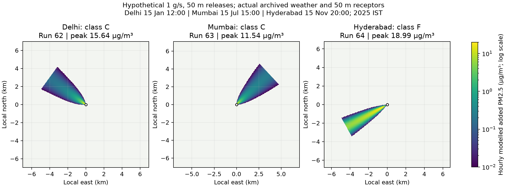

# Phase 6A: VayuSim engine, data integration and API

The engine, real-data adapters, API and verification map are implemented in
`D:\EnviroInsights-India`. The user's subsequent whole-site presentation request
covers the overview, forecasts, research, library, assistant and simulator pages.
This report separates measured software/scientific checks from predictive validity.
The [Phase 6A audit](#phase-6a-audit) below narrows the original validation claims;
it includes discrepancies beyond the original supplied-sigma concentration checks.
The full Phase 6B frontend is outside this implementation.

## Step 0 outcomes

### Forecast intervals

Existing Run 21 archived-weather evaluation results selected the closest coverage
to nominal among methods no more than five percentage points below it, separately
for each city, horizon and level. The policy is stored on all 147 model versions.
No point model was refitted. At the change, all 3,885 existing rows and their point
values were retained; 19 latest issuance rows had revised bounds. Earlier bounds
remain in provenance and `forecast-intervals-before.json`. Scheduled jobs may add
subsequent rows; 3,885 is the snapshot count, not a permanent database total.

Coverage below is retrospective selection evidence, **not independent validation**
of the selected policy. Fourteen of 42 level choices have no qualifying method;
the closest existing method is retained with an explicit failure flag. If needed,
issued 95% bounds are widened to contain the 80% interval. The archived coverage
table describes each selected family, not an independently rescored combined
nesting policy.

| City | Horizon | 80% method / coverage / gate | 95% method / coverage / gate |
| --- | --- | --- | --- |
| bengaluru | 1 | quantile_lightgbm / 71.20% / FAIL | quantile_lightgbm / 89.13% / FAIL |
| bengaluru | 2 | quantile_lightgbm / 73.37% / FAIL | quantile_lightgbm / 86.96% / FAIL |
| bengaluru | 3 | quantile_lightgbm / 73.37% / FAIL | quantile_lightgbm / 86.41% / FAIL |
| chennai | 1 | quantile_lightgbm / 72.83% / FAIL | quantile_lightgbm / 91.30% / pass |
| chennai | 2 | quantile_lightgbm / 73.91% / FAIL | quantile_lightgbm / 91.30% / pass |
| chennai | 3 | quantile_lightgbm / 74.46% / FAIL | quantile_lightgbm / 94.02% / pass |
| delhi | 1 | quantile_lightgbm / 80.43% / pass | quantile_lightgbm / 96.74% / pass |
| delhi | 2 | quantile_lightgbm / 79.89% / pass | quantile_lightgbm / 96.20% / pass |
| delhi | 3 | quantile_lightgbm / 85.87% / pass | quantile_lightgbm / 97.28% / pass |
| hyderabad | 1 | conformal / 78.26% / pass | conformal / 96.20% / pass |
| hyderabad | 2 | quantile_lightgbm / 78.80% / pass | quantile_lightgbm / 96.20% / pass |
| hyderabad | 3 | quantile_lightgbm / 78.80% / pass | quantile_lightgbm / 95.65% / pass |
| kolkata | 1 | quantile_lightgbm / 80.43% / pass | quantile_lightgbm / 94.02% / pass |
| kolkata | 2 | quantile_lightgbm / 82.61% / pass | quantile_lightgbm / 94.57% / pass |
| kolkata | 3 | quantile_lightgbm / 79.89% / pass | quantile_lightgbm / 95.65% / pass |
| mumbai | 1 | quantile_lightgbm / 82.07% / pass | quantile_lightgbm / 96.20% / pass |
| mumbai | 2 | quantile_lightgbm / 83.15% / pass | quantile_lightgbm / 96.20% / pass |
| mumbai | 3 | conformal / 78.80% / pass | quantile_lightgbm / 95.65% / pass |
| pune | 1 | conformal / 71.20% / FAIL | conformal / 88.59% / FAIL |
| pune | 2 | quantile_lightgbm / 70.65% / FAIL | quantile_lightgbm / 86.41% / FAIL |
| pune | 3 | quantile_lightgbm / 73.91% / FAIL | quantile_lightgbm / 91.30% / pass |

Failures: Bengaluru all three horizons at both levels; Chennai all three at 80%;
Pune all three at 80%, and horizons 1–2 at 95%. Quantile target distributions can
place the separate unchanged point model outside an interval. The API/UI retains
and explains that outcome instead of altering point forecasts or stretching bounds.

### Local language model

Installed RAM was 17,179,869,184 bytes (16 GiB). The requested floor of 60% gives
`[wsl2] memory=9GB` in `C:\Users\Andry\.wslconfig`. There was no existing file;
no previous settings were lost. Docker/WSL were cleanly restarted. The resumed
2026-10-15 measurement gave MemAvailable 6,909,865,984 bytes, exceeding the actual
model 1,929,912,432 bytes plus 3,221,225,472 bytes (3 GiB) headroom.

The capability is **extractive retrieval with verified citations**, not a
certified question-answering assistant. The experimental Ollama provider remains
configured as the default with `qwen2.5:3b-instruct`, Q4_K_M, digest
`357c53fb659c5076de1d65ccb0b397446227b71a42be9d1603d46168015c9e4b`.
Model files and Docker's data disk reside on D:. Generation uses temperature 0,
seed 20261010, context 16384, maximum 1600 new tokens, four CPU threads and
keep_alive=0. The provider-only evaluation uses the original 120 frozen questions;
the previous extractive evaluation is preserved.

| Ollama frozen evaluation metric | Actual result |
| --- | --- |
| questions | 120 |
| citations | 2 |
| citation_accuracy | 1.0 |
| audited_citation_uses | 2 |
| correct_citation_uses | 2 |
| groundedness_before_removal | 0.016666666666666666 |
| groundedness_emitted | 1.0 |
| emitted_sentences | 2 |
| supported_emitted_sentences | 2 |
| claims | 120 |
| supported_claims | 2 |
| removed_claims | 118 |
| number_correctness | 0.0 |
| numeric_precision | None |
| numeric_cell_exactness | 0.0 |
| correct_numeric_values | 0 |
| expected_numeric_values | 669 |
| extra_numeric_values | 0 |
| available_data_questions | 30 |
| missing_data_questions | 0 |
| available_data_answer_rate | 0.0 |
| missing_data_refusal_rate | None |
| displayed_row_exactness | 0.0 |
| correct_data_rows | 0 |
| expected_data_rows | 491 |
| data_questions_exact | 0.9 |
| correct_refusal_rate | 1.0 |
| literature_answer_rate | 0.025 |
| literature_gold_source_citation_rate | 0.025 |
| latency_seconds_mean | 80.76179166666667 |
| generation_fallbacks | 0 |

Completed 2026-10-15T15:16:48.629771+00:00; MLflow run `a70d7abfbf0149b8a4a1f78b8dad544b`.

The strict verifier requires a literal supplied `[E#]` alias and exact source
sentences/table rows. Unsupported output becomes a refusal. Do not interpret
high grounding among retained claims as a high answer rate. The frozen forecast
expectations predate the new interval bounds and new interval-policy provenance;
snapshot mismatches must be reported separately from generation correctness.
See the appended provider results in PHASE5. Only 2/80 literature questions
retained an answer, 0/30 available-data questions were answered, and all 10
unanswerable questions were refused. The 100% emitted grounding/citation scores
apply to just two retained sentences/citation uses, not to all 120 questions.

With inference finished and the reranker still resident, the final warm check
measured 5,394,948,096 bytes available against 5,151,137,904 bytes required
(actual model + 3 GiB). This also passes; the margin is small. See `warm-memory-gate.json`.

### Resident reranker and candidate gate

A dedicated single-process Celery inference worker retains the same pinned
float32 cross-encoder (maximum length 1024, batch 2). HTTP embedding requests
release their embedding model; they do not unload the resident reranker.
All 80 frozen literature questions were measured for both candidate counts.

| Metric | Fused 40 | Fused 24 |
| --- | --- | --- |
| recall_at_5 | 0.803125 | 0.809375 |
| recall_at_10 | 0.884375 | 0.903125 |
| hit_at_10 | 0.9 | 0.9125 |
| mrr | 0.6932707917082916 | 0.7010148358585859 |
| seconds | 5.121477811050002 | 2.317789466399995 |

Recall@10 improved by 1.875 percentage points, satisfying the predeclared maximum
one-point drop gate, so 24 is retained. The `seconds` row above is mean
**cache-assisted evaluation** time and is not uncached interactive latency.

| Uncached L001 stage | Before (seconds) | After resident worker (seconds) |
| --- | --- | --- |
| Cold 40 | 80.36799 | 246.86437 |
| Warm 40 | 47.59473 | 156.84292 |
| Embedding request | 10.3666 | 224.39866 |
| Rerank 40 after embedding | 66.5089 | 204.19029 |
| Warm 24 | not measured | 87.96909 |

These actual uncached after timings are slower. They do **not** establish a latency
improvement. They were recorded on different days under different competing CPU
workloads on this laptop. Identical 40 candidate IDs had exactly matching scores;
the 24 subset differed by at most 4.2841e-8. Residence fixes model lifetime and the
24-candidate gate improves the measured retrieval tradeoff; CPU latency remains
a material limitation. Evidence: `reranker-before.json`, `reranker-after.json`,
`rerank-candidate-gate.json`.

## Engine design and references

`apps/vayusim/physics/` imports NumPy only. Geographic projection, population,
weather, Django/database and artifact generation are external adapters.
The current engine version is **gaussian-briggs-1.1.0**.
Point contributions broadcast over receptors and source batches of at most 20;
area midpoint lattices and line midpoint segments conserve total Q and then use
the same superposition. They approximate extended sources, not analytic ISC
area/line integrals. Upwind receptors and the first metre downwind are excluded.

With Q in g/s, the output concentration in µg/m³ is

`C = 10^6 Q/(2π u σy σz) exp(−y²/(2σy²))`
`× [exp(−(z−H)²/(2σz²)) + exp(−(z+H)²/(2σz²))]`.

The default receptor is z=1.5 m. Reflecting images at ±2nL converge elementwise
to a relative contribution below 1e-6. At σz/L≥1.6, the vertical factor becomes
`sqrt(2π) σz/L`, giving a vertically uniform profile. Effective releases above
the lid, or receptors above it, contribute zero and are flagged. Applying an
observed lid also in stable conditions is an educational adaptation; it is not
the unlimited stable mixing assumption of ISC and is not model equivalence.

Briggs σy/σz rural/urban tables are transcribed from
[Brune, PSU METEO532 Table 2.3](https://personal.ems.psu.edu/~brune/m532/m532_theatmosphere.htm).
They are extrapolated with a flag outside the cited 100 m–10 km range. Urban is
the city default. The adjacent class-B worked example conflicts with its own
σy table; coefficients were not tuned to reproduce that inconsistency.

Wind is FROM the supplied meteorological bearing. Wind at the physical release
height is `max(1, u10 (h/10)^p)`. Exponents from
[ISC3 Volume II](https://gaftp.epa.gov/aqmg/SCRAM/models/other/isc3/isc3v2.pdf),
printed p.1-5 Table 1-1, are rural A–F .07/.07/.10/.15/.35/.55 and urban
.15/.15/.20/.25/.30/.30. Low 10 m or release-height wind is flagged.
Release height is not silently clamped to 10 m.

Briggs buoyancy `Fb = g v d²(Ts−Ta)/(4Ts)`, momentum `Fm = v²d²Ta/(4Ts)`,
stable/unstable final and distance-dependent transitional rise and stack-tip
adjustment follow ISC3 printed pp.1-6–1-11, Eqs.1-7–1-29. g=9.80616 m/s²;
stable E/F potential-temperature gradients are .020/.035 K/m. Zero flow or
diameter disables rise. Cold exhaust uses momentum only and is flagged because
dense-gas sinking is not modelled.

Stability is a disclosed approximation: measured-radiation SRDT by day using
[EPA Meteorological Monitoring Guidance](https://www.epa.gov/sites/production/files/2020-10/documents/mmgrma_0.pdf),
Table 6-7 printed p.6-16 (925/675/175 W/m²), and Turner cloud/wind classes at
night. It is **not full Turner**, because cloud ceiling and nighttime delta-T
are unavailable. Daytime classes use measured radiation; an overcast daytime
hour is not overridden using the separate nighttime cloud table.

If BLH is absent, [CDM2 Table 5, printed p.15](https://nepis.epa.gov/Exe/ZyPURL.cgi?Dockey=9101EO4F.TXT)
supplies stability ratios. L=1500 m is the Turner Problem 6 illustrative inversion;
Lmin=500 m is an illustrative screening case in
[EPA Screening Procedures, Figure 4-19 printed p.4-62](https://nepis.epa.gov/Exe/ZyPURL.cgi?Dockey=2000F86J.TXT).
Transferred values A2250, B/C/D-day1500, D-night1000, E/F500 m are educational
assumptions, **not Indian climatology, measured BLH or universal EPA defaults**.
Every affected result contains the fallback and citation flags. The three final
real-weather examples below all have warehouse-supplied BLH; none needs this
fallback. Open-Meteo/ERA5 grid-point meteorology is archived model/reanalysis
data, not direct measurements of BLH. The provenance `observed` flag distinguishes
a supplied warehouse value from the illustrative fallback, not an instrument.

## Numerical validation

Gaussian tests use the source's own published dispersion inputs. The exact-page
worked example is [Cimbala ME433 Lesson06E, PDF p.3](https://www.me.psu.edu/cimbala/me433/Lesson_Notes/ME433_Lesson_06_E_Reflecting_Ground.pdf):
Q=110 kg/s, u=5 m/s, effective H=100 m, x=4.85 km, Martin σy=278.97 m,
σz=87.51 m, reflected ground concentration 149.3 mg/m³. These Martin sigmas
are supplied to the Gaussian primitive; Briggs is a separate parameterisation.
The extra [Turner AP26 Chapter 7 Problem 9 Table 7-4](https://nepis.epa.gov/Exe/ZyPURL.cgi?Dockey=9101GKEZ.TXT)
check uses an unpaginated EPA HTML transcription (no invented printed page).

| Worked example | Published µg/m³ | Computed µg/m³ | Absolute error % |
| --- | --- | --- | --- |
| Turner Table7-4 z=0m | 278.0000 | 274.592426 | 1.225746 |
| Turner Table7-4 z=30m | 285.0000 | 283.075948 | 0.675106 |
| Turner Table7-4 z=150m | 358.0000 | 356.331422 | 0.466083 |
| Cimbala Lesson06E PDF p3 | 149,300.0000 | 149,314.351448 | 0.009612 |

All four supplied-sigma Gaussian comparisons above are below 10%; this does
not establish that Briggs sigmas reproduce either source's parameterisation.
The Turner physical page remains unverified, so its three rows are retained as
**formula check only** in the audit. The following rounded arithmetic evaluates
the same Briggs formulas as the implementation. It is **formula check only**,
not independently printed numerical sigma validation. Treating it as evidence
that the end-to-end parameterisation was validated would be circular. The audit
reports the actual Briggs-versus-printed-Martin discrepancies separately.

| Environment/class at 1 km | Computed σy / σz (m) | σy error % | σz error % |
| --- | --- | --- | --- |
| rural/A | 209.761770 / 200.000000 | 0.000110 | 0.000000 |
| rural/B | 152.554014 / 120.000000 | 0.000009 | 0.000000 |
| rural/D | 76.277007 / 37.947332 | 0.000009 | 0.000875 |
| rural/F | 38.138504 / 12.307692 | 0.001302 | 0.002500 |
| urban/A | 270.449362 / 339.411255 | 0.000134 | 0.000075 |
| urban/D | 135.224681 / 122.788123 | 0.000236 | 0.000100 |
| urban/F | 92.966968 / 50.596443 | 0.000034 | 0.000875 |

All six required Hypothesis properties pass: reflected crosswind mass integral,
crosswind symmetry, Q linearity, source superposition, non-increasing ground
maximum with increased effective release height at identical wind/dispersion,
and zero upwind concentration. The stack-height property explicitly fixes
transport and has z=0/no rise/no lid; it does not claim every coupled plume-rise
configuration is monotonic. Three stored independent scalar-oracle golden fields
pass. Additional tests cover lid mass/uniform mixing, A–F heterogeneous rising
source broadcasting, stability tables, wind profiles, area/line mass conservation,
strict input rejection, synthetic raster count/support, cache uniqueness,
concurrent lazy materialisation and server-computed RAG provenance.

Pre-audit container output: **242 passed, 149 warnings in 39.09 s**. All 41 original
test/support/fixture files are SHA256-identical; all 183 original tests remain.
The frozen question hash and all 32 original Phase 5 result artifacts also match.
Ruff: `All checks passed!`; format: `261 files already formatted`.

## Performance

| Sources | Median ms | Min ms | Max ms | Timed repetitions |
| --- | --- | --- | --- | --- |
| 1 | 6.127 | 5.588 | 7.398 | 20 |
| 20 | 255.313 | 212.995 | 319.776 | 20 |

Measured on Intel Core i5-13420H (8 cores/12 logical processors), 16 GiB RAM,
Windows 11 with the 9 GB WSL2 limit; Python 3.12.15/NumPy 2.5.3 in Linux Docker.
200×200 receptors, float32 result, one warmup before 20 repetitions, one NumPy
thread. This times the pure engine, including buoyant rise, not projection,
population reprojection or response artifacts. The local Qwen evaluation and
normal Docker services were active. The one-source <100 ms target passes;
20-source latency is reported without an invented target. Source broadcasting
increases working memory and does not imply a guaranteed multicity speedup.
Reproduce with `docker compose exec -T web python manage.py verify_vayusim`.

## Real-data integration and three actual examples

Hourly WeatherObservation timestamps are UTC. An IST hour starting 06:30 UTC
uses its 07:00 UTC midpoint observation, which avoids shifting the IST half-hour
offset. Missing required weather is unavailable, not synthetic observations.

WorldPop 2025 counts become geodesic source-cell population densities, warped
by area-weighted rasterio reprojection onto the rotated AEQD grid. A separate
fractional support mask prevents nodata from being extrapolated over missing
areas. Known population counts are retained; unknown population is excluded,
and support area is reported. Reprojection is an approximate finite-cell
method, tested for conservation on known synthetic grids, not a census.

Every demonstration is a **hypothetical 1 g/s source**. All three deliberately
use the same hypothetical 1 g/s
primary PM2.5 point release at 50 m, diameter/velocity 0 (no rise), 293.15 K
(irrelevant at zero flow), urban dispersion, z=1.5 m, 10 km/50 m grid.
These are declared software demonstration assumptions, not measured facilities,
AP-42 defaults or source-apportionment findings. Weather, population and the
computed scenario outputs are real stored runs.

| City / IST hour / ScenarioRun | Class | Peak added µg/m³ | Nearest source–peak m | Population >1 µg/m³ | Population support | Population-weighted increment µg/m³ |
| --- | --- | --- | --- | --- | --- | --- |
| Delhi, 2025-01-15 12:00 IST, #62 | C | 15.641839 | 176.777 | 11,787.141 | 91.306% | 0.025990 |
| Mumbai, 2025-07-15 15:00 IST, #63 | C | 11.536741 | 176.777 | 5,906.777 | 93.905% | 0.029134 |
| Hyderabad, 2025-11-15 20:00 IST, #64 | F | 18.990891 | 725.431 | 66,300.357 | 96.022% | 0.245285 |

| City | u10 m/s | Wind FROM ° | Air K | Shortwave W/m² | Cloud fraction | Warehouse BLH m | Same-hour nearby CPCB readings |
| --- | --- | --- | --- | --- | --- | --- | --- |
| Delhi | 3.26 | 126.0 | 285.65 | 501.0 | 0.71 | 815.0 | 33 |
| Mumbai | 4.42 | 227.0 | 300.65 | 296.0 | 1.0 | 460.0 | 25 |
| Hyderabad | 2.06 | 61.0 | 292.45 | 0.0 | 0.0 | 65.0 | 8 |

Population is modelled and fractional, so table decimals are retained for audit;
the UI rounds people. Population values cover the modelled footprint only and
its known raster support, not an entire city. At fixed weather, source/release
geometry and grid, concentration and peak scale linearly with Q; population
above a fixed concentration threshold does not. Concentrations are hourly increments from these assumed
sources. CPCB/OpenCity-CPCB readings are quality-OK nearby **measured total (all
sources)** within the same IST hour and remain separate; they are never added.
Peak is a 50 m lattice maximum, not a continuous analytical peak. All runs
retain assumptions, exact weather row/source, population SHA, engine version,
input hash, limits and flags. Old engine-version runs are retained.

Delhi 2025-01-15 day mode returned **24/24 available hourly summaries**. Grids
were initially lazy; the first metadata request successfully materialised grid
and contours. All three runs' detail, shared scenario, binary, JSON and PNG
requests returned HTTP 200; each default binary is 160,000 bytes.

## Presets and citations

| Family | Geometry | AP-42 source section | Physical numeric defaults |
| --- | --- | --- | --- |
| Thermal power plant | point | 1.1 Bituminous/subbituminous coal combustion | all null; required |
| Brick kiln cluster | area | 11.3 Brick/structural clay products | all null; required |
| Industrial boiler | point | 1 External combustion; select actual fuel/controls | all null; required |
| Crop-fire field | area | 2.5 Open burning; verify crop/activity/fine fraction | all null; required |
| Road dust resuspension (stable ID `highway`) | line | [13.2.1 January 2011](https://www.epa.gov/sites/default/files/2020-10/documents/13.2.1_paved_roads.pdf), §13.2.1.1 p.13.2.1-1 and §13.2.1.3 p.13.2.1-4 (PDF pp.1,4); excludes exhaust/brake/tire wear | all null; required |

Each preset links to the [EPA AP-42 compilation](https://www.epa.gov/air-emissions-factors-and-quantification/ap-42-compilation-air-emissions-factors-stationary-sources)
and its exact section. No universal, defensible facility emission rate, height,
diameter, exit velocity or temperature was established. Those five fields are
null and required. Activity-based total particulate factors are not silently
converted to instantaneous primary PM2.5 g/s. Area/line geometry and subdivision
counts also require explicit input. No numbers were invented to make a preset
appear complete.

The road preset requires the total segment primary PM2.5 rate in g/s; it does
not accept a g/VKT emission factor or a per-metre rate as that total. The cited
January 2011 road-dust equation excludes exhaust, brake wear and tire wear.
No transferable fleet-specific exhaust factor was established in this audit;
exhaust emissions remain a required independently justified user input for a
separately specified source, not an implied component of this preset.

## Stored evidence and assistant integration

`vayusim_run(run_id)` is a strict whitelisted tool returning stored summary,
engine version, hash and scenario provenance. `/api/rag/explain/` with
`context_type=scenario,payload.run_id` combines that tool with retrieved
literature. Arbitrary client parameters remain unverified context. The separate
five-question VayuSim set checks exact stored values, stability/provenance,
population/support, separation from measured totals and limitations; all five
pass exact citation support with the deterministic extractive provider and
keyword literature retrieval. This is integration evidence, **not a measured
five-question generative LLM quality claim**, and not part of the frozen Phase 5
evaluation. The independent provider results are reported above.

An additional real HTTP request to the default-provider explanation endpoint
returned 200 in 405.516 s using Ollama. Its tool result exactly matched Hyderabad
ScenarioRun 64; the deliberately incorrect client peak 999999 was absent. The
generated explanation omitted valid evidence aliases and was rejected to a
refusal, with no generation or retrieval exception. This proves live routing
and stored-value isolation, **not successful generative explanation quality**.
The complete response is `default-provider-explain.json`.

Lazy materialisation reads the run's canonical input/weather snapshot, not the
editable Scenario record. A regression changes a scenario's emission by 100×
after summary creation and confirms its historical lazy grid still matches
the original peak/hash. This preserves result identity across future edits.

## Whole-site UI and browser verification

The additional requested presentation work gives all six main pages a shared
responsive navigation, typography, green/ivory palette, accessible labels, cards,
empty/loading/error states and explicit dates. Overview cards use actual stored
counts/results. Forecasts show horizon intervals, failed coverage warnings and
actual SHAP contributions. Research shows fixed-panel/all-station distinctions,
intervals and the observed calendar gap. Library search exposes source/licence
and page links. Ask renders safe Markdown plus source links and plaintext audit.
VayuSim supports click/drag placement, cited source families, manual/real weather,
PNG/contours, exposure, measured background and share/download/explain controls.

MapLibre GL JS 5.24.0 and its BSD-3-Clause licence are vendored. The basemap is
OpenStreetMap raster with visible attribution; no paid key, offline bulk fetch
or prefetch. The UI is a one-source verification form; the API supports multiple
sources. Shared one-source scenarios repopulate city, time and source values;
shared multiple-source results are viewable, with edits directed to the API.

Headless Microsoft Edge/Playwright returned HTTP 200 on all six pages at both
1440 px and 390 px, without horizontal overflow or JavaScript errors. Actual
interactions exercised mobile navigation, city selection (three forecast cards),
research mode (seven NCAP cards), AERMOD library filtering, example-question fill,
shared Hyderabad output and an actual map run/overlay. Browser artifacts are in
the verification folder; screenshots are retained under `.tools/phase6a-validation/`.

## Failures found, root causes and corrections

| Failure | Root cause / correction | Measured rerun |
| --- | --- | --- |
| Docker unavailable on resume | Installed Docker Desktop was stopped; start hidden and bring Compose up | Services running/healthy; health 200 |
| Resident reranker lacked Django model registry | Standalone entrypoint needed django.setup() before database result backend | Resident worker requests returned scores matching original |
| Population warp overstated nodata-border support | GDAL excludes nodata from density average; preserve a separate fractional support mask and do not extrapolate | Synthetic count/partial-nodata checks pass; final real exposure recomputed |
| GDAL denormal nodata warning | Zero destination nodata was converted to a tiny sentinel; use NaN nodata and explicit mask | No warning in final reprojection checks |
| New transactional test missing analytics table after original migration test | Original test intentionally restores warehouse-only migration; arrange full leaf schema inside new test | 242 full-suite tests pass; original test unchanged |
| Hypothesis generation timing health check under concurrent inference | CPU contention and Windows bind-mounted cache; put storage in /tmp and briefly pause inference during test, then unpause | Unchanged 53 targeted tests pass, then all242 pass |
| Map repeated-run wait could hang | map.loaded() can be false during tile refresh after load event; cache initial load Promise | Browser map run/share checks pass |
| Shared form showed default city/blank assumptions | Map result was loaded without repopulating controls; restore saved inputs and robust IST datetime | Shared Hyderabad form/output browser check passes |
| Standalone verification helper import error | Script path omitted project PYTHONPATH; invoke with -e PYTHONPATH=/app | Five scenario evidence checks pass |
| Local model refuses most answerable questions | Model output omits required evidence aliases and/or exact supported text; verifier rejects claims | No verifier weakening or synthetic fallback score; completed 120-question results above |

The pre-audit 149 suite warnings were retained, primarily Django 6 URL-scheme deprecation,
NumPy generic timedelta deprecation and statsmodels convergence warnings.
The preexisting netCDF4/NumPy ndarray-size warning, SHAP/matplotlib deprecations
and MLflow type-hint warning also remain. The original baseline log contains
the same warning classes; they were not suppressed or treated as proof of
compatibility outside the tested paths.
`check --deploy --settings=enviroinsights.settings.prod` reports **no issues
(0 silenced)**, so there are no deployment warnings to list or suppress.
Migration drift and OpenAPI validation checks pass.

## Decisions

1. Preserve original tests, gold questions, original extractive artifacts and
   old simulation runs; new outputs have separate directories/version hashes.
2. Keep the requested retrospective interval-selection rule even when no method
   passes; flag the 14 failures and preserve unchanged point forecasts.
3. Adopt 24 candidates on its predefined recall gate; do not claim a latency
   improvement contradicted by uncached measurements.
4. Keep source-specific physical defaults null when citations do not establish
   them. Demonstration source assumptions are explicit and distinct from data.
5. Use the measured-radiation/cloud-table stability hybrid and cited BLH transfer
   anchors with persistent flags rather than claiming unavailable full Turner
   inputs or local climatology.
6. Preserve unknown population support. Report known hourly added exposure;
   do not invent zeros outside the raster or extrapolate counts over nodata.
7. Use local AEQD and bounded source/receptor broadcasting. Performance numbers
   cover the engine only and include actual background laptop CPU contention.
8. Fulfil the later whole-site UI request while leaving Phase 6B's cinematic
   frontend and additional research scope for its own phase.

## Limitations

Primary PM2.5 only: no chemistry, secondary aerosol, deposition or removal.
Flat terrain and uniform steady hourly meteorology; no building downwash beyond
stack-tip. Calm wind, near-field coefficient extrapolation, stable shallow lids,
cold exhaust and extended-source discretisation need caution. No regulatory
assessment or claim of equivalence with AERMOD. Real regulatory work needs
appropriate emissions, meteorological preprocessing and model configuration.
The demonstration has no measured facility inventory. BLH transfer defaults
are illustrative. WorldPop is modelled 2025 population with missing support;
exposure is not daily/annual exposure, dose, health impact or causal attribution.
Partial support, grid resolution and assumed source parameters limit precision.
Reranking/generation are CPU-bound and can take minutes; strict citation support
does not measure semantic correctness or completeness. Existing data gaps,
fixed-panel restrictions, causal limitations and replay labels still apply.
The development server and public local scenario shares are not a production
authentication/hosting deployment.

## Phase 6B API contract

| Endpoint | Contract |
| --- | --- |
| `POST /api/vayusim/run/` | Strict finite JSON, city slug, centre `[lon,lat]`, 1–20 sources, real/manual weather, offset-aware datetime; returns run ID, flags, summary, contours, URLs and cache flag |
| `GET /api/vayusim/runs/<id>/` | Re-open an actual stored run and its provenance |
| `GET /api/vayusim/grid/<id>.bin` | Row-major little-endian float32; default200×200=160000 bytes; `X-Grid-Header` points to metadata |
| `GET /api/vayusim/grid/<id>.json` | Shape, dtype/order, six affine coefficients, AEQD WKT, four lon/lat corners in image order, receptor height, units, label, version/hash, flags, limits and contours |
| `GET /api/vayusim/grid/<id>.png` | Transparent at ≤1 µg/m³, category-colour overlay; hourly increment, **not CPCB AQI** |
| Contours | GeoJSON FeatureCollection in WGS84 lon/lat, thresholds1/15/60/120 plus user values; may be empty; metadata request materialises lazy contours |
| `GET /api/vayusim/scenarios/<slug>/` | Stored inputs and versioned runs for a shared scenario |
| `POST /api/vayusim/day/` | Real weather only, uses the supplied datetime's IST date, 24 entries with availability/reason and summary; grids/contours on demand; **24 independent hours**, not averaged exposure |
| `GET /api/vayusim/presets/` | Five source families, null physical defaults, required inputs and citations |
| `GET /api/vayusim/stations/?city=&datetime=` | Same-hour nearby measured totals; never summed with modelled increment |
| `POST /api/rag/explain/` | `context_type=scenario`, `payload.run_id` selects stored evidence; returns answer, citations, provider and verification |

Affine maps **pixel corners** to east/north metres; sample receptors at
`(column+0.5,row+0.5)`. Wind rotates the grid. PNG corners are top-left,
top-right,bottom-right,bottom-left, with their actual geographic positions;
do not assume an unrotated north-up image. Validate returned shape/resolution.
The frontend must display increment versus measured-total labels, hourly scope,
real/manual weather, actual date and source assumptions, source citations,
population support/unavailability, all flags/limits and replay/provider
verification. Do not animate missing hours as zeros or hide fallback weather.

An older run without a retained grid cannot be silently materialised by a new
engine under its old version label. Its summary stays available; grid requests
return400 with instructions to submit its saved inputs as a new versioned run.

Full commands and measured output are recorded in [VALIDATION](../VALIDATION.md).
Structured local proof files are under `data/results/vayusim/verification/`.
Their final manifest hashes retained files; downloaded scientific source
manifests are under `data/raw/vayusim/`. Re-run the committed verification
command against the retained database/raw assets to reproduce the examples.

## Phase 6A audit

Completed from commit `b5136b2` in `D:\EnviroInsights-India`.
No Phase 6B work, new language-model evaluation, prompt tuning, coefficient
fitting, evaluation-label edits or original-test changes occurred. Structured
measurements are in [PHASE6A_AUDIT_METRICS.json](PHASE6A_AUDIT_METRICS.json).
Every shell command and actual output, including failed attempts, is retained
in [VALIDATION](../VALIDATION.md#phase-6a-audit-command-journal-15-october-2026).

### Decisions

1. Keep 5% sigma and 10% concentration tolerances unchanged. Use independently
   transcribed source values; classify same-formula arithmetic as formula check
   only. A different published parameterisation is not a fitting target.
2. Keep the existing candidate default only when the gain has an evidenced cause
   and the original maximum one-point Recall@10 drop gate holds against both
   fresh K=40 and the historic K=40 baseline. K=32 is diagnostic, not a newly tuned winner.
3. Score each frozen query's 40 pairs freshly once and filter that fixed scored
   set at 24/32/40. This isolates candidate competition without conflating it with
   batch/model differences. Independently time actual uncached 24/32/40 RPCs.
4. Relabel stable ID `highway` as road dust resuspension, because the verified
   January 2011 AP-42 pages exclude exhaust/brake/tire wear. Keep the rate required.
5. Preserve prompts, provider configuration and frozen labels. Decline the optional
   larger-model evaluation; this audit needs an accurate status, not model tuning.
6. Back up the current 9GB WSL file. The prior report records no original existed;
   do not claim a nonexistent historical backup. Keep resource and quality gates separate.
7. Fix project-controlled warning causes with explicit URL-form settings and
   accurate model input/return types. Leave upstream warnings visible with reasons;
   do not edit original tests, suppress categories or change frozen estimator settings.
8. Derive API disclosures from retained run inputs. Do not rewrite old numerical
   summaries, hashes or engine versions. Retain original result artifacts separately.

### Textbook audit and corrections to earlier claims

The seven sigma tests contain literal rounded values, not calls to the engine
to construct their expectations at test time. However, an independently printed
numeric source for those 14 values could not be verified: PSU's Table 2.3 prints
the same formulas. Their exact authoring provenance is **unverified** beyond
the test docstring's arithmetic claim. They are useful transcription/formula
checks, but using them as independent textbook/physical validation would be
circular. They are now explicitly **formula check only**, even when below 5%.

The independently transcribed Cimbala references come from
[ME433 Lesson06E, physical PDF page 3](https://www.me.psu.edu/cimbala/me433/Lesson_Notes/ME433_Lesson_06_E_Reflecting_Ground.pdf).
The handwritten solution shows sigma-y=278.97 m, sigma-z=87.51 m and 149.3 mg/m³
(149300 µg/m³), at x=4850 m, Q=110 kg/s, effective H=100 m and transport wind=5 m/s,
class D. The retained PDF SHA256 is
`ce00801de32bd1b085c8ac86096352cc398f0923b569820e622eef471ae79462`. Page 3 was visually inspected.
The Gaussian primitive concentration expectation is therefore **not circular**.
Those are Martin sigmas, so the audited Briggs rural-D comparison is disclosed
separately; it fails the unchanged sigma and concentration tolerances. It is
not an excuse to fit Briggs coefficients to the Martin lesson.

[Turner AP26, Chapter 7 Problem 9 Table 7-4](https://nepis.epa.gov/Exe/ZyPURL.cgi?Dockey=9101GKEZ.TXT)
contains the independent HTML references 278/285/358 µg/m³ and chart inputs
157/110 m. Its physical printed page is **unverified**: the attempted EPA PDF
URL returned HTML. Under this audit's page requirement it remains **formula
check only**. No printed page number is invented.

[Brune §2.2.5 after Table 2.3](https://personal.ems.psu.edu/~brune/m532/m532_theatmosphere.htm)
is unpaginated and claims 210/120 m for class B at 1 km. Its own rural-B formula
gives 152.554014/120 m. The sigma-y discrepancy is 27.355231%; it resembles a
class A value, but a class mix-up is an inference, not a verified publisher correction.

Concentration references/results below are µg/m³; sigma references/results are m.
Errors use `100 * abs(computed-reference) / abs(reference)`. All reference numbers and
locators are retained in `tests/fixtures/vayusim-textbook-audit.json`.

| Reference / check | Reference | Computed | Error % | Tolerance % | Result / scope |
| --- | --- | --- | --- | --- | --- |
| Cimbala PDF p3: Gaussian with published Martin sigmas | 149300.000000 | 149314.351448 | 0.009612 | 10.0 | within tolerance; textbook validation of Gaussian primitive only |
| Cimbala PDF p3: Briggs rural-D sigma-y vs published Martin sigma-y | 278.970000 | 318.396657 | 14.132938 | 5.0 | **FAIL**; cross-parameterisation disagreement, not a calibration target |
| Cimbala PDF p3: Briggs rural-D sigma-z vs published Martin sigma-z | 87.510000 | 101.160039 | 15.598262 | 5.0 | **FAIL**; cross-parameterisation disagreement, not a calibration target |
| Cimbala PDF p3: Gaussian using Briggs rural-D sigmas | 149300.000000 | 133382.771845 | 10.661238 | 10.0 | **FAIL**; cross-parameterisation disagreement, not a calibration target |
| Turner Table 7-4 z=0m | 278.000000 | 274.592426 | 1.225746 | 10.0 | within tolerance; formula check only; physical page unverified |
| Turner Table 7-4 z=30m | 285.000000 | 283.075948 | 0.675106 | 10.0 | within tolerance; formula check only; physical page unverified |
| Turner Table 7-4 z=150m | 358.000000 | 356.331422 | 0.466083 | 10.0 | within tolerance; formula check only; physical page unverified |
| Brune paragraph class-B sigma-y | 210.000000 | 152.554014 | 27.355231 | 5.0 | **FAIL**; source paragraph/table inconsistency diagnostic |
| Brune paragraph class-B sigma-z | 120.000000 | 120.000000 | 0.000000 | 5.0 | within tolerance; source paragraph/table inconsistency diagnostic |

All 14 original rounded sigma checks follow. Their numeric errors are retained,
but their tolerance result is not promoted to independent validation.

| Same-formula case | Derived reference sigma-y / sigma-z m | Computed sigma-y / sigma-z m | Error y / z % |
| --- | --- | --- | --- |
| rural/A | 209.762 / 200.000 | 209.761770 / 200.000000 | 0.000109823 / 0.000000000 |
| rural/B | 152.554 / 120.000 | 152.554014 / 120.000000 | 0.000009360 / 0.000000000 |
| rural/D | 76.277 / 37.947 | 76.277007 / 37.947332 | 0.000009360 / 0.000874699 |
| rural/F | 38.139 / 12.308 | 38.138504 / 12.307692 | 0.001301634 / 0.002499938 |
| urban/A | 270.449 / 339.411 | 270.449362 / 339.411255 | 0.000133671 / 0.000075121 |
| urban/D | 135.225 / 122.788 | 135.224681 / 122.788123 | 0.000236083 / 0.000099931 |
| urban/F | 92.967 / 50.596 | 92.966968 / 50.596443 | 0.000034399 / 0.000874699 |

The earlier 0.0096–1.23% range describes only the four supplied-sigma Gaussian
checks. It does **not** describe full Briggs agreement: the additional errors
are 14.132938%, 15.598262%, 10.661238% and the source inconsistency 27.355231%.
Independent printed Briggs numeric sigma agreement within 5% remains unestablished.

### Highway citation decision

Stable ID `highway` now displays **Road dust resuspension**. The retained
[AP-42 January 2011 §13.2.1](https://www.epa.gov/sites/default/files/2020-10/documents/13.2.1_paved_roads.pdf),
§13.2.1.1 printed p. 13.2.1-1 (PDF p. 1), explicitly separates resuspension from
exhaust, brake wear and tire wear. §13.2.1.3 printed p. 13.2.1-4 (PDF p. 4) gives
the dust equation and separates other vehicle emissions. No applicable generic
India-fleet exhaust factor was established; it remains required if modelled as
a separately justified source. All five physical defaults remain null. The
required emission is total segment primary PM2.5 g/s, not g/VKT or g/s/m.
The preset/API citation table and limitations now state this scope explicitly.

### Reranker comparison and cause

All 80 frozen literature queries were freshly scored without the pair cache,
once over their fused 40. K=24/32/40 use subsets of the same fixed pair scores.
Model revision `953dc6f6f85a1b2dbfca4c34a2796e7dde08d41e`, CPU float32,
1024-token limit, batch size 2, four Torch threads and seed 20261010 are unchanged.
RRF k=60 and both first-stage limits of 40 are unchanged. Query vectors were cached.

| K | Recall@5 | Recall@10 | MRR through K | Cold L001 s | Warm L001 s |
| --- | --- | --- | --- | --- | --- |
| 24 | 0.809375000000 | 0.903125000000 | 0.701014835859 | 63.861518 | 31.741508 |
| 32 | 0.803125000000 | 0.884375000000 | 0.700181277056 | 76.974456 | 42.284033 |
| 40 | 0.803125000000 | 0.884375000000 | 0.693270791708 | 102.609534 | 52.454254 |

Cold/warm timings are each one actual uncached L001 RPC per K, in order 40, 32, 24.
The worker was restarted before each cold measurement. Cold refers to the model
process, **not a flushed OS file cache**; warm means the immediately repeated
RPC. Pair caches were bypassed for both. Other normal services remained running.
These are measured samples, not confidence intervals or full-corpus averages.
The full fresh K=40 comparison averaged 63.425801 s/query;
other audit checks and the suite ran during parts of that pass. It is not a
controlled speed comparison with the earlier Phase 6A timings, which remain above.

Historical K=40 ordering restricted to the 24 candidates equals K=24 for 80/80 queries.
Fresh K=40 and K=24
orders each match their historic counterparts for
76/80 and
77/80 respectively;
fresh K=40 candidate sets match for 80/80.
This evidences candidate competition, rather than a resident-model improvement.
The retained pair cache reconstructs 80 historical
orders from 80 queries with complete
cached pairs. Fresh scores differ from those cached values by at most
7.45058059692e-08. Near-tie movement changes some
ordering: 79/80 top-10 orders and
80/80 top-10 sets are exactly unchanged. The precise
floating-point kernel/batching mechanism is **unverified**; measured drift and
individual moved scores/ranks are retained in `reranker-score-drift.json`.
For the actual independent K timing probes the maximum warm-prefix score
difference from 40 is 4.76837158203e-07;
the largest cold/warm difference is 0.
Ties use ascending chunk ID. Exact score ties among the displayed gain/displacer
pairs: `False`. The gain rows and actual pair scores are:

| Query | Known-gold chunk | Rank40 | Rank24 | Fixed pair score | Removed higher-scoring non-gold chunks |
| --- | --- | --- | --- | --- | --- |
| L025 | 50660 | 13 | 10 | 0.073289424181 | 50644 (0.264985233545, rank1), 50681 (0.105676166713, rank10) |
| L072 | 43818 | 14 | 9 | 0.0752021819353 | 43545 (0.604610085487, rank2), 50687 (0.30640399456, rank5), 47410 (0.189759835601, rank9), 43796 (0.180791005492, rank10) |

Loss rows (query, lost known-gold IDs, Recall@10 change): `[('L023', [50659], -0.5)]`.
Two historical gains of 1 and one loss of 0.5 give `(1+1-0.5)/80=0.01875`,
exactly the earlier 1.875-point gain. Non-gold means absent from these incomplete
frozen labels, not independently judged irrelevant. This is a repeated frozen
benchmark audit, not new out-of-sample evidence or a tuning exercise.
Recall@5/10 is measured before the service's evidence filtering. For example,
L025's gained gold is rank 10 with score 0.07328942418, below the existing 0.2
relevance floor and outside the eight retained passages. That recall gain does
not itself establish improved returned evidence or answer quality. The floor
and retained-passage count were not changed.

**Chosen default: 24.** Cause evidenced: `True`.
Fresh40 minus 24 Recall@10=-0.018750000000; historic K=40 minus 24=-0.018750000000,
both compared with the unchanged maximum 0.01 drop gate. K=32 is reported without
selecting a new optimum from this benchmark. Evidence retains every candidate
ID, text SHA, score and per-query metric in `reranker-state.json`.

### Assistant resource and quality status

Installed RAM is 17,179,869,184 bytes (16 GiB); Windows
usable RAM is 16,852,574,208 bytes. These are separate
actual CIM measurements. `.wslconfig` exists at `C:\Users\Andry\.wslconfig`
with `[wsl2] memory=9GB`. The current file is backed up at
`C:\Users\Andry\.wslconfig.phase6a-audit-20261015.bak`; both files have SHA256
`d4f748ea8f222563e1beb8319e62496c62635ce052aa4dd380ee332b73375268`. There was no original backup at audit start.
The prior report records no pre-Phase 6A file existed; that historical absence
cannot be independently reconstructed now. The new file preserves current
settings and is **not** misrepresented as a pre-change original.

The readiness endpoint returned **HTTP 200**, all
checks true. After the full evaluation/tests, with the reranker still resident
and normal services running, MemAvailable was
4,103,503,872 bytes, compared with the installed Qwen
file 1,929,912,432 bytes + 3 GiB headroom =
5,151,137,904 bytes; resource gate=False.
An earlier audit measurement was 5,415,559,168
bytes and passed the same gate. The **final measurement fails**, so memory
eligibility is not a permanent certification. The cause of the lower final
availability is **unverified**; no allocator/kernel change is asserted or tuned.
No larger model was downloaded/evaluated, and no provider/prompt was tuned.

The final description in README, Architecture, this report and the Ask page is
**extractive retrieval with verified citations**. The configured experimental
Qwen provider remains unchanged. Its existing 120-question evaluation retained
only 2/80 literature answers, 0/30 available-data answers and refused 10/10
unanswerable questions. Two supported citations do not certify answer quality.
The earlier 0.9 data-snapshot match is not numeric answer correctness. The
answer-quality acceptance gate remains **not passed**; the resource gate does
not change that status.

### Warnings and final tests

Before: 149 warnings, including
2 project-controlled causes. After:
**147 warnings, zero project-originated**, all remaining
warnings upstream. DRF warnings: 0. Original test files are byte-identical.
Source is classified by the implementation that emits the warning, not just
the reported stacklevel callsite; standalone pandas construction reproduces
the 142 datetime warnings without any project import.

| Origin | Category | Exact message | Before | After | Action / reason retained |
| --- | --- | --- | --- | --- | --- |
| Django / project URL-form configuration | RemovedInDjango60Warning | The default scheme will be changed from 'http' to 'https' in Django 6.0. Pass the forms.URLField.assume_scheme argument to silence this warning, or set the FORMS_URLFIELD_ASSUME_HTTPS transitional setting to True to opt into using 'https' as the new default scheme. | 1 | 0 | Fixed with an explicit HTTPS URL form field and admin field overrides; no transitional setting or warning filter. |
| MLflow / project model adapter | UserWarning | Add type hints to the `predict` method to enable data validation and automatic signature inference during model logging. Check https://mlflow.org/docs/latest/model/python_model.html#type-hint-usage-in-pythonmodel for more details. | 1 | 0 | Fixed RegisteredForecaster.predict DataFrame input and ndarray return annotations; no warning filter. |
| SHAP / matplotlib | PendingDeprecationWarning | The set_bad function will be deprecated in a future version. Use cmap.with_extremes(bad=...) or Colormap(bad=...) instead. | 1 | 1 | Pinned SHAP 0.52.0 calls deprecated matplotlib colormap setters at import. No vendored library patch or blanket suppression; retain until compatible upstream upgrade. |
| SHAP / matplotlib | PendingDeprecationWarning | The set_over function will be deprecated in a future version. Use cmap.with_extremes(over=...) or Colormap(over=...) instead. | 1 | 1 | Pinned SHAP 0.52.0 calls deprecated matplotlib colormap setters at import. No vendored library patch or blanket suppression; retain until compatible upstream upgrade. |
| SHAP / matplotlib | PendingDeprecationWarning | The set_under function will be deprecated in a future version. Use cmap.with_extremes(under=...) or Colormap(under=...) instead. | 1 | 1 | Pinned SHAP 0.52.0 calls deprecated matplotlib colormap setters at import. No vendored library patch or blanket suppression; retain until compatible upstream upgrade. |
| netCDF4 / NumPy | RuntimeWarning | numpy.ndarray size changed, may indicate binary incompatibility. Expected 16 from C header, got 96 from PyObject | 1 | 1 | Error-mode trace identifies compiled netCDF4._netCDF4 import. Existing parser tests pass, but full ABI compatibility is unverified; retain visibly pending compatible wheel/rebuild. |
| pandas / NumPy | DeprecationWarning | The 'generic' unit for NumPy timedelta is deprecated, and will raise an error in the future. This includes implicit conversion of bare integers (e.g. `+ 1`). Please use a specific unit instead. | 142 | 142 | Standalone pd.Timedelta(hours=1) reproduces the warning without project imports. Root is pandas 2.3.3 Cython conversion with NumPy 2.5.3. Original tests untouched; dependency upgrade/rebuild deferred, visible and unsuppressed. |
| statsmodels | ConvergenceWarning | Maximum Likelihood optimization failed to converge. Check mle_retvals | 1 | 1 | SARIMAX maximum likelihood does not converge on the original 12-row synthetic state-leakage fixture. The adapter records the convergence flag in tuning metadata. Do not change frozen estimator iterations, edit the fixture or hide the warning. |

An initial URL fix using `FORMS_URLFIELD_ASSUME_HTTPS` exposed its own Django5.2
deprecation (intermediate 148 warnings). It was removed. Explicit URL field
classes/admin overrides choose HTTPS for schemeless curator input and preserve
explicit HTTP, blank/length metadata and stored URLs. MLflow's adapter now has
accurate DataFrame/ndarray hints; this does not claim new automatic schema certification.
No warning suppression was added. Error-mode traces identify pandas Cython and
the compiled netCDF4 extension; ABI compatibility beyond tested paths is unverified.

Final full web-container suite: **249 passed, 147 warnings in 43.62 s**.
Seven added regressions check candidate competition, stable ties, the road-dust
citation/default, source labels/scopes and URL forms. All 242 existing tests and
47 existing test/support/fixture files are unchanged. Ruff check/format, Django
check/deploy, migration drift and strict OpenAPI validation pass in the command journal.
The initial audit baseline attempt hit Hypothesis's generation-speed health
check under host contention; no health checks/assertions were weakened. The
subsequent complete run and final run are retained with their actual conditions.

### Three rerun examples

The verification command returned original runs 62/63/64. Independently recomputed
fields, peak distances and every reported population numeric value match the
retained Phase 6A report. Every example is labelled **hypothetical 1 g/s source**
in this report, README and both run/header API responses. Weather and registered
WorldPop are real archived inputs; the release remains a declared assumption.

| City / run | Source label | Peak added µg/m³ | Peak distance m | Population >1 µg/m³ | Population-weighted mean µg/m³ | Support |
| --- | --- | --- | --- | --- | --- | --- |
| delhi / #62 | hypothetical 1 g/s source | 15.641839027 | 176.776695297 | 11787.140769548 | 0.025989982135 | 0.913056536128 |
| mumbai / #63 | hypothetical 1 g/s source | 11.536741257 | 176.776695297 | 5906.777275623 | 0.029133751121 | 0.939046243713 |
| hyderabad / #64 | hypothetical 1 g/s source | 18.990890503 | 725.430906427 | 66300.357405811 | 0.245285103375 | 0.960219877969 |

At fixed weather, geometry, release parameters and grid, concentration and peak
scale linearly with Q (or a common multiplier on all sources). A fresh 2 g/s
calculation doubled every example peak exactly. Float32 underflow tails differ
by at most 1.40129846432e-45 µg/m³
when scaling before versus after output casting; bitwise equality of all tails
is not claimed. Population above a fixed threshold is nonlinear in Q.
Population values are **for the footprint only**, limited to known raster
support, not citywide exposure, census counts, dose or health impacts.

The extra verification-command benchmark measured median
7.871904 ms for one source and
287.775578 ms for 20, engine only.
Those incidental audit timings do not replace the original measured conditions.

### Frozen identity before and after

Each aggregate SHA256 hashes canonical JSON (`sort_keys=True`, compact separators)
mapping relative filename to the SHA256 of its exact bytes. The 316 Run 7 and 776
Run 21 CSV/JSON files include saved targets, OOF/evaluation labels, split audits,
predictions and metadata. The four evaluation catalogue files additionally cover
the separate VayuSim set. No file or label in these bundles changed.

| Preserved data bundle | Files | SHA256 before | SHA256 after | Identical |
| --- | --- | --- | --- | --- |
| phase3a2 | 316 | c64f5280ed274fe25dd6556028d7e924da6b5c2196c4214f1fc11d7da944c350 | c64f5280ed274fe25dd6556028d7e924da6b5c2196c4214f1fc11d7da944c350 | True |
| phase4 | 776 | 35ea23dbb976c1ddf5cb176c6f095d9226063e891bca23ba355087369945b8b4 | 35ea23dbb976c1ddf5cb176c6f095d9226063e891bca23ba355087369945b8b4 | True |
| phase5 | 4 | 51c3354d68206b082d1f2c240c76c8c230da06ffc23754c2a147e624b6ec0d23 | 51c3354d68206b082d1f2c240c76c8c230da06ffc23754c2a147e624b6ec0d23 | True |
| existing_tests | 47 | a93dc34f7ed9d7469f70a765dad8de26e8eed2b08563458da3563c973451e8a6 | a93dc34f7ed9d7469f70a765dad8de26e8eed2b08563458da3563c973451e8a6 | True |
| protocols | 2 | 11448872580c317d228eeef2f89c54721b34a40cddf124db11b5223b0fb24c17 | 11448872580c317d228eeef2f89c54721b34a40cddf124db11b5223b0fb24c17 | True |

Phase 5 frozen query/relevance file before and after:
`f9e6d1eb712a772d4fac98479a98676b54ab9e7fb05219df8a1ecf667ee960b4`. It includes the known-gold IDs and frozen data labels.
Individual protocol hashes also match the pre-audit Git blobs:

| Protocol | Before SHA256 (baseline Git blob) | After SHA256 |
| --- | --- | --- |
| docs/results/PHASE3A2_PROTOCOL.json | 09d869e72551b31af0368b0d89a5c91510e8ecd65e6ce53605d33a704b827977 | 09d869e72551b31af0368b0d89a5c91510e8ecd65e6ce53605d33a704b827977 |
| docs/results/PHASE4_PROTOCOL.md | 395b384c7b5324ba4b4e87f87e2cdff30295be1de9a42155c85c707e417aa28c | 395b384c7b5324ba4b4e87f87e2cdff30295be1de9a42155c85c707e417aa28c |
| docs/results/PHASE5_PROTOCOL.md | d4872769cb454c79b83a275a0e3004384ef4ac5394bf633d2ab000cc4e0562a7 | d4872769cb454c79b83a275a0e3004384ef4ac5394bf633d2ab000cc4e0562a7 |

Full per-file maps are retained in `identity-before.json` and `identity-after.json`.
The result manifest hashes the measurement artifacts. The older Phase 6A manifest
describes commit b5136b2 and is retained as historical provenance; its source-code
hashes should be checked against that commit, not later changed documentation.

### Remaining limitations and claim changes

Software regression checks pass; independent Briggs sigma validation within 5%
has **not** been established. The source-parameterisation disagreements above
remain disclosed failures. No dispersion coefficients or source defaults were
invented to erase them. The road preset means dust resuspension only.
The Qwen quality gate remains failed, its final measured memory gate also fails,
and no new generation is cleared by this audit. Provider configuration remains
unchanged; explicit extractive mode remains available. CPU retrieval/generation remain slow,
known-gold relevance labels are incomplete, and upstream dependency/ABI warnings
remain visible. Existing primary-PM2.5, steady wind, flat terrain, missing
chemistry/deposition, near-field, BLH-transfer and fractional population-support
limitations still apply. This audit makes no regulatory or predictive-validity
certification and starts no Phase 6B work. No manual installation/restart/action
is required to finish the audit.
